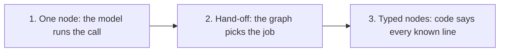

# The three levels, and the add-ons

Every level uses the same core, the same typed state and the same consent rules. A `core.Write` is always read
back and runs only on a heard yes, at every level. What changes is how much of the call the manifest shapes, and
so how much the model has to get right on its own.



1. **One node.** One prompt, one agent. The model decides what to ask and when.
2. **Hand-off.** A front node routes. Each specialist node does its job its own way.
3. **Typed nodes.** One job per node. Code opens each node, offers the choices, reads changes back, and brings the
   caller back from prerequisites. The model reads the caller and picks one typed decision.

Accuracy rises from left to right, because each request carries less and code says more. Cost and latency fall too:
code's lines need no model request. All the manifests below are version 2. Write new use cases in version 2 only.

## How to choose

Ask these in order. Stop at the first yes.

1. Does a call change business data (book, order, cancel, pay, record)? **Level 3.**
2. Must facts be collected in a set order, or picked from what the backend offers? **Level 3.**
3. Are there two or more separate jobs, and picking the wrong one is the main risk? **Level 2.**
4. Otherwise (questions, advice, a companion, a single simple action): **Level 1.**

If the user wants level 1 or 2 for a call that changes data, build it, and say in one line that level 3 is where
this repo measures its accuracy. A level 1 node grows into level 3 by splitting it, one job at a time.

## Level 1: one node

One conversation node. It may still have fields, choices and operations. Everything a structured node gets still
applies: typed updates, read-backs, receipts said by code.

```yaml
version: 2
id: shop-desk
state: state.py:ShopState
identity: customer_phone
entry: desk
greeting: "Hi, you've reached the shop. How can I help?"
current_datetime: {timezone: Europe/Madrid, calendar_days: 14}
context: {facts: none, history: {scope: node, turns: 8}}
model: google-cloud:gemini-3.5-flash-lite

agents:
  sam: {prompt: prompts/_voice.md}

operations:
  place_order: operations.py:PlaceOrder

steps:
  desk:
    agent: sam
    prompt: prompts/desk.md
    fields: [item]
    context: {facts: [item, order]}
    operations: [place_order]
    capabilities: [capabilities.py:returns_policy]
```

Good for: an FAQ line, a companion, a single action with one or two facts. Keep reference text out of the prompt
with a deferred capability (see add-ons), so the prompt stays small.

Watch for: the node's prompt growing a section per job. That is the sign to move to level 3.

## Level 2: hand-off

A front node works out the job and hands over. Each specialist has its own prompt, fields and operations. A
consultation answers a side question and returns the caller.

```yaml
steps:
  front:
    agent: sam
    prompt: prompts/front.md
    exits:
      - {to: ordering, purpose: 'a new order'}
      - {to: returns, purpose: 'returning an item they bought'}
    consults:
      - {to: expert, purpose: 'a question about a product: size, material, care'}

  ordering:
    agent: sam
    prompt: prompts/ordering.md
    fields: [item]
    context: {facts: [item, order]}
    operations: [place_order]
    exits:
      - {to: returns, purpose: 'a return instead of an order'}
      - {to: front, purpose: 'anything else'}

  returns:
    agent: sam
    prompt: prompts/returns.md
    fields: [order_id, reason]
    context: {facts: [order_id, reason]}
    operations: [start_return]
    exits:
      - {to: front, purpose: 'anything else'}

  expert:
    agent: sam
    prompt: prompts/expert.md
    context: {facts: [item]}
```

1. `exits` are the only moves the model may make. Each `purpose` is shown to the model. Write it as the caller's
   intent, not as a condition.
2. A hand-over can carry an `update`, so the next node starts with the facts the caller already gave.
3. A consulted node (`expert`) answers with `done(answer)`. The caller goes back to the node that asked, and a
   read-back that was waiting is asked again.
4. Give every specialist an exit back to `front`, or the caller can get stuck.

## Level 3: typed nodes (recommended)

The salon ([`use-cases/salone-concierge-graph-new/salon/agent.yaml`](../../../../use-cases/salone-concierge-graph-new/salon/agent.yaml))
is the full example. The rules:

1. **One job, one operation.** Split by what the caller wants. Booking, moving and cancelling are three nodes.
2. **Code opens the node.** `offers: [slot]` makes the choice function's `say` the node's first line, on arrival
   and after each `record`. When there is only one option, the function returns `pick`, and code records it and
   reads the operation back with no model request.
3. **Declare prerequisites.** `requires: [customer]` with `satisfied_by: verify`. The graph sends the caller to
   `verify` and back. Only a trusted receipt should set a prerequisite fact.
4. **A change of mind is an exit.** "Move the one I just made" is an exit from `booking` to `moving`.
5. **Show each node only its job.** `context.facts` lists the fields it sees. A field it may change must be one it
   sees, or the load fails.
6. **Let code read back.** `reads_back: {book: [slot]}` reads the operation back as soon as the model records
   `slot`, with no second request.

A level 3 node, trimmed from the salon:

```yaml
  verify:
    agent: robin
    prompt: prompts/verify.md
    fields: [customer_phone]
    context: {facts: [customer_phone, customer]}
    operations: [lookup_customer]
    opens_with: lookup_customer                      # caller ID known: read it back on arrival
    reads_back: {lookup_customer: [customer_phone]}
    asks: {customer_phone: 'Which phone number should I use?'}
    exits:
      - {to: concierge, purpose: 'the caller will not confirm a number, or asks about something else'}

  booking:
    agent: robin
    prompt: prompts/booking.md
    requires: [customer]
    satisfied_by: verify
    fields: [service, booking_day, booking_time, slot]
    context: {facts: [service, booking_day, booking_time, slot]}
    choices:
      slot: {function: offers.py:find_times, after: [service, booking_day, booking_time]}
    offers: [slot]
    operations: [book_appointment]
    reads_back: {book_appointment: [slot]}
    exits:
      - {to: moving, purpose: 'moving a booking they hold, the one just made included'}
      - {to: concierge, purpose: 'they give up booking, or ask about something unrelated'}
```

`after:` says what an offer rests on. When one of those fields changes, the offer and the pick are reset. A plain
reference (`slot: offers.py:find_times`) rests on every other field. `after: []` rests on none.

## Add-ons

Each one combines with any level. Suggest one only when the interview calls for it.

| Add-on | Use it when | How |
|---|---|---|
| Consultation | a side question needs a specialist, then the caller goes back | `consults: [{to: expert, purpose: ...}]`; the specialist ends with `done` |
| Deferred knowledge | reference text most calls never need (a policy, a price list) | a Pydantic AI `Capability(..., defer_loading=True)` in `capabilities.py`, listed under `capabilities:` |
| Shared prompt text | the same text in several prompts | `includes: {hours: prompts/_hours.md}` and `<!--hours-->` in the prompt |
| Code node | one known operation with no model, such as marking help as used | `name: {kind: action, operation: note_help, then: coach, on_error: coach, on_unknown: coach}`; `returns: true` goes back to the node that asked |
| Carried out by code | an approval-free lookup or save that runs as soon as a field is recorded | `carries_out: {find_ticket: [ticket_id]}`; the model never calls it, so leave it out of `operations:` |
| Receipt route | the backend decides where the caller goes next | a receipt field `next: Literal['menu', 'lesson']` and `route = 'next'` on the operation class |
| A restated value confirms | the caller saying the same value again means yes (a phone number) | `restated_confirms = True` on a `core.Lookup` that is read back |
| Caller's own words | a field must quote the caller (a complaint) | type it `core.Quoted` |
| Languages per call | callers speak English or Spanish | `language: <state field>` and `locales: {EN: {base: english}, ES: {base: spanish}}`. This switches core's fixed lines only, not prompts, STT or TTS |

## The contract: version 2 only

Every use case this skill builds follows the version 2 contract, the one the salon
([`use-cases/salone-concierge-graph-new`](../../../../use-cases/salone-concierge-graph-new/)) runs:

1. `version: 2`, with steps keyed by id.
2. Every conversation node is `speech: structured`, the default. Leave `speech:` out. Do not use `prose` or
   `rendered`.
3. Every operation is one line, `name: operations.py:Class`, a `core.Lookup` or `core.Write`. Do not use the
   older `function:` form with `args:`, `readback:` and `succeeds:` keys.
4. The model changes state only through a decision's `update`. There is no `collect` tool.

Other manifests in the repo still use older forms: `salon-graph`, the version 1 fixtures under `core/tests/`, and
parts of Faro (its operations use the `function:` form, and some of its steps are `prose` or `rendered`). Do not
copy from them. `scripts/check_flow.py` refuses a manifest that breaks any rule above.
