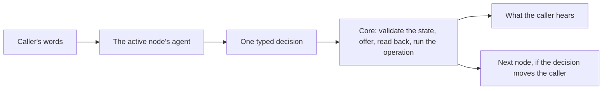
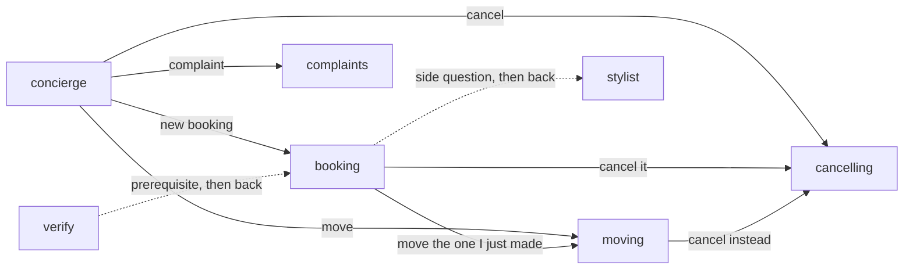

# SLNG Voice Harness

A runtime for voice agents that keeps the conversation correct. Pipecat still does the audio: transport, turn
taking, speech-to-text (STT) and text-to-speech (TTS). The harness sits where Pipecat's LLM service would, and runs
the conversation between what the caller said and what the bot says back.

The package is [`slng-voice-core`](core/pyproject.toml), imported as `core`. An application brings a typed state
model, a manifest (`agent.yaml`), prompts and typed Python functions. Core has no booking or verification logic of
its own.

The reference application is the salon in [`use-cases/salone-concierge-graph-new`](use-cases/salone-concierge-graph-new/).
Everything below uses it as the example.

## The approach



1. The call is always in one **node**. Each node does one job, such as booking, moving or cancelling.
2. The node's agent reads what the caller said. It answers with **one typed decision**: a reply, an update to the
   facts, an operation, a hand-over to another node, or a goodbye. The update rides on the decision itself.
3. **Code checks the decision.** The new facts are validated as a whole state. A pick must be one that was offered.
   A hand-over must be to a node the manifest allows.
4. **Code says every line it already knows.** That covers the times on offer, the question for a missing fact, the
   read-back of a change, the confirmation, and the goodbye. The model only writes free replies.
5. **Nothing changes without consent.** An operation is read back first. It runs only on a yes to that exact
   read-back, and only after the caller heard the read-back in full (playback evidence from Twilio or the browser).

The goal is one model request per caller turn. On the six salon text paths, every turn is one request, switches
between nodes included.

## Why nodes, and how to design them

A node is one job the caller wants done. It is not a sentence or a tool. Split by the job, and keep each node
small. This is the house style for every use case.



The salon used to have one booking node that also moved and cancelled. It is now three nodes:

| Node | Its one job | Its first line on arrival (said by code) |
|---|---|---|
| `booking` | make a new booking | "On Friday I have 9:00, 9:30 or 10:00. Which time works for you?", or "Which day would you like?" |
| `moving` | move a booking the caller holds | "You have a haircut Friday at 9:00. Which day would you like to move it to?" |
| `cancelling` | cancel a booking the caller holds | "Shall I cancel your haircut Friday at 9:00?" (the read-back is the only question) |

The rules:

1. **One job, one operation.** `booking` books, `moving` moves, `cancelling` cancels. A node's prompt and tools
   cover only that job.
2. **Code opens the node.** `offers:` names the choice whose function writes the node's first line. It also runs
   after the model records a new day or time. When the caller has only one booking, the function picks it, and
   the cancel is read back at once.
3. **Prerequisites are declared.** `requires: [customer]` with `satisfied_by: verify` makes the graph put the caller
   through verification first, then come back.
4. **Changes of mind are exits.** "Actually, move the one I just made" is `booking` → `moving`, with a purpose the
   model reads. A hand-over can carry the new day, so the next node offers times at once.
5. **Side questions are consultations.** `consults: stylist` answers a hair question, then returns the caller to
   the same node.

Why this works:

- **Small prompts and schemas.** Each request carries only one job's instructions, facts and outputs. That suits a
  small, fast model (`gemini-3.5-flash-lite` here).
- **Fewer requests.** Code already knows each node's first line, so no model request is spent on it.
- **Mistakes stay contained.** A wrong reading in `moving` cannot book, and one in `cancelling` cannot move.

## How `agent.yaml` is defined

Manifest version 2 keys the steps by id. A step is a conversation node with `speech: structured` unless it says
otherwise. This is the real `booking` step, trimmed:

```yaml
version: 2
state: state.py:SalonState
identity: customer_phone
entry: concierge
current_datetime: {timezone: Europe/Madrid, calendar_days: 14}
context: {facts: none, history: {scope: node, turns: 8}}

operations:
  book_appointment: operations.py:BookAppointment

steps:
  booking:
    prompt: prompts/booking.md
    requires: [customer]
    satisfied_by: verify
    fields: [service, booking_day, booking_time, slot]
    context: {facts: [service, booking_day, booking_time, slot]}
    choices:
      slot: {function: offers.py:find_times, after: [booking_id, service, booking_day, booking_time]}
    offers: [slot]
    operations: [book_appointment]
    reads_back: {book_appointment: [slot]}
    exits:
      - {to: moving, purpose: 'moving a booking they hold, the one just made included'}
      - {to: cancelling, purpose: 'cancelling a booking they hold, the one just made included'}
    consults:
      - {to: stylist, purpose: 'a question about hair'}
```

| Key | What it means |
|---|---|
| `fields` | The state fields this node may change. Their types come from `state.py`. |
| `context.facts` | The state fields this node's model sees. A field it may change must be one it sees. |
| `choices` | A field picked from an offer. Its function returns the ids and the words. `after:` names the fields the offer rests on. When one of them changes, the offer and the pick are reset. |
| `offers` | The choices whose function writes what the node says on arrival, and again after a `record`. |
| `operations` | What this node may carry out. Each is read back, then run on a yes. |
| `reads_back` | Recording this field makes code read the operation back with no second request. |
| `requires` / `satisfied_by` | A fact that must exist first, and the node that gets it. |
| `exits` / `consults` | Where the node may hand the caller, and which specialist it may ask. |

The loader checks every name, file, field, operation and exit when the application starts, never mid-call.

Each file has one job:

| File | Holds |
|---|---|
| `state.py` | `SalonState`, one plain Pydantic model with every fact the call keeps |
| `operations.py` | the typed operations (`core.Lookup` and `core.Write` classes): arguments, run, read-back, recovery, receipt words |
| `offers.py` | the choice functions: which times or bookings are on offer, and their words |
| `prompts/*.md` | one prompt per node, plus the shared voice and diary rules |
| `agent.yaml` | the nodes, what each may see and change, and how they connect |

## State, memory, records and services

Four kinds of data live in a call. They are kept apart on purpose.

| | What it holds | Who writes it | What the model sees | Lifetime |
|---|---|---|---|---|
| **Application state** | the facts: phone, customer, service, day, time, slot, booking id | the model's update and operation receipts, validated as one whole state | only each node's `context.facts` | the call |
| **Conversation memory** | what was said and heard, turn by turn | the turn engine | each node's own recent turns (`history: {scope: node, turns: 8}`) | the call |
| **Runtime records** | the pending read-back, offers, intents, receipts, the speech and playback ledger | core only | a short status line when relevant | the call; intents and receipts also go to the backend |
| **Services** | the backend (the salon's diary), its clients and keys | the application | never | the process |

1. **State is replaced whole.** Every change builds a complete new state and validates it, or changes nothing. A
   change also resets what rested on the old value. A new day drops the times offered for the old day.
2. **Memory is scoped.** A node sees its own turns, plus the caller's words that brought it there. It does not see
   another node's tool calls.
3. **Records are core's.** A model cannot write "approved" or "booked". Only a heard yes and a validated receipt do.
4. **Services stay out of prompts.** A prompt cannot name them, and the loader refuses one that tries.

## Live results

Measured on Coval over the real Twilio line, on the v2 salon. The verdict comes from the salon's diary at the end of
each call, the traces, and [`load_report`](use-cases/concierge-tools/load_report.py). Coval's LLM judges are
reported but not used as the verdict: on these runs they gave several NO answers that contradicted the transcript
or their own explanation.

| Run | Callers | Calls | Result | Requests per turn | Input tokens per call | Turn latency p50 |
|---|---|---:|---|---:|---:|---:|
| [Routine bookings](https://app.coval.dev/slng-ltd-1787040174713992753/workspace/01M09YA4S1SC1Q8AHKHP2R9A0E/simulated/runs/75m8jevu6ywGEkwSaUQave) | normal | 5, 5 at once | 5 of 5 pass every `load_report` check | 0.86 | 17.0k | 1.86 s |
| [Graph paths](https://app.coval.dev/slng-ltd-1787040174713992753/workspace/01M09YA4S1SC1Q8AHKHP2R9A0E/simulated/runs/fMHCmkqa9pBfykQjBMmcEv) | normal | 8, 8 at once | 7 of 8 right in the diary | 0.94 | 21.2k | 2.69 s |
| [Graph paths](https://app.coval.dev/slng-ltd-1787040174713992753/workspace/01M09YA4S1SC1Q8AHKHP2R9A0E/simulated/runs/iWbBgavGcmL7YiVZbZzgwJ) | interruptive | 8, 8 at once | 8 of 8 right in the diary | 1.06 | 31.5k | 2.50 s |

The graph-paths set has eight cases:

1. book;
2. book with no day given;
3. move a held booking;
4. book, then move it to the next day;
5. cancel a held booking;
6. book, move, then cancel;
7. hold two bookings and cancel one;
8. ask to move with nothing held, then book instead.

In every call, each change was read back and confirmed before it happened, and nothing was booked twice. The one
miss was a date: on a Wednesday, "Thursday" became the Thursday of next week. It was read back, and the caller
accepted it.

## Try it

The workspace uses Python 3.14+ and uv. Put the provider keys in the root `.env`, then:

```bash
uv sync --all-packages
cd use-cases/salone-concierge-graph-new
uv run bot.py              # voice in the browser, http://localhost:7860
uv run python -m tests     # the offline suite, no model requests
```

## Read more

- The [architecture guide](docs/architecture/README.md) follows one salon call through nodes, state, operations and
  recovery, with the code behind each step.
- [CLAUDE.md](CLAUDE.md) has the workspace layout, every module's job and the development commands.
- Faro, a language-learning companion, runs on the same core ([`use-cases/faro-language-learning`](use-cases/faro-language-learning/)).
