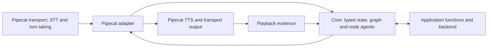

# SLNG Voice Harness

**A reusable conversation runtime for voice applications.** An application defines its own typed state, conversational nodes, prompts and backend functions. The harness runs that definition and manages the conversation across turns, corrections, interruptions and tool calls.

The package is [`slng-voice-core`](core/pyproject.toml), imported as `core`. This README describes the node-agent architecture now merged into `main`. Qualification and migration of the remaining examples are still in progress.

For a step-by-step explanation, start with the [architecture guide](docs/architecture/README.md). Its five chapters move from the voice stack to turns, typed state, graph routing and operation recovery.

## One runtime, different applications

Core has no built-in booking, customer verification, support-ticket or teaching node. Those are application definitions. A node called `booking` in an example has no special meaning to the runtime: it is an application-owned instance of the same `conversation` step another application uses for troubleshooting or onboarding.

| The application supplies | The harness provides |
|---|---|
| A plain Pydantic model for its facts | Validated state updates and separate state for each call |
| Node names, prompts, available tools and allowed destinations | Agent execution and a graph that enforces declared routes |
| Typed functions for its backend | Argument and result validation, operation tracking and recovery hooks |
| Choices and the fields those choices depend on | Invalidation and refresh when the underlying facts change |
| Approval requirements and the exact words for a read-back or result | A pending proposal tied to its arguments, reply and playback evidence |
| Services, persistence and deployment configuration | Per-call history, turn budgets, cancellation handling and lifecycle hooks |

Adding a use case means supplying these definitions, rather than copying the turn engine or adding domain branches to core. Business rules, such as interpreting a date, checking capacity or deciding which actions require approval, remain in the application.

Reuse is exercised through the same public API by the [clinic flows](core/tests/clinic_flow/) and the [support-desk flow](core/tests/ticket_flow/). The [support-desk checks](core/tests/test_tickets.py) include changing every domain field and operation name without changing core. The [salon application](use-cases/salon-graph/) is a more demanding integration example, not the package's data model.

## Where it fits in the voice stack

The implemented adapter replaces the LLM service position in a **Pipecat** pipeline. Pipecat still owns transport, VAD, endpointing, STT, TTS and audio output. The harness owns the conversation between recognized input and the words sent to speech synthesis.



This preserves the media framework's components while making conversation rules reusable and testable independently of audio. The [turn engine](core/src/core/turn.py) also has a text entry point. Importing the [public package](core/src/core/__init__.py) does not import Pipecat or Langfuse, load environment files or create provider clients.

**LiveKit integration is planned, not implemented.** The intended boundary is the same: an adapter between LiveKit's native media/session components and the conversation engine. Its interruption and playback behavior still needs its own implementation and verification.

## Typed state, typed flow

Three libraries have distinct roles in the implementation:

| Library | Role |
|---|---|
| **Pydantic** | Validates application state, operation arguments, results and configuration. |
| **Pydantic AI** | Runs each conversational node's agent, tools and model requests. Agent definitions use its native `AgentSpec`. |
| **Pydantic Graph** | Executes the declared nodes and routes. The graph is built from the application definition, rather than maintained separately. |

An application brings an `agent.yaml` manifest, its state model, prompt files and typed Python functions. `core.load(...)` reads the definition; `compile(...)` checks its references and builds a reusable flow; `flow.open(...)` creates an independent call with its own state and services. See the [manifest compiler](core/src/core/flowspec.py) and [graph implementation](core/src/core/flow.py).

A `conversation` node has its own prompt, writable fields, choices, operations and exits. Its agent interprets the caller's words and selects an action or a permitted destination. No classifier runs before it, in any application. A node can stay active for several turns, and a turn can involve several model requests or nodes.

An `action` node runs deterministic code and follows a declared result path without a model request. Prerequisites can route through another node and return to the unfinished request. An operation's receipt can name the node the caller goes to next (`route:`), from the application's own records, and an operation with no read-back can be carried out by code straight after the agent records its input (`carries_out:`). The application decides the shape of its graph: a small single-agent flow and a structured multi-node flow use the same runtime.

State is shared across nodes **within a call**, not across callers. Updates validate a complete candidate state before committing it. Application validators can use the call's clock and previous state. Declared dependencies invalidate choices and derived facts when their inputs change; moving to another node preserves the call's state and conversation history.

These types make contracts executable. They do not guarantee that a model interpreted a caller correctly.

## Reusable reliability mechanisms

For an operation requiring approval, the application supplies the read-back. Core tracks the exact proposal and checks whether its speech had playback evidence before accepting a subsequent confirmation. The node agent interprets the reply; code enforces the operation's declared requirements.

An operation has a tracked intent. If execution is interrupted after dispatch and the outcome is uncertain, it stays unknown until reconciliation establishes what happened. Applications provide reconciliation and backend idempotency where required. A typed receipt establishes the result; generated prose alone does not.

Nodes can use `speech: rendered` when the application needs code to produce every spoken line. In ordinary prose nodes, the model supplies conversational language, with weaker guarantees about its wording. These are generic choices available to any application.

For voice delivery, the Pipecat adapter supports Twilio marks and a browser integration built on the official Pipecat client SDK plus a small playback-reporting module. Browser reports require continuous playback of the segment, rather than merely sending its audio. They cannot prove that a person heard a physical speaker. The browser implementation has offline Chrome coverage; support across other browsers is not yet qualified.

The corresponding mechanisms live in [steps](core/src/core/steps.py), [operations](core/src/core/operations.py), [state](core/src/core/state.py), [history](core/src/core/history.py) and the [Pipecat adapter](core/src/core/processor.py).

## Reuse and deployment are separate questions

A compiled flow is shared while each call gets its own state, history, pending proposals and budgets. Application services may be shared deliberately. Their databases must enforce ownership, concurrency and idempotency; isolated conversation state does not make a shared backend safe by itself.

The harness does not supply a universal database, distributed scheduler or automatic durable graph execution. Applications choose those deployment components. The current concurrency evidence comes from a bounded MacBook setup and does not establish production server capacity.

The latency goal is small measured runtime overhead, while avoiding unnecessary model requests for work code already knows how to perform. Typed flows can narrow prompts and tool sets, but do not automatically lower token usage. Speed, token cost and accuracy need comparable measurements on the chosen model, transport and workload.

Current qualification remains open: the N12 absolute overhead ceiling passes, its relative rule still fails, and native latency parity is not established. The [latest implementation report](docs/research/reusable-core/session-4g.md) separates offline proofs from remaining live checks. These limits concern the evidence available today, not application-specific requirements imposed by core.

## Try an existing integration

The workspace uses Python 3.14+ and uv. From the repository root:

```bash
uv sync --all-packages
cd use-cases/salon-graph
uv run bot.py
```

Configure the application's provider credentials in the root `.env` before starting. Open `http://localhost:7860`, which serves the SDK-based client at `/voice/`. The stock `/client/` page does not provide the playback evidence required by this integration.

For an offline core check, from the repository root:

```bash
uv run --directory core python -m tests
```

The suite disables model requests. It verifies runtime behavior with scripted models; live evaluations are needed to assess language understanding and audio behavior.

Faro, a bilingual language-learning companion, uses the same public path since session 5: nine nodes, its grading and placement in its own typed functions, and its fixed lines in the learner's language. Its new build has offline evidence only; see the [cleanup report](docs/research/reusable-core/core-cleanup.md). See [CLAUDE.md](CLAUDE.md) for the workspace layout and development commands.
