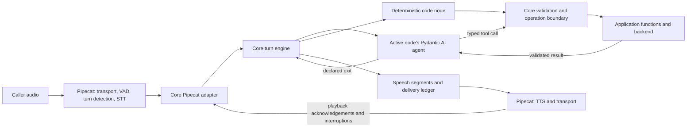

# SLNG Voice Harness

A reusable Python conversation engine for voice agents. An application supplies
its state, prompts, typed functions and allowed routes. Core runs the conversation;
Pipecat handles the audio pipeline, with speech recognition and synthesis through SLNG.

**The architecture we are implementing is one agent per conversational node,
with deterministic code nodes where no language interpretation is needed.**
The active agent understands the caller, uses its tools and chooses among declared
exits. Core checks state updates, routes, approvals, receipts and delivery evidence.

## Implementation status

This README describes the migration architecture, checked against
[PR #22 at `8b127b2`](https://github.com/slng-ai/slng-voice-harness/tree/8b127b2ebb444260d199903e3c91df1fa878eeb6)
on 27 September 2026. At that checkpoint, **PRs #17–#22 are open** and `main`
contains the earlier classifier-based implementation. Updating this document
does not install the new runtime on `main`.

| Area | Status at the documented checkpoint |
|---|---|
| Public package boundary and application authoring | Implemented in PRs [#17](https://github.com/slng-ai/slng-voice-harness/pull/17) and [#18](https://github.com/slng-ai/slng-voice-harness/pull/18). |
| Agent-per-node architecture and salon migration | Implemented in [#19](https://github.com/slng-ai/slng-voice-harness/pull/19). No classifier pre-pass on the public manifest path. |
| Evidence-based evaluator | Implemented in [#20](https://github.com/slng-ai/slng-voice-harness/pull/20). Missing evidence remains unknown. |
| Write recovery, receipt-backed speech and Twilio marks | Implemented in [#21](https://github.com/slng-ai/slng-voice-harness/pull/21), with further repairs in #22 and remaining edge cases under correction. |
| Shared backend and bounded call runner | Implemented in [#22](https://github.com/slng-ai/slng-voice-harness/pull/22); tested at up to five simultaneous calls on one MacBook. Qualification remains open. |
| Correctness and performance hardening | In progress: consent, reconciliation cancellation, move recovery, choice invalidation, fillers, memory and cleanup. |
| Frozen final qualification | Pending the repairs and their verification. Native latency parity is not yet established. |
| Faro and remaining adoption work | Faro still uses the legacy path. Its migration is Session 5; final package integration and adoption are Session 6. |

**Examples labelled “migration branch” require that implementation**, such as
`feat/session-4c-mac` or a descendant. Source links for new APIs are pinned to
the reviewed commit so they work while this README is on `main`.
For the code currently merged into `main`, use the
[earlier architecture guide](https://github.com/slng-ai/slng-voice-harness/blob/176ff9fbab96e8cf795d9b40768d09051c37b8a4/README.md).

## Architecture



An agent node has one composed instruction context: shared persona, node prompt,
application knowledge and the current call facts. It can make several model/tool
requests during a turn. “One agent per node” does not mean one model request per
caller turn, or a separate provider connection per node.

There is **no classifier, solver or supervisor before the active node's agent**
on this public path. The legacy classifier modules remain for Faro until it is
migrated; new applications should use the manifest contract below.

### Library responsibilities

| Component | Responsibility in this repository |
|---|---|
| [Pydantic](https://pydantic.dev/docs/validation/latest/concepts/models/) | Application state, tool arguments, manifest schemas and backend receipt validation. |
| [Pydantic AI](https://pydantic.dev/docs/ai/core-concepts/dependencies/) | Native agent execution, `RunContext`, typed tools, streaming, messages and the model/tool loop. Personas use the SDK's `AgentSpec`. |
| [Pydantic Graph](https://pydantic.dev/docs/ai/graph/graph/) | Execute and inspect the graph of declared routes. The YAML manifest is our package's format. |
| Core (`slng-voice-core`, imported as `core`) | Assemble nodes; maintain per-call state, history, proposals, operations, delivery evidence and bounded turn execution. |
| [Pipecat](https://docs.pipecat.ai/pipecat/learn/pipeline) | Transport, audio frames, VAD, endpointing, interruptions, STT and TTS integration. |
| SLNG | Speech-provider access used by the application pipelines. |
| [Langfuse](https://langfuse.com/docs/observability/overview) | Traces of model requests, tool results, timings and runtime audit events. |
| Coval | External voice callers, recordings and normal/interruptive evaluation scenarios. |

Core uses the installed SDKs' native facilities. There is no separate LangChain
conversation engine. Offline checks use Pydantic AI model doubles; live text
checks run through the same core entry point as voice, without claiming to test audio.

### What a node owns

A conversational node declares its prompt, collectible fields, available choices,
operations, prerequisites and exits. The agent can stay in that node for several
turns. A tool result returns to that agent's ongoing run unless a declared action
or handoff ends it. A code node runs a known operation and follows declared
success, error or unknown-outcome branches without asking a model to choose.

For example, the booking node remains responsible while it asks for available
times, gets them back and discusses them with the caller. If identity verification
is required, core remembers the destination, visits verification and resumes the
pending work. A changed request still needs to be interpreted and validated.

| Definition | Use |
|---|---|
| `kind: conversation` | An agent node with declared fields, choices, operations and exits. |
| `kind: action` | A deterministic operation. `returns: true` returns to the node that handed work to it. |
| `kind: collect`, `confirm`, `end` | Structured collection, explicit confirmation and completion for controlled flows. |
| Legacy `kind: agent` | Hand-built Python nodes; retained for existing applications such as Faro. |

### Shared state without shared callers

Each call gets a fresh `FlowCall` wrapping the application's plain Pydantic state
model. Nodes in that call share its facts, history, pending proposal, offered
choices, receipt evidence and speech ledger. The engine supplies current context
before each model request. The compiled agent definitions can be reused across calls.

Applications do not need to subclass core's session or implement their own
conversation loop. They decide whether service clients are shared or created per
call. Business resources may be shared across callers; those resources need
backend transactions, ownership checks and concurrency control. Per-call state
alone cannot prevent two callers from taking the same resource.

## Authoring an application

On the migration branch, the ordinary application consists of:

```text
my-agent/
  agent.yaml       nodes, fields, operations, prerequisites and exits
  models.py        plain Pydantic state, arguments and receipts
  functions.py     typed functions, read-back wording and backend access
  prompts/         shared persona, node prompts and application knowledge
  bot.py           voice pipeline and application setup
```

`core.load(...)` validates the manifest and references. `compile(...)` constructs
the agents and graph. `flow.open(...)` creates one call. The public boundary is
documented in the implementation's
[core exports](https://github.com/slng-ai/slng-voice-harness/blob/8b127b2ebb444260d199903e3c91df1fa878eeb6/core/src/core/__init__.py).
Importing `core` loads no environment file, provider client, Pipecat or Langfuse.
Voice and tracing are separate package extras; the application supplies its model
provider dependency and credentials.

### An agent handing work to a code node

This excerpt comes from the complete
[clinic code-node example](https://github.com/slng-ai/slng-voice-harness/blob/8b127b2ebb444260d199903e3c91df1fa878eeb6/core/tests/clinic_flow/code_node.yaml).
The manifest also declares its state, persona and lookup operation.

```yaml
steps:
  - id: front
    kind: conversation
    agent: receptionist
    prompt: prompts/lookup.md
    fields: [patient]
    exits:
      - {to: look_up, purpose: find the caller's booking once their patient number is recorded}
  - {id: look_up, kind: action, operation: look_up, returns: true, on_error: front, on_unknown: front}
  - {id: done, kind: end, outcome: completed, say: Goodbye.}
```

The front agent interprets the request and chooses the declared exit. The lookup
node calls a typed Python function, checks its receipt and returns. The result and
shared state are available when the front agent continues.

### Typed operations and backend responsibilities

An operation points to a plain function taking services and a Pydantic argument
model, returning a Pydantic receipt. A write can additionally accept core's `Intent`
so the backend can deduplicate and reconcile it by a stable identifier.
The function signature supplies the types; YAML binds them to application state.

| Manifest field | Meaning |
|---|---|
| `function`, `args` | Implementation and argument-to-state bindings. |
| `readback`, `approval` | Exact proposal wording and whether approval is required. |
| `matches` | Receipt fields that must match the operation's arguments. |
| `succeeds`, `rejects` | Explicit success and terminal refusal conditions. An unsettled write stays unknown. |
| `assign` | State fields populated from a successful receipt. |
| `say`, `recap` | Application wording rendered from receipt evidence. |
| `subject`, `resource`, `version` | Identity and revision of the changed resource. |
| `reconcile`, `idempotent` | How to find an earlier outcome and whether the backend deduplicates by intent ID. |
| `changes: false` | A read; its receipt cannot establish that a resource was changed. |

Declaring `idempotent: true` does not make a backend idempotent. The backend must
persist the intent and atomically record the effect with its result. A lost reply
must be reconciled before another attempt; “no result found” alone does not prove
the old request cannot still commit. The salon's backend uses durable void records
to fence such attempts. Other applications must provide equivalent guarantees
appropriate to their service.

The [support-desk example](https://github.com/slng-ai/slng-voice-harness/tree/8b127b2ebb444260d199903e3c91df1fa878eeb6/core/tests/ticket_flow)
uses accounts, tickets, revisions and Spanish receipt wording. It exercises the
same runtime without phone numbers, appointments or salon imports. The
[clinic examples](https://github.com/slng-ai/slng-voice-harness/tree/8b127b2ebb444260d199903e3c91df1fa878eeb6/core/tests/clinic_flow)
show controlled flow, one conversational agent, handoff and code-node patterns
using the same domain functions.

### Try the public API without a model request

**Migration branch only.** Run from the repository root after `uv sync --all-packages`.
This scripted model asks a question; it makes no provider request or backend write.

```bash
uv run --directory core python - <<'PY'
import asyncio

from pydantic_ai import models
from pydantic_ai.models.function import FunctionModel

import core

models.ALLOW_MODEL_REQUESTS = False

async def answer(messages, info):
    yield 'What is your patient number?'

async def main():
    spec = core.load('tests/clinic_flow/code_node.yaml')
    flow = spec.compile(model=FunctionModel(stream_function=answer))
    call = flow.open(flow.state_type())
    reply = await core.text_turn(flow, call, 'Can you look up my appointment?')
    for segment in reply.segments:
        print(segment.text)
        call.acknowledge(segment.id)

asyncio.run(main())
PY
```

Here the text driver explicitly treats printed segments as delivered. A voice
adapter must use actual playback evidence; successful text generation is not
evidence that a caller heard the words.

## Approval, effects and speech

The intended operation boundary separates four facts: what the caller requested,
what they approved, what the backend did and what they heard. A valid tool call
does not by itself establish all four.

1. Collect and validate the proposed values. Selecting an option is not approval
   to carry out a consequential action.
2. Render the exact read-back from application code and track its delivery.
3. The active agent interprets the subsequent reply. Core checks its relationship
   to the same delivered proposal, identity and arguments before dispatch.
4. Persist and execute the intent, validate and bind the receipt, then record its
   outcome. Cancellation after dispatch can mean an unknown outcome.
5. Say the result using application wording backed by the receipt. Interruption
   of that speech does not undo the backend effect.

The model's interpretation remains fallible. **These are invariants being
hardened, not a claim that all reviewed edge cases already satisfy them.** In
particular, the reviewed revision can treat an unchanged collected value as
consent too broadly. The current repair must preserve any explicitly allowed
identity-restatement policy without turning repetition into approval for a write.

`speech: rendered` gives application code control of all spoken wording in a
node; it is exercised by the ticket example and has restrictions, including no
model-worded choices at this checkpoint. The salon also uses guarded free prose:
its application-defined claim patterns are a best-effort check, not a proof that
every possible unsupported claim is blocked.

### Delivery and interruption

The Pipecat adapter translates frames into core events. Core tracks speech by
segment and retains accepted caller input and completed tool results when a turn
is interrupted. Twilio marks associate playback acknowledgement with the segment
that was sent; cleared or interrupted audio must not be mistaken for a fully
delivered proposal. A receipt can be valid while its spoken confirmation is still
undelivered.

For browser development, `DELIVERY=simulated` uses estimated playback. That mode
cannot prove audible delivery, interruption timing or real telephone latency.
Text checks also cannot establish endpointing quality. Those require the real
voice route and recordings, alongside the runtime evidence.

## Reuse, concurrency and performance

**Core must contain conversation mechanics, not booking rules.** Phone parsing,
relative-date interpretation, appointment capacity, ticket revisions and business
claim wording belong to the application. Core validates the declared contracts
without importing a use case. Use cases must not import one another.

The migration's salon runner uses two workers and a shared SQLite diary. Database
constraints protect capacity; moves update the existing appointment atomically;
intent IDs and resource revisions support recovery and reject stale writes. The
runner admits at most five calls in the current MacBook test setup. This runner
and diary are application/deployment code, not a requirement for every core user.

The performance target is native Pipecat parity under a comparable protocol,
with small measured core overhead. Known transitions and code nodes should not
spend a model request. Holding phrases should cover genuinely slow work; the
reviewed runtime still emits some on fast second requests, which is under repair.
Measure time to **first useful audio** separately from time to any audio so a
filler cannot make a slow answer look fast.

The reviewed Stage C evidence includes 20 benchmark calls at five-way concurrency
and five additional phone-restatement checks. Final bookings were correct in
those samples. They do not establish general consent correctness, move reliability,
native speed parity or production capacity. The frozen N12 relative-overhead
check failed, sustained memory growth remained open, and a worker kill during
real phone calls had not been tested. See the
[Stage C report and evidence](https://github.com/slng-ai/slng-voice-harness/blob/8b127b2ebb444260d199903e3c91df1fa878eeb6/docs/research/reusable-core/session-4c.md).

Next comes narrow correctness repair, then latency and lifecycle repair, then
frozen qualification. The current scope is **up to five simultaneous calls on
this MacBook**. Fifty-call capacity and production hosting are not established.

## Running the repository

This is a `uv` workspace with one root lockfile and environment. Python 3.14 is
pinned; [uv](https://docs.astral.sh/uv/) can install the required interpreter.

```bash
uv sync --all-packages
```

Create a root `.env` using [.env.example](.env.example). Keep credentials out of
source control. The supplied salon needs `GOOGLE_API_KEY` for its configured
Vertex AI model and `SLNG_API_KEY` for speech. Langfuse uses
`LANGFUSE_PUBLIC_KEY`, `LANGFUSE_SECRET_KEY` and `LANGFUSE_BASE_URL` when enabled.
Provider keys belong to the application; the core import and offline examples
do not need them.

On the currently merged, legacy implementation:

```bash
uv run --directory use-cases/salon-graph bot.py
```

On the **migration branch**, for local browser development:

```bash
DELIVERY=simulated uv run --directory use-cases/salon-graph bot.py
```

Open `http://localhost:7860`. For the migration branch's shared phone runner,
configuration and real Twilio testing, use its
[salon guide](https://github.com/slng-ai/slng-voice-harness/blob/8b127b2ebb444260d199903e3c91df1fa878eeb6/use-cases/salon-graph/README.md)
and [Coval tooling](https://github.com/slng-ai/slng-voice-harness/tree/8b127b2ebb444260d199903e3c91df1fa878eeb6/use-cases/concierge-tools/coval_sim).
Model, speech provider, region, VAD, transport and delivery settings must be
recorded when comparing runs; environment overrides can change the comparison.

## Verification

| Layer | What it establishes | What it cannot establish |
|---|---|---|
| Offline assert scripts with model/provider doubles | Contract validation, routing, state isolation, recovery, delivery bookkeeping and reproducible regressions. | Real-model interpretation or audio quality. |
| Live text through core | Model and tool behaviour against real application state and receipts. | Audible overlap, endpointing or telephone latency. |
| Real Twilio calls with Coval and Langfuse | Behaviour under normal and interruptive callers, trace correlation, playback evidence and recording-based timings. | Untested domains or deployment capacity beyond the measured setup. |
| Load and failure checks | Resource use, admission, cleanup and recovery under the tested faults. | Production reliability from a short local run. |

Repair a failing case with a regression first, then a small targeted live check.
Freeze code, prompts, providers, transport, evaluator and case/persona versions
before the final normal and interruptive cohorts. Compare native Pipecat on
eligible matched conditions. Keep failed attempts and unknown verdicts; a correct
final backend state alone is not a passed conversation.

Evaluate outcome, authorization, delivery, completion and termination separately.
Label evidence as measured, agent-reviewed or human-reviewed. Existing call
allowances are shared across sessions; this README authorizes no paid run or
rescoring. The active implementation's campaign ledger is the budget source.

Run checks from the repository root:

```bash
uv run ruff check .
uv run ruff format --check .
for d in core use-cases/*; do uv run --directory "$d" ty check .; done
for d in core use-cases/*; do
  if [ -d "$d/tests" ]; then uv run --directory "$d" python -m tests; fi
done
```

Tests are assert-script modules, not pytest. The suite entry points disable live
model requests. Run the relevant checks for touched members; package-boundary,
reuse and N1–N13 checks belong to the migration's release evidence.

## Repository map

| Location | Purpose |
|---|---|
| `core/` | The reusable `slng-voice-core` package. `turn.py` is transport-independent; `processor.py` is the Pipecat adapter. |
| `use-cases/salon-graph/` | Complex integration and evaluation application; booking behaviour belongs here. |
| `use-cases/salon-pipecat-flows/` | Independent native Pipecat-flows reference, with no core dependency. |
| `use-cases/salon-prompt/` | Independent one-prompt Pipecat baseline. |
| `use-cases/faro-language-learning/` | Language-learning application; legacy authoring path pending migration. |
| `use-cases/concierge-tools/` | Coval campaigns, trace ledger, evaluation and audio timing tools. |
| `use-cases/faro-tools/` | Faro evaluation tooling. |
| `docs/plans/`, `docs/research/` | Migration plans, recorded experiments and evidence. Read their dates and source revisions. |

Start contributors with [CLAUDE.md](CLAUDE.md). The
[migration roadmap](docs/plans/reusable-voice-core-roadmap.md) and
[session playbook](docs/plans/reusable-voice-core-sessions.md) explain the work's
sequence; later implementation reports refine their original plans.
[docs/design.md](docs/design.md) records the earlier design and should be read as
historical where it describes classifiers before the conversational agent.
