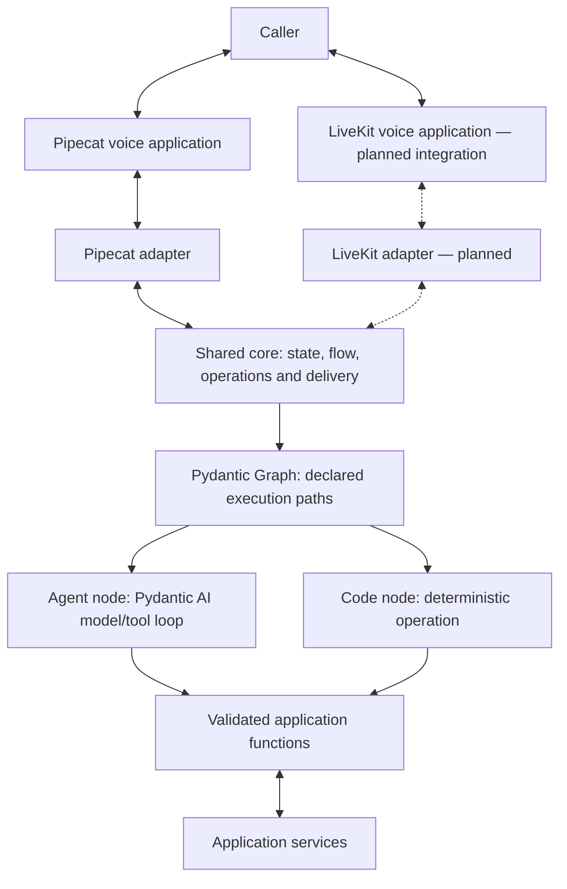

# SLNG Voice Harness

> **Work in progress.** This README describes the architecture we are working
> toward, not the implementation currently available on `main`. The migration
> is ongoing; APIs, examples and behaviour may change.

A reusable Python conversation engine for voice applications. Our goal is to
define a conversation once—its state, prompts, tools, prerequisites and allowed
routes—and run that same contract inside Pipecat and LiveKit applications.
The voice framework handles real-time media; the shared core owns the
conversation under the application's declared rules.

**The architecture we are implementing is one agent per conversational node,
with deterministic code nodes where no language interpretation is needed.**
The active agent understands the caller, uses its tools and chooses among declared
exits. Core checks state updates, routes, approvals, receipts and delivery evidence.

Examples labelled “migration branch” refer to the work in progress and may not
run on `main`. For the currently merged implementation, see the
[earlier architecture guide](https://github.com/slng-ai/slng-voice-harness/blob/176ff9fbab96e8cf795d9b40768d09051c37b8a4/README.md).

## Why we are building a shared conversation core

As voice applications grow, their rules extend beyond a prompt: which information
is trusted, when an action is permitted, what completes a step, how to resume after
a detour, and what survives an interruption. Implementing those relationships
separately in every application and runtime makes changes harder to review and
behaviour harder to keep consistent.

We are moving ownership of that logic into one reusable package. Pipecat and
LiveKit remain the voice runtimes. The core's Pydantic AI agents sit at the
conversation/model boundary inside those applications, with adapters translating
between runtime events and the core's turn execution. This direction targets
cascaded speech recognition → model/tools → speech synthesis pipelines.

Both frameworks already offer useful orchestration. Pipecat Flows has focused
nodes, tools and state; LiveKit has agents, tasks and programmatic handoffs. Native
application code can implement the same policies. The reason to own a shared core
is to declare and enforce those policies once, across applications and adapters.
See [Pipecat Flows](https://docs.pipecat.ai/pipecat/flows/introduction) and
[LiveKit agents and handoffs](https://docs.livekit.io/agents/logic/agents-handoffs/).

The intended benefits are:

- **One authoring contract.** Application authors define domain data and functions
  without rebuilding routing, approval, recovery and history handling.
- **Consistent execution.** A tool invoked by an agent and an action selected by
  code pass through the same validation and authorization boundary.
- **Inspectable conversations.** The graph exposes the permitted paths, their
  prerequisites and the evidence needed to finish work.
- **Fewer avoidable model decisions.** Code can resume a known destination or
  render an established result without asking a model to decide it again.
- **A reusable test boundary.** The same conversation rules can be exercised
  independently of audio, then checked through each voice adapter.

Owning this layer also means owning its integration and failure handling. These
benefits must justify that cost. The Pipecat migration implementation demonstrates
the integration boundary; LiveKit support is a planned adapter, and equivalent
behaviour across both runtimes remains to be demonstrated.

## What typed flows mean

A typed conversation connects the shape of data to the conditions under which
work can proceed. A well-formed value is one fact; permission to act on it and
evidence that the action succeeded are separate facts.

| Contract | What it makes explicit |
|---|---|
| State | What the application knows, which values are valid and which updates belong together. |
| Tools and results | What an operation accepts and what its service must return before the result can be used. |
| Nodes and prompts | The responsibility, context, collectible fields and available operations of each conversational step. |
| Transitions | Which destinations exist, which prerequisites apply and where execution resumes afterwards. |
| Approval | The exact proposed action and delivered question to which an interpreted answer applies. |
| Completion | The validated evidence required before work is considered complete or success is spoken. |

The manifest is checked before a call starts. Runtime guards check incoming data
and current state when an action or transition is attempted. Conversation tests
then establish whether those legal actions actually serve the caller's request.
Types and a legal graph path cannot prove that the model understood a person.

## Architecture inside a voice application



In the Pipecat migration implementation, the adapter occupies the pipeline's LLM processor
position: caller context enters, and response frames carry speech back toward
TTS. The model/tool loop belongs to core. A LiveKit adapter would connect the same
engine to its model-node interface and session lifecycle. LiveKit documents an
overridable [LLM node](https://docs.livekit.io/agents/logic/nodes/#llm-node), which
supports this direction; it does not establish our adapter's correctness.

Adapters must carry interruption, cancellation, history and playback evidence as
well as text. Those semantics are part of portability. A native speech-to-speech
integration would need a separate assessment because its lifecycle differs from
this cascaded pipeline.

An agent node has one composed instruction context: shared persona, node prompt,
application knowledge and the current call facts. It can make several model/tool
requests during a turn. “One agent per node” does not mean one model request per
caller turn, or a separate provider connection per node.

There is **no classifier, solver or supervisor before the active node's agent**
on this public path. The legacy classifier modules remain for Faro until it is
migrated; new applications should use the manifest contract below.

### How Pydantic, Pydantic AI and Pydantic Graph enable this

| Component | Responsibility in this repository |
|---|---|
| [Pydantic](https://pydantic.dev/docs/validation/latest/concepts/models/) | Application state, tool arguments, manifest schemas and backend receipt validation. |
| [Pydantic AI](https://pydantic.dev/docs/ai/core-concepts/dependencies/) | Native agent execution, `RunContext`, typed tools, streaming, messages and the model/tool loop. Personas use the SDK's `AgentSpec`. |
| [Pydantic Graph](https://pydantic.dev/docs/ai/graph/builder/) | Typed graph execution, decision branches and a diagram generated from the executable structure. The YAML manifest is our package's format. |
| Core (`slng-voice-core`, imported as `core`) | Assemble nodes; maintain per-call state, history, proposals, operations, delivery evidence and bounded turn execution. |
| [Pipecat](https://docs.pipecat.ai/pipecat/learn/pipeline) | Transport, audio frames, VAD, endpointing, interruptions, STT and TTS integration. |
| [LiveKit](https://docs.livekit.io/agents/logic/nodes/) | Planned second voice integration, retaining its session, media and turn lifecycle. |
| SLNG | Speech-provider access used by the application pipelines. |
| [Langfuse](https://langfuse.com/docs/observability/overview) | Traces of model requests, tool results, timings and runtime audit events. |
| Coval | External voice callers, recordings and normal/interruptive evaluation scenarios. |

Pydantic gives the application one schema for its state, arguments and receipts.
Core explicitly validates service responses and complete candidate state updates
at their boundaries. A Python return annotation alone does not validate external
data, and validation of one object does not make every later mutation safe.

Pydantic AI supplies the agent loop rather than requiring us to build a model SDK.
Its [tool preparation](https://pydantic.dev/docs/ai/capabilities/prepare-tools/) and
[typed outputs and streaming](https://pydantic.dev/docs/ai/core-concepts/output/)
let core expose the current node's operations, inspect results and stream speech.
Execution guards still check a requested action against the current call state.

Pydantic Graph makes the flow executable. In the migration implementation, core
builds graph steps and decision branches from the node table; an undeclared
transition has no matching branch. The same graph can render a Mermaid diagram,
so the executable routes and their visual representation share a definition.
Application guards still decide whether a declared route is allowed *now*.
See the [graph implementation](https://github.com/slng-ai/slng-voice-harness/blob/8b127b2ebb444260d199903e3c91df1fa878eeb6/core/src/core/flow.py).

The graph schedules execution; core retains the call's position and conversation
state between turns. Backend persistence and recovery remain explicit contracts.
Using a graph library does not automatically make a call durable across crashes.

### What a node owns

A conversational node declares its prompt, collectible fields, available choices,
operations, prerequisites and exits. The agent can stay in that node for several
turns. A tool result returns to that agent's ongoing run unless a declared action
or handoff ends it. A code node runs a known operation and follows declared
success, error or unknown-outcome branches without asking a model to choose.

A node remains responsible while a tool fetches information and the caller
discusses the returned options. If another step must establish a prerequisite,
core remembers where to return after it succeeds. The graph can express
corrections, detours and returns while each node handles natural conversation.
A changed request still needs to be interpreted and validated.

| Definition | Use |
|---|---|
| `kind: conversation` | An agent node with declared fields, choices, operations and exits. |
| `kind: action` | A deterministic operation. `returns: true` returns to the node that handed work to it. |
| `kind: collect`, `confirm`, `end` | Structured collection, explicit confirmation and completion for controlled flows. |
| Legacy `kind: agent` | Hand-built Python nodes; retained for existing applications such as Faro. |

### Shared state without shared callers

Each call gets a fresh `FlowCall` wrapping the application's plain Pydantic state
model. Nodes in that call share its facts, history, pending proposal, offered
choices, receipt evidence and speech ledger. The engine supplies current context
before each model request. The compiled agent definitions can be reused across calls.

Applications do not need to subclass core's session or implement their own
conversation loop. They decide whether service clients are shared or created per
call. Business resources may be shared across callers; those resources need
backend transactions, ownership checks and concurrency control. Per-call state
alone cannot prevent two callers from taking the same resource.

## Authoring an application

Domain models, business operations and wording belong to the application. Core
imports no use case and applies the contracts the application declares.

On the migration branch, the ordinary application consists of:

```text
my-agent/
  agent.yaml       nodes, fields, operations, prerequisites and exits
  models.py        plain Pydantic state, arguments and receipts
  functions.py     typed functions, read-back wording and backend access
  prompts/         shared persona, node prompts and application knowledge
  bot.py           voice pipeline and application setup
```

`core.load(...)` validates the manifest and references. `compile(...)` constructs
the agents and graph. `flow.open(...)` creates one call. The public boundary is
documented in the implementation's
[core exports](https://github.com/slng-ai/slng-voice-harness/blob/8b127b2ebb444260d199903e3c91df1fa878eeb6/core/src/core/__init__.py).
Importing `core` loads no environment file, provider client, Pipecat or Langfuse.
Voice and tracing are separate package extras; the application supplies its model
provider dependency and credentials.

### Agent nodes and code nodes share one flow

An agent node interprets the caller and chooses from its declared operations and
exits. A code node runs a known function and follows its declared result branches.
The application can use a conversational agent, a controlled sequence or agents
handing work to one another without replacing the turn engine.

Both kinds of node use the same call state and operation checks. A tool's results
remain available to the node responsible for the conversation; invoking a tool
does not require losing that context or delegating to another reasoning agent.

### Typed operations and backend responsibilities

An operation points to a plain function taking services and a Pydantic argument
model, returning a Pydantic receipt. A write can additionally accept core's `Intent`
so the backend can deduplicate and reconcile it by a stable identifier.
The function signature supplies the types; YAML binds them to application state.

| Manifest field | Meaning |
|---|---|
| `function`, `args` | Implementation and argument-to-state bindings. |
| `readback`, `approval` | Exact proposal wording and whether approval is required. |
| `matches` | Receipt fields that must match the operation's arguments. |
| `succeeds`, `rejects` | Explicit success and terminal refusal conditions. An unsettled write stays unknown. |
| `assign` | State fields populated from a successful receipt. |
| `say`, `recap` | Application wording rendered from receipt evidence. |
| `subject`, `resource`, `version` | Identity and revision of the changed resource. |
| `reconcile`, `idempotent` | How to find an earlier outcome and whether the backend deduplicates by intent ID. |
| `changes: false` | A read; its receipt cannot establish that a resource was changed. |

Declaring `idempotent: true` does not make a backend idempotent. The backend must
persist the intent and atomically record the effect with its result. A lost reply
must be reconciled before another attempt; “no result found” alone does not prove
the old request cannot still commit. The backend must settle the old attempt or prevent it from committing
before another can safely proceed. Each application provides
the service-specific persistence and concurrency guarantees.

The [support-desk example](https://github.com/slng-ai/slng-voice-harness/tree/8b127b2ebb444260d199903e3c91df1fa878eeb6/core/tests/ticket_flow)
uses accounts, tickets, revisions and Spanish receipt wording. It exercises the
same runtime through a different domain and language. The
[clinic examples](https://github.com/slng-ai/slng-voice-harness/tree/8b127b2ebb444260d199903e3c91df1fa878eeb6/core/tests/clinic_flow)
show controlled flow, one conversational agent, handoff and code-node patterns
using the same domain functions.

## Approval, effects and speech

The intended operation boundary separates four facts: what the caller requested,
what they approved, what the backend did and what they heard. A valid tool call
does not by itself establish all four.

1. Collect and validate the proposed values. Selecting an option is not approval
   to carry out a consequential action.
2. Render the exact read-back from application code and track its delivery.
3. The active agent interprets the subsequent reply. Core checks its relationship
   to the same delivered proposal, identity and arguments before dispatch.
4. Persist and execute the intent, validate and bind the receipt, then record its
   outcome. Cancellation after dispatch can mean an unknown outcome.
5. Say the result using application wording backed by the receipt. Interruption
   of that speech does not undo the backend effect.

The model's interpretation remains fallible. These are the invariants the
implementation must satisfy and test. Repeating a value, selecting an option
and authorizing an action must remain distinct unless the application
explicitly defines a policy connecting them.

`speech: rendered` gives application code control of all spoken wording in a
node; it is exercised by the ticket example and has restrictions, including no
model-worded choices at this checkpoint. Nodes may also use guarded free prose.
Application-defined claim patterns are a best-effort check; they cannot prove
that every possible unsupported claim is blocked.

### Delivery and interruption

The Pipecat adapter translates frames into core events. Core tracks speech by
segment and retains accepted caller input and completed tool results when a turn
is interrupted. Twilio marks associate playback acknowledgement with the segment
that was sent; cleared or interrupted audio must not be mistaken for a fully
delivered proposal. A receipt can be valid while its spoken confirmation is still
undelivered.

For browser development, `DELIVERY=simulated` uses estimated playback. That mode
cannot prove audible delivery, interruption timing or real telephone latency.
Text checks also cannot establish endpointing quality. Those require the real
voice route and recordings, alongside the runtime evidence.

## What we need to demonstrate

The library documentation supports the building blocks, and the Pipecat adapter,
executable graph and application examples show how they fit together. This supports
the design's feasibility. It does not establish that the package is universally
faster, more accurate or easier to maintain than a well-built native application.

The next proof is the same application contract behaving consistently across
different domains and both voice adapters, including interruptions and failed
operations. Reliability and latency claims need comparable native implementations,
the same model and voice conditions, and measurements of useful responses rather
than filler speech. Reuse must also be demonstrated by the amount of application
and adapter code authors actually need. Those results will determine the claims
we publish as the work in progress becomes a supported package.
