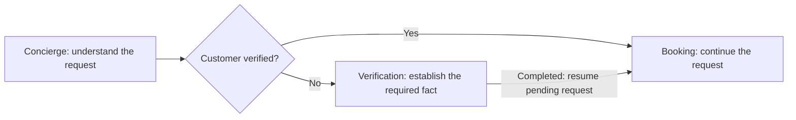
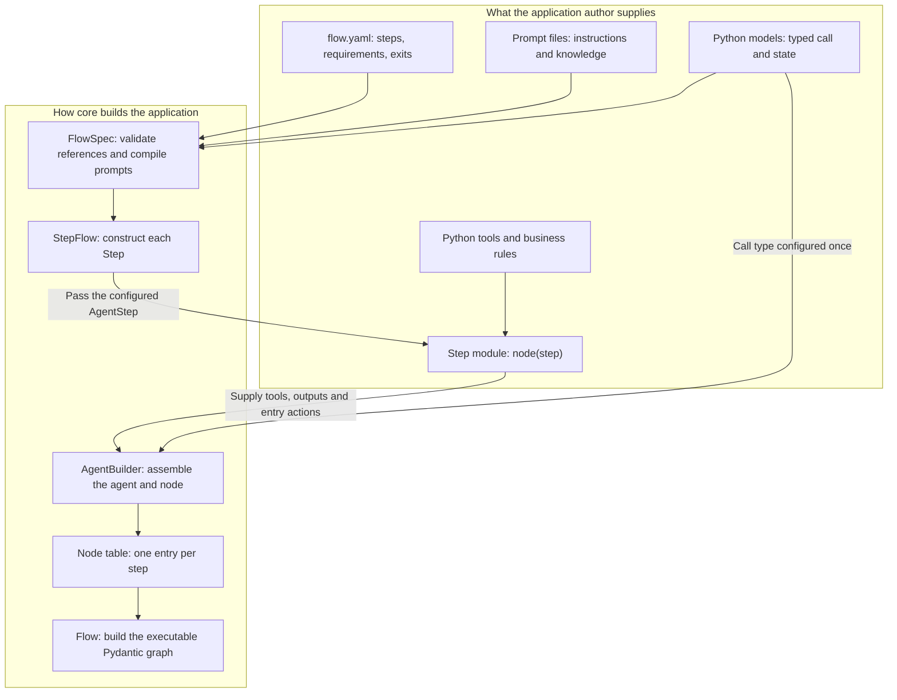
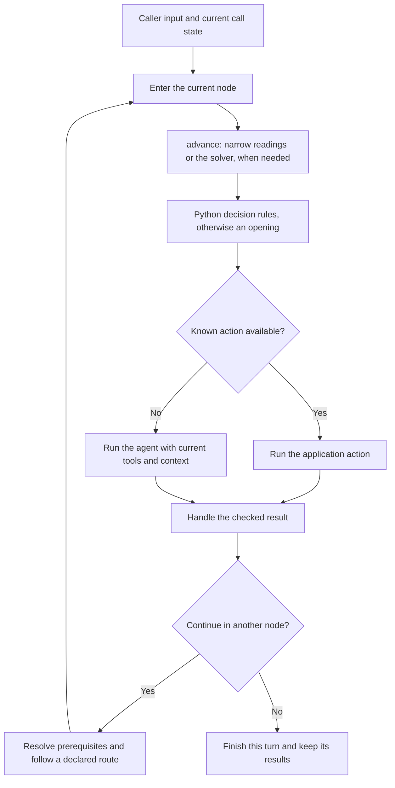
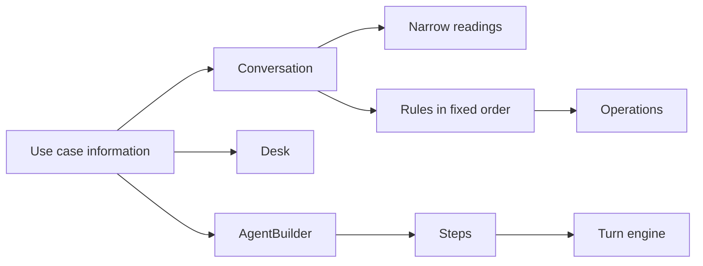

# Typed conversations: how the core works

A voice agent should let people speak naturally while following clear rules
about what it knows, what it can do and when it can act. **The purpose of this
core is to make those rules executable.** The model interprets language. Typed
data, declared steps and Python checks connect that interpretation to the
application's actions.

This guide explains the architecture implemented in `core/`. It follows the
original goal of **typed conversations**: typed variables, typed steps and
controlled flow, with the same execution machinery reusable across
applications. The salon receptionist in `salon/` is the first application
built on it.

## 1. Start with a graph: a map of the conversation

A graph describes pieces of work and the allowed connections between them. In
a conversation:

- A **node** is a place where work happens.
- An **edge** is an allowed move to another node.
- **State** holds what the call knows and where it is now.

Pydantic Graph comes from the Pydantic AI project. It is an asynchronous Python
graph and state-machine library, usable without AI agents. Its types describe
the data passed through execution. Nodes and connections describe the
workflow. Our core uses its `GraphBuilder` API to build an executable graph
from the application's steps. See the official
[graph overview](https://pydantic.dev/docs/ai/graph/graph/) and
[Graph Builder guide](https://pydantic.dev/docs/ai/graph/builder/).

### Why this fits voice calls

Many service calls have a clear purpose and a limited set of meaningful
stages. People can phrase a request in many ways, interrupt, correct
themselves or ask a side question. The requirements for completing an action
are much more stable: collect the information, establish the required facts,
obtain approval and perform the action.

A graph makes that structure visible without scripting every sentence. A node
can hold a natural conversation for several turns. Connections allow
branches, corrections and returns to unfinished work.

Here is one path through the salon, simplified to show prerequisite routing:



The decision in the middle is a check against saved state. Once booking has
been requested, the application already knows where to continue after
verification. No model request is needed to choose that destination.

**The graph controls the available paths. The agent handles conversation
within a node.** This gives predictable structure while keeping the language
flexible.

### How it appears in the current core

The application defines a table of nodes. `core/flow.py` turns that table into
a Pydantic graph, including declared exits and prerequisite return paths. It
can also draw a Mermaid diagram from the same definition:

```bash
uv run python -c "from core.flow import Flow; from salon.agents import AGENTS; print(Flow.of(AGENTS).render())"
```

The original proposal described a small step table. The current
implementation keeps that authoring model and adds an executable graph behind
it. Authors still describe steps. They do not maintain a second graph by hand.

The graph checks whether execution follows a declared route. Application
guards, Python conditions checked against current state, decide whether a
route or action is permitted now. Both are needed: a connection can exist in
the graph while being unavailable to this caller.

Implementation: [core/flow.py](core/flow.py) and [core/graph.py](core/graph.py).

## 2. Why these libraries have separate jobs

The architecture needs three things: valid data, model execution and
controlled movement between steps. Each library serves one of those needs.

The model/tool loop is the cycle in which a model requests a tool, receives
its result and continues until it produces an answer or another ending output.

| Library | Its job here | Why we use it |
|---|---|---|
| **Pydantic** | Validate declared models for state, arguments and service results. | Rules about data become checks that Python can run, with useful errors when values are invalid. |
| **Pydantic AI** | Run an agent with instructions, typed tools, outputs and streaming events. | It exposes the points where core needs to prepare tools, inspect results and manage the model/tool loop. |
| **Pydantic Graph** | Execute the connections between steps. | The allowed routes become a runnable, inspectable structure that can also be drawn. |

These capabilities are described in the official
[Pydantic model documentation](https://pydantic.dev/docs/validation/latest/concepts/models/),
[Pydantic AI tools documentation](https://pydantic.dev/docs/ai/tools-toolsets/tools/)
and [graph documentation](https://pydantic.dev/docs/ai/graph/graph/).

**Our core connects these parts into conversation behaviour.** It owns turn
execution, prerequisite routing, tracked questions, action limits and
interruption handling. The application supplies the business rules those
mechanisms apply.

Pipecat supplies the voice layer: audio transport, detecting speaking turns
(Silero VAD and smart-turn, at Pipecat's recommended defaults), speech
recognition and speech synthesis (through SLNG). Keeping that work separate
lets the conversation engine be tested without a microphone or telephone.

## 3. What "typed conversation" means

A type describes what a value is allowed to contain. Validation checks a value
against that description. Here, typing goes beyond the model's response. It
also describes the information and decisions that move a call forward.

| Part of the conversation | What is declared and checked |
|---|---|
| **Variables and state** | Field types and application constraints. A complete proposed state update is validated before it replaces the saved state. |
| **Steps** | Their kind, required configuration, prompt and code references, and declared destinations. |
| **Tool arguments** | The shape and permitted values of the action's input. |
| **Service results** | The result returned by the backend is validated before the application uses it. |
| **Approval** | The answer is checked against the exact proposal being discussed and the application's authorization rules. |
| **Completion** | Required facts, or a valid service receipt (a record of the result), must establish success. |
| **Flow** | Declared routes, prerequisites and current-state guards decide where execution can continue. |

For example, a valid phone number, a confirmed number and an established
customer identity are different facts. A number passing a format check cannot
establish all three. The application must define the relationship between
them.

In the same way, a model saying "the booking is complete" is speech. The
accepted service result is the evidence that a booking exists.

### State belongs to the call

Applications extend `VoiceState` with their own fields and validation rules. A
`CallContext` holds that state together with the call's history, pending
question and speech records. Agents and tools receive the current call through
Pydantic AI's dependency mechanism, as `ctx.deps`. Each call carries its own
data while sharing the same agent definitions. See
[Pydantic AI dependencies](https://pydantic.dev/docs/ai/core-concepts/dependencies/).

`call.commit(...)` builds and validates a complete candidate state. If
validation fails, the old state stays intact. This matters when several fields
must change together.

The standard steps also keep a `facts` dictionary. Its declared collection and
operation models are validated at their boundaries. Other dictionary entries
do not get strong types automatically. Explicit application state models, as
in the salon, give the stronger contract.

**Types make rules checkable. They do not make language interpretation
infallible.** A classifier can return an allowed label and still misunderstand
the caller. Application checks and conversation evaluations stay necessary.

Implementation: [core/state.py](core/state.py),
[core/operations.py](core/operations.py) and
[core/completion.py](core/completion.py).

## 4. Steps, nodes and agents: how they fit together

These terms describe different layers of the same definition.

| Term | Meaning |
|---|---|
| **Step** | What the author describes: a piece of conversation work and its configuration. |
| **Node** | What the engine runs: that step's agent, entry behaviour, requirements and allowed exits. |
| **Agent** | The model-facing part of the node: instructions, tools and allowed outputs. |
| **Flow** | The graph connecting the nodes. |
| **Turn** | One response cycle to the caller, which may run more than one node. |

A step can stay active across many turns. An agent run can make several model
requests. Moving between steps does not start a separate call or lose the
shared state.

### Standard steps and custom agent steps

Core offers standard building blocks for common structures:

| Step type | Responsibility |
|---|---|
| `CollectStep` | Collect and validate declared fields. |
| `ConfirmStep` | Present an exact proposal and handle acceptance, rejection or revision. |
| `ActionStep` | Run an operation and check its returned result. |
| `ConversationStep` | Hold an ongoing conversation from instructions and knowledge, with a goodbye output. |
| `End` | Speak a closing line and record an outcome. |
| `AgentStep` | Let application Python code assemble the node's tools and behaviour. |

Standard steps use recorded facts to skip completed work and choose what comes
next. Declared dependencies drop derived facts after a correction. Removing a
local fact does not undo a backend action. That needs an explicit operation.

The salon uses four custom `AgentStep` definitions. Custom steps and standard
steps both become nodes in the same engine. This is a key reuse point:
different conversation structures share turn execution, state handling and
flow machinery. The `examples/` folder has two flows built from standard
steps alone: `access`, a ten-step request, and `help`, one conversation step.

Every node contains an agent. The engine can still complete a known action
without running that agent (section 7).

Implementation: [core/steps.py](core/steps.py).

## 5. What an author writes: YAML, prompts and Python

An application brings together three kinds of material:

- **YAML describes the structure:** step names, prompt files, code files,
  requirements and exits.
- **Prompts describe the conversation:** instructions, knowledge and how to
  respond.
- **Python implements behaviour:** typed state, tools, validation,
  authorization and backend actions.

YAML makes the flow easy to review. Python expresses rules that need
executable checks. Prompts give the model the context it needs to converse.

For a custom agent step, the connection is explicit:



`FlowSpec` checks the declared structure and references before any call
starts. `StepFlow` constructs the steps. For an `AgentStep`, it calls the named
Python module's `node(step)` function. That function receives the
YAML-derived configuration and adds the executable behaviour.

The diagram follows the custom-agent path the salon uses. Standard steps build
their nodes through core's own implementations instead of a `node(step)`
function. Authors can also construct steps directly in Python.

### A real step, from declaration to implementation

This is the booking entry in [salon/flow.yaml](salon/flow.yaml):

```yaml
- id: booking
  kind: agent
  prompt: prompts/booking.md
  code: steps/booking.py
  guarded: true
  requires: [customer_verified]
  satisfied_by: verify
  exits: [concierge, complaints]
```

It names the prompt and the Python implementation. It says that booking needs
`customer_verified`, that `verify` supplies it, and which exits booking
offers. `guarded` turns on the engine's guarded speech (section 8).
Authorization still lives in the operation checks.

The referenced [Python module](salon/steps/booking.py) supplies this function,
shown without its imports and docstring:

```python
def node(step: AgentStep) -> Node[SalonState]:
    return build(
        step,
        tools=[read_diary],
        finishers=[save_booking],
        asks=[ask_booking, offer_times, booking_guidance],
        openings=OPENINGS,
        structured_speech=True,
    )
```

Here `build` hands over to core's `AgentBuilder`, configured once with the
application's call type, model and shared policies. The `step` argument
carries the YAML settings. The other arguments say what this agent can do:

- `tools` return information into the model/tool loop.
- `finishers` and `asks` are output functions: a successful call ends the
  agent run with a result or a question.
- `openings` are actions that can run on entry when the next action is
  already known.
- `structured_speech=True` makes this agent speak through
  application-controlled outputs.

Ending an agent run is not ending the phone call. Asking a question ends the
run so the caller can answer. A handoff can continue into another node.

This keeps **the structure in YAML and the behaviour in Python**, joined
through one small, explicit function. The flow-file format is this package's
own, implemented in [core/flowspec.py](core/flowspec.py). It is not a Pydantic
Graph YAML feature.

## 6. Classifiers and the solver: interpreting the caller

**Both interpret what the caller meant. Python rules decide what to do with
that interpretation.** The difference is how much each interpretation covers.

`Classifier` ([core/classifiers.py](core/classifiers.py)) is one reusable core
component. It takes typed input, makes one structured model request and
validates the returned data. Both the narrow readings and the solver use it.
Neither has the conversational agent's tool loop.

Every classification is made of the same five parts:

| Part | Who supplies it |
|---|---|
| The question the person was asked | the application, from state |
| The person's answer | the application, from state |
| Context: what the classifier is for, in one sentence | the author |
| The classes | the author |
| Each class's description | the author |

The instructions are built from these parts by a fixed template, never
hand-written per business. So the same classifier works for a salon, a clinic
or a help desk, with only the context sentence and the classes changed.

### Narrow readings: one question at a time

The default approach uses small classifiers, each answering one question. A
**reading** ([core/readings.py](core/readings.py)) wraps one classifier with
the context it needs and a rule for when it applies. Only the readings that
apply run, side by side, so the caller waits for the slowest one only. Core
owns the common ones:

| Reading | Classes | Applies when |
|---|---|---|
| confirm (`CONFIRM`) | accept, reject, revise, conditional, unclear | a read-back is waiting for an answer |
| choose (`Choice`) | one option id or none, plus the option named with a condition | options are on the table |
| take back (`TAKE_BACK`) | keep, withdraw, unclear | a change made in this call can still be undone |
| still agreed (`STILL_AGREED`) | keep, withdraw, unclear | an approval is held through a detour |
| closing (`CLOSING`) | end, continue, unclear | the caller was asked "anything else?" |
| request kept (`REQUEST`) | kept, changed, unclear | a detour, such as a number check, interrupted a request |

Each request sends only the facts its act needs, about 260 to 430 input
tokens. Each reading has its own Langfuse dataset (`harness-reading/<name>`),
so it can be measured and tuned on its own (`evals/readings.py`).

The results feed `Conversation` ([core/conversation.py](core/conversation.py)).
Its Python rules try the acts in one fixed order: answer the pending question,
then take back, then pick, then goodbye. The first act that decides selects an
application action. Otherwise the reply goes to the conversational agent.

The acts are core classes. An application gives each one its information:

| Act | Information it takes | What it does |
|---|---|---|
| `ReadBack` | the question it answers, the operation a yes runs | runs that operation on a yes to that exact question |
| `Offer` | where the options come from, what a pick does | reads a plain pick back, never writes it. Refuses a pick with a condition |
| `FixedChoice` | a fixed question and its options | runs the action for the chosen option, such as "move it or add another?" |
| `TakeBack` | what can be taken back | offers to undo a change made in this call |
| `HeldApproval` | the approval to keep | keeps an approval through a detour, drops it on any change |
| `HeardValue` | a parser from words to a value | reads a value back with no model request, such as a whole phone number |
| `Detour` | the question that ends a prerequisite | notices when the caller changes the request mid-detour |
| `Closing` | the goodbye | ends the call once the caller is done |

The salon's whole setup is one declaration, `SALON` in
[salon/classification.py](salon/classification.py). A second use case,
[tests/clinic.py](tests/clinic.py), builds a clinic line on the same classes in
about 240 lines, with no salon code.

### The solver: one richer decision

The optional salon solver looks at a wider snapshot: the caller's words, the
current step, identity, the pending proposal, whether it was heard, and the
possible task destinations. It returns one typed
[decision](core/decisions.py), which can carry the information needed to act
on it.

For example, after a phone read-back, "No, the last two digits are 34" is read
narrowly as `revise`. That says there is a correction, but not the corrected
number. The solver can instead return `CorrectPhone` with the full proposed
number. Python validates that number and reads it back. The correction alone
does not verify anyone.

Its other decisions are accept, reject, clarify, choose move or add, switch
task and end the call. "Solver" names this broader strategy: one decision per
request, not a plan of several actions.

| | Narrow readings (default) | Salon solver (opt-in) |
|---|---|---|
| Question | What does this reply mean for one act? | Which supported decision best describes this reply now? |
| Result | a label or a chosen option | one decision, sometimes with fields such as corrected digits or a destination |
| Requests | one per applicable, uncached reading, side by side | one per uncached interpretation |
| Input | only the facts for its act | the wider call snapshot |
| Application handling | the shared conversation rules choose the action | Python handles correction, switching and clarification directly. Other decisions feed the shared rules |
| Measured | per reading, on Langfuse datasets, on four models | not yet compared live |

The solver can settle some replies that would otherwise need the
conversational agent. Its broader task also needs its own accuracy checks. It
is not automatically faster, more accurate or equal in coverage. Narrow
readings are the default in code. `SALON_INTERPRETER=solver` selects the
solver.

### What they share, and where they run

Both use core's **Interpreter** machinery
([core/interpreters.py](core/interpreters.py)):

- They share the turn's request budget.
- An interpretation is cached for the turn, so a tool guard reuses it instead
  of asking again.
- A result that no longer matches the call is rejected, never used.
- A validation or provider failure gives a fallback that authorizes nothing.
- Some readings can run again when application work puts new options on the
  table.

They run in the node's `advance` stage, before its conversational agent, when
the call's state asks for an interpretation. They are two alternative
strategies, not two stages in a row. A tool can also ask for an
interpretation when it needs one. Ordinary conversation needs no extra request
up front.

An interpreted acceptance still passes the operation's authorization. An
interpreted task switch still passes routing and prerequisites. If the
interpretation settles nothing, the engine tries an applicable opening, and
otherwise runs the conversational agent.

### Why not let the model set a flag?

A flag the model sets, such as `confirmed=true` on a tool call, costs no extra
request. It failed in practice: the one-prompt baseline cancelled a booking and
recorded a complaint with no read-back. A word list worked, but only in
English. A reading costs one small request, about 0.8 s, and works across
languages and businesses. The price is more requests per turn, each smaller: on
the paired Coval run the harness made 1.85 requests per caller turn against the
baseline's 1.34, and sent 1,402 input tokens per turn against 3,946.

**This is another reuse boundary.** Core supplies classification,
interpretation caching and the shared conversation rules. The application
supplies its facts, its supported decisions and its handlers. The graph and the
operation checks stay in place whichever strategy is selected.

Implementation: [core/classifiers.py](core/classifiers.py),
[core/readings.py](core/readings.py), [core/interpreters.py](core/interpreters.py),
[core/conversation.py](core/conversation.py), and the salon's solver and
decision handlers in [salon/classification.py](salon/classification.py) and
[salon/nodes.py](salon/nodes.py).

## 7. What happens during a caller turn

The engine starts at the node recorded in the call's state. It first checks
whether application logic can settle the next action. Otherwise, it runs the
node's agent.



The node's `advance` function gets the first chance to settle the caller's
answer (section 6). An applicable `opening` is tried next. Both can select a
`LocalAction`: a named application action to run. Interpretation can use model
requests even when the conversational agent is skipped.

If conversation is needed, `AgentBuilder` prepares the offered tools and
handoff destinations from current state before each model request. Shared
policy allows at most one business-changing or routing action per model reply.
The executors still check authorization when called.

### From words to an authorized action

`ProposalLedger` tracks the one question awaiting an answer, and whether the
caller heard it in full. This gives "yes" a specific context. An `Operation`
then validates arguments, resolves any required earlier work, checks
authorization, calls the service, validates its receipt and records the
result. Every write leaves a `write` span in the trace, with the question it
answered.

A tool the model chose and an action the application chose directly use the
**same executor and checks**. So there are no separate rules per path. If an
action is refused, the agent gets the reason and can clarify.

### Continuing the flow

Prerequisite routing remembers one pending destination. After the
prerequisite completes, the application resumes that work without asking the
model to choose the destination again. A changed request is handled by the
application's conversation rules.

An exit can also declare a `via` tool: a successful call of that tool moves
the call into the destination node. Core rechecks the route's conditions after
success.

The turn engine reports either `Moved` or `Answered` to the graph. The graph
follows the matching declared branch. An undeclared move raises an error. The
whole turn shares limits for requests, tools, step runs and elapsed time.

Each caller turn is one short graph run. The call keeps its position between
turns. Durable storage and recovery across separate calls are the
application's job.

Implementation: [core/turn.py](core/turn.py),
[core/conversation.py](core/conversation.py) and
[core/proposals.py](core/proposals.py).

## 8. Streaming and interruptions are part of execution

Voice needs to respond while work is happening. Core consumes Pydantic AI's
event stream, which exposes text and tool activity during an agent run. So
permitted model text reaches speech synthesis before the whole response
finishes. See
[Pydantic AI output and streaming](https://pydantic.dev/docs/ai/core-concepts/output/).

Application-controlled questions and confirmations go straight to speech. In
the salon, conversational text can stream from the concierge, while
consequential confirmations are said through controlled outputs. On a guarded
step, speech goes out a clause at a time, and a clause claiming a change
nothing made is replaced before it is spoken. Partial tool arguments are never
treated as completed actions.

Interruptions need more than stopping audio. The engine keeps accepted input
and completed tool results, and uses playback feedback to track what speech
was delivered. A question the caller talked over is not counted as heard, so
a "yes" can never answer it. A completed booking stays recorded even if the
caller interrupts its spoken confirmation.

Before the next model request, core prepares history that reflects delivered
speech and keeps tool calls paired with their results. Each node can take the
full conversation history or a fresh one (`Node.history`).

The reusable engine lives in `core/turn.py`. Only `core/processor.py` imports
Pipecat and translates between core events and voice frames. That separation
makes the engine reusable. Another voice adapter would still have to
implement and test delivery and interruption behaviour.

Implementation: [core/processor.py](core/processor.py) and
[core/history.py](core/history.py).

## 9. Where reuse comes from

**Reuse comes from keeping conversation mechanics in core and application
meaning in the application.** Core imports no salon code. It receives
definitions and call data through the interfaces above.

| Reused from core | Supplied by an application |
|---|---|
| Step construction, node contract and graph execution | Step definitions, exits and prerequisite rules |
| Validated state commits and per-call context | State fields, constraints and call creation |
| Agent construction and request preparation (`AgentBuilder`, `Desk`) | Model, prompts, tools and allowed outputs |
| Classification, interpretation caching, question tracking and common conversation acts (`Conversation`) | Relevant facts, interpretation strategy, proposals, choices and decision handlers |
| Operation execution sequence | Authorization, backend integration and recovery |
| Turn budgets, streaming and interruption handling | Wording (`Locale`), speech policies and voice configuration |

An author builds an application by defining its state and operations,
describing its steps, connecting prompts and Python modules, and passing the
resulting node table with a fresh call to the processor. Custom state and call
types need an application call factory. The standard `StepFlow.open_call()`
creates the generic call type. See [Adding a use case](#adding-a-use-case).

The engine can be reused without putting new business rules inside it. That
does not mean configuration alone supplies those rules, or that another
application's behaviour has already been validated.

## 10. How this design is checked

The suite has **23 offline test modules**, with live model requests switched
off. Scripted responses exercise invalid data, approval checks, routing,
interruptions, recovery and shared turn limits. Tests also compare YAML and
Python definitions, check that direct core execution and the Pipecat adapter
agree, and pin every request the harness sends (`tests/golden/*.json`), so a
code change that alters a prompt shows as a diff.

Solver tests check how Python handles scripted decisions, including
corrections and task switches. They check execution behaviour. Whether the
model chooses the right decision needs a live evaluation.

```bash
uv run ruff check .
uv run ty check .
uv run python -m tests
```

We used **Coval and Langfuse to evaluate the feasibility of the package**:
simulated phone calls scored by Coval, and the traces of the same calls read
by `evals/ledger.py` for tokens, latency and every write. The same calls were
run against a one-prompt Pipecat baseline (`VOICE_HARNESS=pipecat`,
[salon/baseline.py](salon/baseline.py)). The figures, with links to every run,
are in [docs/research/poc-evidence-2026-09-24.md](docs/research/poc-evidence-2026-09-24.md).

The offline tests check whether the machinery follows its rules. Voice
evaluations check how the model and audio path behave in the tested
conversations. Both are needed: valid structure alone cannot show that the
caller was understood.

For the original motivation, see the V1 proposal and its supporting research
(`UNMUTE_V1.md` and `RESEARCH.md`, kept outside this repository). They explain
where the design started. The links above describe the current architecture.
The full design notes, with every mechanism and its references, are in
[docs/design.md](docs/design.md).

---

# Running it

You need **uv** (`brew install uv`, or https://docs.astral.sh/uv/ — it installs
the right Python itself, this project pins 3.14) and a `.env` holding the two
keys at the bottom of this file. Nothing else.

```bash
CALLER_ID=+34600111222 \
SALON_FIXTURE=fresh \
SALON_CLOCK=2026-09-21T10:00:00+02:00 \
uv run bot.py -t webrtc --host localhost --port 7861
```

Then open **http://localhost:7861** and click connect. The runner serves a
browser client, so there is nothing else to start.

```
🚀 Bot ready!
   → Open: http://localhost:7861
   → Enabled transports: webrtc
```

| | |
|---|---|
| `CALLER_ID` | the number a phone call would arrive with; read back and confirmed before it is trusted |
| `SALON_FIXTURE` | `fresh` empties the diary first, so every call starts from the same salon. `continue`, the default, is what a real salon does: the last call's booking is still there |
| `SALON_CLOCK` | pins the salon's idea of now, so "tomorrow" resolves to the same day on every run. No offset means the salon's own timezone |
| `-t webrtc` | one transport instead of all of them |
| `--host` / `--port` | Pipecat's runner flags. `uv run bot.py --help` for the rest |
| `VOICE_AGENCY` | which flow answers: `salon` (default), `access` or `help`. See section 4 |
| `SALON_INTERPRETER` | `solver` reads replies with one state-solver request instead of the narrow readings. See section 6 |
| `SALON_NAMED_PICK` | `0` turns off the pick reading's `named` field (on by default for the salon). See section 6 |
| `VOICE_HARNESS` | `pipecat` swaps the harness for the one-prompt baseline (`salon/baseline.py`): the same pipeline, diary and model, with Pipecat's own Gemini service |

All of these are optional: `uv run bot.py` on its own is a live-clock
call, from an anonymous number, into the salon as the last call left it. The
remaining dials are in `.env.example`. Turn taking is Pipecat's recommended
default (Silero VAD and smart-turn v3), with no dial of ours.

A booking, end to end: *"Hi, can I book a haircut for Friday?"* The front desk
hands the caller to booking; booking needs an identified caller, so the graph
interposes verification, which reads the caller ID back. *"Yes, that's right."*
One classifier request interprets the approval; application guards authorize
the lookup, the graph resumes booking, and the diary's free times are offered. *"Three o'clock."* The
application reads the time back: *"Shall I book you in for a haircut, Friday
at 3:00 PM?"* *"Yes."* Only that yes writes, and the confirmation is
spoken in the diary's own words. Neither turn needs a model request beyond the
one classifier. *"That's all, thanks, bye."* The line closes.

Tests: `uv run python -m tests`. Offline, no `.env`, no network.

---

# Adding a use case

A use case gives core's classes its information, and core's code runs it.
[tests/clinic.py](tests/clinic.py) is a complete one: a clinic's booking
line in about 240 lines, with no salon code. The salon is built the same
way, in [salon/classification.py](salon/classification.py) (`SALON`),
[salon/tools/desk.py](salon/tools/desk.py) (`DESK`) and
[salon/nodes.py](salon/nodes.py) (`BUILDER`).



1. The use case writes a call type (`CallContext` subclass) and its state.
2. It writes one `Operation` per business action: what the backend does, and
   what the caller hears when it lands.
3. It gives `Conversation` its acts: which questions are read back and what a
   yes runs, where the options on the table come from, what a pick and a
   take-back do, the goodbye.
4. `Conversation` builds one narrow reading per act. On each turn it runs the
   readings that apply, side by side, and tries the rules in core's order:
   answers, then take-backs, then picks, then goodbye.
5. A rule that decides runs an operation, or a read-back, with no model
   request. `Operation` checks the caller agreed to that exact question
   before anything is written, and records a `write` span for the ledger.
6. `AgentBuilder` builds each step's agent, with the shared `Desk` tools, for
   whatever no rule decides.

This is the clinic's whole conversation:

```python
Conversation[ClinicCall](
    context='A patient is on the phone with the front desk of Riverside Clinic.',
    model=model,
    read_back_context='The front desk read something back and is waiting for a yes.',
    read_backs=(
        ReadBack(about='booking', action='book', run=lambda call, q: BOOK.run(call, Slot(slot=q.value))),
        ReadBack(about='cancel', action='cancel', run=lambda call, q: CANCEL.run(call, Slot(slot=q.value))),
        ReadBack(
            about='patient',
            action='identify',
            run=lambda call, q: IDENTIFY.run(call, Patient(patient=q.value)),
        ),
    ),
    offers=(
        Offer(
            name='chosen_time',
            about='offer',
            options=ClinicCall.table,
            input_type=ChoiceInput,
            context='The patient was offered appointment times.',
            on_pick=_read_back_time,
        ),
    ),
    values=(
        HeardValue(
            about='patient',
            action='ask_patient',
            parse=_patient_number,
            read_back=_read_back_patient,
            when=lambda call: not call.state.patient,
        ),
    ),
    take_backs=(
        TakeBack(
            name='undo_booking',
            kind='undo',
            on_withdraw=_offer_undo,
            context='Earlier in this call the clinic booked an appointment for the patient.',
        ),
    ),
    closing=Closing(goodbye=lambda call: DESK.end_conversation(call, 'Goodbye.')),
)
```

### What each class takes

| Class | Where | The information a use case gives it |
|---|---|---|
| `Conversation` | `core/conversation.py` | who is talking (one sentence), the model and settings, its acts |
| `ReadBack` | `core/conversation.py` | the question it answers, the action a yes runs, when a yes counts |
| `FixedChoice` | `core/conversation.py` | the question, its options, the action for each option |
| `Offer` | `core/conversation.py` | where the options on the table come from, what a pick does |
| `HeardValue` | `core/conversation.py` | a parser from words to a value, how the value is read back |
| `TakeBack` | `core/conversation.py` | the kind of thing held, what taking it back does |
| `HeldApproval` | `core/conversation.py` | the read-back whose yes is kept through a detour, how it is kept |
| `Detour` | `core/conversation.py` | the question that ends a prerequisite's check |
| `Closing` | `core/conversation.py` | the goodbye, the readings to skip on "anything else?" |
| `Operation` | `core/operations.py` | its arguments and receipt types, the question that authorises it (`proposal`), what the backend does (`_execute`, `_record`), or `needs_approval = False` for an action with no read-back |
| `Desk` | `core/desk.py` | the call and hand-over types, the action names, what blocks a switch, an optional `Carry` |
| `AgentBuilder` | `core/steps.py` | the call type, model, settings, action names, `Desk`, `advance` |
| `Locale` | `core/locale.py` | the four lines the turn engine says itself, in the call's language |
| `Held` | `core/state.py` | something the caller could still take back, kept on the call by kind |

### What stays code in each use case

- **What the backend does.** Each operation's `_execute` and `_record`.
- **Where options come from.** A callable, such as the diary's free slots.
- **Parsers.** Such as a Spanish phone number (`salon/tools/identity.py`).
- **The words.** Read-backs, receipts and prompts are the use case's own.

### How to check a new one

- **Its behaviour.** Write assert scripts like
  [tests/test_reuse.py](tests/test_reuse.py). They run the real turn engine
  with scripted classifier answers and no network.
- **Its prompts.** `tests/golden/readings.json` and `tests/golden/agents.json`
  pin every request the salon sends. They cover classifiers and step agents,
  so any code change that alters a prompt shows as a diff.
  `BLESS_READINGS=1 uv run python -m tests.test_classifiers` pins them again.
  Do that only for a change that is meant, and check it live.
- **Its readings.** Each reading's name is its Langfuse dataset's name
  (`harness-reading/<name>`). Readings with core's classes (`confirm`,
  `take_back`, `closing`) share what was measured for the salon.

### Known limits

- Recovering a write whose outcome is unknown is still the salon's code
  (`salon/tools/writes.py`). It is tied to the diary's operation log.
- The patterns for a claimed change nothing made (`_CLAIMED`, `_RECORDED` in
  `salon/models/state.py`) are the salon's, and English.
- A pick with a condition is read by the pick reading's `named` field
  (`Offer(named=True)`). The salon turns it on; core leaves it off, because
  gpt-5.6-luna lost pick accuracy with it. The salon keeps its English word
  list of times as a second check, which can only refuse.
- Classifier instructions and class descriptions are English. The fixed lines
  follow the call's `Locale`, but a conversation in another language needs a
  live check of the readings on its own dataset.
- Form-like flows (`StepFlow`: collect, confirm, action) share the confirm
  request with `ReadBack`, but not the class.

# Layout

```
bot.py                  the Pipecat pipeline, and nothing else
core/
  state.py              VoiceState, CallContext and its speech ledger, Handoff, Question
  graph.py              Node, Exit, LocalAction, Opening, route, moved_by, model_clients
  flow.py               the steps as a Pydantic graph: walks every turn, refuses undeclared moves, draws itself
  classifiers.py        generic Pydantic input/output classification in one request
  readings.py           narrow readings: one small classifier per act, and the fixed order they act in
  conversation.py       the acts as classes a use case fills in (ReadBack, Offer, TakeBack, ...) and Conversation
  desk.py               Desk: hand over, hang up, clarify, switch task, for any use case
  locale.py             Locale: the lines the turn engine says itself, in one language
  decisions.py          typed meanings of a reply: Accept, Reject, SwitchTask, ...
  proposals.py          the one question a call waits on, and when it can be answered
  completion.py         when a step is done: evidence in the facts, never a flag
  steps.py              typed steps (collect, confirm, action, conversation, end), StepFlow, AgentBuilder
  flowspec.py           flow files as YAML (or JSON), checked before they run
  operations.py         Operation: one business action with its checks in a fixed order
  interpreters.py       Interpreter: once per turn, cached, budgeted, never stale
  policies.py           TurnBudget, the hooks, pick, schema_tool
  history.py            what each provider request is sent
  turn.py               one caller turn as an event stream; imports no Pipecat
  processor.py          the Pipecat adapter: events in, frames out
salon/
  models/               shapes, consent, receipts, state
  tools/                identity, booking, complaints, desk, writes, asking, policy
  diary.py              the salon's books, in memory
  flow.yaml             the four steps: prompt, module, exits, requirements
  prompts/              one prompt per step, the shared rules, knowledge/
  steps/                one module per step, each giving node(step)
  nodes.py              BUILDER (core's AgentBuilder), build(), advance()
  instructions.py       loads flow.yaml; each step's compiled prompt
  classification.py     the salon's conversation (SALON: its acts and readings), and the opt-in solver
  baseline.py           the same salon as one prompt on Pipecat's own LLM service (VOICE_HARNESS=pipecat)
  agents.py             the AGENTS table, compiled from flow.yaml
utils/observability.py  Langfuse over OTel
tests/                  twenty-three assert scripts
examples/               access (ten steps) and help (one step), on core alone; VOICE_AGENCY=access|help
evals/cases.py          reviewed reply cases, shared by the live evaluation and tests/test_replay.py
evals/report.py         one result and report shape for every interpreter
evals/consent.py        explicitly invoked live classifier evaluation
evals/focused.py        the live failures replayed against the real readings, five times each, with tokens
evals/readings.py       each reading as a Langfuse dataset and prompt, run on several small models
evals/ledger.py         requests, tokens, calls in a row, latency and writes, read from any build's traces
evals/solver.py         explicitly invoked live state-solver evaluation
evals/compare.py        every interpreter side by side; the rule floor offline, the rest with --live
evals/rules.py          the no-model floor the others must beat
```

`core` knows nothing about the salon, and nothing in `core` but the processor
knows about Pipecat. `tests/test_core.py` reads the source and checks both.

---

# Secrets

Two keys, both required, both in `.env`, which is never committed;
`.env.example` is the template.

| | |
|---|---|
| `GOOGLE_API_KEY` | a **Vertex AI Express Mode** key. The model string is `google-cloud:gemini-3.5-flash-lite`, so a plain Gemini Developer API key is rejected |
| `SLNG_API_KEY` | an SLNG key from https://slng.ai. One key covers both speech to text and text to speech |

Langfuse is optional. With `LANGFUSE_PUBLIC_KEY`, `LANGFUSE_SECRET_KEY` and
`LANGFUSE_BASE_URL` set, one call is one trace, and
`LANGFUSE_TRACING_ENVIRONMENT` says which environment it lands in. Without
them the bot runs and prints one warning that traces are going nowhere.
