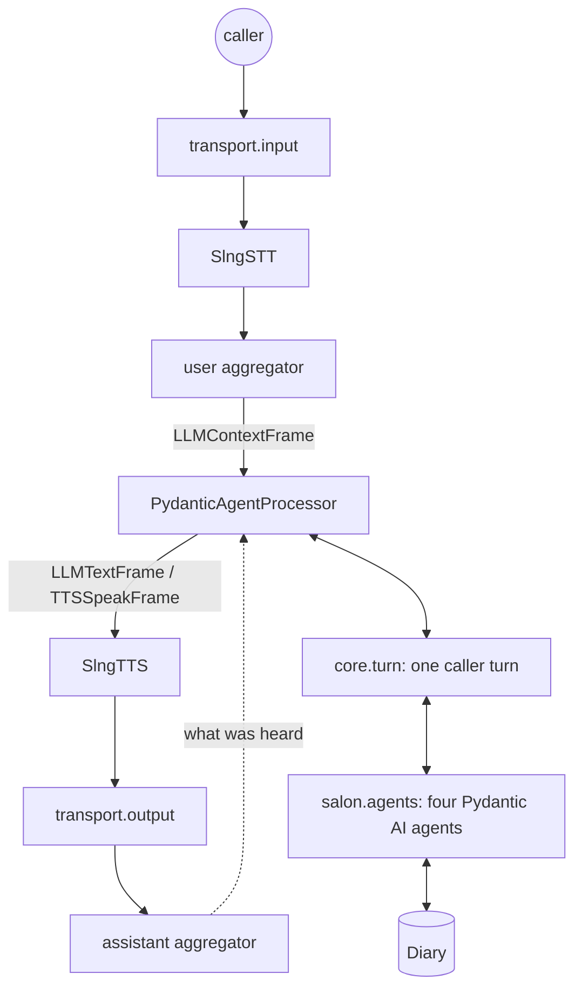
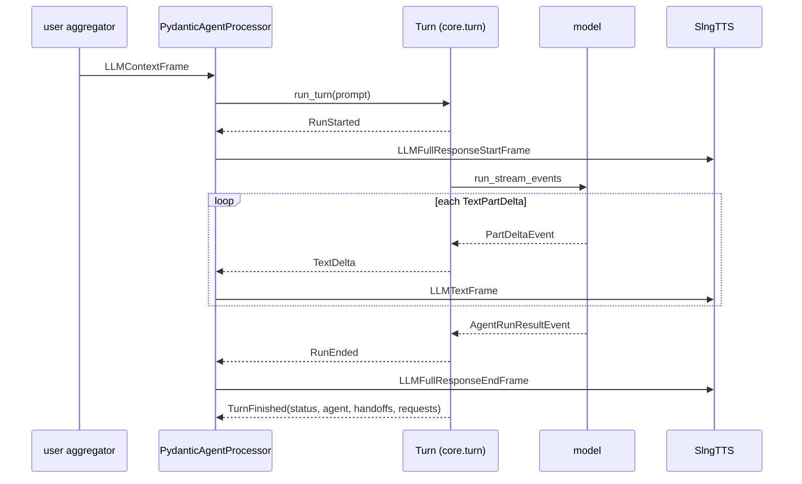
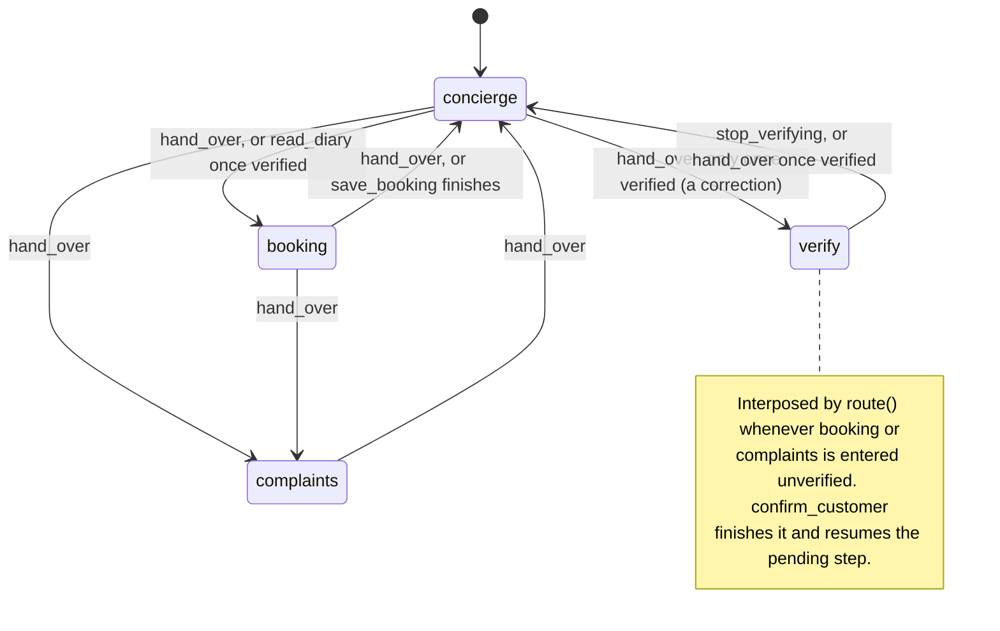

# slng-voice-harness

A Pydantic AI agency standing where Pipecat's LLM service would.

Pipecat owns the transport, VAD, turn taking, STT and TTS (through SLNG). The
agents own the conversation: prompts, tools, typed state, and which step is
running. The seam between them is one frame processor.



---

# Running it

## 1. What you need

- **uv**: `brew install uv`, or see https://docs.astral.sh/uv/. It installs the
  right Python itself. This project pins 3.14.
- **A Vertex AI Express Mode key** for `GOOGLE_API_KEY`. The model string is
  `google-cloud:gemini-3.5-flash-lite`, so a plain Gemini Developer API key is
  rejected.
- **An SLNG key** for `SLNG_API_KEY`, from https://slng.ai. One key covers both
  speech to text and text to speech.
- Langfuse keys are optional. Without them the bot runs and prints one warning
  that traces are going nowhere.

## 2. Install

```bash
git clone <this repo> && cd slng_voice_harness
uv sync                       # creates .venv and installs everything
cp .env.example .env          # then fill in the two required keys
```

## 3. Talk to it

```bash
uv run --env-file .env python bot.py
```

Then open **http://localhost:7860** and click connect. The runner serves a
browser client, so there is nothing else to start.

```
🚀 Bot ready!
   → Open: http://localhost:7860
   → Enabled transports: webrtc, telephony, websocket
```

Useful flags, all from Pipecat's runner:

```bash
uv run --env-file .env python bot.py --port 8080
uv run --env-file .env python bot.py -t webrtc     # one transport only
uv run --env-file .env python bot.py --help
```

A booking, end to end: *"Hi, can I book a haircut for Friday?"* The front desk
hands the caller to booking; booking needs an identified caller, so the graph
interposes verification, which reads the caller ID back. *"Yes, that's right."*
The lookup runs with no model request, the graph resumes booking, and the
diary's free times are offered. *"Three o'clock."* An unambiguous choice of an
offered time is the authorisation, so the write lands and the confirmation is
spoken in the diary's own words. *"That's all, thanks, bye."* The line closes.

## 4. Run the tests

```bash
uv run python -m tests
```

Offline, no `.env`, no network. It prints `all 12 modules ok` or names what failed.

## 5. Traces

With the Langfuse keys set, one call is one trace. Pipecat opens a span for the
whole conversation and one per turn; the agents' runs go inside the turn they
belong to, so a handoff reads as two runs in one exchange rather than two
unrelated traces.

```
conversation                      the whole transcript in, the last line out
├── turn 1                        turn.was_interrupted, turn.user_bot_latency_seconds
│   ├── stt
│   ├── concierge  (agent)  caller's words in, what was spoken out; hops=1 model_requests=1
│   │   └── concierge run         output: the sentence it produced
│   │       └── chat gemini       output: its text, or read_diary({...})
│   └── tts
└── turn 2
    ├── stt
    ├── verify  (agent)  hops=2 handoffs=verify
    │   ├── concierge run         output: handed over to verify: wants to book
    │   └── verify run            output: the readback question
    └── tts
```

Every observation carries the call's session and trace name, not just the root.
Langfuse v4 queries observations rather than traces, so anything left on the root
alone cannot filter or aggregate its children — and Pydantic AI writes a
`gen_ai.conversation.id` of its own, which Langfuse reads as the session unless
something says otherwise. Left alone it did: the whole agency's spend landed
under an id nothing else in the call used.

Input and output are on the observations too, the root included. Pipecat fills
its `conversation` and `turn` spans from the LLM service, which is the one thing
this harness replaced, so both arrived empty; the transcript is rebuilt from the
`stt` and `tts` spans on their way out instead.

Five things make this work, and all five are needed:

| Where | What |
|---|---|
| `bot.py` | `enable_tracing=True` on the `PipelineWorker`, or Pipecat opens no spans at all |
| `utils/observability.py` | a Langfuse client that exports non-GenAI spans; the default filter drops the conversation span everything hangs from |
| `utils/observability.py` | a span processor translating Pipecat's attributes into the `langfuse.observation.*` keys Langfuse renders |
| `utils/observability.py` | the same processor stamping the session and trace name on every span, and rebuilding each turn's and the call's input and output from the speech going past |
| `core/processor.py` | each caller turn parented on Pipecat's open turn span, with what it was asked and answered, `request_ttft`, `turn_first_word`, `speech_origins` and `status` on it |

## 6. Environment

| Variable | Required | What it is |
|---|---|---|
| `GOOGLE_API_KEY` | yes | Vertex AI Express Mode key |
| `SLNG_API_KEY` | yes | SLNG key, for both STT and TTS |
| `LANGFUSE_PUBLIC_KEY` / `LANGFUSE_SECRET_KEY` / `LANGFUSE_BASE_URL` | no | traces, one per call; one warning if unset |
| `LANGFUSE_TRACING_ENVIRONMENT` | no | which Langfuse environment the traces land in; default `default` |
| `CALLER_ID` | no | the number a phone call would arrive with; read back and confirmed before it is trusted |
| `SMART_TURN_STOP_SECS` | no | how long a pause ends the caller's turn when the smart-turn model is unsure; default 1.5 |
| `SLNG_BASE_URL` | no | `eu-north.api.slng.ai` |
| `SLNG_STT_MODEL` / `SLNG_TTS_MODEL` / `SLNG_TTS_VOICE` | no | the SLNG routes and voice |

`.env` is git-ignored; `.env.example` is the template.

---

# How it is built

```
bot.py                  the Pipecat pipeline, and nothing else
core/
  state.py              VoiceState, CallContext and its speech ledger, Handoff, Question
  graph.py              Node, Exit, LocalAction, route, moved_by
  policies.py           TurnBudget, the hooks, pick, schema_tool
  history.py            what each provider request is sent
  turn.py               one caller turn as an event stream; imports no Pipecat
  processor.py          the Pipecat adapter: events in, frames out
salon/
  models/               shapes, consent, receipts, state
  tools/                identity, booking, complaints, desk, writes, asking, policy
  diary.py              the salon's books, in memory
  instructions.py       the prompts, compiled against the call at import
  agents.py             the model, advance(), build(), the AGENTS table
prompts/                one prompt per step, the shared rules, knowledge/
utils/observability.py  Langfuse over OTel
tests/                  twelve assert scripts
```

`core` knows nothing about the salon, and nothing in `core` but the processor
knows about Pipecat. `tests/test_core.py` reads the source and checks both.

# Design choices

Each choice below names what it decided, where it lives, and the document it
rests on. The links are the primary references the design was checked against;
public documentation changes, so behaviour was verified against the pinned
versions in `uv.lock` (Pydantic AI 2.46, Pipecat 1.11).

## 1. Pydantic AI as the LLM node of a Pipecat pipeline

A Pipecat LLM node is a frame contract, not a class. On an `LLMContextFrame`
it pushes `LLMFullResponseStartFrame`, then one `LLMTextFrame` per chunk of
speech, then `LLMFullResponseEndFrame`. TTS, the assistant aggregator, the
transcript and the interruption machinery are built on those three frames and
nothing else, so anything that speaks them can sit in that slot. That is what
`PydanticAgentProcessor` in `core/processor.py` does, and it is the same shape
Pipecat's own bridge to an external agent framework takes.

The agents keep their own history as `list[ModelMessage]` on the call.
Pipecat's `LLMContext` still fills up beside it and is never sent to a model:
it is the aggregators' record of what was actually *spoken*, which is how the
processor learns what the caller heard when they talk over the bot.

- Pipecat's external-framework processor, the precedent for this seam:
  https://github.com/pipecat-ai/pipecat/blob/main/src/pipecat/processors/frameworks/strands_agents.py
- The frames: https://reference-server.pipecat.ai/en/stable/api/pipecat.frames.frames.html

## 2. How streaming works

`Turn._speak` in `core/turn.py` opens `Agent.run_stream_events` and reads the
event stream Pydantic AI emits: a `PartStartEvent` whose part is a `TextPart`,
then `PartDeltaEvent`s carrying `TextPartDelta`s, are speech; a `ToolCallPart`
is not. Each piece of speech becomes a `TextDelta` event, and the processor
turns it into an `LLMTextFrame` the moment it arrives. TTS aggregates by token
rather than by sentence, so the first word is synthesised as soon as the model
produces it.



Three things ride on that stream:

- **Fixed lines** are not generated. A question the application worded, a
  booking confirmation in the diary's own phrasing, the greeting and the error
  lines go straight to TTS as `TTSSpeakFrame`s through `CallContext.say` and
  `speak_now`, and are recorded in the call's speech ledger with who wrote
  them. A turn's delivered speech is therefore not one string, and a trace can
  tell a question from an answer.
- **The clause gate.** On a step that can write (`Node.guarded`), speech is
  held back a clause at a time until the step has written something. Each
  clause is checked by `SalonCall.claims_completion` before it goes out, and a
  clause claiming a change nothing has made is replaced by a correction rather
  than spoken. It costs one clause of latency on those steps only.
- **Barge-in.** The processor fires a `Barge` when Pipecat interrupts; the
  turn cancels the run in flight and stops before starting another. Whatever
  the run completed is kept: messages are retained from the SDK's own
  `new_messages()` boundary after teardown, so accepted input and a tool that
  ran are still in the history, and the assistant aggregator's delivered
  prefix is used to cut the record down to what the caller actually heard.

- Streaming events and output types: https://pydantic.dev/docs/ai/core-concepts/output/
- Message history as an explicit input and output of a run: https://pydantic.dev/docs/ai/core-concepts/message-history/

## 3. Nodes and edges: the graph, and where it lives

A step is a `Node` (`core/graph.py`): the agent that runs it, the `Exit`s it
may take, the state fields it `requires` and the step that `satisfied_by`
fills them. The whole graph is the `AGENTS` table in `salon/agents.py`:

```python
'booking': build(
    'booking',
    tools=[read_diary],
    finishers=[save_booking],
    asks=[ask_booking, offer_times, booking_guidance],
    guarded=True,
    exits=(Exit('concierge'), Exit('complaints')),
    requires=('customer_verified',),
    satisfied_by='verify',
),
```



Two functions walk the graph and neither runs a model:

- **`route(state, nodes, to)`** decides where a handoff actually puts the
  caller. If the destination has an unmet prerequisite, the graph records the
  destination as `pending`, enters the step that satisfies it, and the
  finisher there calls `resume` to go back. No request decides that, and no
  prompt states the ordering.
- **`moved_by(state, node, nodes, succeeded)`** decides where a *successful*
  borrowed tool has put the caller. A step lends a neighbour's entry tool into
  its own schema while an `Exit` guard holds (`Exit('booking', verified,
  via=(read_diary,))`), and calling it *is* the move: the request that moved
  the caller is the request that did their work. Only tools that returned
  count; a refused tool is not a move.

Illegal moves are unrepresentable rather than refused. Each step's `hand_over`
is built by `hand_over_for` with a `Literal` of only that step's destinations,
and two `prepare` hooks rebuild the offered tools before every provider
request: `only_reachable` hides a borrowed tool while its guard does not hold,
and `narrow` rewrites the `hand_over` enum to the exits that are open right
now. Both are re-checked at execution, because a schema built before the tools
in the same reply ran is a convenience for the model, never the enforcement.

- Preparing tools and output tools per request: https://pydantic.dev/docs/ai/capabilities/prepare-tools/
- Programmatic handoff, as distinct from delegation: https://pydantic.dev/docs/ai/guides/multi-agent-applications/
- Function tools and their schemas: https://pydantic.dev/docs/ai/tools-toolsets/tools/

## 4. Typed state, and how it is updated

`VoiceState` (`core/state.py`) is the business facts of a call and nothing
else. `SalonState` (`salon/models/state.py`) adds the salon's: the caller's
number, whether they confirmed it, what the lookup found, the appointment the
diary holds, how many writes have been accepted, and the one write whose
outcome is unknown. Every field is a validated shape from
`salon/models/shapes.py`, so a state cannot hold a phone number that is not a
Spanish number or a date that is not on the calendar.

Three Pydantic opt-ins are on, and none is on by default: `validate_default`,
so an authored default that breaks its own type fails at import;
`validate_assignment`; and `revalidate_instances='always'`, so a nested model
handed in is revalidated rather than trusted. Each alone leaves a hole the
other two do not cover.

State is never assigned field by field. `CallContext.commit(**updates)`
builds one whole candidate from the current values plus the updates and
validates it; on failure the previous state object is untouched. It is not
`model_copy(update=...)`, which copies updates in without validating them, and
a keyword naming no field is refused rather than dropped. A `model_validator`
on `SalonState` runs on every commit and clears verification that does not
belong to the number now on the call, so authorisation cannot survive a
correction and a status nobody earned cannot be constructed.

A commit from a turn the caller has moved on from keeps its business facts and
loses its flow fields: a booking that landed is a fact whichever turn made it;
where the caller *is* belongs to the current turn.

- Model configuration, assignment validation: https://pydantic.dev/docs/validation/latest/api/pydantic/config/
- Models and validation: https://pydantic.dev/docs/validation/latest/concepts/models/
- `TypeAdapter`, used for tool arguments and the phone shape: https://pydantic.dev/docs/validation/latest/concepts/type_adapter/
- Dependencies (`deps_type` is typed access, not a runtime validator): https://pydantic.dev/docs/ai/core-concepts/dependencies/

## 5. Typed flow

Typed values were never the hard part. A valid phone number does not establish
that the caller confirmed it; a valid booking request does not establish
approval; a successful lookup does not say which pending request to resume.
The POC connects four contracts, and each has one place in the code:

| Contract | Question it answers | Where |
|---|---|---|
| Typed values | Is the value structurally valid? | `salon/models/shapes.py`: `Phone`, `SubmittedPhone`, `Date`, `Time`, `Id` |
| Typed state | Do the facts remain consistent after an update? | `CallContext.commit`, the `SalonState` identity invariant |
| Typed flow | Is this action allowed now, and where do we continue? | `route`, `moved_by`, `Exit.guard`, `Node.requires`, the prepare hooks |
| Typed completion | What evidence is required before success is spoken? | `salon/models/receipts.py`, `salon/tools/writes.py` |

Typed completion is the boundary most often skipped. `Diary` stands in for an
HTTP service and hands back dicts; every one is parsed into a receipt model
(`Slots`, `Saved`, `CustomerLookup`, `ComplaintRecord`) before a field is
read, and a legal-looking receipt is then checked against the *request*: a
`cancelled` result is not an answer to a `book` request however well-formed it
is. Every write carries an operation token derived from what the action is,
and a write whose answer was lost is recorded as `Unresolved` on the state,
which blocks every other write until the token has been asked what happened.

## 6. The custom logic

Everything the model used to decide that the application now decides, and the
mechanism for each:

- **One budget per caller turn.** `TurnBudget` (`core/policies.py`) is one
  tally of provider requests, one tool-call allowance, a fixed number of step
  runs and one deadline, threaded through every run in the turn. An exhausted
  turn gets one fixed line and no further request.
  https://pydantic.dev/docs/ai/api/pydantic-ai/usage/ ·
  https://pydantic.dev/docs/ai/core-concepts/retries/ ·
  https://pydantic.dev/docs/ai/core-concepts/timeouts/
- **One action per model reply.** `one_action_per_reply` reads the whole
  response in `after_model_request`, in emission order, and picks the one tool
  call allowed to move the caller or write to the business; `claim_or_refuse`
  is how an action checks it holds the claim, because `before_tool_execute`
  does not fire for output tools.
- **Speak by the third request.** `speak_by` empties the ordinary tool set
  from a given request on, so a run cannot buy a fourth lookup; its output
  tools stay, so it can still finish.
- **A clock per request.** `request_clock` stamps each provider request on
  the way out, so time to first token is per request and says whether the
  first thing back was speech or a tool call.
- **Consent is application-owned.** `CallContext.heard` is what the caller
  said this turn, `Asked` (`salon/models/consent.py`) is the one question they
  are answering, and an `Ask` output function words the question and records
  it. Every consequential action checks the two against each other, and the
  matchers `agrees`, `ends`, `move_or_add` and `times_named` are closed word
  lists that fail towards asking again.
- **Approvals with no model request.** `Node.advance` (`salon/agents.py`
  `advance()`) runs before a step's agent. A clear yes to the pending question
  runs the same executor the model tool runs (`lookup_customer`,
  `write_booking`, `write_complaint`) as a `LocalAction`, spending the shared
  budget and retaining its receipt, with zero provider requests.
- **Deterministic continuation.** A finisher does its work and returns a
  `Handoff` whose destination is `call.resume(...)`, which the graph already
  knows. A prerequisite step reports `completed` or `unserved`, and the
  engine restores the owner's checkpoint and tells the next agent what
  happened through an instruction part.
- **History is projected, not sent raw.** `core/history.py`'s `paired` drops
  tool calls a cancellation left unanswered and `project` merges the speech
  ledger into the protocol by segment id, so a model is told what the caller
  heard and never an assistant message with nothing after it.
  https://pydantic.dev/docs/ai/capabilities/process-history/
- **Prompts are compiled against the call.** `salon/instructions.py` builds a
  `TemplateStr[SalonCall]` per step from `prompts/*.md`, so a placeholder
  naming no field fails at import, every `{{#if}}` is resolved before the model
  reads it, and the salon's own documents are substituted in rather than
  fetched by a retrieval tool. https://pydantic.dev/docs/ai/api/pydantic-ai/template/
- **The diary computes what a model would guess.** Which day "next Friday"
  is, whether a slot has already passed, whether two appointments overlap,
  what a booking sounds like out loud: all `salon/diary.py`, none asked of a
  model.

## 7. Telemetry

Langfuse over OpenTelemetry. Pydantic AI's instrumentation emits the agent
runs; Pipecat emits the conversation, the turn, stt and tts; the processor
emits one span per caller turn, named after the step that answered and typed
`agent`, parented on Pipecat's open turn span. Pydantic AI's own run and request
spans get a readable output: the sentence a run produced, where it handed the
caller, or the text and tool calls a request answered with; the raw messages stay
in the observation's metadata.
`utils/observability.py` does the two things nothing else does: exports the
non-GenAI spans Langfuse would otherwise drop, and translates Pipecat's
attributes into `langfuse.observation.*` so a speech span arrives with its
text and its model rather than empty. Counting provider requests means
counting `model_requests` on the turn span, not every observation labelled
a generation: speech services are generations too.

- Langfuse trace structure and counting: https://langfuse.com/docs/observability/best-practices
