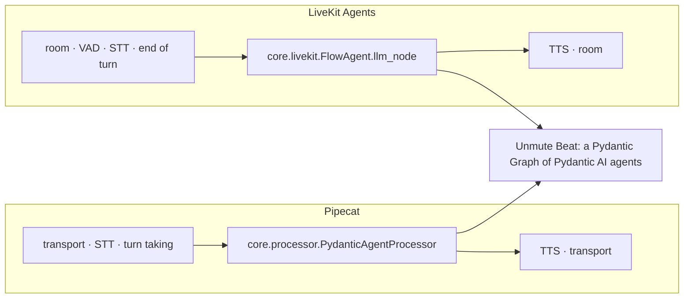
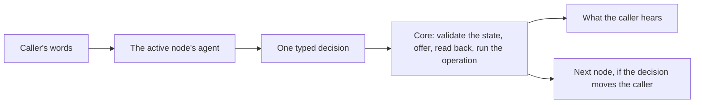
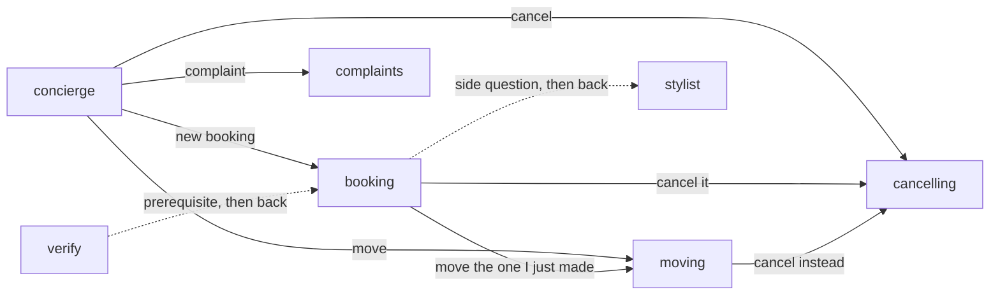

# Unmute Beat

**Structured conversations for voice agents: an agentic LLM node for Pipecat and LiveKit Agents.**

Most voice agents are one long prompt and a list of tools. The model is asked to remember every rule on every turn:
who the caller is, what was offered, what is waiting for a yes, what already happened. When it forgets one, the
caller gets a double booking, a change they never agreed to, or a confident "done" for something that never ran.

Unmute Beat gives the conversation a structure instead. The call is a graph of small jobs, each with its own focused
agent. The rules live in code, so they hold on every turn, whatever the model says.

The package is `slng-voice-core`, imported as `core`. Put it in the slot where your voice framework would call an
LLM. In Pipecat that is the LLM service in the pipeline. In LiveKit Agents it is the agent's `llm_node`. The
framework keeps doing the audio: transport, voice activity detection, turn taking, speech-to-text (STT) and
text-to-speech (TTS). Unmute Beat runs the conversation: between what the caller said and what the bot says back.



## One prompt, or a structured conversation

| | One prompt with tools | A structured conversation (Unmute Beat) |
|---|---|---|
| **Where the rules live** | In the prompt, as instructions the model may skip | In code, checked on every turn |
| **What the model sees** | Every rule, tool and fact, on every request | Only the current job's prompt, facts and outputs |
| **What the model returns** | Free text and tool calls, parsed after the fact | One typed, validated decision |
| **Moving between topics** | Wherever the model drifts | Only along the edges the graph declares |
| **Making a change** | When the model decides to call the tool | Only after a read-back the caller heard in full, and a yes to that exact question |
| **A lost answer from the backend** | Often retried, sometimes done twice | Tracked as an intent and reconciled, never sent twice |
| **Words the bot already knows** | A model request each time | Said by code: offers, questions, read-backs, receipts, goodbyes |

## What it is

A plain LLM node takes the conversation so far and returns text. Unmute Beat's node is **agentic**, and it is
**a graph**:

- **A graph of small agents.** A call is a [Pydantic Graph](https://ai.pydantic.dev/graph/). Each node of the graph
  does one job the caller wants done, such as "book", "move" or "cancel", and has its own
  [Pydantic AI](https://ai.pydantic.dev/) agent, prompt, tools and visible facts. The graph declares the legal moves
  between nodes, and refuses any other.
- **Typed from end to end.** The call's state is your own Pydantic model. Every model answer is one typed decision,
  validated before anything happens.
- **The same brain on both frameworks.** One turn engine (`core.turn`) runs every caller turn. Pipecat and LiveKit
  each get a thin adapter around it, and one `bot.py` runs on either.

You describe the graph in one file, `agent.yaml`: the nodes, what each may see and change, and how they connect.
It is checked when it loads, before any call or model request.

## What you get from it

| Benefit | How the structure gives it |
|---|---|
| **Nothing changes without consent** | A change is read back first. It runs only on a yes to that exact read-back, and only after playback evidence (Twilio marks, the browser's report) shows the caller heard it in full. |
| **Correct state** | The state is validated as one whole model on every change, or nothing changes. A pick must be one that was offered. |
| **Safe writes** | Every business action is an intent with an id. A lost answer is reconciled with the backend, and an action whose outcome is unknown is never sent again unless the backend deduplicates it. |
| **Fewer, cheaper requests** | Code says every line it already knows: offers, questions, read-backs, receipts and goodbyes. The target is one model request per caller turn, with a small prompt and schema. |
| **Mistakes stay contained** | Each node sees only its own facts, history and outputs. A wrong reading in the moving node cannot book. |
| **Real voice behaviour** | A caller who talks over the bot, pauses mid-sentence or answers before a question finished playing is handled by the turn engine, the same way on both frameworks. |
| **Testable offline** | Drive the real graph with a scripted model, with no provider request, and check the backend's end state. |
| **Observable** | Every turn, request, intent and receipt is traced through OpenTelemetry (Langfuse or a local collector). |

## Use it

Install the package with the extra for your framework: `slng-voice-core[voice]` for Pipecat,
`slng-voice-core[livekit]` for LiveKit Agents. Importing `core` alone loads no framework, so the same application
code serves both.

Load and compile the graph once per process, and open one call per caller:

```python
import core

FLOW = core.load('shop/agent.yaml').compile()            # checks the graph and builds its agents
call = FLOW.open(ShopState(), services=Shop(backend))    # one call: its own state, history and pending work
```

**In Pipecat**, the processor stands where the LLM service would:

```python
from core.processor import PydanticAgentProcessor, playout

node = PydanticAgentProcessor(call, FLOW.nodes)
pipeline = Pipeline([
    transport.input(), stt, user_aggregator,
    node,                                                 # instead of the LLM service
    tts, transport.output(),
    *playout(transport, call, echoes_marks=True, simulate=False),
    assistant_aggregator,
])
```

**In LiveKit Agents**, `FlowAgent` is an `Agent` whose `llm_node` runs the graph:

```python
from core.livekit import FlowAgent, playout

agent = FlowAgent(call, FLOW.nodes)
playout(call, simulate=False)
await session.start(agent, room=ctx.room)
agent.attach(session)                                     # wires playback evidence and the session's events
```

You rarely write either by hand. `core.launch.run_call` (Pipecat) and `core.livekit_launch.run_call` (LiveKit) build
the whole call around your use case: speech services, VAD, playback evidence, the greeting and a call ceiling.
A use case's `bot.py` is a few lines, and `core.voice.serve` picks the framework:

```bash
uv run bot.py              # Pipecat
uv run bot.py livekit dev  # LiveKit Agents
```

Core has no business logic of its own. An application brings five things: a state model, operations, choice
functions, prompts and a manifest (`agent.yaml`). The rest of this README explains how to build any application
this way, then shows the reference application, a hair salon that books, moves and cancels appointments.

## How a turn works



1. The call is always in one **node**. Each node does one job the caller wants done.
2. The node's agent reads what the caller said. It answers with **one typed decision**, such as a reply, an
   operation or a hand-over to another node. The facts the caller gave ride on the decision as an `update`.
3. **Code checks the decision.** The new facts are validated as one whole state. A pick must be one that was
   offered. A hand-over must follow an exit the manifest declares.
4. **Code says every line it already knows.** That covers offers, questions for missing facts, read-backs,
   confirmations and goodbyes. The model writes words only when it answers something code cannot know.
5. **Nothing changes without consent.** An operation that changes something is read back first. It runs only on a
   yes to that exact read-back, and only after the caller heard it in full.

The target is one model request per caller turn.

### The decisions a node's agent can make

| Decision | What it does | Who speaks |
|---|---|---|
| `reply(say, update)` | Answers the caller, and records any facts they gave | the model's `say` |
| `record(update)` | Only records facts, such as a new day | code: the node's next offer or question |
| an operation, with its `update` | The first call reads the change back. The same call after a yes carries it out. | code: the read-back, then the receipt's words |
| `hand_over(to, because, update)` | Moves the caller to another node, with the facts they gave | code: the new node's first line |
| `goodbye(recap)` | Ends the call | code: the recaps and the goodbye line |
| `say_again` | Repeats the last confirmation | code |
| `done(answer)` | Ends a consultation and returns the caller | the model's `answer` |

A clear no to a read-back is `reply` or `goodbye` with `decline` set. The node's own prompt says which decisions to
use when. Core only offers the decisions a node can make: a node with no operation has no operation output.

## Build an application

An application is one folder, and the folder is a Python package with an `__init__.py`. The files import each
other by the package name, such as `from shop.state import ShopState`. Each file has one job:

| File | Holds |
|---|---|
| `state.py` | one plain Pydantic model with every fact the call keeps |
| `operations.py` | the business actions: arguments, what runs, the read-back, and how a lost answer is found again |
| `offers.py` | the choice functions: what the caller may pick from, and the words for it |
| `prompts/*.md` | one prompt per node, plus shared prompts for the voice and the business rules |
| `agent.yaml` | the nodes, what each may see and change, and how they connect |
| `app.py` | loads the manifest once, and opens one call per caller |
| `bot.py` | the launcher for Pipecat and LiveKit: copy it from the salon and change the import |

The steps below build a small example: a shop that takes an order. Every code block is a skeleton. The salon has
the full, working version of each.

### 1. Write the state model

```python
class ShopState(BaseModel):
    model_config = ConfigDict(extra='forbid')

    customer_phone: core.Phone | None = None
    customer: Customer | None = None
    item: str | None = Field(None, description='The id of the item the caller picked, from the items on offer.')
    delivery_day: Annotated[date, core.NotPast] | None = Field(None, description='The day they want it, as YYYY-MM-DD.')
```

1. **Every field has a default.** A call starts empty.
2. **The types carry the rules.** `core.Phone` is checked with libphonenumber. `core.NotPast` refuses a past date.
   `core.Quoted` checks the text is the caller's own words.
3. **The descriptions are prompt text.** The model sees each field with its type and description.
4. **A receipt can be a field.** `customer` is set only by the lookup's receipt, never by the model.

### 2. Write the operations

An operation is a class. Its fields are its arguments, taken from the state by name. Its return type is the
outcome.

```python
class PlaceOrder(core.Write[Shop]):
    phone: core.Phone = Field(validation_alias=AliasPath('customer', 'customer_phone'))
    item: str
    matches = ('phone',)
    say = 'Your order {order_id} is placed. Anything else?'
    recap = 'Your order {order_id} is placed.'

    def run(self, shop: Shop, intent: core.Intent) -> Placed | Refused: ...
    def readback(self, shop: Shop) -> str:
        return f'Shall I order {shop.name_of(self.item)}?'
    def reconcile(self, shop: Shop, intent: core.Intent) -> Placed | Refused: ...
```

1. **`core.Write` always needs a heard read-back and a yes.** `core.Lookup` needs one only when it defines
   `readback`.
2. **Arguments come from the state, never from the model's words.** `AliasPath` reads a nested field, here the
   number the lookup verified.
3. **The return type is the outcome.** Each member is a `core.Receipt` model. A member that subclasses
   `core.Rejection` is an authoritative no.
4. **`say` and `recap` are the words for the receipt.** Code fills them from the receipt's fields.
5. **`reconcile` finds a lost answer.** If the backend did not answer, core asks it by the intent's id before
   anything is sent again. Set `idempotent = True` when the backend deduplicates by that id.

The class `Shop` is the application's services: the backend client and anything else the operations need. It is a
plain dataclass. The model never sees it.

### 3. Write the choice functions

A choice function says what the caller may pick for one field. It reads the services and the state.

```python
class Offer(BaseModel):
    options: dict[str, str] = {}
    say: str = ''
    note: str = ''
    pick: str = ''

def items_in_stock(shop: Shop, state: ShopState) -> Offer:
    items = shop.in_stock()
    if not items:
        return Offer(say='Nothing is in stock today. Can I help with anything else?')
    return Offer(options=items, say=f'I have {", ".join(items.values())}. Which one would you like?')
```

| Field | Meaning |
|---|---|
| `options` | the ids the caller may pick, with the words for each |
| `say` | what code says to the caller: the offer, or a question for a fact still missing |
| `note` | what the model is told and the caller is not |
| `pick` | the one id, when there is only one choice. Code records it with no question. |

A pick counts only if it was offered, so the model cannot invent an id.

### 4. Write the prompts

1. One shared prompt for the voice: tone, length, how to say numbers. The manifest's persona points at it.
2. One prompt per node. Say what the node's job is, and which decision to use when. Name only the outputs that
   node has.
3. Shared text, such as opening hours, goes in its own file. A prompt includes it with a marker like
   `<!--hours-->`, declared under `includes:`.

The prompt never lists the facts or the offers. Code adds them before every request, with today's date and a
calendar.

### 5. Write `agent.yaml`

```yaml
version: 2
id: shop
state: state.py:ShopState
identity: customer_phone
entry: front_desk
greeting: "Hi, you've reached the shop. How can I help?"
current_datetime: {timezone: Europe/Madrid, calendar_days: 14}
context: {facts: none, history: {scope: node, turns: 8}}
model: google-cloud:gemini-3.5-flash-lite

agents:
  clerk: {prompt: prompts/_voice.md}

operations:
  lookup_customer: operations.py:LookupCustomer
  place_order: operations.py:PlaceOrder

steps:
  front_desk:
    agent: clerk
    prompt: prompts/front_desk.md
    exits:
      - {to: ordering, purpose: 'a new order'}

  verify:
    agent: clerk
    prompt: prompts/verify.md
    fields: [customer_phone]
    context: {facts: [customer_phone, customer]}
    operations: [lookup_customer]
    reads_back: {lookup_customer: [customer_phone]}
    asks: {customer_phone: 'Which phone number should I use?'}

  ordering:
    agent: clerk
    prompt: prompts/ordering.md
    requires: [customer]
    satisfied_by: verify
    fields: [item, delivery_day]
    context: {facts: [item, delivery_day]}
    choices:
      item: {function: offers.py:items_in_stock, after: [delivery_day]}
    offers: [item]
    operations: [place_order]
    reads_back: {place_order: [item]}
    exits:
      - {to: front_desk, purpose: 'they give up, or ask about something else'}
```

The top of the file describes the whole application:

| Key | What it means |
|---|---|
| `state`, `identity` | the state model, and the field that identifies the caller |
| `entry`, `greeting` | the first node, and the first words of the call |
| `current_datetime` | the time zone and how many labelled days of calendar every node sees |
| `context` | the default for what each node sees: here no facts, and its own last eight turns |
| `model`, `agents` | the model, and the personas with their shared prompt and model settings |
| `operations` | every operation, one line each: `file.py:Class` |
| `locale`, `includes` | the fixed lines in the caller's language, and shared prompt files |

Each step is one node. A step with no `kind` is a conversation node, and its speech is `structured`:

| Key | What it means |
|---|---|
| `prompt`, `agent` | the node's prompt, and the persona it speaks as |
| `fields` | the state fields this node may change |
| `context.facts` | the state fields this node's model sees. A field it may change must be one it sees. |
| `choices` | a field picked from an offer, with its function. `after:` names the fields the offer rests on. When one changes, the offer and the pick are reset. |
| `offers` | the choices whose `say` code speaks on arrival, and again after a `record` |
| `operations` | what this node may carry out |
| `reads_back` | recording this field makes code read the operation back with no second request |
| `asks` | the fixed question code asks for a missing field on arrival |
| `opens_with` | an operation code reads back on arrival, when its arguments are already known |
| `requires`, `satisfied_by` | a fact that must exist first, and the node that gets it. The graph sends the caller there, then back. |
| `exits` | the nodes this one may hand the caller to, each with a purpose the model reads |
| `consults` | a specialist node that answers a side question and returns the caller |
| `capabilities` | Pydantic AI capabilities, such as a policy loaded only when asked about |
| `carries_out` | an operation with no read-back that code runs after a `record` |

The loader checks every name, file, field, operation and exit when the application starts. A mistake fails at
startup, never mid-call.

### 6. Open a call

```python
SPEC = core.load(Path(__file__).with_name('agent.yaml'))
FLOW = SPEC.compile()

def open_call(flow: core.StepFlow, from_number: str, backend: Backend) -> core.FlowCall:
    return flow.open(ShopState(), services=Shop(backend), caller_id=from_number)
```

1. `compile()` runs once per process. Every call shares the compiled flow and nothing else.
2. `open()` gives each caller a separate call, with its own state, history and pending work.
3. `caller_id` fills the identity field from the carrier's number, when it is a real one.

`bot.py` wires the call to Pipecat with `core.processor.PydanticAgentProcessor`, or to LiveKit with
`core.livekit.FlowAgent`. It also wires the playback evidence (Twilio marks, or the browser page's report), without which no read-back can be approved.

## Design the nodes

A node is one job the caller wants done. It is not a sentence or a tool. This is the house style for every
application:

1. **One job, one operation.** Split by what the caller wants: booking, moving and cancelling are three nodes, not
   one. A node's prompt and outputs cover only its job.
2. **Code opens the node.** Name the choice in `offers:` whose `say` is the node's first line. When the caller has
   only one choice, the function returns it as `pick`, and the next question comes at once.
3. **Declare prerequisites.** A fact every job needs first, such as a verified caller, is `requires` with
   `satisfied_by`. Do not repeat it in every prompt.
4. **A change of mind is an exit.** Give each exit a purpose the model can read. A hand-over can carry the new
   facts, so the next node starts with them.
5. **A side question is a consultation.** `consults:` answers it in a specialist node, then returns the caller to
   the same place.
6. **Show each node only what its job needs.** List its facts in `context.facts`. Keep history to its own turns.

Why this works:

- **Small prompts and schemas.** Each request carries one job's instructions, facts and outputs. That suits a small,
  fast model.
- **Fewer requests.** Code knows each node's first line, so no request is spent on it.
- **Mistakes stay contained.** A wrong reading in the moving node cannot book, and one in the cancelling node cannot
  move.

## State, memory, records and services

Four kinds of data live in a call. They are kept apart on purpose.

| | What it holds | Who writes it | What the model sees | Lifetime |
|---|---|---|---|---|
| **Application state** | the facts in your state model | the model's update and operation receipts, validated as one whole state | only each node's `context.facts` | the call |
| **Conversation memory** | what was said and heard, turn by turn | the turn engine | each node's own recent turns (`history`) | the call |
| **Runtime records** | the pending read-back, offers, intents, receipts, the speech and playback ledger | core only | a short status line when relevant | the call; intents and receipts also go to the backend |
| **Services** | the backend, its clients and keys | the application | never | the process |

1. **State is replaced whole.** Every change builds a complete new state and validates it, or changes nothing. A
   change also resets what rested on the old value, through `after:`.
2. **Memory is scoped.** A node sees its own turns, plus the caller's words that brought it there. It does not see
   another node's tool calls.
3. **Records are core's.** A model cannot write "approved" or "done". Only a heard yes and a validated receipt do.
4. **Services stay out of prompts.** A prompt cannot name them, and the loader refuses one that tries.

## Test it

1. **Offline.** Drive the real flow with a scripted model, so no provider request is made. Check the end state of
   the backend, not the words. Pin each node's request in a golden file, so a prompt or schema change shows in a
   diff. The salon's [`tests/`](use-cases/salon/tests/) folder is the pattern to copy.
2. **Live.** Run the calls on Coval over a real phone line, with
   [`coval_sim`](use-cases/concierge-tools/coval_sim/). Judge them by the backend's end state, the traces and
   [`load_report`](use-cases/concierge-tools/load_report.py).

## Example: the salon

The reference application is [`use-cases/salon`](use-cases/salon/), a hair
salon called Sage and Stone. Its backend is a diary of bookings.



The salon used to have one booking node that also moved and cancelled. It is now three nodes:

| Node | Its one job | Its first line on arrival (said by code) |
|---|---|---|
| `booking` | make a new booking | "On Friday I have 9:00, 9:30 or 10:00. Which time works for you?", or "Which day would you like?" |
| `moving` | move a booking the caller holds | "You have a haircut Friday at 9:00. Which day would you like to move it to?" |
| `cancelling` | cancel a booking the caller holds | "Shall I cancel your haircut Friday at 9:00?" (the read-back is the only question) |

Each of the three requires a known customer, so `verify` runs first when the caller is not yet known. `verify`
reads the caller's number back, and the lookup runs on a yes. `stylist` answers questions about hair and returns
the caller.

This is the real `booking` step:

```yaml
booking:
  agent: robin
  prompt: prompts/booking.md
  requires: [customer]
  satisfied_by: verify
  fields: [service, booking_day, booking_time, slot]
  context: {facts: [service, booking_day, booking_time, slot]}
  choices:
    slot: {function: offers.py:find_times, after: [booking_id, service, booking_day, booking_time]}
  offers: [slot]
  operations: [book_appointment]
  reads_back: {book_appointment: [slot]}
  capabilities: [capabilities.py:refunds]
  exits:
    - {to: moving, purpose: 'moving a booking they hold, the one just made included'}
    - {to: cancelling, purpose: 'cancelling a booking they hold, the one just made included'}
    - {to: complaints, purpose: 'a complaint about a past service'}
    - {to: concierge, purpose: 'they give up booking, or ask about something unrelated to booking'}
  consults:
    - {to: stylist, purpose: 'a question about hair: which service suits them, colour, aftercare, how long a service takes'}
```

1. On arrival, `find_times` offers the free times for the service and day the caller already gave. If the day is
   missing, it asks for it. Code says either one, with no model request.
2. When the caller says a day, the model answers `record`. The day changes, so the old offer is reset, and code
   offers the new day's times.
3. When the caller picks a time, the model calls `book_appointment` with the slot. Code reads the booking back.
4. On a yes, the model calls `book_appointment` again. The booking runs, and code says the receipt's words.
5. The refund policy is loaded only if the caller asks about money back.

The salon's files:

| File | Holds |
|---|---|
| [`state.py`](use-cases/salon/salon/state.py) | `SalonState`: phone, customer, service, day, time, slot, booking id, complaint |
| [`operations.py`](use-cases/salon/salon/operations.py) | `LookupCustomer`, `BookAppointment`, `MoveAppointment`, `CancelAppointment`, `RecordComplaint` |
| [`offers.py`](use-cases/salon/salon/offers.py) | `find_times`, `bookings_to_move`, `bookings_to_cancel` |
| [`prompts/`](use-cases/salon/salon/prompts/) | one prompt per node, `_voice.md` and `_diary.md` |
| [`agent.yaml`](use-cases/salon/salon/agent.yaml) | seven nodes and five operations, about 150 lines |

### Live results

Measured on Coval over the real Twilio line. The verdict comes from the salon's diary at the end of each call, the
traces, and [`load_report`](use-cases/concierge-tools/load_report.py). Coval's LLM judges are reported but not used
as the verdict: on these runs they gave several NO answers that contradicted the transcript or their own
explanation.

| Run | Callers | Calls | Result | Requests per turn | Input tokens per call | Turn latency p50 |
|---|---|---:|---|---:|---:|---:|
| [Routine bookings](https://app.coval.dev/slng-ltd-1787040174713992753/workspace/01M09YA4S1SC1Q8AHKHP2R9A0E/simulated/runs/BBdQ7UVJVoNng7HuuggpTR) | normal | 5, 5 at once | 5 of 5 right in the diary and in `load_report` | 0.80 | 15.5k | 3.13 s |
| [Graph paths](https://app.coval.dev/slng-ltd-1787040174713992753/workspace/01M09YA4S1SC1Q8AHKHP2R9A0E/simulated/runs/FZ2Hg5smLR4e4FxQaFFBVp) | normal | 8, 8 at once | 8 of 8 right in the diary | 0.88 | 20.2k | 2.71 s |
| [Graph paths](https://app.coval.dev/slng-ltd-1787040174713992753/workspace/01M09YA4S1SC1Q8AHKHP2R9A0E/simulated/runs/CHbiNaE3KApGEFyqL4t3Zz) | interruptive | 8, 8 at once | 8 of 8 right in the diary | 1.00 | 32.2k | 2.50 s |

The graph-paths set has eight cases:

1. book;
2. book with no day given;
3. move a held booking;
4. book, then move it to the next day;
5. cancel a held booking;
6. book, move, then cancel;
7. hold two bookings and cancel one;
8. ask to move with nothing held, then book instead.

In every call, each change was read back and confirmed before it happened, and every read-back was heard in full on
Twilio's marks. Nothing was booked twice.

Two things to know about these runs:

1. **One interruptive call ran out of turn budget.** The caller said "no" and then the same number again. The verify
   node handed the caller on instead of confirming, and the flow sent them back to verify, twice in one turn. The
   budget stopped the loop. The next turn verified the number, and the right booking was cancelled.
2. **A bare weekday can still be read as next week's.** An earlier run booked "Thursday", said on a Wednesday, a week
   late. It was read back and accepted. Case 2 was right this time, but the fix is separate work.

### Try it

The workspace uses Python 3.14+ and uv. Put the provider keys in the root `.env`, then:

```bash
uv sync --all-packages
cd use-cases/salon
uv run bot.py              # voice in the browser, http://localhost:7860
uv run bot.py livekit dev  # the same call on LiveKit Agents (LIVEKIT_URL, LIVEKIT_API_KEY, LIVEKIT_API_SECRET)
uv run python -m tests     # the offline suite, no model requests
```

Every use case runs on Pipecat or on LiveKit Agents from the same `bot.py`. The brain is the same on both;
[chapter 06](docs/architecture/06-livekit.md) explains how it plugs into LiveKit and what LiveKit can and
cannot tell it about what the caller heard.

## Read more

- The [architecture guide](docs/architecture/README.md) follows one salon call through nodes, state, operations and
  recovery, with the code behind each step.
- [CLAUDE.md](CLAUDE.md) has the workspace layout, every module's job and the development commands.
- The [studio](studio/README.md) draws every agent's step graph locally (`slng studio up`); its design and build plan are in [docs/studio](docs/studio/README.md).
- Faro, a language-learning companion, runs on the same core ([`use-cases/faro-language-learning`](use-cases/faro-language-learning/)).
