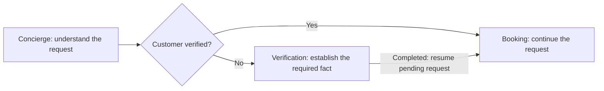
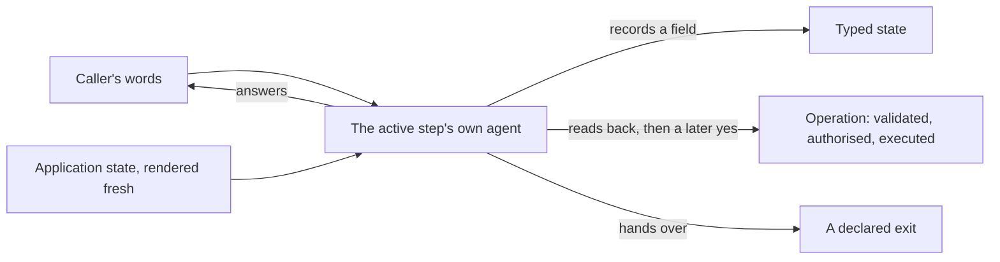
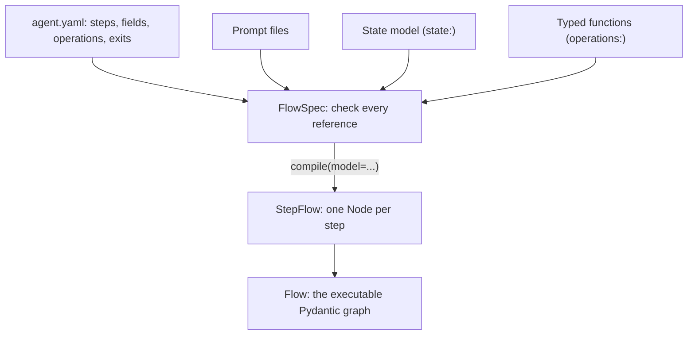
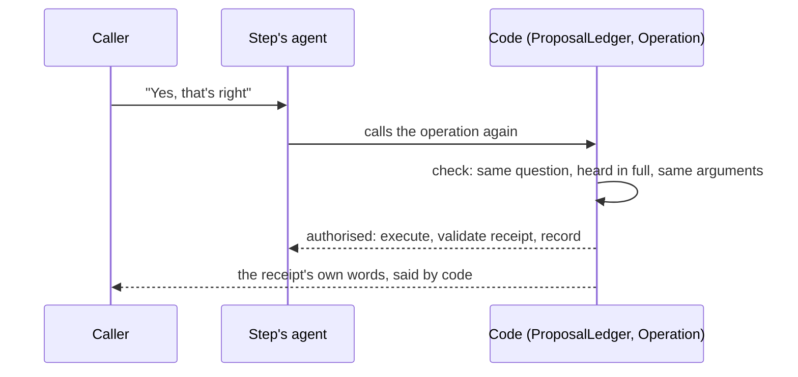
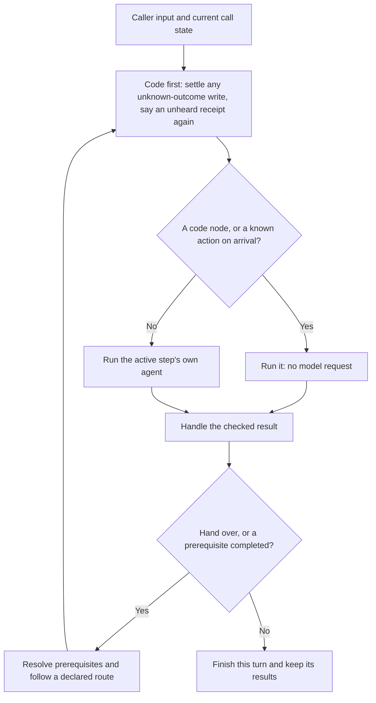
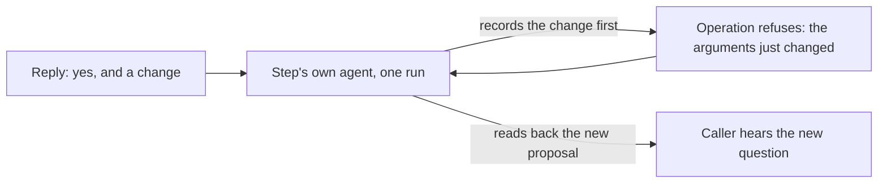
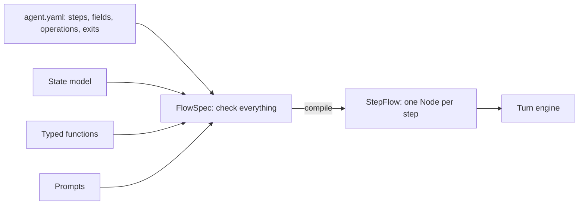

# Typed conversations: how the core works

A voice agent should let people speak naturally while following clear rules
about what it knows, what it can do and when it can act. **The purpose of this
core is to make those rules executable.** The model interprets language. Typed
data, declared steps and Python checks connect that interpretation to the
application's actions.

This guide explains the architecture implemented in `core/` (the package `core/src/core/`). It follows the
original goal of **typed conversations**: typed variables, typed steps and
controlled flow, with the same execution machinery reusable across
applications. The salon receptionist in `use-cases/salon-graph/` is the first application
built on it. Faro, a language-learning companion in
`use-cases/faro-language-learning/`, is the second.

## 1. Start with a graph: a map of the conversation

A graph describes pieces of work and the allowed connections between them. In
a conversation:

- A **node** is a place where work happens.
- An **edge** is an allowed move to another node.
- **State** holds what the call knows and where it is now.

Pydantic Graph comes from the Pydantic AI project. It is an asynchronous Python
graph and state-machine library, usable without AI agents. Its types describe
the data passed through execution. Nodes and connections describe the
workflow. Our core uses its `GraphBuilder` API to build an executable graph
from the application's steps. See the official
[graph overview](https://pydantic.dev/docs/ai/graph/graph/) and
[Graph Builder guide](https://pydantic.dev/docs/ai/graph/builder/).

### Why this fits voice calls

Many service calls have a clear purpose and a limited set of meaningful
stages. People can phrase a request in many ways, interrupt, correct
themselves or ask a side question. The requirements for completing an action
are much more stable: collect the information, establish the required facts,
obtain approval and perform the action.

A graph makes that structure visible without scripting every sentence. A node
can hold a natural conversation for several turns. Connections allow
branches, corrections and returns to unfinished work.

Here is one path through the salon, simplified to show prerequisite routing:



The decision in the middle is a check against saved state. Once booking has
been requested, the application already knows where to continue after
verification. No model request is needed to choose that destination.

**The graph controls the available paths. The agent handles conversation
within a node.** This gives predictable structure while keeping the language
flexible.

### How it appears in the current core

The application defines a table of nodes. `core/flow.py` turns that table into
a Pydantic graph, including declared exits and prerequisite return paths. It
can also draw a Mermaid diagram from the same definition:

```bash
uv run python -c "from core.flow import Flow; from salon.app import FLOW; print(Flow.of(FLOW.nodes).render())"
```

The original proposal described a small step table. The current
implementation keeps that authoring model and adds an executable graph behind
it. Authors still describe steps. They do not maintain a second graph by hand.

The graph checks whether execution follows a declared route. Application
guards, Python conditions checked against current state, decide whether a
route or action is permitted now. Both are needed: a connection can exist in
the graph while being unavailable to this caller.

Implementation: [core/flow.py](core/src/core/flow.py) and [core/graph.py](core/src/core/graph.py).

## 2. Why these libraries have separate jobs

The architecture needs three things: valid data, model execution and
controlled movement between steps. Each library serves one of those needs.

The model/tool loop is the cycle in which a model requests a tool, receives
its result and continues until it produces an answer or another ending output.

| Library | Its job here | Why we use it |
|---|---|---|
| **Pydantic** | Validate declared models for state, arguments and service results. | Rules about data become checks that Python can run, with useful errors when values are invalid. |
| **Pydantic AI** | Run an agent with instructions, typed tools, outputs and streaming events. | It exposes the points where core needs to prepare tools, inspect results and manage the model/tool loop. |
| **Pydantic Graph** | Execute the connections between steps. | The allowed routes become a runnable, inspectable structure that can also be drawn. |

These capabilities are described in the official
[Pydantic model documentation](https://pydantic.dev/docs/validation/latest/concepts/models/),
[Pydantic AI tools documentation](https://pydantic.dev/docs/ai/tools-toolsets/tools/)
and [graph documentation](https://pydantic.dev/docs/ai/graph/graph/).

**Our core connects these parts into conversation behaviour.** It owns turn
execution, prerequisite routing, tracked questions, action limits and
interruption handling. The application supplies the business rules those
mechanisms apply.

Pipecat supplies the voice layer: audio transport, detecting speaking turns
(Silero VAD and smart-turn, set as the graph build of the same salon sets
them), speech recognition and speech synthesis (through SLNG). Keeping that work separate
lets the conversation engine be tested without a microphone or telephone.

## 3. What "typed conversation" means

A type describes what a value is allowed to contain. Validation checks a value
against that description. Here, typing goes beyond the model's response. It
also describes the information and decisions that move a call forward.

| Part of the conversation | What is declared and checked |
|---|---|
| **Variables and state** | Field types and application constraints. A complete proposed state update is validated before it replaces the saved state. |
| **Steps** | Their kind, required configuration, prompt and code references, and declared destinations. |
| **Tool arguments** | The shape and permitted values of the action's input. |
| **Service results** | The result returned by the backend is validated before the application uses it. |
| **Approval** | The answer is checked against the exact proposal being discussed and the application's authorization rules. |
| **Completion** | Required facts, or a valid service receipt (a record of the result), must establish success. |
| **Flow** | Declared routes, prerequisites and current-state guards decide where execution can continue. |

For example, a valid phone number, a confirmed number and an established
customer identity are different facts. A number passing a format check cannot
establish all three. The application must define the relationship between
them.

In the same way, a model saying "the booking is complete" is speech. The
accepted service result is the evidence that a booking exists.

### State belongs to the call

A use case writes one plain Pydantic model for its own facts, named in its
manifest (`state:` in `agent.yaml`). Core wraps it: `FlowState` adds where the
call is and how it ended, and `FlowCall` is the one call type every node's
agent gets, holding the facts together with the call's history, pending
question and speech records. Agents and tools reach the current call through
Pydantic AI's dependency mechanism, as `ctx.deps`. Each call carries its own
data while sharing the same compiled agents. See
[Pydantic AI dependencies](https://pydantic.dev/docs/ai/core-concepts/dependencies/).

A use case never subclasses `CallContext` or `VoiceState` by hand to get this.
Only a use case with a hand-built step does, so its own call type can carry
whatever that step's Python needs (Faro's `FaroCall` and `FaroState`, in
`use-cases/faro-language-learning/faro/state.py`) — today that is Faro alone,
kept as legacy until session 5.

`call.commit(...)` builds and validates a complete candidate state. If
validation fails, the old state stays intact. This matters when several fields
must change together.

The standard steps also keep a `facts` dictionary. Its declared collection and
operation models are validated at their boundaries. Other dictionary entries
do not get strong types automatically. Explicit application state models, as
in the salon, give the stronger contract.

**Types make rules checkable. They do not make language interpretation
infallible.** An agent can call a valid, well-typed tool and still have
misunderstood the caller. Application checks and live evaluations stay
necessary.

Implementation: [core/state.py](core/src/core/state.py),
[core/operations.py](core/src/core/operations.py) and
[core/completion.py](core/src/core/completion.py).

## 4. One agent per node: no reader runs before it

Every conversational node is one Pydantic AI agent. It reads the caller's
reply itself, in the shared conversation, with the application's current
facts rendered fresh before each request. Nothing classifies the reply first.



1. The caller speaks. The engine does not run a classifier, a solver or any
   other reader before the step's agent.
2. The step's own agent gets the whole delivered conversation, plus one block
   of instructions built fresh from the call's current facts (`core.steps.context`):
   what is on offer, the question still waiting for an answer and whether the
   caller heard it, what was done on this call, and where this step may hand
   the caller.
3. From this, the agent decides: record a field, read back and later carry
   out an operation, hand over, or just answer.

These terms describe the layers of one definition:

| Term | Meaning |
|---|---|
| **Step** | What the author describes: a piece of conversation work and its configuration. |
| **Node** | What the engine runs: that step's agent, entry behaviour, requirements and allowed exits. |
| **Agent** | The model-facing part of the node: instructions, tools and allowed outputs. |
| **Flow** | The graph connecting the nodes. |
| **Turn** | One response cycle to the caller, which may run more than one node. |

A step can stay active across many turns. An agent run can make several model
requests. Moving between steps does not start a separate call or lose the
shared state.

### Kinds of step

| Kind | What it does | Runs a model? |
|---|---|---|
| `ConversationStep` | One agent node: answers, records declared `fields`, offers `choices`, reads back and carries out declared `operations`, hands over through `exits`. Stays active across turns until it hands over or the caller says goodbye. | Yes, every turn it is active. |
| `ActionStep` | Runs one operation with arguments already in the state, and follows a declared branch on the result: onward, `on_error`, or `on_unknown` for an outcome nobody can confirm yet. `returns: true` sends it back to the step that handed the caller in, once it is done, never onward. | No. A model request is never spent choosing where a known result goes. |
| `CollectStep`, `ConfirmStep`, `End` | The plain form-flow steps: ask for typed fields, read back an exact proposal, or close the call. Used by the public clinic manifests; the salon builds everything from `ConversationStep` and `ActionStep`. | `CollectStep` and `ConfirmStep` run a model; `End` runs one only to answer afterwards. |
| `AgentStep` | A hand-built step: the flow file names a Python module whose `node(step)` function assembles the agent, its tools and its openings by hand, through `core.desk.AgentBuilder`. Legacy: only Faro uses it, kept until session 5. | Yes. |

Recorded facts decide what is done and what comes next; nothing is a flag
anybody set. Declared dependencies drop derived facts after a correction:
removing a local fact never undoes a backend action, which needs an explicit
operation.

Every conversational node contains an agent. The engine can still complete a
known action, or hand a known destination, with no model request at all
(section 7).

Implementation: [core/steps.py](core/src/core/steps.py).

## 5. What an author writes: YAML, prompts and Python

A use case brings together four kinds of material, all under one manifest,
`agent.yaml`:

- **YAML describes the structure:** step names, prompts, fields, choices,
  operations, exits, requirements.
- **Prompts describe the conversation:** instructions and knowledge, one file
  per step.
- **A Pydantic model describes the state:** the facts of one call, every
  field with a default.
- **Python functions implement the backend:** one typed function per
  operation, each taking the call's services and a validated argument model,
  returning a validated receipt.

YAML makes the flow easy to review. The state model and the functions are
plain Python, checked by `ty` like any other code. Prompts give the model the
context it needs to converse.



`FlowSpec` checks the whole manifest before any call starts: an unknown key, a
missing prompt file, a prompt naming a field the state does not have, an
operation argument the state cannot supply, an action reachable without its
confirmation. `compile(model=...)` only then builds the agents. Nothing here
is a Pydantic Graph YAML feature; the manifest format is this package's own
([core/flowspec.py](core/src/core/flowspec.py)).

### A real step, from declaration to implementation

This is the `booking` step in
[salon/agent.yaml](use-cases/salon-graph/salon/agent.yaml):

```yaml
- id: booking
  kind: conversation
  agent: robin
  prompt: prompts/booking.md
  guarded: true
  requires: [verified_phone]
  satisfied_by: verify
  fields: [service, booking_day, booking_time, slot, appointment]
  choices: {slot: functions.py:find_times, appointment: functions.py:held_bookings}
  operations: [book_appointment, move_appointment, cancel_appointment]
  reads_back: {book_appointment: [slot]}
  exits:
    - {to: complaints, purpose: 'a complaint about a past service'}
    - {to: concierge, purpose: 'they give up booking, or ask about something unrelated to booking'}
```

It names the prompt and says: this step needs `verified_phone`, and `verify`
supplies it; it may record five fields from the caller; it may offer times
and held bookings, looked up by the two named functions; it may carry out
three operations, each read back in the application's own words before a
later yes carries it out; `reads_back` says that a reply which only records
`slot` gets `book_appointment` read back by code, with no extra request; it
may hand the caller to `complaints` or back to `concierge`. `guarded` turns on
clause-at-a-time speech (section 8). No prompt or module chooses any of this;
core builds the whole node from this declaration.

`book_appointment` is declared once, under `operations:` in the same file:

```yaml
operations:
  book_appointment:
    function: functions.py:book
    args: {phone: verified_phone, slot: slot}
    readback: functions.py:booking_words
    reconcile: functions.py:find_booking
    matches: {phone: phone}
    succeeds: {status: booked}
    assign: {booked: booking_id, booked_spoken: spoken}
    say: "You're all set for {spoken}. Anything else I can help with?"
```

`args` binds every argument to a state field: never to a model's words.
`function` is an ordinary Python function in
[salon/functions.py](use-cases/salon-graph/salon/functions.py):

```python
def book(salon: Salon, args: Booking) -> Written:
    """Book the offered slot. A caller who already holds a booking was read back a second appointment, and said yes to that."""
    ...
```

Its own signature is the schema: the second parameter's type (`Booking`) is
what core validates the arguments into, and the return type (`Written`) is
what it validates the receipt into. Nothing types this twice in the YAML.
`readback` renders the sentence the caller is asked to agree to; `succeeds`
says which receipt values mean it worked; `matches` refuses a receipt that
answers about someone else's phone number; `assign` copies receipt fields
into state once it succeeds; `say` is the fixed line the receipt itself
speaks, with no model asked to restate it; `reconcile` looks up what an
earlier attempt with an unknown outcome actually did, before it is ever tried
again.

This keeps **the structure in YAML, the conversation in prompts, and the
backend in plain typed Python**, with core doing the wiring in between.

## 6. Consent without a classifier

**The step's own agent reads the caller's reply. Code decides whether that
reading may authorise a write.** No classifier, supervisor or solver runs
first. This replaced session 3's design, where narrow classifiers read the
reply before the step's agent ever saw it; that design, and the modules it
used (`core.classifiers`, `core.readings`, `core.conversation`,
`core.interpreters`, `core.decisions`), stay in the package only for Faro,
until session 5. The public path — `import core`, load a manifest, compile it
— never imports them (`core/tests/test_nodes.py:public_path_loads_no_reader`).



1. An operation that needs approval is declared with a `readback:` function.
   The first time the step's agent calls it, code renders that read-back in
   the application's own words and says it. Nothing is carried out yet.
2. The caller answers. The same agent, in the same conversation, reads the
   reply itself and decides whether to call the operation again.
3. Calling it again is not itself approval. Code checks the call's
   `ProposalLedger`: is this the same question, for these exact arguments,
   and did the caller hear it in full? Only then does `CallContext.approve`
   bind the yes to that one proposal (`ConfirmedOperation._agreed`).
4. If it is bound, `Operation.run` validates the arguments, executes,
   validates the receipt, records it, and speaks the receipt's own words
   (`say:` in the manifest) — never the model's paraphrase of what happened.
5. A reply that also changes the request (calls `collect` beside the
   operation) gets a fresh read-back instead: the old proposal no longer
   matches what is now being asked.

This is why "yes" needs no separate reading: what makes a yes an
authorisation is never the word itself, it is code matching an exact,
delivered question against an exact, later reply, in `core.proposals` and
`core.operations`. A model still supplies a fallible semantic judgement — it
decides *that* the caller agreed — but it can never itself flip on
`approved`, and the checks above still run on every path, model-chosen or
code-chosen alike (`one_action_per_reply`, `claim_or_refuse`).

### Two shortcuts that still cost no model request

- **`reads_back`.** A reply that only records one of an operation's fields
  (a caller naming a time, nothing else) gets that operation read back by
  code, with no second request for it — the same read-back the agent would
  otherwise have had to ask for a request later
  (`ConversationStep.reads_back`, `Node.reads_back`).
- **`opens_with`.** A step entered by a hand-over can read back an operation
  on arrival, by code, when the state already gives its arguments (a carrier's
  own number) — no model request just to notice the read-back is due
  (`ConversationStep.opens_with`).
- **`asks`.** When the state does not give those arguments, the step asks for
  the first missing field on arrival, in fixed words, also by code
  (`ConversationStep.asks`). The salon's verify step asks "Which phone number
  should I use? Please say it with the country code."

### One reply, one write

`speaks_for` (`Node.speaks_for`) says which of a step's outputs say their own
words. When a reply carries both model text and one of those operation calls
in the same turn — the model wrote the read-back itself, right beside calling
it — the model's text is dropped and only the operation's own words are said.
In the session-4 load baseline this happened 19 times in 10 of 20 calls; after
the fix, 0.

### Faro still reads before it answers

Faro (legacy until session 5) still uses `core.conversation`'s narrow
readings and `core.desk.AgentBuilder`. Its two readings are its own, run by
code rather than words: `GRADE` records every exercise attempt and `ONBOARD`
saves setup answers. Nothing in the salon, or in the public manifest path,
depends on this machinery, and it is checked separately
(`use-cases/faro-language-learning/tests`).

Implementation: [core/proposals.py](core/src/core/proposals.py),
[core/operations.py](core/src/core/operations.py) and
[core/steps.py](core/src/core/steps.py) (`ConversationStep`, `ConfirmedOperation`,
`FunctionOperation`).

## 7. What happens during a caller turn

The engine starts at the node recorded in the call's state.



1. Before anything else, code checks for work that needs no model at all: an
   earlier write whose outcome was unknown gets reconciled
   (`FlowCall.settlement`), and a receipt the caller never heard is said
   again, word for word (`_say_again`).
2. If the active step names a known next action with no model needed — an
   `ActionStep`'s operation, a `ConversationStep`'s `opens_with` or a
   prerequisite step returning to the one that was waiting, or a `ConfirmStep`
   re-issuing an expired read-back — that runs directly. No model chooses it.
3. Otherwise the step's own agent runs, with the offered tools and exits
   built from current state. Shared policy allows at most one
   business-changing or routing action per model reply
   (`one_action_per_reply`); the operation and hand-over executors still
   check authorisation themselves when called, whichever path reached them.

### Keeping the caller's wait short

A holding line ("Let me have a look.", from the call's `Locale`) is said at
most once per caller turn, by code, never by a model:

- when the turn needs a second step request — a tool's result going back to
  the model, a retry, or a hand-over into a step whose agent must now answer;
  or
- when work already running (a tool call, an application action) has taken
  longer than `TurnBudget.hold_after` seconds.

It is never said once the answer has started, and never twice in one turn. A
request that sends nothing within `TurnBudget.first_part` is cancelled and
tried once more; a second stall in the same turn gives the fixed "going round
in circles" line instead.

If the caller goes quiet after an answer has played, `core.turn.remind` steps
in on Pipecat's own idle timer (8 s by default): "Are you still there?", then
the open question, word for word, put again — a yes to that copy answers it,
same as any other delivered question. After two reminders go unanswered, a
goodbye plays and the call ends. No model is asked whether the silence means
anything.

### A yes with more in it

A caller often says more than the yes: "Yes, that's right. Oh, and can we
make it Saturday instead of Friday?" to a read-back.



1. Nothing here is decided by a separate reading. The step's own agent reads
   the whole reply and decides what to do with each part of it, in one run.
2. If it calls the operation again on arguments a reply in the same turn just
   changed, the operation refuses: this is no longer the question it was
   asked to confirm. The agent gets that reason back and can try again in the
   same run (`ModelRetry`).
3. It records the change, then reads the operation back again with the new
   arguments. The caller hears the new proposal, and a later yes to that one
   is what carries it out.

A plain yes with nothing else runs the operation immediately, with no model
request beyond the one reply that called it: the receipt's own words
(`say:`) are what the caller hears next.

### From words to an authorized action

`ProposalLedger` tracks the one question awaiting an answer, and whether the
caller heard it in full. This gives "yes" a specific context. An `Operation`
then validates arguments, resolves any required earlier work, checks
authorization, calls the service, validates its receipt and records the
result. Every write leaves a `write` span in the trace, with the question it
answered.

A tool the model chose and an action the application chose directly use the
**same executor and checks**. So there are no separate rules per path. If an
action is refused, the agent gets the reason and can clarify.

### Continuing the flow

Prerequisite routing remembers one pending destination. After the
prerequisite completes, the application resumes that work without asking the
model to choose the destination again. A changed request is handled by the
step's own agent, in the ordinary way, once it is back in that step.

A hand-built step (`AgentStep`, legacy: Faro) can also declare an exit with a
`via` tool: a successful call of that tool moves the call into the
destination node for free, with no separate hand-over request. Core rechecks
the route's conditions after success. A `ConversationStep` (the salon's kind)
moves only through its own `hand_over` output or a prerequisite's return; it
lends no tools.

The turn engine reports either `Moved` or `Answered` to the graph. The graph
follows the matching declared branch. An undeclared move raises an error. The
whole turn shares limits for requests, tools, step runs and elapsed time.

Each caller turn is one short graph run. The call keeps its position between
turns. Durable storage and recovery across separate calls are the
application's job.

Implementation: [core/turn.py](core/src/core/turn.py),
[core/graph.py](core/src/core/graph.py) and
[core/proposals.py](core/src/core/proposals.py).

## 8. Streaming and interruptions are part of execution

Voice needs to respond while work is happening. Core consumes Pydantic AI's
event stream, which exposes text and tool activity during an agent run. So
permitted model text reaches speech synthesis before the whole response
finishes. See
[Pydantic AI output and streaming](https://pydantic.dev/docs/ai/core-concepts/output/).

Application-controlled questions and confirmations go straight to speech. On
a `guarded` step (the salon turns this on for every step that can write),
speech goes out a clause at a time, and a clause claiming a change nothing
made is replaced before it is spoken (`Locale.claims`, a pattern list per
language — see "Known limits"). Partial tool arguments are never treated as
completed actions.

Interruptions need more than stopping audio. The engine keeps accepted input
and completed tool results, and uses playback feedback to track what speech
was delivered. A question the caller talked over is not counted as heard, so
a "yes" can never answer it. A completed booking stays recorded even if the
caller interrupts its spoken confirmation.

Before the next model request, core prepares history that reflects delivered
speech and keeps tool calls paired with their results. Each node can take the
full conversation history or a fresh one (`Node.history`).

The reusable engine lives in `core/turn.py`. Only `core/processor.py` imports
Pipecat and translates between core events and voice frames. That separation
makes the engine reusable. Another voice adapter would still have to
implement and test delivery and interruption behaviour.

### Session 4's reliability fixes

Session 4 moved reading the caller's reply into the step's own agent
(section 6). These fixes went with it, each found on a live Coval run and each
with a regression check:

| Fix | What it stops |
|---|---|
| One holding line per caller turn, never per piece of it | A turn joined from several caller pieces (section "seven things that bite" in `CLAUDE.md`) used to say the holding line again on every piece: 4 of 20 calls in one Coval run. |
| A holding line is never sent to the model as its own earlier words (`core.history.project`) | The model saw "One moment." as words it had said, and wrote it into its own replies: 32 of them in the session-4 baseline, said to the caller twice each time. |
| `Node.speaks_for`: model text in the same reply as an operation call is dropped | The model wrote the read-back or the receipt itself, right beside calling the operation that then said the same words again: 19 times in 10 of 20 calls before the fix. |
| `reads_back:` | A reply that only records one of an operation's fields gets that operation read back by code, with no second request only to ask for it. |
| `asks:` on arrival | With no caller ID, verify's model opened the detour with "I'll connect you with someone" and the caller hung up unbooked (gate 1 rerun). Code now asks for the missing field in fixed words, with no model request. |
| A goodbye cannot claim a write nothing made (session 4's `steps._unbacked_goodbye`, replaced in stage B by goodbyes with no model words) | The model said "your haircut is booked" in a goodbye after a yes it never carried out; the caller hung up believing it (gate 1). |
| Silence reminder (`core.turn.remind`, 20 s) | Two calls sat silent until the call limit, each side waiting on the other. After 20 s of silence the caller hears "Are you still there?" and the open question again; a goodbye after two. At 8 s it talked over slow callers and looped. |
| A number with a digit too many says what was heard | "Say the whole number again" restarted the number in pieces and cost 85 s in one call. The model now reads back the digits heard and asks which part is wrong. |

Implementation: [core/processor.py](core/src/core/processor.py),
[core/history.py](core/src/core/history.py) and [core/turn.py](core/src/core/turn.py).

### Session 4b stage B: what a write, a goodbye and "heard" now mean

The whole report, with the evidence for each line, is
[session-4b-runtime.md](docs/research/reusable-core/session-4b-runtime.md).

| Change | What it stops |
|---|---|
| Every business action is an `Intent` core issues before dispatch (`core.state.Intent`). It is marked dispatched before the await. After it, only a validated receipt or reconciliation settles it | A backend that committed and then lost its answer to a cancellation left no record, and the retry committed again. A reconciliation that answered in the wrong shape cleared the guard. The retry rule is AWS's: [making retries safe](https://aws.amazon.com/builders-library/making-retries-safe-with-idempotent-APIs/). |
| A function may take the `Intent` as its third parameter. `idempotent: true` lets an unknown intent be sent again, as itself. `changes: false` marks a read. `subject:` names the resource a receipt is about | The salon's diary token held a per-call counter, which a fresh process could not rebuild. |
| A goodbye has no model words. Core says the recap the model points at (only a receipt that still stands, in the operation's `recap:` words), then the locale's goodbye | A lookup receipt allowed "your haircut is booked" in a goodbye. The claim-word list was core's and the salon's verbs; it is now the application's (`locale: {base, claims, goodbye}`). |
| A read-back is delivered only by its own Twilio `mark` (`core.processor.TwilioMarks`), with no clear sent while it was pending, and answered only by speech that began after it | Delivery rested on the aggregate stop signal and a text-length estimate. Twilio also returns a mark for cleared audio ([media streams](https://www.twilio.com/docs/voice/media-streams/websocket-messages)), so every mark pending at a clear counts for nothing. |
| A read-back unheard twice gives way to a truthful line, and a joined turn spends one request tally | Coval call C26pPHK6: yes over every read-back, for 12 s, then goodbye with nothing booked. |
| The call ceiling is stopped by its owner in a `finally` (`core.processor.Ceiling`) | On a shared bot, a call the agent ended left its timer running. |
| The write audit names its intent, the arguments its read-back named when it was asked, and the proposal's marks. `tests.test_audit_export` runs the real `load_report` on the runtime's own spans | The evaluator's authorization and delivery checks had nothing to read. |


## 9. Where reuse comes from

**Reuse comes from keeping conversation mechanics in core and application
meaning in the application.** Core imports no salon code. It receives
definitions and call data through the interfaces above.

| Reused from core | Supplied by a use case |
|---|---|
| Step construction, node contract and graph execution (`StepFlow`, `Flow`) | The manifest: step ids, kinds, exits and prerequisite rules |
| Validated state commits and per-call context (`FlowCall`) | The state model, its fields and constraints |
| Agent construction and request preparation, one agent per `ConversationStep` | Prompts, `fields`, `choices`, `operations` and `exits` |
| Question tracking, the read-back bind and consent checks (`ProposalLedger`, `CallContext.approve`) | Which operations need a read-back (`readback:`), and their arguments |
| Operation execution sequence (`Operation.run`, `FunctionOperation`) | The typed function itself: what the backend does, and its receipt |
| Turn budgets, streaming, holding lines and the silence reminder | Wording (`Locale`), speech policies and voice configuration |

Faro alone still reuses the legacy path — `AgentBuilder` and `Desk`
(`core/src/core/desk.py`), narrow readings and `Conversation`
(`core/src/core/conversation.py`) — kept only until session 5.

A use case builds an application by writing its state model and typed
functions, describing its steps in `agent.yaml`, and opening a call from the
compiled flow with its own services. See
[Adding a use case](#adding-a-use-case).

The engine can be reused without putting new business rules inside it. That
does not mean configuration alone supplies those rules, or that another
application's behaviour has already been validated.

## 10. How this design is checked

Each member's own offline suite runs with live model requests switched off,
scripted responses standing in for a provider. Every module prints `ok` or
raises on its first failure:

| Member | Some of what its suite covers |
|---|---|
| `core` (`core/tests`) | `test_authoring` (the manifest contract on all three clinic patterns), `test_session` (atomic state, owned fields, isolation, stale work, evidence), `test_nodes` (P1-P18: no reader runs on the public path, hostile calls are refused, `reads_back`, the silence reminder), `test_delivery`, `test_sdk`, `test_public`, `test_package`, `test_history`, `test_clock`. `defects.py` runs separately: known defects that fail on purpose, one per open repair. |
| `use-cases/salon-graph` (`tests`) | `test_graph` (legal moves, prerequisite interposition, pinned first requests in `tests/golden/agents.json`), `test_business` (the acceptance matrix, A-L), `test_walkthrough` (one booking call through every boundary), `test_continuation`, `test_overlap` (timed barge-in and delivery replay), `test_state`, `test_diary`, `test_budget`, `test_traces`, `test_core` (direct engine and Pipecat adapter agree), `test_calls` (the live text checkpoint's own machinery, scripted). |

Tests pin every request the harness sends
(`use-cases/salon-graph/tests/golden/agents.json`), so a code change that
alters a prompt shows as a diff (`BLESS_AGENTS=1` re-pins it, checked live
afterwards).

```bash
uv run ruff check .
for d in core use-cases/*; do uv run --directory $d ty check .; done
for d in core use-cases/*/; do [ -d $d/tests ] && uv run --directory $d python -m tests; done
```

`use-cases/concierge-tools/matrix` runs the same N1-N13 scenarios against
both this harness and the native Pipecat-flows build (`use-cases/salon-pipecat-flows`),
offline, each arm in its own environment (`uv run python -m matrix run`).
`use-cases/concierge-tools/load_report.py` reads a batch of Coval calls'
Langfuse traces and write records — no Coval judge — and gives each call
five separate answers, each pass, fail or unknown: outcome (the appointments
left after replaying every receipt by booking ID, each checked against its
own write), authorization, delivery, completion and how the call ended.
Reviewed labels and observed facts come from an `--evidence` file, validated
strictly. Missing evidence is unknown, never a pass, and contradictory
evidence fails. It also reports speech (repeated lines), request chains and
latency per call.

We used **Coval and Langfuse to evaluate the feasibility of the package**:
simulated phone calls scored by Coval, and the traces of the same calls read
by `use-cases/concierge-tools/ledger.py` for tokens, latency and every write.
[docs/research/poc-evidence-2026-09-24.md](docs/research/poc-evidence-2026-09-24.md)
holds that evidence, from the classifier-based design session 4 replaced; it
is history, not a claim about the current node-agent design. The current
design's own runs are logged as they happen in
[docs/research/reusable-core/session-4/ledger.md](docs/research/reusable-core/session-4/ledger.md);
the "Evidence" section below will summarise them once the stress test is done.

The offline tests check whether the machinery follows its rules. Voice
evaluations check how the model and audio path behave in the tested
conversations. Both are needed: valid structure alone cannot show that the
caller was understood.

For the original motivation, see the V1 proposal and its supporting research
(`UNMUTE_V1.md` and `RESEARCH.md`, kept outside this repository). They explain
where the design started. The links above describe the current architecture.
The full design notes, with every mechanism and its references, are in
[docs/design.md](docs/design.md).

---

# Running it

You need **uv** (`brew install uv`, or https://docs.astral.sh/uv/ — it installs
the right Python itself, this project pins 3.14) and a `.env` at the repository
root holding the two keys at the bottom of this file. Nothing else.

Each use case is its own folder with its own `pyproject.toml` and `bot.py`.
Run one from its folder:

```bash
uv sync --all-packages                 # once, from the repository root
cd use-cases/salon-graph && uv run bot.py
```

Then open **http://localhost:7860** and click connect. Each `bot.py` finds the
root `.env` by walking up from its folder.

| Folder | What answers | README |
|---|---|---|
| `use-cases/salon-graph` | the salon, as a graph of typed steps on core | [README](use-cases/salon-graph/README.md) |
| `use-cases/salon-prompt` | the same salon as one prompt on Pipecat's Gemini service: the baseline | [README](use-cases/salon-prompt/README.md) |
| `use-cases/salon-pipecat-flows` | the same salon on declarative Pipecat flows, the harness's guarantees as plain application code, no core | [README](use-cases/salon-pipecat-flows/README.md) |
| `use-cases/faro-language-learning` | Faro, a bilingual language-learning companion | [README](use-cases/faro-language-learning/README.md) |
| `use-cases/concierge-tools` | no bot: Coval calls and the trace ledger, to compare the salon builds | [README](use-cases/concierge-tools/README.md) |
| `use-cases/faro-tools` | no bot: Faro's live benchmark | [README](use-cases/faro-tools/README.md) |

---

# Adding a use case

A use case is a manifest: `agent.yaml`, its prompts, one Pydantic state model,
and one typed Python function per business action. Core reads the manifest,
checks every reference before any call starts, and runs it: no reading or
solver anywhere, no call class to write.



0. The use case is a folder under `use-cases/` with its own `pyproject.toml`
   (depending on `slng-voice-core`) and its own `bot.py`.
1. It writes one plain Pydantic model for its state: every field with a
   default, because a call starts empty.
2. It writes one typed function per business action: `def book(services, args: Booking) -> Written`.
   The function's own signature is the schema.
3. It writes `agent.yaml`: the state model (`state:`), each operation
   (`operations:`, connecting a function to state fields by name, its
   `readback:`, `succeeds:`, `assign:` and `say:`), and each step — most
   often a `ConversationStep` (`kind: conversation`): its prompt, the fields
   it may record, the operations it may carry out, the steps it may hand the
   caller to.
4. It writes one prompt per conversational step: instructions for that one
   piece of the conversation, nothing more.
5. `core.load(...).compile(model=...)` builds the whole thing: `FlowSpec`
   checks every reference, `StepFlow` turns each step into a `Node`, `Flow`
   builds the graph that walks them.

Section 5 above walks the salon's real `booking` step and its
`book_appointment` operation end to end. This is the smallest complete
example, the "controlled" clinic
([core/tests/clinic_flow/agent.yaml](core/tests/clinic_flow/agent.yaml),
[clinic.py](core/tests/clinic_flow/clinic.py)): the plain form-flow steps
(`collect`, `confirm`, `action`, `end`) instead of one open-ended
conversational step, for a business better described as a fixed sequence.

```yaml
operations:
  book:
    function: clinic.py:book
    args: {patient: patient, slot: slot}
    readback: clinic.py:booking_words
    reconcile: clinic.py:find_booking
    succeeds: {status: booked}
    assign: {reference: reference}
    say: 'Booked for {when}, reference {reference}.'
steps:
  - {id: patient, kind: collect, agent: receptionist, prompt: prompts/patient.md, question: 'What is your patient number?', fields: [patient]}
  - {id: slot, kind: collect, agent: receptionist, prompt: prompts/slot.md, question: 'I have {options}. Which works for you?', fields: [slot], choices: {slot: clinic.py:free_times}}
  - {id: confirm, kind: confirm, operation: book, then: book, on_reject: slot, on_revise: slot}
  - {id: book, kind: action, operation: book, then: done, on_error: failed, on_unknown: unsure}
  - {id: done, kind: end, outcome: completed, say: 'Anything else?', take_back: undo}
```

Both patterns — one `ConversationStep` doing everything, or a `collect` /
`confirm` / `action` sequence — compile into the same `Node` table and run on
the same turn engine, budget and barge-in handling.

### What stays code in each use case

- **What the backend does.** Each operation's typed function.
- **Where options come from.** A callable, such as the diary's free slots or
  the clinic's `free_times`.
- **Parsers and validators.** Such as a Spanish phone number
  (`salon/models/shapes.py`), or the complaint-request word list
  (`salon/models/state.py`).
- **The words.** Read-backs (`readback:`), receipts (`say:`) and prompts are
  the use case's own.

### How to check a new one

- **Its behaviour.** Write assert scripts like
  [use-cases/salon-graph/tests/test_walkthrough.py](use-cases/salon-graph/tests/test_walkthrough.py).
  They run the real turn engine with a scripted model and no network.
- **Its prompts.** `use-cases/salon-graph/tests/golden/agents.json` pins the
  first request every step sends: its instructions, the tools and the
  application-state block. Tool docstrings are prompt text, so any change to
  a tool's docstring or a prompt file shows as a diff.
  `BLESS_AGENTS=1 uv run --directory use-cases/salon-graph/ python -m tests.test_graph` pins it again.
  Do that only for a change that is meant, and check it live afterwards
  (`uv run --env-file ../../.env python -m evals.calls`).
- **Its manifest.** `FlowSpec.problems()` lists everything wrong with a
  manifest, with no model and no key: run it in a quick script while editing
  one.

### Known limits

- Recovering a write whose outcome is unknown is declared per operation
  (`reconcile:` in `agent.yaml`, a typed function such as
  `functions.py:find_booking`, looked up by the intent). Without one, and
  without `idempotent: true`, an intent with an unknown outcome is never sent
  again in that call. Exactly-once holds only against a backend that dedups
  by the intent id; the salon's diary does, in memory, for one process.
- The complaint-request word list (`_ASKING_TO_COMPLAIN` in
  `salon/models/state.py`) is the salon's, and English: it only says a
  sentence is nothing but "I'd like to complain," never what went wrong.
- `Locale.claims` is the one place a word list still guards speech, and it
  is the application's (the salon's English verbs, the support desk's
  Spanish ones): checked against model text on a `guarded` step before it is
  said. It is a best-effort guard; model prose remains a behaviour to
  evaluate. Receipts, recaps, goodbyes and fixed lines are rendered by code.
- Structured output validates shape, not semantic accuracy: a valid class or
  a valid tool call can still misread the caller. Run a live evaluation
  before making an accuracy or latency claim (see "How this design is
  checked").
- Faro alone still runs on the legacy path — narrow readings, `Conversation`,
  `AgentBuilder` and `Desk` — kept only until session 5. Nothing on the
  public manifest path uses it.
- In one of two live text runs of the new wording, the `verify` step's first
  request answered "I'm sorry, I cannot do that right now" to an ordinary
  request; the second run of the same case passed
  (`docs/research/reusable-core/session-4/ledger.md`).

# Layout

```
pyproject.toml            the uv workspace: core and every folder in use-cases/, one lock
core/                     the harness, a package: slng-voice-core
  src/core/
    state.py              VoiceState, CallContext and its speech ledger, Handoff, Question
    graph.py              Node, Exit, LocalAction, Opening, route, moved_by, model_clients
    flow.py               the steps as a Pydantic graph: walks every turn, refuses undeclared moves, draws itself
    locale.py             Locale: the lines the turn engine says itself (claim words are the application's); ENGLISH and SPANISH
    proposals.py          the one question a call waits on, and when it can be answered
    completion.py         when a step is done: evidence in the facts, never a flag
    steps.py              CollectStep, ConfirmStep, ActionStep, ConversationStep (one agent per node), End,
                          AgentStep (legacy), StepFlow, FlowCall, ConfirmedOperation, FunctionOperation
    flowspec.py           flow files (agent.yaml) as YAML (or JSON), checked before they run
    operations.py         Operation: one business action with its checks in a fixed order
    policies.py           TurnBudget, the hooks, pick, schema_tool
    history.py            what each provider request is sent
    turn.py               one caller turn as an event stream, the holding line, the silence reminder; imports no Pipecat
    processor.py          the Pipecat adapter: events in, frames out
    observability.py      Langfuse over OTel
    classifiers.py        legacy, Faro only until session 5: generic Pydantic input/output classification
    readings.py           legacy, Faro only until session 5: narrow readings, one small classifier per act
    conversation.py       legacy, Faro only until session 5: the acts as classes (ReadBack, Offer, ...), Conversation
    desk.py               legacy, Faro only until session 5: Desk, and AgentBuilder for a hand-built AgentStep
    decisions.py          legacy, Faro only until session 5: typed meanings of a reply (Accept, SwitchTask, ...)
    interpreters.py       legacy, Faro only until session 5: Interpreter, once per turn, cached, budgeted
  tests/                  core alone: the authoring contract on three clinic manifests, session guarantees,
                          the node-agent contract (test_nodes.py: no reader on the public path), clinic.py
                          (the legacy classes, for Faro-style use cases)
use-cases/
  salon-graph/            the salon on core: bot.py, salon/agent.yaml, salon/functions.py, salon/app.py, evals/, tests/
  salon-prompt/           the same salon as one prompt on Pipecat's Gemini service, no core
  salon-pipecat-flows/    the same salon on declarative Pipecat flows, the guarantees as app code, no core
  faro-language-learning/ Faro: a bilingual learning companion on core's legacy path, with a SQLite store
  concierge-tools/        coval_sim (Coval calls to any bot.py), ledger.py and load_report.py (calls judged from traces)
  faro-tools/             bench.py: Faro's live benchmark
```

`core` knows nothing about any use case, and nothing in `core` but the
processor knows about Pipecat. salon-graph's `tests/test_core.py` reads the
source and checks both. `core/tests/test_nodes.py` checks that the public
path (`import core`, compiling a manifest) never imports the legacy modules
marked above.

---

# Evidence

Session 4 tested this design with Coval phone calls, on two booking cases: a normal caller and an interruptive one. 140 calls were authorised and **138 placed**: 120 harness (69 normal, 51 interruptive) and 18 native (10 normal, 8 interruptive). The full report is [docs/research/reusable-core/session-4.md](docs/research/reusable-core/session-4.md). Every call, with its Coval recording and its Langfuse trace, is listed in [docs/research/reusable-core/session-4/coval-evals.md](docs/research/reusable-core/session-4/coval-evals.md).

How a call is judged: Coval places and records it and scores nothing but a turn count. `use-cases/concierge-tools/load_report.py` reads the call's Langfuse session and write records. It replays the receipts by booking ID, checks each receipt against its own write, and scores outcome, authorization, delivery, completion and ending apart. What the trace cannot show stays unknown until a reviewed label or an observed fact supplies it. The corrected scores are in [session 4b](docs/research/reusable-core/session-4b-evaluator.md) ([inventory](docs/research/reusable-core/session-4b/inventory.md)).

> **Superseded, kept for the record.** The table below is session 4's own summary, before the evaluator was repaired. Its "wrong bookings" and native "1 of 8" are wrong. The two native "wrong bookings" were each a booking and then a move of the same BK0001, so each call left one appointment on the day the caller chose. Their early authorizations are real faults: the Friday booking was written on a time pick and on simulator noise. Its booking counts rest on receipts and a label check, not on reviewed consent or delivery. **No corrected success rate is published.** Most calls have no reviewed final request, and no recording was listened to, so no call has verified delivery.

| | Harness, normal | Native Pipecat, normal | Harness, interruptive | Native Pipecat, interruptive |
|---|---|---|---|---|
| Calls | 40 (gate 1 and its rerun) | 10 | 20 (gate 2) | 8 |
| Exactly one booking, on the day chosen | 38 | 10 | 19 | 1 |
| Wrong bookings | 0 | 0 | 0 | 2 |
| Turn latency p50 / p90 | 1.48-1.57 / 2.72-2.85 s | 2.20 / 3.86 s | 1.69 / 2.95 s | 2.39 / 4.00 s |

The harness ran ten calls at once and native one at a time. The builds also differ in model and voice detector settings, so the latency gap is the product as configured, not the architecture alone.

After the rescore, 123 of the 138 calls end with exactly one active appointment and none with two. That is a receipt count, not a success rate. The 227 harness writes "each answered a matching question put on an earlier turn": that is a label check, and it also passed call 1's consent fault. Live testing found two safety faults, and each was patched with a regression test for that case:
- a read-back counted as heard while it was still queued (call 1, patched in `52eb245`);
- a goodbye that said "your haircut is booked" when nothing was (gate 1, patched in `11dd3eb`).

Each patch was tested for its own case only. It is not a general guarantee. The review of session 4 reproduced three core defects that remain open for the runtime repair stage.

What is not proven yet: a clean normal-caller gate on the final build; moves, cancellations and complaints in Coval; a second production use case on this path (Faro, session 5); load beyond 20 calls at once.

---

# Secrets

Two keys, both required, both in `.env`, which is never committed;
`.env.example` is the template.

| | |
|---|---|
| `GOOGLE_API_KEY` | a **Vertex AI Express Mode** key. The model string is `google-cloud:gemini-3.5-flash-lite`, so a plain Gemini Developer API key is rejected |
| `SLNG_API_KEY` | an SLNG key from https://slng.ai. One key covers both speech to text and text to speech |

Langfuse is optional. With `LANGFUSE_PUBLIC_KEY`, `LANGFUSE_SECRET_KEY` and
`LANGFUSE_BASE_URL` set, one call is one trace, and
`LANGFUSE_TRACING_ENVIRONMENT` says which environment it lands in. Without
them the bot runs and prints one warning that traces are going nowhere.
