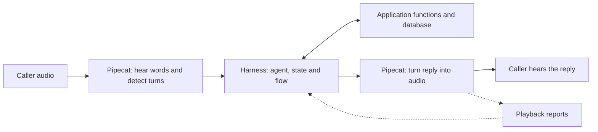

# 01 — Stack and boundaries

Suppose someone calls and says, “Please close my support case.” A voice application needs to understand the request, find the case, ask any missing questions, make the permitted change and say what happened.

The **harness** is the reusable code that manages that conversation. The package is called `slng-voice-core`, and Python applications import it as `core`.

## Start with four words

| Word | Plain meaning | Example |
|---|---|---|
| Model / LLM | The language model that interprets words and generates a response | Understands that “please close it” refers to the case under discussion |
| Agent | A model with instructions and a set of tools it may use | A support assistant allowed to find and close cases |
| Tool | A function the agent can request, or a structured instruction it can return | `find_case` asks code to look up a case |
| State | The named values remembered for this call | The case number, its current status and the requested change |

A **tool call** is the model asking for something to run. It is not the model reaching into a database itself. Application code performs the work and returns the result.

## How is this different from an agent with tools?

It is still an agent with tools. You could give an ordinary agent a prompt saying “find the case, ask for approval, then close it.” You would also need code that remembers which change is awaiting approval, handles corrections and decides what to do if a tool's answer is lost.

The harness provides those recurring rules so each application does not have to write them again:

| Part | Its job |
|---|---|
| Agent | Interpret the caller and choose a permitted next action |
| Application functions | Look up information or make changes in the application's database or API |
| Harness | Keep the call's state, check the action's requirements, track its outcome and continue the conversation |

For example, the agent can interpret “yes” as agreement. Core checks which question that reply answers and whether its read-back finished playing. The application's function closes the case only after its declared requirements pass. A wrong interpretation of “yes” is still possible; the harness does not make language understanding perfect.

A well-built ordinary agent can implement these rules too. The purpose of this package is to reuse their implementation across applications. It is not a claim that adding a graph automatically makes an agent faster or more accurate.

## A node is a job, not a sentence

A **node** is one part of the work, such as handling a change request. It can have its own agent, instructions and tools. A code-only node can perform a known action without asking a model to choose it.

One “handle request” node might ask for the case number, ask what changed, read back the proposed update and handle a correction. Those can be several conversational turns in the same node.

A **graph** is a map of these jobs and the allowed moves between them. An **edge** is one allowed move. Core uses the map while the conversation runs. Node names have no special meaning to core: the same machinery can run a support desk, a booking assistant or a language tutor.

You do not need a node for every tool. A lookup can be an operation inside the current conversation node, or a separate code node when that organization is useful. [Chapter 02](02-a-conversation-from-start-to-finish.md) follows both the words and the work in a concrete conversation.

## The media framework still owns audio

A conversation needs more than a language model. It also needs to hear the caller and play the reply:

| Term | What it does |
|---|---|
| STT — speech to text | Turns the caller's audio into words |
| VAD — voice activity detection | Detects when someone is speaking |
| Endpointing | Decides when a pause should count as the end of the caller's speech |
| TTS — text to speech | Turns the reply's words into audio |
| Transport | Carries audio, such as a WebRTC browser connection or a Twilio phone call |

Pipecat is the media framework used by the implemented integration. It connects those components. The harness fits where the application would otherwise put its LLM service and conversation logic; it does not replace Pipecat's audio system.

The application connects Pipecat to core through an **adapter**, `PydanticAgentProcessor`. An adapter translates between the two components' events. The same core engine can also be driven with text, which is useful for tests without microphones or phone calls.

Sending audio and playing it are different events. The integration uses Twilio marks or browser playback reports to decide whether a particular read-back finished before the caller replied. These reports describe what the transport or page observed, not whether a person understood the words.

This division helps explain faults. A pause being treated as finished speech is an endpointing decision. Forgetting accepted words or repeating a write whose outcome is unknown is a conversation-runtime issue. One incident can involve both.

## What an application supplies

An **application**, also called a use case, defines the actual job: what a support case or a lesson is, which changes are allowed and how to store them. Its **backend** is the database or external service that performs that work.

| Application supplies | Harness does with it |
|---|---|
| Named facts and their valid types | Remembers a separate, checked state for each call |
| Prompts — written instructions for each agent | Runs the right agent for the current node |
| Tools and allowed next nodes | Restricts what that agent can request |
| Functions that read or change the backend | Checks their inputs and returned results |
| Questions, approval rules and result wording | Tracks the exact question and speaks the configured result |
| Storage and a way to look up uncertain results | Recovers an operation when the backend supports it |

The author connects these pieces in a configuration file, usually `agent.yaml`. That file is called the **manifest**. Chapter 04 explains how to read it; you do not need to learn YAML to follow the conversation in chapter 02.

The salon, support desk and Faro learning application use this same public path. Core contains no booking, ticket or grading policy. There is no shared classifier that reads the reply before the active node's agent.

## Where Pydantic fits

The implementation uses three related libraries for different jobs:

| Library | Its role here |
|---|---|
| Pydantic | Checks the shape and declared rules of data: a revision must be a number, for example |
| Pydantic AI | Runs the agents and their model requests and tools |
| Pydantic Graph | Runs the map of permitted moves between nodes |

“Typed” means that values and connections have declared forms that code can check. It does not mean that every model judgement is true. A grade can be one of the allowed values and still be the wrong grade.

Core turns its own manifest format into these library objects. Applications do not write a second, separate graph to keep in sync.

## Portability today

Text execution and the Pipecat adapter are implemented. **LiveKit integration is planned, not implemented.** A LiveKit adapter would need to translate its own interruption and playback events into the same core rules; compatibility is not automatic.

The public `core` import does not load credential files, create model clients, or import Pipecat or Langfuse. The application chooses its model when it builds the flow. Voice and tracing are optional integrations.

## Check this against the code

| Read | What to verify |
|---|---|
| [Public exports](../../core/src/core/__init__.py), [package dependencies](../../core/pyproject.toml) | The package boundary and optional integrations. |
| [Pipecat processor](../../core/src/core/processor.py), [turn engine](../../core/src/core/turn.py) | Frames are adapted outside the conversation engine. |
| [Public API tests](../../core/tests/test_public.py), [node tests](../../core/tests/test_nodes.py) | Public loading and node execution, including the absence of a classifier pre-pass. |
| [Reuse tests](../../core/tests/test_tickets.py), [flow-rule tests](../../core/tests/test_flow_rules.py) | Another domain and renamed fields; receipt routing, automatic operations and per-call language. |
| [Faro manifest](../../use-cases/faro-language-learning/faro/agent.yaml), [Faro tests](../../use-cases/faro-language-learning/tests/test_faro.py) | A learning application on the same public path, with its own grading and storage rules. |

[Reading guide](README.md) · [Next: a conversation from start to finish →](02-a-conversation-from-start-to-finish.md)
