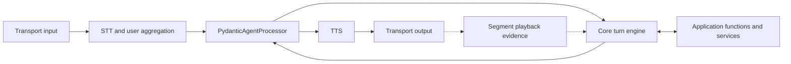

# 01 — Stack and boundaries

The harness is a conversation component. It takes recognized caller input, runs the active part of an application's flow, and produces speech or an action. It fits where an application would otherwise place its LLM service and associated conversation logic.

The implemented package is `slng-voice-core`, imported as `core`. Its public authoring path is:

```text
application definition → load → compile → open a call → run turns
```

## The media framework still owns audio

In the Pipecat integration, the pipeline is arranged around `PydanticAgentProcessor`. Pipecat's transport, speech recognition, turn-taking components, speech synthesis and output continue to do their existing jobs.

**STT** turns speech into text; **TTS** turns a reply into speech. **VAD** detects voice activity. **Endpointing** decides when the caller has finished a turn. A **transport** carries audio between the application and the caller, for example over WebRTC in a browser or through Twilio on a phone call.



This is a responsibility diagram, not every processor in a complete pipeline. VAD and endpointing determine when the media stack presents a turn or an interruption. Core decides what to do with those events: run the current node, retain input, stop obsolete work, preserve completed effects and continue the conversation.

That distinction matters when diagnosing a call. A pause being treated as the end of speech is an endpointing decision. Losing accepted words after an interruption, moving to an obsolete node, or repeating an uncertain write is a conversation-runtime issue. One observed failure can involve both boundaries; it should be traced to the component that made the decision.

Pipecat's [pipeline documentation](https://docs.pipecat.ai/pipecat/learn/pipeline) explains frame processing. The harness adapts that contract in [`processor.py`](../../core/src/core/processor.py); the underlying [`turn.py`](../../core/src/core/turn.py) does not depend on Pipecat frames.

## What an application supplies

The application's **backend** is the database or API that does its business work. A **node** is one part of the conversation, such as gathering information or handling a request. Later chapters show how to define both.

| Application-owned definition | How core uses it |
|---|---|
| A plain Pydantic state model | Holds the call's domain facts and validates candidate updates. |
| Node names and prompts | Creates an agent for each conversational step. |
| Writable fields, choices and operations | Builds the tools available in that step. |
| Exits and prerequisites | Builds and enforces the graph's routes. |
| Typed backend functions | Validates arguments and results at the operation boundary. |
| Read-back and result wording | Speaks precise application statements without asking the model to invent them. |
| Services and persistence | Performs domain work and, where provided, persists and reconciles intents. |

There is no built-in booking, verification, ticket or lesson node. A name such as `desk` or `booking` identifies an application-defined step. Its behavior comes from its declaration, prompt and functions, not a matching branch in core.

For example, a support desk can supply `ticket_id` and `resolve_ticket`; another application can supply a different state model and action names. Both use the same state validation, graph execution, proposal and recovery machinery. The [renamed support-desk regression](../../core/tests/test_tickets.py) exercises that substitution without changing core.

## Why use a separate conversation layer?

A native media application can implement all these rules itself. The benefit sought here is to implement the recurring mechanics once: carrying state between nodes, restricting model-writable facts, binding approval to a specific question, retaining interrupted history and reconciling uncertain operations.

That gives application authors an explicit definition to review and an engine they can exercise without a phone call. It also provides a boundary for another media adapter without rewriting the application's business functions.

This is an architectural reason for the split, not evidence that every use case is faster or more accurate than a native implementation. Model selection, prompt design, function contracts and transport behavior still affect the result.

## The three Pydantic layers

| Layer | What it does in this implementation |
|---|---|
| Pydantic | Validates manifests, application facts, function arguments and receipts. |
| Pydantic AI | Runs node agents with instructions, dependency context, tools, outputs and streamed model responses. |
| Pydantic Graph | Executes the allowed transitions between compiled nodes within a turn. |

The manifest format belongs to this package. It is not a YAML format supplied by Pydantic Graph. Core compiles that format into library objects and adds the conversation rules described in the later chapters.

Pydantic AI passes call context as an agent dependency, exposed to tools as `ctx.deps`; see its [dependency documentation](https://pydantic.dev/docs/ai/core-concepts/dependencies/). This is how shared agent definitions operate on a particular call without holding that caller's mutable facts on the agent object.

## Portability today

The public import, [`core/__init__.py`](../../core/src/core/__init__.py), does not load `.env`, create model clients, or import Pipecat or Langfuse. Model resolution happens at compilation. Voice and tracing are separate optional integrations.

There are two usable execution boundaries today: the text driver and the Pipecat adapter. They run the same conversation engine. The Pipecat integration supplies delivery evidence through Twilio marks or the SDK-based browser client; generated text alone does not establish playback.

**A LiveKit adapter is not implemented.** LiveKit exposes an [LLM pipeline node](https://docs.livekit.io/agents/logic/nodes/#llm-node) that offers a prospective integration point, but its event, interruption and playback contracts still need an adapter and tests. Sharing the engine does not make a second transport compatible automatically.

## Check this against the code

| Read | What to verify |
|---|---|
| [Public exports](../../core/src/core/__init__.py), [package dependencies](../../core/pyproject.toml) | The package boundary and optional integrations. |
| [Pipecat processor](../../core/src/core/processor.py), [turn engine](../../core/src/core/turn.py) | Frames are adapted outside the conversation engine. |
| [Public API tests](../../core/tests/test_public.py), [node tests](../../core/tests/test_nodes.py) | Public loading and node execution, including the absence of a classifier pre-pass. |
| [Reuse tests](../../core/tests/test_tickets.py) | The same mechanisms applied to another domain and renamed fields. |

[Reading guide](README.md) · [Next: a conversation from start to finish →](02-a-conversation-from-start-to-finish.md)
