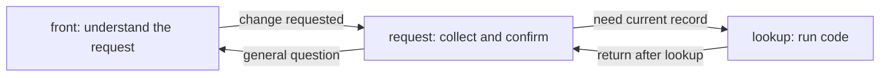
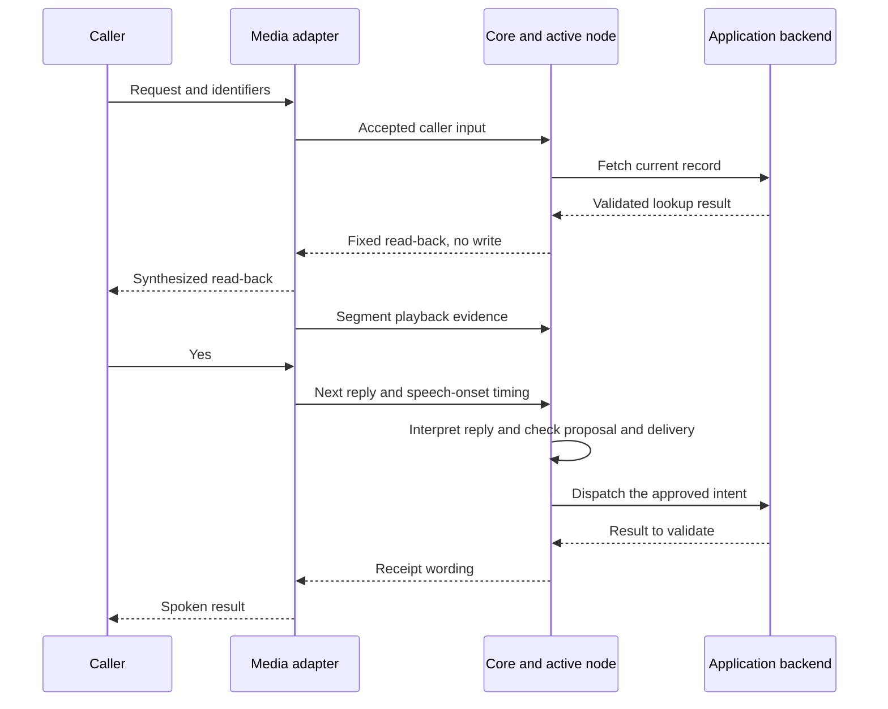

# 02 — A conversation from start to finish

An application defines a graph once, then opens a separate call for each conversation. The graph says which steps exist and how execution may move between them. The call holds the facts, history and pending work as the caller moves through those steps.

This chapter builds a small example: **a caller asks to change an existing record**. The application must collect the request, look up the record, read back the proposed change and apply it after approval. A record could be a reservation, a service request or an account setting. Its fields, validation rules and backend belong to the application; the graph and turn mechanics are the same.

## 1. Turn the work into steps

Start with the responsibilities, before writing a prompt:

| Step | Responsibility | Who decides what happens next? |
|---|---|---|
| `front` | Answer general questions or send a change request to `request` | The node's agent interprets the caller |
| `request` | Collect identifiers and the desired change, request a lookup, then propose the change | The node's agent interprets the caller; core checks its actions |
| `lookup` | Fetch the record's current state and return to the waiting node | Code follows the operation's result |

These are reusable roles, not required node names. A small application could combine `front` and `request`. A node can handle several caller turns, and a single turn can visit several nodes.

The intended successful path is:



Approval and the change happen **inside `request`**. They do not need separate graph nodes. This diagram shows the application path; generated routing decisions and error paths are explained below.

## 2. Declare what each step may do

An application supplies a Pydantic state model, typed backend functions, prompt files and a manifest connecting them. For this example, suppose the state holds:

| Facts | Where they come from |
|---|---|
| `caller_id`, `record_id`, `requested_change` | Caller input, recorded through `collect` |
| `revision`, `status` | Validated backend results, assigned by operations |

The two operations are `fetch_record` and `apply_change`. Their manifest declarations bind Python argument fields to state fields. The lookup uses the identifiers, requires no approval and changes no resource. The write also uses the requested change and current revision, defines a read-back, and declares how to recognize and reconcile its result. [Chapter 05](05-tools-approval-and-recovery.md) covers that operation contract.

Here is the **routing excerpt** of the manifest. It assumes the state, the `assistant` persona, the two operations and the referenced prompt files have been supplied; it is not a standalone application.

```yaml
entry: front
steps:
  - id: front
    kind: conversation
    agent: assistant
    prompt: prompts/front.md
    exits:
      - {to: request, purpose: changing an existing record}
  - id: request
    kind: conversation
    agent: assistant
    prompt: prompts/request.md
    fields: [caller_id, record_id, requested_change]
    operations: [apply_change]
    speech: rendered
    asks:
      caller_id: What is your account identifier?
      record_id: Which record should I change?
      requested_change: What would you like to change?
    exits:
      - {to: lookup, purpose: fetch the current record once its identifiers are known}
      - {to: front, purpose: answering a general question}
  - id: lookup
    kind: action
    operation: fetch_record
    returns: true
    on_error: request
    on_unknown: request
  - {id: done, kind: end, outcome: completed, say: Goodbye.}
```

Read this as a capability map:

- `fields` generates the `request` agent's `collect` tool. It may record those three fields; it cannot invent the backend revision through that tool.
- `operations` exposes `apply_change` to that agent. Selecting it first asks for approval; selection alone does not dispatch the write.
- `exits` generates the allowed `hand_over` destinations. A purpose explains when to choose an exit; it is guidance for the agent, not a condition that code evaluates.
- `speech: rendered` means code supplies every spoken line on `request`. On arrival, `asks` immediately asks for the first missing field without running the agent. On later replies, the agent can choose `wait` to ask for a missing field, but cannot send its own prose to the caller.
- `kind: action` runs `fetch_record` without a model request to choose the action. `returns: true` remembers which node handed over and returns there after success. Errors and unknown outcomes go to `request` as declared.

The `done` step supplies the completion endpoint required for a flow containing an action step. It is not an extra hop after every successful lookup or change. A conversation node can also end the call through its `goodbye` output.

## 3. Build the executable graph

With those application files in place, startup looks like this (`model` is the application's chosen model):

```python
import core

spec = core.load('application/agent.yaml')
flow = spec.compile(model=model)
```

There are three concrete transformations:

1. **Read the definition.** `core.load` parses the manifest into a `FlowSpec`. It validates its shape and keeps the folder used to resolve Python references and prompt paths.
2. **Build the nodes.** `compile` checks references and types, builds the steps, and constructs `StepFlow.nodes`, keyed by step id. Here, `front` and `request` each get their own agent with their own prompt, tools and outputs, even though they share a persona. `lookup` gets the code-entry behavior for `fetch_record`; `done` gets the ending behavior.
3. **Build the routes.** Compilation calls `Flow.of(flow.nodes)`. Core derives legal moves from exits, return paths and any declared prerequisites, then uses Pydantic Graph's `GraphBuilder` to create an executable step for each node and routing decisions after it. The result is cached for that node table.

For example, `front` may hand over to `request`, but not directly to `lookup`. After `lookup`, code can return to the waiting `request` node. The generated graph also contains a start decision that can resume at the call's current node, and an end branch for finishing the current turn. An undeclared move has no matching route and is rejected at runtime.

The author does not write a second Python graph or ask an LLM to build one. The manifest supplies the structure; compilation makes it executable. Prompts influence which legal action an agent chooses during a call.

To inspect the generated graph after compilation:

```python
from core.flow import Flow

print(Flow.of(flow.nodes).render())
```

`Flow` is an internal inspection helper. Its Mermaid output includes routing decisions, fallback return paths and turn endings, so it is more detailed than the overview diagram above. [Chapter 04](04-typed-flows-and-node-agents.md) explains the node types and routing rules further.

## 4. Open one call on that graph

For each new conversation, the application supplies its initial state and backend services:

```python
call = flow.open(ApplicationState(), services=backend)
```

`ApplicationState` is the application's Pydantic model, and `backend` is the service object used by its functions. Core validates and copies the state into the call. The call starts at `front`, with its own history, proposals, speech records and intents. The compiled flow can be shared across calls; each call keeps its own position and facts. Whether the service object itself is shared is the application's choice.

Opening a call does not start a microphone or phone connection. A voice launcher connects it to Pipecat and supplies the greeting. Pipecat's user aggregator passes recognized input to `PydanticAgentProcessor`, which invokes the turn engine. A text application invokes the same engine with `core.text_turn(flow, call, words)`.

## 5. Follow caller input through the graph

Suppose the caller first says, “I'd like to change a record.” The `front` agent selects `hand_over(to='request', because='change an existing record')`. Core checks the route and enters `request` with the same call and history. Because its facts are still empty, `asks` speaks “What is your account identifier?” and ends that turn without a model request on `request`.

After hearing the question, the caller supplies the details:

> For account A-42, please mark record R-17 complete.

The following is one successful sequence of agent choices. The graph permits it; it does not force every model to choose it.

1. **`request` collects the facts.** Its agent calls `collect` with `caller_id='A-42'`, `record_id='R-17'` and `requested_change='complete'`. Core validates the candidate state before committing it.
2. **`request` hands over to `lookup`.** Code binds `fetch_record` arguments from those facts, invokes the backend and validates its result. Suppose the record is `open` at revision 1. The operation assigns those facts, and the successful return sends execution back to `request` without a model choosing the return route.
3. **`request` selects `apply_change`.** Core builds its arguments from the current facts and speaks the application's read-back: “Mark record R-17 complete?” An exact proposal is pending and an intent is prepared. The backend has not been changed.
4. **The turn finishes with a question.** The call stays at `request`. It does not restart at `front` when the caller replies.

If a required identifier were missing, `request` could ask for it and finish the turn there instead. A handoff is not a new caller turn: node runs and model requests share the turn's budget.

## 6. Receive approval and apply the change

Speech generation and speech delivery are separate events. A voice adapter sends each identified speech segment to TTS and the transport, then records playback evidence for that segment. Returning a text reply likewise does not acknowledge its delivery. A text reader explicitly acknowledges received segments:

```python
reply = await core.text_turn(flow, call, words)
call.acknowledge(*(segment.id for segment in reply.segments))
```

That acknowledgement is simulated delivery for the text path. A voice call relies on its transport's playback reports.



When the caller says “Yes,” the active `request` agent interprets the reply and selects `apply_change` again. Core checks that this reply can answer the exact pending question: the arguments and identity still match, and the reply began after its read-back played. A changed value or an unconfirmed read-back cannot authorize that earlier proposal.

The operation now dispatches the intent to the backend. On a validated successful result, core records the **receipt**, assigns the new facts and renders the application's result line, for example “Record R-17 is complete.” It does not need another model request just to paraphrase the receipt.

| Point in the conversation | Active node | Facts and pending work | Backend effect |
|---|---|---|---|
| Call opened | `front` | Initial application state | None |
| Request collected | `request` | Caller, record and desired change known | None |
| Lookup completed | Back at `request` | Revision 1, status `open` | Read only |
| Read-back spoken | `request` | Exact proposal awaiting an answer | No change dispatched |
| Approved operation succeeds | `request` | Receipt establishes revision 2, status `complete` | Change committed |

Completing the operation does not end the conversation. The caller can make another request in the same call. If they say they are finished, the agent can select `goodbye`; core renders eligible receipt recaps and the farewell, and requests the call's end.

## 7. When speech or execution is interrupted

Pipecat signals an interruption, and the processor notifies core before the interrupted task unwinds. Core retains accepted input and completed tool results. A generation identifier prevents older work from later moving the call to an obsolete destination.

If the caller starts speaking again before any non-filler answer has finished playing, core can treat those words as another piece of the same caller turn. It joins the input and preserves the question the turn was answering where appropriate. After an answer finishes, the next reply starts a new turn. Without playback signals, core errs toward a new turn.

A read-back with unconfirmed delivery cannot authorize a change and may be repeated within bounded limits. An unheard receipt can also be repeated, using the recorded result instead of dispatching the operation again. Playback evidence establishes what the adapter observed, not comprehension or physical speaker audibility.

Cancellation does not prove that an already dispatched backend change was cancelled. If its outcome is unknown, core tracks that uncertainty and uses reconciliation rather than assuming failure. [Chapter 05](05-tools-approval-and-recovery.md) follows that path.

## Run a concrete version offline

The repository's [support-desk fixture](../../core/tests/ticket_flow/agent.yaml) implements this pattern with domain-specific names: `faq` is the front node, `desk` handles requests, and `look_up` runs the lookup. Its `resolve_ticket` operation changes a ticket after approval. The fixture speaks Spanish; neither those words nor its ticket rules are built into core.

From the repository root after `uv sync --all-packages`, run the existing walkthrough with provider requests disabled and a temporary database:

```bash
uv run --directory core python - <<'PY'
import asyncio
import tempfile
from pathlib import Path

from pydantic_ai import models

models.ALLOW_MODEL_REQUESTS = False

from tests.test_tickets import a_heard_yes_resolves_once

with tempfile.TemporaryDirectory() as folder:
    asyncio.run(a_heard_yes_resolves_once(Path(folder)))

print('Read-back first; one resolution after the acknowledged yes.')
PY
```

This check uses a scripted model and explicit text acknowledgements. It asserts that the read-back precedes the write, the backend stays unchanged before approval, and the approved request commits one resolution. It checks the execution sequence, not live language understanding or audio delivery.

## Check this against the code

- [Manifest compiler](../../core/src/core/flowspec.py): `FlowSpec.compile` resolves the definition and constructs the flow.
- [Compiled steps](../../core/src/core/steps.py): `StepFlow`, `ConversationStep.node`, `ActionStep.node` and `StepFlow.open` build nodes and open calls.
- [Executable graph](../../core/src/core/flow.py): `legal_moves`, `Flow._build` and `Flow.run` derive routes and walk them.
- [Turn engine](../../core/src/core/turn.py) and [media adapter](../../core/src/core/processor.py): the common execution path and its Pipecat integration.
- [Walkthrough script](../../core/tests/ticket_flow/worker.py) and [support-desk tests](../../core/tests/test_tickets.py): the concrete tool sequence and assertions.
- [Delivery tests](../../core/tests/test_delivery.py) and [Pipecat/text equivalence tests](../../use-cases/salon-graph/tests/test_core.py): the boundaries the text walkthrough does not exercise.

[← Stack and boundaries](01-stack-and-boundaries.md) · [Reading guide](README.md) · [Next: typed state and history →](03-typed-state-and-history.md)
