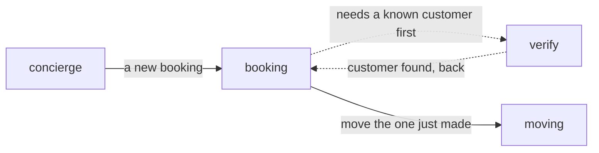

# 02 — A conversation from start to finish

This chapter follows one real salon call before any configuration. The caller books a haircut, then asks to move it
to the next day. Each turn shows what the model chose and what code said. Every turn costs one model request.

The words below come from a real-model text run of the reference salon
([`use-cases/salon`](../../use-cases/salon/)). A live model can still
choose wrongly. The offline check at the end runs the same mechanics with a scripted model.

## 1. The nodes this call uses

| Node | Its one job | Uses a model? |
|---|---|---|
| `concierge` | understand what the caller wants, and send them to the right job | yes |
| `verify` | confirm the caller's phone number and look them up | yes, to read the reply |
| `booking` | make a new booking | yes |
| `moving` | move a booking the caller holds | yes |



These are the salon's names. Core has no built-in node called `booking`. A move to another node is a **hand-over**.
It changes which job is active. It does not start a new call or lose what the caller said.

## 2. The call, turn by turn

| # | Caller | What the model chose | What the caller hears, and who wrote it |
|---:|---|---|---|
| 1 | "Hi, I'd like a haircut this Friday, please." | `concierge`: `hand_over` to `booking`, with the update `service: haircut, booking_day: 2026-10-02` | Code: "Which phone number should I use? Please say it with the country code." |
| 2 | "Plus three four, six hundred, two zero zero, zero zero four." | `verify`: `lookup_customer`, with the update `customer_phone: +34600200004` | Code: "Is your number +34 600 20 00 04?" |
| 3 | "Yes, that's right." | `verify`: `lookup_customer` again, which is the yes | Code: "Thanks, I have you. On Friday the 2nd I have 9:00 AM, 9:30 AM or 10:00 AM. Which time works for you?" |
| 4 | "The first one, please." | `booking`: `book_appointment`, with the update `slot: 2026-10-02T0900\|haircut` | Code: "Shall I book a haircut, Friday the 2nd at 9:00 AM?" |
| 5 | "Yes, please." | `booking`: `book_appointment` again, which is the yes | Code: "You're all set for Friday the 2nd at 9:00 AM. Anything else I can help with?" |
| 6 | "Actually, can you move it to the day after?" | `booking`: `hand_over` to `moving`, with the update `booking_day: 2026-10-03` | Code: "On Saturday the 3rd I have 9:00 AM, 9:30 AM or 10:00 AM. Which time works for you?" |
| 7 | "The first one, please." | `moving`: `move_appointment`, with the update `slot: 2026-10-03T0900\|haircut` | Code: "Shall I move your haircut from Friday the 2nd at 9:00 AM to Saturday the 3rd at 9:00 AM?" |
| 8 | "Yes, please." | `moving`: `move_appointment` again | Code: "That's moved to Saturday the 3rd at 9:00 AM. Anything else I can help with?" |
| 9 | "No, that's all. Bye." | `moving`: `goodbye` | Code: "Your appointment is now Saturday the 3rd at 9:00 AM. Thanks for calling Sage and Stone. Have a lovely day!" |

Nine caller turns, nine model requests. The model never wrote a word the caller heard in this call. It read each
reply and chose one typed decision. Code said the rest. This is the pattern every node follows:

1. **The model reads and decides.** Each response is exactly one typed decision. The facts the caller gave ride on
   it as an `update`.
2. **Code validates first.** The update becomes a complete new state and is checked as a whole. A pick must be on
   offer. A hand-over must follow a declared exit.
3. **Code says what it knows.** Questions for missing facts, offers, read-backs, confirmations and goodbyes are
   written by the application, not paraphrased by the model.

## 3. Who asks for what is missing

**Turn 1.** The caller asked for a booking, so `concierge` handed them to `booking`. But `booking` declares
`requires: [customer]`, and nobody knows the caller yet. The graph therefore put `verify` first, remembering that
`booking` is waiting. `verify` has a fixed question for a missing number (`asks:`), so code asked it with no second
request.

**Turn 3.** The yes made code run the lookup. Its receipt says "Thanks, I have you." That satisfied the
prerequisite, so the call went back to `booking`. `booking` has `offers: [slot]`. On arrival, code asked its choice
function, `find_times`, what to offer for the state as it stands (haircut, Friday). The function returned the free
times and the words for them. So the offer was said in the same turn, with no model request.

If the caller had said no day, `find_times` would have returned only a question: "Which day would you like?" When
the caller then says "Friday", the model answers with `record`, which only records the day. Code then offers the
Friday times. That is still one request.

The model writes free words only with `reply`. It uses that for answers code does not know, such as a question about
the salon's prices or a date that could mean two days.

## 4. Confirm the exact change

A **read-back** states the change and asks the caller to agree. Core keeps it as the pending **proposal**. Choosing
`book_appointment` the first time only prepares that question. The backend does not change.

On "Yes, please", the model chooses `book_appointment` again. Core then checks four things before the change runs:

1. The arguments are the same ones that were read back.
2. The caller is the same.
3. The read-back has playback evidence: it finished playing to the caller.
4. The caller's reply began after it finished.

Then the operation runs. The backend answers with a **receipt**, which core validates. The application's words for
it are then said: "You're all set…". The receipt proves the change, not the model saying "done".

| Moment | State | Did the backend change? |
|---|---|---|
| The pick is recorded | haircut, Friday, 9:00 on offer and picked | No |
| The read-back is said | that exact booking is waiting for a yes | No |
| The yes is carried out | the booking exists, with its receipt | Yes |

A correction such as "yes, but make it 9:30" is not a yes. The model records the new pick, and code reads the new
booking back. A clear no is `reply` with `decline` set: the waiting read-back is dropped, and nothing is booked.

## 5. A change of mind is a hand-over

**Turn 6.** "Actually, can you move it to the day after?" is a new job, so `booking` handed the caller to `moving`.
The hand-over carried the new day, Saturday.

On arrival, `moving` has `offers: [booking_id, slot]`:

1. `bookings_to_move` found that the caller holds one booking, so it **picked** it. The caller had already said the
   new day, so it said nothing.
2. `find_times` then offered Saturday for the booking's own service.

The caller heard the Saturday times in the same turn. The move's read-back in turn 7 names both the old and the new
time, so the pick is confirmed before anything happens.

The state carried across the hand-over. `moving` sees only the facts it lists (`booking_id`, `service`, `booking_day`,
`booking_time`, `slot`), and its own recent turns. [Chapter 03](03-typed-state-and-history.md) shows how that view is
built.

## 6. Speech delivery is separate from text

The application produces words. Pipecat's TTS turns them into audio, and its transport plays them. Sending words to
TTS does not prove the caller heard them.

For a voice call, core uses playback reports tied to each speech segment: Twilio marks, or the browser page's report.
They say what the transport observed. They cannot prove that a person understood.

A text driver acknowledges delivery itself:

```python
reply = await core.text_turn(flow, call, words)
call.acknowledge(*(segment.id for segment in reply.segments))
```

This is **simulated delivery**. A voice integration must use playback evidence instead.

When the caller talks over a read-back, the read-back was not heard in full, so it cannot be approved. Code says it
again. Repeats are bounded. When the caller keeps talking before an answer has played out, their words join the same
turn. [Chapter 05](05-tools-approval-and-recovery.md) explains what happens when a change was sent but its answer was
lost.

## 7. Connect this to the application files

| File | What it gives this call |
|---|---|
| [`state.py`](../../use-cases/salon/salon/state.py) | `SalonState`: the phone, customer, service, day, time, slot and booking id |
| [`operations.py`](../../use-cases/salon/salon/operations.py) | `LookupCustomer`, `BookAppointment` and `MoveAppointment`, each with its read-back and receipt words |
| [`offers.py`](../../use-cases/salon/salon/offers.py) | `find_times` and `bookings_to_move`: what is on offer, and the words for it |
| [`prompts/`](../../use-cases/salon/salon/prompts/) | one prompt per node, and the shared voice and diary rules |
| [`agent.yaml`](../../use-cases/salon/salon/agent.yaml) | the nodes, what each sees and changes, and how they connect |

At startup the application loads and checks these files once. For each call it opens a separate state:

```python
import core

flow = core.load('salon/agent.yaml').compile()
call = flow.open(SalonState(), services=salon, clock=clock)
```

This is an excerpt: `salon/app.py` does it for real, with the diary as the service. Opening a call does not connect
a microphone. `bot.py` wires the call to Pipecat and says the greeting.

## Run it offline

From the repository root, after `uv sync --all-packages`, run the salon's move-and-cancel check. It uses a scripted
model, so no provider request is made:

```bash
cd use-cases/salon
GOOGLE_API_KEY=x uv run python -c "
import asyncio
from tests.test_business import a_booking_is_moved_and_cancelled, the_booking_just_made_moves_to_the_day_given
asyncio.run(a_booking_is_moved_and_cancelled())
asyncio.run(the_booking_just_made_moves_to_the_day_given())
print('moved and cancelled, one request per turn')
"
```

The first check hands a caller to `moving`, which names their booking with no request. It records the new day, and
code offers its times. After the move, a hand-over to `cancelling` reads the cancel back with no second request. The
second check is turn 6 above: a hand-over carrying Saturday, answered with Saturday's times. Both check the
execution, not live language understanding or audio.

## Check this against the code

- [Structured decisions](../../core/src/core/structured.py): `reply`, `record`, an operation with its `update`,
  `hand_over`, `goodbye`, and how each is applied.
- [Compiled steps](../../core/src/core/steps.py): `ConversationStep.offer` (what code says on arrival and after a
  `record`) and `ConversationStep._operate` (read-back, then carry out on a yes).
- [Executable graph](../../core/src/core/flow.py) and [turn engine](../../core/src/core/turn.py): prerequisites,
  hand-overs, and one caller turn from start to end.
- [Salon tests](../../use-cases/salon/tests/test_business.py): every path above, with the
  requests pinned in `golden/payloads.json`.

[← Stack and boundaries](01-stack-and-boundaries.md) · [Reading guide](README.md) · [Next: state, memory, records and services →](03-typed-state-and-history.md)
