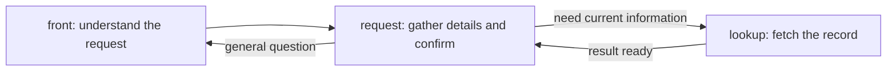
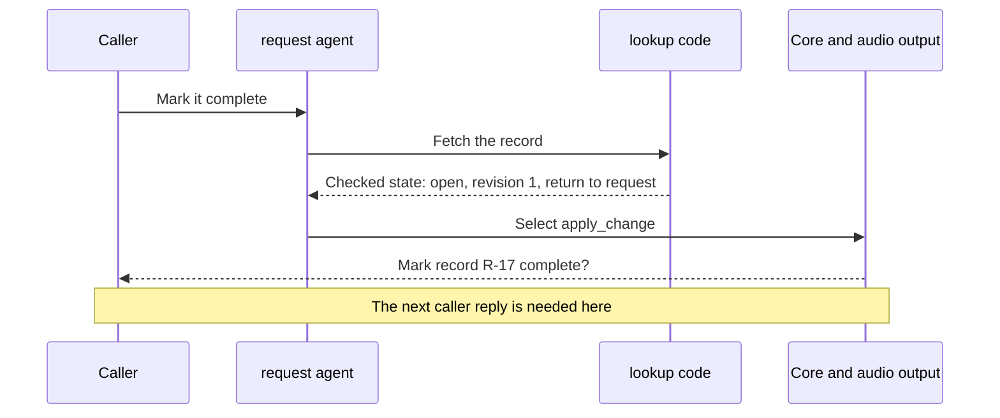

# 02 — A conversation from start to finish

Let us follow what the caller hears before looking at configuration. Our example changes a **record**: one item stored by an application, such as a support case. Account `A-42` owns record `R-17`, and the caller wants to mark it complete.

The conversation below illustrates a successful path, not a recording or a promise that a live model will always choose correctly. The code checks at the end exercise the same mechanics with a scripted model.

## 1. Give each node a clear job

This example uses three nodes:

| Node name | Its job | Uses an agent? |
|---|---|---|
| `front` | Understand the initial request and answer general questions | Yes |
| `request` | Gather the details, ask for approval and handle the change | Yes |
| `lookup` | Fetch the record from the backend and return | No model request is needed to choose this known action |

These are the application's names. Core has no built-in node called `request` or `lookup`.



A move to another node is called a **handoff**. It changes which job is active; it does not open another call or erase the information collected so far. You could also put the lookup operation directly on `request`. The separate node is a design choice, not a requirement for tool use.

## 2. Ask for what is missing

Here is a conversation in which the caller supplies one detail at a time:

| What the caller or assistant says | What happens inside |
|---|---|
| Caller: “I'd like to change a record.” | `front` chooses to hand over to `request`. |
| Assistant: “What is your account identifier?” | On arrival, `request` has no account identifier. Code asks its configured question. |
| Caller: “A-42.” | The `request` agent records `caller_id='A-42'` through `collect`. |
| Assistant: “Which record should I change?” | The agent chooses `wait`; code asks for the next missing field. |
| Caller: “R-17.” | The same agent records `record_id='R-17'`. |
| Assistant: “What would you like to change?” | Another `wait` selects the missing-change question. |
| Caller: “Mark it complete.” | The agent records `requested_change='complete'` and can request the lookup. |

**All the questions after the handoff belong to the same `request` node.** A node describes a responsibility, not one question. `wait` means “give the applicable reply and await the caller,” not “sleep” or “stay silent.”

`collect` is the agent's tool for remembering accepted values. Think of the state as a form that fills up:

```text
At first:          account = ?      record = ?      requested change = ?
After “A-42”:      account = A-42   record = ?      requested change = ?
After “R-17”:      account = A-42   record = R-17   requested change = ?
After “complete”:  account = A-42   record = R-17   requested change = complete
```

The caller can also give all three details in one reply. The agent can collect them together, and already-known fields do not need their missing-field questions. Understanding that reply is the agent's job; validating and storing the proposed values is core's job.

## 3. Decide who writes the questions

The harness supports two speech modes on a conversation node:

| Mode | Who writes ordinary replies? | Example |
|---|---|---|
| **Prose** | The agent, using its prompt, current facts and history | “Of course. Do you have the record number handy?” |
| **Rendered** | Application code, configured questions or result templates | “Which record should I change?” |

Our `request` node uses **rendered** speech so the example has visible, predictable questions. The application declares them with `asks`:

```yaml
speech: rendered
asks:
  caller_id: What is your account identifier?
  record_id: Which record should I change?
  requested_change: What would you like to change?
```

Read `caller_id` as the name of a blank and the sentence beside it as the question for that blank. These are application words; they could be written more warmly. They are not instructions for the model to paraphrase.

On arrival, code can ask the first missing field in this order without a model request. On a later caller reply, the agent runs, records what it understood and may choose `wait`. Code then selects the next applicable question. The whole conversation is not a fixed script: the agent can also select an allowed operation, handoff or goodbye.

For flexible acknowledgements, explanations and follow-up wording, a node can use **prose**, the default. Its prompt tells it how to ask for missing information, and its current state tells it what is already known. The model generates the question; it does not need a new node for each follow-up. Whether it asks the right question naturally still needs live evaluation.

**A prose node can still use exact code-written approval and result lines.** Selecting an operation with a read-back uses the same approval checks in either mode. Natural conversation does not require letting the model invent the approved action or bypass its requirements. If a prose node also declares `asks`, those automatic arrival questions remain application-written.

In a rendered node, a question needing an explanation must have an application response or an allowed handoff to a prose node. The model cannot freely add an explanation there. Here `request` can send a general question back to `front`.

## 4. Answer after the lookup

Once the required details are known, the `request` agent selects the handoff to `lookup`. What happens next is:

1. Code calls `fetch_record` with the account and record identifiers.
2. The backend returns information, for example that R-17 is `open` at revision `1`. A revision is a version number used to notice later changes.
3. Core checks the result and puts the permitted values into state.
4. The lookup's `returns: true` sends execution back to `request`, the node that asked for it.
5. The `request` agent runs with the updated state and existing conversation. It can now select `apply_change`.
6. Code speaks that operation's exact read-back: “Mark record R-17 complete?”

The caller does **not** need to speak between the lookup finishing and that question. Both happen while handling the same caller turn. A caller turn can contain several model requests and node visits; they share limits on how much work may run.



Where do the words come from? The lookup operation can have a `say` template, such as “Record R-17 is currently open.” If it does, that result line is spoken as well. In this walkthrough, assume the lookup is silent: the next spoken line is the change operation's read-back. Returning data does not automatically produce an LLM-written explanation.

On a prose `request` node, the agent could also compose a suitable explanation. On the rendered node shown here, only the application's reply paths can speak. The full routing configuration is in [chapter 04](04-typed-flows-and-node-agents.md#3-declare-each-nodes-capabilities).

## 5. Confirm the exact change

A **read-back** states what the assistant is about to do and asks the caller to agree. Core remembers it as the pending **proposal**. Selecting `apply_change` the first time prepares that question; it does not change the backend.

> Assistant: “Mark record R-17 complete?”
>
> Caller: “Yes.”

The `request` agent interprets the reply and selects `apply_change` again. Core checks that it still refers to the same arguments and caller, that the read-back has playback evidence, and that the reply began after it finished playing. Then the permitted operation runs.

The backend returns a result saying the record is complete, now at revision 2. Core validates that result, saves the updated facts and speaks the application's result wording:

> “Record R-17 is complete.”

This backend result is called a **receipt**. The receipt, rather than the model saying “done,” establishes the operation's outcome. No extra model request is needed just to paraphrase that configured result line.

| Moment | Current state | Did the backend change? |
|---|---|---|
| Details collected | A-42 wants R-17 marked complete | No |
| Lookup finished | R-17 is open at revision 1 | No; it was read only |
| Read-back spoken | That exact change is awaiting approval | No |
| Approved operation succeeds | R-17 is complete at revision 2 | Yes |

A correction such as “Sorry, R-18” needs its own lookup and proposal. It cannot approve the old question. A clear no, interpreted with `decline`, consumes the pending question without making the change. The model still has to interpret those replies correctly; core checks the conditions under which its interpretation may act.

Completing a change does not necessarily end the call. The caller can make another request. If they want to leave, the agent can select `goodbye`; code speaks eligible result recaps and the farewell.

## 6. Keep speech delivery separate from text

The agent or application produces words. Pipecat's TTS turns them into audio, and its transport sends them to the caller. Sending those words to TTS is not proof that a read-back finished playing.

For a voice call, core uses playback reports associated with the particular speech segment. They report what the page or transport observed, not whether someone understood or heard a physical speaker.

The text driver requires an explicit acknowledgement too. In a text integration that is ready to treat the returned text as delivered:

```python
reply = await core.text_turn(flow, call, words)
call.acknowledge(*(segment.id for segment in reply.segments))
```

This is **simulated delivery** for text. A voice integration must use its playback evidence instead of acknowledging text as if it were audio.

Pipecat also reports interruptions. Core keeps accepted input and completed tool results, and prevents obsolete work from moving the conversation later. If the caller continues before a non-filler answer finishes playing, those words may be joined into the same turn. A read-back without confirmed delivery cannot approve a change; repetitions are bounded.

If the tool was already sent when an interruption happened, stopping the conversation task does not prove the backend stopped. [Chapter 05](05-tools-approval-and-recovery.md) explains how core tracks an uncertain result instead of blindly repeating the change.

## 7. Connect this to the application files

Now that the conversation is clear, each file has a specific job:

| File or definition | What it contributes to this example |
|---|---|
| Pydantic state model | Names and types for the account, record, requested change, revision and status |
| Typed functions | `fetch_record` and `apply_change`, with declared inputs and results |
| Prompts | Instructions for how `front` and `request` should interpret and respond |
| Manifest (`agent.yaml`) | Connects the nodes, functions, questions and allowed routes |

Startup reads and checks those definitions. **Compile** means build the reusable executable flow; **open** means create the separate state for one call. With the application's files and chosen model supplied:

```python
import core

spec = core.load('application/agent.yaml')
flow = spec.compile(model=model)
call = flow.open(ApplicationState(), services=backend)
```

This is a lifecycle excerpt, not a standalone application. `ApplicationState` and `backend` are the application's model and service object. Chapter 03 builds the state; chapter 04 shows the manifest and compilation; chapter 05 defines the operation contracts.

Opening a call does not connect a microphone. The voice launcher wires it to Pipecat. It can use `flow.greeting(call, words)` to include the entry node's question, pass the result to `core.greet`, and send it through the normal audio path. A greeting containing a read-back still needs playback evidence before the first reply can approve it.

## Run a concrete version offline


The repository's [support-desk fixture](../../core/tests/ticket_flow/agent.yaml) implements this pattern with domain-specific names: `faq` is the front node, `desk` handles requests, and `look_up` runs the lookup. Its `resolve_ticket` operation changes a ticket after approval. The fixture speaks Spanish; neither those words nor its ticket rules are built into core.

From the repository root after `uv sync --all-packages`, run the existing walkthrough with provider requests disabled and a temporary database:

```bash
uv run --directory core python - <<'PY'
import asyncio
import tempfile
from pathlib import Path

from pydantic_ai import models

models.ALLOW_MODEL_REQUESTS = False

from tests.test_tickets import a_heard_yes_resolves_once

with tempfile.TemporaryDirectory() as folder:
    asyncio.run(a_heard_yes_resolves_once(Path(folder)))

print('Read-back first; one resolution after the acknowledged yes.')
PY
```

This check uses a scripted model and explicit text acknowledgements. It asserts that the read-back precedes the write, the backend stays unchanged before approval, and the approved request commits one resolution. It checks the execution sequence, not live language understanding or audio delivery.

## Check this against the code

- [Manifest compiler](../../core/src/core/flowspec.py): `FlowSpec.compile` resolves the definition and constructs the flow.
- [Compiled steps](../../core/src/core/steps.py): `StepFlow`, `ConversationStep.node`, `ActionStep.node` and `StepFlow.open` build nodes and open calls.
- [Executable graph](../../core/src/core/flow.py): `legal_moves`, `Flow._build` and `Flow.run` derive routes and walk them.
- [Turn engine](../../core/src/core/turn.py) and [media adapter](../../core/src/core/processor.py): the common execution path and its Pipecat integration.
- [Walkthrough script](../../core/tests/ticket_flow/worker.py) and [support-desk tests](../../core/tests/test_tickets.py): the concrete tool sequence and assertions.
- [Delivery tests](../../core/tests/test_delivery.py) and [Pipecat/text equivalence tests](../../use-cases/salon-graph/tests/test_core.py): the boundaries the text walkthrough does not exercise.

[← Stack and boundaries](01-stack-and-boundaries.md) · [Reading guide](README.md) · [Next: typed state and history →](03-typed-state-and-history.md)
