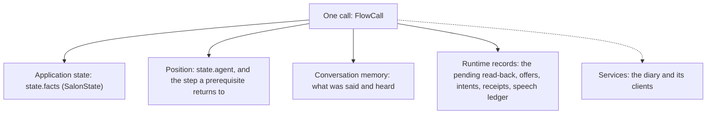

# 03 — State, memory, records and services

When the caller says "Friday", where does that go? Into **state**: the named facts kept for this call. What they
said, word for word, goes into **memory**, the conversation history. Whether a read-back is waiting, and whether it
was heard, goes into core's **runtime records**. The salon's diary is a **service**. The model never sees services.

These four are kept apart on purpose. This chapter shows each one in the salon from
[chapter 02](02-a-conversation-from-start-to-finish.md).

## 1. The four kinds of data



| | What it holds | Who writes it | What a node's model sees | Lifetime |
|---|---|---|---|---|
| **Application state** | phone, customer, service, day, time, slot, booking id | the model's `update` and operation receipts, validated as one whole state | only its `context.facts` | the call |
| **Conversation memory** | the caller's words and the delivered speech, turn by turn | the turn engine | its own recent turns | the call |
| **Runtime records** | the pending read-back, the offers, intents, receipts, playback evidence | core only | a short status line when it matters | the call; intents and receipts also go to the backend |
| **Services** | the diary, clients, keys | the application | never | the process |

Where they live in code:

- `FlowCall` (in [`steps.py`](../../core/src/core/steps.py)) is one call. It extends `CallContext` (in
  [`state.py`](../../core/src/core/state.py)).
- `call.state` is a `FlowState`, which is a `VoiceState` with the application's facts. `call.state.facts` is the
  `SalonState`. `call.state.agent` is the active node.
- `CallContext` holds the memory (`messages`), the speech ledger (`Spoken`), the pending read-back
  (`ProposalLedger`), the intents (`Intent`) and the receipts (`Evidence`).
- `FlowCall` adds the offers (`Offers`) and the services.

The application writes only the state model and the services. Core creates everything else.

## 2. Application state is one plain Pydantic model

The salon's state is [`SalonState`](../../use-cases/salon/salon/state.py). This is an excerpt:

```python
class SalonState(BaseModel):
    model_config = ConfigDict(extra='forbid')

    customer_phone: core.Phone | None = None
    customer: Customer | None = None
    """Set only by the lookup's receipt, for the number it looked up."""
    service: Service | None = Field(None, description='The service the caller wants: haircut, hair-color or blowout.')
    booking_day: Annotated[date, core.NotPast] | None = Field(None, description='The date the caller asked for, ...')
    slot: str | None = Field(None, description='The id of the time the caller picked, from the times on offer.')
    booking_id: str | None = Field(None, description='The id of the booking they hold that they want moved or cancelled, ...')
```

1. **Every field has a default.** A call starts empty.
2. **The types carry the rules.** `core.Phone` is checked with libphonenumber. `core.NotPast` refuses a date the
   call's clock has left behind. The loader turns each `Field` description into the model's schema, so the model
   reads the same words.
3. **`extra='forbid'`** refuses a field the model does not declare.

The manifest names the model and the field that identifies the caller:

```yaml
state: state.py:SalonState
identity: customer_phone
```

A valid number proves its format, not who is on the line. The salon's `verify` node reads it back, and the lookup
runs only on a yes.

## 3. Who may write each field

Each node declares two things separately in `agent.yaml`:

```yaml
booking:
  fields: [service, booking_day, booking_time, slot]            # what it may change
  context: {facts: [service, booking_day, booking_time, slot]}  # what its model sees
```

The model's `update` on each decision is built from `fields`, with the types and descriptions from `SalonState`.
`booking` can record a day or a pick. It cannot set `customer` or `booking_id`. In manifest version 2, a field a
node may change must also be one it sees.

Receipts write the other fields. The lookup's receipt sets `customer`. The booking's receipt sets `booking_id`. A
caller saying "I'm a known customer" establishes nothing. Only the lookup does.

| Path | Who uses it | What it checks |
|---|---|---|
| a decision's `update` | the node's model | that node's fields and types; picks against the offers that stand; the whole state; all or nothing |
| a choice function's `pick` | the application, through `offers:` | that the id is on offer |
| `call.update(...)` | receipts and trusted application code | known fields, and a valid whole state |

Never assign `call.state.facts.x` directly. That bypasses validation and the resets below.

## 4. Every change is validated whole

An update never edits one field in place. Core builds a complete new `SalonState` from the current facts and the
update, validates it, and commits it or changes nothing. If a decision's update is refused (a past date, a number
that cannot be right, a pick not on offer), nothing in it is recorded. The model is told why. When the locale has
words for that refusal, it is given those words to say to the caller.

A change is a change of meaning. Values are validated first and then compared. "Friday" said again, as the same
date, is no change and resets nothing.

Validators can read the call's context:

- `today` and `now`, from the call's clock;
- `before`, the state as it stands;
- `heard`, the caller's words this turn;
- `said`, everything they said on the call.

`core.Quoted`, used for the salon's complaint, checks that the text is the caller's own words.

## 5. A change resets what rested on it

**Correction example.** The caller picked Friday at 9:00, then says "Actually, make it Saturday".

1. The model records `booking_day: 2026-10-03`.
2. The `slot` choice declares `after: [booking_id, service, booking_day, booking_time]`, so the day change takes
   the Friday offer and the Friday pick away in the same update.
3. `booking` has `offers: [slot]`, so code asks `find_times` again and says the Saturday times.

An old yes can never book the Friday slot, because it is gone from the state.

Receipt-set fields reset the same way. A corrected phone number clears `customer`, because the lookup's receipt
rested on the old number. The caller is somebody else until the new number is looked up.

`after:` may name another choice, and the reset follows the chain. `after: []` rests on nothing: the booking being
moved stays when the new day changes. Without `after`, a choice rests on every field that is not a choice. Changing
a known caller to another takes every offer away.

A reset changes the call's facts, not the backend. A booking already made stays made. Undoing it is another
operation, such as a cancel.

## 6. Offers are records tied to state

A choice's offer is a runtime record, one per choice: the ids that may be picked, and the application's words for
them. It stands only for the state it was made for.

- **Made by the choice function.** `find_times` returns the free times and "On Friday I have…". `bookings_to_move`
  returns the bookings held.
- **Said by code.** The node's `offers:` makes code say the words on arrival and after a `record`, with no model
  request.
- **Picked by the model or by the application.** The model puts an offered id in its update. When there is only
  one, the function can return it as `pick`, and code records it.
- **Taken away by a change it rests on,** as in section 5.

## 7. Memory: what a node's model is sent

Before each model request, core builds the view that node is sent. The stored history is never rewritten. The view
is a prepared copy, a **projection**:

1. the shared voice prompt and the node's own prompt;
2. today's date and a labelled 14-day calendar (`current_datetime:`);
3. the facts the node sees, its own offers, its pending read-back, and a short status line;
4. its own recent caller turns, what was said and heard;
5. only the outputs and tools this node may use.

`context.history` chooses the turns. The salon uses `{scope: node, turns: 8}` for every node:

| `history` | What earlier turns the node is sent |
|---|---|
| `{scope: node, turns: 8}` | whole caller turns this node took part in, on any visit, the last eight |
| `{scope: conversation, turns: 8}` | every node's caller turns, the last eight |
| `none` | nothing earlier: this turn's words, its own tool exchange, its own pending question |

Some turns are kept past the window because the node needs them:

- the turn that asked for the node ("I'd like a haircut this Friday" reaches `booking` after `verify`);
- its pending question and the turns after it;
- its loaded capabilities, so the refund policy is not loaded twice.

Another node's tool calls are never sent. This keeps the context small. It does not redact anything: the caller's
own words are sent as said, even when they name a field this node does not see.

Speech is recorded as it was heard. A line cut short is kept only as far as it played. Holding phrases such as
"One moment" are left out, so the model does not copy them.

## 8. What survives each boundary

| Event | What carries forward |
|---|---|
| The caller replies | the same facts, memory and pending work |
| A hand-over | the same call: a new prompt, new outputs and a new view of the same facts |
| A prerequisite (`verify`) | the waiting node is remembered and resumed, with the caller's original words |
| Old work finishes late | its effect stays recorded, but it cannot overwrite the current conversation |
| Another caller connects | a separate `FlowCall`, sharing nothing but the compiled flow and services |
| The process restarts | nothing in memory. Unresolved intents are restored from the backend (chapter 05) |

## Check the state rules offline

From the repository root after `uv sync --all-packages`:

```bash
uv run --directory core python - <<'PY'
import asyncio

from pydantic_ai import models

models.ALLOW_MODEL_REQUESTS = False

from tests.test_session import (
    invalid_updates_change_nothing,
    the_model_writes_only_its_steps_fields,
    two_calls_on_one_flow_share_nothing,
    a_correction_invalidates_completion_not_the_record,
)

for check in (
    invalid_updates_change_nothing,
    the_model_writes_only_its_steps_fields,
    two_calls_on_one_flow_share_nothing,
    a_correction_invalidates_completion_not_the_record,
):
    asyncio.run(check())

print('Invalid updates, field ownership, call isolation and corrections checked.')
PY
```

These checks use a scripted model. They show how core handles values it accepts, not whether a live model reads
every value right.

## Check this against the code

- [Structured decisions](../../core/src/core/structured.py): `Decision`, how an update's type is built from
  `fields`, and how it is applied whole.
- [State and session](../../core/src/core/steps.py): `FlowState`, `FlowCall.update`, `FlowCall.collect` and `StepFlow.record_update` (the resets and picks),
  `Offers` and `StepFlow.open`.
- [Runtime records](../../core/src/core/state.py): `CallContext`, the validation context, speech, proposals, intents
  and evidence.
- [History](../../core/src/core/history.py): `History`, `Scope` and `project`, the view a node is sent.
- [Salon tests](../../use-cases/salon/tests/test_business.py): a corrected number clears the
  customer, a past date is refused, and a correction during a read-back.

[← Conversation walkthrough](02-a-conversation-from-start-to-finish.md) · [Reading guide](README.md) · [Next: nodes and agent.yaml →](04-typed-flows-and-node-agents.md)
