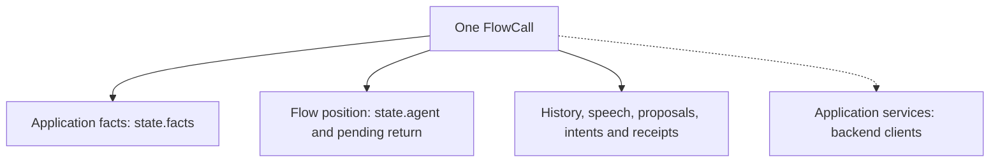
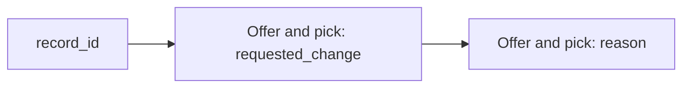

# 03 — Typed state and history

When the assistant asks for a record number and the caller says “R-17,” where does that answer go? Into **state**: named values kept for this call. **History** is the record of the exchange, including the original words and any later correction.

For example, after “Sorry, I meant R-18,” state should say `record_id = R-18`. History should still show that the caller first said R-17 and corrected it. The next node receives the same call, so it does not have to ask for everything again.

**Typed state** means each value has a declared form and rules. An identifier might be text; a revision must be a nonnegative integer. Pydantic checks those rules when core records a proposed update. It does not decide whether the caller or model is telling the truth.

Continue the example from [chapter 02](02-a-conversation-from-start-to-finish.md): caller A-42 wants record R-17 marked complete. The call moves from `front` to `request`, visits `lookup`, and returns to `request` for approval. This chapter follows the data through that path, then through a correction to the record identifier.

## 1. Define the facts the application needs

A model here is a data definition, not the language model. Each line below names a field, gives its type and sets its initial value. For example, `record_id: str` means the identifier is text; `revision: int` means the version is a whole number. Save this as `models.py` in the application folder:

```python
from pydantic import BaseModel, ConfigDict, Field


class ApplicationState(BaseModel):
    model_config = ConfigDict(extra='forbid')

    caller_id: str = Field('', description='The account identifier supplied by the caller.')
    record_id: str = Field('', description='The record the caller wants to change.')
    requested_change: str = Field('', description='The change the caller requested.')
    revision: int = Field(0, ge=0)
    status: str = ''
```

Every field has a default because a call can start before any identifiers are known. Here, an empty string means “not established,” and revision `0` means no backend version has been retrieved. These are choices made by this example, not reserved values that core requires every application to use.

`BaseModel` supplies Pydantic's validation. `extra='forbid'` rejects names that the model did not declare. `Field(0, ge=0)` starts at zero and refuses negative values. These checks help catch bad inputs before an operation uses them.

The model defines the shape of valid state. An application's identifier formats, allowed changes and cross-field rules belong here too. This small model only checks the field types and that revision is nonnegative; it does not establish record ownership or whether a particular change is permitted.

The manifest names the model and the caller-identity field:

```yaml
state: models.py:ApplicationState
identity: caller_id
```

`identity` associates proposals and outcomes with this caller value. Supplying an identifier does not authenticate the person on the line. The backend must still enforce its access rules.

## 2. Separate facts, session records and services

Core keeps the application facts together with the position in the conversation and its pending work. That whole per-call container is the **session**. Opening a call creates it:

```python
call = flow.open(ApplicationState(), services=backend)
```

Core copies and validates the initial facts. Changing the original object afterward does not change the opened call.



| Part | Example | Purpose |
|---|---|---|
| Application facts | `record_id='R-17'`, `revision=1` | The current values used to build operation arguments |
| Flow position | Active node `request` | Where execution resumes on the next turn |
| Session records | Caller words, read-back, delivery evidence, pending intent | What happened and what remains unresolved |
| Services | Database or API client | How application functions reach the backend |

In code, the facts are at `call.state.facts` and the current node is at `call.state.agent`. The names of the containers are `FlowState` and `FlowCall`: the first holds position and facts; the second adds history, pending work and services. Core creates them. The author only needs to supply the application's facts model and services.

There is one shared set of facts per call. A handoff changes the active node, its prompt and its available actions. It does not copy the conversation into another independent session.

## 3. Decide who may write each field

The state model answers whether a value is structurally valid. The manifest separately controls which values an agent may collect. This excerpt belongs on the `request` step:

```yaml
fields: [caller_id, record_id, requested_change]
```

Core builds that node's `collect` tool from these fields and their types. The agent can record the request, but cannot use this tool to set `revision` or `status`.

The lookup operation assigns those two fields from a validated backend result. Its declaration includes this mapping, where the left side is a state field and the right side is a receipt field:

```yaml
assign: {revision: revision, status: status}
```

The same integer can therefore have different authority depending on its source. A caller saying “it is revision 7” does not establish revision 7. The application obtains that fact through its lookup operation.

| Update path | Who uses it? | Checks |
|---|---|---|
| The node's `collect` tool | The agent interpreting caller input | Node-specific fields, typed values, current offers and dependencies |
| `call.collect(...)` | The collection machinery | Flow-level collectible fields, validation and dependent-value resets |
| `call.update(...)` | Trusted application code and receipt handling | Known fields and a valid complete replacement state |

A collectible field can also hold an agent judgement rather than a caller quotation. Faro, for example, lets its examiner record a typed grade and feedback. Validating the grade limits its allowed values; it does not prove the judgement correct. Faro's application code decides what that grade means for progress, using the stored exercise and whether the learner received help. Those teaching rules do not belong to core.

The direct `call.collect` method is not a substitute for the node-specific tool schema. It knows the fields collected across the flow; the generated tool narrows those to the active node's fields. `call.update` deliberately allows trusted code to assign backend-derived facts.

Use these paths instead of assigning `call.state.facts.revision` directly. Direct mutation bypasses validation and the runtime's tracking.

## 4. Follow a correction through the state

Suppose the first lookup reports R-17 as `open` at revision 1. Before approving the change, the caller says:

> Sorry, I meant R-18.

The agent records `record_id='R-18'`. Core handles that update in this order:

1. Combine the proposed value with the current facts and validate the candidate.
2. Compare the validated values with the existing values to identify what actually changed.
3. Reset facts and choices that rested on the changed input. The revision and status came from a lookup of R-17, so they cannot describe R-18.
4. Validate and commit the replacement facts. If that candidate is invalid, it is not applied.

| Point | Record | Revision | Status | What the call can rely on |
|---|---|---|---|---|
| Before lookup | R-17 | 0 | Empty | The caller's request only |
| After lookup | R-17 | 1 | `open` | Backend facts about R-17 |
| After correction | R-18 | 0 | Empty | The corrected identifier, awaiting a fresh lookup |
| After another successful lookup | R-18 | The backend's version | The backend's status | Facts about R-18 |

Core tracks which arguments produced receipt-assigned fields. The lookup's `revision` rests on `caller_id` and `record_id`. Changing only `requested_change` does not invalidate that lookup version. A revision assigned by a later write can have different dependencies because that operation used different arguments.

History still contains the original request for R-17 and the correction to R-18. Any old proposal for R-17 cannot authorize an operation on R-18. Approval is bound to the exact request, as [chapter 05](05-tools-approval-and-recovery.md) explains.

Resetting local facts does not undo a backend change. If an earlier operation already changed R-17, its receipt remains in evidence and reversing it requires another application operation.

## 5. Validate a whole candidate, then compare its meaning

An update replaces the facts as a whole. For example, trusted code might attempt:

```python
call.update(record_id='R-18', revision=-1)
```

With the model above, the negative revision fails validation. Neither the new identifier nor the revision is committed. This lets application validators check relationships between fields without observing a partly updated state.

The guarantee applies to each validated update. A `collect` tool invocation can perform several updates while refreshing offers; it is not a database transaction that rolls back every earlier update if a later choice lookup fails. Backend transactions remain the application's responsibility.

Validators can also normalize equivalent inputs before core compares them. If the application's validator stores both “complete” and “ COMPLETE ” as `complete`, recording the second spelling does not count as a changed request.

Core supplies the call's `today`, `now`, previous facts as `before`, and the caller's words this turn as `heard` through Pydantic's validation context. An application can use these to interpret a relative date consistently, validate a correction against the previous state, or refuse a new value the caller never said. The whole state is validated on every change, so a check on `heard` compares with `before` and leaves an unchanged value alone. Core supplies the context; the application supplies the interpretation. It does not invoke a model to normalize values.

A language field or property can also select the call's fixed phrases through `language:` and `locales:` in the manifest. Changing it affects this call's future core lines, not another caller's language, the STT model or the TTS voice. Application functions still supply their own questions and receipt wording. [Chapter 04](04-typed-flows-and-node-agents.md#8-choose-who-writes-the-spoken-answer) shows this boundary.

## 6. Keep choices tied to the facts that produced them

Some fields should be chosen from a current backend offer rather than accepted as free text. Suppose the application extends this example with a `reason` field and offers permitted changes and reasons:

```yaml
choices:
  requested_change:
    function: functions.py:available_changes
    after: [record_id]
  reason:
    function: functions.py:available_reasons
    after: [requested_change]
```

This is an optional extension to the `request` step. It needs the two choice functions, a defaulted `reason` field on the state model, and `reason` in the step's `fields` list.



Changing the record invalidates the old change offer and selection. That invalidation also takes away the dependent reason offer and selection. The application's functions supply fresh offers for the new facts.

If the caller supplies a new record and a requested change together, core checks the change against the fresh offer for that record. A compatible pick can be retained in the same tool call; an unavailable pick is refused while other valid values can still be recorded. Dependency order determines which offers refresh first, not the order of YAML keys. Compilation rejects cycles between a step's choices.

An explicit `after: []` gives a choice no ordinary field dependency. Omitting `after` uses changes to non-choice fields other than identity as dependencies. Separately, changing an already-known identity clears offers and picks made for the previous caller. Learning an identity for the first time is not treated as switching callers.

## 7. Build the next model request from facts and history

Before a model request, core supplies the node's instructions, a fresh application-state block and a view of the conversation. The state block contains current facts, offers, the question being answered, delivery information, recent outcomes and permitted destinations.

The agent receives the call as its Pydantic AI dependency, `ctx.deps`, but service objects are not serialized into the prompt. Put facts suitable for model context in `ApplicationState`; keep credentials and private clients in services.

For the correction above, the next request needs both perspectives:

| Current facts | Conversation history |
|---|---|
| The record is now R-18 | The caller first said R-17, then corrected it |
| Its revision is not yet known | A previous lookup described R-17 |
| The desired change is still `complete` | The caller has not withdrawn the requested change |

Each time the model is asked to respond, it needs a coherent account of the conversation. Core builds that outgoing view from the stored records. The code calls this a **projection**: a prepared copy, rather than rewriting the original history.

- Tool calls and their results stay paired. Incomplete exchanges left by cancellation are removed from the outgoing view.
- Fixed speech, such as a read-back rendered by code, appears where it was said. An old line is not repeatedly inserted as the latest assistant answer.
- Handoffs do not repeatedly add the same caller input. Separate fragments of an interrupted turn remain represented.
- Holding phrases are excluded so “One moment” does not become conversational content for the model to imitate.

A step chooses what of this it is sent with `context: {facts, history}`:

| `history` | What earlier turns the step is sent |
|---|---|
| `all` (the version 1 default) | the whole retained history, tool exchanges included |
| `messages` | what was said and heard, with no earlier tool exchanges |
| `none` | nothing earlier: this turn's words, its own tool exchange and its own pending question only |
| `{scope: node, turns: 8}` | whole caller turns this step took part in, on any visit, the last eight |
| `{scope: conversation, turns: 8}` | every step's caller turns, the last eight |

`facts` is `all`, `none`, or a list of top-level state fields. A path such as `customer.phone` is refused. A history object opts the step into the scoped view (`core.history.Scope`). Offers, receipts, intents and recaps then follow the step's facts too, not only the facts line, and its prompt may name only what the step sees. Some turns are kept past `turns` because the step needs them: the turn that asked for the step, its own pending question, the turns after that question, and loaded capabilities. In manifest version 2 every conversation step is scoped, and the flow defaults to no facts and `{scope: node}` ([chapter 04](04-typed-flows-and-node-agents.md#9-write-the-same-flow-in-manifest-version-2)).

This minimises context. It does not redact anything. What the caller says, and what they were read, is sent as it was said, and it can name a field the step does not see. The call keeps every field and every message. Only the view is smaller.

Speech delivery is tracked separately from generated text. An estimated partial spoken prefix can help conversational continuity, but it is not evidence that a complete read-back was delivered. Likewise, a history sentence claiming success cannot replace a validated receipt.

## 8. Know what survives each boundary

| Event | What carries forward? |
|---|---|
| The caller replies | This call's facts, history and pending work, subject to approval timing rules |
| Another node takes over | The same call, with a new prompt and action set; prerequisite detours can use a reduced history view |
| An old asynchronous task finishes | Completed effects remain recorded, but generation and identity checks prevent stale work from overwriting the current conversation |
| Another caller connects | A separate `FlowCall` with copied initial facts and its own runtime records |
| The process restarts | Nothing restores the in-memory conversation automatically; the application must persist what it needs |

A backend client may be shared across calls even though their conversation state is separate. Its ownership and concurrency rules still matter. [Chapter 05](05-tools-approval-and-recovery.md) explains the narrower recovery path for unresolved operations.

## Check the state rules offline

The repository's clinic fixture uses different fields but exercises the same state boundary. From the repository root after `uv sync --all-packages`:

```bash
uv run --directory core python - <<'PY'
import asyncio

from pydantic_ai import models

models.ALLOW_MODEL_REQUESTS = False

from tests.test_session import (
    invalid_updates_change_nothing,
    the_model_writes_only_collected_fields,
    two_calls_on_one_flow_share_nothing,
    a_correction_invalidates_completion_not_the_record,
)

for check in (
    invalid_updates_change_nothing,
    the_model_writes_only_collected_fields,
    two_calls_on_one_flow_share_nothing,
    a_correction_invalidates_completion_not_the_record,
):
    asyncio.run(check())

print('Invalid updates, field ownership, call isolation and corrections checked.')
PY
```

These checks use a scripted model. They establish how core handles accepted values and recorded effects, not whether a live model extracts every value correctly.

## Check this against the code

- [State and session implementation](../../core/src/core/steps.py): `FlowState`, `FlowCall.update`, `FlowCall.collect`, `ConversationStep._record`, `context` and `StepFlow.open`.
- [Runtime records](../../core/src/core/state.py): `CallContext.commit`, validation context, speech, proposals and evidence.
- [History projection](../../core/src/core/history.py): `project` and `paired` copy history for outgoing requests.
- [Session tests](../../core/tests/test_session.py) and [history tests](../../core/tests/test_history.py): validation, isolation, stale work and retained conversation.
- [Chained-choice fixture](../../core/tests/ticket_flow/chained.yaml) and [support-desk tests](../../core/tests/test_tickets.py): dependent offers, normalization and simultaneous parent/child corrections.

[← Conversation walkthrough](02-a-conversation-from-start-to-finish.md) · [Reading guide](README.md) · [Next: typed flows and node agents →](04-typed-flows-and-node-agents.md)
