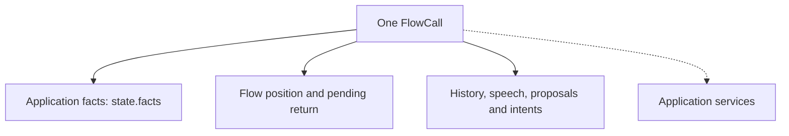
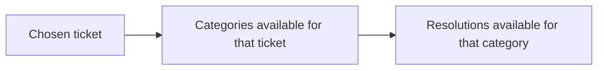

# 03 — Typed state and history

State answers **“What does this call know now?”** History answers **“What happened in the conversation?”** They serve different purposes. If the caller corrects a value, the current state should change, while the history should still explain the correction.

The harness keeps both on the call. Moving between nodes does not create another set of facts or erase the conversation.

## Start with the application's facts

An application writes a plain Pydantic model and names it in the manifest:

```yaml
state: tickets.py:DeskState
```

The actual [`DeskState`](../../core/tests/ticket_flow/tickets.py) includes these fields:

| Field | What it means | Where its value comes from in the main desk flow |
|---|---|---|
| `account_id` | The account the caller names | The caller, through `collect` |
| `ticket_id` | The ticket being discussed | The caller, through `collect` |
| `resolution` | How the caller says the problem was fixed | The caller, through `collect` |
| `revision` | Which version of the ticket the backend reported | A validated receipt |
| `ticket_status` | Whether that reported version is open or resolved | A validated receipt |

The model describes valid values: the account and ticket identifiers have patterns, and fields have defaults so a call can start without all the information. The manifest separately describes which fields a node may collect.

For example, these are declarations from `DeskState` (an excerpt, not the complete model):

```python
account_id: AccountId | None = Field(None, description='The account number, like ACC-1234.')
ticket_id: TicketId | None = Field(None, description='The ticket number, like T-101.')
revision: int = 0
ticket_status: str = ''
```

`AccountId` and `TicketId` are application-defined string types with pattern checks. `None` means the caller has not supplied a value yet; revision `0` means no backend revision has been established. The operation's argument model later requires a revision of at least `1` before a change can run.

That separation is important. A field being a valid integer does not mean the model is allowed to set it. In this flow, the model cannot establish a backend revision merely by choosing an integer.

## The call has three kinds of data



| Part | Owner and purpose |
|---|---|
| Application facts | The application's model, available as `call.state.facts`. |
| Runtime records | Core's position, accepted input, history, speech delivery, waiting question and action records. |
| Services | The database or API clients passed to `flow.open(...)`. Core calls them, but they are not placed in the model's prompt. |

`FlowState` wraps the application facts with flow fields such as the active node. `FlowCall` adds the rest of the session. The public manifest path builds these types; an application does not need to subclass them.

The node agent receives the call as its Pydantic AI dependency, `ctx.deps`. Before each model request, core builds a current-state instruction block containing facts, available choices, the pending question, recent outcomes and permitted destinations. It does not send the service objects.

There is **one shared application state per call**, not an automatic private state object for each node. Nodes have different prompts and writable fields, but they can see the current facts. Keep facts suitable for model context in that model; keep service credentials and private clients in services. Selecting an `identity:` field associates records with an identity value—it does not authenticate the person on the line.

## How an update works

Suppose the caller corrects the ticket number. Core does not write that field directly and hope the remaining fields still make sense.

1. It combines the proposed values with the current facts.
2. It validates a complete candidate using the application's Pydantic model.
3. On the model's collection path, it also removes choices and derived facts that depended on the changed inputs.
4. It commits a validated candidate, or leaves that candidate unapplied if validation fails.

There are two entry points for different callers:

| Entry point | Used by | What it adds |
|---|---|---|
| `call.update(...)` | Trusted application code and receipt handling | Validates a complete replacement for the application facts. |
| `collect` / `call.collect(...)` | The node's model-facing collection path | Restricts writable fields and checks choices and dependent values as well. |

Applications should use these methods rather than assigning `call.state.facts.some_field` directly. Direct mutation bypasses the runtime's checks.

The guarantee is per validated state update. One `collect` tool invocation can make several updates while refreshing choices; it is not a transaction that rolls back all previous updates if a later lookup fails. Backend transactions are separate again.

## Compare meaning, not just spelling

Core passes a validation context to the application's validators: the call's `today`, `now`, and previous facts as `before`. A validator can use those values to store a consistent representation of a caller's words.

For example, the support fixture converts “mañana” into a date using the call's clock. The application owns that interpretation. Core does not contain a Spanish date parser or a ticket-specific rule. Once normalized, two inputs representing the same value can be compared without treating a spelling change as a new request.

This uses Pydantic's [validation context](https://pydantic.dev/docs/validation/latest/concepts/validators/#validation-context). It supplies data to validators; it does not call an LLM or a backend to infer the meaning.

## Choices can depend on other facts

A choice is a value selected from an application's current offer. In the [chained desk fixture](../../core/tests/ticket_flow/chained.yaml), the dependencies are:



The manifest expresses them with `after:`. Changing a parent removes the old child offer and its selection, including further dependent choices. Core then asks the application's choice functions what is available for the new state.

If a caller supplies a new parent and child together, the child is checked against that fresh offer. A compatible child can be recorded in the same tool call; an incompatible one remains refused. Declared dependencies determine the order, not the order of YAML keys. Cycles between a step's choices are rejected at compilation.

An explicit `after: []` means no ordinary field dependency. Changing an already-known identity still clears choices made for the previous identity. Without an explicit `after:`, choices depend on changes to the non-choice fields other than identity, with that separate identity rule still applying.

Receipt-derived fields also have dependencies. For example, a looked-up revision rests on the account and ticket used for that lookup. Changing unrelated discussion fields should not erase that revision. Removing a local fact never reverses a backend effect; reversal requires an explicit operation.

## History tells the next request what happened

Core keeps the provider's message history and a separate record of speech segments. Before a model request, it builds a copy of the history suitable for that request. This is called a **history projection**.

The projection keeps tool calls next to their results, removes incomplete tool exchanges left by cancellation, and includes fixed speech in the turn where it was said. A line from an interrupted run must not appear as the latest assistant sentence on every later request. Caller fragments are retained without repeatedly adding the same input during handoffs.

Generated text and delivered speech are different records. The runtime may know that a segment finished playing, was cut short, or has no confirmed delivery. It can also retain an estimated partial prefix for conversational continuity; that estimate is not approval evidence. Holding phrases are excluded from the projected conversation so they do not become examples for the model to repeat.

The history supports interpretation. The current facts, proposals and receipts still determine what an operation is allowed to do. An old sentence saying an action succeeded cannot substitute for a valid result.

## A new turn, another node, another call

| Event | What carries forward |
|---|---|
| The caller answers again | This call's facts and history; pending questions remain subject to their timing rules. |
| The flow moves to another node | The same call, with a different prompt and available actions. Some prerequisite detours use a reduced history view, not a new call. |
| An older asynchronous task returns | Its result is checked against the current generation and identity. Completed effects remain recorded, but old work cannot move the current flow backward. |
| Another caller connects | A new `FlowCall` with copied and validated initial facts and separate runtime records. |
| A process restarts | In-memory conversation state is not restored automatically. The application must persist what it needs; unresolved intents have a restoration path described in chapter 05. |

Services can intentionally be shared between calls. Their database rules still need to prevent one caller from changing another caller's resources. Call isolation and backend ownership checks solve different problems.

## Check this against the code

- [`FlowState`, `FlowCall.update`, `FlowCall.collect` and `StepFlow.open`](../../core/src/core/steps.py): state ownership, validation and choice dependencies.
- [`CallContext.commit` and `validation_context`](../../core/src/core/state.py): whole-state updates and checks on late work.
- [`history.project` and `history.paired`](../../core/src/core/history.py): history copies and complete tool exchanges.
- [Session tests](../../core/tests/test_session.py), [history tests](../../core/tests/test_history.py), and [support-desk tests](../../core/tests/test_tickets.py): isolation, late results, corrections, normalization and chained choices, including R23.

[← Conversation walkthrough](02-a-conversation-from-start-to-finish.md) · [Reading guide](README.md) · [Next: typed flows and node agents →](04-typed-flows-and-node-agents.md)
