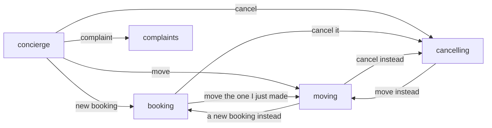
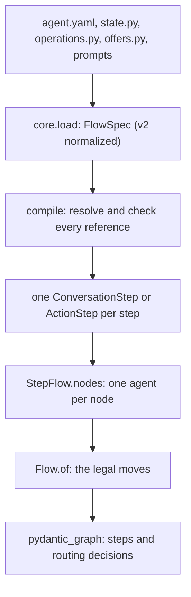

# 04 — Nodes and agent.yaml

A **flow** is the set of jobs and the allowed moves between them. A **node** is one job. An **edge** is permission
to move from one job to another. The application declares all of them in `agent.yaml`. Core checks the file when the
application starts, builds one agent per node, and enforces the edges on every turn.

The agent decides what the caller seems to need. The graph checks that the move is allowed. Code says the lines it
already knows. This chapter shows how to design the nodes, how to write the manifest, and what happens to it.

## 1. One job per node

Split the conversation by the job the caller wants done. Do not split it by sentence or by tool. This is the house
style for every use case on core.

The salon started with one `booking` node that also moved and cancelled. It is now three:

| Node | Its one job | Operation | What code says on arrival |
|---|---|---|---|
| `booking` | make a new booking | `book_appointment` | the times for the day asked, or "Which day would you like?" |
| `moving` | move a booking the caller holds | `move_appointment` | "You have a haircut Friday at 9:00. Which day would you like to move it to?" |
| `cancelling` | cancel a booking the caller holds | `cancel_appointment` | "Shall I cancel your haircut Friday at 9:00?" |



The rules:

1. **One job, one operation.** A node's prompt, facts and outputs cover only its job. `cancelling` cannot book.
2. **Code opens the node.** `offers:` names the choice whose function writes the first line. The model is not
   asked to say something code already knows.
3. **Prerequisites are declared, not prompted.** `requires` and `satisfied_by` make the graph interpose `verify`
   and come back.
4. **A change of mind is an exit.** "Move the one I just made" is an exit from `booking` to `moving`, with a purpose
   the model reads. The hand-over can carry the new day.
5. **A side question is a consultation.** `consults: stylist` answers a hair question and hands the caller back.
6. **An entry node routes.** `concierge` works out the job, answers general questions, and hands over.

Why this works:

- **Small prompts and schemas.** Each request carries one job's instructions, facts and outputs. A booking request
  is about 18 kB at the model boundary. That suits a small, fast model.
- **Fewer requests.** Code already knows each node's first line, so no model request is spent on it. On the six
  salon text paths, every caller turn is one request.
- **Mistakes stay contained.** A wrong reading inside `moving` cannot book or cancel.

A node can still span many turns. `moving` names the booking, takes the day, offers times, reads the move back,
and handles "no, make it 10:30", all in the same node.

## 2. The application folder

```text
salon/
  agent.yaml        the nodes, what each sees and changes, and how they connect
  state.py          SalonState: every fact the call keeps (chapter 03)
  operations.py     LookupCustomer, BookAppointment, MoveAppointment, ... (chapter 05)
  offers.py         find_times, bookings_to_move, bookings_to_cancel: what is on offer, and its words
  receipts.py       the typed answers the diary may give
  capabilities.py   the refund policy, loaded only when asked about
  prompts/          one prompt per node, plus _voice.md and _diary.md shared by several
  app.py            FLOW = SPEC.compile(), and open_call for each call
```

Each file has one job. Python owns the types and the business actions. YAML owns the graph and the permissions.
Prompts own the conversational instructions. Core owns the pending question, the typed outputs, approval, delivery
and routing.

## 3. The manifest, top to bottom

The header of the salon's [`agent.yaml`](../../use-cases/salone-concierge-graph-new/salon/agent.yaml), trimmed:

```yaml
version: 2
id: sage-and-stone
app_version: '2026.09.30-v2'
greeting: "Hi, you've reached Sage and Stone. Robin speaking, what can I do for you?"
state: state.py:SalonState
identity: customer_phone
entry: concierge
current_datetime: {timezone: Europe/Madrid, calendar_days: 14}
context: {facts: none, history: {scope: node, turns: 8}}
locale:
  base: english
  goodbye: Thanks for calling Sage and Stone. Have a lovely day!
model: google-cloud:gemini-3.5-flash-lite
includes:
  diary: prompts/_diary.md

agents:
  robin:
    prompt: prompts/_voice.md

operations:
  lookup_customer: operations.py:LookupCustomer
  book_appointment: operations.py:BookAppointment
  move_appointment: operations.py:MoveAppointment
  cancel_appointment: operations.py:CancelAppointment
```

| Key | What it does |
|---|---|
| `version: 2` | Steps are keyed by id. A step with no `kind` is a conversation, and one with no `speech` is `structured`. |
| `state` / `identity` | The application's state model, and the field that names the caller. |
| `entry` | The node every call starts in. |
| `current_datetime` | The call's clock. Every node's model sees today and a labelled 14-day calendar. |
| `context` | The default view for every node: no facts, and its own last eight turns. Each node lists its own facts. |
| `locale` | Core's own fixed lines, in one language, with the salon's goodbye. |
| `includes` | Files pasted into prompts where `<!--diary-->` appears. |
| `agents` | Shared personas. `robin` is the voice every node speaks in, with native Pydantic AI `AgentSpec` settings. |
| `operations` | Each business action, one line: a `core.Lookup` or `core.Write` class. |

A node, the real `moving` step:

```yaml
steps:
  moving:
    agent: robin
    prompt: prompts/moving.md
    requires: [customer]
    satisfied_by: verify
    fields: [booking_id, service, booking_day, booking_time, slot]
    context: {facts: [booking_id, service, booking_day, booking_time, slot]}
    choices:
      booking_id: {function: offers.py:bookings_to_move, after: []}
      slot: {function: offers.py:find_times, after: [booking_id, service, booking_day, booking_time]}
    offers: [booking_id, slot]
    operations: [move_appointment]
    reads_back: {move_appointment: [slot]}
    capabilities: [capabilities.py:refunds]
    exits:
      - {to: booking, purpose: 'a new booking instead of a move'}
      - {to: cancelling, purpose: 'cancelling instead of moving'}
      - {to: complaints, purpose: 'a complaint about a past service'}
      - {to: concierge, purpose: 'they give up, or ask about something unrelated'}
```

| Key | What it does |
|---|---|
| `prompt` | This node's instructions, after the persona's. |
| `requires` / `satisfied_by` | `customer` must exist first. If it does not, the graph runs `verify` and comes back. |
| `fields` | The facts this node's model may change. The update's types come from `SalonState`. |
| `context.facts` | The facts this node's model sees. A field it may change must be one it sees. |
| `choices` | A field picked from an offer. The function returns the ids and the words. `after:` names what the offer rests on: `booking_id` rests on nothing, and the times rest on the booking and the request. |
| `offers` | The choices code asks for the node's next line, in order, on arrival and after a `record` (section 5). |
| `operations` | What this node may carry out. Each is read back first. |
| `reads_back` | When the model only records `slot`, code reads the move back. No second request is needed. |
| `capabilities` | Native Pydantic AI capabilities. The refund policy is loaded on demand, only when asked about. |
| `exits` | Where the model may hand the caller. `purpose` is shown to the model. It is guidance, not a condition. |
| `consults` | (on `booking` and `concierge`) a specialist that answers and hands the caller back. |

Other keys exist for other shapes:

- `asks` and `opens_with`, which `verify` uses: ask for a missing field, or read a value back on arrival.
- `route:` and `carries_out:`, in section 7.
- `kind: action`, a code node with no model.
- `language:` and `locales:`, a language per call.

Every key is checked at load.

## 4. What the model can choose

Each node's agent answers every request with **exactly one typed decision**. The caller's update rides on it. This
is `speech: structured`, in [`core/structured.py`](../../core/src/core/structured.py). A booking request offers:

| Output | What it does | Who speaks |
|---|---|---|
| `reply(say, update, decline)` | answers the caller, with what they said recorded | the model's `say`, once the update commits |
| `record(update)` | records only, when the application answers next: an offer, a read-back, or an operation code carries out | code |
| `book_appointment(update)` | first call: read the booking back. Called again on a yes to that read-back: book it | code: the read-back, then the receipt |
| `hand_over(to, because, update)` | moves the caller to a declared exit or consultation | the next node, often code's first line |
| `goodbye(recap, decline)` | ends the call | code: the recaps, then the locale's goodbye |
| `say_again` | the caller asked to hear again what was done | code: the latest receipt |

It also has two ordinary tools, which return a result to the same agent in the same turn:

- `options(update)` asks a choice function for fresh offers.
- `load_capability` loads the refund policy.

A pure read (no read-back, no change, no route) is an ordinary tool too.

The rules on an update:

1. A field left out is kept.
2. `null` clears a field only if it may be empty.
3. `False`, `0` and `''` are values.
4. The whole update commits, or none of it does.

A consulted node, such as `stylist`, answers with `done(answer, handback)`, which returns the caller.

One response may carry one decision. A hostile reply that asks for two actions gets one, and the other is refused.

## 5. Offers: code says the next line

`offers:` is how a node opens without a model request. Core runs it on arrival, whether by a hand-over or back from a
prerequisite, and after a `record`. It goes through the listed choices in order. For each one with no offer of this
node's own, it asks the choice function, then:

1. If the function returns a **`pick`** (the caller has only one booking), code records it. If an operation now has
   every argument, code reads it back and stops. That is how `cancelling` asks "Shall I cancel your haircut Friday?"
   with no request.
2. If the function returns **words**, code says them and stops. That is an offer ("On Friday I have…") or a question
   for what it still needs ("Which day would you like?").
3. If there are no words, it goes on to the next choice. `bookings_to_move` says nothing when the new day is already
   known, so `find_times` offers that day's times.
4. If nothing has words, the node's agent answers, with the functions' notes.

The choice functions are plain application code. [`offers.py`](../../use-cases/salone-concierge-graph-new/salon/offers.py):

```python
def bookings_to_cancel(salon: Salon, state: SalonState) -> Times:
    """What a cancel can name. The one booking held is picked: its cancel read-back is the question, asked once."""
    held = _held(salon, state)
    if not held:
        return Times(note='They hold no upcoming booking.', say=NONE_HELD)
    if len(held) == 1:
        [booking] = held
        return Times(options=held, pick=booking)
    return Times(options=held, say=f'You have {_listed(list(held.values()))}. Which one would you like to cancel?')
```

A pick is still only an offered id, and it changes nothing by itself. The operation's read-back names the booking,
and the caller's yes is still required.

## 6. Follow compilation from files to graph

**Compile** means check the definition and build the objects that run it. It happens once, before any call. The
salon does it at import (`salon/app.py`):

```python
FLOW = SPEC.compile()                 # SPEC = core.load(Path(__file__).with_name('agent.yaml'))
call = FLOW.open(SalonState(), services=salon, caller_id=from_number, clock=clock)
```



1. **Load.** `core.load` parses the YAML and refuses a key given twice. Version 2 is normalized into the same
   internal steps table (`FlowSpec._normalized`), so there is one executor.
2. **Resolve.** Core finds the state model, operation classes, choice functions, capabilities and prompt files. It
   checks that every field, exit, choice and `after:` name exists and that operation arguments fit the state. Each
   prompt is compiled against the view its node sees, so a placeholder naming a hidden field fails here.
3. **Build.** Each step becomes a `Node` with its own agent (`Agent.from_spec`), outputs and openings.
4. **Route.** `Flow.of` derives every legal move: exits, consultations and their returns, prerequisite detours,
   receipt routes. Pydantic Graph runs them.

Every refusal names its step, for example `moving: may change 'slot' but cannot see it: add it to context.facts`.
Nothing fails mid-call for a wiring mistake. Compilation checks the wiring. It does not prove a prompt reads every
reply right.

## 7. Let code handle returns, prerequisites and known next steps

**Prerequisites.** When `concierge` hands a caller to `booking` and `customer` is missing, routing sends them to
`verify` and records that `booking` is waiting. When the lookup's receipt sets `customer`, code resumes `booking`,
and its offers open it in the same turn. `requires` checks that the fact exists. Only a trusted operation should set
a fact that stands for verification, as the salon's lookup receipt does. The return has one waiting destination,
not a stack.

**Consultations.** `booking` consults `stylist`. The stylist answers with `done`. The caller goes back to `booking`,
and a read-back that was waiting is put again.

**Receipt routes.** An operation can declare `route: next`, so its receipt's `next` field names the destination.
The field must be a `Literal` of step ids, and the loader checks it. Faro uses this: after a save, the store says
where the learner continues.

**Carried-out operations.** `carries_out: {find_ticket: [ticket_id]}` runs an approval-free operation as soon as a
`record` has recorded its trigger field. The model never calls it, so it runs only on what this reply recorded. See
the [routed support desk](../../core/tests/ticket_flow/routed.yaml).

**A code node.** `kind: action` runs one known operation with no model. `returns: true` goes back to the node that
asked, and `on_error` and `on_unknown` say where a refusal or an unknown outcome goes.

## 8. Language and greeting

`language:` names a state field, and `locales:` maps its values to locales. Core's own lines then follow the
caller's language during the call. This does not translate prompts or application wording, and does not switch STT
or TTS. Faro uses it for English and Spanish.

`flow.greeting(call, words)` returns the greeting, then what the entry node opens with, such as a caller ID read
back. That read-back then becomes the question the first reply answers. It still needs playback evidence.

## 9. Version 1

Version 1 manifests still load until the cleanup. They use a list of steps with `id` and `kind`, `prose` speech by
default, and the `collect` tool as the model's write path. The one application still on version 1 is `salon-graph`.
It will be retired. Write new use cases in version 2. [`core/tests/test_v2.py`](../../core/tests/test_v2.py) checks
that each version 2 twin of a clinic fixture normalizes to its version 1 source and sends the same requests.

## Inspect a compiled graph offline

From the repository root after `uv sync --all-packages`, compile the salon and print its legal moves, without any
provider request:

```bash
cd use-cases/salone-concierge-graph-new
GOOGLE_API_KEY=x uv run python -c "
from core.flow import Flow
from salon.app import FLOW
moves = Flow.of(FLOW.nodes).moves
assert {'booking', 'moving', 'cancelling', 'complaints'} <= moves['concierge']
assert {'moving', 'cancelling'} <= moves['booking']
for step, allowed in sorted(moves.items()):
    print(f'{step:12} -> {sorted(allowed)}')
"
```

The table says what is allowed, including prerequisite and consultation returns. It is not a transcript of what a
live model will choose.

## Check this against the code

- [Manifest compiler](../../core/src/core/flowspec.py): `FlowSpec`, `_normalized` for version 2, and every load check.
- [Structured decisions](../../core/src/core/structured.py): the outputs above and how an update is applied.
- [Compiled steps](../../core/src/core/steps.py): `ConversationStep.offer`, `owes_offer`, `_operate`, and prerequisite
  returns.
- [Executable graph](../../core/src/core/flow.py) and [routing](../../core/src/core/graph.py): legal moves,
  `Opening`, `route`.
- [Structured tests](../../core/tests/test_structured.py): one request per local answer, a pick read back by code,
  and a `record` that offers again.
- [Salon tests](../../use-cases/salone-concierge-graph-new/tests/test_business.py): every node's first line said by
  code, and the whole call at one request per turn.

[← State, memory, records and services](03-typed-state-and-history.md) · [Reading guide](README.md) · [Next: operations, approval and recovery →](05-tools-approval-and-recovery.md)
