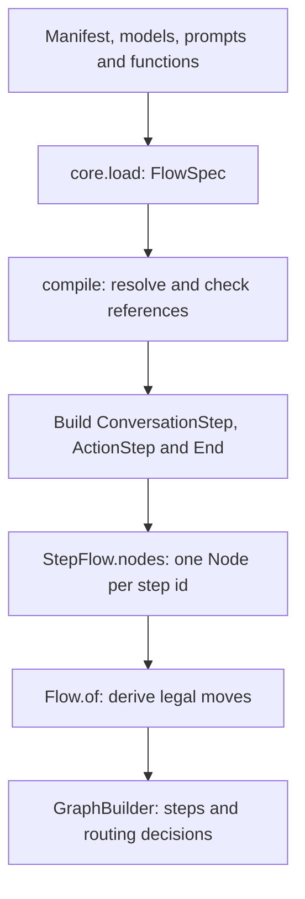
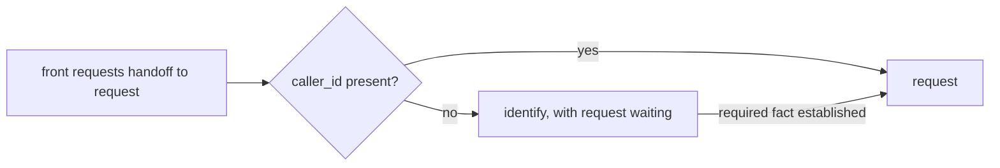

# 04 — Typed flows and node agents

A flow turns an application's declared steps into executable nodes and permitted routes. The graph controls where execution can go; the active node's agent interprets what the caller means within those limits.

Continue the example from [chapter 02](02-a-conversation-from-start-to-finish.md): `front` understands the request, `request` collects and confirms a change, and `lookup` fetches the current record. This chapter follows those declarations into the compiled graph, then shows how the engine walks it during a turn.

## 1. Choose where language decisions belong

Start by separating work that needs interpretation from work whose next action is already known:

| Responsibility | Example | Step kind |
|---|---|---|
| Interpret a request or answer | Decide whether “please mark R-17 complete” is a change request | `conversation` |
| Run a known operation | Fetch R-17 once its identifiers have been collected | `action` |
| Finish a structured path | Record completion and say a farewell | `end` |

A conversation node can stay active for several caller turns. It can collect missing information, ask for approval and handle a correction without moving elsewhere. An action node is useful when code already knows which function should run and where its result should lead.

The graph does not require one node per sentence or per tool. In this example, `apply_change` remains an operation on `request`: proposing it and executing it do not require separate nodes. A simpler application could combine `front` and `request` if separating their responsibilities added no useful boundary.

The package also offers `collect` and `confirm` steps for structured form-style flows. The [clinic definitions](../../core/tests/clinic_flow/) demonstrate those alongside conversation-based flows. This chapter follows the public `conversation` and `action` path.

## 2. Connect the application files

An application folder for the running example contains these pieces:

```text
application/
  __init__.py
  agent.yaml
  models.py
  functions.py
  prompts/
    assistant.md
    front.md
    request.md
```

| File | What the author supplies |
|---|---|
| `__init__.py` | Makes the folder a Python package so its functions can import its models |
| `models.py` | `ApplicationState` from chapter 03, plus argument and receipt models |
| `functions.py` | `fetch_record`, `apply_change`, read-back wording and reconciliation |
| `prompts/assistant.md` | Shared persona instructions |
| `prompts/front.md` | Instructions for understanding and routing an initial request |
| `prompts/request.md` | Instructions for collecting values, requesting a lookup and interpreting approval |
| `agent.yaml` | References connecting those pieces and declaring the routes |

The top of the manifest names the state, caller identity, entry step and persona:

```yaml
version: 1
id: record-changes
state: models.py:ApplicationState
identity: caller_id
entry: front
agents:
  assistant:
    prompt: prompts/assistant.md
```

This is a header excerpt. The complete application also needs `operations:` and `steps:`. [Chapter 05](05-tools-approval-and-recovery.md) builds the `apply_change` declaration; `fetch_record` supplies the lookup used below. A model can be selected in the manifest or passed to `compile(model=...)`.

## 3. Declare each node's capabilities

These are the same step declarations used in chapter 02:

```yaml
steps:
  - id: front
    kind: conversation
    agent: assistant
    prompt: prompts/front.md
    exits:
      - {to: request, purpose: changing an existing record}
  - id: request
    kind: conversation
    agent: assistant
    prompt: prompts/request.md
    fields: [caller_id, record_id, requested_change]
    operations: [apply_change]
    speech: rendered
    asks:
      caller_id: What is your account identifier?
      record_id: Which record should I change?
      requested_change: What would you like to change?
    exits:
      - {to: lookup, purpose: fetch the current record once its identifiers are known}
      - {to: front, purpose: answering a general question}
  - id: lookup
    kind: action
    operation: fetch_record
    returns: true
    on_error: request
    on_unknown: request
  - {id: done, kind: end, outcome: completed, say: Goodbye.}
```

`id` supplies the node name. `kind` chooses the runtime behavior. On a conversation step, `fields`, `operations` and `exits` define capabilities; the prompt explains how to use them.

For example, the `request` prompt could instruct its agent to collect the caller's identifiers, hand over to `lookup` when a current revision is needed, and select `apply_change` to propose the requested change. That instruction does not grant any additional tool or route. Giving the same instruction to `front` would not let it execute `apply_change`.

Both conversation steps name `assistant`, but compilation creates a separate agent for each step. They share persona configuration while retaining different prompts and available actions. They do not create separate calls or private copies of the application's facts.

The `done` step satisfies the completion-endpoint requirement for a flow containing an action step. The successful lookup normally returns to `request`, and a conversation node can end through `goodbye`; the presence of `done` does not force a visit after every operation.

## 4. Follow compilation from files to graph

With the referenced application code and prompts supplied, startup is:

```python
import core

spec = core.load('application/agent.yaml')
flow = spec.compile(model=model)
```



The stages have different jobs:

1. **Load the manifest.** `core.load` parses YAML, validates the declaration shape and records the application folder for resolving file references.
2. **Resolve the definitions.** Compilation finds the state model, functions, argument and receipt types, personas and prompt files. It checks that fields and destinations exist and that operation bindings fit their types. `FlowSpec.problems()` can inspect definition problems without running a model.
3. **Build runtime steps and nodes.** Each declared kind becomes its corresponding step object. `StepFlow` calls each step's `node` method and stores the resulting `Node` under its id in `flow.nodes`.
4. **Build legal routes.** `Flow.of(flow.nodes)` derives permitted moves, including automatic returns and prerequisite routes. Pydantic Graph's `GraphBuilder` turns those into executable steps and decisions. Core caches the graph for that node table.

Missing prompts, unknown fields or exits, incompatible function bindings and cyclic choice dependencies fail before a call runs. Compilation checks the wiring; it does not prove that a prompt will produce the right interpretation of every caller reply.

## 5. See what the agent receives

Before each model request, core combines the active node's instructions with current facts and the history view described in [chapter 03](03-typed-state-and-history.md). It then exposes the tools and outputs that node supports.

For `request`, the declaration above produces these choices:

| Choice | What it does | Where control goes |
|---|---|---|
| `collect` | Record the three permitted caller-supplied fields | Tool result returns to the same agent run |
| `decline` | Record a no to the pending read-back | Tool result returns to the same agent run |
| `apply_change` | Propose the operation, or execute it after valid approval | Back to the turn engine |
| `hand_over` | Request `lookup` or `front`, with a reason | Back to the engine to check and perform the move |
| `wait` | Ask code to choose the applicable fixed response | Back to the engine with rendered speech |
| `say_again` | Repeat the newest eligible change receipt | Back to the engine, without another backend write |
| `goodbye` | Request the call's end with eligible recaps and a farewell | Back to the engine to finish the conversation |

`decline` is available because this operation requires approval. `say_again` is available because it is a change with receipt wording. These are generated capabilities, not functions the application must implement itself.

The distinction between an ordinary function tool and an **output tool** explains the control flow. `collect` can return information to the agent so it can choose another action in the same run. Operations and handoffs are output tools: their selection returns control to the engine, which can speak fixed words or enter another node.

A handoff's destination schema lists only that node's declared exits. Core also enforces routes during execution. The turn policy permits only one action that moves the caller or changes the business per model reply; requesting several does not make them all execute.

## 6. Walk caller input through the generated graph

The caller first says, “I'd like to change a record.” The `front` agent hands over to `request`. On arrival, `asks` immediately speaks “What is your account identifier?” because that field is empty. This is code-entry behavior: it finishes the turn before the `request` agent runs.

After hearing the question, the caller says, “For account A-42, please mark record R-17 complete.” This next turn starts at `request`. One valid execution is:

| Hop | Work performed | What happens next? |
|---|---|---|
| `request` | Agent collects the facts, then selects `hand_over` to `lookup` | The graph enters the code node |
| `lookup` | Code runs `fetch_record` and validates the result | Successful return resumes `request` |
| `request` | Agent selects `apply_change` | Core speaks the read-back and finishes this turn |

Each generated graph step asks the turn engine to perform one node's work. Its result is either `Moved`, naming the next node, or `Answered`, ending this graph execution. The decision after the step routes `Moved` only to a permitted destination and routes `Answered` to the graph's end.

The graph's start decision can enter whichever node the call currently occupies. On the next caller reply, this call starts its graph execution at `request`, not at `front`. `Answered` ends the current execution, not necessarily the call; it also covers interruption, failure or an exhausted budget.

The graph uses `state=None`: the turn driver is passed as a dependency, and the `FlowCall` holds facts and position. Pydantic Graph is enforcing transitions here, not keeping a second copy of conversational state or persisting a paused call.

## 7. Let code handle returns and prerequisites

For `lookup`, the handoff records that `request` is waiting. On success, `returns: true` sends execution back there. No model request is needed to choose that return. A refusal or an unknown outcome follows the separately declared `on_error` or `on_unknown` destination.

The action still goes through the normal operation boundary. Making a step deterministic does not bypass argument validation, receipt checks or an operation's approval requirement. This example's `fetch_record` explicitly declares `approval: none` and `changes: false`.

A prerequisite is a related but different routing rule. As an optional extension, suppose `request` should run only after a separate identification step has established the caller. Add these fields to its declaration:

```yaml
requires: [caller_id]
satisfied_by: identify
```

This extension also needs a declared `identify` step that can establish `caller_id`. Its behavior is:



Routing checks the required facts and inserts the prerequisite when they are missing. Once they are present, code resumes the waiting destination. `requires` checks presence; it does not authenticate a caller simply because a string is populated. If the prerequisite represents verification, the application should require a fact that its trusted verification operation establishes.

The current return mechanism has one pending destination, not a stack of nested detours. A second interposition replaces the waiting destination. Keep that limit in mind when designing prerequisites that themselves need prerequisites.

## 8. Choose who writes the spoken answer

`front` uses the default `prose` mode, so its agent can compose answers to general questions. `request` uses `speech: rendered`, so the agent chooses actions while code supplies the words.

For example, `asks` speaks the first missing-field question automatically on handoff. On a later reply, if the record identifier is still missing and the agent chooses `wait`, code can say that field's `asks` line. Selecting `apply_change` produces the application's read-back or receipt wording. Selecting `say_again` speaks a recorded result. `wait` means “choose the appropriate rendered response,” not “sleep.”

Rendered speech gives control over wording, while intent interpretation and field extraction still depend on the agent. A prose node's optional `guarded` mode can filter unsupported completion claims using application-supplied rules, but that is a best-effort check. A rendered node has no model prose to guard and cannot also declare `guarded`.

Additional declarations such as `opens_with` and `reads_back` can make code select a predictable read-back on arrival or after collection. They are useful when the application already knows that next action; the simpler sequence above does not need them.

## Inspect a compiled graph offline

The support-desk fixture implements the same structure with `faq`, `desk` and `look_up` in place of `front`, `request` and `lookup`. From the repository root after `uv sync --all-packages`, compile it and inspect the actual route table without provider requests:

```bash
uv run --directory core python - <<'PY'
import core
from core.flow import Flow
from pydantic_ai import models
from pydantic_ai.models.test import TestModel

models.ALLOW_MODEL_REQUESTS = False
flow = core.load('tests/ticket_flow/agent.yaml').compile(model=TestModel())
graph = Flow.of(flow.nodes)

assert graph.moves['faq'] == frozenset({'desk'})
assert graph.moves['desk'] == frozenset({'faq', 'look_up'})
assert 'desk' in graph.moves['look_up']
print(graph.render())
print('Declared routes and the lookup return are present.')
PY
```

`core.flow.Flow` is the internal inspection helper, not an additional public export from `core`. Its Mermaid output contains generated decisions, fallback routes and turn endings, so it is more detailed than an application-path diagram. The route table describes what is allowed, not a transcript of the choices a live model will make.

## Check this against the code

- [Manifest compiler](../../core/src/core/flowspec.py): `FlowSpec`, declaration checks and conversion to runtime steps.
- [Compiled steps](../../core/src/core/steps.py): `ConversationStep.node`, `ActionStep.node`, `StepFlow.destinations` and prerequisite returns.
- [Executable graph](../../core/src/core/flow.py): `legal_moves`, `Flow._build`, `Moved` and `Answered`.
- [Routing](../../core/src/core/graph.py): `route`, `holds` and the pending return destination.
- [Authoring tests](../../core/tests/test_authoring.py) and [node tests](../../core/tests/test_nodes.py): different flow shapes, generated capabilities and rejected actions.

[← Typed state and history](03-typed-state-and-history.md) · [Reading guide](README.md) · [Next: tools, approval and recovery →](05-tools-approval-and-recovery.md)
