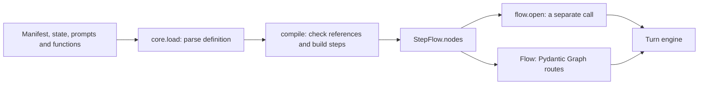
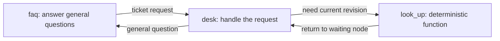

# 04 — Typed flows and node agents

A flow is a map of work the application can perform. A **node** handles one part of that work. An **edge** is an allowed move to another node. The call's state says where it is now and what it knows.

The graph limits where execution can go. The active agent still interprets natural language within those limits. A node can handle several turns; it is not a single sentence in a script.

## Why a graph?

Prompts can describe a process, but a prompt alone does not make its transitions enforceable. A declared graph gives core a concrete answer to “May this node hand over there?” and gives an author a map to inspect.

The graph also separates decisions that need language understanding from those already known by code. An agent can choose to look up a resource. Once the lookup finishes, a declared return path can take the call back without asking a model where it should go.

This makes rules visible and reusable. It does not prove that the agent chose the best legal path, nor does adding more nodes automatically improve accuracy or reduce tokens.

## What the author writes

An application supplies four pieces:

| Piece | Role |
|---|---|
| State model | The facts and their validation rules, covered in chapter 03. |
| Manifest | Node kinds, prompts, fields, choices, operations, exits and prerequisites. |
| Prompt files | How each conversational node should interpret and respond to the caller. |
| Typed Python functions | Lookups, changes and application wording, covered in chapter 05. |

This excerpt comes from the support desk's [complete manifest](../../core/tests/ticket_flow/agent.yaml). Its `agents`, `state` and operation declarations are elsewhere in that file; this is not a standalone manifest.

```yaml
steps:
  - id: faq
    kind: conversation
    agent: agent
    prompt: prompts/faq.md
    exits:
      - {to: desk, purpose: resolving or reopening one of the caller's tickets}
  - id: desk
    kind: conversation
    agent: agent
    prompt: prompts/desk.md
    fields: [account_id, ticket_id, resolution]
    operations: [resolve_ticket, reopen_ticket]
    speech: rendered
    exits:
      - {to: look_up, purpose: find the ticket's current revision once the account and ticket are recorded}
      - {to: faq, purpose: a general question}
  - {id: look_up, kind: action, operation: look_up_ticket, returns: true, on_error: desk, on_unknown: desk}
```

`id` is the application's name for the step. `kind` chooses core's behavior. Here, `faq` and `desk` are conversational nodes; `look_up` is a code node. There is nothing ticket-specific about those kinds.

Both conversational steps refer to the same base agent definition, but core builds a separate Pydantic AI agent for each step, with that step's prompt, tools and outputs. Reusing a base persona is different from giving every node the same job.

## How the definition becomes executable



Loading parses YAML and validates the manifest's shape. `FlowSpec.problems()` can inspect definition problems without running a model. Compilation resolves the state and function types, checks references and builds the runtime steps and agents. Failures include unknown fields or destinations, missing prompt files, incompatible operation bindings and cycles in declared choice dependencies.

The application does not maintain another graph by hand. [`Flow`](../../core/src/core/flow.py) builds one from the compiled node table with Pydantic Graph's `GraphBuilder`. It creates decisions for the routes the table permits and rejects a move that matches none of them. The [Graph Builder documentation](https://pydantic.dev/docs/ai/graph/builder/) describes the underlying steps, edges and decisions; the manifest compiler and conversation rules are core's layer above them.

## What an agent node can do

The public `conversation` path has one agent per node, with no classifier run before it. The agent receives the shared conversation plus current facts and selects from the tools and outputs that node declares.

| Choice | Result |
|---|---|
| `collect` | Record caller-supplied values in permitted fields and return any refreshed choices. |
| An operation | Read back a proposed action, or carry it out if its requirements are satisfied. |
| `hand_over` | Ask to move through a declared exit, with a reason passed to the receiving node. |
| An answer | Say model prose, or choose a rendered response, depending on the step's speech mode. |
| `goodbye` | End the conversation with core-managed wording and eligible receipt recaps. |

Tools are narrower than the whole application's capabilities. A node sees its operations and exits, and the destination schema for `hand_over` contains its declared destinations. Runtime checks still enforce the route if a model produces an invalid value.

Ordinary tool results, such as `collect`, return to the same agent run. Operations and handoffs use Pydantic AI output tools: they return control to the turn engine, which may speak a fixed result or run another node. The call retains the facts and evidence for the next request either way. This is how a node can continue handling a request after its functions have run without needing its own separate session.

## Code nodes and automatic returns

In the support desk, the relevant route is:



This diagram shows the application path, not every generated graph decision. A turn may stop at `desk` with a question and continue there when the caller replies.

An `action` step invokes its operation without a model request to choose or perform that call. It follows declared success, `on_error` or `on_unknown` paths. `returns: true` returns a successful detour to the waiting node. It does not remove operation approval or result validation.

Prerequisites work similarly. `requires` names facts a node needs, and `satisfied_by` names the node that can establish them. Routing can visit that prerequisite node, remember the intended destination, and return when the requirements hold. The application defines which facts count as satisfying a requirement.

## Speech is a separate choice

In a prose node, the model can provide the spoken answer. This suits open conversation but leaves the accuracy of its wording partly to the model.

With `speech: rendered`, the agent still interprets and chooses, but it cannot send its own prose to TTS. Code speaks read-backs, receipt text, questions or offers supplied by the application. A `wait` output asks core to select the appropriate rendered line; it is not an instruction to sleep.

Rendered speech strengthens control over wording. It does not eliminate mistakes in interpreting intent, collecting a field or choosing an operation. Those remain part of application evaluation.

The package also has `collect`, `confirm` and `end` step kinds for more structured form-style flows. The [clinic fixtures](../../core/tests/clinic_flow/) show these alongside one-agent and handoff definitions. The legacy hand-built `agent` kind is outside this guide's authoring path.

## Where state and graph execution meet

Core runs a short graph execution for each accepted piece of a caller turn, starting from the call's current node. A result says either “move to this node” (`Moved`) or “this turn's execution has finished” (`Answered`). `Answered` can mean interrupted or failed as well as answered successfully; it does not mean the whole call is complete.

The Pydantic Graph object uses `state=None` here. A driver passed as its dependency runs the actual turn work, and the `FlowCall` holds the application state and position. The graph is therefore not a second state store, a database or a process-recovery engine.

## Inspect the real graph offline

From the repository root after syncing dependencies, this builds the support flow with a test model and prints the graph generated from its node table. It makes no model request:

```bash
uv run --directory core python - <<'PY'
import core
from core.flow import Flow
from pydantic_ai import models
from pydantic_ai.models.test import TestModel

models.ALLOW_MODEL_REQUESTS = False
flow = core.load('tests/ticket_flow/agent.yaml').compile(model=TestModel())
print(Flow.of(flow.nodes).render())
PY
```

`core.flow.Flow` is the current internal graph-inspection helper, not an additional public export from `core`. The Mermaid output can be compared with the manifest without maintaining a second handwritten route table.

## Check this against the code

- [Manifest compiler](../../core/src/core/flowspec.py): `FlowSpec`, declared step kinds, reference checks and native agent specifications.
- [Compiled steps](../../core/src/core/steps.py): `ConversationStep`, `ActionStep`, agent construction and tool availability.
- [Graph](../../core/src/core/flow.py) and [routing](../../core/src/core/graph.py): legal moves, prerequisites and return paths.
- [Authoring tests](../../core/tests/test_authoring.py), [node tests](../../core/tests/test_nodes.py) and [support-desk tests](../../core/tests/test_tickets.py): different definitions on the same engine, illegal actions and dependent-choice ordering.

[← Typed state and history](03-typed-state-and-history.md) · [Reading guide](README.md) · [Next: tools, approval and recovery →](05-tools-approval-and-recovery.md)
