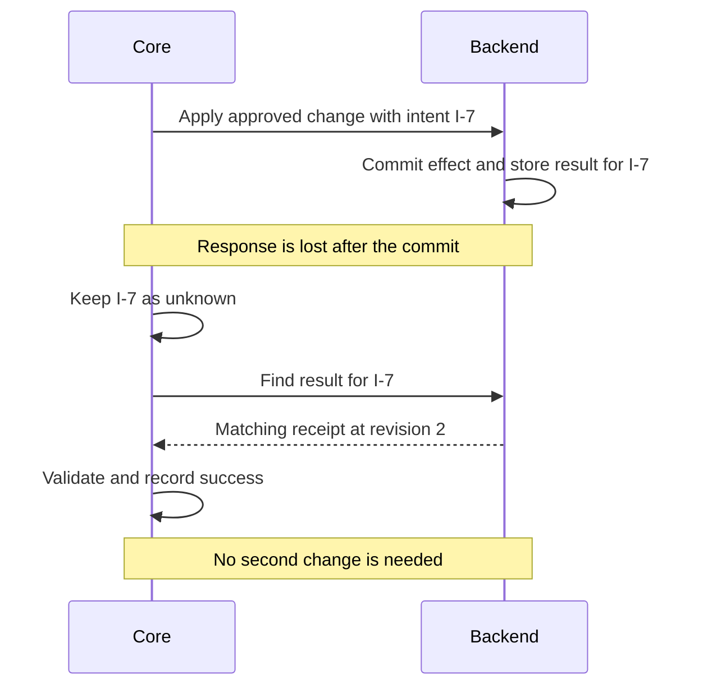
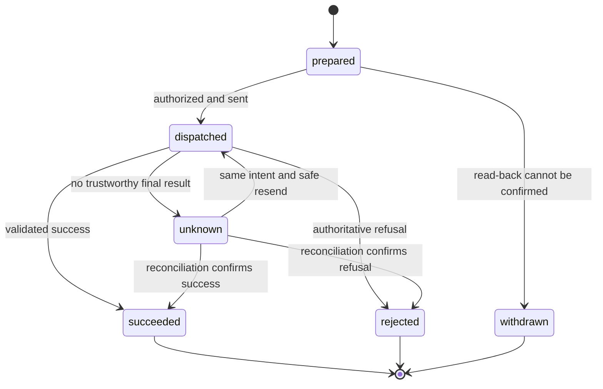

# 05 — Tools, approval and recovery

A model selecting a tool establishes what it wants to do. Core must still check whether the action is allowed, track whether it was sent, and validate what the backend says happened. Speaking the result is another step, with its own delivery evidence.

Continue the example from [chapter 02](02-a-conversation-from-start-to-finish.md): caller A-42 wants record R-17 marked complete. The lookup has established that it is open at revision 1. This chapter builds the `apply_change` operation, follows its approval and receipt, then repeats the sequence with a lost backend response.

## 1. Define the operation's inputs and result

The application's state can be incomplete while the conversation is in progress. An operation's argument model describes what must be present before that operation can run.

Add these models to the example's `models.py`, alongside `ApplicationState` from [chapter 03](03-typed-state-and-history.md):

```python
from typing import Literal

from pydantic import BaseModel, Field


class ChangeArgs(BaseModel):
    caller_id: str = Field(min_length=1)
    record_id: str = Field(min_length=1)
    revision: int = Field(ge=1)
    requested_change: str = Field(min_length=1)


class ChangeResult(BaseModel):
    caller_id: str
    record_id: str
    revision: int
    requested_change: str
    now_revision: int = Field(ge=1)
    status: Literal['complete', 'stale', 'pending']
```

`ChangeArgs` refuses empty identifiers and revision `0`, even though the initial conversation state permits them. `ChangeResult` describes this example backend's response: it echoes the request, reports the resulting version, and distinguishes completion, an obsolete-version refusal and unfinished processing.

These status words belong to the application. Core does not know what “complete” means until the manifest declares it. The backend must also validate ownership and permitted state transitions; a well-typed identifier does not establish access to a record.

## 2. Wrap the backend in typed functions

The application connects its backend through ordinary functions. In `functions.py`, the wrappers might look like this:

```python
from core import Intent

from .models import ChangeArgs, ChangeResult


def apply_change(backend, args: ChangeArgs, intent: Intent) -> ChangeResult:
    return backend.apply(args, intent.id)


def change_words(args: ChangeArgs) -> str:
    return f'Mark record {args.record_id} {args.requested_change}?'


def find_change(backend, args: ChangeArgs, intent: Intent) -> ChangeResult | None:
    return backend.find(intent.id)
```

This is a function-boundary example, not a backend implementation. The application must provide `backend.apply` and `backend.find`. When using relative imports as above, the application folder also needs an `__init__.py` so it can be imported as a Python package.

The function receives the call's service object, validated arguments and, optionally, the `Intent`. Core supplies that third parameter when it is annotated `Intent`; this backend uses its id to recognize repeated attempts. `find_change` retrieves the result of that same attempt rather than guessing from the record's current status.

Compilation reads the annotations and constructs a `FunctionOperation`. The author does not need to subclass core's operation classes for this path. A synchronous function runs in a worker thread, while an asynchronous function is awaited. Core validates returned data against the receipt model; a Python return annotation alone is not runtime validation.

## 3. Connect state, function and receipt in the manifest

The `apply_change` entry under `operations:` is:

```yaml
operations:
  apply_change:
    function: functions.py:apply_change
    args:
      caller_id: caller_id
      record_id: record_id
      revision: revision
      requested_change: requested_change
    readback: functions.py:change_words
    reconcile: functions.py:find_change
    subject: record_id
    resource: record
    version: now_revision
    idempotent: true
    matches:
      caller_id: caller_id
      record_id: record_id
      revision: revision
      requested_change: requested_change
    succeeds: {status: complete}
    rejects: {status: stale}
    assign: {revision: now_revision, status: status}
    say: 'Record {record_id} is {status}.'
    recap: 'Record {record_id} is {status}.'
```

This is an operation excerpt. The complete manifest also includes the state, persona, steps and `fetch_record` lookup from the preceding chapters. Here, `idempotent: true` assumes the backend really deduplicates by intent id, as explained below.

The mappings have specific directions:

| Declaration | Meaning in this example |
|---|---|
| `args` | Argument field → state field. Build `ChangeArgs` from the call's current facts. |
| `matches` | Receipt field → argument field. Require the returned caller, record, original revision and requested change to match this attempt. |
| `succeeds` / `rejects` | Receipt values that establish success or an authoritative refusal. Other outcomes of a change remain unknown. |
| `assign` | State field → receipt field. On success, replace the state revision with `now_revision` and copy the status. |
| `say` / `recap` | Wording rendered from receipt fields for the immediate result and an eligible later recap. |
| `subject`, `resource`, `version` | The receipt's record identifier, its resource kind and the resulting version used to order effects. |
| `reconcile` / `idempotent` | How to discover the original outcome and whether the same uncertain intent can safely be resent. |

The model selects `apply_change`; it does not submit another unchecked copy of these arguments. Core takes them from validated state and validates them again as `ChangeArgs`.

Approval and business effects are separate settings. By default, this operation requires approval and declares a change. The lookup instead declares both `approval: none` and `changes: false`. A read can require approval, and an application can explicitly permit a change without conversational approval. The manifest chooses that policy; types do not choose it automatically. An operation with `approval: none` can also be kept out of the model's tools entirely and carried out by code after `collect` records its input (`carries_out`, chapter 04).

## 4. Read back one exact proposal

With the facts from the lookup, core can build:

```python
ChangeArgs(
    caller_id='A-42',
    record_id='R-17',
    revision=1,
    requested_change='complete',
)
```

The `request` agent selects `apply_change`. Core prepares an intent, records a **proposal** for those exact arguments and renders:

> Mark record R-17 complete?

Nothing has been dispatched to the backend yet. A proposal is the question waiting for an answer; an intent is the tracked attempt that may eventually be sent.

The voice adapter must establish delivery of the proposal's speech segment. Generating its text or starting TTS is insufficient. A text application uses `call.acknowledge(...)` as explicit simulated delivery, as shown in chapter 02.

There is one pending proposal slot per call. Another proposal replaces it. The call does not hold a queue of independent questions that one later “yes” can approve together.

## 5. Bind the reply to that proposal

The caller says “Yes.” The same node agent interprets the reply and selects `apply_change` again. No separate classifier first decides whether the answer was agreement.

Core then checks the reading against the session:

1. The operation and its current arguments match the pending proposal.
2. The caller identity still matches the identity associated with that question.
3. The latest read-back copy has the required delivery evidence, and the reply began after it finished playing.
4. The approving work is still current, and the answer has not already been consumed.

A valid answer authorizes this action and is consumed. It cannot also authorize a different write in the same model reply.

| Reply or event | Consequence |
|---|---|
| A valid yes after the read-back was delivered | The matching operation may execute |
| “Actually, R-18” | Changed arguments need their own proposal and approval |
| A clear no, interpreted through `decline` | Consume the pending question without executing its operation |
| A question about the proposed change | Not automatically a rejection; the question can remain pending |
| A reply before playback finishes, or without confirmed delivery | It cannot approve this read-back |
| Repeated inability to confirm delivery | Bounded attempts end in withdrawal and a fallback line |

After withdrawal, the same arguments remain withdrawn on that call; asking again does not create an unlimited retry allowance. Corrected arguments can form a new proposal.

The model still decides what the reply means. The runtime checks prevent that interpretation from approving a stale, mismatched or unconfirmed proposal; they do not establish perfect language understanding. Live evaluation is needed for that part.

## 6. Dispatch the intent and validate the receipt

After authorization, core claims the intent so another task on this call cannot dispatch it concurrently. If the service provides `note_intent(intent)`, core asks it to persist the intent before dispatch. A failure at that persistence step means the operation is not sent.

Core then marks the intent dispatched and invokes `apply_change`. Suppose the backend commits the change and returns:

```python
ChangeResult(
    caller_id='A-42',
    record_id='R-17',
    revision=1,
    requested_change='complete',
    now_revision=2,
    status='complete',
)
```

The two revision fields answer different questions: `revision=1` identifies the version this request acted on, while `now_revision=2` identifies the effect it produced.

Core validates the response shape, checks `matches`, and applies the declared outcome rules:

| Response | Established outcome | State and speech |
|---|---|---|
| Matching result with `status='complete'` | `succeeded` | Assign revision 2 and status, then render “Record R-17 is complete.” |
| Matching result with `status='stale'` | `rejected` | Do not assign success facts or speak the success line |
| Matching result with `status='pending'` | `unknown` | The backend has not established a final outcome |
| Wrong record, invalid data or a lost response | `unknown` | Do not infer either success or failure |

A receipt is recorded as evidence before success presentation awaits further work. If local state presentation or speech is then interrupted, core can repair that presentation from the stored receipt. It does not need to send the business change again or ask another model to paraphrase its result.

## 7. Follow a lost response through recovery

Now change just one part of the successful sequence: the backend commits revision 2, but the response never reaches core.



`I-7` is an illustrative intent id. The important property is that reconciliation asks about the same attempt that was dispatched.

Core cannot infer failure from cancellation, timeout or malformed data after dispatch. The backend may already have committed. A synchronous function running in a worker thread can even finish after the task awaiting it is cancelled. These cases leave the intent **unknown**, with the original arguments retained for reconciliation.

An explicit `Refused` exception has a different meaning: the application knows no effect happened and none will. An ordinary retry signal after dispatch does not provide that certainty.

The intent's main transitions are:



`unknown` is not a synonym for failed. It means the application still lacks enough evidence to settle that attempt.

## 8. Reconcile before deciding to resend

On a later turn, core can call `find_change` with the original arguments and intent before another model request. The backend looks up the stored result by intent id; core validates the answer through the operation's result rules.

| Reconciliation response | Next step |
|---|---|
| Matching, validated success | Settle the intent and present the result if it still applies |
| A declared terminal refusal | Settle it as rejected |
| No stored result yet | Keep it unknown; absence of a result does not prove absence of an effect |
| Invalid data, a mismatched receipt or another error | Keep it unknown and preserve the dispatch guard |

An unknown change can be resent as the **same intent** only if it is declared `idempotent: true`. A pure read is also resendable because it declares no business effect. Reconciliation itself does not blindly repeat the operation.

For the declaration above to be truthful, the backend must recognize `intent.id` and prevent a duplicate effect. A common implementation commits the resource change and a result keyed by intent id in the same database transaction. If the same id arrives again, it returns that result rather than applying another change. The YAML setting does not add this behavior to a database or external API.

The id stays stable while that attempt is uncertain or retried. It is not a permanent hash of the arguments: a later, separately approved business action can need a new intent even if its arguments are identical.

While a change remains dispatched or unknown, core also blocks a different intent of the same operation for the same caller identity. This is a per-call safeguard. Ownership checks, concurrent edits and duplicate prevention across workers still need backend enforcement. In this example, the backend's revision check refuses a request based on a version that has already changed.

## 9. Distinguish recorded history from the current effect

Suppose R-17 was completed at revision 2, then another operation reopened it at revision 3. Both receipts are historical facts. Only revision 3 describes the standing effect.

The declarations `resource: record`, `subject: record_id` and `version: now_revision` identify the resource and order successful changes to it. Core's `effective()` view selects the standing successful effects for recaps by resource kind and id, using application versions rather than receipt arrival order.

An optional `services.current_version(kind, resource)` hook lets core check a reconciled success against newer backend changes. If it reports revision 3, a late success receipt at revision 2 is recorded as history rather than assigned and spoken as current. If that version check fails or returns no usable version, the outcome stays unknown pending a trustworthy check. Without the hook, core only knows the versions recorded in this call.

Repeating receipt wording is separate from executing an operation. The `say_again` output uses an eligible recorded result and sends no new business change. An automatic repeat after interrupted playback likewise uses the receipt. A superseded receipt must not become the current result merely because its speech was never heard.

## 10. Restore unresolved work after a process restart

If the process dies after dispatch, its in-memory call records disappear. Durable recovery needs the application to persist the intent before sending it, record backend effects, and retrieve unresolved work afterward.

A new process can open a call with those saved intents:

```python
call = flow.open(
    ApplicationState(caller_id='A-42'),
    services=backend,
    intents=saved_unresolved_intents,
)
```

`saved_unresolved_intents` is supplied by the application's durable store. Core treats restored unresolved intents as unknown and reconciles them before another conflicting attempt. Services can also expose `owed(identity)` to retrieve unresolved actions left by earlier calls once the caller is known.

This restores the ability to settle actions. It does not restore the old microphone connection, full history, pending conversation or a graph suspended inside the previous process. Those require separate application persistence if they are needed.

## Exercise recovery offline

The support-desk fixture implements this pattern with `resolve_ticket` and a SQLite backend. Its fault switches can lose a committed response or return a receipt for the wrong resource. Core's intent tests also cover a thread finishing after cancellation and restoration into a fresh call.

From the repository root after `uv sync --all-packages`:

```bash
uv run --directory core python - <<'PY'
import asyncio
import tempfile
from pathlib import Path

from pydantic_ai import models

models.ALLOW_MODEL_REQUESTS = False

from tests.test_intents import (
    a_thread_commits_after_cancellation,
    restored_intents_reconcile_first,
)
from tests.test_tickets import a_doubtful_answer_is_reconciled_by_intent

with tempfile.TemporaryDirectory() as folder:
    asyncio.run(a_doubtful_answer_is_reconciled_by_intent(Path(folder)))

asyncio.run(a_thread_commits_after_cancellation())
asyncio.run(restored_intents_reconcile_first())
print('Lost responses, late thread completion and restored intents reconciled without duplicate effects.')
PY
```

These checks use scripted models and controlled faults. They test the runtime's handling of uncertain outcomes; each real backend still needs to satisfy its declared reconciliation and idempotency contract.

## Check this against the code

- [Function binding and node tools](../../core/src/core/steps.py): `FunctionOperation`, `ConversationStep`, reconciliation and receipt presentation.
- [Operation execution](../../core/src/core/operations.py): `Operation.run`, dispatch, intent claims, outcome validation and current-version checks.
- [Proposal ledger](../../core/src/core/proposals.py) and [session records](../../core/src/core/state.py): exact question binding, delivery, withdrawal, restoration and effective receipts.
- [Intent tests](../../core/tests/test_intents.py) and [outcome tests](../../core/tests/test_outcomes.py): cancellation, safe retries, late effects, malformed results and recovery.
- [Support-desk backend](../../core/tests/ticket_flow/tickets.py) and [tests](../../core/tests/test_tickets.py): durable intent records, stale revisions, process death and receipt-only repetition.

[← Typed flows and node agents](04-typed-flows-and-node-agents.md) · [Reading guide](README.md)
