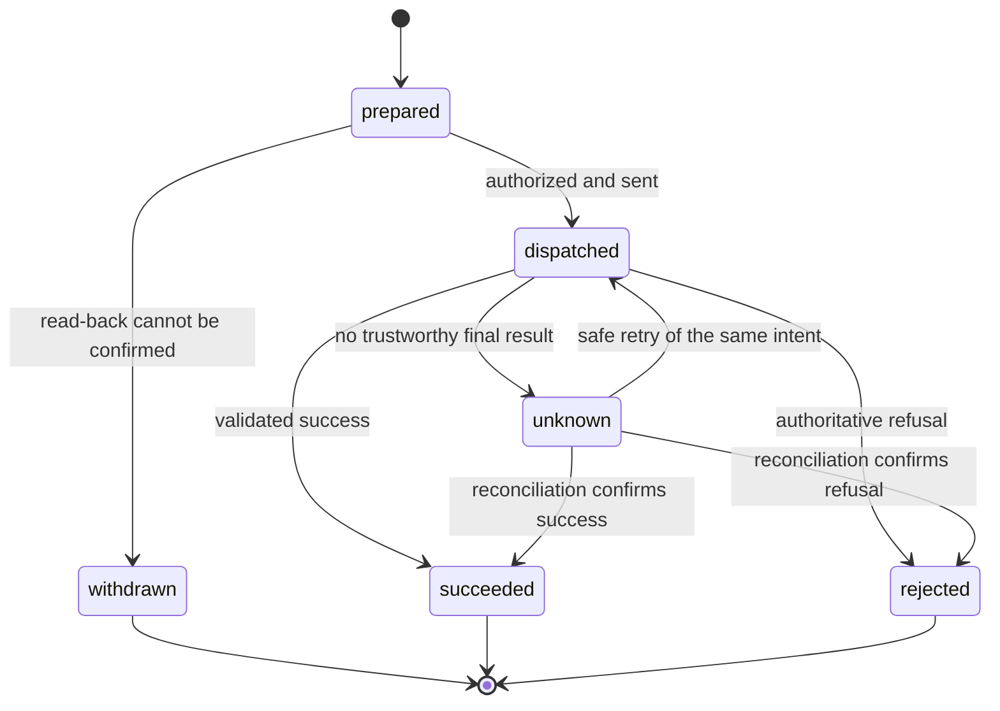

# 05 — Tools, approval and recovery

A tool call is a request from the model. It is not proof that the requested action is allowed, that the backend performed it, or that the caller heard the result.

Core keeps those decisions separate. The application defines its functions and rules; the harness checks the request, tracks what was sent and records what the result establishes.

## From a tool to an application function

The model can use ordinary tools such as `collect` to record facts. A declared operation is the boundary for calling an application service, whether that service reads information or changes it.

An application supplies a Python function with typed arguments and a typed result. Here is the signature of the support desk's resolve function; its implementation is in [`tickets.py`](../../core/tests/ticket_flow/tickets.py):

```python
def resolve(desk: Desk, args: Resolve, intent: Intent) -> Changed:
    ...
```

`desk` is the call's service object. `Resolve` describes the required arguments. `Changed` describes the receipt. The optional third parameter, `Intent`, supplies the stable identifier used by this backend to recognize a repeated attempt.

Core reads those annotations and builds a `FunctionOperation`. Application authors do not need to write an operation subclass for this path. A synchronous function runs in a worker thread; an asynchronous function is awaited.

Pydantic AI supplies the model's [function-tool machinery](https://pydantic.dev/docs/ai/tools-toolsets/tools/). Core's declared operations add state-bound arguments, approval, intents and receipts. They are exposed as output tools, so the turn engine can handle a read-back or fixed result without asking the model to paraphrase it.

## The declaration connects state, function and result

This is the complete `resolve_ticket` entry under `operations:` in the [support-desk manifest](../../core/tests/ticket_flow/agent.yaml):

```yaml
resolve_ticket:
  function: tickets.py:resolve
  args: {account_id: account_id, ticket_id: ticket_id, revision: revision, resolution: resolution}
  readback: tickets.py:resolve_words
  reconcile: tickets.py:find_effect
  subject: ticket_id
  resource: ticket
  version: now_revision
  idempotent: true
  matches: {account_id: account_id, ticket_id: ticket_id, revision: revision}
  succeeds: {status: resolved}
  rejects: {status: stale}
  assign: {revision: now_revision, ticket_status: status}
  say: 'Ticket {ticket_id} resuelto. ¿Algo más?'
  recap: 'El ticket {ticket_id} queda resuelto.'
```

Read it in three groups:

| Group | What it means |
|---|---|
| `function`, `args`, `readback` | Which function runs, which state field supplies each argument, and how the proposed action is read back. |
| `matches`, `succeeds`, `rejects`, `assign`, `say` | How to check the result, decide its outcome, update facts and speak its result. `assign` maps state field → receipt field. |
| `reconcile`, `idempotent`, `subject`, `resource`, `version`, `recap` | How to recover an uncertain result and identify which resource and version a receipt describes. |

The model selects `resolve_ticket`; it does not provide a second unchecked copy of the account, ticket or revision. Core builds those arguments from validated state according to `args`.

Two switches remain independent: `approval: none` removes the read-back requirement, and `changes: false` declares a read with no business effect. The desk lookup declares both. A read can require approval, and an application can declare a change without conversational approval if that is its intended policy. Types do not choose that policy for it.

## Approval belongs to a particular question

A **read-back** is the application's exact statement of what it is about to do. A **proposal** records that action and its arguments while waiting for the caller's reply.

For a conversation node whose operation requires approval:

1. The agent first selects the operation. Core validates the state-bound arguments, records the proposal and speaks the read-back. It sends no change to the backend.
2. The adapter records delivery evidence for that proposal's speech segment. Generating text or starting TTS is insufficient.
3. The caller replies. The same node agent interprets the reply. If it understands agreement, it selects the operation again; there is no separate classifier deciding yes or no first.
4. Core checks that this reply can answer the pending proposal: the operation and arguments match, the identity is still the same, the latest read-back copy has the required delivery evidence before the reply, and the approving work is current.
5. Authorization consumes that answer. It cannot authorize another action as well.

The model's interpretation is still a model decision. These checks prevent a yes from being applied to the wrong or unconfirmed proposal; they do not prove that the model understood every phrase correctly. Live language evaluations remain necessary.

If the caller corrects an argument, the old proposal cannot approve the new one. If the agent reads a clear no, `decline` consumes the pending question without executing it. A question in reply is not automatically a rejection. If delivery repeatedly cannot be confirmed, core withdraws the prepared intent and says one fallback line. The same request then stays withdrawn on that call; corrected arguments can form a new proposal.

There is one pending proposal slot per call. Asking another replaces it. This is a deliberate limit of the current design, not a queue of independent approvals.

## Send an intent, then establish the outcome

An **intent** is core's record of a particular attempt at an operation. Its identifier stays the same when that uncertain attempt is checked or safely retried.



Before dispatch, `Operation.run` validates the arguments, handles any earlier unsettled attempt, checks authorization and claims the intent so another task cannot dispatch it concurrently. If the application provides `services.note_intent(...)`, core asks it to persist the intent before sending the operation.

After dispatch, core validates the receipt and checks the operation's declared result rules. A receipt for another account, ticket or requested revision cannot establish this attempt's result. For a change, a result such as `pending` that matches neither `succeeds` nor `rejects` leaves the outcome unknown.

Core records the established outcome and receipt before awaiting result presentation. If speech or local state presentation then fails, the success remains recorded for repair; core does not send the business action again just to recover its confirmation line.

## Why cancellation does not mean failure

Consider this sequence:

1. The backend commits the requested change.
2. The caller interrupts, or the connection fails.
3. The task waiting for the backend result is cancelled before core receives it.

The change may already exist. Marking it “failed” and trying a fresh request could duplicate it. Core therefore records an unknown outcome after cancellation or another uncertain error following dispatch. A synchronous function running in a thread can even finish after its waiting task has been cancelled.

An explicit `Refused` exception is different: it states that the service rejected the action. An ordinary retry signal or malformed response after dispatch does not provide that certainty.

## Reconcile before deciding to resend

**Reconciliation** means asking the backend what happened to the original intent. The application supplies this lookup; core validates its answer before clearing the unknown outcome.

| Reconciliation result | What core can conclude |
|---|---|
| A valid success for the same request | Record the success and present it if it still applies. |
| A declared final refusal | Record rejection; a new attempt must follow the application's rules. |
| No record yet, invalid data, a mismatched result, or another failure | The outcome remains unknown. Absence of a result is not proof that nothing happened. |

An unknown change can be resent as the **same intent** only when the application declares `idempotent: true`. That means the backend really recognizes the intent ID and avoids applying its effect twice. The setting does not add that behavior to a database or external API. A pure read is also eligible for resend because it declares no business effect.

While a change is unresolved, core also blocks a different intent for the same operation and identity. This is a per-call safeguard. Cross-process ownership, resource access, version checks and duplicate prevention still require backend support.

In the support fixture, the resource change and its recorded effect commit in one SQLite transaction. The backend can then return that stored effect when asked about the intent again. Its revision check also refuses a change based on an obsolete version of the ticket.

## A receipt is history; its result may no longer be current

The call's evidence retains receipts. Suppose a ticket was resolved and then reopened. Both events happened, but only the later version describes its current state.

The application identifies a resource through `resource` and the receipt field named by `subject`, and orders changes using `version`. Core's `effective()` view selects the standing successful effects for recaps. An application can also provide `current_version(...)` so a reconciled result is checked against newer backend changes. Without that hook, core only knows the versions recorded in this call.

This is why replaying receipt speech is different from executing an operation. Repeating a result uses recorded evidence and wording. It makes no new intent and sends no new change. A superseded receipt should not be presented as the current result.

## What recovery across processes requires

An in-memory intent does not survive a killed process by itself. Durable recovery needs the application to keep the intent and effect records and retrieve unresolved intents for the relevant session or identity.

The public opening method accepts `flow.open(..., intents=...)`. Restored unresolved intents are treated as unknown and checked before another conflicting attempt. The services may also expose `owed(identity)` to retrieve work left uncertain by earlier calls.

This restores the ability to settle actions. It does not automatically restore microphone connections, the full conversation history or a graph paused inside an old process.

## Check this against the code

| Implementation and tests | What they establish |
|---|---|
| [`FunctionOperation` and `ConversationStep`](../../core/src/core/steps.py) | Typed function binding, read-backs, outcomes and receipt presentation. |
| [`Operation.run`](../../core/src/core/operations.py) | Authorization, intent claims, dispatch and result recording. |
| [`ProposalLedger`](../../core/src/core/proposals.py), [`CallContext`](../../core/src/core/state.py) | Exact question binding, delivery, withdrawal, intent restoration and effective receipts. |
| [Intent tests](../../core/tests/test_intents.py) | Cancellation after a commit, late thread completion, invalid reconciliation, stable IDs and recovery in a fresh call. |
| [Outcome tests](../../core/tests/test_outcomes.py) | Non-final receipts, failed persistence and checks against repeated dispatch. |
| [Support-desk tests and backend](../../core/tests/test_tickets.py) | Heard approval, stale revisions, wrong-resource results, process death, renamed domain fields and receipt-only repetition. |

These are runtime guarantees exercised with controlled faults and scripted models. They do not establish perfect intent recognition, universal backend safety or production capacity.

[← Typed flows and node agents](04-typed-flows-and-node-agents.md) · [Reading guide](README.md)
