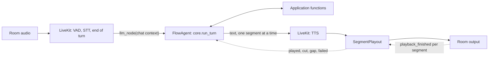

# 06 — Running on LiveKit

The harness is the brain of a call. Pipecat and LiveKit Agents are two ways to give it ears and a mouth. This chapter explains how the brain plugs into LiveKit, what LiveKit tells it, and what is still missing.

Read [chapter 01](01-stack-and-boundaries.md) first: everything there stays true. Only the media framework changes.

## 1. One entrypoint, two frameworks

A use case still says what it is once, in its `entry.py` (`core.Entry`). Its `bot.py` runs that entry on either framework:

```bash
cd use-cases/salon
uv run bot.py                     # Pipecat, as before: open http://localhost:7860
uv run bot.py livekit dev         # LiveKit: a worker that takes one call per room
uv run bot.py livekit console     # LiveKit: one call in this terminal
uv run bot.py livekit start       # LiveKit: production worker
```

`VOICE_FRAMEWORK=livekit` does the same as the word `livekit`. `LIVEKIT_URL`, `LIVEKIT_API_KEY` and `LIVEKIT_API_SECRET` say which LiveKit server to use. Set `LIVEKIT_AGENT_NAME` to take only rooms dispatched to that name.

| Piece | Pipecat | LiveKit |
|---|---|---|
| Runs one call | `core.launch.run_call` | `core.livekit_launch.run_call` |
| Adapter | `core.processor.PydanticAgentProcessor` (a frame processor) | `core.livekit.FlowAgent` (a LiveKit `Agent`) |
| Playback evidence | `TwilioMarks`, `WebRTCPlayout`, `LocalPlayout` | `core.livekit.SegmentPlayout` |
| Shared by both | `core.voice`: waits, call ceiling, how a call ended, `serve` | |
| The brain | `core.turn`, unchanged | `core.turn`, unchanged |

The settings are the same environment names on both: the SLNG speech models and voice, `VAD_STOP_SECS`, `MAX_CALL_SECONDS` and `DELIVERY`. One speech profile runs both.

## 2. Where the brain sits in LiveKit

LiveKit Agents has a slot for the language model: `Agent.llm_node`. LiveKit calls it once the caller has finished a turn. `FlowAgent` fills that slot with the whole flow: the step's agent, its tools, operations, hand-overs and every fixed line.



Three rules make this safe:

1. **The turn runs in its own task.** The node only passes on what the turn says. When LiveKit cancels the node because the caller cut in, the turn is cancelled too, as on Pipecat. When LiveKit cancels it because the room is closing, the turn may finish its write (`CallTiming.FINISH_SECONDS`).
2. **Never on guessed words.** LiveKit can start a reply early, on words the caller has not finished (preemptive generation). A turn can write to the business, so `FlowAgent` turns that off for itself, and a reply that is not yet scheduled waits.
3. **LiveKit's own LLM is never called.** The session gets a stand-in (`FlowLLM`) only because LiveKit runs its reply pipeline when an LLM is set. It raises if anything calls it.

## 3. What the caller said: end of turn, joining, and dropping a stale reply

| What the caller does | What LiveKit does | What the brain does |
|---|---|---|
| Finishes speaking | Commits the turn (VAD, STT and its turn detector) | Takes every user message it has not served yet, by id, as one turn |
| Pauses, then goes on before any answer played | Commits a second turn | Joins both pieces into one turn (`continues_turn`), as on Pipecat |
| Goes on talking while the brain is still working | Would hold the old reply and play it after them | Drops the old reply as soon as there are words (L4) |
| Makes a sound with no words while the brain works | Pauses, then carries on | Cancels nothing: the reply plays once they are quiet (L5) |
| Says "mm-hm" while the agent speaks | Its adaptive detector can let the agent go on | Nothing is cut, so nothing is lost |
| Talks over the agent | Interrupts (or pauses, then interrupts) | The segment is cut to the words that played (L3) |
| Stays silent | Nothing | Asks if they are still there, puts the question again, then says goodbye (L7) |

Only words drop a reply that is still being prepared, never a sound. On Pipecat any new user turn interrupts; on LiveKit a cough no longer cancels a turn that nothing will replace.

One LiveKit detail matters: on an audio output that cannot pause, LiveKit itself drops a reply on any sound longer than `min_duration`. A real room's output can pause, so this only shows up in custom outputs.

## 4. What the caller heard: one segment, one report

The brain records every line it says as a segment (`CallContext.spoken`): the model's words, a holding line, a read-back, a receipt. On LiveKit each segment becomes its own speech segment. The node sends a `FlushSentinel` between them, so each one is synthesised, played and reported on its own, and the next one's speech is made while this one plays.

`SegmentPlayout` sits at the top of LiveKit's audio chain. It sees each segment's audio, its end, a clear and a pause, and LiveKit's `playback_finished` for it:

| LiveKit says | The segment is |
|---|---|
| Finished, not interrupted | Played (`local` evidence) |
| Finished, interrupted | Cut to the words the transcript synchroniser says played |
| Paused (a possible interruption), then resumed | Never heard in full: the room output drops what it had queued when it pauses (`CallContext.note_gap`) |
| No audio, or synthesis failed after LiveKit's retries | Failed: never heard |

A read-back can be agreed to only when its segment was heard in full and the caller's reply began after it ended, exactly as on Pipecat.

### The gap: LiveKit reports its own clock

LiveKit's room output reports when its audio left this process at real time. It does not report that a browser or a phone played it. Twilio marks and core's browser page do report that. So on LiveKit the evidence is `local`, the same class as Coval's mark-less phone line, and it counts as heard only on a call opened for simulated playout:

```bash
DELIVERY=simulated uv run bot.py livekit dev
```

Without it, a flow that confirms writes (the salon) says it cannot confirm changes on this line and hangs up, before the caller gives any details (`core.livekit.reports_playback`). A flow with no read-backs runs either way.

To close the gap, the far end has to report playout, as core's browser page does on Pipecat. LiveKit already has the shape for it: its avatar protocol has the remote side send `lk.playback_finished` by RPC. A LiveKit web client could report each segment the same way. That is the next step, not done yet.

## 5. Checks

| Check | What it proves | How to run |
|---|---|---|
| `core/tests/test_livekit.py` (L1-L13) | Every behaviour in sections 3 and 4, on LiveKit's real `AgentSession`, offline, with a made-up caller, voice and speaker | `cd core && uv run python -m tests.test_livekit` |
| `core/tests/test_package.py` | Only `core.livekit` and `core.livekit_launch` import LiveKit; `core.voice` imports no framework | `cd core && uv run python -m tests.test_package` |
| `use-cases/salon/livekit_check.py text` | The salon through LiveKit's own text mode, real Gemini | billable |
| `use-cases/salon/livekit_check.py voice` | The salon with real SLNG speech both ways and Silero, a synthetic caller who also talks over the agent | billable |

L13 runs the same scripted turn over text and over LiveKit and checks the words are the same: one brain, two frameworks.

The live checks were run on 2026-10-11 from a cloud sandbox:

- Text: verify, offer, read-back, yes, booked once, goodbye; 0.6 to 1.3 s per turn.
- Voice: the caller talked over the list of times; LiveKit paused, then cut it; the offer was recorded as cut. "10:00 would be perfect" was read back, "Yes, please book it" booked it once, and the goodbye closed the call. From the final transcript to the agent's first audio took 1.3 to 1.7 s per turn. The sandbox's speech-to-text results came about 3 s after the caller stopped, so the full waits there (3.7 to 7.3 s) say nothing about a real deployment.

A real LiveKit room could not be tested from the sandbox: its network passes HTTPS only, and WebRTC media needs UDP or TURN. The worker did register with LiveKit Cloud.

## 6. Plugging into unmute-core

[unmute-core](https://github.com/slng-ai/unmute-core) is the shared runtime for Unmute's agents on LiveKit and Pipecat. It owns its own adapters (`unmute_core.livekit.UnmuteAgent`, `unmute_core.pipecat`) and one plug point for the model call (`ModelCall`). The harness can plug in at the same place on each side:

| unmute-core | The harness |
|---|---|
| `UnmuteAgent.llm_node` sends one model request | `FlowAgent.llm_node` runs a whole caller turn |
| `yield_to_caller` drops a reply the caller spoke over | `FlowAgent` drops it on words, never on a sound |
| `idle_nudges` | `core.turn.remind`, by code |
| `interruption(backchannels)` | `livekit_launch.turn_handling` (interruption on, adaptive where LiveKit has it) |
| Telemetry spans | `core.observability` spans, one per turn |

The proposal: unmute-core gets a second plug point beside `ModelCall`, a "brain" that owns a whole turn (`async def turn(words) -> segments`) plus the playback reports this chapter describes. `FlowAgent` already has that shape on LiveKit and `PydanticAgentProcessor` on Pipecat, so the harness would implement it twice with no change to `core.turn`. The pieces that must cross the seam are small: the words of a turn, a barge-in, a speech onset, and one playback report per segment.

## 7. Limits

- Playback evidence is LiveKit's own clock (section 4). A client report is the fix.
- `FlowAgent` reads two private LiveKit internals, pinned to livekit-agents 1.8: the reply's speech handle (to bind a segment to the reply that plays it) and whether the session is closing. If either goes, nothing is heard, or a closing session is taken as a barge-in. Both fail closed.
- livekit-agents 1.8 declares `openai<3`, Pydantic AI needs openai 3. The workspace overrides it (`pyproject.toml`); every LiveKit module core uses imports and runs under openai 3.
- The studio's runner still starts Pipecat calls only.

[← Back to the guide](README.md)
