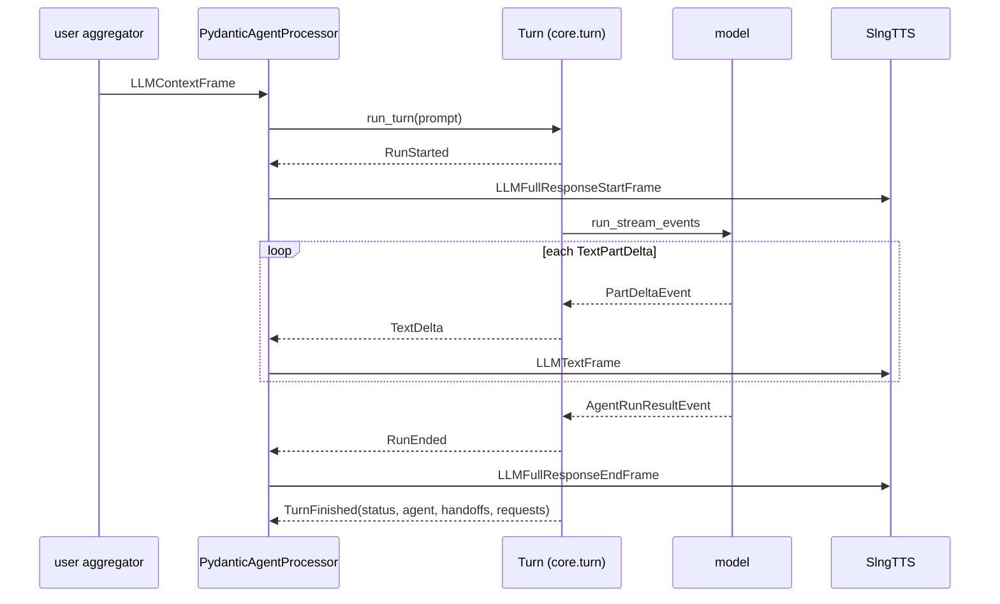
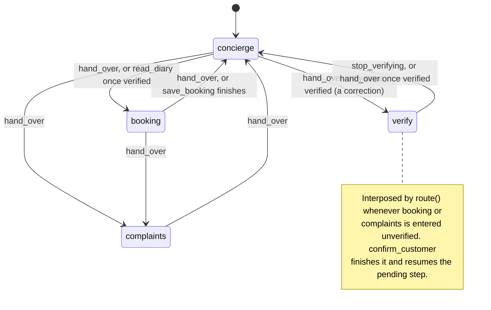
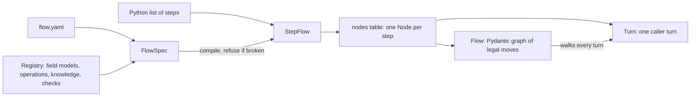
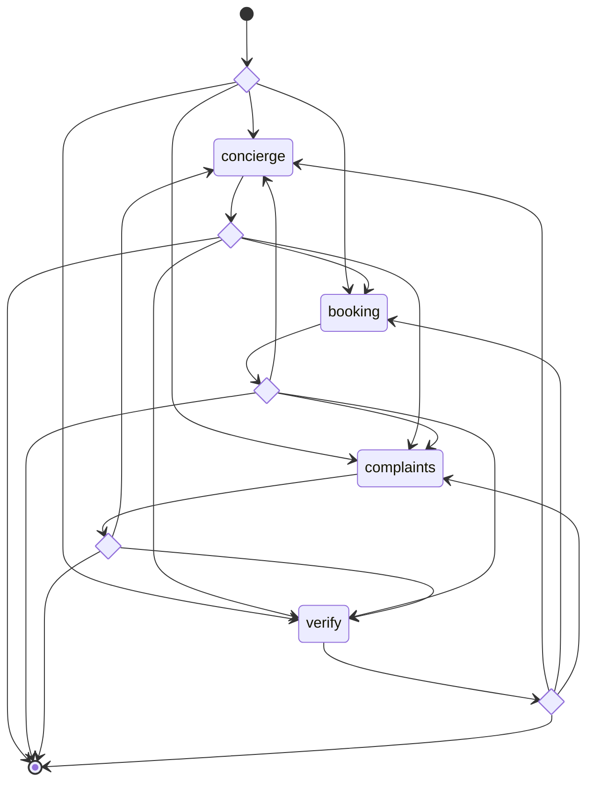
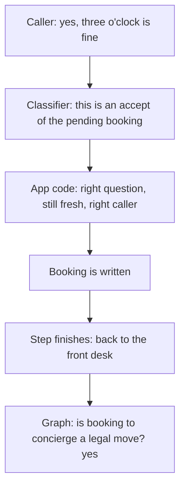
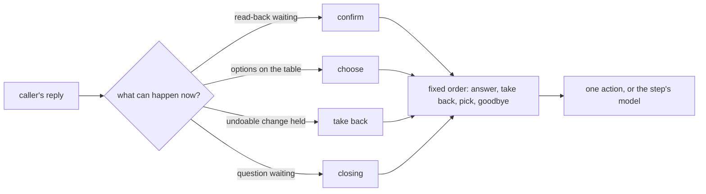
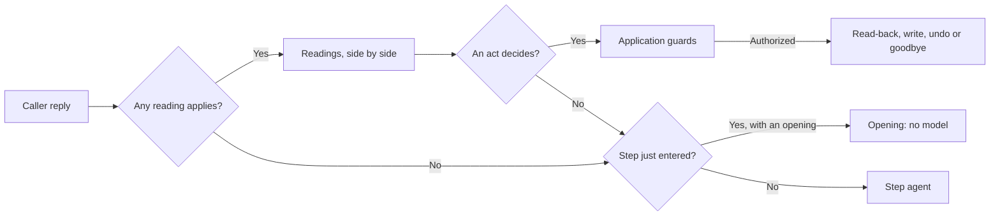

# Design notes

The mechanisms behind [the README](../README.md), each with where it lives and the documentation it was checked against. These sections were the second half of the README until 24 September 2026.


Each choice below names what it decided, where it lives, and the document it
rests on. The links are the primary references the design was checked against;
public documentation changes, so behaviour was verified against the pinned
versions in `uv.lock` (Pydantic AI 2.46, Pipecat 1.11).

## 1. Pydantic AI as the LLM node of a Pipecat pipeline

A Pipecat LLM node is a frame contract, not a class. On an `LLMContextFrame`
it pushes `LLMFullResponseStartFrame`, then one `LLMTextFrame` per chunk of
speech, then `LLMFullResponseEndFrame`. TTS, the assistant aggregator, the
transcript and the interruption machinery are built on those three frames and
nothing else, so anything that speaks them can sit in that slot. That is what
`PydanticAgentProcessor` in `core/processor.py` does, and it is the same shape
Pipecat's own bridge to an external agent framework takes.

The agents keep their own history as `list[ModelMessage]` on the call.
Pipecat's `LLMContext` still fills up beside it and is never sent to a model:
it is the aggregators' record of what was actually *spoken*, which is how the
processor learns what the caller heard when they talk over the bot.

- Pipecat's external-framework processor, the precedent for this seam:
  https://github.com/pipecat-ai/pipecat/blob/main/src/pipecat/processors/frameworks/strands_agents.py
- The frames: https://reference-server.pipecat.ai/en/stable/api/pipecat.frames.frames.html

## 2. How streaming works

`Turn._speak` in `core/turn.py` opens `Agent.run_stream_events` and reads the
event stream Pydantic AI emits: a `PartStartEvent` whose part is a `TextPart`,
then `PartDeltaEvent`s carrying `TextPartDelta`s, are speech; a `ToolCallPart`
is not. Each piece of speech becomes a `TextDelta` event, and the processor
turns it into an `LLMTextFrame` the moment it arrives. TTS aggregates by token
rather than by sentence, so the first word is synthesised as soon as the model
produces it.



Three things ride on that stream:

- **Fixed lines** are not generated. A question the application worded, a
  booking confirmation in the diary's own phrasing, the greeting and the error
  lines go straight to TTS as `TTSSpeakFrame`s through `CallContext.say` and
  `speak_now`, and are recorded in the call's speech ledger with who wrote
  them. A turn's delivered speech is therefore not one string, and a trace can
  tell a question from an answer.
- **The clause gate.** On a step that can write (`Node.guarded`), speech is
  held back a clause at a time until the step has written something. Each
  clause is checked by `SalonCall.claims_completion` before it goes out, and a
  clause claiming a change nothing has made is replaced by a correction rather
  than spoken. It costs one clause of latency on those steps only.
- **Barge-in.** The processor fires a `Barge` when Pipecat interrupts; the
  turn cancels the run in flight and stops before starting another. Whatever
  the run completed is kept: messages are retained from the SDK's own
  `new_messages()` boundary after teardown, so accepted input and a tool that
  ran are still in the history, and the assistant aggregator's delivered
  prefix is used to cut the record down to what the caller actually heard.

- Streaming events and output types: https://pydantic.dev/docs/ai/core-concepts/output/
- Message history as an explicit input and output of a run: https://pydantic.dev/docs/ai/core-concepts/message-history/

## 3. Nodes and edges: the graph, and where it lives

A step is a `Node` (`core/graph.py`): the agent that runs it, the `Exit`s it
may take, the state fields it `requires` and the step that `satisfied_by`
fills them. The whole graph is `salon/flow.yaml`, compiled into the `AGENTS`
table in `salon/agents.py`. Each step is an entry in the file and a module in
`salon/steps/`:

```yaml
  - id: booking
    kind: agent
    prompt: prompts/booking.md
    code: steps/booking.py
    guarded: true
    requires: [customer_verified]
    satisfied_by: verify
    exits: [concierge, complaints]
```

```python
def node(step: AgentStep) -> Node[SalonState]:
    return build(
        step,
        tools=[read_diary],
        finishers=[save_booking],
        asks=[ask_booking, offer_times, booking_guidance],
        openings=OPENINGS,
        structured_speech=True,
    )
```



Two functions walk the graph and neither runs a model:

- **`route(state, nodes, to)`** decides where a handoff actually puts the
  caller. If the destination has an unmet prerequisite, the graph records the
  destination as `pending`, enters the step that satisfies it, and the
  finisher there calls `resume` to go back. No request decides that, and no
  prompt states the ordering.
- **`moved_by(state, node, nodes, succeeded)`** decides where a *successful*
  borrowed tool has put the caller. A step lends a neighbour's entry tool into
  its own schema while an `Exit` guard holds (`Exit('booking', verified,
  via=(read_diary,))`), and calling it *is* the move: the request that moved
  the caller is the request that did their work. Only tools that returned
  count; a refused tool is not a move.

Illegal moves are unrepresentable rather than refused. Each step's `hand_over`
is built by `Desk.hand_over_for` (`core/desk.py`) with a `Literal` of only that
step's destinations. `AgentBuilder` (`core/steps.py`) adds two `prepare` hooks
that rebuild the offered tools before every provider request: `only_reachable` hides a borrowed tool while its guard does not hold,
and `narrow` rewrites the `hand_over` enum to the exits that are open right
now. Both are re-checked at execution, because a schema built before the tools
in the same reply ran is a convenience for the model, never the enforcement.

- Preparing tools and output tools per request: https://pydantic.dev/docs/ai/capabilities/prepare-tools/
- Programmatic handoff, as distinct from delegation: https://pydantic.dev/docs/ai/guides/multi-agent-applications/
- Function tools and their schemas: https://pydantic.dev/docs/ai/tools-toolsets/tools/

## 4. Typed state, and how it is updated

`VoiceState` (`core/state.py`) is the business facts of a call and nothing
else. `SalonState` (`salon/models/state.py`) adds the salon's: the caller's
number, whether they confirmed it, what the lookup found, the appointment the
diary holds, how many writes have been accepted, and the one write whose
outcome is unknown. Every field is a validated shape from
`salon/models/shapes.py`, so a state cannot hold a phone number that is not a
Spanish number or a date that is not on the calendar.

Three Pydantic opt-ins are on, and none is on by default: `validate_default`,
so an authored default that breaks its own type fails at import;
`validate_assignment`; and `revalidate_instances='always'`, so a nested model
handed in is revalidated rather than trusted. Each alone leaves a hole the
other two do not cover.

State is never assigned field by field. `CallContext.commit(**updates)`
builds one whole candidate from the current values plus the updates and
validates it; on failure the previous state object is untouched. It is not
`model_copy(update=...)`, which copies updates in without validating them, and
a keyword naming no field is refused rather than dropped. A `model_validator`
on `SalonState` runs on every commit and clears verification that does not
belong to the number now on the call, so authorisation cannot survive a
correction and a status nobody earned cannot be constructed.

A commit from a turn the caller has moved on from keeps its business facts and
loses its flow fields: a booking that landed is a fact whichever turn made it;
where the caller *is* belongs to the current turn.

- Model configuration, assignment validation: https://pydantic.dev/docs/validation/latest/api/pydantic/config/
- Models and validation: https://pydantic.dev/docs/validation/latest/concepts/models/
- `TypeAdapter`, used for tool arguments and the phone shape: https://pydantic.dev/docs/validation/latest/concepts/type_adapter/
- Dependencies (`deps_type` is typed access, not a runtime validator): https://pydantic.dev/docs/ai/core-concepts/dependencies/

## 5. Typed flow

Typed values were never the hard part. A valid phone number does not establish
that the caller confirmed it; a valid booking request does not establish
approval; a successful lookup does not say which pending request to resume.
The POC connects four contracts, and each has one place in the code:

| Contract | Question it answers | Where |
|---|---|---|
| Typed values | Is the value structurally valid? | `salon/models/shapes.py`: `Phone`, `SubmittedPhone`, `Date`, `Time`, `Id` |
| Typed state | Do the facts remain consistent after an update? | `CallContext.commit`, the `SalonState` identity invariant |
| Typed flow | Is this action allowed now, and where do we continue? | `route`, `moved_by`, `Exit.guard`, `Node.requires`, the prepare hooks |
| Typed completion | What evidence is required before success is spoken? | `salon/models/receipts.py`, `salon/tools/writes.py` |

Typed completion is the boundary most often skipped. `Diary` stands in for an
HTTP service and hands back dicts; every one is parsed into a receipt model
(`Slots`, `Saved`, `CustomerLookup`, `ComplaintRecord`) before a field is
read, and a legal-looking receipt is then checked against the *request*: a
`cancelled` result is not an answer to a `book` request however well-formed it
is. Every write carries an operation token derived from what the action is,
and a write whose answer was lost is recorded as `Unresolved` on the state,
which blocks every other write until the token has been asked what happened.

## 6. Typed flows for any business, and the graph that runs them

The salon's four steps are written by hand. Any other business can describe
its flow as a short, ordered list of **typed steps** instead, in Python or in
a YAML file, and run it on the same engine. The Pydantic graph then checks,
while the call runs, that every move from one step to the next is one the
flow allows.

### From a list of steps to a running call



1. **Write the steps.** Either as Python (`examples/access/flow.py`,
   `build()`) or as a flow file (`examples/access/flow.yaml`).
2. **Compile.** `StepFlow` (`core/steps.py`) turns each step into the same
   `Node` the salon hand-writes: an agent, openings, and the steps it can
   hand the caller to. A flow file first goes through `FlowSpec.compile`
   (`core/flowspec.py`), which refuses it if anything is wrong (see below).
3. **Build the graph.** `Flow.of(nodes)` (`core/flow.py`) compiles the nodes
   table into one `pydantic_graph` graph, once per flow, shared by every call.
4. **Run.** The turn engine (`core/turn.py`) runs one caller turn at a time,
   with the same budget, barge-in handling, history and tracing as the salon.

### The five step kinds

| Kind | What it does | Done when |
|---|---|---|
| `CollectStep` | Asks one question and records typed fields. Values are checked by a Pydantic model, with the facts collected so far as context (a system must belong to the team). A caller may answer a later question early; that answer is kept and the later step is skipped. | every required field has a valid value |
| `ConfirmStep` | Reads back the exact request an operation would carry out, in words the code wrote, and waits. Yes goes on; no and "change it" go where the step says; anything unclear gets the readback again. | the action after it has a receipt |
| `ActionStep` | Runs one `Operation` (`core/operations.py`) with the collected facts and files its receipt. A refusal goes to `on_error`; an answer that never came back goes to `on_unknown` (pending), never to success. | the receipt says what the step needed (`accepts`) |
| `ConversationStep` | Answers from its instructions and knowledge. Stays active every turn until the caller says goodbye. | never: it is a place to stay |
| `End` | Says one closing line and records how the flow ended: `completed`, `cancelled`, `failed` or `pending`. | on arrival |

Two rules hold for every kind:

- **"Done" is worked out from the facts, never stored as a flag.**
  `core/completion.py` has `FieldsPresent` and `ReceiptMatched`. The next step
  is simply the first later step that is not done yet, so a step answered
  early is passed over without a model request.
- **Changing an answer forgets what was built on it.** Each step says which
  facts it rests on (`after`). When the caller changes the system,
  `StepFlow.record` drops the level (it rested on the system) and the
  eligibility check (it rested on the level), so both are asked and run again.

Consent works exactly as in the salon: the readback is a recorded question
(`core/proposals.py`), a spoken-over readback can never be accepted, and the
operation checks that the yes was to *these* arguments before it runs.

### What the Pydantic graph adds

`Flow` makes one graph step per flow step. After each step sits a decision
point with one branch for every step the caller may legally go to next, and
one branch to the end of the turn:



That is the salon, drawn by the code itself:
`uv run python -c "from core.flow import Flow; from salon.agents import AGENTS; print(Flow.of(AGENTS).render())"`.
Swap in `examples.access` to draw the access request.

How one caller turn goes through it:

1. The graph starts at the step the caller is in (`call.state.agent`).
   pydantic-graph 2.46 has no save-and-resume, and the call already knows
   where the caller is, so every turn is one short graph run.
2. The graph step asks the turn engine to run that step once (`Turn.hop`).
   The engine does all the voice work: openings, the agent, streaming speech,
   barge-in.
3. The engine answers `Moved(to)` (the caller was handed on, run the next
   step now) or `Answered()` (the turn is over).
4. The decision point sends `Moved(to)` to that step, or ends the run. **A
   move the flow does not allow matches no branch, so the graph refuses it**
   and the turn fails, instead of the caller ending up somewhere nobody
   designed.

The legal moves come from the table (`legal_moves`): a step's exits, the step
that fills a missing prerequisite (the salon's `verify`), and for that step,
every step that could be waiting on it. For a typed flow they are: every
later step (a done step can be skipped), plus each step's own failure,
rejection and revision targets.

Speech from inside a graph step has to reach the caller as it streams, while
the graph waits for the step to finish. So the engine passes each event out
through a small lockstep channel: a step's next action waits until its last
event has been handed on, so speech, fixed lines and commits happen in exactly
the order the step produced them.

**What the graph does not do.** Where a handoff *really* lands still depends
on the call's state: the prerequisite check, the resume point, a borrowed
tool that moves the caller, an edge's guard. Those stay in `route` and
`moved_by` (`core/graph.py`), because a graph's shape cannot express them.

### Why a graph

The engine's job between steps is small: after a step runs, send the caller
to the next step, or end the turn. A plain loop could do that in fewer lines.
A graph was chosen because it adds four things a loop does not:

1. **Every move is checked against a declared map.** In a loop, the next
   step is whatever the code returns, and nothing compares it to what the
   flow allows. In the graph, each step's legal next steps are branches of
   its decision point. A move with no branch is refused, so a bug or a
   confused model shows up as a failed turn, not as a caller standing
   somewhere nobody designed.
2. **The diagram is the code.** `Flow.render()` draws the same graph that
   runs, so the picture of a flow can never drift from what it does. That
   matters most for flows written by people who do not read the engine.
3. **One engine for every flow.** The salon's four hand-built steps and
   every typed flow compile to the same nodes table and the same kind of
   graph. A new business adds steps, not engine code.
4. **Built once, shared by every call.** The graph and its legal moves are
   worked out when the flow loads. A call only carries its own facts.

What it costs:

- about 200 more lines than a loop;
- a small lockstep channel, so speech streams to the caller while the graph
  waits for the step to finish;
- one short graph run per turn, because pydantic-graph 2.46 cannot save and
  resume a run, and the call already knows which step the caller is in;
- routing that depends on the call's state (a missing prerequisite, a
  resume point, a guard) still lives in `route` and `moved_by`, because a
  graph's shape cannot express it. The graph checks the result; it does not
  choose it.

Every turn, for the salon and for every typed flow, is walked by its flow's
graph. There is no second engine.

### The graph and the classifier: two different jobs

It is easy to read the graph as the thing that "understands" the call. It
is not. The two parts answer different questions, and a turn usually needs
both:

| | The graph | The classifier (or the solver) |
|---|---|---|
| Question it answers | Where may the caller go next? | What did the caller mean? |
| Looks at | step names and legal moves | the caller's words and the question they were asked |
| Uses a model | never | one small request per reading, only for the readings that can apply now |
| Lives in | `core/flow.py` | `core/readings.py`, `core/conversation.py`, the salon's `SALON` in `salon/classification.py`, and the confirm step in `core/steps.py` |

A turn where the caller answers a question:



When no reading can apply, no classifier runs, and the step's agent simply
answers. The graph never reads the caller's words, and the
classifier never decides where the caller goes. Changing one does not
remove the need for the other: `SALON_INTERPRETER=solver` swaps the
classifier for the solver (section 8), and the graph stays exactly the same.

### Flow files

A flow lives in its own folder. The YAML file lists the steps; each step
names its own prompt file and, if it runs code, its own Python module:

```
examples/access/
  flow.yaml          the steps, in order, and where each one can go
  voice.md           tone and persona, added to the top of every prompt
  prompts/           one prompt per step that talks: employee.md, team.md, ...
  steps/             one module per step that runs code: identify.py, submit.py, ...
  backend.py         the systems the modules call
```

```yaml
version: 1
id: access_request
greeting: Access desk, this is Sam. What is your employee ID?
voice: voice.md
steps:
  - id: employee
    kind: collect
    prompt: prompts/employee.md
    model: steps/fields.py:Employee
    question: What is your employee ID?

  - id: identify
    kind: action
    code: steps/identify.py
    on_error: stranger

  - id: reason
    kind: collect
    prompt: prompts/reason.md
    question: What do you need it for?
    fields:
      reason: {type: string, min_length: 5}

  - id: confirm
    kind: confirm
    code: steps/submit.py
    then: submit
    on_reject: cancelled
    on_revise: level

  - id: submit
    kind: action
    code: steps/submit.py
    on_error: failed
    on_unknown: unconfirmed

  - id: submitted
    kind: end
    outcome: completed
    say: 'Done: request {submit[request_id]} is submitted.'
```

(Shortened; the full file is `examples/access/flow.yaml`.) Four rules:

1. **Steps that talk have a prompt; steps that only act do not.** `collect`,
   `conversation` and `agent` steps need `prompt:`. `confirm`, `action` and
   `end` steps speak fixed lines chosen by code, so a `prompt:` there is
   refused.
2. **One prompt per step.** Two steps naming the same file is refused. Text
   every step shares goes in `voice:`; text a few steps share goes in
   `includes:` and is pasted in wherever a prompt says `<!--name-->`.
3. **Code comes only from the folder.** `code:` and `model:` are file paths
   inside the flow folder (`steps/submit.py`, or `steps/fields.py:Employee`
   for one class). A path outside it is refused, so a file cannot reach into
   the rest of the codebase. An action or confirm module provides
   `OPERATION` (the `Operation` class) and, if it wants, `accepts(receipt)`;
   an agent module provides `node(step)`.
4. **Everything is checked at load.** Every prompt is compiled against the
   call class (`call:`, default `FlowCall`), so a `{{state.x}}` naming no
   field stops the flow before any call starts.

Step kinds: `collect` (ask for typed facts), `confirm` (read back and ask
yes or no), `action` (run an `Operation`), `conversation` (a free chat,
optionally with a `knowledge:` file), `end` (a fixed goodbye), and `agent`, a
step whose module builds its whole agent by hand. The salon is four `agent`
steps (`salon/flow.yaml`):

```yaml
  - id: booking
    kind: agent
    prompt: prompts/booking.md
    code: steps/booking.py
    guarded: true
    requires: [customer_verified]
    satisfied_by: verify
    exits: [concierge, complaints]
```

The file says where the step can send the caller and what must hold before it
runs; `salon/steps/booking.py` says which tools and outputs it has. An exit
can also name a guard and borrowed tools from the step's module:
`{to: booking, when: verified, via: [read_diary]}`.

Files are read with `yaml.safe_load`, which only ever builds plain data, and
JSON is valid YAML, so a `.json` file loads too (`load_file(path)`). Two YAML
habits to know: an unquoted `no`, `yes`, `on` or `off` becomes true or false,
and a line containing `: ` must be quoted (the `say` above). A value that
YAML turned into the wrong type is refused with the step and field named.

`FlowSpec.compile` refuses a broken flow and lists **every** problem at once:

- an unknown step kind or field, or a version it does not know (at load);
- a step id used twice;
- a destination that is not a step;
- a prompt or module that does not exist, sits outside the folder, is shared
  by two steps, or does not fit the call;
- a module without the `OPERATION` or `node` its step needs;
- a fact in `after` that no earlier step collects;
- an action that needs approval with no confirm step for it, or one that can
  be reached without going through that confirm step.

Then it builds the `StepFlow` and its graph once; every call shares them. A
`Registry` is still accepted for things a platform wants to name rather than
ship as files (`operation: submit`, `knowledge: library`).

### Running the examples

```bash
VOICE_AGENCY=access uv run bot.py -t webrtc   # the ten-step access request
VOICE_AGENCY=help uv run bot.py -t webrtc     # the library help line
```

Both examples import nothing from the salon. `tests/test_examples.py` walks
them through the real engine; `tests/test_flowspec.py` checks that each flow
file behaves exactly like its Python version, that YAML and JSON load to the
same flow, and that every broken file is refused.

- Pydantic graph: https://pydantic.dev/docs/ai/graph/graph/
- Discriminated unions, for step kinds: https://pydantic.dev/docs/validation/latest/concepts/unions/#discriminated-unions
- Validation context, for checks that read other facts: https://pydantic.dev/docs/validation/latest/concepts/validators/

## 7. The custom logic

Everything the model used to decide that the application now decides, and the
mechanism for each:

- **One budget per caller turn.** `TurnBudget` (`core/policies.py`) is one
  tally of provider requests, one tool-call allowance, a fixed number of step
  runs and one deadline, threaded through every run in the turn. An exhausted
  turn gets one fixed line and no further request.
  https://pydantic.dev/docs/ai/api/pydantic-ai/usage/ ·
  https://pydantic.dev/docs/ai/core-concepts/retries/ ·
  https://pydantic.dev/docs/ai/core-concepts/timeouts/
- **One action per model reply.** `one_action_per_reply` reads the whole
  response in `after_model_request`, in emission order, and picks the one tool
  call allowed to move the caller or write to the business; `claim_or_refuse`
  is how an action checks it holds the claim, because `before_tool_execute`
  does not fire for output tools.
- **Speak by the third request.** `speak_by` empties the ordinary tool set
  from a given request on, so a run cannot buy a fourth lookup; its output
  tools stay, so it can still finish.
- **A clock per request.** `request_clock` stamps each provider request on
  the way out, so time to first token is per request and says whether the
  first thing back was speech or a tool call.
- **Typed interpretation, guarded execution.** The classifier interprets a
  reply to a pending question; application guards authorize the exact action.
  Resolved decisions replace the conversational request. See
  [the classifier flow and evolution path](#8-typed-classification-and-its-evolution).
- **Deterministic continuation.** A finisher does its work and returns a
  `Handoff` whose destination is `call.resume(...)`, which the graph already
  knows. A prerequisite step reports `completed` or `unserved`, and the
  engine restores the owner's checkpoint and tells the next agent what
  happened through an instruction part.
- **History is projected, not sent raw.** `core/history.py`'s `paired` drops
  tool calls a cancellation left unanswered and `project` merges the speech
  ledger into the protocol by segment id, so a model is told what the caller
  heard and never an assistant message with nothing after it.
  https://pydantic.dev/docs/ai/capabilities/process-history/
- **Prompts are compiled against the call.** `salon/flow.yaml` names a
  `TemplateStr[SalonCall]` per step from `salon/prompts/*.md`, so a placeholder
  naming no field fails at import, every `{{#if}}` is resolved before the model
  reads it, and the salon's own documents are substituted in rather than
  fetched by a retrieval tool. https://pydantic.dev/docs/ai/api/pydantic-ai/template/
- **The diary computes what a model would guess.** Which day "next Friday"
  is, whether a slot has already passed, whether two appointments overlap,
  what a booking sounds like out loud: all `salon/diary.py`, none asked of a
  model.

## 8. Typed classification and its evolution

The classifier answers a narrow question: how does the caller's reply relate
to the question they just heard? It does not decide where the caller goes; that is
the graph's job (see "The graph and the classifier: two different jobs" in
section 6). Today it uses the same Gemini model as the
conversational agents, through one asynchronous
[Pydantic AI direct model request](https://pydantic.dev/docs/ai/core-concepts/direct/).
It has no agent loop, business tools, conversation history or repair requests.

[Classifier](../core/classifiers.py) is an ordinary generic Python class:
`Classifier[InputT, OutputT]`, with both contracts defined by Pydantic models.
Every classification is made of the same five things:

| Part | Who supplies it | Where it goes |
|---|---|---|
| The question the person was asked | the application, from state | `Exchange.question` |
| The person's answer | the application, from state | `Exchange.answer` |
| Context: what the classifier is for | the author, a sentence or two | `Classifier(context=...)`, first in the instructions |
| The classes | the author | the output model's fields |
| Each class's description | the author | the output schema |

The instructions are built, never hand-written: the author's context, one
fixed task sentence (`TASK`), and a list of the input's other fields by their
`Field(description=...)`. Those extra fields are facts the application
knows, such as the times on the table. The classes are written either as
`Annotated[Literal[...], Field(description=...)]` members or as plain data
with `ClassSet` and `output_model`, so a flow file can define them. A new use
case supplies its own context, facts and classes. There are no salon rules
in `core`.

### Narrow readings: one small classifier per act

A reply can do a handful of things every voice agent has to hear. Each one
is its own reading ([core/readings.py](../core/readings.py)), and a reading runs
only when the call's state says its act can happen this turn:



1. The application's state decides which readings apply. A reading that
   cannot apply is never sent.
2. The ones that apply run side by side, so the turn waits for the slowest.
3. Each has its own input (the question, the answer, and only the facts it
   needs) and its own classes with their descriptions.
4. `Acts` tries what the business does on each act in one fixed order, the
   same for every business. "Yes, cancel it" to a cancel question answers
   it before it counts as taking anything back.

Core owns the inputs, the classes and their descriptions (`CONFIRM`,
`TAKE_BACK`, `STILL_AGREED`, `CLOSING`, `REQUEST`, and `Choice` for picking
one of the options by id). Core also owns the acts themselves, as classes in
[core/conversation.py](../core/conversation.py): `ReadBack`, `FixedChoice`,
`Offer`, `HeardValue`, `TakeBack`, `HeldApproval`, `Detour`, `Closing`, put
together by `Conversation`. A business gives each one its information: the
question it answers, one context sentence, where its options come from, and
the action each answer takes. The salon's is one declaration, `SALON` in
[salon/classification.py](../salon/classification.py). The tool guards read one
merged view of this turn's labels, `SalonCall.classification`.

A request sends 270 to 430 input tokens, against about 2,300 for the one
consent classifier it replaced, which was sent every class and every fact on
every turn. On the 53 reviewed cases in `evals/cases.py` the readings gave
the reviewed answer 50 times and accepted wrongly once; the single
classifier, on the same cases the same day, 43 and 5. Four of those five were
answers to a question the caller never heard in full, which a reading is now
never sent at all.

`uv run --env-file .env python -m evals.focused` sends the exact inputs of
the live failures to the real readings, five times each, says which cases
did not pass every time, and prints each reading's input tokens per request.
It is billable and cheap: 130 small requests.

### Each reading is measured on its own dataset

Each reading has a Langfuse dataset named after it (`harness-reading/confirm`,
`harness-reading/choose`, ...) and a Langfuse prompt with `candidate` and
`production` labels. `evals/readings.py` builds them from the code and runs
experiments on several models:

```bash
uv run --env-file .env python -m evals.readings build                  # datasets and candidate prompts
uv run --env-file .env python -m evals.readings run --repeat 3 confirm  # production prompt, every model, 3 times
uv run --env-file .env python -m evals.readings run --label candidate --repeat 3 choose
```

1. A run scores accuracy, false accepts (a label that would allow something
   the caller did not agree to), seconds and input tokens.
2. A prompt is promoted with `build --publish` only after the candidate is
   no worse than production, over 3 runs on each model.
3. On 24 September, 5 of the 6 readings scored 1.00 on the three smaller
   models. `confirm` is the one that varies: 0.90 to 0.93 on
   gemini-3.5-flash-lite at version 3.

### A pick with a condition

"Nine o'clock, but only if it is under 30 euros" names a time, but it is not
a pick. The pick reading has a second field, `named`: the option the caller
named with a condition, a question or a doubt (`NamedChoice` in
`core/readings.py`). With `Offer(named=True)`, the booking guard refuses to
read that option back, so the step agent answers the condition first.

The salon turns it on. On `harness-reading/choose` it kept pick accuracy at
1.00, with no false accept, over 3 runs on gemini-3.5-flash-lite. Core
leaves it off by default, because gpt-5.6-luna lost pick accuracy with it
(0.95, 0.95, 0.86). The salon keeps its English word list of times as a
second check, which can only refuse.

### The state solver (opt-in)

`SALON_INTERPRETER=solver` swaps the narrow readings for a
[state solver](../salon/classification.py): one structured request that reads the
reply as exactly one [decision](../core/decisions.py) (accept, reject, revise,
conditional, clarify, correct the number, choose move or add, switch task,
end the call, or nothing). The three the classifier cannot say are applied
by existing executors: a corrected number is read back with `readback_number`,
a switch moves the caller through the same routing and prerequisites as any
handoff and ends the turn, and a clarifying question is only asked about a
readback. Everything else is written into the same merged view the
readings produce, so every tool guard reads the solver unchanged. An
interrupted proposal is shown to the solver so it can be corrected or
abandoned, and can never be accepted. It stays opt-in until it has been
compared live on `evals/cases.py`; see `docs/plans/portable-typed-flows.md`.

### Before the step agent runs



1. `advance()` (`salon/nodes.py`) runs the readings that apply to this turn,
   side by side. A turn no reading applies to sends no classifier request.
2. `SALON.decide` tries the acts in core's order. An act that decides runs
   with no step-model request.
3. When no act decides, a step that was just entered may still open with no
   model (see openings below).
4. Otherwise the step agent answers. A tool can ask for the readings on
   demand (`call.read_reply`). They are cached for the turn, so they never
   run twice.
5. On "Anything else?" the choice readings wait
   (`Closing(skip_before_model=...)`). The booking tool runs them when it is
   about to read a time back.

Only explicit acceptance can approve a confirmation. Code checks identity,
freshness, the exact proposal and valid options, then consumes approval once.
The interpretation is cached within the caller turn and bound to its input
and proposal. Both paths share request limits and the turn deadline.
Cancellation retains accepted input, excludes classifier JSON from dialogue
history and discards superseded results. Pydantic validates the shape of the
answer; semantic accuracy still needs evaluation.

When `advance()` declines, a step that was just entered can still open
without a model. Each step declares its `openings` in its module in `salon/steps/`.
An opening names the entry it answers (a handoff, or a prerequisite's
return), a guard over the call, and the executor the model's tool uses.

- `verify`, entered by a handoff: read back the carrier's number, or ask
  for one when there is none.
- `booking`, back from verification: offer times for the request the front
  desk typed into `hand_over(booking=...)`.

The booking prompt also shows the times just offered, with their slot ids.
A caller picking one is read back without a model request (`salon.classification._picked`):
the pick's reading names the slot, and the application puts the read-back.
Only the yes to it books, also without a model request. Once a booking is
made, the offered times leave the table, so the next replies do not run the
choice readings. One model round trip
costs about 0.8s on this setup, so a turn only stays under 1.1s with one
request at most.

### Next: change the inference engine, preserve the contract

The following are proposed evolutions; this repository currently runs the
Gemini implementation only. Keep `classify(value, *, usage, usage_limits)`
and the domain models as the consumer contract. Keep authorization in the
existing application guards. Changing the classifier must not give a model
new authority to execute actions.

| Candidate | Integration path | What to establish before using it |
|---|---|---|
| A smaller hosted LLM | Inject a different Pydantic AI model and its settings into `Classifier`. | Native JSON Schema support and adequate multilingual classification accuracy. |
| TypeSafe AI's Jev | Add a focused adapter for typed choice requests, mapping the schema's class keys and descriptions to questions and validating answers back into `OutputT`. | Supported schema mappings, confidence handling, usage accounting and the same cancellation behavior. |
| A small model running locally | Inject a model connected to a local inference server that supports native JSON Schema output, such as self-hosted Ollama. Use provider-appropriate settings instead of the Google settings. | Accuracy on the target languages, memory requirements and response times on the actual hardware under concurrent calls. |

**Jev has a different response contract.** Pydantic AI's
[TypeSafe integration](https://pydantic.dev/docs/ai/models/typesafe/) maps
supported output fields to typed questions and exposes confidence. It does
not support native text/JSON output, which the current `Classifier` requires.
That makes this a future adapter change rather than just a model-name change.
The pinned SDK includes `TypeSafeModel`, but this project does not install its
optional `typesafe` dependency. The adapter should reuse the schema definitions,
preserve one request with no business tools, and map insufficient confidence
to an unresolved result using thresholds chosen from evaluation data.

**Local inference can keep the current request path.** Pydantic AI documents
[native structured output for self-hosted Ollama](https://pydantic.dev/docs/ai/models/ollama/).
The selected server and model must accept our actual schema, including nested
models and descriptions. Local classification could avoid a remote round trip;
whether it improves voice latency depends on model speed, cold starts and
contention with other workloads. Moving classification locally leaves the
conversational model and speech services as separate deployment choices.

### Evaluate before switching

Start with the existing Gemini classifier as the baseline. Explicitly run
`uv run --env-file .env python -m evals.consent` to make live requests. It
reports English, Spanish and mixed-language accuracy, false acceptances and
classifier p50/p95 duration separately from offline flow tests. It currently
uses the configured salon classifier; it is not yet a multi-provider benchmark.

For each candidate, run the same labeled cases, then expand them with real
corrections, conditions, ambiguous replies and contextual goodbyes. Compare
false acceptances and fallback rates as well as overall accuracy. Measure
end-to-end voice latency under representative load; for local models include
both cold and warm runs. A possible later step is evaluating candidates beside
the current classifier without executing their decisions, then selecting one
once the accuracy and latency results justify it. No Jev or local-model
measurements have been made in this repository.

## 9. Telemetry

Langfuse over OpenTelemetry. Pydantic AI's instrumentation emits the agent
runs; Pipecat emits the conversation, the turn, stt and tts; the processor
emits one span per caller turn, named after the step that answered and typed
`agent`, parented on Pipecat's open turn span. Pydantic AI's own run and request
spans get a readable input and output: the input is the prompt as a transcript,
system prompt first, and the output is the sentence a run produced, where it
handed the caller, or the text and tool calls a request answered with. Langfuse
renders neither from Pydantic AI's own attributes, so both are said again in
`langfuse.observation.*`; the raw messages stay in the observation's metadata.
`utils/observability.py` does the two things nothing else does: exports the
non-GenAI spans Langfuse would otherwise drop, and translates Pipecat's
attributes into `langfuse.observation.*` so a speech span arrives with its
text and its model rather than empty. Counting provider requests means
counting `model_requests` on the turn span, not every observation labelled
a generation: speech services are generations too.

- Langfuse trace structure and counting: https://langfuse.com/docs/observability/best-practices

Classifier request count, duration and fallback are recorded on the turn span
alongside existing voice latency. Compare complete caller turns, including
fallback, when evaluating a change of model.

Every write attempt leaves a `write` span (`core/operations.py`). Its
`write.audit` attribute holds the action, its arguments, the question it
answered, the turn that question was put on, what the caller said, and the
result. `evals.ledger` reads these spans to check consent from the traces
alone, with no judge.
