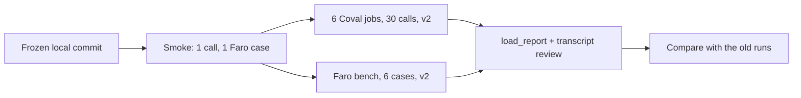

# Typed nodes: live validation contract (session 4)

This replaces the Session 3 proposal. The user decided to run version 2 only: v1 has known faults, so billed calls on it
teach nothing. Version 2 is compared with earlier runs that worked. The verdict is accuracy. Tokens are reported on the
side.

1. One local commit holds what the calls run. Its SHA, the `uv.lock` hash and each manifest's, prompt's and speech
   profile's SHA-256 go in the run log before launch.
2. One smoke call and one Faro case run first. If either fails, nothing more is spent.
3. Six Coval jobs of 5 calls each run at concurrency 5, one job at a time on the one phone number.
4. `load_report` judges every call. Every transcript is read, and each finding is tagged `[app]` or `[prompt]`.

## Salon jobs

All jobs use the same settings:

- **Agent:** `8y68A4M9k5dg4Q6m64sy6f` (`voice-harness-salone-concierge-graph-new-pipecat-twilio`), the real Twilio
  line.
- **Call ceiling:** 300 s.
- **Speech:** `speech-profile.v1.env`.
- **State:** a fresh diary per job.
- **Metrics:** Latency `29BlkepvvX19ebbLDB0y6Q`, Turn Count `7VHk6dTjvBcuV6XYPmaeGq`, Harness: expected behaviors
  `DWTXGNixUZH86QUSR5Dv72`, Changes Match What The Caller Agreed `XjYZ7er6k72ho6d8ccmsPC`, and Answered Question
  Not Asked Again `ma5psdGKoHbWtdv8BFXGtx`.

| # | Test set | Persona | Calls | Compared with |
|---|---|---|---:|---|
| 1 | `8YK67zzr` core 5 | Standard `MUFJdYAHdBHU6UbRRu4ykM` | 5 | `hdbogMqBE2bYYbUf35owxE` (like for like), `4eDqRVLRQpXQmsCLKPBc79` (reference) |
| 2 | `8YK67zzr` core 5 | Interruptive `VSruLZYYyz3w7fkdUaheDR` | 5 | none |
| 3 | `2P6J33TP` normal | Standard | 5 | 4c A `c77fpUwGHjNYHBoFntSpNW` |
| 4 | `CHPwoXJf` interruptive | Interruptive | 5 | 4c B `C4jjBivqK5PSCLpkVmNzhA` |
| 5 | `F5jCk2TL` detours | Standard | 5 | none |
| 6 | `F5jCk2TL` detours | Interruptive | 5 | none |

That is 30 calls plus 1 smoke call. No call is replaced, and nothing is scored again for pay.

## What the preflight found (2026-09-30, read-only)

**Case text:**

- `2P6J33TP`, `CHPwoXJf` and `F5jCk2TL` match the saved copies, case by case.
- `8YK67zzr` has no saved copy. Its five cases share the caller number `+34 671 273 454`.
- Three of those cases were edited at 13:28 on 2026-09-24: `66JfiSUwTPxWfdUq7DebDs`, `bYTW3WUDm5BovE3zsCHt2U` and
  `eNyNBaHekEfXFwUDxJuW3S`. That was after `4eDqRV…` ran (09:51) and before `hdbog…` ran (19:36).

**Metrics:**

- Changes Match and Answered Question Not Asked Again were edited at 16:59 on 2026-09-24. That was after `4eDqRV…`
  and before `hdbog…`.
- `4eDqRV…` therefore matches like for like only on:
  - its two unedited cases, `Lab6uJsmMMp3u4VZ3BcB7h` and `VAsCSxvpMcVi78Ki3ZEw2n`;
  - its three unchanged metrics.
- `hdbog…` matches on all five cases and all five metrics. It scored NO on Changes Match for one call and on
  Answered Question Not Asked Again for two.

**Old baselines:** the old runs used salon-graph, the older rendered build.

- `4eDqRV…` and `hdbog…` ran on Coval's websocket simulator.
- The 4c runs ran on the real line.
- A matched result is therefore "observed on the matched sample", never an A/B.

## Binding calls to simulations

`coval_sim` binds a call by the phone number its case gives. The five core 5 calls share one number, so they are bound
by content instead:

- Each Coval transcript is matched with each call's Langfuse turns.
- The binding and its evidence are recorded and passed to `load_report --call`.
- A call that cannot be matched without doubt stays `unknown`.

## Faro

Faro runs `faro-tools/bench.py` on the real model, one pass each: `L01-emma`, `L03-EN`, `L05-revise`, `L07-ES`,
`L09-accept` and `L11-EN`.

The review covers:

- each grade against the learner's words;
- whether help made the next answer `assisted`;
- whether a plan changed only on a yes to its read-back;
- whether the explanation language followed the learner.

No teaching quality and no pass rate is claimed.

## Stop rules

Stop and report on any of these:

- an unauthorized or duplicate write;
- a write with no heard read-back;
- a wrong identity or date said to the caller;
- two failed connections in a row;
- a call past its ceiling.

## Decision rule

v2 passes only if all of these hold:

- No call shows an adoption blocker (`use-cases/salone-concierge-graph-new/evals/rubric.v1.md`).
- Every connected call passes outcome, authorization and delivery, or its failure is `[prompt]` or a simulator fault
  and is listed apart.
- No matched case goes from pass to fail for an `[app]` cause.
