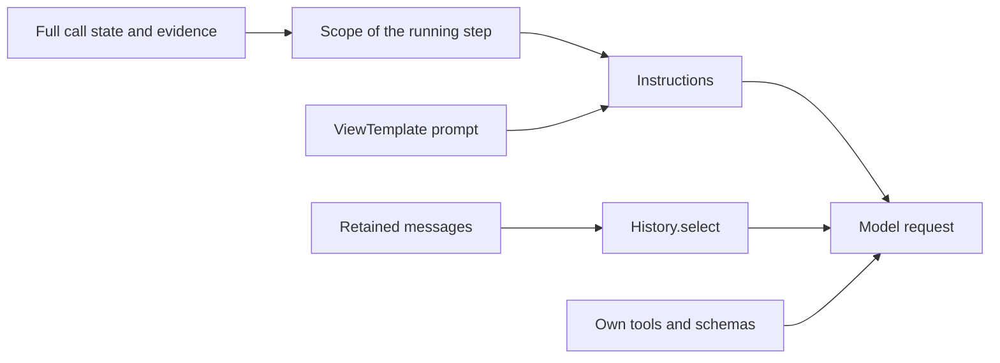

# Typed nodes, session 1: typed variables and per-node context

The scoped context view and the node history object are in place, offline-tested, and **uncommitted**.
v1 manifests send the same requests as before, byte for byte at the model boundary.

## Revisions and working tree

| | |
|---|---|
| Base | `ee377d4d97adaeffbecbd45d23e35973a620c85a` (`feat/simpler-authoring`) |
| Checkout | worktree `.claude/worktrees/fix-simpler`, branch `feat/typed-nodes-session-1`, created at the base |
| HEAD | `ee377d4` (no commits made) |
| State | working-tree checkpoint, uncommitted, not pushed |

No commit after `ee377d4` existed on any local ref when the session started. The main checkout was not touched,
so its untracked files (`.DS_Store`, the new salon's `evals/report.v1.md`) are as they were.

`git status --short` at the end of the session:

```text
 M CLAUDE.md
 M core/src/core/flowspec.py
 M core/src/core/graph.py
 M core/src/core/history.py
 M core/src/core/state.py
 M core/src/core/steps.py
 M core/src/core/turn.py
 M core/tests/test_context.py
 M core/tests/test_nodes.py
 M core/tests/test_tickets.py
 M use-cases/faro-language-learning/faro/__init__.py
 M use-cases/faro-language-learning/tests/test_faro.py
 M use-cases/salone-concierge-graph-new/salon/app.py
 M use-cases/salone-concierge-graph-new/tests/script.py
 M use-cases/salone-concierge-graph-new/tests/test_business.py
?? core/tests/clinic_flow/prompts/call.md
?? core/tests/clinic_flow/prompts/lobby.md
?? core/tests/clinic_flow/scoped.py
?? core/tests/clinic_flow/scoped.yaml
?? core/tests/golden/
?? docs/implementation/
?? use-cases/faro-language-learning/tests/golden/
?? use-cases/salone-concierge-graph-new/tests/golden/
```

## How a scoped request is built



1. The call keeps its full state, messages and evidence. Nothing is deleted.
2. The running step's `Scope` decides what the automatic context lines show.
3. The prompt template can name only the step's view.
4. `History.select` picks whole caller turns by the step that handled them, plus anchors.
5. Tools and output schemas are the step's own, as before.

## What changed

### Opt-in and inheritance (`core/src/core/flowspec.py`)

A `History` object at the root or on a step opts that step into the scoped view:

```yaml
context: {facts: [slot], history: {scope: node, turns: 1}}
steps:
  - id: front
    context: {facts: [patient]}   # facts replace the root list; history is inherited
```

- Scoped: the root is the default. A step's `facts` replaces the root list. A step's `history`, string or
  object, replaces the root's as a unit. Absent members inherit (`ContextSpec.under`, `model_fields_set`).
  `context: none` is no facts and history `none`.
- v1 (no history object anywhere): unchanged. A step's context replaces the root whole, with its own default
  `history: all`. Regression: `v1_node_context_replaces_the_flows_whole`.
- `facts` entries must be plain top-level names. `a.b`, `a[0]` and `*` fail at load with a message that points
  to the whole field.
- `History`: `scope: node | conversation` (default `node`), `turns`: a strict positive int, or absent for all.
  Unknown keys fail.
- Scoped prompts compile against a view model `{heard, state: {facts: <selected fields>}}` (`ViewTemplate`, a
  `TemplateStr` subclass) and render from it. `{{state.facts.<hidden>}}`, `{{state.agent}}`, `{{services...}}`
  fail at load. Nothing is rendered and then redacted. v1 prompts still compile against `FlowCall[S]`.
- No version bump, no v2 keys, no per-field YAML types, no patch DSL. AliasPath bindings untouched.

### The node view (`core/src/core/history.py` `Scope`, `core/src/core/steps.py` `context`)

`Scope` is built per step at compile: visible `facts`, writable `fields`, owned `operations`
(`operations` and `carries_out`), and each owned operation's `binds` and `assign`.

| Automatic source | v1 (unchanged) | Scoped |
|---|---|---|
| Facts line | selected fields | selected fields |
| Offers | every offer on the call | offers for choices the step writes and sees |
| Pending question | always, with its words | owned: words and hearing; else one marker line |
| Withdrawn / unknown intents | operation and all args | owned: args bound from visible fields; unknown and unowned: one marker line |
| "Done on this call" | args and full receipt JSON | owned only: visible args, status, values the receipt set in visible fields |
| Recaps | every standing recap | owned operations only (`StepFlow.recaps(only=...)`) |
| `spoken_over` | in `context()` and in `prepare` | only the `prepare` note; none when history is `none` |
| Rejected receipt retry | full receipt dict | `public_receipt` plus a `Rejection`'s `reason` |
| Earlier `ModelRequest.instructions` in history | every earlier step's full application state | stripped |
| `retain_action` "Application result" part | kept under `history: all` | dropped |

`fields` and `facts` stay independent. A step can write a field it does not see (`note` on `desk`), and see
one it cannot write. Receipt-assigned fields stay unwritable (existing loader check, unchanged).

### Node history (`History.select`, `core/src/core/turn.py`, `core/src/core/state.py`)

- Attribution: every retained message gets `metadata['step']` and `metadata['run']`. `Spoken` gets `step`.
  Model-free inputs, application results and the greeting are tagged too.
- `CallContext._arrived[step]`: the caller turn in which the caller was sent to a step. Set on hand-over,
  consultation and prerequisite interposition. A prerequisite return does not overwrite it.
- Earlier caller turns are eligible when the step took part (by step id, not persona), or always under
  `scope: conversation`. The last `turns` eligible turns are kept. The current turn is always sent.
- Kept past the window: the `_arrived` turn, the owned pending question's turn and every later turn, and
  `load_capability` pairs and availability deltas of capabilities the step registers. The window logs the
  turns it kept past `turns`, and `History.window` returns them.
- Earlier turns keep only what was said and heard. In the current turn, only messages not yet retained (this
  run) keep their tool parts. When dropping another run's tool results leaves the history ending on speech, the
  caller's words are sent again last. The turn engine already does this for a run with no prompt.

### Capture and pins

- `core.history.Payload`: one request at the **Pydantic AI model boundary** (FunctionModel `messages` and
  `AgentInfo`). It is not the provider wire format. It holds instructions, history, function tools and output
  tools as canonical JSON, without timestamps, tool call ids, run ids and message metadata.
- The existing scripted models keep one `Payload` per request: `test_context.Script`, `test_nodes.Script` (and
  so `test_tickets`), Faro's `Script`, the new salon's `Request.payload`.
- v1 requests pinned whole before any behaviour change (`BLESS_PAYLOADS=1` rewrites):
  `core/tests/golden/context.json`, `core/tests/golden/tickets.json`,
  `use-cases/faro-language-learning/tests/golden/payloads.json`,
  `use-cases/salone-concierge-graph-new/tests/golden/payloads.json`. salon-graph's `golden/agents.json`
  still passes unchanged.
- To pin the date, `faro.open_call` and the new salon's `salon.app.open_call` take an optional `clock`. Only
  the pin tests pass one.

### Legacy `collect`, frozen for Session 2

| Input | Today |
|---|---|
| field omitted | value kept |
| explicit `null` | value kept: legacy `collect` cannot clear (`model_dump(exclude_none=True)`) |
| `''` | recorded (clinic `note`) |
| `False` | recorded (salon `wants_refund`) |
| `0` | validated, refused by `ge=5` (Faro `length`) |
| schema | each field `T or null`, default null, state constraints and description, no state default, no other field |

Tests: `legacy_collect_is_frozen` (core), `false_is_a_value_and_null_leaves_one` (salon),
`zero_is_a_value_the_state_validates` (Faro).

## Tests added (`core/tests/test_context.py`, on `clinic_flow/scoped.yaml`)

| Test | Proves |
|---|---|
| `v1_node_context_replaces_the_flows_whole` | root `history: messages` plus node `{facts: [x]}` gives node history `all`, tool exchange sent |
| `scoped_members_replace_one_by_one` | facts replace, history string or object replaces, absent inherits, `none`, one step opted in alone |
| `invalid_context_is_refused_at_load` | selectors, bad scope, `turns: 0`, `turns: '8'`, unknown key, hidden and call-level template references; the same template loads in v1 |
| `automatic_sources_show_only_the_steps_view` | canaries (hidden patient, note, raw receipt, offers, read-back, intent args, recap, unknown outcome) never reach a step that does not see them; stored state, trusted binding and full evidence intact; no values in schemas |
| `a_refusal_says_only_what_the_step_sees` | the rejected-receipt retry holds the patient in v1 and not in scoped mode |
| `words_said_stay_words` | a caller's mixed request is recorded whole; their words and the read-back they heard stay in history |
| `history_is_the_nodes_own` | node id not persona, revisit keeps own turns, parent `hand_over` exchange dropped, window of one |
| `anchors_outlive_the_window` | original request across the prerequisite, own pending question, one capability load kept past `turns: 1`; the step that took over sees no `front` tool exchange |
| `each_request_is_rebuilt_for_its_own_call` | facts re-read per request; two interleaved calls on one flow share nothing; a trusted capability callback's actual output asserted |

Mutation checks, run by hand and reverted, not shipped: forcing `scope = None` in `context()` fails
`automatic_sources_show_only_the_steps_view`. Keeping every tool part in `History.select` fails the same test.

## Payload bytes

Bytes are UTF-8 bytes of the canonical `Payload` JSON at the Pydantic AI model boundary. They are not tokens,
and not the provider wire.

### v1 pins (before = after)

| Pin file | Request | Instructions | History | Tools | Outputs | Total |
|---|---|---|---|---|---|---|
| `core/tests/golden/context.json` | desk, a local answer after a note | 1153 | 2782 | 2737 | 2673 | 9345 |
| `core/tests/golden/context.json` | desk, after the prerequisite returned | 1129 | 3904 | 2737 | 2673 | 10443 |
| `core/tests/golden/context.json` | desk, the read-back request | 1155 | 6203 | 2737 | 2673 | 12768 |
| `core/tests/golden/context.json` | front, the prerequisite | 670 | 759 | 750 | 2167 | 4346 |
| `core/tests/golden/context.json` | nurse, consulted | 883 | 842 | 2 | 1378 | 3105 |
| `core/tests/golden/tickets.json` | desk, the read-back request | 1475 | 5589 | 1623 | 3872 | 12559 |
| `core/tests/golden/tickets.json` | desk, the yes | 1455 | 6482 | 1623 | 3872 | 13432 |
| `core/tests/golden/tickets.json` | faq, the first request | 803 | 952 | 2 | 1564 | 3321 |
| Faro `tests/golden/payloads.json` | identify, the yes | 2791 | 3454 | 1585 | 1990 | 9820 |
| Faro `tests/golden/payloads.json` | lesson, an answer graded | 4528 | 13751 | 2097 | 2130 | 22506 |
| Faro `tests/golden/payloads.json` | menu, carrying on | 3754 | 8213 | 1247 | 3228 | 16442 |
| new salon `tests/golden/payloads.json` | booking, the read-back request | 7751 | 14839 | 3445 | 3966 | 30001 |
| new salon `tests/golden/payloads.json` | concierge, a local answer | 5891 | 5504 | 2025 | 1602 | 15022 |
| new salon `tests/golden/payloads.json` | stylist, consulted | 4625 | 27499 | 2 | 1378 | 33504 |

The new salon's stylist gets 27,499 history bytes for a one-line question under `history: messages`. Much of it
is earlier requests' `instructions` riding along in the message list, which the scoped view strips.

### Same clinic scenario, v1 (`consult.yaml`) / scoped (`scoped.yaml`)

The two manifests differ in their selections: v1 desk sees `[checked_in, slot]` with `history: messages` and a
`context: none` nurse; scoped desk sees `[slot]`, node history with `turns: 1`, nurse `{facts: none}`.

| Request | Instructions | History | Tools | Outputs | Total |
|---|---|---|---|---|---|
| desk: read-back #1 | 1054 / 1020 | 1150 / 143 | 2737 / 2737 | 2673 / 2673 | 7614 / 6573 |
| desk: read-back #2 | 1155 / 1121 | 3038 / 911 | 2737 / 2737 | 2673 / 2673 | 9603 / 7442 |
| desk hands over to the nurse | 1258 / 1224 | 2933 / 700 | 2737 / 2737 | 2673 / 2673 | 9601 / 7334 |
| nurse answers | 883 / 781 | 826 / 143 | 2 / 2 | 1378 / 1378 | 3089 / 2304 |
| desk: the yes | 1258 / 1224 | 4737 / 1278 | 2737 / 2737 | 2673 / 2673 | 11405 / 7912 |
| desk: after booking | 1246 / 1156 | 6536 / 1845 | 2737 / 2737 | 2673 / 2673 | 13192 / 8411 |

Request counts are the same in both arms. Tool and output schemas do not change: they depend on `fields`,
`operations` and exits, not on `context`.

## Checks run (real output, last lines)

```text
$ uv run ruff format .                          # root
370 files left unchanged
$ uv run ruff check .
All checks passed!
$ uv run --directory core ty check .
All checks passed!
$ uv run --directory use-cases/faro-language-learning ty check .
All checks passed!
$ uv run --directory use-cases/salone-concierge-graph-new ty check .
All checks passed!
$ uv run --directory use-cases/salon-graph ty check .
All checks passed!
$ (cd core && uv run python -m tests)
all 20 modules ok
$ (cd use-cases/faro-language-learning && uv run python -m tests)
all 2 modules ok
$ (cd use-cases/salone-concierge-graph-new && uv run python -m tests)
all 3 modules ok
$ (cd use-cases/salon-graph && uv run python -m tests)
all 21 modules ok
```

The same four suites passed at the base before any edit (20, 2, 3 and 21 modules). Provider requests stayed
disabled (`ALLOW_MODEL_REQUESTS = False` in each `tests/__main__.py`). No `.env`, live eval, Coval run or phone
call was used.

## Known limits

- **Context minimisation, not confidentiality.** A caller's words, and speech sent to them (read-backs,
  receipts), may name a hidden field, and are sent as said. No free text is redacted. A caller's mixed
  correction is kept whole.
- **An owned read-back is shown whole.** Its words are declared public speech, so a patient number in
  `Shall I book ... for P-7777?` reaches the owning step's instructions while the question waits.
- **Trusted callbacks are not sandboxed.** A native capability's instructions or tool callbacks get the whole
  call. `scoped.py:notes` reads `note`, which `front` is not shown, and the test asserts that its output
  reaches the model. Declared tool results, `Refused(...)` text and validator messages are application text,
  also not filtered.
- **Specialists get no parent read-back.** A consulted step sees one marker line. A consultation whose purpose
  needs the read-back's content has no way to ask for it yet.
- **Recaps are per owner.** A scoped step recaps only its own operations. The runtime goodbye still resolves
  every standing recap.
- **Top-level fields only.** A selected nested model is shown whole. No leaf projection.
- **No provider-wire capture.** The byte tables are the Pydantic AI model boundary. The Google adapter's own
  serialization was not captured.
- **v1 `history: messages` still sends earlier requests' `instructions`** in the message list at the model
  boundary. Changing that would change v1 payloads, so it is left for the v2 default.
- **Diagnostics are a log line.** Turns kept past `turns` are logged and returned by `History.window`, not
  written to a span.
- No production manifest opts in. Only the clinic fixture uses the scoped view.

## Session 2 prerequisites

1. Continue on branch `feat/typed-nodes-session-1` in `.claude/worktrees/fix-simpler`, from this working
   tree. Do not reset to `ee377d4`.
2. Keep the v1 pins green. A structured mode must not change a v1 request, so any diff in the four golden files
   is a regression unless deliberately re-blessed with review.
3. The structured patch must distinguish omitted, `null`, `''`, `False` and `0`. Keep legacy `collect` as frozen
   above for v1 steps.
4. Reuse `Payload` and the extended scripts for request counts and schema sizes. Structured output schemas will
   appear in the `outputs` component.
5. Consultation answers and parent read-backs: decide whether a consultation's purpose may carry the waiting
   read-back to the specialist, and keep the scoped marker otherwise.
6. A read continuation should return a public result through `Scope.public_receipt` (assigned visible fields and
   status), not the raw receipt.
