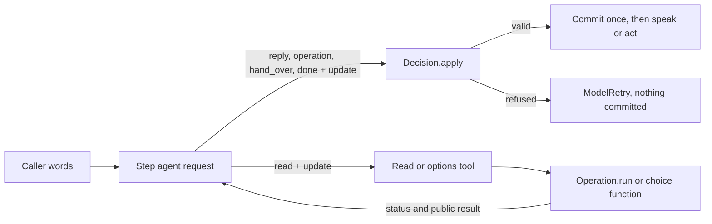

# Typed nodes, session 2: terminal typed decisions, read continuation, pending interactions

A conversation step can now opt into `speech: structured`. There, every answer and action is one typed decision that carries the
caller's update, and a pure read continues to the same agent. It is offline-tested on the clinic, the ticket desk, the new salon
and Faro. It is **uncommitted**. v1 `prose` and `rendered` steps send the same requests as before, byte for byte at the model
boundary (the Session 1 pins still match).

## Revisions and working tree

| | |
|---|---|
| Base | `ee377d4d97adaeffbecbd45d23e35973a620c85a` (`feat/simpler-authoring`) |
| Checkout | worktree `.claude/worktrees/fix-simpler`, branch `feat/typed-nodes-session-1`, continued from Session 1 |
| HEAD | `ee377d4` (no commits made in either session) |
| State | working-tree checkpoint on top of Session 1, uncommitted, not pushed |

Session 1 was complete when this session started (its report and checks are unchanged). Sessions 1 and 2 share one
uncommitted tree. At the end of Session 1 the tracked diff was 15 files, +1191/-58. It is now 19 files, +1686/-106, plus the
untracked files below.

`git status --short` at the end of this session:

```text
 M CLAUDE.md
 M core/src/core/actions.py
 M core/src/core/flow.py
 M core/src/core/flowspec.py
 M core/src/core/graph.py
 M core/src/core/history.py
 M core/src/core/policies.py
 M core/src/core/state.py
 M core/src/core/steps.py
 M core/src/core/turn.py
 M core/tests/__main__.py
 M core/tests/test_context.py
 M core/tests/test_nodes.py
 M core/tests/test_tickets.py
 M use-cases/faro-language-learning/faro/__init__.py
 M use-cases/faro-language-learning/tests/test_faro.py
 M use-cases/salone-concierge-graph-new/salon/app.py
 M use-cases/salone-concierge-graph-new/tests/script.py
 M use-cases/salone-concierge-graph-new/tests/test_business.py
?? core/src/core/structured.py
?? core/tests/clinic_flow/prompts/call.md
?? core/tests/clinic_flow/prompts/check_in.md
?? core/tests/clinic_flow/prompts/lobby.md
?? core/tests/clinic_flow/prompts/visit.md
?? core/tests/clinic_flow/scoped.py
?? core/tests/clinic_flow/scoped.yaml
?? core/tests/clinic_flow/structured.py
?? core/tests/clinic_flow/structured.yaml
?? core/tests/golden/
?? core/tests/test_structured.py
?? docs/implementation/
?? use-cases/faro-language-learning/tests/golden/
?? use-cases/salone-concierge-graph-new/tests/golden/
```

Added in Session 2: `core/src/core/structured.py`, `clinic_flow/structured.{py,yaml}`, `prompts/visit.md`,
`prompts/check_in.md`, `tests/test_structured.py` and this report. Changed in Session 2: `actions.py`, `flow.py`,
`policies.py`, `tests/__main__.py`, and further edits to `state.py`, `steps.py`, `turn.py`, `history.py`, `flowspec.py`,
`test_context.py`, `test_tickets.py`, Faro's and the new salon's tests, and `CLAUDE.md`. No production manifest opts in.

## How one structured turn works



1. The step agent is sent one request. It has no plain-text output and no `collect` tool.
2. A local answer is `reply(say, update)`. Code validates the update against the whole state, commits it once, says `say`
   as the model's words, and the run ends. One request.
3. A read the answer needs is an ordinary tool that takes the new values it rests on. Code commits them, runs the read once
   and returns its status and public result. The same agent then answers with `reply`. Two requests.
4. Operations, `hand_over` and `done` take their update in the same call, and code applies it first. No sibling tool has
   to run in a convenient order.
5. Any refusal commits nothing and says nothing. The model gets a labelled retry.

## Why an output function

The saved SDK proof (`voice-latency-evidence.zip`, `checks/sdk-terminal-output-check.py`) shows the problem with the
obvious alternatives. With `NativeOutput` plus an ordinary update tool, the default `graceful` end strategy costs three
requests. The `early` strategy costs two, but skips the update. So the update lives inside the terminal output function
(`ToolOutput`). Pydantic AI validates its arguments and runs it once, and the run ends on it. The runtime already used
output functions for operations, `hand_over` and `wait`.

Checked on the installed Pydantic AI 2.46.0 before any edit (a scratch probe with provider requests disabled):

- Under `graceful`, tools run in emission order, output tools included. An output tool emitted before a function tool runs
  first. So core refuses the answer beside a read, whatever the order.
- Two `prepare_tools` handlers on one `Hooks` both run.
- `tool_validate_error` does not fire for output tools. Their argument errors are the SDK's own retry.
- An explicit `null` for a non-nullable field fails the field's own type.

A `FunctionModel` check proves SDK control flow only. It says nothing about how a live Gemini model chooses outputs.

## Output and tool contracts (`core/src/core/structured.py`)

### The update

`patch_type` builds one model per tool from the step's `fields`. Each field keeps the state's own annotation, constraints
and description. No default or example is copied, and the schema shows no default.

| Update value | Effect |
|---|---|
| key absent | the field keeps its value (`model_fields_set`) |
| `null` | clears it, only where the state's type accepts None; otherwise the field's own type refuses it |
| `false`, `0`, `''` | recorded as values, checked by the field's constraints |
| a nested model | replaced whole, never merged |
| an unknown, read-only, receipt-owned or other step's field | refused by the schema (`extra='forbid'`) |

`Decision.apply` commits through `StepFlow.record(atomic=True)`, the same path `collect` uses. It applies the application's
validators with `before`, `heard` and the clock, whole-state rules, the resets of what rested on a changed field, and the
rule that a pick must be on an offer standing for the final state. With `atomic`, a refused pick refuses the whole update.
Legacy `collect` still records the rest. A quoted field must be the caller's words. Only the first call in a response
that carries an update may apply it (`patch_or_refuse`).

An action takes only the fields it rests on (`_resting_on`). `book` takes `slot`, `quote` takes `service`, and `options`
takes the fields its offers rest on. `reply`, `record` and `hand_over` take all of the step's fields.

### Terminal outputs

| Output | Arguments | What code does |
|---|---|---|
| `reply` | `say` (never blank), `update`, `decline` (only with a read-back on the step) | apply, decline, say the words once as model speech (`speak_now(origin='model')`), end the run |
| `record` | `update` (required) | apply, then code speaks the consequence: a carried-out operation or a read-back confirmed by its value said again. Offered only on steps with `carries_out` or a `restated: confirms` read-back |
| each guarded operation | `update` over its fields | claim, apply, then the existing read-back or approval path (`ConversationStep._operate`) |
| `hand_over` | `to`, `because`, `update` | claim, apply, hand over |
| `goodbye` | `recap`, `decline` | claim, decline, the existing goodbye |
| `done` (consulted step) | `answer` (never blank), `handback` | claim, check it was consulted, say `answer` once, return. A non-blank `handback` continues to the step that consulted in the same turn |
| `say_again` | none | unchanged |

`reply`, `record`, `goodbye`, `done`, the operations and `hand_over` are all actions for `one_action_per_reply`. One of
them runs per response.

### Ordinary tools

| Tool | Eligible when | Result |
|---|---|---|
| `Read` (named after the operation) | no read-back, `changes: false`, no `route`, no `say:` | `{status: found, result}`: the assigned fields the step may see, or the whole receipt when it assigns none (the application's declared return type is its public result). `refused` (a validated no, public fields only). `absent` (no receipt for this caller). `failed` (no answer; a read changed nothing, so nothing is claimed) |
| `options` | the step has choices | the standing offers, and a choice function asked only where no offer stands |

Both reuse the existing machinery. `Read` runs through `Operation.run`: binding from state, the audit span, receipt
validation, `matches`, assignment and evidence. `options` goes through `_offer`. A cancelled read assigns nothing. The same
read for the same caller turn and state version is a labelled retry, and nothing is sent. While every offer stands,
`options` requires a non-empty update (`minProperties: 1`), so a refetch with nothing new is not offered.

A response that calls a read answers and acts on nothing beside it. The answer was written before the result
(`one_action_per_reply(reads=...)`, `READING`).

Operations that write, need a read-back, or route by receipt keep their guarded terminal paths. A pure read with a `say:`
also stays terminal, because its receipt speech is exact. On a structured step the loader does not ask a pure read for a `say:`.

## Changes outside the structured mode

These apply to every manifest. None of them changes a v1 request (the pins match):

- `flow.legal_moves`: a consulted step may move back to each step that consults it. This is the return edge the old repro
  showed missing. The graph refused a consultation's return before.
- `FlowCall.reissue_waiting`: a waiting read-back is put again only while the state still builds its exact arguments.
- `turn.retain` tags a message kept during a consultation with `metadata['for']`, the step it served. `History.window`
  counts that turn as the parent's. This changed one Session 1 assertion in `test_context.history_is_the_nodes_own`: the
  desk now sees the turn the nurse answered for it (scoped mode only).
- `Action.spoken()` reports `route`, so the loader sees a class operation's route.
- `Entry` gains `'returned'`: a step reached by a consultation's handback runs no arrival opening.
- `one_action_per_reply` reads an `update` argument beside `values`, and a claimed action's own update is not "unapplied".

## Request tables

All counts are whole caller turns, every agent and retry included, captured at the Pydantic AI model boundary
(`FunctionModel`, `Payload`). They are not provider-wire counts.

### One and two request paths

| Scenario (test) | v1 | structured | Backend reads |
|---|---:|---:|---|
| Clinic: local answer with an update (`test_context` v1, `a_local_answer_is_one_request`) | 2 (collect, speech) | **1** | none |
| Clinic: price with a new service (`a_read_with_new_values_is_two_requests`) | no v1 equivalent | **2** | 1 quote |
| Clinic: times for a new service (`offered`) | no v1 equivalent (the salon's v1 path is 2) | **2** | 1 availability |
| Clinic: pick read back (`read_back`) | 1 with `reads_back`, 2 without (`test_context`) | **1** | none |
| Clinic: yes (`consent_is_code_s`) | 1 | 1 | 1 booking write |
| Clinic: "yes, but nine" (`consent_is_code_s`) | not measured this session | **1** | none |
| Clinic: check-in, then back to the desk (`a_consultation_keeps_the_prerequisite_apart`) | 3 (collect, check_in, speech) | **2** | 1 check-in read |
| Ticket desk: to the Spanish read-back (R2 v1, R24 structured) | 4 | **3** | 1 ticket read (action step) |
| Salon: haircut Friday at two, then pick, then yes (`structured_read_back`) | 2 + 1 + 1 | 2 + 1 + 1 | 1 availability, 2 held-booking reads (both arms) |
| Faro: number read back (`a_wrong_or_foreign_number_discloses_nothing`, F10) | 1 | 1 | none |

The salon's booking path costs the same number of requests in both arms. v1 already removes the collect-only request
there: its `reads_back` rule reads the pick back by code, and `collect` makes the offer itself.

### Paths that need a third request, and why

| Scenario | Requests | The information each one needs |
|---|---:|---|
| Ticket desk to read-back (R24) | 3 | `faq` routes (it owns no ticket fields); `desk` records the caller's words and routes to the look-up; `desk` reads back with the revision the look-up just returned |
| Clinic consultation with a handback (`the_caller_s_words_come_back_whatever_the_summary`) | 3 | desk hands over; nurse answers; desk reads the caller's change and reads the new time back |
| Salon stylist with a handback (`a_structured_stylist_hands_the_change_back`) | 4 | booking hands over; stylist answers; booking reads times for the new hour; booking reads back the new slot id it got from that read |
| Clinic consultation, answer at once (`a_consultation_answers_once`) | 2, +1 | desk hands over; nurse answers. The +1 is the blank-answer retry the test sends on purpose |

A hand-over into a step that must read before it answers stays at 3 requests: the routing decision, the read, then the
answer. The read needs the routed request. No known transition or saved variable costs a request on these paths.

### Exception paths (labelled retries)

| Scenario (test) | Requests | Retry the model is told |
|---|---:|---|
| Update refused: null on a non-nullable field, whole-state rule, unknown key, receipt field, other step's field, bad nested value, off-offer pick (`an_update_keeps_what_it_leaves_out`, `a_refused_decision_commits_nothing`) | 2 each | `Nothing was recorded: ...` (nothing committed, nothing said) |
| Read and answer in one response, either order (`one_decision_per_response`) | 2 | `READING` |
| Two updates in one response | 2 | `PATCHED` |
| Adaptive fake repeats a read (`no_redundant_path_is_offered`) | 3 | `already answered for this request` (no backend call) |
| Hostile refetch with nothing new, then a hidden `collect` | 3 | `still stands`; the SDK's unknown-tool retry (nothing recorded) |
| Blank consultation answer | +1 | the SDK's `min_length` retry |

The adaptive fake takes any redundant path a request offers. On the structured clinic it found no `collect` and no
refetch with nothing new. The only redundant tool on offer was a repeated read, and that became a labelled retry. On the
v1 prose desk (`consult.yaml`) it found `collect` on every request.

## State, effect and speech checks

| Check | Where | Result |
|---|---|---|
| A valid reply commits once (`_version` +1) and is said once, as model speech | `a_local_answer_is_one_request` | pass |
| The next request sees the change, and history carries the words once | same | pass |
| Absent keeps; null clears `companion`; `False`, `0`, `''` recorded | `an_update_keeps_what_it_leaves_out` | pass |
| Every refused update commits nothing (`facts`, `_version` unchanged) and says nothing | `a_refused_decision_commits_nothing` | pass |
| The read's backend saw the new value once; the result goes back to the same agent | `a_read_with_new_values_is_two_requests` | pass |
| An assigned read result rests on its inputs: a new service takes the price away | same | pass |
| Empty, refused, failed, absent (identity changed during the read), cancelled: told apart, nothing stale assigned | `a_read_says_what_it_found`, `a_cancelled_read_assigns_nothing` | pass |
| Read-back in code's words; only a heard yes books, once | `consent_is_code_s` | pass |
| A correction makes a new intent read back fresh; the old one is never dispatched | same | pass |
| A side question leaves the intent prepared; the next yes hears the read-back again | same, Faro F10 | pass |
| An ordinary question and "yes" approve nothing | same, Faro F10 | pass |
| `decline` inside `reply` spends the read-back | same | pass |
| An unknown write stays unknown and is never resent | same | pass |
| The specialist's "yes" books nothing; its answer is said once; a blank answer is refused | `a_consultation_answers_once` | pass |
| A correct, wrong or missing summary: the caller's words reach the parent's next request | `the_caller_s_words_come_back_whatever_the_summary` | pass |
| A read-back whose arguments changed is not put again | `a_stale_read_back_is_not_put_again` | pass |
| Prerequisite and consultation owners stay apart | `a_consultation_keeps_the_prerequisite_apart` | pass |
| A partial streamed reply commits nothing and says nothing | `partial_output_commits_nothing` | pass |
| A committed update stays when its words are cut; they are not claimed as heard | `a_committed_update_stays_when_its_words_are_cut` | pass |
| Spanish read-back and receipt exact; a correction read back fresh; resolved once | `test_tickets` R24 | pass |
| One availability read, counted apart from held-booking reads; a repeat reads nothing | salon `test_business` | pass |

### The guards fail their tests when broken

Each guard below was broken by hand, one at a time, and restored (`scratchpad/mutate.py`, not in the tree):

```text
caught: atomic update off (tests.test_structured)
caught: no answer beside a read: off (tests.test_structured)
caught: one update per response: off (tests.test_structured)
caught: handback continues: off (tests.test_structured)
caught: legal return edge: off (tests.test_structured)
caught: stale read-back check: off (tests.test_structured)
caught: repeat read check: off (tests.test_structured)
caught: refetch with nothing new: off (tests.test_structured)
caught: blank answer allowed (tests.test_structured)
caught: consultation turn not the parent's (tests.test_context)
```

## Bytes at the model boundary

The salon's booking path, the same scripted turns in both arms (bytes, not tokens):

| Arm | Turn | Request | Instructions | History | Tools | Outputs | Total |
|---|---|---:|---:|---:|---:|---:|---:|
| v1 prose | A haircut on Friday at two. | 1 | 7318 | 6982 | 3445 | 3966 | 21711 |
| v1 prose | A haircut on Friday at two. | 2 | 7760 | 15588 | 3445 | 3966 | 30759 |
| v1 prose | Yes, two is great. | 1 | 7751 | 14839 | 3445 | 3966 | 30001 |
| v1 prose | Yes please. | 1 | 7886 | 22837 | 3445 | 3966 | 38134 |
| structured | A haircut on Friday at two. | 1 | 7318 | 6982 | 2415 | 9619 | 26334 |
| structured | A haircut on Friday at two. | 2 | 7760 | 15517 | 2424 | 9619 | 35320 |
| structured | Yes, two is great. | 1 | 7751 | 14839 | 2424 | 9619 | 34633 |
| structured | Yes please. | 1 | 7886 | 22837 | 2424 | 9619 | 42766 |

Structured requests on this path are about 4.6 KB larger: tools and outputs grow from 7,411 to 12,043 bytes. The reason is
that an update schema cannot be shared between tools. Each output that takes an update repeats its schema.

Per tool on booking's first request (bytes):

| Tool | v1 | structured |
|---|---:|---:|
| `collect` | 1601 | removed |
| `decline` | 505 | removed (inside `reply`) |
| `options` | 559 | 1639 |
| `reply` | none | 2251 |
| `goodbye` | 837 | 969 |
| `book_appointment` | 616 | 1178 |
| `move_appointment` | 616 | 1358 |
| `cancel_appointment` | 620 | 1228 |
| `hand_over` | 728 | 2083 |
| `load_capability`, `say_again` | 772, 512 | 772, 512 |

This is after two reductions made in this session. Each action's update was narrowed to the fields it rests on, and
`record` is offered only where no operation call can stand for it. Before them, outputs were 13,326 bytes.

## Known limits

- Typed shape does not prove understanding. The schemas check structure. The guards check ownership, approval and effects.
  Whether the model read the caller right, graded right, or summarised a consultation truthfully is a live measurement.
- `handback` is the specialist's reading. The parent reruns only when it is non-blank. With no handback, code puts a still
  valid read-back again. The caller's words reach the parent's next request either way, and a yes binds to the words heard.
- An action refused after its valid update keeps the update and says nothing. Example: `book` is not ready yet. The update
  is what the caller said. The model is told what is missing.
- `record` with no consequence (a carry-out whose arguments are still incomplete) has already committed its update when it
  asks the model to answer. That costs one more request in that case.
- A structured reply is said after its whole tool call arrives and validates. There is no token streaming of `say`. The
  first audio of a structured answer starts later than a streamed prose answer's. This was not measured.
- No `update` on `goodbye` or `say_again`. No parent-scoped proposal from a specialist, only handback text.
- v1 `done` is unchanged: a v1 specialist can still end with no words. The fix is structured-only, to keep v1 requests
  identical.
- The graph edge, the stale read-back check and the `for` tag apply in every mode. The v1 pins are unchanged, but a v1
  consultation that returns to a changed read-back now stays silent where it would have repeated the old one.
- Byte growth from repeated update schemas (see above). This is model-boundary bytes, not provider-wire bytes or tokens.
- All checks use scripted models. No live provider, Coval run, phone call or paid rescoring was run.

## Checks run (real output, provider requests disabled)

```text
$ uv run ruff format . && uv run ruff check . && uv run ruff format --check .
2 files reformatted, 374 files left unchanged
All checks passed!
376 files already formatted

$ uv run --directory core ty check .                              -> All checks passed!
$ uv run --directory use-cases/faro-language-learning ty check .  -> All checks passed!
$ uv run --directory use-cases/salone-concierge-graph-new ty check . -> All checks passed!
$ uv run --directory use-cases/salon-graph ty check .             -> All checks passed!

$ uv run --directory core python -m tests                          -> all 21 modules ok
$ uv run --directory use-cases/salone-concierge-graph-new python -m tests -> all 3 modules ok
$ uv run --directory use-cases/faro-language-learning python -m tests    -> all 2 modules ok
$ uv run --directory use-cases/salon-graph python -m tests         -> all 21 modules ok
```

Core has one more module than in Session 1 (`tests.test_structured`). The v1 pins in `core/tests/golden/`, Faro's and the
new salon's `golden/payloads.json`, and salon-graph's `golden/agents.json` all still match.

## Session 3 prerequisites

1. Default v2 conversation nodes to `speech: structured` (`ConversationStep.structured`). v1 keeps `prose`.
2. Decide how to handle the repeated update schema. The options: accept about 4.6 KB per request on the salon; drop
   `update` from `hand_over` where exits carry nothing; or a single terminal output with a discriminated action union,
   which states the update once. That last one is a larger change to `one_action_per_reply` and `speaks_for`.
3. v2 `fields` must be a subset of visible `facts`. On a structured step that is what lets the model see what it replaces.
   The loader does not enforce it yet.
4. Migrations: the new salon's concierge, booking and stylist steps, the clinic and ticket fixtures, and Faro's `identify`
   and `plan` already run structured in tests. Faro's rendered `assessment` and `lesson`, and its `carries_out`-heavy
   steps, need `record` or a rendered `wait`. Those steps have not been tried structured.
5. A live check before any production manifest opts in. Prompts that name `collect` (`desk.md`, the salon's prompts) must
   be moved, not edited, per the repository rules. Then measure output choice, first-audio time and tokens.
6. Keep the Session 1 and 2 checkpoint uncommitted until reviewed. Do not reset to `ee377d4`.
