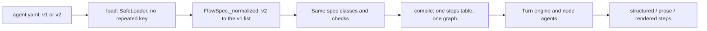

# Typed nodes, session 3: the version 2 manifest, domain migrations, offline qualification

> Later change: session 4 promoted the two version 2 twins this report names.
>
> - `salon/agent.v2.yaml` became the new salon's `salon/agent.yaml`.
> - Faro's `tests/v2.yaml` became `faro/agent.yaml`.
> - Their prompts now name the structured outputs.
>
> The byte tables below are the Session 3 measurements.

A manifest can now say `version: 2`. Its steps are keyed by id. A step with no `kind` is a conversation, and a
conversation with no `speech` is `speech: structured`. Every conversation step gets the scoped view, and the flow
context defaults to no facts and the step's own history. The loader turns version 2 into the version 1 steps list,
and the same spec classes, compiler and runtime run it.

Version 1 files load and run as before. Every v1 golden pin still matches. The new salon, a clinic, the ticket desk and
Faro each have a version 2 file, all qualified offline with scripted models.

The work is **uncommitted**, on top of the local commit `292e5db` (Sessions 1 and 2). Nothing is pushed.

## Revisions and working tree

| | |
|---|---|
| Base of the typed-node work | `ee377d4` |
| HEAD | `292e5db` "Typed nodes, sessions 1 and 2: scoped context and structured decisions" (local only) |
| Checkout | worktree `.claude/worktrees/fix-simpler`, branch `feat/typed-nodes-session-1` |
| This session | working-tree changes on top of `292e5db`: 14 tracked files, +711/−101, and 7 new files. Uncommitted, not pushed |

`git status --short` at the end of the session:

```text
 M CLAUDE.md
 M core/src/core/flowspec.py
 M core/src/core/history.py
 M core/tests/__main__.py
 M core/tests/test_authoring.py
 M core/tests/test_context.py
 M core/tests/test_structured.py
 M core/tests/test_tickets.py
 M core/tests/ticket_flow/worker.py
 M docs/architecture/03-typed-state-and-history.md
 M docs/architecture/04-typed-flows-and-node-agents.md
 M use-cases/faro-language-learning/tests/test_faro.py
 M use-cases/salone-concierge-graph-new/tests/script.py
 M use-cases/salone-concierge-graph-new/tests/test_business.py
?? core/tests/clinic_flow/scoped.v2.yaml
?? core/tests/clinic_flow/structured.v2.yaml
?? core/tests/test_v2.py
?? core/tests/ticket_flow/v2.yaml
?? docs/implementation/typed-nodes/live-validation.md
?? docs/implementation/typed-nodes/session-3.md
?? use-cases/faro-language-learning/tests/v2.yaml
?? use-cases/salone-concierge-graph-new/salon/agent.v2.yaml
```

No production manifest changed. `bot.py` still runs the salon's `agent.yaml`, and Faro still runs `faro/agent.yaml`.
No prompt file changed.

## Final architecture



1. `load` parses the file with `_Manifest`, a `yaml.SafeLoader` that refuses a key given twice in one mapping. This
   holds in both versions.
2. `FlowSpec._normalized` is a Pydantic `before` validator. For `version: 2` it turns `steps: {id: body}` into the
   list, fills the defaults, and fills the flow context. For version 1 it changes nothing.
3. The existing `StepSpec` classes validate every step. `extra='forbid'` still refuses unknown keys. A version 2
   problem becomes one `FlowSpecError` with a line per problem, each starting with the step's key.
4. `_Resolver` runs every existing check and three new ones: the version 2 writable-visible rule, the version 2 scoped
   view, and a persona `spec.output_schema` refusal in both versions.
5. `compile` builds the same `StepFlow`, nodes table and graph as before. No new executor, node type or schema exists.
6. At run time a v2 step is an ordinary conversation, rendered, action, collect, confirm or end step. Structured steps
   are Session 2's `core.structured`, and scoped context is Session 1's `History` and `Scope`.

Code changes are in two core files:

- `core/src/core/flowspec.py`: the loader, the normalizer, the error mapping, the three checks, `Literal[1, 2]`, and
  docstrings.
- `core/src/core/history.py`: `Payload.results()`, the bytes of tool results inside history, reported apart and not
  added to `sizes()`, so no pin moves.

`steps.py`, `structured.py`, `turn.py`, `graph.py` and `state.py` did not need a change. Qualification found no runtime
bug.

## Supported YAML

| | Version 1 | Version 2 |
|---|---|---|
| Steps | a list; each step has `id` and `kind` | a mapping keyed by id; an `id:` inside must equal its key |
| No `kind` | refused | `conversation` |
| Conversation with no `speech` | `prose` | `structured` |
| Flow `context:` absent | every fact, `history: all` | `{facts: none, history: {scope: node}}` |
| Flow context without `facts` | `all` | `none` |
| Flow context without `history` | `all` | `{scope: node}`: the step's own turns, no window |
| Step `context:` | replaces the flow's whole (unless a history object opts into scoped mode) | replaces the flow's member by member; `facts: []` is none; a history replaces the flow's as a unit |
| Scoped view (`Scope`, `ViewTemplate`) | only with a history object | every conversation step |
| A field in `fields` the step cannot see | allowed | refused: `may change 'x' but cannot see it` |
| A key given twice | refused | refused |
| Persona `spec.output_schema` | refused (it was silently replaced) | refused |
| Error type | Pydantic `ValidationError`, as before | `FlowSpecError`, one line per problem, named by step |

Every other key means the same in both versions: `state`, `identity`, `fields`, `choices` with `after`, `operations`,
`exits`, `consults`, `requires`/`satisfied_by`, `speech: prose|rendered`, `asks`, `opens_with`, `reads_back`,
`carries_out`, `quoted`, `refusals`, `capabilities`, `context`, root `voice`, `agents` with native `AgentSpec`, `locale`,
`language`/`locales`, `services`, `current_datetime`, operation policies and `route`. No synonyms were added. There is no
`variables`, `read_fields`, `write_fields`, `proposes`, `reply:` switch or expression language. Which values are
caller facts, model judgements or backend authority stays in the Python state and receipt models and their field
descriptions.

The v1 regression for the whole-object override (flow `history: messages`, step `context: {facts: [x]}` giving that step
`history: all`) still passes in `test_context.v1_node_context_replaces_the_flows_whole`.

## Migration table

| Domain | Version 1 (kept, unchanged) | Version 2 file | Steps structured in v2 | Differences on purpose |
|---|---|---|---|---|
| Clinic, structured | `clinic_flow/structured.yaml` | `clinic_flow/structured.v2.yaml` | desk, front, nurse | none: the normalized spec is equal and every request is byte-identical |
| Clinic, scoped | `clinic_flow/scoped.yaml` | `clinic_flow/scoped.v2.yaml` | none: prose kept explicitly | desk now sees `note`, which it may change (the v2 rule) |
| Ticket desk | `ticket_flow/agent.yaml` (desk rendered) | `ticket_flow/v2.yaml` | faq, desk | facts listed per step; desk structured, as R24 had it |
| New salon | `salon/agent.yaml` (`bot.py` runs it) | `salon/agent.v2.yaml` | concierge, verify, booking, complaints, stylist | the handoff specimen: flow facts none, `{scope: node, turns: 8}`, facts listed per step |
| Faro | `faro/agent.yaml` (Faro runs it) | `tests/v2.yaml`, root `faro/` | identify, plan, menu, coach | signup and onboarding prose; assessment and lesson rendered, as in v1; coach `history: {scope: conversation}` |
| Rendered salon | `use-cases/salon-graph` | none | none | the unchanged rendered path; its 21-module suite passes |

The new salon's `agent.v2.yaml` is the handoff's `concierge-agent.yaml` specimen, checked against the real v1 file. The
operations, choices, read-backs, prerequisites, exits, consultations, capabilities, persona, model settings and
prompts are those of `agent.yaml`. The prompts still name `collect`, which a structured step does not have. That is why
`bot.py` does not run this file. Moving those lines is a prompt change that needs its own live check
([live-validation.md](live-validation.md)).

Faro's coach sees the whole conversation (`{scope: conversation}`, no window). The exercise it helps with was said on
the lesson's turns, not the coach's. Faro's state has no field that holds the exercise's words, only its id
(`waiting`). A window or node scope would drop the words the coach grades against. v1 also sends the coach the whole
history. A typed `exercise` field would let the coach use node scope. That is a Faro change, left for later.

## Request and payload evidence

### How it was measured

- Scripted `FunctionModel` requests on the real loader, compiler, turn engine and backends (diary, SQLite store,
  ticket desk). Provider requests are disabled.
- **Model boundary:** `core.history.Payload`, canonical JSON with sorted keys and volatile keys removed, UTF-8 bytes.
  This is the same serializer as Sessions 1 and 2.
- **Adapter mapping:** the installed Gemini adapter's own `GoogleModel._build_content_and_config`, run offline on the
  same messages and request parameters. Nothing is sent. The columns are the `system_instruction`, the `contents`, and
  `tools` with `tool_config`, as canonical JSON bytes. This is the pydantic-ai 2.46.0 adapter output handed to the
  google-genai client. The client's own HTTP encoding (camelCase keys) is not in it. It is the nearest offline evidence
  to the provider wire, and it is not the HTTP body.
- Bytes are not tokens. No tokenizer was run and no provider usage exists for these runs.
- Sequential depth equals the request count on every path here, because one step's agent runs at a time.

The two boundaries disagree about v1, and the reason matters. At the model boundary, each earlier `ModelRequest` in a
v1 history keeps its own copy of the instructions. That is why v1 "History" looks large. The adapter sends one system
instruction, taken from the latest request, and drops the earlier copies. Session 1's `History` drops them before the
model boundary. So the model-boundary columns overstate v1's cost, and the adapter columns are the fair comparison.

### New salon: one whole call, the same caller words

`tests.test_business.a_v2_call_verifies_reads_and_books_once` runs both manifests. `--table` prints every request.

| Caller turn | v1 requests | v2 requests | v1 availability reads | v2 availability reads | Said (both arms) |
|---|---:|---:|---:|---:|---|
| A haircut Friday at two, please. | 2 (collect, hand_over) | 1 (hand_over with update) | 0 | 0 | the number read back (code) |
| Yes, that is my number. | 4 (lookup, collect, options, speech) | 3 (lookup, options, reply) | 2 | 1 | "Thanks, I have you." (receipt), the times |
| Two is great. | 1 (collect; code reads back) | 1 (book with update) | 0 | 0 | the read-back (code) |
| Yes please. | 1 | 1 | 0 | 0 | the receipt (code) |
| **Whole call** | **8** | **6** | **2** | **1** | the same words; one booking in each arm |

Held-booking reads: v1 3, v2 2. Both arms book the same slot once. Nothing is written twice and no read-back is
skipped. The v1 moves follow what the saved September 29 calls did (collect, then options, then speech: 17 of 20
calls). A v1 model that skipped the repeated `collect` would cost 3 requests on turn 2, and would still read the
times twice.

The one path over two requests is turn 2. There, verification's yes needs the verify step. Booking's read needs the
booking step, which the prerequisite interposed. Then booking answers. No request is spent on bookkeeping.

Bytes per request (from `python -m tests.test_business --table`):

| Arm | Turn | Req | Step | Instructions | History | of which results | Tools | Outputs | Total | Adapter system | Adapter contents | Adapter tools | Adapter total |
|---|---|---:|---|---:|---:|---:|---:|---:|---:|---:|---:|---:|---:|
| v1 agent.yaml | A haircut Friday at two, please. | 1 | concierge | 5901 | 5524 | 0 | 2025 | 1602 | 15052 | 6141 | 75 | 2595 | 8811 |
| v1 agent.yaml | A haircut Friday at two, please. | 2 | concierge | 5920 | 11676 | 47 | 2025 | 1602 | 21223 | 6166 | 553 | 2595 | 9314 |
| v1 agent.yaml | Yes, that is my number. | 1 | verify | 3766 | 9264 | 0 | 1962 | 2185 | 17177 | 3947 | 217 | 2861 | 7025 |
| v1 agent.yaml | Yes, that is my number. | 2 | booking | 7569 | 16968 | 25 | 3445 | 3966 | 31948 | 7886 | 636 | 4802 | 13324 |
| v1 agent.yaml | Yes, that is my number. | 3 | booking | 7992 | 25722 | 614 | 3445 | 3966 | 41125 | 8335 | 1656 | 4802 | 14793 |
| v1 agent.yaml | Yes, that is my number. | 4 | booking | 7992 | 34304 | 1132 | 774 | 3966 | 47036 | 8335 | 2501 | 2923 | 13759 |
| v1 agent.yaml | Two is great. | 1 | booking | 7885 | 17310 | 0 | 3445 | 3966 | 32606 | 8216 | 391 | 4802 | 13409 |
| v1 agent.yaml | Yes please. | 1 | booking | 8025 | 25460 | 0 | 3445 | 3966 | 40896 | 8361 | 539 | 4802 | 13702 |
| v2 agent.v2.yaml | A haircut Friday at two, please. | 1 | concierge | 5764 | 152 | 0 | 774 | 4419 | 11109 | 5988 | 75 | 4155 | 10218 |
| v2 agent.v2.yaml | Yes, that is my number. | 1 | verify | 3677 | 705 | 0 | 2 | 7695 | 12079 | 3848 | 217 | 6404 | 10469 |
| v2 agent.v2.yaml | Yes, that is my number. | 2 | booking | 7265 | 1222 | 0 | 2415 | 9619 | 20521 | 7549 | 346 | 9684 | 17579 |
| v2 agent.v2.yaml | Yes, that is my number. | 3 | booking | 7688 | 2347 | 518 | 2424 | 9619 | 22078 | 7998 | 1191 | 9693 | 18882 |
| v2 agent.v2.yaml | Two is great. | 1 | booking | 7581 | 1303 | 0 | 2424 | 9619 | 20927 | 7879 | 391 | 9693 | 17963 |
| v2 agent.v2.yaml | Yes please. | 1 | booking | 7721 | 1861 | 0 | 2424 | 9619 | 21625 | 8024 | 539 | 9693 | 18256 |

Whole-call totals, in bytes:

| | v1 | v2 | Change |
|---|---:|---:|---:|
| Requests | 8 | 6 | −2 |
| Adapter system instruction | 57,387 | 41,286 | −28% |
| Adapter contents (conversation and results) | 6,568 | 2,759 | −58% |
| Adapter tools (function and output schemas) | 30,182 | 49,322 | **+63%** |
| **Adapter total** | **94,137** | **93,367** | −0.8% |
| Adapter mean per request | 11,767 | 15,561 | **+32%** |
| Model-boundary total (inflated for v1, see above) | 247,063 | 108,339 | −56% |

So v2 saves two requests on this call, and what each request carries changes. The instructions and conversation
shrink, because facts are scoped and history is the node's own. The tool schemas grow, because every structured output
repeats its update schema (Session 2's known cost). The two nearly cancel over the call. Each v2 request is about a third
larger at the adapter. Whether that costs more time per request than the saved requests gain back is a live
measurement. These bytes cannot answer it.

### Faro: a lesson with help, the same learner words

`tests.test_faro.version_2_keeps_teaching_apart_from_planning` (F11) runs both manifests. `--table` prints every
request.

| Arm | Turn | Req | Instructions | History | of which results | Tools | Outputs | Total | Adapter system | Adapter contents | Adapter tools | Adapter total |
|---|---|---:|---:|---:|---:|---:|---:|---:|---:|---:|---:|---:|
| v1 faro/agent.yaml | Yes. | 1 | 2788 | 3446 | 0 | 1585 | 1990 | 9809 | 2969 | 260 | 2288 | 5517 |
| v1 faro/agent.yaml | Let's carry on. | 1 | 3664 | 8101 | 25 | 1247 | 3228 | 16240 | 3905 | 839 | 2928 | 7672 |
| v1 faro/agent.yaml | How do I say apples? | 1 | 4400 | 13480 | 50 | 2097 | 2130 | 22107 | 4661 | 1386 | 3197 | 9244 |
| v1 faro/agent.yaml | How do I say apples? | 2 | 4586 | 18766 | 75 | 2689 | 1564 | 27605 | 4877 | 1816 | 3493 | 10186 |
| v1 faro/agent.yaml | Un kilo de manzanas, por favor. | 1 | 4435 | 19325 | 75 | 2689 | 1564 | 28013 | 4714 | 1965 | 3493 | 10172 |
| v2 tests/v2.yaml | Yes. | 1 | 2359 | 606 | 0 | 2 | 4446 | 7413 | 2466 | 260 | 3417 | 6143 |
| v2 tests/v2.yaml | Let's carry on. | 1 | 2439 | 761 | 0 | 2 | 6093 | 9295 | 2562 | 274 | 4277 | 7113 |
| v2 tests/v2.yaml | How do I say apples? | 1 | 2978 | 736 | 0 | 2097 | 2130 | 7941 | 3108 | 249 | 3197 | 6554 |
| v2 tests/v2.yaml | How do I say apples? | 2 | 3057 | 1844 | 0 | 2 | 9230 | 14133 | 3210 | 678 | 8201 | 12089 |
| v2 tests/v2.yaml | Un kilo de manzanas, por favor. | 1 | 2906 | 2403 | 0 | 2 | 9230 | 14541 | 3047 | 827 | 8201 | 12075 |

| | v1 | v2 | Change |
|---|---:|---:|---:|
| Requests (1, 1, 2, 1 per turn in both) | 5 | 5 | 0 |
| Adapter system | 21,126 | 14,393 | −32% |
| Adapter contents | 6,266 | 2,288 | −63% |
| Adapter tools | 15,399 | 27,293 | **+77%** |
| **Adapter total** | **42,791** | **43,974** | **+2.8%** |

Faro's v1 path already had no bookkeeping request on this path: code carries out `record_attempt` after `collect`. So v2
saves no request here and costs about 3% more bytes. The store records the same `assisted` attempt in both arms, and the
learner hears the same words.

### Clinic and ticket desk (request counts)

| Scenario | v1 | v2 | Backend |
|---|---:|---:|---|
| Clinic local answer, then a price read with its update (`test_v2.each_twin_is_its_source`) | 1 + 2 | 1 + 2, byte-identical requests | 1 quote |
| All of `test_structured` on `structured.v2.yaml` | as on `structured.yaml` | the same | the same counts |
| Ticket desk to the Spanish read-back (R2 v1, R24 on `v2.yaml`) | 4 | 3 | 1 ticket read |
| Ticket read-back, a question, yes, yes (R25) | not re-measured | 1, 1, 1, 1 | 1 resolve, sent once |
| Clinic `context: none` confirm step: a price question during a read-back (`test_v2`) | none | 2 (read, answer) | 1 quote |

The ticket desk has no adapter table this session. Core has no Google dependency to import the adapter from. Its
model-boundary requests are pinned by R24 and R25.

### Context kept past the window

Anchors kept outside `turns` (`History.window`, logged when used), from `test_context.anchors_outlive_the_window` on
both `scoped.yaml` and `scoped.v2.yaml` (`turns: 1`):

- the turn that asked for the step before a prerequisite ran ("I would like Tuesday at ten, please.");
- the step's own pending read-back and the turns after it;
- the one `load_capability` record, so the refund policy is not loaded twice.

## Context qualification

| Requirement | Where | Result |
|---|---|---|
| A field a step does not see stays in the full state and is still bound by trusted code | `automatic_sources_show_only_the_steps_view` on both clinic files; salon v2 booking binds the phone it does not see | pass |
| A selected value is current on a revisit, and each request is rebuilt | `each_request_is_rebuilt_for_its_own_call` (two calls, one flow) on both | pass |
| Another step's tool exchange and receipts do not reach the next step | `anchors_outlive_the_window`, `history_is_the_nodes_own`, `test_v2` context none, Faro F11 (lesson has no phone read-back) | pass |
| The caller's current words and unresolved corrections remain | same tests; salon "yes, but at three"; ticket R24 correction | pass |
| A pending question survives a window smaller than its age | `anchors_outlive_the_window` on both | pass |
| `context: none` keeps the words, its own tool exchange and its own question | `test_v2.no_context_keeps_the_turn_and_its_own_question` | pass |
| A prompt template reaching past the view is refused at load | `test_v2` (`prompts/call.md` on nurse) | pass |
| A capability callback is trusted code and says what it reads | `each_request_is_rebuilt_for_its_own_call` (front's notes callback) | pass, documented |
| Free text is not redacted | `words_said_stay_words` on both; Faro F11: the coach's history holds the number the greeting read back | pass, documented |

Selecting history is minimisation, not semantic redaction. A value said by the caller, or read back to them, is sent as
it was said wherever that turn is in view.

## Domain behaviour qualification

| Domain | What was checked on its v2 file | Test | Result |
|---|---|---|---|
| Clinic | All Session 2 structured behaviour (updates, reads, consent, consultations, cancellation) | `test_structured` × 2 manifests | pass |
| Ticket desk | Renamed entities (every field and operation renamed, core untouched) | R25 via R8 | pass |
| Ticket desk | Fresh-process recovery: after the commit found and not resent; before it, resent as the same intent once | R25 via R7 | pass |
| Ticket desk | Spanish read-back and receipt exact; a correction read back fresh; a question is no yes | R24, R25 | pass |
| New salon | Verify: the number read back by code, a yes looks it up | whole-call test | pass |
| New salon | The number said back again confirms it (`record`, `Restated`), and booking reads in the same turn | `a_v2_number_said_back_is_a_yes` | pass |
| New salon | Duplicate availability read: one read where v1 made two | whole-call test | pass |
| New salon | Consultation with a correction handed back | `a_structured_stylist_hands_the_change_back` on v2 | pass |
| New salon | Complaint in the caller's words, read back, recorded once; words never said record nothing | `a_v2_complaint_is_read_back_in_the_callers_words` | pass |
| New salon | Side question during a read-back leaves it prepared; "yes, but at three" read back fresh; booked once | `a_v2_side_question_and_a_correction_during_the_read_back` | pass |
| Faro | Identify, and plan's side question and yes (F10) | F10 on `tests/v2.yaml` | pass |
| Faro | Planning/teaching boundary: plan's facts have no answer, grade, phone or confirmed number; lesson's request has no number; coach's facts have no number, account or plan | F11 | pass |
| Faro | Current exercise: the coach sees its id in facts and its words in the conversation | F11 | pass |
| Faro | Help is the store's record before the coach speaks | F11 | pass |
| Faro | Grade versus receipt: state holds the coach's `correct`; the store records `assisted`; code says the receipt | F11 | pass |
| Faro | Routing: the receipt's `route: next` returns the learner to the lesson | F11 | pass |
| Faro | Explanation language: the rendered lesson puts the exercise again in Spanish | F11 | pass |

Passing scripted tests does not establish live teaching quality, grading accuracy, or how a model reads a caller.

### The guards fail their tests when broken

Each guard was broken by hand, one at a time, and restored (`scratchpad/mutate3.py`, not in the tree):

```text
caught: duplicate-key refusal off (tests.test_v2)
caught: id-conflict refusal off (tests.test_v2)
caught: writable-visible rule off (tests.test_v2)
caught: v2 scoped mode off (tests.test_v2)
caught: structured default off (tests.test_v2)
caught: output_schema refusal off (tests.test_v2)
caught: v2 root context default off (tests.test_v2)
caught: errors by step off (tests.test_v2)
```

The first run missed "v2 scoped mode off". Every fixture's flow context carried a history object, which scopes a step
in either version. `test_v2` now also loads a version 2 flow whose history is the string `messages`, and one with
`context: none`, and requires both to be scoped. After that change all eight were caught.

## Checks run (real output, provider requests disabled)

```text
$ uv run ruff format . && uv run ruff check . && uv run ruff format --check .
379 files left unchanged
All checks passed!
379 files already formatted
$ uv run --directory core ty check .
All checks passed!
$ uv run --directory use-cases/salone-concierge-graph-new ty check .
All checks passed!
$ uv run --directory use-cases/faro-language-learning ty check .
All checks passed!
$ uv run --directory use-cases/salon-graph ty check .
All checks passed!
$ uv run --directory use-cases/concierge-tools ty check .
All checks passed!
$ uv run --directory core python -m tests
all 22 modules ok
exit 0
$ uv run --directory use-cases/salone-concierge-graph-new python -m tests
all 3 modules ok
exit 0
$ uv run --directory use-cases/faro-language-learning python -m tests
all 2 modules ok
exit 0
$ uv run --directory use-cases/salon-graph python -m tests
all 21 modules ok
exit 0
$ uv run --directory use-cases/concierge-tools python -m tests
all 5 modules ok
exit 0
```

The byte tables above come from:

```bash
cd use-cases/salone-concierge-graph-new && GOOGLE_API_KEY=x uv run python -m tests.test_business --table
cd use-cases/faro-language-learning && GOOGLE_API_KEY=x uv run python -m tests.test_faro --table
```

No `.env` was loaded and no live model, Coval run or phone call was made. The v1 golden pins in `core/tests/golden`,
`use-cases/salone-concierge-graph-new/tests/golden` and `use-cases/faro-language-learning/tests/golden` are unchanged.
The tree has no diff under `golden/`.

The ERROR lines some suites log are expected ones that tests produce on purpose. Examples are the TTS context with no
audio in `test_webrtc` and the page that reports no playback in Faro's `test_bot`.

## Residual risks and known limits

- **Schema bytes.** Every structured output repeats its update schema. On the salon, tools grow 63% over the call and
  each request is about a third larger at the adapter. The two fewer requests nearly cancel that in bytes. The fix
  options from Session 2 still stand: drop `update` from `hand_over` where exits carry nothing, or use one terminal
  output with a discriminated action union that states the update once. The second is the larger change.
- **Prompts name `collect`.** Every production prompt does. The v2 salon and Faro files cannot run live until those lines
  are moved and checked. This is a prompt change, recorded as prerequisite 1 in [live-validation.md](live-validation.md).
- **The hand-over-then-read path stays at three requests** (the salon's turn 2). The read needs the step a prerequisite
  interposed. Resuming the pending read by code after verification would make it two. That is an application-level
  continuation not built here.
- **Structured `say` is not streamed.** A structured reply is spoken after its tool call validates. First audio will
  come later than a streamed prose sentence. This was not measured.
- **Faro's coach needs the whole conversation**, since the exercise's words are not a state field. Its conversation
  names the phone number the greeting read back. The coach's facts do not.
- **The v2 writable-visible rule changes what one v1 pattern allows.** In `scoped.yaml` desk may change a note it cannot
  see. In version 2 it must see it.
- **Known limits not addressed here:**
  - one consultation at a time (no nesting);
  - Faro's lost reply at a phase boundary can leave the node behind the store's checkpoint (`record_attempt` is its
    only reconciled operation);
  - start-of-turn settlement repairs state and speech but does not follow `route`;
  - no cross-process restore of a conversation, only of unresolved intents;
  - `decline` lives on the step that owns the operation.
- **Adapter bytes are not the HTTP body.** They are the installed adapter's mapping before the google-genai client
  encodes it. The client's key renaming and any provider-side template are not measured. Nothing here is a token count.
- **Scripted models.** They prove runtime properties: counts, schemas, what is sent, effects and speech. They prove
  nothing about whether a live model chooses these paths.

## Live validation (proposal only, not run)

The contract is in [live-validation.md](live-validation.md).

- **Salon:** v1 `agent.yaml` against `agent.v2.yaml` with moved prompt copies. The frozen 5 normal and 5 interruptive
  Coval cases and personas, the real Twilio line with marks, concurrency 5, one iteration: 20 calls in all, with no
  replacements and no rescoring.
- **Faro:** 6 bench cases per arm through `faro-tools/bench.py`, as text, with its own reviewed semantics.
- **Measures:** tokens counted once through `ledger.tokens`, and time to the first relevant answer.
- **Stop rules:** any bad write, repeated connection failures, or an arm mix-up.

Three prerequisites come before any run: the prompt copies, a manifest switch, and a frozen commit. None is part of
this diff.
