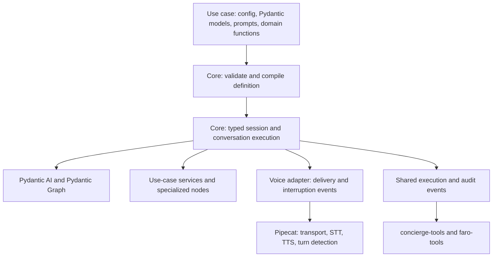

# Reusable voice core: package direction and migration roadmap

**Status:** Proposed implementation direction; no runtime changes made by this document.

**Date:** 25 September 2026.

**Repository reviewed:** `slng-ai/slng-voice-harness`, `main` at [`d31399e`](https://github.com/slng-ai/slng-voice-harness/tree/d31399ea659b6eebdb005f1473109704c019f555), after the `core/` and `use-cases/` workspace split.

## 1. What we are building

Make `slng-voice-core` the library that every project under `use-cases/` consumes. A new voice application should normally need only:

- One configuration file describing agents, steps, tools, and policies.
- Plain Pydantic models describing application state, operation arguments, and receipts.
- Prompts and fixed response templates.
- Domain functions for backend calls and genuinely specialized nodes.
- A small entry point that imports the package and supplies dependencies.

The package must own conversation execution, validated state updates, standard interpretation, approval tracking, interruption handling, and agent construction. A use case should not rebuild these by subclassing `CallContext`, wiring `Conversation`, constructing `Desk` and `AgentBuilder`, or implementing its own confirmation interpreter.

**The target is almost zero new orchestration code per use case.** Business integrations, grading, persistence, and other domain behavior still need code. Moving that code into YAML expressions would not make the system simpler.

The package already exists. The next work is to make its public authoring contract small and complete, then prove it across the existing projects. Do not start a second engine or repeat the repository reorganization.

## 2. Start from the current repository

The root is now a uv workspace with `core` and `use-cases/*` as members. `core/pyproject.toml` builds the distribution **`slng-voice-core`** from **`core/src/core/`**; its current Python import namespace is **`core`**. Keep these distinctions explicit in documentation and dependency declarations. [Workspace manifest](https://github.com/slng-ai/slng-voice-harness/blob/d31399ea659b6eebdb005f1473109704c019f555/pyproject.toml), [package manifest](https://github.com/slng-ai/slng-voice-harness/blob/d31399ea659b6eebdb005f1473109704c019f555/core/pyproject.toml).

| Current project | What it does today | Target use of the shared package |
|---|---|---|
| `use-cases/salon-graph` | Salon workflow; already depends on core, but authors assemble runtime classes. | Import the application loader and shared launcher. Supply declarative steps, state, prompts, and diary operations. |
| `use-cases/faro-language-learning` | Faro companion; already depends on core, with a large custom call type and phases inside one agent step. | Use the same loader and launcher. Keep learning, grading, and storage code; replace custom conversation plumbing. |
| `use-cases/salon-prompt` | Pipecat one-prompt comparison baseline; currently does not depend on core. | Import shared transport/launch and tracing support, while continuing to use its native Pipecat conversational service. |
| `use-cases/concierge-tools` | Coval runner and trace ledger; currently independent of core. | Import a small shared trace/result contract and launch metadata where needed. Keep evaluation cases and reporting here. |
| `use-cases/faro-tools` | Faro benchmark; depends on the Faro package and imports it. | Declare core directly for the public text/session execution interface it uses; retain Faro as the domain application dependency. |

Every project gets a real dependency and useful imports. An unused import added merely to satisfy this requirement does not count.

The baseline is a deliberate distinction: sharing its infrastructure must not quietly give it the harness's approval or routing policy. Preserve a versioned historical baseline and verify behavior after sharing the launcher. If its conversation controller is later replaced by core, label it as a different benchmark variant.

The old `examples/help` and `examples/access` directories are absent from this reviewed `main`. Do not write a migration plan around them. The existing `core/tests/clinic.py` remains a useful independent reuse fixture.

## 3. Keep the boundary clear



| Package owns | Use case owns |
|---|---|
| Definition loading, startup diagnostics, prompt-reference checks | Configuration and wording |
| Graph execution, prerequisite routing, pending destination | Domain stages and permitted transitions |
| Typed session, atomic state commits, invalidation rules | Pydantic application data models |
| Standard confirmation, choice, revision, and closing interpretation | Specialized interpretation such as learning assessment |
| One approval policy and guarded operation execution | Which actions need approval and their readback templates |
| Receipt validation, permitted state assignments, completion checks | Backend functions and receipt models |
| Speech/history reconciliation and interruption handling | Domain feedback and language resources |
| Shared launcher and telemetry contracts | Service construction, credentials, deployment configuration |

Keep the dependency direction one way: core imports no use case. Evaluation projects may import their subject application through its declared package dependency, as `faro-tools` already does. No application should import another application's private runtime implementation.

Extend the current engine and `FlowSpec`; do not add another orchestration framework. Keep SDK-specific details behind the package's public boundary. Pipecat imports stay in the adapter/launcher boundary, with import-boundary checks updated if that boundary is split into more than the current `processor.py` module.

The current distribution installs Pipecat and Langfuse as required dependencies. When establishing the release boundary, separate optional voice and tracing dependencies into package extras so text consumers and evaluation tools can install only what they use. This is a packaging change, not a reason to create several new libraries. Keep import-time setup free of environment loading, provider initialization, and telemetry side effects.

## 4. The application folder authors should see

Preserve existing Python package names during migration. In Faro, `faro/` is the application root because the benchmark already imports it. The same convention can apply to `salon/`.

```text
use-cases/faro-language-learning/
  pyproject.toml                dependency on slng-voice-core
  bot.py                        thin shared-launcher entry point
  faro/
    agent.yaml                  one application definition
    state.py                    plain Pydantic application state
    models.py                   argument/receipt models, if useful separately
    tools/                      typed domain/backend functions
    steps/                      specialized node code only
    prompts/
      voice.md                  shared voice and persona
      agents/                   reusable agent instructions
      steps/                    instructions for individual stages
    utils/                      optional domain helpers
    curriculum.py               Faro's domain content and rules
    store.py                    Faro's persistence integration
  tests/                        application behavior checks
```

This is a proposed layout, not an existing scaffold. Small applications should omit empty folders. Agents can initially be named entries in `agent.yaml`; separate agent YAML files are unnecessary until size warrants them. Ordinary collect/confirm/action steps should require no Python file in `steps/`.

Prompts, curriculum, and configuration used through an installed application must be included as package resources. Loading must work outside the repository and independently of the shell's working directory. Database locations must be writable runtime paths, separate from installed resources.

The launcher handles the repeated Pipecat pipeline setup now present in three `bot.py` files. A small dependency factory may still construct a diary, database client, or service. This is legitimate application code; it must not reconstruct the conversation engine.

## 5. One small configuration contract

Use `agent.yaml` as the proposed application manifest. Evolve the existing loader rather than maintaining a separate parser. Existing `flow.yaml` definitions need an explicit migration path; never require authors to keep both files synchronized.

The following are **proposed configuration concepts**, not a supported syntax or a promise about final field names:

| Concept | What the author declares | What core derives or checks |
|---|---|---|
| Identity and version | Application ID and manifest version | Compatible loader behavior and useful errors |
| State | Reference to a Pydantic model | Typed state and prompt context |
| Models and voice | Defaults, locale, optional overrides | Agent construction and shared runtime setup |
| Agents | Reusable instructions and tool selections | SDK agents; one persona can serve multiple steps |
| Steps | Kind, inputs, completion evidence, transitions | Executable graph, tool availability, prerequisite return |
| Operations | Function reference, argument bindings, approval policy | Validated execution boundary and audit events |
| Results | Explicit receipt-to-state assignments and completion response | One validated candidate state; response from matching evidence |
| Choices | Explicit source of options and their stable identifiers | A selection constrained to the offered options |

Do not redeclare Python field types in YAML. Derive argument and receipt schemas from the declared models and function signatures. Configuration describes how they connect.

Support a small set of explicit predicates and bindings: field presence, typed identity evidence, receipt status, permitted choice, and field assignment. No embedded Python, arbitrary expressions, or a new general-purpose programming language. Complex domain predicates belong in a named, typed domain function.

Definition validation should report unknown fields, invalid references, incompatible assignments, undeclared transitions, and missing approval paths before serving a call. Dynamic business checks still run at execution time. Configuration/module discovery should not instantiate provider clients or require model keys merely to validate a definition.

## 6. State must be data

Separate three objects that are currently mixed together in custom call classes:

| Object | Contents | Lifetime and ownership |
|---|---|---|
| Application state | Learner information, selected appointment, collected answers, validated business results | Concrete Pydantic model supplied by the application; updates mediated by core |
| Session | Current step, turn/generation, pending proposal, speech/history, interpretation cache, execution receipts | Core-owned runtime state; private to one call |
| Dependencies | Store, diary, API clients, clock, injected services | Explicitly constructed with documented shared/per-call lifetimes |

### Application-state rules

- Fields, defaults, nested models, enums, literals, discriminated unions, and Pydantic constraints are allowed.
- No use-case state methods, custom validators containing business behavior, private service clients, prompt building, regex interpretation, or lifecycle hooks.
- Reusable value types may encapsulate established validation in the library or an existing dependency. Do not recreate phone-number validation separately in each use case.
- Represent structurally different stages as different model variants where that makes invalid combinations unrepresentable.
- Core constructs and validates the whole candidate state before replacing the previous state. Field-by-field mutation and unvalidated copy/update shortcuts must not become public escape routes.
- Collection outputs can update only declared collected fields. Approval, verification, and successful-operation evidence cannot be set through model-generated fields.

The current `FlowState.facts: dict[str, Any]` is not the target aggregate state contract. Both standard steps and custom nodes must operate against the same concrete application model. Typed individual values inside an unrestricted dictionary are insufficient.

Schema validity and business evidence remain different. A phone field does not prove confirmation. A model instance named `VerifiedIdentity` does not prove identity verification. Core must control which validated execution result can establish trusted evidence; backend authorization remains authoritative. Phone readback alone is not production authentication.

For Faro, replace the current “no learner data before confirmed phone” custom validator with an appropriate state shape **and** runtime gates on loading and exposing learner data. Do not weaken it into a mere `phone`-is-present check.

Some invariants cannot be expressed with field declarations alone. Enforce those in a domain operation or node at the shared commit/execution boundary, rather than hiding executable behavior inside `state.py`. Keep this boundary testable; avoid building a fragile source-code scanner to police Pydantic's own methods.

## 7. Operations, receipts, and speech

Reuse the sequence already centralized in `Operation`: validate arguments, check preconditions and approval, attempt the business call, validate the receipt, commit what it establishes, and render the outcome. Make ordinary operations available through typed functions plus declarations, without requiring an `Operation` subclass per use case.

Both model-selected tools and application-selected actions must use that same boundary. A direct transition is an optimization, not a way to bypass validation, approval, budgets, or auditing.

An operation's policy includes:

- Whether it reads or mutates business data, and which authorization it needs.
- The exact input bindings and permitted state assignments.
- The receipt type and what constitutes successful completion.
- Readback and completion templates where appropriate.
- Explicit failure and unknown-outcome behavior.

Retain one flow-changing or business-mutating action per model reply, and enforce the relevant budget across direct execution as well. A write attempt is not a successful write: `acted_this_turn` and generic save counters are not completion evidence.

Transactional completion speech must be rendered from a validated receipt matching the operation, subject, and arguments. Free-text output remains appropriate for coaching or explanation, but its schema cannot guarantee the truth of “saved” or “booked.” Do not stream unrestricted completion claims and hope to repair them afterward.

Remove per-use-case regex guards only when their purpose is covered by an explicit policy and a regression check. Low firing frequency is not evidence that a guard is unnecessary. Syntax parsing may still use regex where appropriate; language-specific word lists must not authorize actions or prove completion.

Idempotency needs a stable operation identity and backend support. A wrapper cannot promise exactly-once effects across crashes. After an uncertain outcome, reconcile before retrying. Undo is a compensating business action with its own receipt, not an in-memory state reset.

## 8. Voice approval and native Pydantic AI approval

Keep one shared consent policy. It binds the caller's acceptance to the exact proposal, current identity, relevant state revision, freshness, and delivery evidence. Changes to the proposed arguments require a new readback. Approval is consumed by the execution attempt, with recovery handled separately.

Pydantic AI supplies native deferral and approval for ordinary function tools. It can suspend a call, identify it, accept a decision, and resume execution. The SDK does not determine whether a spoken “yes” authorizes the proposal. That decision still belongs to the voice runtime. [Native approval documentation](https://pydantic.dev/docs/ai/tools-toolsets/deferred-tools/).

| Execution situation | Direction |
|---|---|
| Known confirm → action workflow | Keep direct execution through the shared guarded boundary. Do not introduce an extra agent decision. |
| Agent dynamically proposes an ordinary function tool | Use native deferred approval if it reduces integration work, with the same voice consent policy supplying the decision. |
| A use case needs approval | Declare the policy and wording; do not implement another ledger or classifier. |

The source investigation against SDK 2.46.0 found these migration constraints:

1. Existing `ToolOutput` finishers and direct actions are not ordinary approval-enabled function tools. Output functions deliberately end the run without sending their result back to the model. [Output-function documentation](https://pydantic.dev/docs/ai/core-concepts/output/#output-functions).
2. Native resume executes the approved tool without a preceding model request, but an ordinary function-tool result normally continues the model loop afterward. Manual graph control is possible; its extra integration work must earn its place.
3. Current `history.paired()` removes calls without results. Pending native approvals intentionally lack results and must survive until resolution.
4. An inline handler waiting for the caller must cooperate with cancellation when the next utterance arrives.
5. Argument overrides supported by the SDK must not turn a caller's correction into approval of an unread proposal.
6. Native approval does not replace backend authorization, idempotency, receipt checks, or one-action policy.

Also tighten the existing delivery contract before promising more: `ProposalLedger.last()` rejects recorded interruptions but currently treats absent matching speech evidence as heard. Track delivered, interrupted, and unknown explicitly. For approvals requiring a delivered readback, unknown must not silently count as delivered. A text adapter or test harness must provide its own explicit delivery acknowledgement.

Do not make native approval integration a prerequisite for simplifying the authoring API. Retain one consent authority and add SDK deferral support when an actual function-tool use case needs it.

## 9. Classifier and solver direction

Standard interpretation should be a built-in package capability. The author selects a policy such as confirmation or choice; core provides the schema, prompt, scheduling, caching, budget, and stale-result checks.

For confirmation, use structured outcomes such as accept, reject, revise, conditional, and unclear. Interpret against the pending question and the actual caller utterance. Conditional acceptance does not authorize the original action. Choice interpretation must use the explicitly offered identifiers, not arbitrary options inferred from any receipt containing an `options` field.

Run only the readings relevant to the current step and pending interaction. Reuse a result only while its utterance, proposal, and relevant context remain unchanged. Domain readings such as Faro's grading stay domain code; they use the shared execution and tracing infrastructure.

Use narrow readings as the initial default. Keep the salon solver experimental until matched evaluations show a reason to adopt it. Do not expose “classifier versus solver” as a choice every new application must understand, and do not delete decision types still used by standard steps.

Step-based tool visibility already limits what the model receives. Do not add on-demand capability discovery or tool search to these small applications merely because the SDK supports them; revisit when tool inventory or measured prompt cost warrants it.

Pydantic validates the shape of an interpretation, not whether it understood the caller. Offline scripted checks establish execution behavior; multilingual model evaluation establishes interpretation quality. Historical zero-model approval measurements must not be presented as a guarantee of today's classifier-based path.

## 10. Migration order and completion gates

Each phase should leave the existing applications runnable. Adapt the existing modules; do not replace the engine wholesale.

| Phase | Work | Evidence required before continuing |
|---|---|---|
| 0. Establish the current baseline | Start implementation from the reorganized `main`; inventory custom call methods, repeated launch code, imports, and behavior checks. Preserve prompts and existing benchmark variants. | All workspace members have recorded commands and baseline results; no migration refers to removed `examples/` paths. |
| 1. Prove the package boundary | Build the existing core distribution; identify a small public facade; make optional voice/tracing setup independent of core import. Preserve current deep imports temporarily. | Install the built artifact outside the workspace, import it without keys or application folders, and run an offline core scenario. |
| 2. Establish typed state and session | Separate application state, core session, and dependencies. Use one atomic commit path and explicit ownership of trusted fields. | A fields-only Pydantic state works through the engine; invalid updates leave state unchanged; calls do not share mutable session data. |
| 3. Finish ordinary authoring | Extend `FlowSpec` into the manifest contract; provide standard steps, typed operation-function adaptation, prompt context, and default readings. | A simple clinic scenario needs configuration, models, prompts, and domain functions, without custom runtime subclasses or assembly classes. |
| 4. Migrate salon-graph | Replace `SalonCall` plumbing and `SALON`/`DESK`/`BUILDER` assembly with the public contract. Preserve booking, move/cancel, complaints, detours, and unknown-write recovery. | Existing business and consent cases pass through the new entry point; prompt changes are explicit and evaluated. |
| 5. Migrate Faro | Extract identity, sign-up, onboarding, assessment, plan, and lesson stages into declared steps. Reuse the same companion persona. Keep curriculum, grading, store, and checkpoint behavior domain-owned. | Existing persistence and acceptance cases pass; no replacement `FaroCall` or per-case approval engine is needed. |
| 6. Finish all consumers | Extract the repeated launcher; migrate salon-prompt's shared infrastructure and both tooling projects to useful public imports. | All five manifests declare core where directly used; all run from their own directories; the baseline still uses its native conversational service. |
| 7. Verify and simplify | Run package-isolation and cross-case checks, then matched voice/model evaluations. Remove replaced plumbing and temporary compatibility paths. | The release checklist below passes; documented public imports are sufficient for every consumer. |

For Faro, an exercise loop does not need one graph node per exercise. A reusable lesson node can remain domain code. Make lifecycle stages explicit where they change permissions or completion conditions; retain meaningful conversational flexibility inside each stage.

Keep the historical `flow.yaml` reader during migration only as long as needed. Prefer one translation into the new definition contract over two separately maintained execution paths.

## 11. How each project proves reuse

| Project | Keep domain-owned | Remove or centralize | Acceptance signal |
|---|---|---|---|
| salon-graph | Diary behavior, booking/complaint shapes, wording, recovery integration | Custom call plumbing, repeated interpreters, standard agent/tool assembly, pipeline setup | Existing operations behave correctly through the package API, including corrections and prerequisite returns. |
| faro-language-learning | Curriculum, grading, SQLite integration, learning progress and resume rules | `FaroCall` runtime responsibilities, repeated phase gates, generic consent and speech-claim machinery | Identity boundaries and L01–L16 scenarios remain covered; acknowledged progress survives restart. |
| salon-prompt | Native Pipecat service, baseline prompt and tool behavior | Repeated transport, speech-service setup, and compatible tracing support | Comparable transport/model settings and unchanged conversation-controller identity; shared setup does not activate harness guards. |
| concierge-tools | Coval integration, comparisons, historical trace interpretation | Current core event-shape definitions and application-specific guessing for new traces | New application operations appear through generic audit fields without extending a hard-coded task-name list. |
| faro-tools | Learner fixtures, scenario scripts, domain assertions | Imports of core internals and custom turn-driving setup | Uses the same public session runner as other text consumers; still checks Faro-specific outcomes. |

Do not move salon diary code or Faro curriculum into core to eliminate duplication. These are domain assets. The two salon variants must keep equivalent diary/prompt fixtures for comparison; version or compare those assets explicitly rather than turning core into a salon package.

## 12. Release checks that demonstrate the architecture

- **New-use-case check:** a small standard flow is authored without modifying core or subclassing its runtime classes. Count orchestration code separately from domain code.
- **State check:** no behavioral methods or application validators in migrated state definitions; every update validates the full concrete model; trusted fields cannot come from collection output.
- **Approval check:** cover interrupted and unknown delivery, stale proposal, changed identity, argument correction, conditional acceptance, unrelated “yes,” and attempted approval replay.
- **Operation check:** direct and model-selected execution have identical guards; malformed receipts cannot produce completion; uncertain outcomes trigger reconciliation; interruption after a successful write does not erase it.
- **History check:** retained input and completed results survive cancellation. If native deferral is introduced, pending calls survive projection and cannot be accidentally approved as a batch.
- **Package check:** build/install core and the packaged Faro resources in a clean environment outside the checkout. No `sys.path` workaround or sibling-source dependency. Check each consumer in isolation: one shared workspace environment can hide undeclared dependencies and colliding `salon`, `bot`, or `tests` imports.
- **Consumer check:** all five projects use documented public interfaces for their responsibilities. Core has no use-case imports; domain plugins cannot silently bypass the guarded operation path.
- **Behavior check:** run offline assert-script suites, Ruff, and ty using the reorganized per-member commands. Keep the repository's existing test style; do not introduce another framework.
- **Measured voice check:** evaluate semantic accuracy, interruption behavior, requests per turn, and end-to-end audio latency. Separate model/classifier time, engine text latency, backend time, and STT/TTS/playback time.

Do not run billable evaluations as part of a documentation change. During implementation, report the actual commands, versions, datasets, and results rather than transferring old benchmark numbers to the new API.

## 13. Scalability beyond configuration

Authoring reuse does not establish concurrent-call capacity. Compile immutable definitions once; keep sessions, approvals, histories, and caches isolated per call. Shared clients need bounded resources and explicit lifetimes. Preserve cancellation and timeout behavior at service boundaries.

Faro's single database worker and process-local active-learner guard are application limits. Moving them into a package would not make them distributed. Keep those limits documented; replace them with database-backed coordination or a different store only when deployment requirements demand it.

Likewise, keep transport neutrality as a tested engine boundary. Pipecat is the implemented adapter; LiveKit parity remains a separate proof, especially for delivery, cancellation, and history. Do not build the second adapter before the public contract works across salon and Faro.

## 14. The next implementation slice

Start with phases 0–3 as one bounded milestone: **an installable core, a small public entry point, and one ordinary flow with fields-only state and no custom orchestration assembly.** Use the clinic fixture to keep this focused, then immediately test the contract against a salon identity/readback/action path before expanding migration.

Defer a new Go/YAML code generator, a plugin registry, a general expression language, a universal persistence abstraction, and a solver redesign. If generation is added later, it should emit definitions that import this versioned library, never copies of the runtime.

The first slice proves the authoring contract on a small flow. Adoption is complete only when salon and Faro can both consume it without recreating its internals. The repository migration is complete when the baseline and tooling projects also use the appropriate shared public interfaces, with their distinct purposes preserved.

## References and relationship to earlier work

- [Reviewed repository layout and authoring instructions](https://github.com/slng-ai/slng-voice-harness/blob/d31399ea659b6eebdb005f1473109704c019f555/CLAUDE.md).
- [Current flow loader](https://github.com/slng-ai/slng-voice-harness/blob/d31399ea659b6eebdb005f1473109704c019f555/core/src/core/flowspec.py) and [standard steps](https://github.com/slng-ai/slng-voice-harness/blob/d31399ea659b6eebdb005f1473109704c019f555/core/src/core/steps.py): foundations to extend.
- [Current Faro state and call class](https://github.com/slng-ai/slng-voice-harness/blob/d31399ea659b6eebdb005f1473109704c019f555/use-cases/faro-language-learning/faro/state.py): the authoring burden this plan addresses.
- [Current proposal ledger](https://github.com/slng-ai/slng-voice-harness/blob/d31399ea659b6eebdb005f1473109704c019f555/core/src/core/proposals.py) and [history projection](https://github.com/slng-ai/slng-voice-harness/blob/d31399ea659b6eebdb005f1473109704c019f555/core/src/core/history.py): approval and cancellation behavior to preserve or tighten explicitly.
- [Earlier portable-flow plan](portable-typed-flows.md) and [research](../research/portable-typed-flows.md): retain their evidence and execution goals. This roadmap proposes a smaller authoring surface based on composition and declarations, replacing the earlier expectation that each business fills in runtime subclasses.
- The supplied `UNMUTE_V1.md`, `RESEARCH.md`, additional architecture notes, and native-approval investigation informed this roadmap. Their historical evidence is context, not verification of the proposed API.

This document was written in an older local worktree, but all current-layout paths and the migration inventory above were checked against the pinned reorganized GitHub revision. No repository restructuring, application migration, new API, or performance result is claimed as completed here.
