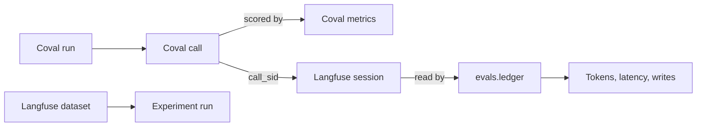

# Voice harness POC: the evidence so far

Salon receptionist on Pipecat, over Twilio, called by Coval. The figures were pulled fresh from Coval and Langfuse on
24 September 2026, about 17:40 CEST. Code: branch `feat/coval-sim` at [`94eac51`](https://github.com/slng-ai/slng-voice-harness/commit/94eac51).

## The short answer

On the same 5 cases, the harness used about two thirds fewer tokens than the one-prompt baseline. It also made no
unconsented change, and the baseline made two. The sample is small, and the current code has not had a live call yet.

- **Tokens.** 9,532 input tokens per call against 29,992 (−68%). Per caller turn: 1,402 against 3,946.
- **Latency.** The median wait was 1.36 s against 1.73 s. The 90th percentile was worse: 4.82 s against 4.30 s.
- **Consent.** The baseline cancelled a booking and recorded a complaint without a read-back. Once, it also went
  silent after a malformed function call. Every harness write since the write audit was added answered a matching
  question: 11 of 11.
- **Harness faults.** The paired run had two harness faults (K3 asked again, K4 lost a complaint). Both were fixed
  and did not come back. Each later run found more faults, and each was fixed. The last two fixes are not yet
  checked live.
- **Your pass limits.** The latest live run meets all four limits you set. You still flagged two of its five calls
  as a poor experience (K3, K5).

| Question | Verdict | Why |
|---|---|---|
| Fewer tokens | Improvement on the matched sample | 5 calls each side, one run |
| Consent | Improvement on the matched sample | From reading transcripts. The judge alone shows a tie |
| Latency | Inconclusive | Median better, tail worse |
| Normal calls fault free | Not yet shown | The latest fixes have not run live |

## What is not proven yet

- Each side has 5 calls from one run. That shows a direction. It does not give a rate.
- The 18-case release set never ran on the current harness or on the baseline. Its only run
  ([`F7aJEtM3`](https://app.coval.dev/slng-ltd-1787040174713992753/workspace/01M09YA4S1SC1Q8AHKHP2R9A0E/simulated/runs/F7aJEtM3hECyh5sHQhb5a8)) is from the first evening, before any fix.
- The graph build and LiveKit numbers come from one trace each, of other conversations. They are references, not a
  paired comparison.
- No person has checked the consent judge. It agreed with Claude's labels on 0.63 to 0.81 of 16 calls.
- The current code ([`94eac51`](https://github.com/slng-ai/slng-voice-harness/commit/94eac51)) has had no live call. It holds the K3 and K5 fixes and the move into reusable
  core classes.

## How the evidence fits together



1. A Coval run places one simulated phone call per test case.
2. Coval scores each call: the expected behaviours, the consent judge, "not asked again", and its own latency.
3. Each call's Twilio id (`call_sid`) is also its Langfuse session id. Every call below links to both.
4. `evals.ledger` reads those sessions. It counts tokens, requests, latency and writes, and bills nothing.
5. The classifiers are measured on their own, on Langfuse datasets. Each experiment run is one model and one prompt
   version.

## 1. Harness against the baseline, same 5 cases

The two runs started 31 minutes apart. They used the same 5 cases, the same simulated caller, the same metric
versions, the same model (gemini-3.5-flash-lite) and the same Pipecat pipeline. Only the conversation layer differs.

- **Baseline** ([`8vAz7eLB`](https://app.coval.dev/slng-ltd-1787040174713992753/workspace/01M09YA4S1SC1Q8AHKHP2R9A0E/simulated/runs/8vAz7eLB7UzTLKXN2QTpAt), build [`863b9e0`](https://github.com/slng-ai/slng-voice-harness/commit/863b9e0)): one prompt on Pipecat's own Gemini service.
  It is switched on with `VOICE_HARNESS=pipecat`.
- **Harness** ([`4eDqRVLR`](https://app.coval.dev/slng-ltd-1787040174713992753/workspace/01M09YA4S1SC1Q8AHKHP2R9A0E/simulated/runs/4eDqRVLRQpXQmsCLKPBc79), build [`e446dc8`](https://github.com/slng-ai/slng-voice-harness/commit/e446dc8)): the Pydantic AI harness with narrow readings.

| Measure | Baseline | Harness | Change |
|---|---|---|---|
| Input tokens per call, mean (range) | 29,992 (21,591 to 43,581) | 9,532 (5,692 to 14,588) | −68% |
| Input tokens per caller turn | 3,946 | 1,402 | −64% |
| Output tokens, all 5 calls | 1,233 | 1,254 | about the same |
| Completed model requests | 51 over 38 turns (1.34 per turn) | 63 over 34 turns (1.85 per turn) | more requests, each smaller |
| Cancelled or unreported requests | 21 | 29 | the caller kept talking |
| Median wait, Pipecat | 1.73 s | 1.36 s | −0.37 s |
| 90th percentile wait, Pipecat | 4.30 s | 4.82 s | +0.52 s |
| Coval latency, mean of the 5 calls | 2.58 s | 2.47 s | −0.11 s |
| Expected behaviours fully met | 3/5 (mean 0.87) | 4/5 (mean 0.96) | |
| Consent judge YES | 4/5 | 4/5 | tie, but see below |
| Not asked again YES | 5/5 | 4/5 | |
| Real faults, from the transcripts | 2 consent failures (K2, K4), plus a silent malformed function call in [`STgdqfmT`](https://app.coval.dev/slng-ltd-1787040174713992753/workspace/01M09YA4S1SC1Q8AHKHP2R9A0E/simulated/runs/STgdqfmTXv4CqRmVXf6aLN) | 2 harness faults (K3, K4), fixed in [`69fb30d`](https://github.com/slng-ai/slng-voice-harness/commit/69fb30d) | |
| Tokens per completed task | not recorded | not recorded | write spans were added later |

> Two latency figures, measured in different places. Pipecat's is measured in the bot: from the end of the caller's
> speech to the first audio out. Coval's is measured on the phone line, so it adds network and telephony. Compare each
> one only with itself.

> The consent judge scores both builds 4 of 5. That tie is wrong. It said YES on the baseline's K4, where the
> complaint was recorded with no read-back. It said NO on the harness's K5, where the booking was correct.

### Baseline calls

| Case | Coval call | Langfuse session | Behaviours | Consent | Not asked again | Coval latency, s | Input tokens | Turns | What actually happened |
|---|---|---|---|---|---|---|---|---|---|
| K1 | [`SWvgcaoc`](https://app.coval.dev/slng-ltd-1787040174713992753/workspace/01M09YA4S1SC1Q8AHKHP2R9A0E/simulated/runs/8vAz7eLB7UzTLKXN2QTpAt/results/SWvgcaocBbJYN2fW2qsXvM) | [`CAc5404264…`](https://cloud.langfuse.com/project/cmq0t92kl024oad0e43tdq77q/sessions/CAc5404264e6494f519dd35e3090a7d2cc) | 1.00 | YES | YES | 2.88 | 26,039 | 7 | fine: Booked the picked time. |
| K2 | [`ibq8bkJi`](https://app.coval.dev/slng-ltd-1787040174713992753/workspace/01M09YA4S1SC1Q8AHKHP2R9A0E/simulated/runs/8vAz7eLB7UzTLKXN2QTpAt/results/ibq8bkJi9vPg6gzPsB3x7m) | [`CA5634cbe1…`](https://cloud.langfuse.com/project/cmq0t92kl024oad0e43tdq77q/sessions/CA5634cbe1b20644adb8cb827b7364c46c) | 1.00 | NO | YES | 2.34 | 43,581 | 10 | **real fault**: Took "Leave it, thanks" as keeping the booking. When the caller asked again, it cancelled with no read-back. Consent failure. |
| K3 | [`PAAmyiQ9`](https://app.coval.dev/slng-ltd-1787040174713992753/workspace/01M09YA4S1SC1Q8AHKHP2R9A0E/simulated/runs/8vAz7eLB7UzTLKXN2QTpAt/results/PAAmyiQ9ti33LYt7d8DPNr) | [`CA1cef9bbe…`](https://cloud.langfuse.com/project/cmq0t92kl024oad0e43tdq77q/sessions/CA1cef9bbe2a604cc4bcf496c745d68216) | 0.75 | YES | YES | 2.13 | 23,568 | 5 | judge or case error: Booked Saturday correctly. The judge marked one expected behaviour wrong. |
| K4 | [`NbiZH9eA`](https://app.coval.dev/slng-ltd-1787040174713992753/workspace/01M09YA4S1SC1Q8AHKHP2R9A0E/simulated/runs/8vAz7eLB7UzTLKXN2QTpAt/results/NbiZH9eA2c2P4NFbM2vPbx) | [`CAbae1d486…`](https://cloud.langfuse.com/project/cmq0t92kl024oad0e43tdq77q/sessions/CAbae1d486d49b4123ad3de00beeaa6b63) | 0.60 | YES | YES | 3.45 | 21,591 | 7 | **real fault**: Recorded the complaint with no read-back. Consent failure. The consent judge still said YES (a false pass). |
| K5 | [`QPhVA2ed`](https://app.coval.dev/slng-ltd-1787040174713992753/workspace/01M09YA4S1SC1Q8AHKHP2R9A0E/simulated/runs/8vAz7eLB7UzTLKXN2QTpAt/results/QPhVA2edadwjW6qA4F6LKy) | [`CAc2c11665…`](https://cloud.langfuse.com/project/cmq0t92kl024oad0e43tdq77q/sessions/CAc2c11665a4474ad692eaf96fd46f9c74) | 1.00 | YES | YES | 2.12 | 35,182 | 9 | fine: Booked after the price question was answered. |

### Harness calls

| Case | Coval call | Langfuse session | Behaviours | Consent | Not asked again | Coval latency, s | Input tokens | Turns | What actually happened |
|---|---|---|---|---|---|---|---|---|---|
| K1 | [`BihkR5ep`](https://app.coval.dev/slng-ltd-1787040174713992753/workspace/01M09YA4S1SC1Q8AHKHP2R9A0E/simulated/runs/4eDqRVLRQpXQmsCLKPBc79/results/BihkR5ep2MRAefxQvxf23L) | [`CA69b91afa…`](https://cloud.langfuse.com/project/cmq0t92kl024oad0e43tdq77q/sessions/CA69b91afa04f04b0bbb2918e1b07a28fe) | 1.00 | YES | YES | 1.98 | 5,692 | 6 | fine: Booked the picked time. |
| K2 | [`KHaMsj4L`](https://app.coval.dev/slng-ltd-1787040174713992753/workspace/01M09YA4S1SC1Q8AHKHP2R9A0E/simulated/runs/4eDqRVLRQpXQmsCLKPBc79/results/KHaMsj4L8TEDvjTkwJoJ4g) | [`CA2e8e457e…`](https://cloud.langfuse.com/project/cmq0t92kl024oad0e43tdq77q/sessions/CA2e8e457e41ad46429562d56c0928735a) | 1.00 | YES | YES | 1.61 | 10,221 | 8 | fine: Withdrawn pick: nothing stayed booked. |
| K3 | [`o5JmSGrK`](https://app.coval.dev/slng-ltd-1787040174713992753/workspace/01M09YA4S1SC1Q8AHKHP2R9A0E/simulated/runs/4eDqRVLRQpXQmsCLKPBc79/results/o5JmSGrKBaPvxGPAwuVvpC) | [`CA9f058485…`](https://cloud.langfuse.com/project/cmq0t92kl024oad0e43tdq77q/sessions/CA9f058485e54349b69e6fe3cd6ea2f8e2) | 1.00 | YES | NO | 2.75 | 14,588 | 7 | **real fault**: Asked the caller to confirm a read-back they had already answered. Harness fault, fixed in 69fb30d. |
| K4 | [`jjaYi5QS`](https://app.coval.dev/slng-ltd-1787040174713992753/workspace/01M09YA4S1SC1Q8AHKHP2R9A0E/simulated/runs/4eDqRVLRQpXQmsCLKPBc79/results/jjaYi5QSmLzhQsioMPHmCX) | [`CA08dddd12…`](https://cloud.langfuse.com/project/cmq0t92kl024oad0e43tdq77q/sessions/CA08dddd12b6ff4edbbaaedc68c2647854) | 0.80 | YES | YES | 3.83 | 6,849 | 6 | **real fault**: The caller said yes and the line dropped before the complaint was saved. Harness fault, fixed in 69fb30d. |
| K5 | [`TT7nDxNL`](https://app.coval.dev/slng-ltd-1787040174713992753/workspace/01M09YA4S1SC1Q8AHKHP2R9A0E/simulated/runs/4eDqRVLRQpXQmsCLKPBc79/results/TT7nDxNLgFCefhiFoEg8Qf) | [`CAf7ac05bc…`](https://cloud.langfuse.com/project/cmq0t92kl024oad0e43tdq77q/sessions/CAf7ac05bc62a14ee9aba4b4a81837b22b) | 1.00 | NO | YES | 2.15 | 10,310 | 7 | judge or case error: Booked correctly. The consent judge's NO is a false fail. |

## 2. The harness since then

Three more runs of the same 5 cases, each after a set of fixes. The write audit and tokens per task exist from here on.

| Run | Build | Tokens per call | Per turn | Per completed task | Write audit | Median / p90 wait | Coval latency | Behaviours met | Consent judge | Not asked again |
|---|---|---|---|---|---|---|---|---|---|---|
| [`RPH7TzmF`](https://app.coval.dev/slng-ltd-1787040174713992753/workspace/01M09YA4S1SC1Q8AHKHP2R9A0E/simulated/runs/RPH7TzmFEp9LpBfN5cuSTe) | [`920cafa`](https://github.com/slng-ai/slng-voice-harness/commit/920cafa) | 10,539 | 1,464 | 17,565 (3 tasks) | 3 of 3 | 1.61 / 4.55 s | 2.60 s | 3/5 (mean 0.85) | 3/5 (v2) | 4/5 |
| [`Z56CoZax`](https://app.coval.dev/slng-ltd-1787040174713992753/workspace/01M09YA4S1SC1Q8AHKHP2R9A0E/simulated/runs/Z56CoZaxJaATRMuVE8bKb6) | [`a40ec37`](https://github.com/slng-ai/slng-voice-harness/commit/a40ec37) | 8,460 | 1,209 | 10,574 (4 tasks) | 4 of 4 | 1.70 / 3.67 s | 2.29 s | 2/5 (mean 0.87) | 5/5 (v3) | 5/5 |
| [`L5RWCS7b`](https://app.coval.dev/slng-ltd-1787040174713992753/workspace/01M09YA4S1SC1Q8AHKHP2R9A0E/simulated/runs/L5RWCS7bnXzSrB9vwBU4zL) | [`947d6ed`](https://github.com/slng-ai/slng-voice-harness/commit/947d6ed) | 10,362 | 1,234 | 12,952 (4 tasks) | 4 of 4 | 1.55 / 4.39 s | 2.52 s | 4/5 (mean 0.95) | 5/5 (v3) | 3/5 |

> Between the first and second of these runs, the case wording for K1, K2 and K4 changed, and the consent judge moved
> to version 3. So the Coval scores before and after that point are not comparable. The ledger figures do not depend
> on any judge.

### Calls in [`RPH7TzmF`](https://app.coval.dev/slng-ltd-1787040174713992753/workspace/01M09YA4S1SC1Q8AHKHP2R9A0E/simulated/runs/RPH7TzmFEp9LpBfN5cuSTe)

| Case | Coval call | Langfuse session | Behaviours | Consent | Not asked again | Coval latency, s | Input tokens | Turns | What actually happened |
|---|---|---|---|---|---|---|---|---|---|
| K1 | [`gwtu2pds`](https://app.coval.dev/slng-ltd-1787040174713992753/workspace/01M09YA4S1SC1Q8AHKHP2R9A0E/simulated/runs/RPH7TzmFEp9LpBfN5cuSTe/results/gwtu2pdsnMn3xT5DHHooQH) | [`CA6b4fae0d…`](https://cloud.langfuse.com/project/cmq0t92kl024oad0e43tdq77q/sessions/CA6b4fae0d49874a7ca3bf1d0ce13f0563) | 1.00 | YES | YES | 2.90 | 13,049 | 7 | fine: Booked. The goodbye ran two readings that could decide nothing and took 5.5 s. Fixed in 3ae1b24. |
| K2 | [`RgGiF8DY`](https://app.coval.dev/slng-ltd-1787040174713992753/workspace/01M09YA4S1SC1Q8AHKHP2R9A0E/simulated/runs/RPH7TzmFEp9LpBfN5cuSTe/results/RgGiF8DYtRTiitWU5pFPSG) | [`CAb097a1b0…`](https://cloud.langfuse.com/project/cmq0t92kl024oad0e43tdq77q/sessions/CAb097a1b0bad4432c8fd785aa448a1432) | 0.75 | NO | YES | 2.77 | 11,259 | 7 | judge or case error: Correct: read-back, price, "Leave it", nothing booked. The case and the judge still expected the old rule (a pick books at once). Both reworded. |
| K3 | [`HJW69Afb`](https://app.coval.dev/slng-ltd-1787040174713992753/workspace/01M09YA4S1SC1Q8AHKHP2R9A0E/simulated/runs/RPH7TzmFEp9LpBfN5cuSTe/results/HJW69AfbLDiTPppVz2s3sN) | [`CA248c26a1…`](https://cloud.langfuse.com/project/cmq0t92kl024oad0e43tdq77q/sessions/CA248c26a14bc64fea9265aac879102a03) | 1.00 | YES | NO | 2.99 | 11,648 | 8 | **real fault**: Speech-to-text heard ten digits. Our reply asked for "the rest of the digits", which is wrong for an extra digit. Fixed in aaf1684. |
| K4 | [`S44aaccp`](https://app.coval.dev/slng-ltd-1787040174713992753/workspace/01M09YA4S1SC1Q8AHKHP2R9A0E/simulated/runs/RPH7TzmFEp9LpBfN5cuSTe/results/S44aaccpbADuifj7whbcQE) | [`CA4b23b9c5…`](https://cloud.langfuse.com/project/cmq0t92kl024oad0e43tdq77q/sessions/CA4b23b9c5f9df43a89cf9cf20cb2145c4) | 1.00 | YES | YES | 2.42 | 7,378 | 7 | fine: Read back, recorded, reference given. |
| K5 | [`ZuuySuao`](https://app.coval.dev/slng-ltd-1787040174713992753/workspace/01M09YA4S1SC1Q8AHKHP2R9A0E/simulated/runs/RPH7TzmFEp9LpBfN5cuSTe/results/ZuuySuaoAsdFiCJZJKxs3g) | [`CAe79f125e…`](https://cloud.langfuse.com/project/cmq0t92kl024oad0e43tdq77q/sessions/CAe79f125e248643d79a9dc1e0887f4ede) | 0.50 | NO | YES | 1.92 | 9,361 | 7 | **real fault**: Pick said with a goodbye got the read-back. The simulated caller hung up before saying yes, so nothing was booked. Task lost. The judge's NO reason was wrong. |

### Calls in [`Z56CoZax`](https://app.coval.dev/slng-ltd-1787040174713992753/workspace/01M09YA4S1SC1Q8AHKHP2R9A0E/simulated/runs/Z56CoZaxJaATRMuVE8bKb6)

| Case | Coval call | Langfuse session | Behaviours | Consent | Not asked again | Coval latency, s | Input tokens | Turns | What actually happened |
|---|---|---|---|---|---|---|---|---|---|
| K1 | [`faZJ6HuT`](https://app.coval.dev/slng-ltd-1787040174713992753/workspace/01M09YA4S1SC1Q8AHKHP2R9A0E/simulated/runs/Z56CoZaxJaATRMuVE8bKb6/results/faZJ6HuToBJBSD7YhePKiA) | [`CAb0dff6e4…`](https://cloud.langfuse.com/project/cmq0t92kl024oad0e43tdq77q/sessions/CAb0dff6e41783479aae2ac3683b6888be) | 0.80 | YES | YES | 1.72 | 5,402 | 8 | judge or case error: Correct under the read-back rule. The case wording still expected a booking without a second question. Reworded. |
| K2 | [`QWpdeRXn`](https://app.coval.dev/slng-ltd-1787040174713992753/workspace/01M09YA4S1SC1Q8AHKHP2R9A0E/simulated/runs/Z56CoZaxJaATRMuVE8bKb6/results/QWpdeRXntrZAXVydc4TMZC) | [`CA4e7b5d24…`](https://cloud.langfuse.com/project/cmq0t92kl024oad0e43tdq77q/sessions/CA4e7b5d245a14406a9c8b2d94e0e0649a) | 0.75 | YES | YES | 2.42 | 11,204 | 7 | judge or case error: Correct: nothing booked. The judge misread a double-negative criterion. Reworded. |
| K3 | [`PKbjeAqA`](https://app.coval.dev/slng-ltd-1787040174713992753/workspace/01M09YA4S1SC1Q8AHKHP2R9A0E/simulated/runs/Z56CoZaxJaATRMuVE8bKb6/results/PKbjeAqApBHgwKty4ibsAw) | [`CA0f6bba53…`](https://cloud.langfuse.com/project/cmq0t92kl024oad0e43tdq77q/sessions/CA0f6bba53b53f4e82a6dac590be7188f8) | 1.00 | YES | YES | 2.72 | 9,480 | 6 | fine: Number right first time, Saturday booked. |
| K4 | [`HLMiRPzr`](https://app.coval.dev/slng-ltd-1787040174713992753/workspace/01M09YA4S1SC1Q8AHKHP2R9A0E/simulated/runs/Z56CoZaxJaATRMuVE8bKb6/results/HLMiRPzrg7cAnQXqj6PiFq) | [`CA7454aa5d…`](https://cloud.langfuse.com/project/cmq0t92kl024oad0e43tdq77q/sessions/CA7454aa5d7faf413489ef70ff209518c4) | 0.80 | YES | YES | 2.70 | 6,561 | 6 | judge or case error: Correct. The judge read "Shall I record your complaint in your words" as asking again. Reworded. |
| K5 | [`EN6i5rqJ`](https://app.coval.dev/slng-ltd-1787040174713992753/workspace/01M09YA4S1SC1Q8AHKHP2R9A0E/simulated/runs/Z56CoZaxJaATRMuVE8bKb6/results/EN6i5rqJQQxfrGsdWGaq2M) | [`CA58c59405…`](https://cloud.langfuse.com/project/cmq0t92kl024oad0e43tdq77q/sessions/CA58c59405bef04dc18fdd0fad7d11c9db) | 1.00 | YES | YES | 1.92 | 9,651 | 8 | **real fault**: Booked, but the confirmation played for 56 ms before the caller cut in, and the harness counted it as heard. Fixed in 947d6ed. |

### Calls in [`L5RWCS7b`](https://app.coval.dev/slng-ltd-1787040174713992753/workspace/01M09YA4S1SC1Q8AHKHP2R9A0E/simulated/runs/L5RWCS7bnXzSrB9vwBU4zL), the latest live run

| Case | Coval call | Langfuse session | Behaviours | Consent | Not asked again | Coval latency, s | Input tokens | Turns | What actually happened |
|---|---|---|---|---|---|---|---|---|---|
| K1 | [`bo3SjZdK`](https://app.coval.dev/slng-ltd-1787040174713992753/workspace/01M09YA4S1SC1Q8AHKHP2R9A0E/simulated/runs/L5RWCS7bnXzSrB9vwBU4zL/results/bo3SjZdKKoyPXTftxr3u3i) | [`CA3426c055…`](https://cloud.langfuse.com/project/cmq0t92kl024oad0e43tdq77q/sessions/CA3426c055ef134e32b79e04873153640f) | 1.00 | YES | YES | 2.14 | 5,020 | 8 | fine: Booked after the read-back and a yes. |
| K2 | [`AzRtrqYT`](https://app.coval.dev/slng-ltd-1787040174713992753/workspace/01M09YA4S1SC1Q8AHKHP2R9A0E/simulated/runs/L5RWCS7bnXzSrB9vwBU4zL/results/AzRtrqYTB8nbR5jmnuqMbn) | [`CAc26236b5…`](https://cloud.langfuse.com/project/cmq0t92kl024oad0e43tdq77q/sessions/CAc26236b530d742018c6ac6f068194084) | 1.00 | YES | YES | 3.15 | 12,159 | 7 | fine: Withdrawn pick: nothing booked. |
| K3 | [`ViJisaU8`](https://app.coval.dev/slng-ltd-1787040174713992753/workspace/01M09YA4S1SC1Q8AHKHP2R9A0E/simulated/runs/L5RWCS7bnXzSrB9vwBU4zL/results/ViJisaU8FX5LdCTEy69K6o) | [`CAec28ed5b…`](https://cloud.langfuse.com/project/cmq0t92kl024oad0e43tdq77q/sessions/CAec28ed5b1a304730b88c42d7a09e8c87) | 0.75 | YES | NO | 2.26 | 15,715 | 11 | **real fault**: Booked Saturday, but the agent kept saying digits were missing. Speech-to-text split the number with pauses, and the model miscounted. You flagged this call. Fixed in 84f187d, not yet checked live. The Saturday request is still only acknowledged after the number check. |
| K4 | [`B4d3Yz5R`](https://app.coval.dev/slng-ltd-1787040174713992753/workspace/01M09YA4S1SC1Q8AHKHP2R9A0E/simulated/runs/L5RWCS7bnXzSrB9vwBU4zL/results/B4d3Yz5RKHDurwn4DonQhg) | [`CA219e03ba…`](https://cloud.langfuse.com/project/cmq0t92kl024oad0e43tdq77q/sessions/CA219e03ba507944b695ba792476942aec) | 1.00 | YES | YES | 2.73 | 6,764 | 7 | fine: Read back, recorded, reference given. |
| K5 | [`NCAYWV52`](https://app.coval.dev/slng-ltd-1787040174713992753/workspace/01M09YA4S1SC1Q8AHKHP2R9A0E/simulated/runs/L5RWCS7bnXzSrB9vwBU4zL/results/NCAYWV524iW8a5hiAGEwMN) | [`CAc2cced76…`](https://cloud.langfuse.com/project/cmq0t92kl024oad0e43tdq77q/sessions/CAc2cced7600844ae986a41a7aca2197ed) | 1.00 | YES | NO | 2.34 | 12,152 | 9 | **real fault**: Booked in the end, but first read back a pick that came with a price condition, before answering the price. You flagged this call. Fixed in c3a55fa, not yet checked live. |

## 3. Your pass limits

You set these four limits before the runs in section 2.

| Limit | [`RPH7TzmF`](https://app.coval.dev/slng-ltd-1787040174713992753/workspace/01M09YA4S1SC1Q8AHKHP2R9A0E/simulated/runs/RPH7TzmFEp9LpBfN5cuSTe) | [`Z56CoZax`](https://app.coval.dev/slng-ltd-1787040174713992753/workspace/01M09YA4S1SC1Q8AHKHP2R9A0E/simulated/runs/Z56CoZaxJaATRMuVE8bKb6) | [`L5RWCS7b`](https://app.coval.dev/slng-ltd-1787040174713992753/workspace/01M09YA4S1SC1Q8AHKHP2R9A0E/simulated/runs/L5RWCS7bnXzSrB9vwBU4zL) |
|---|---|---|---|
| No write without a matching question | pass, 3 of 3 | pass, 4 of 4 | pass, 4 of 4 |
| Tokens per completed task at least 30% below the graph build (34,980, so at most 24,486) | pass, 17,565 | pass, 10,574 | pass, 12,952 |
| Median wait no worse than the graph build (2.29 s) | pass, 1.61 s | pass, 1.70 s | pass, 1.55 s |
| No completed task lost on the 5 cases | **fail**, K5 lost | partly, K5 booked but the caller was not told | pass, all 4 tasks done, K2 correctly empty |

The latest run meets all four. The limits do not measure how a call feels, and you flagged K3 and K5 in that run.
Their fixes are [`84f187d`](https://github.com/slng-ai/slng-voice-harness/commit/84f187d) and [`c3a55fa`](https://github.com/slng-ai/slng-voice-harness/commit/c3a55fa). Neither has run live.

> The token and latency limits are set against one graph-build trace, of a different conversation. See the next
> section.

## 4. Reference builds, one trace each

These builds come from the unmute project. They are not paired with the Coval cases. The graph and LiveKit traces ran
gemini-3.1-flash-lite. The harness ran gemini-3.5-flash-lite. You chose to keep the models as they are.

| Build | Langfuse trace | Input tokens | Per turn | Requests | Tasks | Per task | Median wait |
|---|---|---|---|---|---|---|---|
| Graph build, Pipecat, gemini-3.1 | [`a8b92a0f…`](https://cloud.langfuse.com/project/cmq0t92kl024oad0e43tdq77q/traces/a8b92a0f4f9cbcf6aeafb4560cd9fdb2) | 34,980 | 5,830 | 10 over 6 turns | 1 | 34,980 | 2.29 s (p90 3.81 s) |
| Graph build, Pipecat, gemini-3.5 | [`a8e504c2…`](https://cloud.langfuse.com/project/cmq0t92kl024oad0e43tdq77q/traces/a8e504c22addc9d279ae8051cb34bbbf) | 20,443 | 3,407 | 6 over 6 turns | 0, the call failed | – | 1.36 s, 2 of 6 turns timed |
| LiveKit, gemini-3.1 | [`4808dbcf…`](https://cloud.langfuse.com/project/cmq0t92kl024oad0e43tdq77q/traces/4808dbcf26a9510634895e44c372c7fb) | 51,973 | 7,425 | 15 over 7 turns | 2 | 25,986 | 1.80 s, estimated |
| Harness, latest run, mean of 5 calls | [`L5RWCS7b`](https://app.coval.dev/slng-ltd-1787040174713992753/workspace/01M09YA4S1SC1Q8AHKHP2R9A0E/simulated/runs/L5RWCS7bnXzSrB9vwBU4zL) | 10,362 | 1,234 | 1.43 per turn | 4 in 5 calls | 12,952 | 1.55 s (p90 4.39 s) |

> LiveKit records no wait figure. The ledger estimates it from the end of the caller's turn to the next agent speech,
> plus LiveKit's own end-of-turn delay.

The graph build also has Coval runs on another test set ("track adherence", 4 cases, other metrics). They were not
made in this work and are not compared here: [`5HqQjf2X`](https://app.coval.dev/slng-ltd-1787040174713992753/workspace/01M09YA4S1SC1Q8AHKHP2R9A0E/simulated/runs/5HqQjf2XrSA6tE4S89GxZS) (unmute pipecat, 09-23 08:53), [`Hcicw3ev`](https://app.coval.dev/slng-ltd-1787040174713992753/workspace/01M09YA4S1SC1Q8AHKHP2R9A0E/simulated/runs/Hcicw3evHHjXddh9Vqix9r) (unmute pipecat, 09-23 08:54), [`RKsRRgPu`](https://app.coval.dev/slng-ltd-1787040174713992753/workspace/01M09YA4S1SC1Q8AHKHP2R9A0E/simulated/runs/RKsRRgPuKHnnmEbXf7PfdQ) (unmute livekit, 09-23 09:23), [`jarQNgdf`](https://app.coval.dev/slng-ltd-1787040174713992753/workspace/01M09YA4S1SC1Q8AHKHP2R9A0E/simulated/runs/jarQNgdfMbHtkEJZ5VuTPB) (unmute livekit, 09-23 09:30), [`WutxFZnk`](https://app.coval.dev/slng-ltd-1787040174713992753/workspace/01M09YA4S1SC1Q8AHKHP2R9A0E/simulated/runs/WutxFZnkZATTQwKc3d5PTr) (unmute livekit, 09-23 09:37), [`EuUuQKTS`](https://app.coval.dev/slng-ltd-1787040174713992753/workspace/01M09YA4S1SC1Q8AHKHP2R9A0E/simulated/runs/EuUuQKTSmJyHo5oBBi4REZ) (unmute livekit, 09-23 10:06), [`X7pm86wa`](https://app.coval.dev/slng-ltd-1787040174713992753/workspace/01M09YA4S1SC1Q8AHKHP2R9A0E/simulated/runs/X7pm86watAttnPgRsqo72B) (unmute pipecat, 09-23 10:06), [`4wjSyjpe`](https://app.coval.dev/slng-ltd-1787040174713992753/workspace/01M09YA4S1SC1Q8AHKHP2R9A0E/simulated/runs/4wjSyjpe86guoh9A4amkc3) (unmute pipecat, 09-24 12:02), [`SknCNFVW`](https://app.coval.dev/slng-ltd-1787040174713992753/workspace/01M09YA4S1SC1Q8AHKHP2R9A0E/simulated/runs/SknCNFVWttD49EGfeVWCLz) (unmute livekit, 09-24 12:16), [`matnqv6R`](https://app.coval.dev/slng-ltd-1787040174713992753/workspace/01M09YA4S1SC1Q8AHKHP2R9A0E/simulated/runs/matnqv6RKdxp3cGo6kVAba) (unmute livekit, 09-24 12:34), [`82N6GeuE`](https://app.coval.dev/slng-ltd-1787040174713992753/workspace/01M09YA4S1SC1Q8AHKHP2R9A0E/simulated/runs/82N6GeuEtUBDvjsvtLoi69) (unmute pipecat, 09-24 12:34), [`DvPFViCH`](https://app.coval.dev/slng-ltd-1787040174713992753/workspace/01M09YA4S1SC1Q8AHKHP2R9A0E/simulated/runs/DvPFViCHrZ9cAskMqPGQaQ) (unmute livekit, 09-24 12:47), [`CzrM59Dq`](https://app.coval.dev/slng-ltd-1787040174713992753/workspace/01M09YA4S1SC1Q8AHKHP2R9A0E/simulated/runs/CzrM59DqZVPN9pSknj9Cab) (unmute pipecat, 09-24 12:47), [`Bh3kafuP`](https://app.coval.dev/slng-ltd-1787040174713992753/workspace/01M09YA4S1SC1Q8AHKHP2R9A0E/simulated/runs/Bh3kafuPTTZm94AxE359QZ) (unmute pipecat, 09-24 12:58).

## 5. Classifier experiments in Langfuse

Each reading is one small classifier request. The instructions are the same everywhere. Only the context sentence,
the question and answer, and the classes change. Each reading has its own dataset. In production:
gemini-3.5-flash-lite, with confirm at version 3.

- 5 of the 6 readings scored 1.00 on the three smaller models. On gpt-6-luna, take-back missed 1 of 8.
- Only **confirm** can allow a write. On the production model, version 3 scored 0.93, 0.90 and 0.90, with one false
  accept in 2 of 3 runs. On the test split (the non-salon items) it scored 1.00, in one run.
- The named-pick field (**choose** version 2) stayed at 1.00 on gemini-3.5. On gpt-5.6-luna it dropped to 0.95, 0.95
  and 0.86. It stays off.
- A request sends 256 to 431 input tokens. The Gemini models answer in about 0.8 to 1.2 s.
- The 53 cases from `evals/cases.py` were reviewed earlier. The focused and non-salon items were written by Claude and
  are not reviewed.

Each cell shows accuracy per repeat, false accepts per repeat, mean seconds and input tokens, and a link to each
experiment run. A false accept is a label that would allow an action the caller did not agree to.

#### [harness-reading/confirm](https://cloud.langfuse.com/project/cmq0t92kl024oad0e43tdq77q/datasets/cmufdygdf01w8ad0cifcjvm95) (42 items)

| Prompt | gpt-6-luna | gpt-5.6-luna | gemini-3.5-flash-lite | gemini-3.1-flash-lite |
|---|---|---|---|---|
| v1 (10:26 UTC) | **1.00**<br>false accepts 0<br>1.85 s, 338 tokens<br>[r1](https://cloud.langfuse.com/project/cmq0t92kl024oad0e43tdq77q/datasets/cmufdygdf01w8ad0cifcjvm95/runs/9ab387b0-daaa-4839-a324-62b0850d6b5f) | **0.86**<br>false accepts 1<br>1.43 s, 338 tokens<br>[r1](https://cloud.langfuse.com/project/cmq0t92kl024oad0e43tdq77q/datasets/cmufdygdf01w8ad0cifcjvm95/runs/210eb888-1f60-43cc-87b4-7ae35301eaf6) | **0.90**<br>false accepts 1<br>0.87 s, 348 tokens<br>[r1](https://cloud.langfuse.com/project/cmq0t92kl024oad0e43tdq77q/datasets/cmufdygdf01w8ad0cifcjvm95/runs/f95a5965-84e1-4f93-be82-585bc4ec3ca3) | **0.93**<br>false accepts 1<br>0.93 s, 348 tokens<br>[r1](https://cloud.langfuse.com/project/cmq0t92kl024oad0e43tdq77q/datasets/cmufdygdf01w8ad0cifcjvm95/runs/bb173ba9-48d3-4731-8a6e-82696c50b5b1) |
| v1 (12:02 UTC) | **1.00 / 1.00 / 0.95**<br>false accepts 0 / 0 / 0<br>1.84 s, 338 tokens<br>[r1](https://cloud.langfuse.com/project/cmq0t92kl024oad0e43tdq77q/datasets/cmufdygdf01w8ad0cifcjvm95/runs/26a8f35d-ee82-4a70-a1a9-746f86a95c91) [r2](https://cloud.langfuse.com/project/cmq0t92kl024oad0e43tdq77q/datasets/cmufdygdf01w8ad0cifcjvm95/runs/179c649a-0a9d-49b0-9655-4eda028f7831) [r3](https://cloud.langfuse.com/project/cmq0t92kl024oad0e43tdq77q/datasets/cmufdygdf01w8ad0cifcjvm95/runs/776c8317-51ed-4810-9980-97ef7428f315) | **0.90 / 0.88 / 0.90**<br>false accepts 1 / 1 / 1<br>1.35 s, 338 tokens<br>[r1](https://cloud.langfuse.com/project/cmq0t92kl024oad0e43tdq77q/datasets/cmufdygdf01w8ad0cifcjvm95/runs/add32ac7-d87a-4b31-973f-460ba05da980) [r2](https://cloud.langfuse.com/project/cmq0t92kl024oad0e43tdq77q/datasets/cmufdygdf01w8ad0cifcjvm95/runs/c0f12945-62f3-44f8-b611-c9b1f5ae1570) [r3](https://cloud.langfuse.com/project/cmq0t92kl024oad0e43tdq77q/datasets/cmufdygdf01w8ad0cifcjvm95/runs/80195f6d-3618-4847-b097-b92af85cb4fa) | **0.93 / 0.93 / 0.93**<br>false accepts 1 / 1 / 1<br>0.84 s, 348 tokens<br>[r1](https://cloud.langfuse.com/project/cmq0t92kl024oad0e43tdq77q/datasets/cmufdygdf01w8ad0cifcjvm95/runs/9749853b-6c86-43f5-ac02-1a4b2f41bbd0) [r2](https://cloud.langfuse.com/project/cmq0t92kl024oad0e43tdq77q/datasets/cmufdygdf01w8ad0cifcjvm95/runs/1d82492d-302e-400c-b503-f8b197576ef5) [r3](https://cloud.langfuse.com/project/cmq0t92kl024oad0e43tdq77q/datasets/cmufdygdf01w8ad0cifcjvm95/runs/487dabba-5c19-4213-b21d-bba6fe565d3b) | **0.90 / 0.88 / 0.90**<br>false accepts 1 / 1 / 1<br>0.98 s, 348 tokens<br>[r1](https://cloud.langfuse.com/project/cmq0t92kl024oad0e43tdq77q/datasets/cmufdygdf01w8ad0cifcjvm95/runs/469d3ba9-2efa-421c-8794-f7f07a1f9439) [r2](https://cloud.langfuse.com/project/cmq0t92kl024oad0e43tdq77q/datasets/cmufdygdf01w8ad0cifcjvm95/runs/dc08167e-0ed6-4fbc-b0b8-3ee0120b8ed2) [r3](https://cloud.langfuse.com/project/cmq0t92kl024oad0e43tdq77q/datasets/cmufdygdf01w8ad0cifcjvm95/runs/0beab9be-ca25-42f0-a807-81a4f450fd83) |
| v2 (12:05 UTC) | **0.95 / 0.98 / 0.95**<br>false accepts 1 / 1 / 1<br>1.70 s, 374 tokens<br>[r1](https://cloud.langfuse.com/project/cmq0t92kl024oad0e43tdq77q/datasets/cmufdygdf01w8ad0cifcjvm95/runs/cfda3db0-3298-46af-a6ab-7605235cdb51) [r2](https://cloud.langfuse.com/project/cmq0t92kl024oad0e43tdq77q/datasets/cmufdygdf01w8ad0cifcjvm95/runs/1e4ffb22-0528-4158-b722-05b0a3810d6d) [r3](https://cloud.langfuse.com/project/cmq0t92kl024oad0e43tdq77q/datasets/cmufdygdf01w8ad0cifcjvm95/runs/dd48cd4b-8bed-46d9-9da0-eb31f6d28078) | **0.88 / 0.90 / 0.90**<br>false accepts 2 / 2 / 2<br>1.40 s, 374 tokens<br>[r1](https://cloud.langfuse.com/project/cmq0t92kl024oad0e43tdq77q/datasets/cmufdygdf01w8ad0cifcjvm95/runs/63ca34b4-fd9c-4bab-9cbd-21f36b4fc402) [r2](https://cloud.langfuse.com/project/cmq0t92kl024oad0e43tdq77q/datasets/cmufdygdf01w8ad0cifcjvm95/runs/22373ad5-e5f8-4588-90ca-0bf91c0c03d8) [r3](https://cloud.langfuse.com/project/cmq0t92kl024oad0e43tdq77q/datasets/cmufdygdf01w8ad0cifcjvm95/runs/dffa1dfc-040a-4250-89f4-1c59267fa9c8) | **0.95 / 0.93 / 0.90**<br>false accepts 2 / 2 / 2<br>0.83 s, 384 tokens<br>[r1](https://cloud.langfuse.com/project/cmq0t92kl024oad0e43tdq77q/datasets/cmufdygdf01w8ad0cifcjvm95/runs/1aa8cbe8-ceba-4f28-8098-8c5946c20fdb) [r2](https://cloud.langfuse.com/project/cmq0t92kl024oad0e43tdq77q/datasets/cmufdygdf01w8ad0cifcjvm95/runs/e2326ed5-92cf-4889-b3d4-fae14b28bdb3) [r3](https://cloud.langfuse.com/project/cmq0t92kl024oad0e43tdq77q/datasets/cmufdygdf01w8ad0cifcjvm95/runs/a34c0e26-6133-4ba8-bd45-9855e0f5e93e) | **1.00 / 0.98 / 0.95**<br>false accepts 0 / 0 / 0<br>0.99 s, 384 tokens<br>[r1](https://cloud.langfuse.com/project/cmq0t92kl024oad0e43tdq77q/datasets/cmufdygdf01w8ad0cifcjvm95/runs/0a487530-d16c-4fc8-99e4-99c72ecebe1e) [r2](https://cloud.langfuse.com/project/cmq0t92kl024oad0e43tdq77q/datasets/cmufdygdf01w8ad0cifcjvm95/runs/a21ff861-799d-464f-bd7c-a72d3652b226) [r3](https://cloud.langfuse.com/project/cmq0t92kl024oad0e43tdq77q/datasets/cmufdygdf01w8ad0cifcjvm95/runs/829b123d-c20a-4e1b-b396-90ce6e7a1960) |
| v3 (12:07 UTC) | **0.98 / 1.00 / 1.00**<br>false accepts 0 / 0 / 0<br>1.76 s, 356 tokens<br>[r1](https://cloud.langfuse.com/project/cmq0t92kl024oad0e43tdq77q/datasets/cmufdygdf01w8ad0cifcjvm95/runs/b7687b71-9ffe-4994-afa0-cc95c9c6a7b0) [r2](https://cloud.langfuse.com/project/cmq0t92kl024oad0e43tdq77q/datasets/cmufdygdf01w8ad0cifcjvm95/runs/f8626f85-338a-4ae1-a4d6-d8b3bc2c28b7) [r3](https://cloud.langfuse.com/project/cmq0t92kl024oad0e43tdq77q/datasets/cmufdygdf01w8ad0cifcjvm95/runs/cad9d65c-b097-456e-a2d8-0522c894ee63) | **0.88 / 0.90 / 0.90**<br>false accepts 1 / 1 / 1<br>1.23 s, 356 tokens<br>[r1](https://cloud.langfuse.com/project/cmq0t92kl024oad0e43tdq77q/datasets/cmufdygdf01w8ad0cifcjvm95/runs/d164b5f1-c858-4ca1-bddc-9625028f00dc) [r2](https://cloud.langfuse.com/project/cmq0t92kl024oad0e43tdq77q/datasets/cmufdygdf01w8ad0cifcjvm95/runs/316a0886-d2f6-487c-bb67-3a6f745bda83) [r3](https://cloud.langfuse.com/project/cmq0t92kl024oad0e43tdq77q/datasets/cmufdygdf01w8ad0cifcjvm95/runs/b55c3f7c-34ff-4e06-89bd-dfe0839593e8) | **0.93 / 0.90 / 0.90**<br>false accepts 0 / 1 / 1<br>0.80 s, 366 tokens<br>[r1](https://cloud.langfuse.com/project/cmq0t92kl024oad0e43tdq77q/datasets/cmufdygdf01w8ad0cifcjvm95/runs/c2cf8e06-4552-4228-951d-06a4d6625eb5) [r2](https://cloud.langfuse.com/project/cmq0t92kl024oad0e43tdq77q/datasets/cmufdygdf01w8ad0cifcjvm95/runs/8896c73b-931f-416b-a20f-8952d754c294) [r3](https://cloud.langfuse.com/project/cmq0t92kl024oad0e43tdq77q/datasets/cmufdygdf01w8ad0cifcjvm95/runs/f4999595-bb9c-41af-9490-e481b4253bfc) | **0.95 / 0.95 / 0.95**<br>false accepts 0 / 0 / 0<br>0.95 s, 366 tokens<br>[r1](https://cloud.langfuse.com/project/cmq0t92kl024oad0e43tdq77q/datasets/cmufdygdf01w8ad0cifcjvm95/runs/ce567bb9-3664-498b-8cc6-9a54ec96f3c3) [r2](https://cloud.langfuse.com/project/cmq0t92kl024oad0e43tdq77q/datasets/cmufdygdf01w8ad0cifcjvm95/runs/04d2c029-8172-49a5-a00a-2b7e6da62a5b) [r3](https://cloud.langfuse.com/project/cmq0t92kl024oad0e43tdq77q/datasets/cmufdygdf01w8ad0cifcjvm95/runs/6e6876be-4397-453b-85ad-b3e875e4bb66) |
| v3, test split (12:37 UTC) | – | – | **1.00**<br>false accepts 0<br>0.90 s, 364 tokens<br>[r1](https://cloud.langfuse.com/project/cmq0t92kl024oad0e43tdq77q/datasets/cmufdygdf01w8ad0cifcjvm95/runs/133a8083-3459-487e-8aff-7c5bd951b1b6) | – |

#### [harness-reading/choose](https://cloud.langfuse.com/project/cmq0t92kl024oad0e43tdq77q/datasets/cmufdykdw01vzad0c38hwxmuf) (16, then 21 items)

| Prompt | gpt-6-luna | gpt-5.6-luna | gemini-3.5-flash-lite | gemini-3.1-flash-lite |
|---|---|---|---|---|
| v1 (10:26 UTC) | **1.00**<br>false accepts 0<br>1.80 s, 340 tokens<br>[r1](https://cloud.langfuse.com/project/cmq0t92kl024oad0e43tdq77q/datasets/cmufdykdw01vzad0c38hwxmuf/runs/d2ffbe15-9275-4dd9-a37a-09d601e21bc1) | **1.00**<br>false accepts 0<br>1.18 s, 340 tokens<br>[r1](https://cloud.langfuse.com/project/cmq0t92kl024oad0e43tdq77q/datasets/cmufdykdw01vzad0c38hwxmuf/runs/de9b100e-9b9c-4d53-9384-14e0480fb3e5) | **1.00**<br>false accepts 0<br>0.84 s, 360 tokens<br>[r1](https://cloud.langfuse.com/project/cmq0t92kl024oad0e43tdq77q/datasets/cmufdykdw01vzad0c38hwxmuf/runs/56b43eec-4a6a-4f4d-add0-754b349a570f) | **1.00**<br>false accepts 0<br>1.00 s, 360 tokens<br>[r1](https://cloud.langfuse.com/project/cmq0t92kl024oad0e43tdq77q/datasets/cmufdykdw01vzad0c38hwxmuf/runs/5265aa18-dd41-4ec1-8fe3-07be35b7c769) |
| v1 (15:26 UTC) | **1.00 / 1.00 / 1.00**<br>false accepts 0 / 0 / 0<br>2.69 s, 341 tokens<br>[r1](https://cloud.langfuse.com/project/cmq0t92kl024oad0e43tdq77q/datasets/cmufdykdw01vzad0c38hwxmuf/runs/c3e3ea2c-03fe-4e67-8527-0ebfb3aeb562) [r2](https://cloud.langfuse.com/project/cmq0t92kl024oad0e43tdq77q/datasets/cmufdykdw01vzad0c38hwxmuf/runs/f659e71e-844d-460b-a57d-0b6e983a674f) [r3](https://cloud.langfuse.com/project/cmq0t92kl024oad0e43tdq77q/datasets/cmufdykdw01vzad0c38hwxmuf/runs/db87efd9-6f7f-4d13-b429-a4ac027d011d) | **1.00 / 1.00 / 1.00**<br>false accepts 0 / 0 / 0<br>1.61 s, 341 tokens<br>[r1](https://cloud.langfuse.com/project/cmq0t92kl024oad0e43tdq77q/datasets/cmufdykdw01vzad0c38hwxmuf/runs/99fee43e-cff1-423f-b06c-5014e07b3181) [r2](https://cloud.langfuse.com/project/cmq0t92kl024oad0e43tdq77q/datasets/cmufdykdw01vzad0c38hwxmuf/runs/148ab4e0-fa7d-46a7-98d7-0e4d5cfacc0c) [r3](https://cloud.langfuse.com/project/cmq0t92kl024oad0e43tdq77q/datasets/cmufdykdw01vzad0c38hwxmuf/runs/64caf3b0-94c1-4cee-9370-0c49743a4fa0) | **1.00 / 1.00 / 1.00**<br>false accepts 0 / 0 / 0<br>0.93 s, 361 tokens<br>[r1](https://cloud.langfuse.com/project/cmq0t92kl024oad0e43tdq77q/datasets/cmufdykdw01vzad0c38hwxmuf/runs/d63e307b-defe-42be-8579-423d2a843cad) [r2](https://cloud.langfuse.com/project/cmq0t92kl024oad0e43tdq77q/datasets/cmufdykdw01vzad0c38hwxmuf/runs/a215c318-42f1-42ad-9338-90cebe79aeb0) [r3](https://cloud.langfuse.com/project/cmq0t92kl024oad0e43tdq77q/datasets/cmufdykdw01vzad0c38hwxmuf/runs/ec177e3e-b549-4810-86e1-79943423ab9a) | **0.95 / 0.95 / 0.95**<br>false accepts 1 / 1 / 1<br>1.01 s, 361 tokens<br>[r1](https://cloud.langfuse.com/project/cmq0t92kl024oad0e43tdq77q/datasets/cmufdykdw01vzad0c38hwxmuf/runs/575b4d58-701f-4948-8b71-8ce23550f270) [r2](https://cloud.langfuse.com/project/cmq0t92kl024oad0e43tdq77q/datasets/cmufdykdw01vzad0c38hwxmuf/runs/7d8f1329-3d43-413b-9fb6-32d639331cbc) [r3](https://cloud.langfuse.com/project/cmq0t92kl024oad0e43tdq77q/datasets/cmufdykdw01vzad0c38hwxmuf/runs/2e65b089-6601-4977-a345-9756fa2bea7a) |
| v2 (15:27 UTC) | **1.00 / 1.00 / 1.00**<br>false accepts 0 / 0 / 0<br>named 1.00 / 1.00 / 1.00<br>2.25 s, 397 tokens<br>[r1](https://cloud.langfuse.com/project/cmq0t92kl024oad0e43tdq77q/datasets/cmufdykdw01vzad0c38hwxmuf/runs/cc7d9639-97e4-4121-99b3-711cfc7a394b) [r2](https://cloud.langfuse.com/project/cmq0t92kl024oad0e43tdq77q/datasets/cmufdykdw01vzad0c38hwxmuf/runs/173012de-016d-4600-999b-9a5721057b79) [r3](https://cloud.langfuse.com/project/cmq0t92kl024oad0e43tdq77q/datasets/cmufdykdw01vzad0c38hwxmuf/runs/6ffe2e89-d5b1-4512-b976-7a446c013a41) | **0.95 / 0.95 / 0.86**<br>false accepts 0 / 0 / 0<br>named 1.00 / 1.00 / 0.95<br>1.73 s, 397 tokens<br>[r1](https://cloud.langfuse.com/project/cmq0t92kl024oad0e43tdq77q/datasets/cmufdykdw01vzad0c38hwxmuf/runs/5f0af514-55b1-46e1-992d-651b8672659a) [r2](https://cloud.langfuse.com/project/cmq0t92kl024oad0e43tdq77q/datasets/cmufdykdw01vzad0c38hwxmuf/runs/22b71ad1-f7ee-42c0-87e4-5f377f296936) [r3](https://cloud.langfuse.com/project/cmq0t92kl024oad0e43tdq77q/datasets/cmufdykdw01vzad0c38hwxmuf/runs/939511a7-1d85-4735-8eb8-42e0400363da) | **1.00 / 1.00 / 1.00**<br>false accepts 0 / 0 / 0<br>named 1.00 / 1.00 / 1.00<br>0.97 s, 431 tokens<br>[r1](https://cloud.langfuse.com/project/cmq0t92kl024oad0e43tdq77q/datasets/cmufdykdw01vzad0c38hwxmuf/runs/61b81a4c-2325-414c-9471-b768bced7ebf) [r2](https://cloud.langfuse.com/project/cmq0t92kl024oad0e43tdq77q/datasets/cmufdykdw01vzad0c38hwxmuf/runs/d730a98a-60a2-4220-948c-102f11212eb2) [r3](https://cloud.langfuse.com/project/cmq0t92kl024oad0e43tdq77q/datasets/cmufdykdw01vzad0c38hwxmuf/runs/0d4815e9-2ee2-41ff-baa8-cc0a22475bfd) | **0.95 / 0.95 / 0.95**<br>false accepts 1 / 1 / 1<br>named 1.00 / 1.00 / 1.00<br>1.09 s, 431 tokens<br>[r1](https://cloud.langfuse.com/project/cmq0t92kl024oad0e43tdq77q/datasets/cmufdykdw01vzad0c38hwxmuf/runs/039b7df1-ff9b-4959-83fe-09e09cd8bcf1) [r2](https://cloud.langfuse.com/project/cmq0t92kl024oad0e43tdq77q/datasets/cmufdykdw01vzad0c38hwxmuf/runs/0666bae3-1edc-427b-896c-41cba65cbfdb) [r3](https://cloud.langfuse.com/project/cmq0t92kl024oad0e43tdq77q/datasets/cmufdykdw01vzad0c38hwxmuf/runs/c64b24a2-1f13-44a5-b51d-a474ef084b84) |

#### [harness-reading/take-back](https://cloud.langfuse.com/project/cmq0t92kl024oad0e43tdq77q/datasets/cmufdymex01jsad0cc6tsh617) (8 items)

| Prompt | gpt-6-luna | gpt-5.6-luna | gemini-3.5-flash-lite | gemini-3.1-flash-lite |
|---|---|---|---|---|
| v1 (10:26 UTC) | **0.88**<br>false accepts 0<br>1.91 s, 374 tokens<br>[r1](https://cloud.langfuse.com/project/cmq0t92kl024oad0e43tdq77q/datasets/cmufdymex01jsad0cc6tsh617/runs/1ddd8921-ca4a-483c-9f0a-e731541b3831) | **1.00**<br>false accepts 0<br>1.18 s, 374 tokens<br>[r1](https://cloud.langfuse.com/project/cmq0t92kl024oad0e43tdq77q/datasets/cmufdymex01jsad0cc6tsh617/runs/0bc8b678-1f5b-4109-babc-dfd351054bff) | **1.00**<br>false accepts 0<br>0.90 s, 390 tokens<br>[r1](https://cloud.langfuse.com/project/cmq0t92kl024oad0e43tdq77q/datasets/cmufdymex01jsad0cc6tsh617/runs/7d54557b-1f12-45b4-8d20-6f34ae5589c6) | **1.00**<br>false accepts 0<br>0.90 s, 390 tokens<br>[r1](https://cloud.langfuse.com/project/cmq0t92kl024oad0e43tdq77q/datasets/cmufdymex01jsad0cc6tsh617/runs/4a97f576-faa5-43c7-b39b-ea1dedc12003) |

#### [harness-reading/still-agreed](https://cloud.langfuse.com/project/cmq0t92kl024oad0e43tdq77q/datasets/cmufdyo8y01n1ad0iw69zzpvi) (5 items)

| Prompt | gpt-6-luna | gpt-5.6-luna | gemini-3.5-flash-lite | gemini-3.1-flash-lite |
|---|---|---|---|---|
| v1 (10:26 UTC) | **1.00**<br>false accepts 0<br>2.40 s, 344 tokens<br>[r1](https://cloud.langfuse.com/project/cmq0t92kl024oad0e43tdq77q/datasets/cmufdyo8y01n1ad0iw69zzpvi/runs/c53e95c8-fa29-4f94-a254-8bc99ec5ee52) | **1.00**<br>false accepts 0<br>1.33 s, 344 tokens<br>[r1](https://cloud.langfuse.com/project/cmq0t92kl024oad0e43tdq77q/datasets/cmufdyo8y01n1ad0iw69zzpvi/runs/5c10d3a0-7304-4da3-93d8-8fda8bd827fd) | **1.00**<br>false accepts 0<br>0.86 s, 359 tokens<br>[r1](https://cloud.langfuse.com/project/cmq0t92kl024oad0e43tdq77q/datasets/cmufdyo8y01n1ad0iw69zzpvi/runs/c6ca92fe-e94c-4f96-8b19-a6d6ba0d7b90) | **1.00**<br>false accepts 0<br>1.06 s, 359 tokens<br>[r1](https://cloud.langfuse.com/project/cmq0t92kl024oad0e43tdq77q/datasets/cmufdyo8y01n1ad0iw69zzpvi/runs/65da80d6-a683-45ad-a229-50b5d8c822fa) |

#### [harness-reading/closing](https://cloud.langfuse.com/project/cmq0t92kl024oad0e43tdq77q/datasets/cmufdypzn01u9ad0c9j1kfv77) (13 items)

| Prompt | gpt-6-luna | gpt-5.6-luna | gemini-3.5-flash-lite | gemini-3.1-flash-lite |
|---|---|---|---|---|
| v1 (10:26 UTC) | **1.00**<br>false accepts 0<br>1.57 s, 256 tokens<br>[r1](https://cloud.langfuse.com/project/cmq0t92kl024oad0e43tdq77q/datasets/cmufdypzn01u9ad0c9j1kfv77/runs/be79b997-b8a9-49d9-8771-e90a15620cef) | **1.00**<br>false accepts 0<br>4.25 s, 256 tokens<br>[r1](https://cloud.langfuse.com/project/cmq0t92kl024oad0e43tdq77q/datasets/cmufdypzn01u9ad0c9j1kfv77/runs/1755e0bb-ac95-4bb9-8f2b-efcce910db34) | **1.00**<br>false accepts 0<br>0.87 s, 267 tokens<br>[r1](https://cloud.langfuse.com/project/cmq0t92kl024oad0e43tdq77q/datasets/cmufdypzn01u9ad0c9j1kfv77/runs/4646f4bc-7e58-4664-898d-48a99e8f5239) | **1.00**<br>false accepts 0<br>0.91 s, 267 tokens<br>[r1](https://cloud.langfuse.com/project/cmq0t92kl024oad0e43tdq77q/datasets/cmufdypzn01u9ad0c9j1kfv77/runs/9eb5f0dc-870d-4dc2-a0d7-680310c6b335) |

#### [harness-reading/request-kept](https://cloud.langfuse.com/project/cmq0t92kl024oad0e43tdq77q/datasets/cmufdyrlu01qkad0cxhic93sb) (7 items)

| Prompt | gpt-6-luna | gpt-5.6-luna | gemini-3.5-flash-lite | gemini-3.1-flash-lite |
|---|---|---|---|---|
| v1 (10:26 UTC) | **1.00**<br>false accepts 0<br>2.18 s, 367 tokens<br>[r1](https://cloud.langfuse.com/project/cmq0t92kl024oad0e43tdq77q/datasets/cmufdyrlu01qkad0cxhic93sb/runs/716c8ca6-c827-4a45-859b-4e49eaa151ee) | **1.00**<br>false accepts 0<br>1.40 s, 367 tokens<br>[r1](https://cloud.langfuse.com/project/cmq0t92kl024oad0e43tdq77q/datasets/cmufdyrlu01qkad0cxhic93sb/runs/d326b8b7-4b38-46b5-ab3d-1c5659716a1d) | **1.00**<br>false accepts 0<br>0.96 s, 396 tokens<br>[r1](https://cloud.langfuse.com/project/cmq0t92kl024oad0e43tdq77q/datasets/cmufdyrlu01qkad0cxhic93sb/runs/60c85ab3-dddf-4959-b5c1-2492e2c12516) | **1.00**<br>false accepts 0<br>0.93 s, 396 tokens<br>[r1](https://cloud.langfuse.com/project/cmq0t92kl024oad0e43tdq77q/datasets/cmufdyrlu01qkad0cxhic93sb/runs/4d180bb8-a923-4870-a6ae-e6694abf49cb) |

### The consent judge

[coval-judge/changes-match-agreed](https://cloud.langfuse.com/project/cmq0t92kl024oad0e43tdq77q/datasets/cmufdffxx01pbad0csfarzn84): 16 Coval calls, labelled by Claude from the transcripts, not by a person. Judge model: gpt-6-luna.

| Experiment run | Agreement with the labels |
|---|---|
| [`coval-live-v1-gpt-6-luna-20260924-1011-r1`](https://cloud.langfuse.com/project/cmq0t92kl024oad0e43tdq77q/datasets/cmufdffxx01pbad0csfarzn84/runs/513b4349-14ca-43b3-8f4c-2fa4a41f0642) | 0.688 |
| [`coval-live-v1-gpt-6-luna-20260924-1011-r2`](https://cloud.langfuse.com/project/cmq0t92kl024oad0e43tdq77q/datasets/cmufdffxx01pbad0csfarzn84/runs/dd69d3a8-b1e9-4375-a2cd-8ad01f9425bd) | 0.688 |
| [`coval-live-v1-gpt-6-luna-20260924-1011-r3`](https://cloud.langfuse.com/project/cmq0t92kl024oad0e43tdq77q/datasets/cmufdffxx01pbad0csfarzn84/runs/41b4b84b-ed83-472b-80c9-e9ac7609fd5d) | 0.625 |
| [`candidate-v2-gpt-6-luna-20260924-1011-r1`](https://cloud.langfuse.com/project/cmq0t92kl024oad0e43tdq77q/datasets/cmufdffxx01pbad0csfarzn84/runs/72d477d8-eb4f-40f3-9b13-46aa571b1b0f) | 0.688 |
| [`candidate-v2-gpt-6-luna-20260924-1011-r2`](https://cloud.langfuse.com/project/cmq0t92kl024oad0e43tdq77q/datasets/cmufdffxx01pbad0csfarzn84/runs/19cbedae-382d-48f9-b2b9-1d070cb9d3f5) | 0.750 |
| [`candidate-v2-gpt-6-luna-20260924-1011-r3`](https://cloud.langfuse.com/project/cmq0t92kl024oad0e43tdq77q/datasets/cmufdffxx01pbad0csfarzn84/runs/a8ff05b5-dc5a-4347-a374-975b1006e553) | 0.812 |
| [`candidate-v3-gpt-6-luna-20260924-1018-r1`](https://cloud.langfuse.com/project/cmq0t92kl024oad0e43tdq77q/datasets/cmufdffxx01pbad0csfarzn84/runs/c980a99e-6e2c-4e37-9fd2-102257a48247) | no score (run did not finish) |

> Coval's consent metric is now version 3. Version 3 was never scored on this dataset, because its run did not
> finish.

## 6. How to check a number yourself

Run these from the repository root. The ledger and Coval commands only read. The last command makes about 126 small
billed requests.

```bash
# One Coval run: its calls, then one call's transcript and metrics
coval --format json simulations list --run-id 4eDqRVLRQpXQmsCLKPBc79
coval --format json simulations get <call id>
coval --format json simulations metrics <call id>

# The paired comparison, from the Langfuse traces
uv run --env-file .env python -m evals.ledger \
    baseline CAc5404264e6494f519dd35e3090a7d2cc CA5634cbe1b20644adb8cb827b7364c46c CA1cef9bbe2a604cc4bcf496c745d68216 CAbae1d486d49b4123ad3de00beeaa6b63 CAc2c11665a4474ad692eaf96fd46f9c74 \
    -- harness CA69b91afa04f04b0bbb2918e1b07a28fe CA2e8e457e41ad46429562d56c0928735a CA9f058485e54349b69e6fe3cd6ea2f8e2 CA08dddd12b6ff4edbbaaedc68c2647854 CAf7ac05bc62a14ee9aba4b4a81837b22b

# The latest run, next to the graph and LiveKit reference traces
uv run --env-file .env python -m evals.ledger \
    harness CA3426c055ef134e32b79e04873153640f CAc26236b530d742018c6ac6f068194084 CAec28ed5b1a304730b88c42d7a09e8c87 CA219e03ba507944b695ba792476942aec CAc2cced7600844ae986a41a7aca2197ed \
    -- graph trace:a8b92a0f4f9cbcf6aeafb4560cd9fdb2 -- livekit trace:4808dbcf26a9510634895e44c372c7fb

# One classifier again: 3 repeats of confirm, production prompt, production model
uv run --env-file .env python -m evals.readings run --label production --repeat 3 gemini-3.5-flash-lite confirm
```

1. Tokens are Langfuse's input plus cached input, counted once. Pydantic AI reports the same tokens twice under two
   names, so adding both doubles the count.
2. A request with no usage was cancelled, or its usage never arrived. It is counted apart, never as zero.
3. The wait is Pipecat's `turn.user_bot_latency_seconds`.
4. Langfuse project: https://cloud.langfuse.com/project/cmq0t92kl024oad0e43tdq77q. The simulated caller's number is +34 671 273 454.

## 7. Every Coval run on the harness agent

Agent `voice-harness-salon-pipecat`. The build is the last commit before the run started. Uncommitted edits may also
have been running.

| Started, UTC | Coval run | Test set | Build | Behaviours met | What it was for |
|---|---|---|---|---|---|
| 09-23 17:53 | [`2m8nduKHVDhnMPDZvfu94T`](https://app.coval.dev/slng-ltd-1787040174713992753/workspace/01M09YA4S1SC1Q8AHKHP2R9A0E/simulated/runs/2m8nduKHVDhnMPDZvfu94T) | smoke 1 | [`fdfa739`](https://github.com/slng-ai/slng-voice-harness/commit/fdfa739) | 0/1 full, mean 0.80 | Smoke call, first evening. Showed the caller talking over an unfinished answer. |
| 09-23 17:58 | [`F7aJEtM3hECyh5sHQhb5a8`](https://app.coval.dev/slng-ltd-1787040174713992753/workspace/01M09YA4S1SC1Q8AHKHP2R9A0E/simulated/runs/F7aJEtM3hECyh5sHQhb5a8) | release 18 | [`1165cb2`](https://github.com/slng-ai/slng-voice-harness/commit/1165cb2) | 6/18 full, mean 0.82 | The 18-case release set, first evening, before any of the fixes. Langfuse was not connected yet, so there are no traces. |
| 09-23 21:07 | [`FdyWRw83P4zWbMoTUvZzR8`](https://app.coval.dev/slng-ltd-1787040174713992753/workspace/01M09YA4S1SC1Q8AHKHP2R9A0E/simulated/runs/FdyWRw83P4zWbMoTUvZzR8) | core 5 | [`c501af2`](https://github.com/slng-ai/slng-voice-harness/commit/c501af2) | 1/5 full, mean 0.66 | First run of the 5-case core set. |
| 09-23 21:30 | [`XYufJeNrxm8b3ic4oPrAdX`](https://app.coval.dev/slng-ltd-1787040174713992753/workspace/01M09YA4S1SC1Q8AHKHP2R9A0E/simulated/runs/XYufJeNrxm8b3ic4oPrAdX) | core 5 | [`8a156e4`](https://github.com/slng-ai/slng-voice-harness/commit/8a156e4) | not scored | All 5 calls ended FAILED in Coval, with no scores. No evidence. |
| 09-23 21:41 | [`PtkArSwNLvW4u5rHTLvEKV`](https://app.coval.dev/slng-ltd-1787040174713992753/workspace/01M09YA4S1SC1Q8AHKHP2R9A0E/simulated/runs/PtkArSwNLvW4u5rHTLvEKV) | core 5 | [`63b9863`](https://github.com/slng-ai/slng-voice-harness/commit/63b9863) | 3/5 full, mean 0.77 | Core set, overnight turn-taking fixes. |
| 09-23 21:55 | [`2cWX643nkFxZrjMzqMbTU4`](https://app.coval.dev/slng-ltd-1787040174713992753/workspace/01M09YA4S1SC1Q8AHKHP2R9A0E/simulated/runs/2cWX643nkFxZrjMzqMbTU4) | core 5 | [`8024594`](https://github.com/slng-ai/slng-voice-harness/commit/8024594) | 3/5 full, mean 0.80 | Core set, overnight turn-taking fixes. |
| 09-24 06:53 | [`CFmgWMUyvrxNLFk6rakXwe`](https://app.coval.dev/slng-ltd-1787040174713992753/workspace/01M09YA4S1SC1Q8AHKHP2R9A0E/simulated/runs/CFmgWMUyvrxNLFk6rakXwe) | core 5 | [`96d81e6`](https://github.com/slng-ai/slng-voice-harness/commit/96d81e6) | 2/5 full, mean 0.82 | Core set, after the test-case audit. |
| 09-24 07:21 | [`DkLvLzC5Ajst3KaNTMxvBc`](https://app.coval.dev/slng-ltd-1787040174713992753/workspace/01M09YA4S1SC1Q8AHKHP2R9A0E/simulated/runs/DkLvLzC5Ajst3KaNTMxvBc) | core 5 | [`657d212`](https://github.com/slng-ai/slng-voice-harness/commit/657d212) | 4/5 full, mean 0.90 | Core set, classifier with the five fixed inputs. |
| 09-24 07:34 | [`ad3n4Vxnm3Szr2dp6LLabe`](https://app.coval.dev/slng-ltd-1787040174713992753/workspace/01M09YA4S1SC1Q8AHKHP2R9A0E/simulated/runs/ad3n4Vxnm3Szr2dp6LLabe) | core 5 | [`d085b48`](https://github.com/slng-ai/slng-voice-harness/commit/d085b48) | 3/5 full, mean 0.80 | Core set, turn-taking check. |
| 09-24 08:03 | [`TgByaegkWBxdcFihNRLt8u`](https://app.coval.dev/slng-ltd-1787040174713992753/workspace/01M09YA4S1SC1Q8AHKHP2R9A0E/simulated/runs/TgByaegkWBxdcFihNRLt8u) | prototype | [`df1dcd1`](https://github.com/slng-ai/slng-voice-harness/commit/df1dcd1) | 0/1 full, mean 0.50 | One K5 call, end-of-turn prototype. |
| 09-24 08:09 | [`ZDQy7ZjwQk2xoffkHB7Lsb`](https://app.coval.dev/slng-ltd-1787040174713992753/workspace/01M09YA4S1SC1Q8AHKHP2R9A0E/simulated/runs/ZDQy7ZjwQk2xoffkHB7Lsb) | prototype | [`aa62ade`](https://github.com/slng-ai/slng-voice-harness/commit/aa62ade) | 0/1 full, mean 0.75 | One K5 call, end-of-turn prototype again. |
| 09-24 08:18 | [`Y47Ut7oC9TDPFKhsRx9nYR`](https://app.coval.dev/slng-ltd-1787040174713992753/workspace/01M09YA4S1SC1Q8AHKHP2R9A0E/simulated/runs/Y47Ut7oC9TDPFKhsRx9nYR) | core 5 | [`26ae2a7`](https://github.com/slng-ai/slng-voice-harness/commit/26ae2a7) | 3/5 full, mean 0.91 | Core set on Pipecat's recommended turn taking. |
| 09-24 08:33 | [`gdw96FkHE7AH3WxzfW4ByL`](https://app.coval.dev/slng-ltd-1787040174713992753/workspace/01M09YA4S1SC1Q8AHKHP2R9A0E/simulated/runs/gdw96FkHE7AH3WxzfW4ByL) | prototype | [`84b60ca`](https://github.com/slng-ai/slng-voice-harness/commit/84b60ca) | 1/1 full, mean 1.00 | One K2 call, prototype. |
| 09-24 09:01 | [`STgdqfmTXv4CqRmVXf6aLN`](https://app.coval.dev/slng-ltd-1787040174713992753/workspace/01M09YA4S1SC1Q8AHKHP2R9A0E/simulated/runs/STgdqfmTXv4CqRmVXf6aLN) | prototype | baseline, [`863b9e0`](https://github.com/slng-ai/slng-voice-harness/commit/863b9e0) | 0/1 full, mean 0.50 | Baseline, one K2 call. Gemini returned a malformed function call. Pipecat went silent and the booking stayed in the diary. |
| 09-24 09:20 | [`8vAz7eLB7UzTLKXN2QTpAt`](https://app.coval.dev/slng-ltd-1787040174713992753/workspace/01M09YA4S1SC1Q8AHKHP2R9A0E/simulated/runs/8vAz7eLB7UzTLKXN2QTpAt) | core 5 | baseline, [`863b9e0`](https://github.com/slng-ai/slng-voice-harness/commit/863b9e0) | 3/5 full, mean 0.87 | Baseline: the same 5 core cases on the one-prompt Pipecat bot (VOICE_HARNESS=pipecat). |
| 09-24 09:48 | [`LuGLmxkmuA6N9eSupHs5MJ`](https://app.coval.dev/slng-ltd-1787040174713992753/workspace/01M09YA4S1SC1Q8AHKHP2R9A0E/simulated/runs/LuGLmxkmuA6N9eSupHs5MJ) | prototype | [`e446dc8`](https://github.com/slng-ai/slng-voice-harness/commit/e446dc8) | 1/1 full, mean 1.00 | One K2 call on the narrow readings. |
| 09-24 09:51 | [`4eDqRVLRQpXQmsCLKPBc79`](https://app.coval.dev/slng-ltd-1787040174713992753/workspace/01M09YA4S1SC1Q8AHKHP2R9A0E/simulated/runs/4eDqRVLRQpXQmsCLKPBc79) | core 5 | [`e446dc8`](https://github.com/slng-ai/slng-voice-harness/commit/e446dc8) | 4/5 full, mean 0.96 | Harness, 31 minutes after the baseline, same cases. The paired comparison. |
| 09-24 12:42 | [`RPH7TzmFEp9LpBfN5cuSTe`](https://app.coval.dev/slng-ltd-1787040174713992753/workspace/01M09YA4S1SC1Q8AHKHP2R9A0E/simulated/runs/RPH7TzmFEp9LpBfN5cuSTe) | core 5 | [`920cafa`](https://github.com/slng-ai/slng-voice-harness/commit/920cafa) | 3/5 full, mean 0.85 | Harness after the pick read-back, confirm v3, ledger and write audit. |
| 09-24 13:07 | [`Z56CoZaxJaATRMuVE8bKb6`](https://app.coval.dev/slng-ltd-1787040174713992753/workspace/01M09YA4S1SC1Q8AHKHP2R9A0E/simulated/runs/Z56CoZaxJaATRMuVE8bKb6) | core 5 | [`a40ec37`](https://github.com/slng-ai/slng-voice-harness/commit/a40ec37) | 2/5 full, mean 0.87 | Harness after the offer-table and digit-count fixes. Consent judge v3. |
| 09-24 13:28 | [`L5RWCS7bnXzSrB9vwBU4zL`](https://app.coval.dev/slng-ltd-1787040174713992753/workspace/01M09YA4S1SC1Q8AHKHP2R9A0E/simulated/runs/L5RWCS7bnXzSrB9vwBU4zL) | core 5 | [`947d6ed`](https://github.com/slng-ai/slng-voice-harness/commit/947d6ed) | 4/5 full, mean 0.95 | Harness after the cut-off playback fix. The latest live run. |

## 8. What would settle it

1. **Run the 5 core calls on [`94eac51`](https://github.com/slng-ai/slng-voice-harness/commit/94eac51).** This checks the K3 and K5 fixes and the move into core classes.
   5 calls.
2. **Run the 18-case release set on the harness and on the baseline, once each.** This gives the paired headline for
   the POC. 36 calls.
3. **Have a person label the consent on about 16 calls.** Until then, trust the harness's write audit, which is exact,
   and read the baseline's writes by hand.

## 9. Update, 24 September evening: two more runs, and where the wait goes

Both runs are on build `bfcac34`, before the fixes on branch `fix/harness-faults`.

| Run | Calls | Tokens per call | Per turn | Per task | Write audit | Wait p50 | Wait p90 |
|---|---|---|---|---|---|---|---|
| [`RmoWxPcQ`](https://app.coval.dev/slng-ltd-1787040174713992753/workspace/01M09YA4S1SC1Q8AHKHP2R9A0E/simulated/runs/RmoWxPcQ2JHuRJ8DeFbSTW) (core 5) | 5 | 9,252 | 1,250 | 11,566 | 4 of 4 | 1.70 s | 4.47 s |
| [`4bLgLR4t`](https://app.coval.dev/slng-ltd-1787040174713992753/workspace/01M09YA4S1SC1Q8AHKHP2R9A0E/simulated/runs/4bLgLR4tQQ3HQmPxXUbp9x) (release 18) | 18 | 8,412 | 1,059 | 7,969 (19 tasks) | 19 of 19 | 1.71 s | 4.44 s |

- `RmoWxPcQ`: consent 5 of 5. K1 (0.8) and K3 (0.75) were judge errors. No harness fault.
- `4bLgLR4t`, before and after the judge changes: behaviours fully met 9 → 11 of 18, consent YES 14 → 16 of 18,
  not asked again YES 11 → 12 of 18. Real faults: 05 (a cut-off question answered), 09 (a yes and a goodbye got
  "Anything else?"), 01 and 03 (prompts), 16 (minor). STT: 06 and 13. Judge errors: 03 and 15 (read "manager will call
  you back" as a transfer), 08 and 09 (consent), 17, 18.

### Where the wait went, on `4bLgLR4t`

The ledger now splits each wait in two: the answer time, from the work that answered to the first speech, and the
time before any work started, which is turn taking.

| | Harness, 18 calls | Graph build, call `cd48a382` |
|---|---|---|
| Wait p50 / p90 | 1.71 s / 4.44 s | 1.81 s / 3.60 s |
| Answer time p50 / p90 | 0.99 s / 1.97 s | 1.13 s / 1.70 s |
| Turns that waited over 2 s before any work | 34 of 120 | 0 of 8 |

- **Turn taking was the tail.** The bot log shows "End of Turn complete due to stop_secs" 29 times: smart-turn waited
  out its 3 s default ceiling. The graph build sets it to 1.6 s. The harness now uses the same settings.
- **A reading and the step's model ran one after the other.** A reading takes p50 0.91 s, p90 1.14 s, one at 2.71 s
  (133 requests). They now run side by side, and a slow reading is sent twice.
- **Step requests** had their first part at p50 0.74 s, p99 1.20 s (65 requests). One request in the user's own call
  sent nothing for 8.49 s. A request with nothing in 1.5 s is now tried again.

None of these fixes has been measured live yet. The next Coval run, on both builds, is what settles it.
