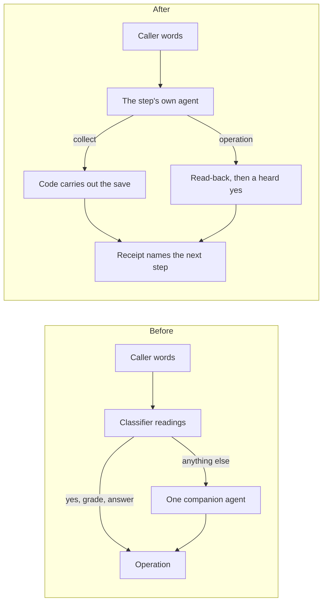
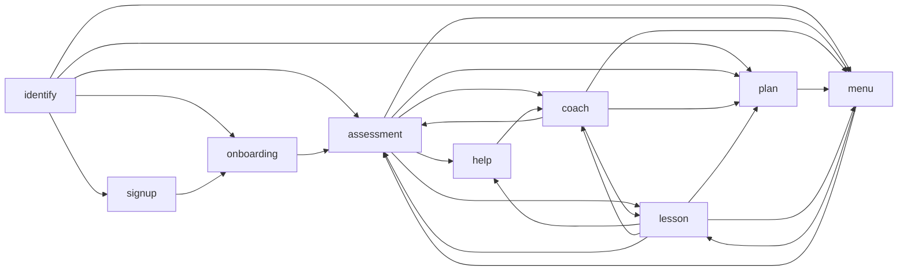

# Core cleanup and Faro's migration (session 5)

Faro now runs on core's public manifest path, and the legacy classifier and
hand-built-step path is gone from core. Core's production Python went from
12,758 to 10,269 lines. No dependency was added or removed. The line count is
a size result, not a performance result: N12 timing is unchanged (below).

Evidence for everything here is in [`cleanup/`](cleanup/): the inventory
script and its output before and after, suite summaries, the mutation check,
the N1-N13 matrix, the N12 timing of the parent and of this branch, the
package proof and the browser check.

## What changed in a Faro turn

1. Before, every turn ran up to three classifier requests first (yes/no, the menu choice, grading, onboarding answers). A clear answer ran an operation with no agent; anything else went to one companion agent that had every tool, gated by a phase field.
2. After, the step the learner is in reads the reply with its own agent. There is no pass before it.
3. An exercise answer, an onboarding answer or a name is recorded with `collect`, and code runs the save straight after (`carries_out`). The agent is never offered those saves.
4. The phone, the sign-up offer and the plan are read back by code and need a heard yes, as before.
5. The receipt says where the learner goes next (`route: next`), from the store's record. No model chooses the step.

## How the inventory was built

1. [`cleanup/inventory.py`](cleanup/inventory.py) lists every top-level name and method in `core/src/core` with the Python syntax tree: 735 names before, 561 after.
2. For each name it counts whole-word uses in core, core's tests, each use case and the docs, outside the name's own definition.
3. A zero was only a candidate. Each candidate was checked by hand for dynamic use: Pydantic validators, hooks registered on agents, protocol methods, callbacks passed as values, names in YAML manifests, and `getattr` lookups.
4. A second pass (`inventory.py ROOT legacy`) lists names whose only users are the legacy modules or Faro's old files. Those were deleted with the legacy path, or kept when the engine still uses them.

Before and after: [`cleanup/inventory-before.tsv`](cleanup/inventory-before.tsv), [`cleanup/inventory-after.tsv`](cleanup/inventory-after.tsv).

## 1. Safe deletions: no user at all

| Removed | Where | Evidence |
|---|---|---|
| `schema_tool`, `UnsupportedSchemaError`, `_SCHEMA_TYPES` | `policies.py` | No caller anywhere; no manifest key builds a schema tool |
| `CallContext.keep_detour_words` | `state.py` | No caller. `graph.py` described it as used by `Node.shares_detour`, which nothing read |
| `Node.shares_detour` | `graph.py` | Never read by the turn engine: a documented behaviour that did not exist |
| `read_out`, `Asks` | `turn.py` | No caller since the text runtime moved to `text_turn` and `acknowledge` |
| `_covering`, `_delivered` | `turn.py` | No caller |
| `_moved` | `steps.py` | No caller |
| `Checkpoint.messages`, `speech_ids`, `turn` | `state.py` | Read only by the legacy detour helpers. Every interposed prerequisite still deep-copied the whole history into `messages` |

## 2. Deletions unlocked by Faro's migration

| Removed | Last users before | Replacement or reason |
|---|---|---|
| `core.classifiers`, `readings`, `conversation`, `interpreters`, `decisions` | Faro's `conversation.py`, core's legacy clinic | Each step's own agent reads the reply; code decides what it may authorise |
| `core.desk` (`Desk`, `AgentBuilder`) | Faro's `steps/companion.py` | `kind: conversation` steps, compiled by `StepFlow` |
| `kind: agent` (`AgentSpec`, `ExitSpec`, `AgentStep`), `call:`, `StepFlow(call_type=)` | Faro's `flow.yaml` | `state:` names a plain model; the call is `FlowCall[State]` |
| `Exit.guard`, `Exit.via`, `lent`, `moved_by` | Hand-built steps lending tools | Exits are plain destinations; moves are `hand_over`, prerequisites or a receipt's `route` |
| `Opening.after`, return openings, `request_kept` | The desk's return openings | Openings answer an arrival by hand-over only; a returning step's agent reads what the caller said meanwhile |
| `Node.enter`, `Node.outputs` | `AgentBuilder` | Never set by a compiled step |
| The early run beside a slow `advance` (`_Early`, `_Hold`, `EARLY_AFTER`) | Classifier readings, the only slow `advance` | `ConfirmStep.advance` is code and answers at once |
| Classifier request accounting (`Request.kind='classifier'`, `fallback`, `outcome`, `labels`, `duration`), the `classifier_*` span attributes | Readings and interpreters | None: no classifier runs. Historical readers keep recognising old traces (`concierge-tools/ledger.py` keys on the classifier's instruction text) |
| `Interpretation`, `CallContext.conversation`, `_interpretations` | Interpreters | None |
| `CallContext` detour helpers (`detour_request`, `detour_words`, `detour_speech`, `heard_since`, `said_last_turn`), `note_request_kept`, `request_kept` | `core.conversation`, Faro's grader | None |
| `Held`, `CallContext.hold`, `held`, `release` | Take-back readings | `End.take_back`, and operations' own receipts |
| `operation_token` | Faro's old attempt ids | Faro keys an attempt by its core-issued `Intent` id |
| `core/tests/clinic.py`, `core/tests/test_reuse.py` | The legacy clinic | The engine checks moved to `core/tests/test_engine.py` (E1-E7) on the public clinic; see below |

What `test_reuse.py` checked, and where it went:

| Legacy check | Now |
|---|---|
| Stall retry, a retry ending on the caller's words | `test_engine` E1, E2 (salon-graph's `test_budget` also covers the stall) |
| No holding line for a slow model, or for a fast tool | `test_engine` E3, E4; `test_nodes` P10 for a slow tool |
| A late report does not cut a read-back that played | `test_engine` E5. The legacy test also let the aggregate end-of-speech signal approve; since session 4f only a copy's own delivery evidence does, so E5 asks for it |
| The date in the call's own time zone | `test_engine` E6 |
| A provider error gives the stumble line, in the call's language | `test_engine` E7, and `test_flow_rules` F1 for a language per call |
| Read-backs, picks, a yes without its question, a change in the same reply | `test_nodes`, `test_tickets`, `test_session` (already on the public path) |
| Readings side by side with the step, a reading that decides, take-back and closing readings, a value parsed by a reading | Removed with the readings: the behaviour they checked no longer exists |

## 3. Kept on purpose

| Kept | Why |
|---|---|
| `Operation` and its hooks (`_before`, `_authorise`, `_agreed`, `proposal_about`) | `core.Operation` is exported public API. Only `ConfirmedOperation` and `FunctionOperation` subclass it in this repository, but an application may |
| `Registry` and `FlowSpec.compile(registry=)` | Public API of the loader; unused in the repository today. A candidate for a later session with its own migration note |
| `Node.history` (`'reset'`) | No compiled step sets it, but core's `test_history` and salon-graph's `test_core` check it. Small; listed as a candidate |
| `ConfirmStep.advance` and `Node.advance` | Used by the form-flow confirm step |
| `Restated` | Used by `restated: confirms` and now by `carries_out` |
| `CallContext` itself | `FlowCall` is built on it, and `test_classes` checks its ledger |
| The ledger's `CLASSIFIER` constant and its `ANSWERS` entries for `phone` and `plan` | Reading historical traces |

## 4. The earlier cleanup draft, reviewed

The draft (`feat/core-reuse-cleanup`, uncommitted, on `697d998`) removed unused helpers but kept Faro on the legacy path. Each change was checked again here.

| Draft change | Here | Why |
|---|---|---|
| `schema_tool` and its error removed | Reproduced | No user |
| `decisions.py` deleted while its importers stayed | Deleted with the whole legacy path | The draft left `readings` and `conversation` importing a reduced module |
| `request_kept`, detour helpers, `Opening.after` removed | Reproduced | Only the desk used them |
| `read_out`, `Asks`, `_covering`, `_delivered`, `_moved` removed | Reproduced | No user |
| `graph.py` doc: "detour is kept by the turn engine" | Not reproduced | Untrue: nothing keeps it. `shares_detour` was removed instead |
| `hold_after` docstring shortened | Reproduced in substance | It cited `core.classifiers.HEDGE_AFTER` |
| Partial edits inside `conversation`, `desk`, `interpreters`, `readings` | Not needed | The modules are deleted |

## 5. Public compatibility changes

Every in-repository consumer is updated. An application outside the repository needs these changes:

| Old | New |
|---|---|
| `kind: agent` steps and `call: file.py:MyCall` | `kind: conversation` (or `collect`, `confirm`, `action`, `end`) steps and `state: file.py:MyState` |
| A `CallContext` subclass for the call | A plain Pydantic state model; per-call services passed to `flow.open(services=...)` |
| `core.classifiers`, `readings`, `conversation`, `interpreters`, `desk`, `decisions` | The step's agent, `collect`, declared operations, `decline`, `goodbye` |
| `StepFlow(..., call_type=...)` | Removed |
| `Opening(name, after, applies, run)` | `Opening(name, applies, run)`; it answers a hand-over only |
| `Exit(to, guard, via)`, `core.graph.lent`, `moved_by` | `Exit(to)` |
| `Node(enter=, outputs=, shares_detour=)` | Removed |
| `CallContext.hold/held/release`, `Held`, `Interpretation`, detour helpers | Removed |
| `Request.fallback/outcome/labels/duration`, `kind='classifier'`; `classifier_*` span attributes | Removed; `Request.kind` is `''`, `'text'` or `'tool'` |
| `core.operations.operation_token`, `core.policies.schema_tool` | Removed |
| `Handoff(ends_turn=True)` with no `reply`: the destination ran | The turn ends there, unless the destination has an opening |
| A flow with any action step needed an `End` with outcome `completed` | Only when a collect, confirm or action step has no `then` |

New manifest keys, all optional, are listed in "What core gained" below.

## 6. Optimization candidates, deferred

None was measured or changed in this session. Each needs its own measurement first, in the performance session:

| Candidate | Why it might matter | How to measure |
|---|---|---|
| `context()` renders the whole state as JSON into every request | Faro's state has 30 fields; prompts grow | Tokens per request in `ledger.py`, before and after trimming |
| `history.project` walks the whole history on every request | Long calls | N12 turns late in a long scripted call |
| `FunctionOperation._call` runs every plain function in a worker thread | Thread hop per operation | Operation latency spans on the salon's diary |
| Faro's grading is one request that records the grade; coaching needs the extra `help` hop and a coach request | Turns with a question | Requests per caller turn in `bench.py` |
| `Node.history='reset'`, `Registry`: kept code with no production user | Maintenance, not speed | None needed; decide by use |

## Faro: old to new

### Where each responsibility went

| Old (one `agent` step) | New |
|---|---|
| Phase `identify`: `read_back_number`, `HeardValue` reading a spoken number, `confirm_phone` on a classified yes | Step `identify`: records `phone`; code reads it back (`reads_back`); `confirm_phone` on the agent's yes to the heard read-back |
| Greeting as a hand-written `Prompted` | `StepFlow.greeting`: the entry step's `opens_with` read-back after Faro's words |
| Phase `signup`: `ReadBack` for the offer, `accept_signup` | Step `signup`: `opens_with: agree_signup` (read-back, call-local consent) |
| Phase `name`: `save_name` | Step `signup`: `name` recorded, `create_learner` carried out by code; needs the consent |
| Phase `onboarding`: `ONBOARD` classifier, `save_onboarding` | Step `onboarding`: `learn`, `purpose`, `length` recorded, `save_onboarding` carried out by code |
| Phase `assessment`: `GRADE` classifier, `record_assessment` | Step `assessment` (rendered): `answer`, `grade`, `feedback`, `evidence` recorded, `record_attempt` carried out by code |
| Phase `plan`: `ReadBack` of the proposal, `revise_plan`, `decline_plan`, `present_plan` | Step `plan`: `opens_with: activate_plan`; a change is recorded and read back by code; `keep_plan` recorded, `decline_plan` carried out by code |
| Phase `menu`: `FixedChoice` reading | Step `menu`: `continue_lesson`, `read_progress`, `start_reassessment` chosen by its agent |
| Phase `lesson`: `GRADE` classifier, `record_answer`; the companion coaching in prose | Step `lesson` (rendered): same grading fields, `record_attempt` carried out by code; a question goes to `help` then `coach` |
| `_coached`, set when the companion spoke while an item waited | `help`, a code node: marks the item helped in the session checkpoint before `coach` speaks |
| `set_language`, then `restate` | `asked_language` recorded in any step; the fixed lines follow (`language:`); a waiting read-back is put again in the new words; an exercise or task is said again (`repeat_waiting`) |
| `remember` | `fact_key`, `fact_text` recorded, `remember` carried out by code, in `menu` and `coach` |
| `hang_up` with a model-written goodbye and a spoken summary | `goodbye`: the locale's fixed line; `close_call` writes the summary to the plan when the call ends |
| `FaroCall(CallContext)` with private records | `FaroState`, plain data; the store holds progress; the services object reads the call's facts for the words code says |

The graph (`Flow.of(faro.FLOW.nodes).moves`):

`record_attempt` serves both a lesson and a placement, so its receipt type allows the moves of both; the store's checkpoint decides which one happens.

### Behaviours kept, and where they are checked

| Behaviour | How | Test (`use-cases/faro-language-learning/tests/`) |
|---|---|---|
| Caller ID is a hint | Read back in the greeting; nothing is looked up before the yes | L01, L02 |
| No learner data before confirmation | The state's validator refuses it; the agent's facts show nothing | L01, F4 |
| Sign-up and plan need a heard yes | Read-backs; `create_learner` needs the call's consent | L03, L05, F8 |
| Interrupted or unconfirmed read-backs authorise nothing | Core's delivery evidence | L11, F5, B3 |
| A correction needs a fresh yes | Changed arguments are a new read-back | L02, L05 |
| Refusal, questions and goodbye are not answers | Prompts; the examiner cannot speak; `answer` must be the learner's words | L10, F4 |
| Helped answers are never independent | `help` marks the store; a miss earlier in the session counts too | L10, F2, mutations |
| No pronunciation claims | Field descriptions and prompts | (prompt text; live only) |
| A language switch keeps the question | Re-read in the new words, or the exercise said again | L06, F3 |
| Restart and resume keep progress | The store, unchanged format plus two optional fields | L06, L16, L16b |
| Approval is call-local | `signup_agreed` is state, never stored | F8 |
| Duplicate, cancelled, stale and uncertain writes | Attempts keyed by intent; reconciliation by intent; stale sessions refused | L07, L13, F6 |
| Callers share nothing | One `FlowCall` and services per call; one call per learner | F7 |
| The +34 policy | A new number needs its country code in the caller's words this turn | L02, mutations |
| A client with no playback evidence is refused first | `bot.py`, as the salon's | B3 |

The mutation check ([`cleanup/mutations.log`](cleanup/mutations.log)) breaks six of these protections one at a time; the suite fails for each.

### What a learner will notice

- A clear yes now costs one step-agent request instead of one classifier request.
- The first read-back of a number says "Let me check: is your number ...?" in the greeting too.
- The goodbye is Faro's fixed line per language. The summary is still written, but not said.
- A question during an exercise goes through the coach; the next right answer to that exercise is recorded as assisted.

## What core gained, and where it is proven

All on the support desk, not on Faro: [`core/tests/test_flow_rules.py`](../../../core/tests/test_flow_rules.py) and [`ticket_flow/routed.yaml`](../../../core/tests/ticket_flow/routed.yaml).

| Capability | What it does | Why Faro needed it | Test |
|---|---|---|---|
| `language:` and `locales:` | The fixed lines follow a state field, per call | A learner explains in Spanish or English | F1 |
| `route:` on an operation | Its receipt names the next step (a `Literal` of step ids, checked at load) | The store knows where a returning learner stands | F2 |
| `carries_out:` on a step | An approval-free operation runs by code after a reply that only records its field; the model is never offered it | Grading and setup answers, on this reply's values only | F2 |
| `StepFlow.greeting()` | The entry step's read-back after the greeting | The caller ID read back as the first question | F5 |
| `heard` in the validation context | A validator reads the caller's words this turn | The +34 policy | F6 |
| A reworded read-back is put again | Same value, new words: a new copy | A language switch during a read-back | F4 |
| An empty receipt `say` says nothing | | A move whose next step speaks | F2 |
| A refused carried operation returns to the agent | The refusal is context for the step's agent in the same turn | A save the application declines | F2 |

## Rules, patterns and domain words

- Core's code has no business words and four patterns: clause splitting for speech (`_CLAUSE`), word tokens for quotes and read-backs (`\w+`, `[\w']+`), and the application's own claim patterns, compiled from the manifest.
- The salon's `locale.claims` stay unchanged. They guard the two prose steps (`concierge`, `complaints`) and the end-of-turn check; the rendered steps never reach them.
- The desk's Spanish claims stay; they back the end-of-turn check on its prose `faq` step.
- Faro keeps two word lists of its own: its claim words (now its manifest's `locales`), and the country-code pattern (`faro.models._CODE`), a check on what was said, kept as Faro's phone policy. Its language names (`_NAMES`) normalise a typed field.
- The salon's `_ASKING_TO_COMPLAIN` word list is known debt, English only, and untouched: salon prompts and tools were out of scope.

## Verification

| Check | Result |
|---|---|
| `uv run ruff check .` | All checks passed |
| `uv run ruff format --check .` | 316 files already formatted |
| `ty check .` per member (7) | All checks passed, every member |
| `python -m tests`: core | 17 modules ok (parent: 16; `test_reuse` out, `test_engine` and `test_flow_rules` in) |
| `python -m tests`: salon-graph | 21 modules ok (parent: 21) |
| `python -m tests`: Faro | 2 modules ok (parent: 1): L01-L16, F1-F9, B1-B3 |
| `python -m tests`: concierge-tools, salon-pipecat-flows, salon-prompt | 5, 1, 1 modules ok, as on the parent |
| Fresh process, no retired module imported | Faro F9; core `test_nodes` P1; the retired modules are not importable |
| Package proof (`session-4d-correctness/package-proof.sh`) | ok, outside the checkout, no key ([`cleanup/package-proof.log`](cleanup/package-proof.log)) |
| Wheel assets and flow rules installed | ok: `client/index.html`, `playout.js`, `sdk.js`; no retired module; the routed desk runs ([`cleanup/package-check.log`](cleanup/package-check.log)) |
| N1-N13 (`matrix run`) | Every harness row passes; N9's native arm fails as recorded ([`cleanup/matrix/matrix.md`](cleanup/matrix/matrix.md)) |
| N12 (`matrix time`) | Fails the relative rule on turns 2, 4 and 5, as on the parent; worst harness turn 28.2 ms against 28.1 ms on the parent, under the 50 ms ceiling ([`cleanup/n12-compare.md`](cleanup/n12-compare.md)) |
| Browser check (`core/tests/client_check.py`) | C1-C8 ok in headless Chrome ([`cleanup/client-check.log`](cleanup/client-check.log)) |
| Imports | `core` and `faro` resolve to this worktree's own `.venv` and sources |

## What is not verified

Offline checks prove plumbing, not language understanding. Grading accuracy,
onboarding reading, step choices and voice quality of the new Faro build are
unverified until a live run.

The smallest live checkpoint: `cd use-cases/faro-tools && uv run --env-file
../../.env bench.py L01 L03-EN L07-EN L10-ES L11-EN`, then
`ledger.py faro session:...` for requests per turn and consent writes. That
covers identity, sign-up with placement and plan, a lesson with coaching, an
honest grade on weak answers and a talked-over plan. It is billable and needs
approval.

Other limits:

- A lost reply is reconciled only for `record_attempt`. Another Faro write whose reply is lost stays unsettled for the rest of the call, as it did before.
- A reconciliation that finds a placement finished does not move the learner to the plan step: settlement at the start of a turn says the receipt's words but routes nowhere. The next attempt is refused, and the rendered examiner can only ask again. Calling back resumes at the plan, from the store.
- The coach is prose: it can still say too much of an answer. Only what it records is checked.
