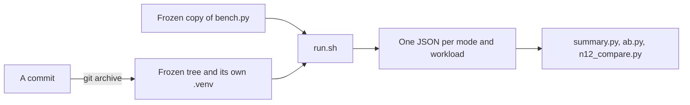
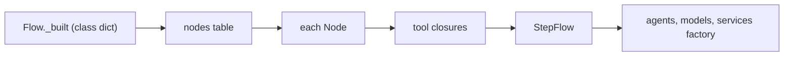

# Core optimization (session 6)

Two core changes, each measured before and after on the same scripted calls:

1. A discarded application definition is now collected. Before, a process-wide graph cache kept every
   compiled flow alive: 50 compile/discard cycles held 8 MB (desk), 18 MB (salon) and 32 MB (Faro).
   After, none is alive, and what remains stays at about 70 to 100 KiB however many times you compile.
2. Each step agent carries one `Hooks` capability instead of four. Warm scripted calls got 5 to 8%
   faster in an alternating A/B (desk -1.5 ms, Faro -3.1 ms, salon -3.7 ms per call).

Nothing else changed in core. Request counts, what each request carries and every suite result are the
same as before. N12's relative rule still fails, with the same turns failing (2, 4, 5 and the trace).
Its 50 ms ceiling passes.

Branch: `perf/core-optimization`. Baseline: `e0edb30` (merged main, PR #32). The code measured as the
candidate is `0d7fc69`. Later commits on the branch add only documents and evidence.

The branch was then rebased onto main at `1d826a5`, which added architecture documents only (PRs #33 and
#34). The measured commits and their rebased copies carry identical code
(`git diff` over `core`, `use-cases`, `uv.lock` and `pyproject.toml` is empty):

| Measured as | On the branch now | Change |
|---|---|---|
| `3bf8d3f` (`fix1`) | `19c0cab` | the steps table owns its graph |
| `0d7fc69` (`hooks`) | `0100897` | one `Hooks` per step agent |
Evidence is in [`optimization/`](optimization/): the scripts, and their raw output in
[`optimization/results/`](optimization/results/).

## How the measurements were made



1. Each revision is exported with `git archive` into its own folder, with its own `uv sync --frozen`
   environment. No measurement ran on a tree that was being edited.
2. One frozen copy of `bench.py` measures every tree. Before and after run the same script on the same
   scripted calls.
3. `run.sh` runs every mode for every workload, one process per mode, one tree at a time.
   Nothing else from this session ran meanwhile.
4. The summary scripts turn the JSON into the tables below.

The four workloads are scripted calls that end in a checked outcome. A run that ends differently fails.
So a timing is always of the same conversation.

| Workload | Member | Call | Checked outcome |
|---|---|---|---|
| `desk` | `core` | the support desk (`core/tests/ticket_flow`): a question, a resolve read back, a yes, a goodbye. 4 turns | ticket `T-101` resolved once, receipt said, call ended |
| `salon` | salon-graph | session 4's booking walkthrough, move for move. 6 turns | one booking at 2:30 PM Friday, caller with `complaints` |
| `salon-long` | salon-graph | the same, then 24 complaint turns. 30 turns | the same, and the last line said |
| `faro` | faro-language-learning | Emma confirms, gets help, answers three exercises, goes on. 7 turns | lesson completed, next lesson started |

### What is fixed across every run

| Item | Value |
|---|---|
| Machine | Apple M5 Pro, 15 cores (5 performance, 10 efficiency), 24 GB, macOS 27.0 |
| Load | Shared machine: other users' processes kept the load average between 1.2 and 3.8. Every table shows spread, and the hooks result was checked in alternating rounds |
| Python and packages | Python 3.14.5, pydantic 2.13.5, pydantic-ai-slim 2.46.0, pydantic-graph 2.46.0, pipecat-ai 1.11.0, from the same `uv.lock` |
| Model | Scripted `FunctionModel` (`bench.py`'s `Scripted`). Real requests refused (`ALLOW_MODEL_REQUESTS = False`) |
| Playback | Simulated: every segment is acknowledged as text (`CallContext.acknowledge`). The runner ramp uses the offline doubles, with Twilio marks over a fake phone |
| Speech profile, VAD, STT, TTS | Not used by `bench.py`. The ramp and N12 use the existing doubles and native components, unchanged |
| Warm-up policy | `bench.py` sends no warm-up in timed runs. `payload` mode counts them through `core.graph.model_clients(warm=True)` |
| Repetitions | Compile: 20 in-process and 20 fresh processes. Turns: 3 warm-up calls, then 20 calls. First call: 10 fresh processes. Memory: 50 compiles, 20 completed calls, 5 open calls |
| Workers and concurrency | `bench.py`: one process, one call at a time (the `apps` mode runs two apps at once). Ramp: 2 workers, 1, 2 and 5 calls at once |

### Commands

From the repo root, for any exported tree `TREE`:

```bash
docs/research/reusable-core/optimization/run.sh TREE OUT          # every bench mode, every workload
python3 docs/research/reusable-core/optimization/summary.py OUT_BASELINE OUT_CANDIDATE
docs/research/reusable-core/optimization/suites.sh OUT             # every member's offline suite
cd core && uv run python ../docs/research/reusable-core/optimization/hooks_floor.py
cd use-cases/salon-graph && uv run python ../../docs/research/reusable-core/optimization/projection.py
cd <member> && uv run python <optimization>/context_share.py <workload>
cd use-cases/salon-graph && uv run python -m evals.load ramp --calls 1,2,5 --seconds 60 --workers 2 --idle 30 --out DIR
cd use-cases/salon-graph && uv run python -m evals.load ramp ... --live --tracemalloc --out DIR   # memory diagnostic
cd use-cases/salon-graph && uv run python -m evals.load faults --out DIR
cd use-cases/concierge-tools && uv run python -m matrix time --out DIR && uv run python -m matrix run --out DIR
```

## 1. The graph cache kept every definition alive

### What held it



1. `FlowSpec.compile` called `Flow.of(flow.nodes)`. `Flow.of` stored the table and its graph in
   `Flow._built`, a dict on the class, keyed by `id(nodes)`.
2. Nothing ever removed an entry. The dict kept the table.
3. Each node's tools are closures over their `StepFlow`, so the table kept the flow, and the flow kept
   every agent, its model and its captured functions.

Reproduced first, on `e0edb30`: `core/tests/test_session.py`'s `a_discarded_flow_is_collected` fails there
("a discarded flow, its graph or an agent is still held") and passes after the fix.

### The fix

The compiled table owns its graph. `core.flow.Nodes` is a `dict` that builds its `Flow` once, when the
table is built, and keeps it as an attribute. `StepFlow` builds its table as a `Nodes`. `Flow.of` returns
`nodes.flow`, or builds a fresh graph for a table made by hand (only a few core tests do that).
`Flow._built` is gone. No call site changed: the processor, `run_turn` and `text_turn` still take a dict.

Why ownership and not a bounded cache: the graph's lifetime is exactly the table's. A call holds its
processor or its flow, which holds the table, which holds the graph. Discarding another definition cannot
touch it. The graph holds step names and legal moves only, never call state or services. So there is no
key to choose and nothing to evict.

### Checks

Added to `core/tests/test_session.py` (run on both revisions):

| Check | `e0edb30` | fix |
|---|---|---|
| A discarded flow, its graph and an agent are collected, and 50 more compiles keep no flow | fails | passes |
| A call waiting on a read-back books correctly while three other flows are compiled, used and dropped | passes | passes |
| Same routing, one prompt changed: own graph, own agents, own words, own services | passes | passes |
| One graph build per compile across turns and a second call (`Flow._build` counted) | passes | passes |

Legal and illegal moves: salon-graph's `test_graph` (legal moves, interposition, refused moves) and core's
`test_nodes` (hostile calls) pass unchanged.

### Before and after

From [`results/bench.md`](optimization/results/bench.md) (`baseline` is `e0edb30`, `fix1` is `3bf8d3f`,
`hooks` is `0d7fc69`):

| Workload | Discarded flows alive after 50 compiles | Python memory kept by them | RSS start → end of the memory run |
|---|---|---|---|
| desk | 50/50 → 0/50 | 7,950 KiB → 78 KiB | 91 → 111 MB, then 91 → 98 MB |
| salon | 50/50 → 0/50 | 18,004 KiB → 101 KiB | 129 → 168 MB, then 130 → 145 MB |
| Faro | 50/50 → 0/50 | 32,272 KiB → 94 KiB | 94 → 165 MB, then 94 → 111 MB |

The remaining 70 to 100 KiB does not grow with the number of compiles. After 50 warm-up compiles, traced
memory stood at 68, 74 and 72 KiB after 100, 200 and 300 more. It is Pydantic's JSON-schema method-name
strings and YAML scanner buffers, not flows or agents.

Compile time did not change beyond noise: desk 19.4 → 19.9 ms warm, salon 45.3 → 45.6 ms, Faro 94.0 →
87.9 ms (standard deviations 3 to 34 ms). Cold compile in a fresh process: desk 36.6 → 37.5 ms, salon
72.8 → 73.9 ms, Faro 100.8 → 103.1 ms. The graph is still built once per compile, and a turn now reads
an attribute instead of a dict lookup.

## 2. Four `Hooks` per agent cost four dispatches

### Where the time went

A profile of the long salon call (baseline) showed `dataclasses.replace` as the largest single cost.
Its main caller was not core but Pydantic AI's `_replace_capability_context`, about 4,900 calls per call
([`results/micro.md`](optimization/results/micro.md)). Pydantic AI copies the run context once per
capability at every hook point. A conversation step's agent carried seven capabilities: two SDK
defaults, four core `Hooks` built at compile time, and one per-run `Hooks` from the turn engine.

`hooks_floor.py` measures this with no core at all: a bare agent, one streamed scripted reply per run.

| `Hooks` on the agent | Median per run | Over none |
|---|---|---|
| 0 | 2,079 us | - |
| 1 | 2,132 us | +53 us |
| 2 | 2,257 us | +178 us |
| 5 | 2,640 us | +562 us |
| 8 | 2,977 us | +898 us |

So each extra `Hooks` costs about 110 us per run, and a bare Pydantic AI streamed run costs about 2.1 ms
on this machine before core does anything.

### The change

The four compile-time hooks each use a different event: the request clock (`before_model_request`), one
action per reply (`after_model_request`, `before_tool_execute`), `speak_by` (`prepare_tools`) and the
hand-over's destinations (`prepare_output_tools`). One `Hooks` object keeps a list per event and runs it in
order, so holding all four runs exactly the same handlers. The policy functions gain `into=`, which
registers on an existing `Hooks`. The per-run `Hooks` (history projection and the response tag) stays a
separate capability in the same position, so the order across the two is unchanged.

Check: `core/tests/test_sdk.py`'s `every_step_has_one_hooks` (one `Hooks` per step agent, the clock on
every step, all four policies on the desk step, one handler per event). It would fail on `e0edb30` at
the single-`Hooks` unpack. Salon's pinned first requests (`golden/agents.json`), the hostile-model checks
(`test_nodes`, `test_business`) and the budget checks (`test_budget`) pass unchanged.

### Before and after

The one-shot three-tree run moved in the same direction but was noisy, so the two trees were alternated
over three rounds ([`results/hooks-ab.md`](optimization/results/hooks-ab.md)). Median warm call, ms:

| Workload | Before (`3bf8d3f`), 3 rounds | After (`0d7fc69`), 3 rounds | Change of the median |
|---|---|---|---|
| desk | 31.5, 30.9, 31.4 (31.4) | 28.4, 33.2, 29.9 (29.9) | -4.9% |
| Faro | 50.0, 51.1, 50.1 (50.1) | 46.8, 47.0, 51.0 (47.0) | -6.1% |
| salon | 47.4, 46.7, 47.1 (47.1) | 43.1, 48.2, 43.4 (43.4) | -7.9% |

In each workload, one of the three "after" rounds was as slow as "before": round 2 for the desk and the
salon, round 3 for Faro. That points to load on the machine in those rounds, not to the change. In the one-shot run, CPU per warm call went from 23.8 to
22.2 ms (desk) and 36.4 to 34.2 ms (salon), and Faro did not move (40.1 ms).

## Where a turn's time goes now

From the profiles and the floor measurement, per warm call:

| Part | desk (4 turns, 7 requests) | salon (6 turns, 10 requests) |
|---|---|---|
| Warm call, wall | 29.8 ms | 44.7 ms |
| Of which process CPU | 22.2 ms | 34.2 ms |
| Of which waiting (wall minus CPU) | 7.6 ms (SQLite, the event loop) | 10.5 ms |
| Pydantic AI floor, 2.1 ms per request | about 15 ms | about 21 ms |
| Core's own functions, under the profiler | 1.9 of 62 ms profiled (3%) | 3.0 of 92 ms profiled (3%) |

Core's own code is 3 to 4% of profiled time in every workload. Most of the rest is Pydantic AI's agent
loop and asyncio scheduling. That matches session 4f's finding.

First useful output, the time from a turn's start to its first spoken segment that is not a holding line,
stayed at about 6 ms (desk 6.2 → 5.9, salon 6.3 → 6.0, Faro 6.8 → 6.7). No holding line fires offline,
because no tool runs longer than `hold_after`. So no filler was mistaken for output.

## Model usage

### Accounting source and its limits

The scripted model reports no provider usage, so this session has no token counts. It measures bytes
instead: what each request carries, split by source ([`results/bench.md`](optimization/results/bench.md),
payload table). History bytes count only the text a provider receives (words, tool names, arguments,
results), not timestamps or ids. Bytes are a proxy. Real tokens, cached input and the share each provider
caches need `concierge-tools/ledger.py` on live traces, which uses the corrected accounting
(`token-accounting.md`).

Neither change moved a single byte. Payload is identical before and after in every workload.

| Workload | Requests | Instructions | Of which core's context block | History | Tool schemas |
|---|---|---|---|---|---|
| desk | 7 | 8,685 B | 4,998 B | 2,510 B | 14,684 B |
| salon | 10 | 62,586 B | 11,551 B | 9,026 B | 27,923 B |
| salon-long | 34 | 176,888 B | 44,239 B | 69,887 B | 75,779 B |
| Faro | 8 | 33,047 B | 17,420 B | 5,563 B | 20,625 B |

### Findings

1. **Tools per node.** Each node is offered its own step's tools only, as salon's `test_graph` and Faro's
   `each_step_offers_only_its_own_tools` check. Booking offers `move_appointment` and
   `cancel_appointment` before the caller holds a booking, because the model may record the booking and
   call the operation in one reply. Hiding them by state would change behaviour. Not changed.
2. **Deterministic moves.** No workload has a request that code could replace, and no request count
   changed. Faro's `help` node is code and makes no request. The turn that reaches it makes two: the
   lesson agent choosing `hand_over`, then the coach speaking. Both are the model's own work.
3. **Redundant context.** The context block repeats itself, mostly in Faro
   ([`results/micro.md`](optimization/results/micro.md), `context_share.py`):

   | Workload | Empty facts (`null`, `""`) | Receipt fields already in the facts | Share of all instructions |
   |---|---|---|---|
   | Faro | 1,983 B | 3,430 B | 16% |
   | salon | 1,251 B | 481 B | 2.8% |
   | desk | 425 B | 214 B | 7.4% |

   Leaving these out would change what every model reads, so it is a behaviour change. It is **not done**.
   It is a proposal that needs a live check first (see the open work below).
4. **Warm-ups.** One per distinct model client: a non-streamed `ok` with `max_tokens: 1`, no instructions
   and no tools (`core.graph._warm`). In the runner ramp, each worker sent one. The scripted model
   estimated it at 51 input and 1 output token, an estimate, not a provider count. `server.py` warms once per worker and `bot.py` once per call.
   Their latency benefit (1.05 s cold against 0.78 s warm, 2026-09-23) cannot be measured offline. Kept
   unchanged.
5. **History.** Not truncated. History bytes grow linearly per request (salon-long: 70 KB over 34
   requests), which is the conversation itself. Projection keeps tool pairs, corrections, pending
   questions and cancelled-run speech as before, since `history.py` is unchanged.

## Concurrency and resource checks

### Runner ramp, 1, 2 and 5 calls at once

Plain ramp (`evals.load ramp`, 2 workers, offline doubles), both trees:

| Calls | Tree | Booked | Duplicates, leaks, unauthorised | Loop lag p99, worst sample | RSS max | Turn latency p50 / p90 | Idle tasks per worker |
|---|---|---|---|---|---|---|---|
| 1 | before | 1 | 0, 0, 0 | 253 ms | 533 MB | 1.46 / 1.99 s | 3, 3 |
| 1 | after | 1 | 0, 0, 0 | 189 ms | 519 MB | 1.46 / 1.99 s | 3, 3 |
| 2 | before | 2 | 0, 0, 0 | 124 ms | 674 MB | 0.93 / 2.01 s | 3, 3 |
| 2 | after | 2 | 0, 0, 0 | 110 ms | 602 MB | 0.94 / 2.02 s | 3, 3 |
| 5 | before | 10 | 0, 0, 0 | 122 ms | 994 MB | 0.94 / 2.02 s | 3, 3 |
| 5 | after | 10 | 0, 0, 0 | 141 ms | 936 MB | 0.96 / 2.05 s | 3, 3 |

The ramp's loop-lag gate (p99 under 100 ms) **fails on both trees**, so it is not caused by these changes.
Its worst samples are single spikes on a shared machine. Session 4c passed this gate on the same laptop
(p99 32.4 ms at five calls). It needs its own look (open work below). Every other verdict passes on both trees. Turn
latency is set by the doubles' paced speech, not by core.

Memory diagnostic (`--live --tracemalloc`), after the five-call step: every worker had 0 live
`FlowCall`, `Pipeline`, `PipelineWorker`, `PydanticAgentProcessor`, transport, VAD, smart-turn and
`LLMContext` objects, and 3 tasks. The Python heap per worker was 24.2 MB before and 26.1 MB after.
RSS peaked at 921 MB before and 840 MB after, well under the 80% RAM limit. As in sessions 4c and 4e,
RSS grows while the Python heap stays flat. That is native and allocator memory (ONNX VAD and turn
models, audio buffers), not Python objects, and neither change touches it.

### Faults

`evals.load faults` on the final tree: F0 to F6 all pass (worker killed before and after its intent was
recorded and after commit, stale worker fenced, overload refused at five, graceful drain, the placed
pair with the live fault armed after placement). Raw lines: [`results/load/hooks-faults.jsonl`](optimization/results/load/hooks-faults.jsonl).

### Several applications and callers

- `bench.py apps`: the salon and Faro compiled in one process, one call each run side by side. Each ends
  with its own checked outcome, and neither sees the other's operations (salon: `lookup_customer`,
  `book_appointment`. Faro: `confirm_phone`, `continue_lesson`, `note_help`, `record_attempt`).
- The new `test_session` checks: two compiles of the same routing keep their own prompts and services, and
  a call carries on while other definitions come and go.
- Completed calls: 0 of 20 alive after they end, in every workload, before and after. Open calls hold
  39 KiB (desk) to 193 KiB (salon, 15 turns in) each, and 0 of 5 are alive once released.
- Warm-up cancellation and client shutdown order: `test_sdk`'s `a_warm_up_ends_before_its_client_closes`
  passes.

## N12, the frozen protocol

`matrix time`, run alone, alternating trees over two rounds ([`results/n12.md`](optimization/results/n12.md)).
Median `last_ms` per turn at zero delay, native / harness:

| Turn | before, round 1 | before, round 2 | after, round 1 | after, round 2 |
|---|---|---|---|---|
| 1 | 7.2 / 11.1 | 7.3 / 11.3 | 7.3 / 10.6 | 7.4 / 10.4 |
| 2 | 10.6 / 22.1 | 9.1 / 23.4 | 9.6 / 21.4 | 10.7 / 22.0 |
| 3 | 33.6 / 28.6 | 38.6 / 34.3 | 38.7 / 32.0 | 38.5 / 31.1 |
| 4 | 8.3 / 20.8 | 8.9 / 22.8 | 8.8 / 21.3 | 8.8 / 19.8 |
| 5 | 7.3 / 21.2 | 8.0 / 23.2 | 8.3 / 22.6 | 7.7 / 21.3 |
| trace | 66.8 / 106.7 | 71.5 / 114.0 | 72.2 / 106.7 | 71.9 / 104.8 |

**Relative rule** (harness within max(5 ms, 25%) of native, per turn and on the trace): **fails in all four
runs**, on turns 2, 4 and 5 and on the trace, as on the parent and at cleanup.

**Absolute rule** (slowest harness turn under 50 ms): **passes in all four runs**, slowest 36.7, 37.0,
47.7 and 36.4 ms. The 47.7 ms is one sample in one run, close to the ceiling. The other runs sit at 36 to
37 ms.

Measured cause: the harness sends fewer requests than native over the trace (6 against 7), so the gap is
cost per request, about 17.5 ms against about 10 ms. A bare Pydantic AI streamed run costs 2.1 ms on this
machine. Core's own functions are 3 to 4% of profiled time. The rest is the Pydantic AI agent loop and
Pipecat's frame path in the adapter, which the rule counts as package overhead. The hooks change took
about 1 ms off turns 1, 2 and 4, which is too little to meet a 5 ms tolerance on native turns of 8 to 10
ms. The threshold, comparator and delays were not changed, and nothing was inserted.

N1 to N13 (`matrix run`) on the final tree: every harness row passes, and exit is 0
([`results/n12/matrix-hooks/matrix.md`](optimization/results/n12/matrix-hooks/matrix.md)). N9 fails on
the native arm, which is the pinned reference's known result.

## Acceptance gates

On the branch before the rebase (code as `0d7fc69`), each command's real last line. The rebase brought
in documents only. `ruff` and the core suite were run again after it, with the same result.

| Gate | Result |
|---|---|
| `uv run ruff format --check .` | all files already formatted (the first run reformatted the new `n12_compare.py`) |
| `uv run ruff check .` | All checks passed! |
| `ty check .` in `core` and each of the six use cases | All checks passed! (7 of 7) |
| `core`: `python -m tests` | exit 0, every module `ok` (`session ok: ... definitions owned and collected`) |
| `use-cases/salon-graph`: `python -m tests` | exit 0, every module `ok` |
| `use-cases/faro-language-learning`: `python -m tests` | exit 0, `faro ok: L01-L16 and F1-F9 ...`, `bot ok: B1-B3 ...` |
| `use-cases/salon-pipecat-flows`: `python -m tests` | exit 0 |
| `session-4d-correctness/package-proof.sh` | exit 0, `package proof ok` |
| `core`: `python -m tests.client_check` | exit 0, `client check ok: C1-C8 ...` |
| `evals.load faults` | F0-F6 pass |
| `matrix run` | exit 0 |
| `matrix time` | N12 fails its relative rule, passes its ceiling (above) |

## Considered and not done

| Candidate | Measured | Why not |
|---|---|---|
| Fold the per-run `Hooks` (projection, response tag) into the agent's | about 110 us per run | Its handlers are closures over run-local state (request count, stall timer, run id). Moving that state onto the call adds more than it saves |
| Copy less in `history.project` | 0.29 ms at turn 30 of the long call, and about 0.2 ms more for the second projection per request. Under 0.1 ms per request at N12's length. Grows about 2.7 us per message | The copy is what keeps the source history untouched (session 4c). Halving it means reworking those rules for under 0.1 ms per request at normal lengths. Revisit for calls far longer than 30 turns |
| Build `StepFlow.operations()` once | not visible in any profile (`context` is 2 ms of 336 ms profiled on the long call) | No measured cost |
| Cache `Today.instructions()` | not visible in any profile | No measured cost. The text is already the same all through a call |
| `FunctionOperation`'s worker-thread hop | not isolated. Operations total 1.2 to 3.8 ms profiled per call | Too small to justify a change to how writes run |
| Leave empty facts and repeated receipt fields out of the context | 16% of Faro's instructions, 2.8% of the salon's (bytes) | Changes what the model reads. Needs a live check first |
| Offer booking's move and cancel only once a booking is held | 2 tool schemas per booking request | Changes what the model can do in one reply |
| Remove warm-ups | 1 request of about 52 tokens per worker | Their benefit is cold-call latency, which only a live run can show |

## Open work that needs live runs

No paid model calls, Coval runs or rescoring were made in this session. Before claiming token, accuracy or
voice-latency parity:

1. **Tokens.** Run the live text checkpoint (`evals.calls`, T1-T4) or a few Coval calls on this branch, and
   read them with `ledger.py`. That gives real input, cached input and output per request. Both changes
   leave every request byte-identical, so no change in tokens is expected. The live run confirms it.
2. **The context trim proposal.** If it is wanted: implement it behind a regression test, then run the
   paired semantic check (`evals.paired`) and Faro's `bench.py` cases (L01-L16), and compare accuracy and
   tokens with `ledger.py`.
3. **Warm-ups.** A live A/B of the first call's first turn with and without warm-up, on `server.py` (once per
   worker) and on `bot.py` (per call), with the warm-up's own tokens counted apart.
4. **Voice latency.** A Coval run on the salon (`coval_sim`, same speech profile as the last baseline).
   N12 measures the package offline only.
5. **The ramp's loop-lag gate.** It failed on both trees on a shared machine. Rerun the plain ramp on an idle
   machine. If it still fails, find the spike (the first call's ONNX model load is the first suspect).
