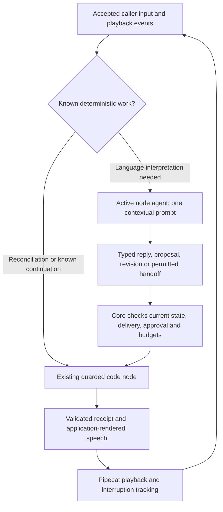
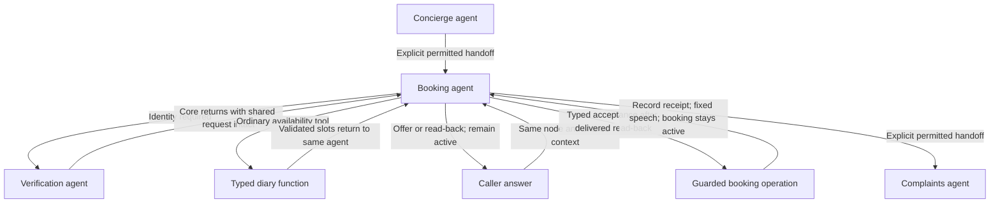

# Node agents after session 3

Decision prepared 25 September 2026 against PR #18, `074a6c290ec1273334190e72dc32279b4e289d6a`. This is research and an implementation brief for session 4, not a report of an implemented or evaluated replacement.

## Recommendation

Proceed with one active Pydantic AI agent per conversational node, with that node's instructions, relevant typed state, delivered conversation and permitted tools/exits. Keep deterministic nodes and application-controlled continuations for work whose answer is already known. Remove the separate conversational classifier pass from the migrated salon path, including classifiers hidden inside confirmation and operation guards. Preserve the shared execution, consent, delivery and receipt machinery.

This is a justified simplification to implement and compare. Greater semantic reliability, lower audio latency and a token ceiling equal to native Pipecat are hypotheses, not established results. The change relocates language interpretation into the active node agent; it does not eliminate model interpretation or make it deterministic.

The user's `RESEARCH.md` (reviewed 21 September) and `UNMUTE_V1.md` (updated 22 September), supplied from the UnmuteV1 directory, support typed application boundaries, focused steps, permitted tools and deterministic continuation. Their historical compiler, LiveKit and zero-model-approval proposals are background, not instructions to expand this repository migration. This decision retains the Python package/Pipecat scope and updates the interpretation strategy.

## What the repository evidence actually says

The source of these observations is the [session-3 report at the reviewed revision](https://github.com/slng-ai/slng-voice-harness/blob/074a6c290ec1273334190e72dc32279b4e289d6a/docs/research/reusable-core/session-3.md), particularly sections 2, 3, 7, 7b and 8. Reported checks were inspected; they were not rerun during this documentation task.

| Observation | What it supports | What it does not establish |
|---|---|---|
| Confirmation: 42/48 correct; consent: 50/53; zero false accepts across 186 labelled items | Compound replies are a concrete usability problem worth targeting without sacrificing conservative authorization | That all classifiers fail, or that removing them automatically improves safety |
| All six confirmation misses contain a yes plus a question, correction or different task | Letting one contextual agent handle both parts may avoid losing meaning between a label and a later response | That broader context always improves interpretation; test it |
| Other reported reading scores were 1.00, some on candidate prompt versions | Keep versions and dataset provenance when comparing | One uniform production classifier baseline with 100% accuracy |
| Stress call 1's take-back reading returned `keep` twice, but the controller still allowed the booking to be moved | The demonstrated fault was failure to consume a correct interpretation; retain the receipt-recovery repair | A classifier error in that particular call |
| T3 drops 2 PM across verification; “Saturday instead” has inconsistent date anchoring | Persist explicit requested constraints and define date clarification in domain code | That deleting a classifier fixes lost state or ambiguous dates |
| T4 now reconciles an unknown write through code | Deterministic reconciliation should remain before language work | That a prompt can replace stable operation identity and backend reconciliation |
| Sequential stress median audio latency was 2.48 s against 2.29 s | A remaining product latency issue | Attribution to classifiers alone; endpointing, model work, STT/TTS and playback all contribute |
| Seven of eight conclusive voice calls had correct outcomes; receipt-cut trigger did not recur after the fix | Useful sampled evidence and a live coverage gap | Broad reliability, or live proof of the receipt repair |

The clinic's zero authored orchestration lines versus the native salon's 750 are a useful authoring inventory. They are different applications and coverage scopes, not a controlled proof of superior runtime reliability or cost. Session 4 must inventory the full migrated salon itself.

## Research supporting the design and its limits

| Primary source | Supported design choice | Limit |
|---|---|---|
| [Pipecat Flows](https://docs.pipecat.ai/pipecat/flows/introduction) | Focus each node on a task with its own instructions/tools; declare transitions and keep handlers in Python | Architectural precedent, not a controlled comparison against this harness |
| [Pydantic AI multi-agent patterns](https://pydantic.dev/docs/ai/guides/multi-agent-applications/) | Application-controlled handoff and graph control can compose agents without a separate supervisor model | A handoff can still lead to another provider request |
| [Pydantic AI output functions](https://pydantic.dev/docs/ai/core-concepts/output/#output-functions) | A validated output function can end a run and return its result to code without a model follow-up | Tool argument validation does not prove the caller meant “yes” |
| [Pydantic AI Agent Specs](https://pydantic.dev/docs/ai/core-concepts/agent-spec/) and [GraphBuilder](https://pydantic.dev/docs/ai/graph/builder/) | Reuse the existing agent configuration and graph facilities | Check the locked 2.46.0 API, rather than assuming current examples work unchanged |
| [Anthropic: Building effective agents](https://www.anthropic.com/engineering/building-effective-agents) | Prefer simple, composable patterns and add complexity only when evaluation justifies it | The article also supports classification for accurately separable tasks; it is not evidence against classifiers generally |
| [τ-bench, Yao et al.](https://arxiv.org/abs/2406.12045) | Judge task outcomes using backend state, and distinguish one successful attempt from consistency across trials | Its models/domains are not this salon; its failure rates cannot be transferred here |

The inference from these sources and the local faults is specific: a context-aware node agent is a reasonable replacement for this application's multi-reading pre-pass. The research cannot prove our candidate is better without testing the candidate. Session 4 therefore has an architecture acceptance check, a matched semantic comparison and a separate live voice gate.

## Fit with the existing implementation

This is not a replacement engine. At `074a6c2`, the following are already present:

- `salon/flow.yaml` already has concierge, verify, booking and complaints agents with separate prompts. `salon/nodes.py:advance` runs relevant readings before those agents, except for deterministic unknown-write settlement. Remove the redundant interpretation route, not the node concept.
- `core/steps.py` supplies `ConversationStep` with fields, choices, operations and exits; `ActionStep` invokes guarded operations; `StepFlow` uses the existing graph. The three clinic manifests already demonstrate several authoring patterns.
- `ConfirmStep.advance`, `ConversationStep.advance`, `ConfirmedOperation._agreed` and `End` still invoke the shared confirmation/take-back readers. Simply changing salon prompts or enabling `SALON_INTERPRETER=solver` would leave another model pass in place.
- `Operation.run`, proposals, `Evidence`, `receipt_for`, atomic state updates, history projection and playback tracking are the guarantees to retain. `FunctionOperation` and the manifest remain the application interface.

“One prompt” permits a shared persona prefix and reusable policy instructions composed into that node's request. It means no independent confirmation/closing/choice agent runs before or inside it. “One agent” does not mean one provider request per caller turn: ordinary tools, retries and a legitimate handoff may require more.

Keep one authoritative typed state per call. Nodes see relevant fields and may have declared node-specific data, but must not maintain conflicting private copies of identity, approval or bookings. Compiled agent definitions can be shared; mutable session data cannot.

## Target package contract

The package will expose two node behaviors through the existing manifest/flow machinery. **Agent nodes** interpret the conversation, call their tools and choose permitted handoffs. **Code nodes** run typed functions or guarded operations and follow declared result-dependent continuations without model inference. Existing authoring conveniences can compile to those behaviors. This does not require a new public class for every concept or a new graph driver.

| Concern | Chosen behavior |
|---|---|
| Domain state | One concrete Pydantic object per call, currently `FlowCall.state.facts`. Booking/request/complaint fields are part of that state. No private agent copies of identity or booking data. |
| Runtime state | Core owns the active node, prerequisite return, proposals, delivery, receipts, history, cancellation and budgets. Agents request changes through typed tools; they cannot assign protected bookkeeping. |
| Node context | Default to the same flow's public domain state and shared delivered dialogue, plus the current node's instructions/tools and applicable validated tool results. Refresh before each provider request. Preserve explicit privacy boundaries; never serialize injected services or secrets. |
| Tool return | An ordinary booking tool returns to the booking agent's SDK tool loop. It does not transition to concierge or invoke a router. A result that needs interpretation may require another request by booking. |
| Waiting | Offering slots or asking a question ends that agent run while leaving booking active. The next caller reply goes to booking with its pending offer/question and current shared context. |
| Agent handoff | The active agent chooses a declared destination in context. Core validates the edge and prerequisites, then activates the destination's instructions/tools while retaining shared business context. |
| Code continuation | An explicit code node follows its declared success/error/unknown destination. A reusable prerequisite can return to the saved requesting node using existing routing bookkeeping. |
| Late results | An old lookup cannot overwrite a newer offer/request or reactivate a node that was left. A completed business effect remains recorded even if its original generation was cancelled. |

This context policy is an application decision informed by [Pipecat's node/context facilities](https://docs.pipecat.ai/pipecat/flows/nodes-and-messages) and [Pydantic AI message-history reuse](https://pydantic.dev/docs/ai/core-concepts/message-history/). It is not a guarantee supplied automatically by either SDK. The harness must project valid messages, distinguish generated from delivered speech, preserve tool-call/result pairing and avoid carrying old node instructions as current ones.

The booking node owns the complete conversational task:

For example, booking receives available slot IDs, offers 2 or 3 PM and waits. “The later one” is interpreted there against the offer; a bare “yes” to two choices needs clarification. After selecting 3 PM, core renders and tracks its exact read-back, and the next answer still belongs to booking. “Yes” to that delivered proposal can request the guarded write; “actually Saturday” invalidates the old offer/approval and starts another availability lookup in the same node. A side question retains the pending task. There is no separate choice, confirmation or routing classifier in this sequence.

Known receipt speech can finish in code without another model request. The receipt is still available in shared evidence/context when booking next runs. An ordinary tool return, an agent-selected handoff and an application-rendered output are distinct outcomes; treating all three as “go to the next node” would recreate the context-loss problem.

Implement this at the reusable boundary: `flowspec.py`/`steps.py` compile the declarations; `graph.py`/`flow.py`/`turn.py` preserve node ownership and explicit continuations; state/history/proposal/operation modules maintain the shared invariants. Salon should supply domain data, prompts and functions, not its own turn router. The public clinic patterns must demonstrate the same behavior before claiming reuse.

Session 4 removes conversational classifier execution from the public authoring path and salon, including speculative classifier/agent races and hidden operation readers. Only named legacy Faro callers may temporarily retain it until session 5; unused generic classifier/solver/readings machinery is then removed. An explicit pedagogical grader is a domain capability, not a mandatory conversational pre-pass. Labelled historical datasets remain comparison evidence.

## Approval without a second classifier

The active agent interprets the caller's answer using the actual pending proposal, delivered history, current facts and relevant request. It selects a typed response through the same run that can handle the caller's question or correction. Core binds that response to the runtime-owned utterance/turn/generation, proposal serial, subject, arguments and delivered segment. Core then validates and consumes the resulting approval once at the existing operation boundary.

This is not permission to expose a writable `approved` flag or trust an arbitrary model-authored `confirmed=true`. The model still supplies a fallible semantic judgement, exactly as the classifier did. Deterministic code can reject stale, unheard, wrong-subject or changed-argument acceptance; it cannot prove that an LLM correctly understood a natural-language reply. Negative semantic tests remain mandatory.

Mixed replies need scope-aware handling. “Yes, that number is right; Saturday instead” can confirm the unchanged phone while revising the booking request. “Yes, book nine—actually make it ten” must not book nine and then repair it. Collect and validate the relevant revisions before allowing a write. Use one guarded business action and bounded transitions, not an arbitrary list of model-planned operations.

Known read-backs and receipt speech remain application-rendered. A selected action followed by its known receipt does not need another model to restate success. Ordinary language questions do need the active agent; a plain-text “yes” is not a zero-request deterministic event just because its spelling is familiar.

## Cost and latency: no native upper bound

Compare total measured requests and usage across a complete successful task:

`total tokens = sum(input + output + separately reported reasoning usage across every provider request)`

Report cached-input accounting separately and follow the provider's usage definitions to avoid counting reasoning twice. Include retries, cancelled requests with available usage and destination-node runs. Report unknown usage as missing.

Removing several narrow requests may offset a larger node prompt; it may also increase total tokens if the node repeatedly receives long history or needs tool-result continuations. Native Pipecat is not a mathematical ceiling. The native and harness profiles already differ in LLM and endpointing settings, and no further paid native checks are authorized. Existing native data is contextual unless genuinely matched; an unmatched comparison cannot establish a cost bound.

For session 4, keep the same Gemini settings and speech-profile v1 while comparing the parent and candidate text paths. Report completed tasks, unnecessary re-asks, false acceptance, requests, tokens and elapsed time separately. Do not sum medians of classifiers that previously ran in parallel to claim a latency saving. Keep the frozen 2.29 s audio-response and 0.5 s barge-in targets; five repetitions per normal/stress case improve visibility, but even the 20-call session ceiling is not a tail-latency or general reliability study.

## Session-4 proof and release decision

The implementation brief is [prompt 4 in the playbook](../../plans/reusable-voice-core-sessions.md#prompt-4--migrate-salon-to-node-agents-with-guarded-code-nodes). It requires:

1. Full salon migration through the existing public manifest/session API, with no application runtime subclass or replacement scheduler.
2. A test that makes classifier/solver entry points raise while the new salon and representative public clinic paths still complete. Dependency-compatible legacy code can remain for Faro until session 5; it cannot run invisibly in the new path.
   The new P13–P18 checks additionally prove tool results return to their owning node, waiting preserves node ownership, agent-selected handoffs are explicit, shared context survives verification, code nodes return without inference, and stale lookup results cannot overwrite newer state. Inspect rendered booking contexts at offer, read-back and receipt stages.
3. Full deterministic consent, delivery, reconciliation, correction and backend-outcome checks, including the session-3 receipt replay and missing-time defect.
4. A small frozen parent/candidate live-text comparison that includes mixed replies and negative consent cases. Same model/settings and observations; no hidden expected labels in agent inputs. Preserve the four existing end-to-end text cases and the per-session request/token limits.
5. After cheap checks, one previously failing complex Coval call must exercise its interruption/receipt trigger and pass before two candidate-only jobs: five normal calls, then five stress calls. The user explicitly selected this arrangement over an old/new voice comparison. The new cap is 20 calls per numbered session: 11 planned and nine reserved for targeted repair/coverage follow-up, counting failed/inconclusive attempts. Fifteen earlier calls remain historical; completed sessions are not topped up. No new native calls. Review each job before the next and stop new launches on critical failure. Recover existing bulk audio when available: unmatched concurrency prevents latency comparison, not qualitative interruption analysis.
6. Separate verdicts for implementation, semantic behavior, cost, latency and actual voice-trigger coverage. If the replacement regresses authorization or cannot satisfy the required business cases, fix it or keep it explicitly unaccepted; do not make it the default by deleting the failing tests.

Historical Langfuse reading candidates remain unpublished evidence. This decision does not require promoting them or deleting datasets. They are useful controls while replacing the path they measured.
