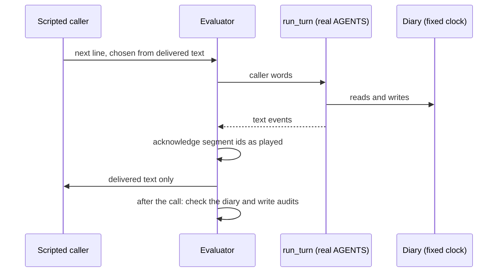

# Session 1: baseline and bounded evaluation tools

Written 25 September 2026. Plan: [reusable-voice-core-sessions.md](../../plans/reusable-voice-core-sessions.md), prompt 1.

The baseline is reproducible and the evaluation selection is bounded. Every offline check passes. Three known
defects are recorded, each with a failing check and an owner session. The live text checkpoint passed 2 of 4
cases: T3 failed on a real salon defect and T4 is incomplete. Of the two Coval calls, the normal booking passed.
The pause-and-correction call booked the right appointment but failed the case: the agent asked for the phone
number twice, and the judge made two errors.

This is a smoke baseline, not full verification. Two voice calls and four text calls cannot support a p95, a rate
or a reliability claim.

## 1. Starting point

| Item | Value |
|---|---|
| Revision | `2611475` on `main` (clean, 0 commits behind), worktree branch `worktree-baseline-and-evals` |
| Roadmap reviewed at | `d31399e` (an earlier `main`; the layout is the same) |
| `uv.lock` sha256 | `a8248035a2e0c15e…` |
| Python, uv | 3.14.5, uv 0.12.18 |
| Locked packages | pydantic 2.13.5, pydantic-ai-slim 2.46.0, pydantic-graph 2.46.0, pipecat-ai 1.11.0, google-genai 2.24.0, langfuse 4.15.4 |
| Agent and classifier model | `google-cloud:gemini-3.5-flash-lite`, `service_tier='priority'`, thinking `MINIMAL` (`salon/classification.py`) |
| Interpreter | narrow readings (`SALON_INTERPRETER` unset); confirm reading is `harness-reading/confirm` v3, in `core/readings.py` |
| STT | SLNG `soniox/speech-ai:rt-v5`, English |
| TTS | SLNG `cartesia/sonic:3.5`, voice `62ae83ad-4f6a-430b-af41-a9bede9286ca`, token aggregation |
| Turn taking | Silero `VADParams(stop_secs=0.2)`, smart-turn v3 `SmartTurnParams(stop_secs=1.6)` |
| Disconnect | a running turn may finish for `FINISH_SECONDS = 8` |
| Golden snapshots | `salon-graph/tests/golden/{agents,readings}.json`, unchanged |

Prompt fingerprints (first 12 hex characters of sha256):

| File | sha256 |
|---|---|
| `salon/flow.yaml` | `01acedb5de72` |
| `salon/prompts/_voice.md` | `2d433f4d392b` |
| `salon/prompts/_diary.md` | `9831511fe71c` |
| `salon/prompts/concierge.md` | `3013a8fee3b4` |
| `salon/prompts/verify.md` | `8ef2fbf6bf56` |
| `salon/prompts/booking.md` | `18fc0d77c3f6` |
| `salon/prompts/complaints.md` | `06e8c8ab2780` |
| `salon/prompts/knowledge/services.md` | `f105535d8dd2` |
| `salon/prompts/knowledge/refunds.md` | `3fc2476597e2` |
| `salon/prompts/knowledge/complaint-guidance.json` | `104e4cdb2f94` |
| `core/src/core/readings.py` (classifier prompts) | `486b1f21d7e9` |

No prompt, tool docstring, model setting or golden file was changed in this session.

### Consumers and their dependencies

| Member | Direct dependencies | Uses core | Offline suite |
|---|---|---|---|
| `core` | langfuse, pydantic-ai-slim[google,openai,spec], pipecat-ai, python-dotenv, pyyaml | is core | 4 modules |
| `salon-graph` | slng-voice-core, pydantic-extra-types[phonenumbers], pipecat-ai[google,runner,silero,webrtc], pipecat-slng, python-dotenv, websockets | yes | 15 modules at start, 17 now |
| `salon-prompt` | langfuse, pydantic-extra-types, pipecat-ai[…], pipecat-slng, python-dotenv, websockets | no | 1 module |
| `salon-pipecat-flows` | same as salon-prompt | no | 1 module |
| `faro-language-learning` | slng-voice-core, pydantic-extra-types, pipecat-ai[…], pipecat-slng, python-dotenv, websockets | yes | 1 module |
| `concierge-tools` | langfuse, pydantic, python-dotenv; the `coval` CLI (v0.7.3) and `cloudflared` as external binaries | no | 2 modules at start, 3 now |
| `faro-tools` | faro-language-learning only | through Faro | none |

## 2. Baseline checks

All commands ran from the workspace root with the Langfuse, Google, OpenAI, Coval and SLNG keys unset in the shell.
The runner is `baseline.sh`, recorded below. Every command exited 0, before and after this session's changes.

```bash
uv run ruff check .                     # All checks passed!
uv run ruff format --check .            # 168 files already formatted (159 at the start)
for d in core use-cases/*; do uv run --directory $d ty check .; done          # All checks passed! x7
uv run --directory core python -m tests                    # all 4 modules ok
uv run --directory use-cases/salon-graph python -m tests   # all 15 modules ok at start; all 17 now
uv run --directory use-cases/salon-prompt python -m tests          # all 1 modules ok
uv run --directory use-cases/salon-pipecat-flows python -m tests   # all 1 modules ok
uv run --directory use-cases/faro-language-learning python -m tests   # all 1 modules ok
uv run --directory use-cases/concierge-tools python -m tests       # all 2 modules ok at start; all 3 now
```

`faro-tools` has no suite. `bench.py` is billable and was not run.

The salon suite logs tracebacks from errors its tests provoke on purpose (for example `ToolRetryError`). They are
not failures. A module failure prints `FAILED` and the runner exits 1.

### Known defects

These fail today on purpose. They live outside the passing suites in `core/tests/defects.py`, whose exit code is
the number of defects still present.

```bash
uv run --directory core python -m tests.defects     # exit 3 today
```

| Defect | Check | Owner |
|---|---|---|
| Unknown delivery authorizes: a read-back never recorded as said can be answered. `ProposalLedger.last` (`core/proposals.py:111-130`) counts a question as heard unless it finds a copy marked interrupted. With no copy, `heard` is `True`, and `pending()` hands the question to `Operation._authorise`. | `unrecorded_readback_authorizes` | session 2 |
| Unknown delivery authorizes: a read-back handed to speech but never started playing, on a call whose runtime does report playback, is answerable once the caller speaks without cutting in. | `unplayed_readback_authorizes` | session 2 |
| Importing core loads `.env`. `core/observability.py:24` calls `load_dotenv()` at import. It walks up from core's own folder to the checkout's `.env`, so every process that imports core, the offline suites included, gets the real Langfuse keys and exports its spans. Unsetting the keys in the shell does not help. | `importing_core_loads_the_env_file` | session 2 |

Findings from the live checkpoints (sections 4 and 6) that have no offline check yet:

| Finding | Evidence | Owner |
|---|---|---|
| A booking asked for before identity keeps its service and day through verification, but not its time. Asked for "a colour on Thursday at two", the diary returned 12 slots including 14:00, and the caller was offered only 9:00, 9:30 and 10:00. The caller had to ask for two o'clock again. | T3, session `text-T3.v1-40105eb5`, turn 3 | session 4 (detour return) |
| A phone number given in two pieces, with the agent's "Please give me the rest of the digits." played in full between them, is not joined: the agent asks for the rest a second time. | Coval call 2, simulation `2LwJneQXNpKKQuPrVN4xnt` | session 4 (identity slice) |
| A write whose outcome is unknown is not settled during the call. The diary would answer the second time it is asked. The agent instead said "someone checks on this and confirms it for you shortly", which nothing in the salon does. | T4, session `text-T4.v1-477284b5`, turn 5 | session 3 (reconcile before retry, in the operation boundary) |

## 3. What this session added

| Path | What it is |
|---|---|
| `use-cases/salon-graph/evals/calls.py` | the live text checkpoint: four versioned scripted calls, checked on the diary |
| `use-cases/salon-graph/tests/test_calls.py` | its offline self-check |
| `use-cases/salon-graph/tests/test_overlap.py` | the timed event replay on the real processor |
| `core/tests/defects.py` | the known-defect checks |
| `use-cases/concierge-tools/coval_sim/` | bounded Coval jobs: exact plan, run log, one job per invocation |
| `use-cases/concierge-tools/audio_timing.py`, `tests/test_audio_timing.py` | speech intervals and the contract's audio timings from a two-channel recording |
| `use-cases/salon-graph/bot.py` | `MAX_CALL_SECONDS`: off unless set; `coval_sim` sets 180 |
| `docs/plans/reusable-voice-core-{roadmap,sessions}.md` | the supplied plan, verbatim |

## 4. Live text checkpoint

### How to run it

```bash
cd use-cases/salon-graph
uv run --env-file ../../.env python -m evals.calls                    # T1 T2 T3 T4, billable
uv run --env-file ../../.env python -m evals.calls --recheck ../../docs/research/reusable-core/session-1/text/*.json   # no model
GOOGLE_API_KEY=x uv run python -m tests.test_calls                    # the self-check, offline
```



1. The scripted caller picks its next line from words in the agent's last delivered reply. It never sees state.
2. The evaluator runs one turn through `core.turn.run_turn` with the real salon agents.
3. The diary is fresh per case, on a fixed clock: Monday 28 September 2026, 08:30 Madrid.
4. After each turn the evaluator calls `note_reached()` then `note_drained()`, and records which segment ids that
   marked played. A returned string alone is never counted as heard.
5. After the call, a Python check reads only the diary, the timed diary calls and core's `write` audit spans.

### Frozen cases

| Case | Goal | Business check |
|---|---|---|
| `T1.v1` | known customer books a haircut on Friday morning | one haircut on 2 October, before noon, at an offered time, for the verified number, booked on a read-back played in full |
| `T2.v1` | "Yes, but make it Wednesday" to a Tuesday read-back | no Tuesday write attempted; the conditional yes books nothing; one Wednesday booking on a Wednesday read-back played in full |
| `T3.v2` | colour on Thursday at two, asked before identity | the phone yes books nothing; the reply to it offers 2 PM; one hair colour on 1 October at 14:00, authorised by a booking question |
| `T4.v2` | first booking lands, its answer is lost, the diary cannot say the first time | one booking; the outcome asked for before any second write; the lost outcome recovered; no success claimed before the call had its receipt |

Limits: 12 caller turns per case, 100 target requests and 250,000 tokens across the checkpoint, one attempt each, no
retries, no caller model. The token limit is mine. The contract asks for a finite one and names no number. It is
enforced by the evaluator, not by the provider: no provider-side spend cap was set.

Two case versions changed after the run, and both are recorded:

- `T3.v1` checked the wrong service id (`colour`; the diary's is `hair-color`). It also did not look at the offer
  made on the way back from verification. `T3.v2` fixes both, and the saved `T3.v1` run was rechecked with it.
- `T4.v1` had no caller reply for the agent saying the save failed, so its run stopped off-script. `T4.v2` adds one.
  It has not run: the allowance was spent.

### Results

Records: [`session-1/text/`](session-1/text/). Each JSON holds inputs, delivered segments with ids and playback
states, the readings, diary calls with times, write audits, final diary and state, and per-turn requests, tokens
and timings.

| Case | Result | Caller turns | Requests | Tokens in + out | Session |
|---|---|---|---|---|---|
| T1.v1 | passed | 6 | 15 | 6,521 + 191 | `text-T1.v1-0c36a2be` |
| T2.v1 | passed | 8 | 21 | 10,224 + 293 | `text-T2.v1-679f1bbd` |
| T3.v1, rechecked as T3.v2 | failed: the reply to the verification yes offered 9:00, 9:30, 10:00, not the requested 2 PM | 6 | 17 | 12,420 + 277 | `text-T3.v1-40105eb5` |
| T4.v1 | off-script, so incomplete: the unknown outcome was never recovered | 5 | 17 | 11,454 + 275 | `text-T4.v1-477284b5` |

T2 in detail: the Tuesday time was read back, the caller said "Yes, but make it Wednesday.", nothing was written,
Wednesday times were offered, and only the Wednesday read-back was booked.

T4 in detail: the diary took the booking and raised. `outcome_of` was asked once and gave no answer. No second
write went out, and nothing claimed success. The call ended its turn with `unresolved` set and one real booking.

### An invalid first attempt

The first run of all four cases is kept in [`session-1/text-invalid-attempt/`](session-1/text-invalid-attempt/)
and tells nothing about the salon. The evaluator's diary timer read a `date` key from each offered slot, which slots
do not have. It raised inside `find_slots`, and the engine said its fixed "problem there" line. All four stopped
off-script at turn 3. It cost 25 requests and 18,089 + 455 tokens.

The timer was fixed (`watch` no longer lets recording raise), a check that watching changes no diary answer was
added, and the four cases ran once more inside what was left of the same allowance (`--requests-left 75`).

Checkpoint total: **95 of 100 requests, 58,708 input + 1,491 output tokens.**

### Langfuse: not exported

No text call reached Langfuse. The evaluator installed its span collector before `core.observability.setup()`, and
OpenTelemetry then refused Langfuse's provider. The request and token counts above come from the same Pydantic AI
spans, collected in memory, and the trace ids in the records are local only. `spans()` now calls `setup()` first,
and `test_calls` checks the order. The next checkpoint's sessions will be in Langfuse.

### Text timings, 25 turns

Seconds per caller turn, from the model spans and the timed diary calls, on one wall clock. No audio.

| Part | Median | Range |
|---|---|---|
| Whole turn | 0.871 | 0.673 to 2.923 |
| Model and classifier requests (their union) | 0.841 | 0.653 to 2.880 |
| Engine (turn minus model and diary) | 0.010 | 0.004 to 0.042 |
| Diary (in memory) | under 0.001 | under 0.001 |

## 5. Timed event replay

`use-cases/salon-graph/tests/test_overlap.py` drives the real `PydanticAgentProcessor` with scripted models and a
gated classifier. Caller speech, endpoints and playback are placed on one fake clock. The reference is `bot.py`'s own
settings: `VAD_STOP = 0.2`, `TURN_STOP = 1.6`, and Silero's default `start_secs = 0.2` for noticing the caller.
A `Timeline` records every event. `overlaps()` returns each caller and agent audio interval that crossed, and
`heard()` returns the read-backs played to their end. Tests assert on those, not on names.

Smart-turn's judgement is not reimplemented. Each pause case says whether it judged the first piece complete
(endpoint at 0.2 s) or not (endpoint at 1.6 s). The diary is synchronous, so a barge can land only at the awaits
around `save_booking`, never inside it.

| Contract row | Where it is covered | Result |
|---|---|---|
| Short pause | `test_overlap` 0.1 s (complete) and 1.5 s (incomplete): no endpoint, one piece | pass |
| Premature endpoint | `test_overlap` 0.5 s complete: answer generated, never played, one logical turn; also with STT 0.4 s late. Existing: `test_continuation.a_reply_split_by_a_pause_is_one_answer` | pass |
| Agent talks over caller | `test_overlap` 1.7 s incomplete, playback 0.15 s after the endpoint: the audio starts after the caller resumed; one overlap; answer cut and not delivered | pass |
| Caller barges into read-back | `test_overlap` 1.2 s: one overlap, answer cut, same turn. Existing: `a_read_back_cut_off_is_not_agreed_to`, `a_question_cut_off_as_the_audio_stops_is_not_heard` | pass |
| Generation without playback | known defect `unplayed_readback_authorizes` | fails, session 2 |
| Partial then complete repeat | existing: `a_read_back_said_again_in_full_can_be_answered` | pass |
| Delayed or stale events | `test_overlap`: the playback stop arrives after the cut-in and does not un-cut the segment. Existing: `a_cut_off_question_reported_in_full_is_still_cut_off`, `test_budget.a_superseded_turn_cannot_move_the_caller` | pass |
| Cancellation around a write | `test_overlap`: before dispatch (barge while the yes is being read: no write), during an unknown outcome (barge while the step model runs: no second write, `unresolved` set, settled by asking the diary), after the receipt (confirmation cut off: one booking kept, not booked again). Existing: `test_budget.an_uncertain_write_is_reconciled_not_repeated` | pass |
| Real new turn | `test_overlap` 5.0 s: the answer played out, the next piece is turn 2 | pass |

Not exercised: recorded audio through the installed smart-turn detector.

## 6. Coval checkpoint

### How to run it

```bash
cd use-cases/concierge-tools
uv run --env-file ../../.env python -m coval_sim plan --agency salon --agent JxGgSPA55DcFcDcvbKAUQM \
    --test-set kQ8b6nMZ --persona MUFJdYAHdBHU6UbRRu4ykM --iterations 1 --max-simulations 1 \
    --label session-N --log ../../docs/research/reusable-core/session-N/coval-runs.jsonl
# then the same with `run`; review; then the pause set:
#   --test-set K3Xwqi7g --persona VSruLZYYyz3w7fkdUaheDR
uv run --env-file ../../.env python ledger.py callN session:<call_sid>
uv run python audio_timing.py call.wav
```

### Frozen resources

| Resource | ID | Note |
|---|---|---|
| Agent | `JxGgSPA55DcFcDcvbKAUQM` | `voice-harness-salon-pipecat`, calls `use-cases/salon-graph` |
| Normal booking set | `kQ8b6nMZ` | one case `M5Z8LjVyQZPuhSubmt26w7`, a copy of `EXbrRnuGX9pXRC8AxdfKk7` |
| Pause and correction set | `K3Xwqi7g` | one case `GRdmreeb7SP4G8yegtMntC`, built from `QGMVoS7osoWYZdTV4vX3m4` and `6ghEvcChT7kesZPucGJmsu` |
| Calm persona | `MUFJdYAHdBHU6UbRRu4ykM` | Standard Customer, interruption NONE |
| Interruptive persona | `VSruLZYYyz3w7fkdUaheDR` | Interruptive Speaker, interruption HIGH |
| Metrics | `DWTXGNixUZH86QUSR5Dv72`, `XjYZ7er6k72ho6d8ccmsPC`, `ma5psdGKoHbWtdv8BFXGtx`, `29BlkepvvX19ebbLDB0y6Q` | expected behaviours (composite), consent, not asked again, latency |

Both sets are attached only to the salon agent, so no test-case filter is trusted.

What Coval can and cannot do here:

- No per-call duration limit exists in Coval's API. The only related field (`hold_music_timeout_seconds`) ends a
  call after silence. So `bot.py` hangs up 180 s after the caller connects (`MAX_CALL_SECONDS`), then lets a running
  turn finish for up to 8 s more.
- The persona's interruption rate is a timer: HIGH forces a cut-in about every 30 s while the agent speaks. It is not
  a barge-in at a chosen moment. The pause case asks the caller to change the day at the read-back. Only the timer can
  make that a real cut-in.
- Price: Coval bills simulated voice by the minute. The public list price is $0.40 per extra minute on Starter and
  $0.25 on Growth, with 100 or 1,000 minutes included ([coval.ai/pricing](https://www.coval.ai/pricing)). The account's
  plan is not visible from here. Model, STT, TTS and evaluator costs are not included.

### The two calls

Launched one at a time. Call 1 was reviewed before call 2 went out. No retry, no third call. The run log is
[`session-1/coval-runs.jsonl`](session-1/coval-runs.jsonl): intent, launched and finished lines for each.

| | Call 1: normal booking | Call 2: pause and correction |
|---|---|---|
| Run | [`Li7JG95o4iLbw9qcwFMFri`](https://app.coval.dev/slng-ltd-1787040174713992753/workspace/01M09YA4S1SC1Q8AHKHP2R9A0E/simulated/runs/Li7JG95o4iLbw9qcwFMFri) | [`gVoJZjyGLM4eWeuDMewL4h`](https://app.coval.dev/slng-ltd-1787040174713992753/workspace/01M09YA4S1SC1Q8AHKHP2R9A0E/simulated/runs/gVoJZjyGLM4eWeuDMewL4h) |
| Simulation | `W7ySeGzUsPGJ3wEqhDutHU` | `2LwJneQXNpKKQuPrVN4xnt` |
| Call id = Langfuse session | `CAe23b63fc40354b2eb3a742e44ea513da` | `CAc4e275efa456497f986d09d2fc2bf089` |
| Langfuse trace | `9b1816f60c7be7786313df8cbae7697f` | `fb94b924432729ce15b06b688f974b60` |
| Persona | Standard Customer | Interruptive Speaker |
| Recording length | 88.3 s | 100.2 s |
| Runner verdict | ok | FAIL: expected behaviours 0.50, "not asked again" NO |
| Expected behaviours (composite) | 1.0 (6 of 6) | 0.5 (3 of 6) |
| Changes match what the caller agreed | YES | YES |
| Answered question not asked again | YES | NO |
| Coval latency metric | 1.88 s | 1.60 s |
| Receipt (from the `write` span) | `BK0001` haircut 2026-10-02 09:00 | `BK0001` haircut 2026-09-26 09:00 ("tomorrow", a Saturday) |
| Writes, each answering a matching question | 2 of 2 (lookup, booking) | 2 of 2 (lookup, booking) |
| Requests (ledger) | 12 completed (9 classifier, 3 step), 11 cancelled | 14 completed (9 classifier, 5 step), 16 cancelled |
| Input + output tokens (ledger) | 7,829 + 216 | 12,365 + 269 |

Both calls ran on Friday 25 September with each call's own diary on the wall clock. "This Friday" therefore meant
2 October in call 1, and "tomorrow" in call 2 is Saturday 26 September.

**Call 1** did what the case asks. The number was read back and agreed. Friday morning times were offered, 9 AM was
read back and accepted, and one booking was confirmed. One observation: the booking's `write` audit records the
caller's words as "That's perfect.", while Coval heard "Yes, please. That's perfect."

**Call 2** booked the right thing and failed the case, for three reasons:

1. **Real defect: the number was asked for twice.** After "plus three four, six seven one" the agent asked for the
   rest, correctly. After "two seven three, four five four" it asked for the rest again, and the caller had to say
   the whole number. The guidance line played out in full between the pieces, so the second piece was a new turn,
   and the two pieces were never joined across it. Owner: session 4 (identity slice). The existing offline test
   `a_number_in_pieces_is_read_back_without_the_model` covers pieces within one turn only.
2. **Judge errors (2 criteria).** "Did not say a Friday appointment was booked" was marked not met, but no Friday
   booking was ever said. "Exactly one appointment, a haircut on Saturday morning" was marked not met because the
   judge read "tomorrow" as Friday. The receipt says Saturday 26 September. The judge does not know the call's date.
3. **A criterion stricter than the case.** "Offered at least one Saturday morning time" is literally not met. The
   simulated caller said "Nine o'clock is perfect" straight after asking for Saturday, and the agent read back
   Saturday 9 AM instead of listing times. A `v2` of this case could say "offered or read back". It is not changed
   here: the case is frozen, and changing it after seeing the result would hide a comparison.

No human has checked the judge. Under the contract, call 2 does not pass.

### Overlap and endpointing coverage, from audio and logs

`audio_timing.py` on each recording (agent on the channel that speaks first), plus the bot log for endpoints.

| Trigger | Call 1 | Call 2 |
|---|---|---|
| Premature endpoint (a turn split by a pause, the pieces joined) | not seen | exercised: 6 `continues with piece` events |
| Agent speaking over the caller | not seen | exercised: an obsolete 0.16 s fragment at 63.96 s, while the caller spoke (response latency −2.42 s) |
| Caller barge-in | not seen (no overlap) | exercised, but into the offer list (63.46 s), not into the booking read-back |
| Caller barge-in into the appointment read-back | not exercised | **not exercised** |

Audio timings, raw, in seconds:

| Measure | Call 1 | Call 2 |
|---|---|---|
| Response latency (agent start minus caller end) | 1.52, 2.28, 1.90, 1.74, 1.72, 3.28 (n=6, median 1.82) | 1.84, 1.88, 1.70, 0.88, 1.92, −2.42, 1.74, 2.68, 1.68 (n=9, median 1.74) |
| Barge-in stop latency | none | 0.10 (n=1) |
| Overlaps | none | 63.46-63.56, 63.96-64.12 |
| Pipecat turn latency, p50 / p90 (ledger) | 1.49 / 2.96 (6 turns) | 1.48 / 3.47 (8 turns) |
| Answer time, work start to first speech, p50 | 1.01 | 0.98 |

The audio edges come from a loudness threshold on 20 ms frames, so each edge can be off by one or two frames
(20-40 ms). The audio clock and the bot's clock were not aligned, so endpoint delay (runtime endpoint minus acoustic
end) is not measured. Transcript arrival and per-request model times for voice are in the Langfuse traces above.

### Spend

| Item | Amount |
|---|---|
| Coval simulated audio | 188.5 s, about 3.1 minutes, over 2 calls. Priced per minute; the account's plan and included minutes are not visible here |
| Coval judge tokens | about 4,000 per call for the composite metric (call 2: 3,767 + 302); billed by Coval, if at all |
| Gemini, voice calls | 20,194 input + 485 output tokens (ledger) |
| Gemini, text checkpoint | 58,708 input + 1,491 output tokens, 95 requests, 25 of them in the invalid attempt |
| SLNG STT and TTS, Twilio route | not metered by any tool here |

No money figure is stated: no provider bill was read.

## 7. Provisional timing budgets

Frozen now, so later sessions compare against them. None is a product limit except the first, which the user set in
[poc-evidence-2026-09-24.md](../poc-evidence-2026-09-24.md).

| Measure | Budget | Session 1 observed |
|---|---|---|
| Voice response latency, median per call (audio) | at most 2.29 s | 1.82 s and 1.74 s (n=6 and n=9) |
| Barge-in stop latency, each | at most 0.5 s (mine) | 0.10 s (n=1) |
| Simulated call length | at most 180 s (enforced by `bot.py`) | 88.3 s and 100.2 s |
| Text turn, median across the checkpoint | at most 1.1 s (mine) | 0.871 s |
| Engine time per text turn, max | at most 0.05 s (mine) | 0.042 s |
| Target requests per text checkpoint | at most 100 (contract) | 95, including the 25 of the invalid attempt |

Regression trigger for later sessions: a matched median rise above max(200 ms, 20 %). It calls for a look, not a
verdict. Sample counts are tiny, and raw values are in the records.

## 8. Method inventory

Each method is marked as generic runtime work, which should move into core, or domain work, which stays. The owner
is the session whose brief moves it.

### `SalonState` and `SalonCall` (`salon/models/state.py`)

| Method | Line | Does | Kind | Owner |
|---|---|---|---|---|
| `_verification_belongs_to_one_identity` | 130 | drops verification and offers when the phone changes | domain rule in a validator | 4 (2 for the pattern) |
| `now()` | 261 | the call's clock, from the diary | generic hook | 2 |
| `identity()` | 285 | returns `customer_phone` | generic hook | 2 |
| `ask()` | 289 | validates into `Asked`, drops a stale complaint approval | generic, plus one domain line | 2 / 4 |
| `pending_question()`, `pending()`, `last_proposal()` | 296-308 | typed pass-throughs to the ledger | generic | 2 |
| `conversation`, `classification`, `read_reply()` | 400-418 | wire the call to `SALON` | generic wiring | 2 / 3 |
| `wrote_this_turn()` | 442 | a write counter compared per turn | generic pattern | 2 |
| `unbacked_claim()` | 469 | scans this turn's speech for unbacked claims | generic hook, domain regex | 2 / 4 |
| `turn_started()` | 265 | write baseline, day words | domain over a generic hook | 4 |
| `diary`, `holding()`, `table()`, `picked_offer()` | 257-347 | diary access, what the caller holds and can pick | domain | 4 |
| `offer_undo()`, `undo_booking`, `approve_complaint()`, `approved_complaint`, `complaint_approved` | 356-430 | held take-backs and complaint approval | domain over generic `hold()` | 4 |
| `day_words`, `claims_completion()`, `_invented()` | 437-455 | English day words and claim regexes | domain heuristics | 4 |
| `open_call()`, `prefetch_number()` | 494, 188 | build a call; clean the carrier's caller ID | domain | 4 |

Roughly 8 of about 23 are thin generic hooks. The rest are salon business logic.

### Salon assembly

| Item | File | Kind | Owner |
|---|---|---|---|
| `SalonConversation.label/view/read/read_reply` | `salon/classification.py:218-254` | domain switch over generic `Conversation` | 3 / 4 |
| `SALON = SalonConversation(...)` | `classification.py:281` | domain data for generic acts (read-backs, choices, offers, take-backs, held approval, detour, closing) | 3 (act types) / 4 (data) |
| act predicates and executors (`_verified`, `_add`, `_move`, `_picked`, `_took_back`, `_record_approved`, …) | `classification.py:105-199` | domain | 4 |
| `SalonSolver`, `SOLVER`, `consent_of` | `classification.py:433-491` | experimental interpreter, domain rules | 4, and stays out of the author API |
| `DESK = Desk[SalonCall](...)` and its five re-exported actions | `salon/tools/desk.py:25-43` | generic runtime configured with salon data | 3 / 4 |
| `BUILDER = AgentBuilder[SalonCall](...)`, `build()` | `salon/nodes.py:118-130` | generic builder configured | 3 |
| `advance()`, `decided()`, `solve()` | `nodes.py:54-78` | domain dispatch over generic readings | 3 / 4 |
| guards `complaint_ready()`, `verified()` | `nodes.py:136-141` | domain | 4 |

### `FaroState` and `FaroCall` (`faro/state.py`)

| Method | Line | Kind | Owner |
|---|---|---|---|
| `_nothing_before_confirmation` | 71 | domain rule in a validator | 5 |
| `conversation`, `identity()`, `wrote_this_turn()` | 121-224 | generic hooks | 2 |
| `note_model_text()`, `unbacked_claim()` | 218, 232 | generic hooks, Faro bodies (coaching tracking, save-claim regex) | 2 / 5 |
| `locale`, `store`, `session`, `learner`, `plan`, `draft` | 93-117 | domain records and resources | 5 |
| `load()`, `write_brief()`, `turn_started()`, `claims_completion()`, `open_call()` | 129-241 | domain | 5 |

Faro's `conversation.py` configures the same generic types (`Conversation` acts, `Desk`, `AgentBuilder`, two own
`Reading`s: `GRADE`, `ONBOARD`). Its dispatch (`advance`, `graded`, `onboarded`, `leaving`, `unheard`, `_goodbye`)
is Faro's own. Owner: session 5, with the generic types from session 3.

### The three `bot.py` files

| Part | salon-graph | salon-prompt | faro | Owner |
|---|---|---|---|---|
| `speech_services()`, `transport_params`, `pipeline_worker()`, `bot()` entry | same | same | same | 6 (launcher) |
| session and trace setup at the top of `run_bot` | same pattern | same pattern | same pattern | 6 |
| turn taking | own function, smart-turn 1.6 s | inline, Pipecat defaults | own function, Pipecat defaults | 6, keeping each app's settings |
| `playback()` delivery wiring | yes | none (native service) | yes | 6 |
| controller | `PydanticAgentProcessor` | `GoogleLLMService` | `PydanticAgentProcessor` | stays per app |
| greeting | fixed line | TTS frame | a function of the call | app callback |
| disconnect | finish turn, cancel | cancel | finish turn, close the store session, cancel | app callback |
| `MAX_CALL_SECONDS` | yes (this session) | no | no | 6 |

### `faro-tools/bench.py`

It drives `core.turn` itself: `greet`, `run_turn`, `note_spoken` and `TurnBudget` (lines 693-751). It also reaches
into private call state: `call._say` and `call._end` (714), `call._proposals.asked` (105, 727-728) and
`call._session` (516, 770). Owner: session 6, onto the public session and delivery interface. The salon evaluator
added here does the same with `call._say`, `call._end` and `call._ended`, and will move with it.

## 9. Status

| Kind of evidence | Status |
|---|---|
| Implementation | done for session 1 scope |
| Deterministic (offline) | all suites and ty pass; three known defects recorded for session 2 |
| Semantic (live text) | T1 and T2 pass; T3 fails on a detour defect (session 4); T4 incomplete, v2 not yet run |
| Voice (Coval) | call 1 passes on metrics and receipt; call 2 books correctly but fails (number asked twice, plus two judge errors); barge-in into a read-back not exercised |

Session 2 prerequisites: repair the three known defects and move their checks into the suites; run `T4.v2` and the
other three cases with Langfuse export working; keep every frozen ID above. The number-in-pieces defect (call 2) and
the detour-time defect (T3) belong to session 4, but session 2's checkpoint will show them again until then.
