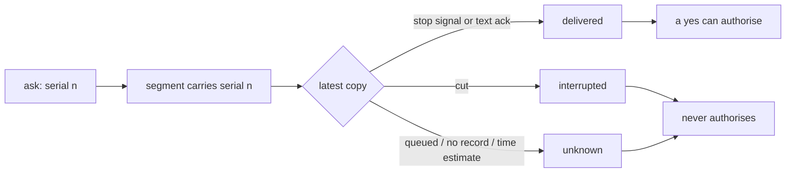
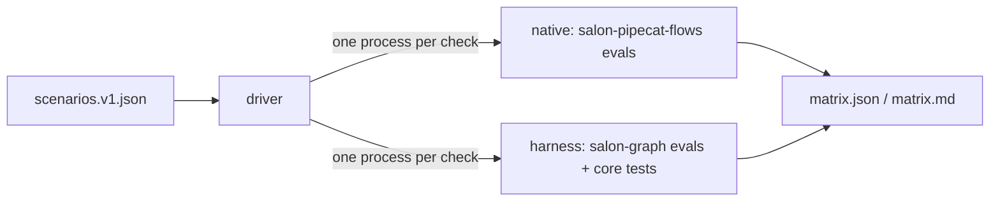

# Session 2: public boundary, typed session, explicit delivery, native quality gate

Written 25 September 2026. Plan: [reusable-voice-core-sessions.md](../../plans/reusable-voice-core-sessions.md), prompt 2, as updated by PR #16.

`slng-voice-core` now installs from its wheel into a clean project and runs a small application through a public API. An application gives its own Pydantic state model to the engine; nothing subclasses `CallContext`. A read-back can only be answered once its latest copy was delivered: a playback signal or a text acknowledgement. No record, a queued copy, a cut copy or a time estimate never authorises. The N1-N13 matrix runs both builds offline on their real pipelines: every harness row passes, and native fails N9 as expected. The frozen N12 tolerance passes after one repair. Live text: 3 of 4 cases pass; T3 fails on the known session-4 detour defect. Coval: both normal-booking calls booked correctly; the harness call passed on every measure but the frozen latency budget, and the native call booked without the caller hearing the receipt. Both stress calls ran through one SLNG STT outage and are inconclusive for both builds.

## 1. Starting point and opening update

| Item | Value |
|---|---|
| Start | `3613b99` on `main`, worktree branch `worktree-session-2`, clean |
| Plan document | PR #16 (merged), head `903229c88dd0e1931a6689b9e07a6b3a57defe92`; only `docs/plans/reusable-voice-core-sessions.md`, copied in with `git checkout 903229c8 -- <file>`. No runtime code or lockfile from it |
| `main` during the session | `176ff9f` = `3613b99` + PR #16 only |
| `uv.lock` sha256 | start `a8248035…`, end `ff362a07b142fca7…` (metadata only: extras and direct dependencies; no version changed) |
| Python, uv | 3.14.5, uv 0.12.18 |
| Native reference | `use-cases/salon-pipecat-flows` at `26114758246bfb4cd05a0242ed48e335d3f1ed4a`; `git diff 26114758 HEAD` empty for the folder; runtime digest `550dd67c4bae3790…` (`python -m matrix pin`) |
| Coval ledger at start | 2 of 14 calls used (session 1: `Li7JG95o…`, `gVoJZjyG…`); `coval runs list` showed nothing later. Session 2 allowance: 2 salon-graph + 2 native |

Inherited from session 1: the three known defects (below, all repaired), the T3 detour-time defect and the number-in-pieces defect (both session 4), and the unsettled unknown write (T4, session 3).

## 2. The public boundary

```python
import core

spec = core.load('clinic/flow.yaml')  # read and check: no model, no key, no network
flow = spec.compile(model=model)  # the one place a provider is resolved
call = flow.open(ClinicState(), services=backend, clock=clock)
reply = await core.text_turn(flow, call, 'I need an appointment')
call.acknowledge(*(s.id for s in reply.segments))  # the reader got it; only now can it be agreed to
```

`core/__init__.py` exports `load`, `FlowSpec`, `FlowSpecError`, `StepFlow`, `FlowCall`, `text_turn`, `TextReply`, `greet`, `Operation`, `ConfirmedOperation`, `OutcomeUnknownError`, `BaseProposal`, `TurnBudget`. Voice is `core.processor.PydanticAgentProcessor` (extra `voice`), tracing `core.observability.setup` (extra `tracing`). The worked example is [`core/tests/clinic_flow/`](../../../core/tests/clinic_flow/) with [`core/tests/test_public.py`](../../../core/tests/test_public.py).

A flow file names its state model and identity field:

```yaml
state: clinic.py:ClinicState
identity: patient
steps:
  - {id: patient, kind: collect, prompt: prompts/patient.md, question: What is your patient number?, fields: [patient]}
  - {id: confirm, kind: confirm, code: clinic.py, then: book, on_reject: slot, on_revise: slot}
  - {id: book, kind: action, code: clinic.py, on_error: failed}
```

### Dependencies

| Set | Packages |
|---|---|
| Required (imported by core) | `httpx`, `loguru`, `opentelemetry-api`, `pydantic`, `pydantic-ai-slim[spec]`, `pydantic-graph`, `pyyaml` |
| `voice` | `pipecat-ai` |
| `tracing` | `langfuse`, `opentelemetry-sdk` |
| Dropped from core | `python-dotenv` (each launcher loads `.env`), provider extras `google`/`openai` (salon-graph declares `pydantic-ai-slim[google,openai]`, Faro `[google]`) |

`core.observability` no longer calls `load_dotenv()`. `faro-tools/bench.py` now documents `--env-file`, and the salon evaluator's offline self-check instruments agents itself instead of relying on keys loaded by an import.

## 3. Three objects

| Object | What it is | Owner |
|---|---|---|
| Application state `S` | the application's Pydantic model, plain data, every field defaulted | application; held as `FlowState[S].facts` |
| Core session | active step, pending destination, outcome (`FlowState[S]`); turn, generation, the identity each generation began under, history, speech ledger with delivery, question ledger with serials, interpretations, budgets, `Evidence` log | core (`CallContext`, `FlowCall[S]`) |
| Services | backend clients and clock, passed to `StepFlow.open(state, services=..., clock=...)`; private, so no template can reach them | application decides shared or per call; a compiled `StepFlow` is shared per process |

### State updates

- One boundary, `CallContext.commit`: the whole candidate from `model_dump() | deepcopy(updates)`, validated with `model_validate(..., extra='forbid')` (refuses unknown keys in nested models that set no `extra`). Invalid input leaves the state object unchanged.
- `FlowCall.update(**fields)`: the trusted path (operation results, application code). `FlowCall.collect(**fields)`: the model path, only fields some collect step names; anything else raises before it is looked at. The collect tool's schema is built from the state's own field types, constraints kept (`_optional`).
- `Evidence`: `Operation.run` files every validated receipt before anything can await. Append-only. `ActionStep` and `ConfirmStep` completion reads it (`receipt_for`): a receipt counts only for the arguments the state gives now and the current identity, so a correction ends completion without erasing the record.
- Stale work: a superseded generation keeps its business facts and loses flow fields (as before); a superseded generation that began under another identity writes no state at all; its receipt is still filed.

## 4. Delivery



1. Each `ask` gets a serial. A segment saying the question's words on its turn is stamped with it; a question with no fixed words is carried by the model's speech after it (`ProposalLedger.bind`).
2. `Spoken.delivered` is `delivered` only on evidence: `playback == 'played'` with `heard_by` `signal` (the runtime's stop) or `ack` (`CallContext.acknowledge`).
3. `ProposalLedger.last` reads the latest stamped copy only. A full repeat after a cut first copy is answerable; an older copy or the same words for another question prove nothing.
4. `note_barge` ends the audio burst, so a late stop for cut-off audio cannot count a copy queued after the cut-in as played.
5. The `PLAYOUT_SLACK` estimate still decides turn continuation (CLAUDE.md item 7), never approval.
6. The `write` audit adds `proposal` (the serial) and `segments` (the copies' ids).

`take_turn(..., received=True)`, `receive(call)` and `read_out(call, line)` are the text adapter's explicit acknowledgements, used by tests and evaluators.

### Test changes the new rule required

Existing tests answered read-backs that were never recorded or never played. Each now delivers the read-back explicitly where the test means the caller heard it; business assertions are unchanged. Helpers changed: `test_classes.asked`, `test_reuse` (module turns `received=True`), salon `test_classifiers._next_turn` / `pending_booking` / `pending_readback`, `test_replay.pending` (the `delivered` flag now acknowledges), `test_consent` (`read_out`, `_model_asks`), `test_salon` / `test_budget` (wordless asks said by the model and delivered), `test_recovery.played_in_full`, `test_continuation` (the full repeat acknowledged), `test_optimization` (`receive`), `test_traces`, `test_faro.Line.turn` (the learner reads the last reply before answering). Golden snapshots unchanged.

One assertion changed meaning: `test_optimization.cancellation_keeps_committed_receipt` expected one classifier reading of a yes after the receipt's "Anything else?" was cancelled mid-speech. That question never played, so it now gets no reading (`call.requests == []`). The complaint, the single write and the retained receipt are asserted as before.

## 5. SDK reuse

| Primitive | Replaces or backs | Check |
|---|---|---|
| `model_validate(..., extra='forbid')` on the whole candidate | field-by-field assignment; silent drop of unknown nested keys | `test_sdk.whole_candidates_refuse_nested_unknown_keys`, `test_session.invalid_updates_change_nothing` |
| Discriminated union in state (`Unverified \| Verified`) | a behaviour validator like salon's `_verification_belongs_to_one_identity` | `test_sdk.the_model_cannot_write_a_verified_identity` |
| `TemplateStr` against `FlowCall[S]` | untyped prompt context | `test_sdk.prompts_see_the_state_and_nothing_else` (nullable and union fields, `SecretStr` masked, services unreachable, unknown field refused) |
| `Agent.from_spec` with `deps_type=FlowCall[S]` on the existing graph (`core.flow`, pydantic-graph `GraphBuilder`) | session 3's agent construction | `test_sdk.an_agent_spec_runs_on_the_existing_graph`. Decision for session 3: usable for model, settings and typed instructions under the manifest; it is not the voice application |
| State field types as the collect tool schema | a separate per-step field model | `test_sdk.the_collect_schema_is_the_states_own` (enum and pattern reach the model) |
| Hooks, `UsageLimits`, `new_messages()` retention | budgets and cancellation history | existing `tests.test_history`, salon `test_budget`, `test_flow` |
| `TypeAdapter` | nothing yet: no receipt is a union | not used |
| Pipecat `FlowManager`, `tts_say` | not adopted: no second scheduler. The native build's custom `say` avoids the `ActionFinishedFrame` hang, and the harness has no equivalent wait | matrix N7 |

## 6. Required checks

| Check | Where | Result |
|---|---|---|
| Invalid multi-field and nested update leave the original | `test_session.invalid_updates_change_nothing` | pass |
| Protected field through collection refused before the backend | `test_session.the_model_writes_only_collected_fields` | pass |
| Mutating a committed or opened object changes nothing saved | `test_session.what_the_caller_keeps_cannot_reach_the_state` | pass |
| Two interleaved sessions on one compiled flow | `test_session.two_calls_on_one_flow_share_nothing` | pass |
| Generated read-back, no acknowledgement, yes: no write | `test_public.an_unheard_read_back_books_nothing`, `test_delivery.text_with_no_acknowledgement_is_unknown` | pass |
| Partial read-back, yes: no write | `test_delivery.a_partly_read_read_back_is_not_heard` | pass |
| Cut first copy, delivered repeat, yes: exactly one attempt | `test_delivery.the_full_repeat_after_a_cut_copy_is_heard_once` | pass |
| Identity or argument revision, stale proposal, unrelated yes, conditional yes, replay | `test_session.only_the_delivered_current_proposal_authorises` | pass |
| Late playback stop or late reading from an old generation | `test_delivery.a_late_stop_cannot_play_a_copy_queued_after_the_cut`, `test_session.a_late_reading_does_not_act` | pass |
| Cancellation after a matching receipt | `test_session.a_cut_confirmation_keeps_the_booking_once` | pass |
| Old direct-core, Pipecat parity and split-utterance tests | salon-graph `test_core`, `test_continuation`, `test_overlap` | pass |

Each negative check was confirmed able to fail: with the old "no copy means heard" rule restored, `test_delivery`, `test_public` and `test_session` all fail.

Not covered: in-place mutation of `call.state.facts` (an application's own model may allow attribute assignment). The engine never mutates in place and every commit replaces the object; freezing is the application's model config.

## 7. Package proof

[`session-2/package-proof.sh`](session-2/package-proof.sh), run with `env -i` (only `PATH` and `HOME`), a fresh `uv venv` outside the checkout, and the wheel only:

| Step | Result |
|---|---|
| Wheel | `slng_voice_core-0.1.0-py3-none-any.whl`, sha256 `60778b25ca345c9b3709def0d326dca29ce4d87916ade3e48723fe1225aab1ca` |
| Core install | 24 packages ([`package-deps-core.txt`](session-2/package-deps-core.txt)); resolver picked `pydantic-ai-slim 2.50.0` |
| Import location | `…/app/.venv/lib/python3.14/site-packages/core/__init__.py` |
| Offline scenario | clinic slice loads, books `CL001`, no `pipecat`, `langfuse` or `dotenv` loaded |
| Missing extras | `core.processor needs the voice extra: install slng-voice-core[voice]`; same for `core.observability` and `[tracing]` |
| With `[voice,tracing]` | 55 more packages ([`package-deps-extras.txt`](session-2/package-deps-extras.txt)); both import |

In the workspace, `core/tests/test_package.py` checks the same import hygiene in a fresh interpreter with the keys removed.

## 8. N1-N13 native comparison

How to run: `cd use-cases/concierge-tools && uv run python -m matrix run` (and `time` for N12). Scenario file [`matrix/scenarios.v1.json`](../../../use-cases/concierge-tools/matrix/scenarios.v1.json). Raw results [`session-2/matrix.json`](session-2/matrix.json).



1. Each row lists existing assert functions and line scenarios for each arm.
2. A line scenario drives the build's real pipeline: user aggregator, the build's LLM node (native: `GoogleLLMService` with the real `FlowManager`, `ClaimFilter`, `EmptyReplyGuard`; harness: `PydanticAgentProcessor`), a playout sink, assistant aggregator. The only fake is the provider: `ScriptedGemini._stream_response` returns Gemini chunks; Pydantic AI `FunctionModel` answers the harness's agents and readings. Same caller words, same 50 ms delay.
3. Each scenario checks the harness's acceptance condition on both builds; a native gap is a native fail.
4. The driver refuses to run if the native digest changed, runs every check in its own process, and exits 1 on any harness failure or missing result.

Final run, on the final code (exit 0):

| Row | Native | Harness | Checks (native / harness) | Status |
|---|---|---|---|---|
| N1 | pass | pass | 4/4 / 6/6 | pass |
| N2 | pass | pass | 6/6 / 6/6 | pass |
| N3 | pass | pass | 3/3 / 4/4 | pass |
| N4 | pass | pass | 2/2 / 4/4 | pass |
| N5 | pass | pass | 2/2 / 3/3 | pass |
| N6 | pass | pass | 5/5 / 5/5 | pass |
| N7 | pass | pass | 4/4 / 3/3 | pass |
| N8 | pass | pass | 1/1 / 6/6 | pass |
| N9 | fail | pass | 0/2 / 11/11 | pass |
| N10 | pass | pass | 1/1 / 4/4 | pass |
| N11 | pass | pass | 1/1 / 3/3 | pass |
| N13 | not exercised | pass | 0/0 / 3/3 | pass |


| Row | Native evidence | Harness evidence | Notes |
|---|---|---|---|
| N1 | `arguments_are_validated_before_anything_runs`, `a_malformed_receipt_changes_nothing`, `every_tool_has_its_pydantic_schema` (enum by `typed()` patch), `bad_slot` | `test_state` batch and malformed-response checks, `a_result_about_a_different_slot_is_not_accepted`, `invalid_updates_change_nothing`, `the_collect_schema_is_the_states_own`, `bad_slot` | both refuse a slot that does not exist; enum reaches the model in both (native by patch) |
| N2 | four `test_graph_salon` consent checks, `booking`, `replay` | `n3_a_flipped_flag_is_not_consent`, `n4_a_correction_is_not_an_agreement`, `correcting_the_number_withdraws_the_old_authorisation`, `only_the_delivered_current_proposal_authorises`, `booking`, `replay` | one booking each; no second on a replayed yes |
| N3 | `an_unidentified_booking_goes_through_verify_and_resumes`, `a_booking_asked_of_the_concierge_is_read_by_code_after_the_lookup`, `booking` | `service_requests_verify_first`, `n2_the_day_survives_the_verification_detour`, `openings_skip_the_model`, `booking` | after verification the harness offers times with no model request; native spends 3 (answer, read_diary, the offer) |
| N4 | complaint read-back, `booking` | move, complaint wording, book-again-after-cancel, `booking` | native move and cancel not exercised by any native check |
| N5 | `one_action_per_reply`, `the_turn_budget_ends_with_a_fixed_line` | `a_second_action_is_refused_before_it_runs`, budget exhaustion, tool limit | |
| N6 | fault, empty reply, claim filter, code-line copy, `empty_output` | unbacked-claim correction, repair bound, silent request retried, note said once, `empty_output` | doubly empty reply: native 2 requests (1 rerun, fixed line), harness 3 step requests + 2 readings (Pydantic AI output retries, then its fixed line). See below |
| N7 | `say` waits for nothing, no node waits on a dropped frame, `action_frame_dropped`, `barge_during_entry_line` | barge after a tool moves nobody, a missing barge never merges turns, `barge_during_entry_line` | reproduced: Pipecat's `tts_say` node change did not complete within 2 s when the frame was dropped; the build's custom `say` did |
| N8 | `cut_receipt` | three `test_overlap` barges around a write, reconcile-not-repeat, `a_cut_confirmation_keeps_the_booking_once`, `cut_receipt` | one booking kept, none repeated, both builds |
| N9 | `unplayed_read_back`, `partial_read_back`: **both book** | five `test_delivery` checks, cut read-back, split reply, pauses around thresholds, superseded turn, `unplayed_read_back`, `partial_read_back`: **no booking** | the stronger contract. `SalonCall.approve` checks kind, caller and turn, not playback |
| N10 | `provider_messages_in_context` (Gemini `LLMSpecificMessage` in the context) | `cancellation_keeps_receipts`, `interrupted_protocol`, `cancelled_queue_keeps_all_accepted_input`, `provider_messages_in_context` (a `ThinkingPart` with a signature, a paired call, an orphaned call: only the pair is sent) | |
| N11 | `two_calls` | `two_calls_on_one_flow_share_nothing`, `a_yes_said_as_the_line_drops_still_counts`, `two_calls` | native disconnect and setup failure not exercised |
| N12 | timing below | timing below | |
| N13 | none | `one_booking_through_the_public_boundary`, `what_the_application_wrote`, `importing_and_checking_loads_nothing_else` | foundation only; session 3 finishes N13 |

The first version of `empty_output` passed at 2 requests or fewer, a bound copied from the native build's own repair rather than the row's rule ("bounded, one truthful audible outcome"); the harness spent 3 step requests. It now passes on an audible, write-free recovery within the 8-request turn budget both builds share, and both counts are reported. The extra request is Pydantic AI's output retry on a structured step: a candidate for session 3's turn policy, not fixed here.

### N12: request topology and overhead

The booking trace (5 caller turns, request made before identity). Model requests per trace:

| | Step model | Classifier | Code-decided transitions and receipts |
|---|---|---|---|
| Native | 7 | 0 | none: every node change and read-back needs a model call (`answer`, `read_diary`, `ask_booking`) |
| Harness | 1 | 7 (consent, request-kept and closing side by side; pick; confirmation) | verification return, offer, read-back and receipt made with no step-model request |

Protocol (frozen in the plan before measurement): 3 warm-ups, 20 paired repetitions alternating which arm starts, each run in its own process, fake provider delay 0 and 50 ms. Tolerance on each turn's median at delay 0: harness ≤ native + max(5 ms, 25 %); every harness turn under 50 ms. Raw samples: [`timing.json`](session-2/timing.json), first run [`timing-before-fix.json`](session-2/timing-before-fix.json).

Median dispatch-to-last-output per turn, ms, delay 0:

| Run | Arm | T1 | T2 | T3 | T4 | T5 | Trace (range) |
|---|---|---|---|---|---|---|---|
| before fix | native | 7.0 | 8.5 | 30.1 | 6.6 | 6.7 | 57.6 (45.4-64.0) |
| before fix | harness | **12.5** | 5.5 | 10.9 | 6.8 | 6.5 | 42.4 (33.4-46.4) |
| after fix | native | 7.0 | 7.9 | 29.8 | 6.5 | 6.0 | 56.6 (34.7-61.0) |
| after fix | harness | 10.8 | 5.3 | 11.4 | 6.5 | 6.6 | 39.4 (33.2-51.6) |

With a 50 ms provider: native trace 420.8 ms (412.1-425.4), harness 256.4 ms (239.5-260.2).

The breach and the repair: before the fix, turn 1 (the hand-over turn) was 12.5 ms against an allowed 12.0. The driver's first verdict only applied the tolerance to the trace total; the plan froze it per turn, so the per-turn verdict was added and applied to the same raw samples. A profile showed Pydantic AI rebuilding the run's output schema on every run, because `core.turn` passed `Node.outputs(state)`, which for `AgentBuilder` steps is always the agent's own declared set. The engine now passes nothing in that case (`core/src/core/turn.py`). After the fix every turn is within tolerance (turn 1: 10.8 against 12.0; max harness turn 13.6 ms).

Not claimed: in one long-running process, turn 1 is warm at about 9 ms for the harness against 2.5 ms for native (5 traces each, `warm.py` investigation). The frozen protocol measures a fresh process per run, and this difference is outside it. The remaining cost on that turn is the engine's speculative step runs and Pydantic AI capability wrappers.

## 9. Live text checkpoint

`cd use-cases/salon-graph && uv run --env-file <main>/.env python -m evals.calls --out ../../docs/research/reusable-core/session-2/text`: the frozen cases, one attempt each, the text caller acknowledging every segment by id (`receive`). Records: [`session-2/text/`](session-2/text/).

| Case | Result | Caller turns | Requests | Tokens in + out | Session |
|---|---|---|---|---|---|
| T1.v1 | passed | 6 | 15 | 6,526 + 198 | `text-T1.v1-f3db5c60` |
| T2.v1 | passed | 8 | 21 | 10,186 + 284 | `text-T2.v1-ac600467` |
| T3.v2 | **failed**: after the verification yes it offered 9:00, 9:30 and 10:00 for Thursday, not the requested 2 PM | 6 | 17 | 12,444 + 285 | `text-T3.v2-1bd4d89f` |
| T4.v2 | passed: the first write landed and raised, its outcome was asked for before any second write, one booking, no success claimed early | 7 | 20 | 10,083 + 262 | `text-T4.v2-e387a663` |

Checkpoint total: 73 of 100 requests, 39,239 input + 1,029 output tokens (allowance left: 27 requests). T3's failure is session 1's detour-time defect, owned by session 4; this session did not touch it. T4.v2 ran for the first time and passed.

Every `write` audit now carries the question's serial and the one segment that carried it (for example T1 `save_booking`: proposal 3, one segment). The sessions reached Langfuse this time (the ledger finds their `write` spans); its request count is 0 because a text call has no voice turn spans, so request and token counts are the evaluator's own.

Text timings, 27 caller turns: turn wall time median 0.932 s (0.650 to 2.537), within the frozen 1.1 s budget and a rise of 61 ms on session 1's 0.871 s (the trigger is max(200 ms, 20 %)). Engine time per turn: median 0.005 s, max 0.024 s (budget 0.05 s).

## 10. Coval checkpoint

Four calls, 6 of the 14-call cap now used. Frozen IDs from session 1: sets `kQ8b6nMZ` (normal) and `K3Xwqi7g` (pause and correction), personas `MUFJdYAHdBHU6UbRRu4ykM` (Standard Customer) and `VSruLZYYyz3w7fkdUaheDR` (Interruptive Speaker, HIGH), the same four metrics. Run log: [`session-2/coval-runs.jsonl`](session-2/coval-runs.jsonl).

Native target set up this session: agent `cCQwmuCdjz6twETL6Vj933` (`voice-harness-salon-pipecat-flows-pipecat`, created by `coval_sim add`), the two sets and four metrics attached. Its bot has no call limit, so the runner stops it 188 s after the call connects (`coval_sim.runtime.ceiling`, checked in `test_coval_sim.test_call_ceiling`); call 4's recording ends at 188 s.

Settings differ between the arms and are the configured products: harness `gemini-3.5-flash-lite`, Silero `stop_secs=0.2`, smart-turn 1.6 s; native `gemini-3.1-flash-lite` (hard-coded), Silero defaults, smart-turn 1.5 s. So no speed comparison between them is claimed.

Calls 1 and 2 ran one at a time, each reviewed before the next. At your request, calls 3 and 4 ran side by side (`coval_sim --port`, added this session: one port per job), which set aside the plan's rule of reviewing each call before launching the next for those two.

| | 1: normal, harness | 2: normal, native | 3: stress, harness | 4: stress, native |
|---|---|---|---|---|
| Run | `BChXtqzgWq5HxzxP69aoKo` | `XMnnft82s6MitKPjiiQpJz` | `RXcDFLJXHnN7dEddsLyptv` | `ZTKVhxqTAhRAekBhG9jAsC` |
| Simulation | `h92De4uNeQjGcLvdDPSkRG` | `VpwEcccXGwgUGWA25LhFDz` | `Qcd2UDR6v4ceyijodza4B5` | `4dqBFiHpPLDmkXLSQjAgsD` |
| Call id = Langfuse session | `CAbb3045c5dbe84e31a4c8a5772783ad61` | `CA3b549d6904774e12857058d378d3d362` | `CA2edbef2dd691405ba2179e93e538494f` | `CA91f216a75ba34d47b6f551ee2a5ae6e6` |
| Expected behaviours | 1.0 | 1.0 | 0.6 | 0.6 |
| Changes match what was agreed | YES | YES | NO | UNKNOWN |
| Answered question not asked again | YES | YES | NO | NO |
| Coval latency metric | 2.13 s | 2.18 s | 8.13 s | 5.96 s |
| Receipt (write span) | `save_booking` ok, haircut Fri 2 Oct 09:00 | `save_booking` ok, Fri 2 Oct 09:00 | `save_booking` ok, Fri 2 Oct 09:00, on a delivered read-back and "Yes, that works for me." | none (phone confirmed only) |
| Receipt heard | yes | **no**: TTS dropped it ("interrupted mid-utterance") when "That's perfect." arrived; never said again | yes | - |
| Requests (ledger) | 12 (11 classifier, 1 step), 15 cancelled | 7 step, 1 cancelled | 17 (12 classifier, 5 step), 8 cancelled | 8 step, 6 cancelled |
| Tokens in + out | 5,984 + 188 | 20,818 + 201 | 14,301 + 334 | 20,246 + 243 |
| Answer time p50 (work start to first speech) | 1.03 s | 1.10 s | 1.02 s | 3.06 s |
| Response latency, audio, raw (s) | 1.98, 0.96, 2.52, 2.44, 2.48, 3.28 (median 2.46) | 2.02, 1.56, 2.44, 1.90, 3.82 (median 2.02) | 1.74, 1.60, 2.28, 0.68, 12.84, 18.46, 15.50, 13.04 | 1.68, 1.64, -0.64, 3.56, 25.52, 5.58, 1.84, 3.00 |
| Overlaps (audio) | none | none | none | one, 31.12-31.28 |
| Recording | 86.1 s | 82.0 s | 180.8 s (bot ceiling) | 188.1 s (runner ceiling) |

**Call 1 (harness) passes on behaviour** and matches its receipt and audio: the number read back and agreed, Friday times offered, 9 AM read back, one booking, receipt heard, no overlap. Coval's transcript marks every caller turn `is_interrupted` and overlaps segment ends with the agent's starts; the recording shows no overlap, so that is Coval's segment timing. It **breaches the frozen latency budget**: median 2.46 s against 2.29 s, and 0.64 s above session 1's 1.82 s, over the max(200 ms, 20 %) trigger. Investigated: the harness's answer time is unchanged (1.03 s p50, session 1 1.01 s). The difference is before work starts: this caller spoke in pieces (five continuation pieces over turns 2, 4, 5 and 6), each cancelling and redoing its readings (15 cancelled requests, session 1 11). Session 1's call 1 had none. One call cannot separate pacing from code; the latency gate stays open.

**Call 2 (native) books correctly but the caller never hears the confirmation.** The judge scored it 1.0; the recording and bot log show the receipt was generated and dropped by TTS as the caller's second piece arrived, and the model then closed with "You're very welcome. See you then." The case requires a matching confirmation, so on evidence this criterion is not met: a judge error. For comparison, the harness records such a receipt as not heard, and its next reply is told what the caller missed (`test_continuation.the_next_reply_is_told_what_was_not_heard`); this call pair did not exercise that on the harness.

**Calls 3 and 4 are inconclusive for both builds.** Both bots lost SLNG STT at the same moment (15:34:20 and 15:34:24: "no close frame", reconnect handshakes timing out, init acks timing out) and one TTS context produced no audio. Each call then sat silent for 46 s (harness) and 72 s (native) while nothing was transcribed, and both ran into the 180 s ceiling. Whether running two calls at once caused the outage or only coincided with it is not known from one sample. What the harness call still shows:

- Session 1's number-in-pieces defect again: "Please give me the rest of the digits" twice (session 4).
- Its offer's TTS context produced no audio; the caller's next reply was read as a pick of 9 AM from that unheard offer, and 9 AM was read back. The booking itself was authorised correctly, by a delivered read-back and a yes, but a pick read against an offer the caller never heard is a finding for session 4 (should a choice reading require a delivered offer?).
- Barge-in into the appointment read-back: not exercised in either stress call.

Trigger coverage:

| Trigger | 1 | 2 | 3 | 4 |
|---|---|---|---|---|
| Premature endpoint (pieces joined) | exercised (5) | native does not join | exercised (4) | native does not join |
| Agent over caller | not seen | not seen | not seen | one 0.16 s fragment |
| Barge-in into the read-back | not exercised | not exercised | not exercised | not exercised |

Spend: 4 calls, 537 s (about 9 minutes) of simulated audio; Gemini tokens as above; no provider bill was read, so no money figure is stated. No call was retried. Rerunning the stress pair needs an allowance beyond this session's four calls.

## 11. Checks

From the root, keys unset, at the end of the session:

```text
uv run ruff check .             All checks passed!
uv run ruff format --check .    189 files already formatted
ty check, every member          All checks passed! x7
core                            all 9 modules ok
salon-graph                     all 17 modules ok
salon-prompt                    all 1 modules ok
salon-pipecat-flows             all 1 modules ok
faro-language-learning          all 1 modules ok
concierge-tools                 all 4 modules ok
core tests.defects              exit 0 (no known defect left)
matrix run                      exit 0 (every harness row passes; N9 native fails as expected)
```

## 12. Compatibility still needed

| Consumer | Uses | Until |
|---|---|---|
| salon-graph | `SalonCall(CallContext)`, `call:` in its flow file, deep `core.*` imports, `SALON`/`DESK`/`BUILDER` assembly | session 4 |
| faro-language-learning | `FaroCall(CallContext)`, deep imports, own assembly | session 5 |
| faro-tools `bench.py`, salon `evals/calls.py` | `core.turn` directly and private call attributes (`_say`, `_end`, `_proposals`) | session 6 |
| salon-graph and Faro tests | deep and private imports | their sessions |
| `core/tests/clinic.py` | `ClinicCall(CallContext)` (the older reuse fixture) | session 3 replaces it with the manifest clinic |
| `FlowSpec.call` | a flow naming its own call class | removed when salon and Faro migrate |

## 13. Status

| Dimension | Status |
|---|---|
| Foundation correctness | pass: atomic state, owned fields, isolation, stale work, evidence, clean installation |
| Native common-case parity | pass on every applicable row (N1-N8, N10, N11); N4 native move/cancel and N11 native disconnect not exercised |
| Stronger delivery guarantees | pass: N9 harness refuses unplayed and cut read-backs; native books on both |
| Runtime overhead | pass under the frozen protocol after one repair; warm hand-over turn slower than native, recorded, not claimed |
| Live audio | incomplete: normal booking passed on behaviour on both builds (native with an unheard receipt); harness latency above the frozen budget; stress pair inconclusive (STT outage) |
| N13 | foundation pass; full authoring proof due in session 3 |

Next session prerequisites: the manifest (session 3) builds on `FlowState[S]`, `collect`/`update`, `Evidence` and `receipt_for`; decide whether a doubly empty structured reply should cost one repair, not two.
