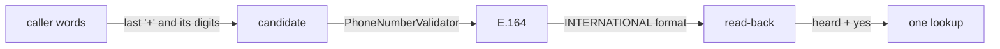

# Session 3: the stress-path repairs, then the ordinary authoring contract

Written 25 September 2026. Plan: [reusable-voice-core-sessions.md](../../plans/reusable-voice-core-sessions.md), prompt 3, as updated for this session (commit `b7791c0`).

An application can now be a manifest (`agent.yaml`), fields-only Pydantic models, prompts and typed functions. The clinic is written that way three times: a controlled flow, one conversational agent, and a front desk handing over to a specialist. All three use the same `clinic.py`, with no `Operation` subclass, no call class and no core edit. The salon's identity path runs on the same manifest with the salon's real types. Phase A repaired the stress path first: phone numbers from any country, and a new speech profile. The first live stress call then found a real fault, and core now fixes it: a receipt the caller never heard is said again instead of being moved. The live text T4 case regressed on model wording, and code now settles it.

## 1. Starting point

| Item | Value |
|---|---|
| Parent | `feat/session-2-public-boundary` at `47f41923064f57fa01847785a46d14c1999a1fd5` (PR #17, open), contains `6c9f75c` |
| Child branch | `feat/session-3-authoring`, created from the parent in worktree `reusable-core-s3` (the worktree's own branch had no commits) |
| Plan update | `docs/plans/reusable-voice-core-sessions.md` copied from the ce27 worktree; the local copy had no edits since `903229c`, so it was replaced whole (`b7791c0`) |
| `uv.lock` sha256 | `ff362a07b142fca7…` at start and end: no dependency changed |
| Versions | Python 3.14.5, pydantic-ai-slim 2.46.0, pipecat-ai 1.11.0, pipecat-slng 0.5.2 |
| Native reference | unchanged: the matrix pin check passes (`550dd67c…`) |
| Coval ledger at start | 6 of 14 calls used (sessions 1 and 2); `coval runs list` showed nothing newer than session 2's `ZTKVhxqT` |

Allocation, as changed during the session: the prompt gave session 3 two salon-graph calls (call 1 the stress repair, call 2 the final regression). After call 1 you allowed **eight more calls, run in bulk after Phase B**: stress set ×4, then normal set ×4, each at `--concurrency 4`. These replace the single call 2. Sessions 4–6 keep their six calls. Bulk calls run at the same time, so their latency does not compare with calls run one at a time.

## 2. Phase A: the stress path

### A1. Phone numbers from any country



1. `HeardValue.turns` (session 2) still joins the pieces across turns. The joiner takes the last "+" and every digit after it, so a restart replaces the old number.
2. `Phone` and `SubmittedPhone` validate with pydantic-extra-types' `PhoneNumberValidator(number_format='E164')`. There is no region list and no default region, so a country code is never guessed.
3. The read-back uses the validator's own `INTERNATIONAL` format. Spanish numbers now read as "+34 671 27 34 54" (your choice: less code).
4. The false line "I can look up Spanish phone numbers" is gone, and so is its tool topic.
5. Wrong lengths are explained with libphonenumber's own reasons, and the digit count is kept for the model.

Model-facing changes: the phone field's description and the `verification_guidance` topics (`tests/golden/agents.json`, reviewed). The native reference and salon-prompt keep their Spanish-only copies of `shapes.py`. So the phone-support profile now differs between the builds. This is recorded here, not changed in the comparator.

Offline checks, each counting lookups (`test_continuation`, `test_state`):

| Case | Result |
|---|---|
| "+34 671", then the request for the rest, then "273 454" | read back, 0 lookups before agreement |
| +1 and +353 numbers | read back in their own format; 0 lookups on an unheard read-back, exactly 1 after a heard yes; a replayed yes adds none |
| A correction (+44 … 0958, then 0959) | the new number read back; one lookup, with the new number |
| No country code | not read back; the model asks for the country |
| A digit too many | "I heard 10 digits after +34 …", no model request |
| Invalid numbers and lookup arguments | refused with the one thing to do next |

### A2. Speech profile v1

File: [`session-3/speech-profile.v1.env`](session-3/speech-profile.v1.env), sha256 `a168116910c50ec3…`. It is secret-free and is loaded after the main `.env`. No bot code changed.

| Setting | Value | Evidence |
|---|---|---|
| Host | `eu-west.api.slng.ai` (Germany) | both models list it (SLNG regions map) |
| STT | `deepgram/nova:3`, language `en` | `deepgram/nova:3-en` does not exist. `slng/deepgram/nova:3-en` is US, Australia and India only. Nova 3 runs on Deepgram's servers, and only the gateway is in the EU. You accepted this |
| TTS | `slng/fish/tts:s2.1-pro` | Netherlands, Germany, Australia, UK |
| Voice | `16cabdb7f8d240569aff36c9e480d783` (Amelia) | the Fish voice id format. The old Cartesia UUID does not fit |
| Audio | TTS linear16 at 24 kHz (Pipecat's default), STT linear16 at 16 kHz | the bridge accepts 8–44.1 kHz |
| Unchanged | Gemini 3.5 flash lite, Silero `stop_secs=0.2`, smart-turn 1.6 s | |

Offline preflight built the SDK's real connection options: `wss://eu-west.api.slng.ai/v1/bridges/unmute/tts/slng/fish/tts:s2.1-pro` and `…/stt/deepgram/nova:3`. Live evidence: every call below connected and transcribed. This replaces the old speech profile, so no latency is compared with sessions 1 and 2. The frozen product target stays the same: a median response latency of at most 2.29 s per call, and a barge-in stop of at most 0.5 s. The target was fixed before any new measurement.

### A3. What a later turn knows about missed speech

Decision: **no history change**. The one-turn note stays, and code now handles a receipt that was never heard (see A4). Evidence, in `test_continuation.an_unheard_receipt_is_said_again_and_not_booked_again`:

1. A goodbye over an unheard receipt: the receipt is said again by code, with no model.
2. A change of mind over it: the model gets the note, which contains the receipt's own words. Its history still holds the booking's application result.
3. Nothing is written twice, and the turn after a heard reply carries no note.

### A4. The stress call, and what it found

Offline first: ruff, ty and every suite were clean, and the matrix matched session 2 ([`matrix-before-receipt-fix`](session-3/matrix-before-receipt-fix)).

Call 1: run `BVqdGEunV3avnHrHVwq4oE`, simulation `7kYgV9kZLXV9GYeDTHZrPe`, call `CA7ca49095d1194811a5bab4c274a58b00`, revision `0f72ca6`. It was launched once, with 1 simulation. Evidence: [bot log](session-3/stress-bot.log), [ledger](session-3/stress-ledger.txt), [transcript](session-3/stress-simulation.json). The judge scored expected behaviours 0.50.

| Check | Result |
|---|---|
| Split number | pass: "+34 671", "please give me the rest", "273 454" read back once and agreed; no repeated request |
| Choice from an unheard offer | not triggered |
| Correction reaches one matching effect | **fail**: the Saturday read-back was agreed and booked (write 1). Its receipt was cut before any audio played, and the caller went on: "Yes, tomorrow at nine AM. That's great." The take-back reading said **keep** twice, but nothing acted on it. The front desk's model then handed over "move the haircut to Saturday morning". 9:00 was now the caller's own booking, so 10:00 was offered and the booking moved (write 2) |
| Unheard receipt recovered without executing again | **fail**, same cause |
| Premature endpoint | exercised: turns 5, 8, 9, 10 and 11 continued with more pieces |
| Receipt cut by the caller | exercised (turn 8) |
| Read-back barge-in | not exercised: the recording has no overlap at all ([audio timing](session-3/stress-audio-timing.txt)) |
| Agent over caller | not seen (no overlap) |
| Response latency (audio) | 2.12, 1.98, 3.34, 2.14, 3.48, 4.8, 2.08, 3.1, 2.5, 2.48, 2.06 s: median 2.48 s (n=11), **above** the frozen 2.29 s target, on the new speech profile |

Consent held throughout: both writes answered a delivered read-back and a yes. The fault is recovery.

**Repair** (`26d5cd8`, core `TakeBack`): when the reading is `keep` and the held receipt is known to be unheard, the receipt is said again word for word, with no model and no write. Known unheard means cut, or never started on a runtime that reports playback. An unclear reply or a change still goes to the model with the note. `test_continuation.a_receipt_cut_before_it_played_is_said_again_not_moved` replays the live sequence. It fails with the fix off, and with the fix off the model hands over again, as it did live.

## 3. Phase B: the ordinary authoring contract

### The minimal manifest

```yaml
version: 1
id: clinic-booking
app_version: '2026.09.25'
state: clinic.py:ClinicState       # plain data, every field defaulted
identity: patient
services: clinic.py:Backend        # one per call when open() is given none
locale: english
agents:
  receptionist: {prompt: prompts/receptionist.md}   # spec: Pydantic AI's native AgentSpec
operations:
  book:
    function: clinic.py:book       # def book(clinic: Backend, a: Appointment) -> Booked
    args: {patient: patient, slot: slot}
    readback: clinic.py:booking_words
    reconcile: clinic.py:find_booking
    succeeds: {status: booked}
    assign: {reference: reference}
    say: 'Booked for {when}, reference {reference}.'
steps:
  - {id: patient, kind: collect, agent: receptionist, prompt: prompts/patient.md,
     question: 'What is your patient number?', fields: [patient]}
  - {id: slot, kind: collect, agent: receptionist, prompt: prompts/slot.md,
     question: 'I have {options}. Which works for you?', fields: [slot],
     choices: {slot: clinic.py:free_times}}
  - {id: confirm, kind: confirm, operation: book, then: book, on_reject: slot, on_revise: slot}
  - {id: book, kind: action, operation: book, then: done, on_error: failed, on_unknown: unsure}
  - {id: done, kind: end, outcome: completed, say: 'Anything else?', take_back: undo}
```

The whole file is [`core/tests/clinic_flow/agent.yaml`](../../../core/tests/clinic_flow/agent.yaml). It also declares the cancel operation, the undo steps, and the failed and pending endings.

| Concept | Field | Meaning |
|---|---|---|
| Application | `id`, `app_version`, `version` | `version` is the manifest format |
| State, identity | `state`, `identity` | the application's model; the caller field |
| Entry, services | `entry`, `services` | the first step; `file.py:factory` for one call's services |
| Model, locale | `model`, `locale` | the default model; the engine's fixed lines. Speech settings belong to the voice adapter |
| Personas | `agents.<name>.prompt`, `.spec` | shared instructions, plus Pydantic AI's **native** `AgentSpec` (model, settings, retries), never retyped |
| Operations | `function`, `args`, `assign`, `succeeds`, `matches`, `approval`, `readback`, `reconcile`, `say` | see below |
| Steps | `collect` (`choices`), `confirm`, `action`, `conversation` (`fields`, `choices`, `operations`, `exits`), `end` (`take_back`), `agent` (hand-built) | |

Python is the schema source. An operation's argument and receipt models come from the function's signature. `args` binds every argument to a state field, and a model never recreates them. `assign` copies receipt fields into state fields. The closed predicates are field presence (existing `FieldsPresent`: `None` and empty values are absent; `False` and `0` are present), `succeeds` (receipt field equality), `matches` (a receipt field equals an argument), trusted identity (`identity`), and allowed choice (only an offered id). Anything unusual is a named typed function.

### Public imports

`import core`: `load`, `FlowSpec`, `FlowSpecError`, `StepFlow`, `FlowCall`, `text_turn`, `TextReply`, `greet`, `Operation`, `ConfirmedOperation`, `OutcomeUnknownError`, `BaseProposal`, `TurnBudget`. The clinic imports only `OutcomeUnknownError`, the one exception its service raises.

### Startup validation

`problems()` connects to nothing. `test_authoring.definitions_fail_before_any_model` breaks the clinic's manifest in 17 ways. Examples:

| Break | Diagnostic |
|---|---|
| a repeated step id | `step id 'patient' is used more than once` |
| function file missing | `operation book: 'nowhere.py' does not exist` |
| argument unbound | `operation book: argument 'slot' is not bound to a state field` |
| wrong kind of binding | `operation book: 'notes' cannot supply 'slot': they hold different kinds of value` |
| receipt overwrites a collected field | `operation book: assigns 'slot', which the caller gives; a receipt may not overwrite it` |
| approval with no read-back | `operation book: needs approval, so it needs a readback function` |
| a bad prompt reference | `slot: prompt … does not fit the call: Field 'nickname' not found` |
| action reachable without its confirm | `book: needs approval, and no confirm step for 'book' leads to it` |
| unknown field, kind or version | a Pydantic `ValidationError` at `load`, naming the field |
| no model anywhere | `model: no model: set model: in the manifest or pass compile(model=...)` |

### Operations: one sequence for both paths

`FunctionOperation` (in `core/steps.py`) is built from each declaration by `FlowSpec`, one subclass per declaration, and no application writes one. It runs through the existing `@final Operation.run`:

```
validate args → _before (reconcile an unknown attempt) → authorise (the delivered read-back + a yes)
  → note the attempt → call the function → validate the receipt + matches → file evidence
  → succeeds? assign, say : refuse
```

| Acceptance | Check |
|---|---|
| A delivered proposal and a yes make one effect and its confirmation | `every_pattern_books_once_on_a_heard_yes` (all three patterns) |
| An unheard read-back makes none | same, `heard=False` |
| A failed receipt completes nothing and claims nothing | `a_receipt_that_says_no_completes_nothing` |
| A receipt about someone else is refused | `test_slice.a_receipt_about_another_number_verifies_nobody` |
| An unknown outcome is settled, never repeated | `an_unknown_outcome_is_settled_not_repeated`; without a `reconcile` it is never retried (`the_model_path_refuses_what_the_direct_path_refuses`) |
| Direct and model paths refuse alike | same check: the model calling `book` again cannot skip the read-back; a full diary claims nothing on either path |
| Undo is a real compensating operation | `the_controlled_clinic_books_and_takes_back`: take-back → "Shall I cancel booking CL001?" → yes → cancel receipt; the booking stays on record |
| A no forgets the answer it rejects | fixed here: before, a rejected time was kept, its step was skipped as done, and the same read-back was asked again |

### Interpretation

The readings follow the fixed order. A known event continues directly: an opening, a yes to a heard read-back, the take-back of a completed ending. A pending question's reply uses its reading (`CONFIRM`, or `TAKE_BACK` at an ending). Anything else goes to the step's model. `ordinary_conversation_reads_nothing` shows that a question with nothing pending pays for no reading. Choices are recorded only among offered ids. The solver stays experimental and out of the manifest.

### Three agency patterns, one clinic

| Pattern | File | What differs |
|---|---|---|
| Controlled | `agent.yaml` | collect → confirm → action → end, with an undo |
| One agent | `one_agent.yaml` | one `conversation` step with `fields`, `choices`, `operations: [book, cancel]` |
| Hand-over | `handoff.yaml` | `front` hands to `booking` (`exits`); one persona serves both |

In every pattern, `operation.function is clinic.book`, and the read-back, consent, receipt and speech checks are the same.

### The salon slice

[`use-cases/salon-graph/tests/slice/`](../../../use-cases/salon-graph/tests/slice/): collect a number, then read-back, then `look_up` as a typed function on the salon's real `Diary`, `SubmittedPhone` and `CustomerLookup`. `test_slice` covers it: one lookup only after a heard yes, a correction read back again, no country code not recorded, and a receipt about another number verifies nobody.

It found three clinic-only assumptions, all fixed in core:

1. A flow folder inside a namespace package (salon's `tests/`) got the wrong module name.
2. A class factory with optional parameters failed the arity check.
3. A receipt literal inside the state's literal was called a different kind of value.

It also added `matches`.

### SDK reuse, and decisions

| Feature | Use | Check |
|---|---|---|
| Native `AgentSpec`, `Agent.from_spec` | every standard step's agent; a persona's `spec` is the native model | `the_manifest_reaches_the_session` (the persona's settings reach the agent; an explicit model wins) |
| `TemplateStr` | persona and step prompts compiled against `FlowCall[S]` at load | the bad-prompt diagnostic |
| Concrete output and receipt validation | the function's own models; `model_validate` on every receipt | `a_receipt_that_says_no_completes_nothing` |
| Output functions | read-back and operation outputs end the run with the application's words | `every_pattern_books_once_on_a_heard_yes` |
| Hooks | `one_action_per_reply` on conversation steps with operations or exits | matrix N5 |
| Graph | the existing `core.flow` over the compiled nodes | `Flow.of` at compile |
| Retries | `retries={'tools': 2, 'output': 1}` (`TurnBudget.output_retries`) | matrix N6 `empty_output`: 3 step requests became 2, with the same fixed line |
| `FunctionToolset` | not used: no ordinary tool is shared between agents (each step's `collect` and `options` are its own) | – |
| On-demand capabilities | not used: a known booking stage is chosen by a deterministic step, which is cheaper than a discovery request | – |
| Deferred tools (`requires_approval`) | not used: known confirm → action flows keep direct guarded execution; no consumer proposes dynamic tools | – |

## 4. What the application wrote (N13)

Non-blank lines, from `test_authoring.what_the_application_wrote`:

| | Clinic | Native salon |
|---|---|---|
| Domain (models, service, functions) | 105 (`clinic.py`) | – |
| Configuration | 101 (three manifests) | – |
| Prompts | 7 | – |
| Orchestration (consent, delivery, speech, budgets, reconciliation) | **0** | 750 (`call.py`, `handlers.py`, `speech.py`, `writes.py`) |

No clinic class derives from anything but `BaseModel`. The three patterns share every line of domain code. No core edit was needed to add the application. The core edits this session were general capabilities, found by the clinic and the salon slice, and not clinic code.

## 5. Checks

From the root, keys unset, at `a8868be`:

```text
uv run ruff check .              All checks passed!
uv run ruff format --check .     201 files already formatted
ty check, every member           All checks passed! x6
core                             all 10 modules ok
salon-graph                      all 18 modules ok
salon-prompt                     all 1 modules ok
salon-pipecat-flows              all 1 modules ok
faro-language-learning           all 1 modules ok
concierge-tools                  all 4 modules ok
package proof                    ok (session-3/package-proof.sh)
```

Package proof ([script](session-3/package-proof.sh), [output](session-3/package-proof.out)): wheel sha256 `5850431f5d4ba32a…`, 26 packages. Run from `/`, with every manifest found through `importlib.resources`, all three clinic patterns book once and the salon slice looks up once. No Pipecat, Langfuse or dotenv module is loaded.

## 6. N1–N13

| Row | Native | Harness | Checks (native / harness) | Status |
|---|---|---|---|---|
| N1–N8, N10, N11 | pass | pass | as session 2 | pass |
| N9 | fail | pass | 0/2 / 11/11 | pass (the stronger contract) |
| N6 | pass | pass | 5/5 / 5/5 | pass; `empty_output` harness 4 requests (was 5), native 2 |
| N13 | not exercised | pass | 0/0 / 15/15 | **complete**: manifest, three patterns, salon slice, early diagnostics |

Native move/cancel and disconnect coverage stay partial, as recorded in session 2. N12's timing protocol was not repeated. The turn path changed only in the retry budget and in a code path taken only after a cut receipt or an unknown write. The warm hand-over finding stands.

## 7. Live text checkpoint

`uv run --env-file <main>/.env python -m evals.calls --out ../../docs/research/reusable-core/session-3/text`, then T4 alone on the fix.

| Case | Result | Turns | Requests | Tokens in + out |
|---|---|---|---|---|
| T1.v1 | passed | 6 | 15 | 6,508 + 201 |
| T2.v1 | passed | 8 | 22 | 12,915 + 317 |
| T3.v2 | failed: the known session-4 detour defect (9:00 offered, not 2 PM); untouched | 6 | 17 | 12,402 + 277 |
| T4.v2, first run | off-script: the booking model said "a little hiccup" in its own words and never checked the diary | 5 | 16 | 11,478 + 282 |
| T4.v2, on the fix | **passed**: fixed `unsettled` line; the next turn settled it from the diary with 0 requests | 7 | 14 | 6,043 + 183 |

Total: 84 of 100 requests, 49,346 + 1,260 tokens. The T4 fix (`b3fec91`) has two parts. The approved write's executor says core's fixed line when the outcome is unknown. And `advance` settles an outstanding write on the caller's next words, before any reading or model. Session 2's pass had depended on its model not following the salon's own instruction for an outstanding write.

## 7b. Reading accuracy (labelled, text only)

Asked for during the session. Both runs use the production reading model, `gemini-3.5-flash-lite`, one repeat, through the harness's own `Classifier` path. Records: [`readings-run.out`](session-3/readings-run.out), [`readings-run-candidate.out`](session-3/readings-run-candidate.out), [`readings-run-2.out`](session-3/readings-run-2.out), [`consent-results.json`](session-3/consent-results.json).

| Reading | Prompt | Items | Accuracy | False accepts | Median |
|---|---|---|---|---|---|
| confirm | v3 (production) | 48 | 0.88 (42) | 0 | 0.88 s |
| choose | v2 (candidate) | 22 | 1.00 | 0 | 0.99 s |
| take-back | v3 (candidate) | 17 | 1.00 | 0 | 1.02 s |
| still-agreed | v1 (production) | 11 | 1.00 | 0 | 0.86 s |
| closing | v3 (candidate) | 22 | 1.00 | 0 | 0.95 s |
| request-kept | v1 (production) | 13 | 1.00 | 0 | 0.97 s |
| **consent** (`evals.consent`, 53 reviewed reply cases) | as sent live | 53 | **0.94 (50)** | **0** | 0.69 s |

All 186 items: **0 false accepts**. Every miss falls on the safe side. A mixed "yes" is read as `revise`, `conditional` or `unclear`, which costs the caller one more turn and never a wrong write. The six confirm misses are all a yes with something more: a question, a new day, or a switch to another task. Examples are "Yes, that's right. Oh, and can we make it Saturday instead?" and "yes, then a question". This is the known debt in CLAUDE.md. The three consent misses: an ambiguous correction read as `reject` (expected `revise`), a mixed yes plus complaint read as `conditional`, and a complaint switch read as `revise` (expected `reject`).

Langfuse housekeeping: the `choose`, `take-back` and `closing` prompts in Langfuse were older than the classes the code sends, and the runner refused to measure them. `evals.readings build` wrote matching versions under the label `candidate` (choose v2, take-back v3, closing v3). Nothing was published: `production` still points at the old versions, which live calls do not read (the code sends its own classes). Publishing is a separate decision.

This measures interpretation on labelled text. It says nothing about speech-to-text errors or voice timing.

## 8. Coval

(Filled in after the bulk jobs.)

## 9. Inherited findings

| Finding | Status |
|---|---|
| Number across turns (`HeardValue.turns`) | kept; live pass in call 1 |
| No pick from an unheard offer (`Offer._snapshot`) | kept; not triggered live |
| `_missed` for audio that never started | kept; extended: a kept, unheard receipt is now said again |
| T3 detour time | open, session 4 |
| T4 unknown write | passed again, now by code |
| Harness latency above the frozen budget | not comparable: new speech profile and bulk calls |
| Native receipt dropped | recorded; no native call allowed |

## 10. Compatibility still needed

| Consumer | Uses | Until |
|---|---|---|
| salon-graph | `SalonCall`, `call:` flows, deep imports, hand-built `agent` steps | session 4 |
| faro-language-learning | `FaroCall`, deep imports | session 5 |
| `core/tests/clinic.py`, `test_reuse` | `ClinicCall(CallContext)`: covers `AgentBuilder`, `Conversation` and `Desk` for hand-built steps, which salon still uses | removed with salon's migration |
| `FlowSpec.call` | a flow naming its own call class | sessions 4–5 |

## 11. Status

| Dimension | Status |
|---|---|
| Implementation | Phase A and Phase B done |
| Deterministic | pass: every suite, matrix, package proof |
| Semantic (live text) | T1, T2, T4 pass; T3 is the known session-4 failure |
| Voice | see section 8 |
