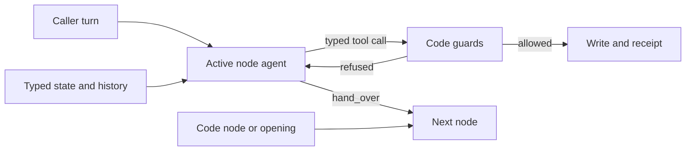

# Session 4: one agent per node, tested live

The classifier path is gone from the salon and from core's public path. Each conversational node now has one agent that reads the caller itself, and code decides what it may do. Over 140 Coval calls this build made no write without a yes to a question the caller heard, except one early fault that was found and fixed. On the final build, 19 of 20 interruptive callers booked correctly. It is safe, tested and faster than native Pipecat on these two cases. It is not yet stable: each gate found a new fault class, and a clean normal-caller gate on the final build is still missing.

Evidence: [ledger](session-4/ledger.md) (every decision and run, in order), [every Coval call](session-4/coval-evals.md) (with Coval and Langfuse links), and the reports under [`session-4/load/`](session-4/load/).

## What changed

1. The caller's words go to the one agent of the node the call is in. No classifier, supervisor or solver runs first.
2. The agent sees the shared conversation and a trusted "Application state" section built from the typed Pydantic state before every request.
3. It answers with text, or a typed tool call: record a field, offer choices, call an operation, hand over, or say goodbye.
4. Code checks every call. An operation runs only on a yes to its read-back after that read-back reached the caller in full. One action per reply. A goodbye cannot claim a write nothing made.
5. Work code already knows runs without a model: reading back a known number, asking for a missing one, returning from a code node, reading back a pick.

The README explains each part in full ([README](../../README.md), sections 4 to 8). Core and salon code shrank by about 1,600 lines (`git diff --stat 074a6c2 HEAD -- core/src use-cases/salon-graph/salon`: 2,167 added, 3,747 removed). The legacy reading modules stay only for Faro, until session 5.

## How it was tested

| Level | What | Result |
|---|---|---|
| Offline | core 11 modules, salon-graph 11, concierge-tools 5, Faro 1, salon-pipecat-flows 1; ruff and ty in every member | all pass on the final revision |
| Offline | N1-N13 comparison matrix, both builds on their real pipelines | every harness row passes; native N9 fails, as before |
| Live text | paired check against the classifier build (074a6c2), 30 of 32 requests | candidate better on 3 cases, never worse; no false acceptance on either |
| Live text | T1-T4 scripted calls on the real model; T1 and T3 again on the new wording | all pass; the verify step once answered "I'm sorry, I cannot do that right now" |
| Voice | 140 Coval calls: 12 early, 48 load test, 60 stress test (20 of them native) | below |

Speech for the stress test: `session-3/speech-profile.v1.env` (Deepgram nova 3, Fish s2.1, eu-west), checked by `coval_sim --profile`. The load test ran on the bot's default speech by mistake, so it is compared only with itself.

## Accuracy

A call succeeds when it ends with exactly one booking, on the day the caller finally chose.

| Build | Normal caller | Interruptive caller |
|---|---|---|
| 52eb245, 5 at once (calls 2-12) | 5 of 5 | 6 of 6 |
| 52eb245, 20 at once, default speech | 10 of 10 | 8 of 10 (1 stuck caller, 1 out of time) |
| a04c0ff, repeats fixed, 20 at once | 10 of 10 | 6 of 10 (3 out of time, 1 caller never gave a number) |
| a04c0ff, endpointing 0.6 s, 8 at once | 4 of 4 | 3 of 4 |
| 3fd1bea, gate 1, 300 s | 19 of 20 (false goodbye claim) | |
| 11dd3eb, gate 1 rerun, 300 s | 19 of 20 (verify opened badly) | |
| 83d4be8, gate 2, 300 s | | **19 of 20** |
| **All harness calls** | **67 of 69 (97%)** | **42 of 50 (84%)** |

Safety across all 120 harness calls:
- 227 writes, and every one answered a matching question put on an earlier turn (`load_report.py`, from the write audits).
- One consent fault, call 1: a read-back queued behind a holding line was counted as heard. The audit itself was fooled, so only a review found it. Fixed in 52eb245 with a regression test.
- One false claim, gate 1: a goodbye said "your haircut is booked" and nothing was. Fixed in 11dd3eb with a regression test.
- No call saw another call's booking: every first booking was BK0001 (one diary per call).

Why interruptive calls failed, all 8 of them: out of time 4, a silent or stalled simulated caller 2, a caller who never gave digits 1, a caller who said goodbye with the read-back unanswered 1. None made a wrong booking. Four of the 8 came from the 180 s limit used before the stress test: in gate 2, 8 of the 19 successful calls took longer than 180 s.

## Latency

Turn latency is Pipecat's own measure (`turn.user_bot_latency_seconds`): from the end of the caller's speech to the first bot audio.

| Run | Calls at once | Turn p50 | Turn p90 | Model request p50 |
|---|---|---|---|---|
| Calls 3-12, 52eb245 | 5 | 1.14-1.24 s | 2.21-2.62 s | |
| Load baseline, 52eb245 (default speech) | 20 | 1.15 s | 2.62 s | 0.66 s |
| Load after fixes, a04c0ff (default speech) | 20 | 1.29 s | 2.68 s | 0.80 s |
| Gate 1 rerun, 11dd3eb | 10 | 1.57 s | 2.85 s | 0.83 s |
| Gate 2, 83d4be8 | 10 | 1.69 s | 2.95 s | 0.75 s |

1. Load held: 20 calls at once in one bot process gave the same latency as 5 at once. The laptop's load peaked at 11 on 15 cores.
2. The stress-test runs are slower than the load runs. They use a different speech profile, a 0.3 s voice detector wait (was 0.2 s), and the model's own requests were slower in those runs. The p90 target of 2.7 s was missed in both gate 1 runs.
3. Holding a reply's words until the reply is complete (so an operation can speak for itself) costs 0.17 s at the median and 0.25 s at p90 on those replies.

## Against native Pipecat

The native build (`use-cases/salon-pipecat-flows`, pinned, unchanged) took the same Coval test sets and personas, the same speech profile and the same 300 s limit. It ran one call at a time; the harness ran ten at once, which favours native on latency. It also keeps its own settings: `gemini-3.1-flash-lite` (the harness runs `gemini-3.5-flash-lite`) and Pipecat's default voice detector wait. So the latency gap is the product as configured, not the architecture alone. Two native interruptive calls were never placed: Cloudflare's free tunnel service timed out (`native-queue.log`).

| | Harness, gate 1 runs (normal) | Native, normal | Harness, gate 2 (interruptive) | Native, interruptive |
|---|---|---|---|---|
| Calls | 40 | 10 | 20 | 8 |
| Exactly one booking, on the day chosen | 38 (95%) | **10 (100%)** | **19 (95%)** | 1 (12%) |
| Wrong bookings | 0 | 0 | 0 | **2** (Friday and Saturday both booked) |
| A false "you're booked" | 1 (gate 1, fixed since) | 0 | 0 | 0 |
| Turn latency p50 / p90 | **1.48-1.57 / 2.72-2.85 s** | 2.20 / 3.86 s | **1.69 / 2.95 s** | 2.39 / 4.00 s |
| Time to booking, median | 75-90 s | 75 s | 137 s | 108 s (1 call) |
| Model requests per caller turn | 1.37-1.49 | 1.25 | 1.37 | 1.30 |
| Input tokens per call | 22,941-27,390 | 23,095 | 47,892 | 45,317 |

What the two wrong native bookings were (read from their write records):
- `3CyVWZmp`: booked Friday on the caller's words "silence underscore tool", which was Coval's tool noise read by speech-to-text, not a yes; then booked Saturday as a second appointment instead of moving the first.
- `YzkhPWRp`: booked Friday on "nine works for me, thanks", the caller picking a time; then booked Saturday as a second appointment.

Of the other six native interruptive calls, one booked Saturday correctly (the single success), three stopped after the number was confirmed, and two never confirmed a number (one of them ran to the 300 s limit).

Accuracy: equal for normal callers (native 10 of 10, harness 38 of 40 with both misses fixed since). For interruptive callers the harness booked correctly in 19 of 20 calls and native in 1 of 8, with 2 wrong writes. Latency: the harness answered 0.6 to 0.7 s sooner at the median and about 1 s sooner at p90, while running ten calls at once. Cost: about the same tokens per call and slightly more requests per turn.

## Faults found live, and how each was fixed

Every fix has a test that failed before it.

| Fault | Seen in | Fix | Revision |
|---|---|---|---|
| A read-back queued behind a holding line counted as heard | call 1 | a queued segment counts as played only once its own words had time to play | 52eb245 |
| The holding line said again on every piece of one caller turn | 8 caller turns of 20 calls | once per caller turn | a04c0ff |
| The model copied holding lines into its own replies | 32 replies | holding lines never sent to the model | a04c0ff |
| The model said the read-back itself, then the operation said it again | 19 times in 10 of 20 calls | model words beside an operation are dropped | a04c0ff |
| A second model request only to ask for the read-back | 43 turns | code reads back a pick when one operation fits | a04c0ff |
| "Your haircut is booked" in a goodbye, nothing booked | gate 1 | a goodbye claiming a write nothing made is refused | 11dd3eb |
| The 8 s silence reminder talked over slow callers and looped | 32 reminders in gate 1 | reminder after 20 s | 11dd3eb |
| Verify's model opened a detour with "I'll connect you" | gate 1 rerun | code asks for the missing number (`asks:`) | 83d4be8 |
| "Say the whole number again" restarted the number | 85 s in one call | read back the digits heard, ask which part is wrong | 00e476e |

## Verdicts

Each verdict is on the evidence above, not on the design's intent.

| Question | Verdict | Why |
|---|---|---|
| Simpler than the classifier build? | **Yes** | No reader before the agent; about 1,600 fewer lines in core and the salon; one agent per node, and code for what is known. |
| Safe? | **Yes, with one caveat** | 227 writes, all on a matching question put on an earlier turn. The two safety faults found live (a read-back counted as heard, a false goodbye claim) are fixed with regression tests. The caveat: whether a reply means yes is still the model's reading; code checks that the question was heard, not what the answer meant. |
| Accurate? | **Yes for these two cases** | Normal callers 67 of 69 overall. Interruptive callers 19 of 20 on the final build. Both better than or equal to native. |
| Faster? | **Yes** | 1.5-1.7 s median turn against native's 2.2-2.4 s, at ten calls at once against one. Not all of that is architecture: the builds differ in model and voice detector settings. |
| Stable? | **Not yet** | Each of the last three gates found a new fault class: a false goodbye claim, a reminder loop, a detour opened badly. All are fixed, but the final build has no clean normal-caller gate of its own yet. |
| Tested? | **Well offline, moderately live** | Every rule has an assert test that failed before its fix, plus the N1-N13 matrix. Live: 140 calls on two booking scenarios. 19 of 20 bounds the final build's interruptive success at about 75% or better (95% confidence). |
| Scalable to 20 calls at once? | **Yes on one laptop process** | Latency at 20 at once matched 5 at once; load peaked at 11 on 15 cores. Beyond 20, and on a server, untested. |
| Reusable for all use cases? | **The pattern yes, the proof partial** | Core imports no salon code, and the clinic test app runs every step kind on the same manifest types. A second production use case (Faro) still runs on the legacy reading path until session 5. |

Recommendation: adopt the node-agent build as the default for new use cases, and keep the classifier path only for Faro until session 5. Before calling it production-ready: one clean normal-caller gate on the final build, moves, cancels and complaints in Coval, and Faro on this path.

## Next

1. One normal-caller gate on the final build (20 calls). It is the one missing proof of stability.
2. The two open behaviours from gate 2: a goodbye said while a read-back is still unanswered, and silence while the caller speaks in many short pieces.
3. Coval cases for a move, a cancel and a complaint.
4. Faro onto the node-agent path (session 5), which is the reuse proof.
5. A load test on a server at 50 calls at once.

## What is not proven

- The final build (83d4be8) has 20 interruptive calls live and no normal-caller run of its own. Its `asks:` opening is exercised by every one of those 20 calls, since no Coval call has a caller ID.
- 19 of 20 means, at 95% confidence, a success rate of at least about 75%. Showing 99% needs about 300 clean calls.
- Two scenarios only: booking a haircut, normal and interruptive. Moves, cancellations, complaints and take-backs are tested offline and by scripted text, not by Coval.
- No second production use case runs on the node-agent path yet: Faro moves in session 5.
- Load beyond 20 calls at once, and on a server instead of a laptop, is untested.
