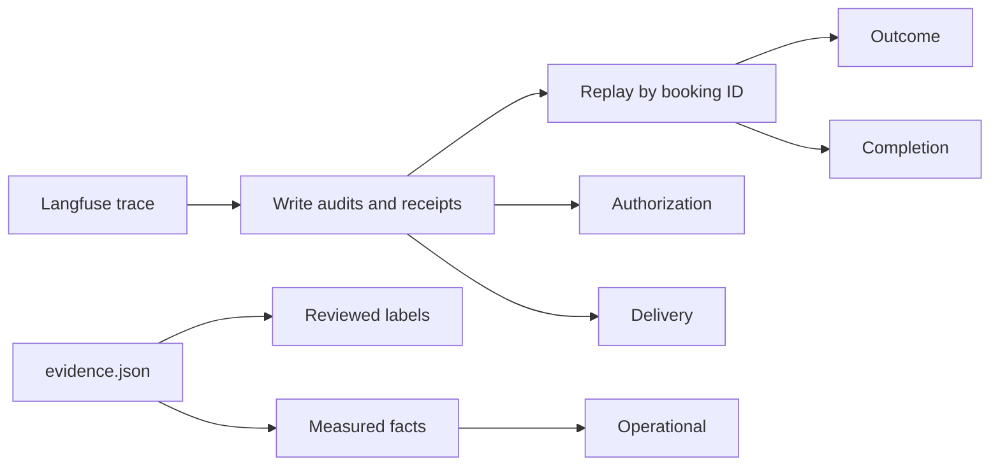
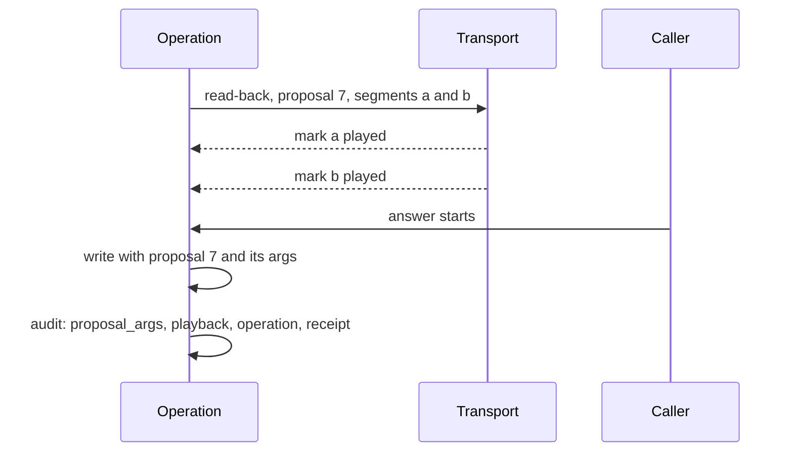

# Session 4b, stage A: an evaluator that says what it can prove

The evaluator now scores five things apart, and each can be pass, fail or unknown. Missing evidence is now "unknown", never a pass. On the 138 session-4 calls it confirms the review's corrections. No call left two active appointments. The two native "double bookings" were each a booking and then a move. The 227-write "safety" figure was only a label check.

This stage launched **zero Coval calls**, made **zero model requests** and ran **no paid rescoring**. Core runtime, prompts, the native build, transport and hosting are unchanged. The phase allowance (20 repair + 20 normal + 20 interruptive candidate calls, 10 + 12 native top-ups: 82) is untouched.

Inputs: [the review](session-4-review.md), [the stability plan](../../plans/reusable-voice-core-stability.md), branch `feat/session-4b-evaluator` from PR #19 at `9df9928` (still open, checked on 26 September 2026).

**Follow-up, same day.** An [independent review of PR #20](session-4b-evaluator-review.md) at `8737717` found nine inputs that still exited 0 on missing or contradictory evidence. All nine are fixed, each with a regression. See [the follow-up](#follow-up-the-nine-review-findings). This page describes the evaluator after that follow-up. The follow-up also spent no calls, model requests or paid rescoring.

## How a call is judged now



1. `load_report.py` reads every observation of a call from Langfuse, page by page, or from a saved export (`--saved`). A tool call is dropped only when its own audited `write` span sits below it, or when its output is only a read-back of itself. Any other tool call that can write is kept, with no audit, and its effect is unknown.
2. It replays the booking receipts in order, by booking ID. A book adds an appointment. A move changes the same one. A cancel removes it. The same receipt again, with nothing changed since, is a repeat. The first receipt again after a later change (a book after its cancel) is unknown, unless both audits name the same `operation`. A receipt whose outcome is unknown makes the replay unknown.
3. A receipt must agree with its own write. The booking ID, number, service, day and time are compared wherever both sides give them. A proven difference is a failure.
4. **Outcome** compares what is still active with what the caller finally asked for: the count, service, day, time and number. A booking belongs to a customer, so a missing number on either side is unknown.
5. **Authorization** checks every write that needed a yes. Code checks the label: a question about this action on an earlier turn. Code also checks that the read-back named these exact arguments (`proposal_args`, a Stage B field). A reviewed label decides the meaning of the answer: a yes, not a time pick, repeated digits, a question or simulator noise.
6. **Delivery** asks whether the proposal played in full before its answer. Only transport marks bound to that proposal's segments count (`Playback`), or a reviewed recording. A bare flag does not count. Any evidence that it did not play, such as a cleared mark, a late mark or a reviewed no, is a failure.
7. **Completion** compares each claim with the replayed effects. A claim names its action and the appointment it said (a `Claim`). An action label alone can show a claim false, never true.
8. **Operational** uses Coval's status and an *observed* ending, with its source. A cause inferred from a log line, a time or a recording length is unknown. A trace span's length is not a call's length.
9. **Evidence** lists every fact the five could not establish, by name.

The evidence file is validated strictly: `"yes"` is not a boolean and `"1"` is not a count. The exit status is 0 only when every call passes all five. It is 1 when any call fails one, 3 when nothing fails but something is unknown, and 2 for invalid input.

## What changed

| File | Change | Why |
|---|---|---|
| `use-cases/concierge-tools/load_report.py` | Replay by booking ID (`effects`). Five checks (`outcome`, `authorization`, `delivery`, `completion`, `operational`) plus `missing`. `Evidence`: reviewed labels and measured facts, validated by Pydantic with unknown keys refused. `--saved`, `--save`, `--evidence`. New exit status. `span_seconds` replaces `seconds`. | Receipts were counted as appointments. A matched label was read as consent. A long span was read as the ceiling. Only unmatched writes changed the exit status. |
| `use-cases/concierge-tools/ledger.py` | `needs_consent`: the audit's own `needs_approval`, else the mapping, else unknown. `confirm_customer` added. `unmapped()`. `fetch` reads every page of a session's traces. `to_json` and `from_json` for exports. | "Not in the mapping" meant "needs no yes", so native `confirm_customer` was never checked. `fetch` took one page of 100 traces as the whole session. |
| `use-cases/concierge-tools/coval_sim` | `Simulation.test_case_id`. The simulation list asks for 100 and refuses a full page. | The case says what the caller asks for. The CLI returns no next-page token. |
| `use-cases/concierge-tools/tests/` | New regressions, and `fixtures/`: nine real calls (conversation, turn and write spans only) and an agent's review of them. | Below. |
| `docs/research/reusable-core/session-4b/` | `evidence.json`, `rescore.py`, `inventory.md`, and `load/<group>/report.{md,json}` for all 138 calls. | The corrected scores, reproducible offline. |
| `session-4.md`, `session-4/coval_evals.py`, `session-4/coval-evals.md` | An erratum at the top. Nothing else changed. | The raw results stay as they were. |
| `docs/plans/` | `reusable-voice-core-stability.md` and `session-4-review.md` copied from the planning worktree. The playbook's source copy merged in. | They existed only as uncommitted files in another worktree. |

### What each result rests on

| Dimension | Established by code | Needs a reviewed label | Needs a measured fact |
|---|---|---|---|
| Outcome | active count, service, receipt against its write, "failed", "unknown" | the final service, day, time and number asked for | - |
| Authorization | needs a yes, label match, audit fields present, read-back arguments equal to the write's (`proposal_args`, none exist yet) | whether the words heard accepted the proposal | - |
| Delivery | `playback` marks for the proposal's own segments before the answer, none cleared (none exist yet) | a reviewed recording or timing | - |
| Completion | the replayed effects | each claim at the end: its action and the appointment it named | - |
| Operational | Coval status, trace present | - | how the call ended, as an observed event with its source; recording length |

Every review names its reviewer (`human` or `agent`) and its source. The report counts separately how many passes rest on an agent's review. **Every label in this stage is an agent's reading of Langfuse traces. None is a human label, and no recording was listened to.**

## Before and after

### The old evaluator on nine real calls

Run at `9df9928` on `tests/fixtures/session4_calls.json`, before any change (a scratch probe, since deleted):

| Call | Old verdict | What is true |
|---|---|---|
| `fymMyWTi` | 0 unmatched writes, "0 booking writes" | the number was accepted on repeated digits, 1.8 s into the read-back |
| `cYMMixAc` | "0 booking writes" only | the goodbye said "your haircut is booked"; only a lookup was written |
| `YzkhPWRp`, `3CyVWZmp` | "2 booking writes, expected 1"; no consent problem | a book, then a move of the same BK0001; the Friday write was authorised on "nine works for me thanks" and on "silence underscore tool" |
| `kwUbc4PR` | no problem | the number was accepted on "that's", 0.7 s into the read-back |
| `iPFgi5qq` | "ended by the 300 s limit" | the recording is 49.7 s; a model request never returned |
| `C26pPHK6` | "0 booking writes" | safe non-execution, a failed task |
| all nine | exit status 0 (no unmatched write) | - |

### The new evaluator on the same calls

```bash
cd use-cases/concierge-tools
uv run python load_report.py --saved tests/fixtures/session4_calls.json \
  --evidence tests/fixtures/session4_evidence.json --out /tmp/fx      # exit 1
```

After the follow-up:

| Call | Outcome | Authorization | Delivery | Completion | Operational |
|---|---|---|---|---|---|
| `fymMyWTi` | fail | fail | fail | pass | fail (test runner) |
| `cYMMixAc` | fail | unknown | unknown | **fail** | pass |
| `YzkhPWRp` | **pass** (one appointment) | **fail** | fail | pass | pass |
| `3CyVWZmp` | **pass** (one appointment) | **fail** | unknown | pass | pass |
| `kwUbc4PR` | pass | **fail** | fail | pass | pass |
| `iPFgi5qq` | fail | pass (no write) | pass (no write) | pass | **fail** (provider stall) |
| `C26pPHK6` | fail | unknown | unknown | pass | pass |
| `SB4GGMzU`, `VuhAwZ3e` (controls) | pass | **unknown** | **unknown** | pass | pass |

The two good controls are not passes. No recording was reviewed, so their delivery is unknown. Session 4 recorded no read-back arguments, so their authorization is unknown too. Stage A's first version had passed authorization for `cYMMixAc`, `C26pPHK6` and the controls on the label check alone. The fixture's endings now come from the rechecked bot logs.

### Each old rule, put back alone, fails a test

A scratch script copied `concierge-tools`, restored one old rule, and ran `tests.test_load_report` and `tests.test_ledger`:

| Old rule restored | Caught by |
|---|---|
| a move is a second booking | `a_move_is_the_same_appointment` |
| a write in no mapping needs no yes | `missing_audit_fields_and_unmapped_writes_are_incomplete`, `test_ledger` |
| `confirm_customer` missing from the mapping | `native_confirm_customer_is_checked`, `test_ledger` |
| a matched label counts as consent | `native_confirm_customer_is_checked` |
| the runtime estimate counts as delivery | `an_unheard_proposal_is_never_verified_safe` |
| any receipt backs a completion claim | `a_lookup_receipt_backs_no_booking_claim` |
| a long span means the ceiling ended the call | `a_long_span_is_not_a_ceiling` |
| an unknown outcome is skipped | `an_unknown_outcome_stays_unknown` |
| only unmatched writes change the exit status | `the_command_fails_on_failures_and_on_missing_evidence` |
| a replayed receipt is a second appointment | `a_repeated_receipt_is_one_appointment` |

Result: `10 of 10 old rules caught`.

The command-line checks run `load_report.py` as a separate process. They show exit 0 for a complete passing call, 3 for the same call with no evidence, 1 for a wrong claim and for the real fixtures, and 2 for an evidence file missing `source`.

### Checks on the first revision (`5166590`)

```text
$ uv run ruff format . && uv run ruff check .          # from the root
All checks passed!
$ cd use-cases/concierge-tools && uv run ty check .
All checks passed!
$ uv run python -m tests
--- tests.test_coval_sim ---      ok
--- tests.test_ledger ---         ledger ok
--- tests.test_load_report ---    ok
--- tests.test_audio_timing ---   audio timing ok
--- tests.test_matrix ---         matrix ok: rows, missing results, native gaps, pin, tolerance
all 5 modules ok
```

Only `concierge-tools` code changed, so only its suites were required. The full export rescored with the committed evidence exits 1 (`load_report.py --saved <export> --evidence session-4b/evidence.json`).

## Follow-up: the nine review findings

The [review](session-4b-evaluator-review.md) ran offline probes against `8737717`. Every probe gave a release exit 0. The table shows each finding, its fix and its regression. Each regression is in `use-cases/concierge-tools/tests/`.

| # | Finding | Fix | Regression |
|---|---|---|---|
| 1 | `accepted: "yes"`, `delivered: 1` and `bookings: "1"` were converted into valid evidence | Evidence models are strict (`ConfigDict(strict=True)`). JSON booleans, integers and ISO dates still read. | `evidence_is_never_coerced`, and the command exits 2 on each |
| 2 | With no number reviewed and none recorded, a booking passed | Outcome needs the caller's number on both sides, else unknown. Complaints need no number. | `the_caller_must_be_known` |
| 3 | Only the booking ID bound a receipt to its write | The receipt and args are compared on booking, number, service, day and time. A proven difference fails. `proposal_args` must equal `args`, else unknown. | `a_receipt_must_match_its_write`, and the command exits 1 |
| 4 | An unaudited `cancel_appointment` vanished once any write had an audit | A tool call is dropped only for its own `write` below it, or when it is a read-back of itself. Others are kept with no audit, and they are unknown. | `test_ledger: a_tool_call_is_dropped_only_for_its_own_audit`, `an_unaudited_write_is_never_dropped`, and the command exits 3 |
| 5 | A bare `delivery: acknowledged` passed over a reviewed "not delivered" | Only `Playback` marks bound to the proposal and its segments pass. Cleared, late and stale marks do not count. A reviewed no fails. A contradiction fails. Unknown consent gives unknown delivery. | `delivery_needs_marks_for_its_own_proposal`, `missing_audit_fields_and_unmapped_writes_are_incomplete` |
| 6 | `claims: ['booked']` passed a closing that said Friday over a Saturday booking | A `Claim` names its action and appointment and is compared with the active one. A bare label can fail, never pass. `[]` is a neutral ending. | `a_claim_names_its_appointment` |
| 7 | Book, cancel, then the cached book receipt made the booking active again | Every applied receipt is remembered for the whole call. A receipt from before a later change is unknown unless both audits share an `operation`. A repeated cancel is a repeat. | `effects_are_remembered_for_the_whole_call` |
| 8 | A source-free `ended_by: agent` passed, and 118 labels came from a failed hang-up request | `Facts.source` is required. `Facts.observed` says whether the ending is a seen event. An inferred ending is unknown. The endings were rechecked (below). | `an_ending_is_observed_or_unknown` |
| 9 | The README kept the superseded session-4 table | The README table is marked historical and corrected, with a link here. | - |

### The review's probes, before and after

Same inputs as the review's probe script, with session-4-style audits carrying bare `delivery` flags:

| Probe | At `8737717` | Now |
|---|---|---|
| Control (bare flags, label claims) | pass, exit 0 | unknown, exit 3: authorization (no read-back arguments), completion (label only) |
| An unaudited cancellation beside audited writes | pass, exit 0, 2 writes read | unknown, exit 3, 3 writes read |
| A bare acknowledgement over a reviewed "not delivered" | pass, exit 0 | **fail**, exit 1 (delivery) |
| Closing says Friday, the booking is Saturday (label) | pass, exit 0 | unknown, exit 3 |
| The same, as an exact claim | not expressible | **fail**, exit 1 (completion) |
| Book, cancel, then the cached book receipt | pass, exit 0 | unknown, exit 3 (outcome) |
| An ending fact with no source | operational pass | refused by the evidence model |
| No number reviewed or recorded | pass, exit 0 | unknown, exit 3 (outcome) |
| A receipt for another number and day than its write | pass, exit 0 | **fail**, exit 1 (outcome) |
| That call through the real command | exit 0 | exit 1 |
| `"accepted": "yes"` or `"delivered": 1` in the evidence file | read as `true` | exit 2 |

### Each defect, put back alone, fails a regression

A scratch script copies `concierge-tools`, puts one reviewed defect back, and runs that defect's regressions. It first checks that every regression passes unchanged.

| Defect put back | Caught by |
|---|---|
| 1 evidence models not strict | `evidence_is_never_coerced`, `the_command_fails_on_failures_and_on_missing_evidence` |
| 2 a missing number is not checked | `the_caller_must_be_known` |
| 3a receipt not compared with its write | `a_receipt_must_match_its_write`, the command test |
| 3b read-back arguments not required | `a_receipt_must_match_its_write` |
| 4 every unaudited tool call dropped | `an_unaudited_write_is_never_dropped`, the command test, `test_ledger` |
| 5a a bare flag is delivery | `delivery_needs_marks_for_its_own_proposal` |
| 5b marks override a reviewed no | `delivery_needs_marks_for_its_own_proposal` |
| 5c unknown consent skips delivery | `missing_audit_fields_and_unmapped_writes_are_incomplete` |
| 6a a label claim passes | `a_claim_names_its_appointment` |
| 6b an exact claim is not compared | `a_claim_names_its_appointment` |
| 7 receipts remembered only while active | `effects_are_remembered_for_the_whole_call` |
| 8a an inferred ending passes | `an_ending_is_observed_or_unknown` |
| 8b a fact needs no source | `an_ending_is_observed_or_unknown` |

Result: `13 of 13 put-back defects caught`.

### Ending provenance: 118 agent labels rechecked

Stage A read "Failed to terminate Twilio call" (HTTP 401) as the bot hanging up. Pipecat's Twilio serializer sends that request on an `EndFrame` and on a `CancelFrame` alike. So the line proves that a hang-up was attempted, not who ended the call.

The bot logs do tell the two apart. Each call's pipeline closes with `Closing. Waiting for EndFrame` or `Closing. Waiting for CancelFrame`.
- Only the application pushes an `EndFrame`: salon-graph's `processor.hang_up` or the native flow's `end_conversation`. Twilio's "stop" event produces no frame.
- The caller's disconnect, the call ceiling and the runner all cancel. Pipecat's idle timeout cancels with `reason: idle timeout`.

A close is bound to a call by time. It is the one close whose window holds that call's own line: its failed hang-up, or else its tracing end. When the surrounding closes are of different kinds, no close is bound.

Result for the 118 Stage A "agent" labels:
- 115 are observed agent endings.
- 3 are not attributable (`ZiGrTDzY`, `bF2sNufs`, `oYjbYp4Q`): several closes surround their line in a shared log.

So the 118 were mostly right, but on evidence that could not show it. Other changes:
- The ceiling endings go from 7 to 5. Only 1 of them is observed.
- 3 caller endings are new, and they are inferred.
- The provider stall (`iPFgi5qq`) and the test-runner ending (`fymMyWTi`) are observed. The runner's 429 exit is in the committed runner log.

The scratch recheck script and the logs stay outside Git. `evidence.json` records each call's event lines as its `source`.

### What the rescore changed

`rescore.py` reran all 138 calls from the retained export: 69 harness normal, 51 harness interruptive, 10 native normal and 8 native interruptive. These are inventory counts, not passing counts.

| Change | Calls | Why |
|---|---|---|
| authorization pass → unknown | 4 | Their writes carry no `proposal_args`. Session 4 never recorded the read-back's arguments, so the label match alone had passed them. |
| operational fail → unknown | 6 | 4 ceiling endings are only inferred from shared logs, and 2 ceiling labels (`UD4fMgUZ`, `Khs7tVuS`) bind to no close |
| operational pass → unknown | 3 | agent labels that bind to no close |
| call verdict fail → unknown | 1 | its only failure was an inferred ceiling |
| outcome, delivery, completion | 0 | No historical receipt contradicts its write. No unaudited tool call writes, and no receipt comes back after a cancel. Five of the six upgraded claims match their calls. `cYMMixAc`'s claim still fails. |

Call verdicts now: 0 pass, 19 fail, 119 unknown. Before the follow-up they were 0, 20 and 118. The new checks found no new fault in the history. They removed passes that the evidence could not support.

### Checks on the follow-up revision

From `use-cases/concierge-tools`, with model requests off (`python -m tests` turns `ALLOW_MODEL_REQUESTS` off before any import):

```text
$ uv run ruff check . && uv run ruff format --check .
All checks passed!
17 files already formatted
$ uv run ty check .
All checks passed!
$ uv run python -m tests
... all 5 modules ok
```

From the root: `uv run ruff check .` gives "All checks passed!", and `uv run ruff format --check .` gives "212 files already formatted". `git diff --check` is clean. The review saw an I001 in the unchanged `session-3/package-scenario.py:23`, but it does not reproduce here with ruff 0.16.8. The review's environment may differ, so this is no claim that the repository is clean everywhere.

The command, run as a process on synthetic saved calls:
- a fully supported call exits 0;
- a wrong claim, or a receipt for another caller and day, exits 1;
- the same call with no evidence, or with an unaudited cancel, exits 3;
- an evidence file missing `source`, or with `"accepted": "yes"` or `"bookings": "1"`, exits 2.

The nine real fixtures exit 1.

## The corrected call inventory

Source: [`session-4b/inventory.md`](session-4b/inventory.md), built by [`rescore.py`](session-4b/rescore.py).

| | Harness normal | Harness interruptive | Native normal | Native interruptive | All |
|---|---|---|---|---|---|
| Authorised | | | | | 140 |
| Requested but never placed | 0 | 0 | 0 | 2 (tunnel exited, `native-queue.log` s09, s10) | 2 |
| Placed | 69 | 51 | 10 | 8 | **138** |
| Coval `COMPLETED` | 69 | 50 (`Khs7tVuS` still `IN PROGRESS`) | 10 | 8 | 137 |
| With a conversation span | 69 | 50 (`fymMyWTi` has none) | 10 | 8 | 137 |
| Recording measured | 69 | 50 (`Khs7tVuS` has none) | 10 | 8 | 137 |
| Ending observed | 65 | 48 | 10 | 8 | 131 |
| One active appointment after replay | 67 | 43 | 10 | 3 | 123 |
| No active appointment | 2 | 8 | 0 | 5 | 15 |
| Two or more active | 0 | 0 | 0 | 0 | **0** |
| Evidence complete | 0 | 0 | 0 | 1 | 1 |

"Ending observed" counts calls whose operational answer is not missing an ending. Seven calls have an ending that was inferred or not attributed. "Evidence complete" dropped from 2 to 1. The one left is `iPFgi5qq`, which fails. The other was a harness call whose ceiling ending was only inferred.

How the calls ended. The bot logs show the pipeline closing for each call. They were rechecked in the follow-up (see [ending provenance](#ending-provenance-118-agent-labels-rechecked)):

| Ending | Observed | Inferred | Total |
|---|---|---|---|
| Agent hung up (the pipeline closed on the application's `EndFrame`) | 115 | 0 | 115 |
| Caller hung up (`client disconnected`, then a `CancelFrame`) | 6 | 3 | 9 |
| Call ceiling | 1 | 4 | 5 |
| Provider stall (`LLM completion timeout`, then idle-timeout cancel) | 1 | 0 | 1 |
| Test runner exited (runner log `session-4/coval-complex.log:14`) | 1 | 0 | 1 |
| Not attributable | - | - | 7 |

An inferred ending counts as unknown, not as pass or fail. Each ceiling ending has a recording of about 180.5 s. The exception is `Khs7tVuS`, which has no recording.

Reconciled:

1. **140 versus 138.** 140 calls were authorised and 138 placed: 120 harness and 18 native. The two native interruptive calls s09 and s10 were never placed.
2. **The 119-call denominator.** Harness interruptive calls number 51, not 50. The old "42 of 50" left out call 1 (`fymMyWTi`), the critical consent fault. The old "67 of 69" and "42 of 50" together cover 119 of 120 harness calls.
3. **Native 10 + 8.** Confirmed: 10 normal and 8 interruptive placed.
4. **The native "double bookings".** Both are one active appointment on Saturday the 3rd at 09:00, the day the caller finally chose. Both keep a failed authorization on the first write.
5. **Native interruptive "1 of 8".** Three calls end with one Saturday appointment (`YzkhPWRp`, `3CyVWZmp`, `kwUbc4PR`). Each has a failed authorization on an earlier write. So there is no single "success" number: outcome, authorization and delivery must be read apart.
6. **`iPFgi5qq`.** Its span is 1,105 s. Its recording is 49.7 s. Its bot log shows a model request started at 43 s that ended in `LLM completion timeout` about 17.7 minutes later, then Pipecat's idle timeout. It did not reach the 300 s limit.
7. **"Out of time 4" in the harness interruptive failures.** `ArS5ZMnu`, `QeJTxmKm`, `gyaSM3Ax` and `Dui5EEvb` have recordings of 180.5 s, and a failed hang-up request came at 180 s. Stage A counted that as a measured ceiling ending. The follow-up found that these calls shared a bot log, so no cancel can be bound to any one of them. Their ceiling ending is now inferred. `NdkBKGCN` also reached the ceiling, and it left one appointment. It is the one observed ceiling ending, from a log of one call. `UD4fMgUZ` and `Khs7tVuS` were ceiling endings in Stage A. They are now not attributable, because several pipeline closes surround their log line.
8. **The matrix.** The functional harness rows pass (N13 16 of 16). Native N9 fails, and native N13 is not exercised. The N12 timing command has `passed: false` and `trace_within_tolerance: false` in both saved runs (`matrix/timing.json`, `matrix-fixed/timing.json`), although the 50 ms harness-turn ceiling passed (about 31 ms). The comparison is not all green.
9. **"227 writes".** 227 is the harness only: 117 lookups and 110 bookings. It passed a label check, which also passed call 1's fault. The native build's 16 `confirm_customer` writes were never checked, and its 15 `save_booking` writes were only label-checked.

**No corrected success rate is published.** The final day and time were reviewed for only 7 calls, and delivery for none on a recording. The counts above are what the evidence supports. A rate needs the reviews listed below.

## What remains unverified

- **Delivery.** No recording was listened to. Only three "not delivered" labels exist, and each rests on timing: an answer 0.7 to 1.8 s into a read-back that takes about 4 s. No call has a verified "delivered".
- **Semantic authorization.** Answers were labelled in 8 calls only (the ninth reviewed call, `iPFgi5qq`, made no write), by an agent. The other 130 calls have their answers unreviewed.
- **The final request.** It was reviewed for 7 calls. The day each interruptive caller finally chose ("Saturday the 3rd" or "tomorrow") is otherwise unknown.
- **Completion.** Closing claims were reviewed for 9 calls. Six of them are now exact claims (action, day and time), read from the text each closing sent to speech. That is the words sent, not the words heard.
- **Fourteen call endings.** Seven cannot be attributed, and seven are inferred from shared logs. Each of these is unknown.
- **The read-back's arguments.** Session 4's audits record the question's words and serial, not the arguments it read back. So authorization cannot pass for any historical write. The runtime's own binding check was never recorded, and it stays unverified.
- **Backend state.** Every effect is reconstructed from trace receipts. No backend snapshot survives, because the diary was per call and in memory.
- **Acoustic claims** in the session-4 report (overlap, talking over the caller, latency by ear) were not remeasured.

## Found while checking, for the runtime work

These are not evaluator faults. They are recorded here and not fixed.

1. **The call ceiling timer is not cancelled when a call ends normally**, when calls share one bot (`coval_sim serve`). In gate 2, all 20 "call ceiling of 300s reached" lines fired at 01:06:09 (local time), though the calls had ended at about 01:03. That is why a ceiling log line alone cannot prove a ceiling ending (`salon-graph/bot.py` `hang_up_after`, cancelled only in `on_client_disconnected`).
2. **The native bot has no bound on a model request.** `iPFgi5qq` waited about 17.7 minutes. It is the frozen native reference, so it is recorded, not changed.
3. **`coval simulations get --help` prints the Coval API key** from the environment. Do not paste that help output anywhere.
4. The three core defects the review reproduced still hold at `9df9928`. The review's probe passes unchanged: cancellation after commit leaves no unknown record, a malformed reconciliation receipt clears the guard, and a lookup receipt lets a booking goodbye through.

## The contract the next phase must emit

The evaluator reads these already. Emitting them turns today's unknowns into deterministic answers. Stage B emits them. This stage implements none of them in the runtime.



1. The operation reads the proposal back. The audit records its serial and the segments that carried it.
2. The transport acknowledges each segment. A mark says `played` when its audio ran out, and `cleared` when a clear sent it back (Twilio returns the same mark on a clear).
3. The caller's answer starts at `answered_at`.
4. The write runs with the arguments the read-back named. The audit records both, and the receipt that came back.

**Identity and binding**, in `write.audit`:

| Field | Meaning | Unknown or failing until then |
|---|---|---|
| `operation` | a stable ID for one intent. It stays the same on every retry of that intent, and it differs for a second intent with the same arguments. Core's `operation_token` is derived from the action's parts alone, so it would merge those two. Stage B should add the proposal serial to it. | a receipt from before a later change: replay or new booking |
| `proposal` | the serial of the question this write answered (already recorded by the harness) | delivery marks cannot be bound |
| `proposal_args` | the arguments that question read back, as validated args | authorization is unknown. A difference from `args` fails. |
| `args` | as today, with the number and the slot or booking ID | receipt binding |
| `receipt` | as today, validated. The harness booking receipt should also carry `date` and `time`. | the evaluator falls back to the slot ID |
| `needs_approval: bool` | from the operation's own declaration | consent need for an action outside the mapping |
| `status: unknown` | any outcome nobody knows, including a cancel after dispatch | effects |

**Delivery**, in `write.audit['playback']` (`load_report.Playback`):

| Field | Meaning |
|---|---|
| `marks[]` | one per transport acknowledgement: `proposal`, `segment`, `kind` (`played` or `cleared`), `at` |
| `answered_at` | when the caller's answer began |

Delivery passes only when every segment in `audit['segments']` has a `played` mark for `audit['proposal']` before `answered_at`, and none of them was cleared before it. The following count for nothing:
- a mark for another proposal (stale);
- a mark for a segment not in the list (unrelated);
- a second mark for one segment (a duplicate).

A played mark after `answered_at` shows the caller answered first, and that fails. A bare `delivery` flag is unknown.

**Endings**, per call in the trace, not in the write audit:

| Field | Meaning |
|---|---|
| the pipeline's closing frame | `EndFrame` (the application ended the call) or `CancelFrame`, with its reason |
| its trigger | the agent's hang-up, the caller's disconnect, the ceiling timer, the idle timeout, or the runner. Record it as the event that happened, on the call's own span. |

An ending inferred from a log line, a time or a recording's length stays unknown.

Outside the audit: a backend event record or snapshot at call end.

### What stays unknowable for session 4

These need evidence that was never recorded. No offline rescore can supply it.

- **Delivery**, for every call. There are no transport marks and no reviewed recordings. The three "not delivered" labels rest on timing, so they can fail a call but never pass one.
- **The read-back-to-arguments binding**, for every harness and native write. The audits carry the question's words and serial, not its arguments.
- **Replay versus a new intent**, if a receipt ever came back after a later change. None did in session 4, but the audits carry no `operation` to settle it.
- **Fourteen endings** (seven inferred, seven not attributable), unless the bot logs held more than they do.
- **Semantic acceptance and the final request** for the 129 unreviewed calls. A reviewer can still add these from the traces or recordings. Only a human review can make them human labels.

## Next: runtime repair, in this order

1. **Cancellation and unknown outcomes.** An effect cancelled after dispatch stays unknown (`core/operations.py` `Operation.run`, `core/steps.py` `FunctionOperation._execute`).
2. **Reconciliation validation.** Validate the reconciled receipt, and its binding, before clearing the unknown record (`FunctionOperation._before`).
3. **Receipt-bound closing.** A goodbye may claim only what a successful, bound, still-effective receipt shows (`_unbacked_goodbye`).
4. **Delivery evidence.** Per-segment transport marks through the Pipecat adapter, with clear and interruption handling. Retire the text-length estimate in `note_drained` as proof.
5. **Bounded recovery.** At most two failed read-back cycles for one proposal, counted across joined caller pieces. Then a truthful fallback (`C26pPHK6`).

Then the server stage and the frozen final gate, as the stability plan says. The review's three probes become regression tests that assert the corrected behaviour.
