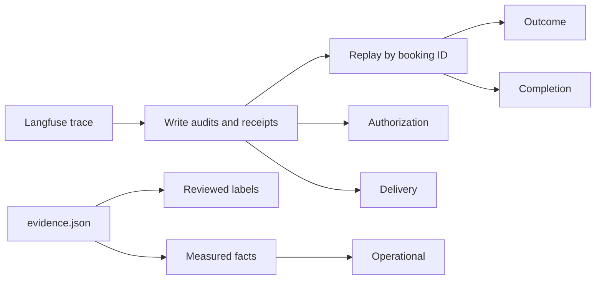

# Session 4b, stage A: an evaluator that says what it can prove

The evaluator now scores five things apart, and each can be pass, fail or unknown. Missing evidence is now "unknown", never a pass. On the 138 session-4 calls it confirms the review's corrections. No call left two active appointments. The two native "double bookings" were each a booking and then a move. The 227-write "safety" figure was only a label check.

This stage launched **zero Coval calls**, made **zero model requests** and ran **no paid rescoring**. Core runtime, prompts, the native build, transport and hosting are unchanged. The phase allowance (20 repair + 20 normal + 20 interruptive candidate calls, 10 + 12 native top-ups: 82) is untouched.

Inputs: [the review](session-4-review.md), [the stability plan](../../plans/reusable-voice-core-stability.md), branch `feat/session-4b-evaluator` from PR #19 at `9df9928` (still open, checked on 26 September 2026).

## How a call is judged now



1. `load_report.py` reads every observation of a call from Langfuse, page by page, or from a saved export (`--saved`).
2. It replays the booking receipts in order, by booking ID. A book adds an appointment. A move changes the same one. A cancel removes it. The same receipt seen twice is one appointment. A receipt whose outcome is unknown, or that names another booking than its write, makes the replay unknown.
3. **Outcome** compares what is still active with what the caller finally asked for. The count and the service are checked by code. The day and time need a reviewed final request.
4. **Authorization** checks every write that needed a yes. The label check is code: a question about this action on an earlier turn. The meaning of the answer needs a reviewed label: a yes, not a time pick, repeated digits, a question or simulator noise.
5. **Delivery** asks whether the proposal played in full before its answer. The runtime's own playback estimate cannot certify itself. Only a transport acknowledgement in the audit, or a reviewed recording or timing, counts.
6. **Completion** compares what the agent said it had done with the replayed effects. A lookup receipt backs no booking claim.
7. **Operational** uses Coval's status and a measured ending: the bot log or the recording. A trace span's length is not a call's length.
8. **Evidence** lists every fact the five could not establish, by name.

The exit status is 0 only when every call passes all five. It is 1 when any call fails one, 3 when nothing fails but something is unknown, and 2 for a bad input file.

## What changed

| File | Change | Why |
|---|---|---|
| `use-cases/concierge-tools/load_report.py` | Replay by booking ID (`effects`). Five checks (`outcome`, `authorization`, `delivery`, `completion`, `operational`) plus `missing`. `Evidence`: reviewed labels and measured facts, validated by Pydantic with unknown keys refused. `--saved`, `--save`, `--evidence`. New exit status. `span_seconds` replaces `seconds`. | Receipts were counted as appointments. A matched label was read as consent. A long span was read as the ceiling. Only unmatched writes changed the exit status. |
| `use-cases/concierge-tools/ledger.py` | `needs_consent`: the audit's own `needs_approval`, else the mapping, else unknown. `confirm_customer` added. `unmapped()`. `fetch` reads every page of a session's traces. `to_json` and `from_json` for exports. | "Not in the mapping" meant "needs no yes", so native `confirm_customer` was never checked. `fetch` took one page of 100 traces as the whole session. |
| `use-cases/concierge-tools/coval_sim` | `Simulation.test_case_id`. The simulation list asks for 100 and refuses a full page. | The case says what the caller asks for. The CLI returns no next-page token. |
| `use-cases/concierge-tools/tests/` | New regressions, and `fixtures/`: nine real calls (conversation, turn and write spans only) and an agent's review of them. | Below. |
| `docs/research/reusable-core/session-4b/` | `evidence.json`, `rescore.py`, `inventory.md`, and `load/<group>/report.{md,json}` for all 138 calls. | The corrected scores, reproducible offline. |
| `session-4.md`, `session-4/coval_evals.py`, `session-4/coval-evals.md` | An erratum at the top. Nothing else changed. | The raw results stay as they were. |
| `docs/plans/` | `reusable-voice-core-stability.md` and `session-4-review.md` copied from the planning worktree. The playbook's source copy merged in. | They existed only as uncommitted files in another worktree. |

### What each result rests on

| Dimension | Established by code | Needs a reviewed label | Needs a measured fact |
|---|---|---|---|
| Outcome | active count, service, number, "failed", "unknown" | the final day and time asked for | - |
| Authorization | needs a yes, label match, audit fields present | whether the words heard accepted the proposal | - |
| Delivery | a transport acknowledgement in the audit (none exist yet) | a reviewed recording or timing | - |
| Completion | the replayed effects | what the agent claimed at the end | - |
| Operational | Coval status, trace present | - | how the call ended, recording length |

Every review names its reviewer (`human` or `agent`) and its source. The report counts separately how many passes rest on an agent's review. **Every label in this stage is an agent's reading of Langfuse traces. None is a human label, and no recording was listened to.**

## Before and after

### The old evaluator on nine real calls

Run at `9df9928` on `tests/fixtures/session4_calls.json`, before any change (a scratch probe, since deleted):

| Call | Old verdict | What is true |
|---|---|---|
| `fymMyWTi` | 0 unmatched writes, "0 booking writes" | the number was accepted on repeated digits, 1.8 s into the read-back |
| `cYMMixAc` | "0 booking writes" only | the goodbye said "your haircut is booked"; only a lookup was written |
| `YzkhPWRp`, `3CyVWZmp` | "2 booking writes, expected 1"; no consent problem | a book, then a move of the same BK0001; the Friday write was authorised on "nine works for me thanks" and on "silence underscore tool" |
| `kwUbc4PR` | no problem | the number was accepted on "that's", 0.7 s into the read-back |
| `iPFgi5qq` | "ended by the 300 s limit" | the recording is 49.7 s; a model request never returned |
| `C26pPHK6` | "0 booking writes" | safe non-execution, a failed task |
| all nine | exit status 0 (no unmatched write) | - |

### The new evaluator on the same calls

```bash
cd use-cases/concierge-tools
uv run python load_report.py --saved tests/fixtures/session4_calls.json \
  --evidence tests/fixtures/session4_evidence.json --out /tmp/fx      # exit 1
```

| Call | Outcome | Authorization | Delivery | Completion | Operational |
|---|---|---|---|---|---|
| `fymMyWTi` | fail | fail | fail | pass | fail (test runner) |
| `cYMMixAc` | fail | pass | unknown | **fail** | unknown |
| `YzkhPWRp` | **pass** (one appointment) | **fail** | fail | pass | pass |
| `3CyVWZmp` | **pass** (one appointment) | **fail** | unknown | pass | pass |
| `kwUbc4PR` | pass | **fail** | fail | pass | pass |
| `iPFgi5qq` | fail | pass (no write) | pass (no write) | pass | **fail** (provider stall) |
| `C26pPHK6` | fail | pass | unknown | pass | unknown |
| `SB4GGMzU`, `VuhAwZ3e` (controls) | pass | pass | **unknown** | pass | unknown |

The two good controls are not passes. No recording was reviewed, so their delivery is unknown. (The fixture evidence carries no ending for the harness calls; the full evidence file does.)

### Each old rule, put back alone, fails a test

A scratch script copied `concierge-tools`, restored one old rule, and ran `tests.test_load_report` and `tests.test_ledger`:

| Old rule restored | Caught by |
|---|---|
| a move is a second booking | `a_move_is_the_same_appointment` |
| a write in no mapping needs no yes | `missing_audit_fields_and_unmapped_writes_are_incomplete`, `test_ledger` |
| `confirm_customer` missing from the mapping | `native_confirm_customer_is_checked`, `test_ledger` |
| a matched label counts as consent | `native_confirm_customer_is_checked` |
| the runtime estimate counts as delivery | `an_unheard_proposal_is_never_verified_safe` |
| any receipt backs a completion claim | `a_lookup_receipt_backs_no_booking_claim` |
| a long span means the ceiling ended the call | `a_long_span_is_not_a_ceiling` |
| an unknown outcome is skipped | `an_unknown_outcome_stays_unknown` |
| only unmatched writes change the exit status | `the_command_fails_on_failures_and_on_missing_evidence` |
| a replayed receipt is a second appointment | `a_repeated_receipt_is_one_appointment` |

Result: `10 of 10 old rules caught`.

The command-line checks run `load_report.py` as a separate process. They show exit 0 for a complete passing call, 3 for the same call with no evidence, 1 for a wrong claim and for the real fixtures, and 2 for an evidence file missing `source`.

### Checks on the final revision

```text
$ uv run ruff format . && uv run ruff check .          # from the root
All checks passed!
$ cd use-cases/concierge-tools && uv run ty check .
All checks passed!
$ uv run python -m tests
--- tests.test_coval_sim ---      ok
--- tests.test_ledger ---         ledger ok
--- tests.test_load_report ---    ok
--- tests.test_audio_timing ---   audio timing ok
--- tests.test_matrix ---         matrix ok: rows, missing results, native gaps, pin, tolerance
all 5 modules ok
```

Only `concierge-tools` code changed, so only its suites were required. The full export rescored with the committed evidence exits 1 (`load_report.py --saved <export> --evidence session-4b/evidence.json`).

## The corrected call inventory

Source: [`session-4b/inventory.md`](session-4b/inventory.md), built by [`rescore.py`](session-4b/rescore.py).

| | Harness normal | Harness interruptive | Native normal | Native interruptive | All |
|---|---|---|---|---|---|
| Authorised | | | | | 140 |
| Requested but never placed | 0 | 0 | 0 | 2 (tunnel exited, `native-queue.log` s09, s10) | 2 |
| Placed | 69 | 51 | 10 | 8 | **138** |
| Coval `COMPLETED` | 69 | 50 (`Khs7tVuS` still `IN PROGRESS`) | 10 | 8 | 137 |
| With a conversation span | 69 | 50 (`fymMyWTi` has none) | 10 | 8 | 137 |
| Recording measured | 69 | 50 (`Khs7tVuS` has none) | 10 | 8 | 137 |
| Ending measured | 68 | 47 | 10 | 8 | 133 |
| One active appointment after replay | 67 | 43 | 10 | 3 | 123 |
| No active appointment | 2 | 8 | 0 | 5 | 15 |
| Two or more active | 0 | 0 | 0 | 0 | **0** |
| Evidence complete | 0 | 1 | 0 | 1 | 2 |

How the calls ended, from the bot logs, cross-checked with the recordings: the bot hung up in 118 calls, the ceiling ended 7, the caller disconnected in 6, a provider stalled in 1, and the test runner in 1. Five cannot be attributed: several calls shared one log and none of them has a hang-up line. All 118 bot hang-up times agree with the recording lengths within 6 s. Each ceiling ending has a recording of about 180.5 s, except `Khs7tVuS`, which has none.

Reconciled:

1. **140 versus 138.** 140 calls were authorised and 138 placed: 120 harness and 18 native. The two native interruptive calls s09 and s10 were never placed.
2. **The 119-call denominator.** Harness interruptive calls number 51, not 50. The old "42 of 50" left out call 1 (`fymMyWTi`), the critical consent fault. The old "67 of 69" and "42 of 50" together cover 119 of 120 harness calls.
3. **Native 10 + 8.** Confirmed: 10 normal and 8 interruptive placed.
4. **The native "double bookings".** Both are one active appointment on Saturday the 3rd at 09:00, the day the caller finally chose. Both keep a failed authorization on the first write.
5. **Native interruptive "1 of 8".** Three calls end with one Saturday appointment (`YzkhPWRp`, `3CyVWZmp`, `kwUbc4PR`). Each has a failed authorization on an earlier write. So there is no single "success" number: outcome, authorization and delivery must be read apart.
6. **`iPFgi5qq`.** Its span is 1,105 s. Its recording is 49.7 s. Its bot log shows a model request started at 43 s that ended in `LLM completion timeout` about 17.7 minutes later, then Pipecat's idle timeout. It did not reach the 300 s limit.
7. **"Out of time 4" in the harness interruptive failures.** Confirmed for `ArS5ZMnu`, `QeJTxmKm`, `gyaSM3Ax` and `Dui5EEvb`. The bot hung up at 180 s, and their recordings are 180.5 s. `UD4fMgUZ` and `NdkBKGCN` also ended at the ceiling, but each left one appointment.
8. **The matrix.** The functional harness rows pass (N13 16 of 16). Native N9 fails, and native N13 is not exercised. The N12 timing command has `passed: false` and `trace_within_tolerance: false` in both saved runs (`matrix/timing.json`, `matrix-fixed/timing.json`), although the 50 ms harness-turn ceiling passed (about 31 ms). The comparison is not all green.
9. **"227 writes".** 227 is the harness only: 117 lookups and 110 bookings. It passed a label check, which also passed call 1's fault. The native build's 16 `confirm_customer` writes were never checked, and its 15 `save_booking` writes were only label-checked.

**No corrected success rate is published.** The final day and time were reviewed for only 7 calls, and delivery for none on a recording. The counts above are what the evidence supports. A rate needs the reviews listed below.

## What remains unverified

- **Delivery.** No recording was listened to. Only three "not delivered" labels exist, and each rests on timing: an answer 0.7 to 1.8 s into a read-back that takes about 4 s. No call has a verified "delivered".
- **Semantic authorization.** Answers were labelled in 8 calls only (the ninth reviewed call, `iPFgi5qq`, made no write), by an agent. The other 130 calls have their answers unreviewed.
- **The final request.** It was reviewed for 7 calls. The day each interruptive caller finally chose ("Saturday the 3rd" or "tomorrow") is otherwise unknown.
- **Completion.** Closing claims were reviewed for 9 calls.
- **Five call endings.** They cannot be attributed from the shared logs.
- **Backend state.** Every effect is reconstructed from trace receipts. No backend snapshot survives, because the diary was per call and in memory.
- **Acoustic claims** in the session-4 report (overlap, talking over the caller, latency by ear) were not remeasured.

## Found while checking, for the runtime work

These are not evaluator faults. They are recorded here and not fixed.

1. **The call ceiling timer is not cancelled when a call ends normally**, when calls share one bot (`coval_sim serve`). In gate 2, all 20 "call ceiling of 300s reached" lines fired at 01:06:09 (local time), though the calls had ended at about 01:03. That is why a ceiling log line alone cannot prove a ceiling ending (`salon-graph/bot.py` `hang_up_after`, cancelled only in `on_client_disconnected`).
2. **The native bot has no bound on a model request.** `iPFgi5qq` waited about 17.7 minutes. It is the frozen native reference, so it is recorded, not changed.
3. **`coval simulations get --help` prints the Coval API key** from the environment. Do not paste that help output anywhere.
4. The three core defects the review reproduced still hold at `9df9928`. The review's probe passes unchanged: cancellation after commit leaves no unknown record, a malformed reconciliation receipt clears the guard, and a lookup receipt lets a booking goodbye through.

## The contract the next phase must emit

The evaluator reads these already. Emitting them turns today's unknowns into deterministic answers.

| Field in `write.audit` | Meaning | Unknown until then |
|---|---|---|
| `needs_approval: bool` | from the operation's own declaration | consent need, for an action outside the mapping |
| `about`, `question`, `asked_turn`, `turn`, `heard` | as today; all required | authorization |
| `args` with the booking ID and number | as today | receipt binding, identity |
| `receipt` with `status`, `booking_id`, `service`, `date`, `time` | the harness receipt has no `date` or `time` today; the evaluator falls back to the slot ID | outcome day and time |
| `status: unknown` for any outcome nobody knows, including cancellation after dispatch | today only `OutcomeUnknownError` gives it | effects |
| `delivery: acknowledged` only on a transport mark for the proposal's own segments, after them and not cleared | never emitted today | delivery |

Outside the audit: a per-call ending (who hung up, and why) in the trace, and a backend event record or snapshot at call end.

## Next: runtime repair, in this order

1. **Cancellation and unknown outcomes.** An effect cancelled after dispatch stays unknown (`core/operations.py` `Operation.run`, `core/steps.py` `FunctionOperation._execute`).
2. **Reconciliation validation.** Validate the reconciled receipt, and its binding, before clearing the unknown record (`FunctionOperation._before`).
3. **Receipt-bound closing.** A goodbye may claim only what a successful, bound, still-effective receipt shows (`_unbacked_goodbye`).
4. **Delivery evidence.** Per-segment transport marks through the Pipecat adapter, with clear and interruption handling. Retire the text-length estimate in `note_drained` as proof.
5. **Bounded recovery.** At most two failed read-back cycles for one proposal, counted across joined caller pieces. Then a truthful fallback (`C26pPHK6`).

Then the server stage and the frozen final gate, as the stability plan says. The review's three probes become regression tests that assert the corrected behaviour.
