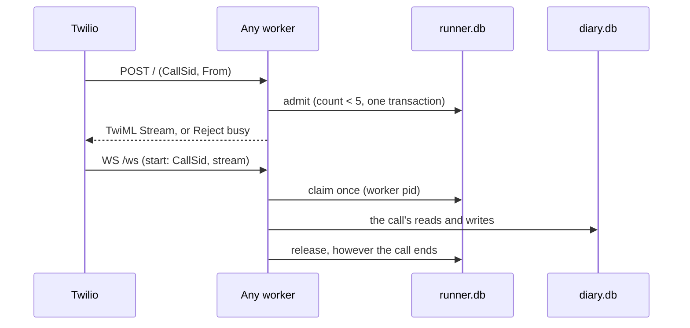

# Session 4b, stage C: shared state, one MacBook, five calls

Stage C closes the six guarantee gaps the Stage B review found, gives the salon one durable diary that every worker shares, runs it behind a small bounded runner, and qualifies one to two to five calls at once, with worker failure, on this MacBook. It also gives the Twilio number one owner per campaign.

The runner is qualified on one laptop, for at most five calls at once. That is not a production or server capacity claim.

<!-- STATUS -->

## Checkpoint

| Item | Value |
|---|---|
| Parent | PR #21, branch `feat/session-4b-runtime`, reviewed head `1bc9fec0d850333e94b1737465e2de373d866a2d` (open; base `feat/session-4b-evaluator`, PR #20, open) |
| This branch | `feat/session-4c-mac`, created from `1bc9fec` (the name was free locally and on the remote). The PR #21 branch was not renamed |
| Offline evidence SHA | `f823d4e5f218429c444096c2309ddcfefaa3a43f` (ramp, sizing, long run, faults, mutations; no tracked change at the start of the batch) |
| Text checks SHA | `f823d4e` (text-3 and text-4) |
<!-- SHAS -->

## Effective configuration

The lockfile did not change. Checked in `uv.lock`: pydantic 2.13.5, pydantic-ai-slim 2.46.0, pydantic-graph 2.46.0, pipecat-ai 1.11.0, langfuse 4.15.4. Python 3.14.5. SQLite (bundled with Python) 3.50.4. uvicorn 0.53.0.

| Item | Value |
|---|---|
| Host | Apple M5 Pro, 15 cores (`hw.perflevel0.physicalcpu` 5, `hw.perflevel1.physicalcpu` 10), 24 GiB, macOS 27.0 (26A428) |
| Runner | `uvicorn server:app --workers 2`, one port; `MAX_CALLS=5`; `MAX_CALL_SECONDS=180` on live calls, 150 offline |
| Model | `google-cloud:gemini-3.5-flash-lite` (`salon/agent.yaml`), unchanged |
| Speech profile | `docs/research/reusable-core/session-3/speech-profile.v1.env`, unchanged: `SLNG_BASE_URL=eu-west.api.slng.ai`, `SLNG_STT_MODEL=deepgram/nova:3`, `SLNG_STT_LANGUAGE=en`, `SLNG_TTS_MODEL=slng/fish/tts:s2.1-pro`, `SLNG_TTS_VOICE=16cabdb7f8d240569aff36c9e480d783`, `SLNG_TTS_LANGUAGE=en` |
| VAD and turn taking | as Stage B: Silero with 0.3 s stop, smart-turn v3 with a 1.6 s ceiling |
| Delivery | `DELIVERY=marks` on the phone line: only a returned Twilio mark is a heard read-back |

## What changed

1. Twilio's webhook is admitted only while fewer than five calls are admitted or active over every worker. Past that, the caller hears busy. Nothing waits in a queue.
2. Each call's state, history, approvals and speech ledger are private to it. Only the diary file is shared.
3. A read-back is heard only when its own Twilio mark returns. An estimate never approves a voice write unless a launcher names the simulation.
4. The operation claims its intent before its first await, records it in the diary, and only then sends it.
5. The diary holds capacity with a database trigger, keys every write by its intent, and answers with a receipt.
6. A receipt settles the intent only if the application declared it a success (`succeeds`) or a final no (`rejects`). Anything else stays unknown.
7. An unknown intent is reconciled by its id. If the diary has no result, reconciliation writes a void, so a late write can never land.
8. What stands is each resource's highest version, keyed by its kind and id, never by arrival order.

## C0: the six gaps

Each gap was first reproduced at the parent, through a public entry point with model requests off (`core/tests/defects.py`, record `session-4c/defects-parent.txt`: 6 known defects). After the fixes every one is `fixed` (`session-4c/defects-after.txt`). Each fix was then turned off in a scratch copy of the evidence SHA, and its regression failed every time (`session-4c/mutations.md`, harness `mutations.py`).

| # | Reproducer | Root cause | Fix | Regression |
|---|---|---|---|---|
| 1 | A receipt with `status: pending` from a change | `Operation._settled` turned every non-success into `rejected`, which ended the intent and let a new intent be sent | `rejects:` in the manifest names the terminal no. `outcome()` sorts a validated, bound receipt: `succeeds` → succeeded, `rejects` → rejected, anything else → unknown, nothing filed. After dispatch every exception, a plain `ModelRetry` included, is unknown; `core.Refused` is the application's explicit no (Faro uses it for its pre-effect checks). A read (`changes: false`) is final either way | `test_outcomes` O1-O3; `test_speech` S3 |
| 2 | Two concurrent runs of one intent on one call, with a durable intent record that yields | `run` checked eligibility, awaited `note_intent`, and only then marked the intent dispatched | The intent is claimed (`CallContext._claimed`) in the same synchronous step as the check, and released in a `finally`. A cancellation during the record leaves it `prepared`. Across processes the backend arbitrates by intent id | `test_outcomes` O4, O5 |
| 3 | Desk: resolve, reopen, then a fresh session restores the old resolve | Reconciliation arrival order decided what stood, and a reconciled receipt was always said | `version:` names the receipt field that orders changes. `effective()` keeps the highest version. A reconciled success is checked against the service's `current_version`; below it, it is history: filed and audited, never said, assigned or recapped. `restore` never reopens a finished intent | `test_outcomes` O6 (normal, reversed, repeated and stale restore) |
| 4 | `update_ticket` and `update_address` on id `1` | Effective receipts were keyed by the id alone | `resource:` names the kind (default: the subject field). The key is kind and id | `test_outcomes` O7 |
| 5 | A read-back settled as `local` (audio written, or time for it to play) | `Spoken.delivered` counted `local`, and `playout` gives every non-Twilio transport `LocalPlayout` | `local` delivers only in a call opened with `simulate_playout`, which only `playout(simulate=True)` sets, from `DELIVERY=simulated`. `coval_sim` sets it only for Coval's mark-less simulator. The write audit says which | core `test_delivery`; salon `test_marks` M7, M8 |
| 6 | Desk, after a lookup only: "El ticket T-101 ha quedado solucionado definitivamente." | The claim patterns miss a paraphrase; any prose path can claim | `speech: rendered`: the step's agent has no text output and still chooses (record, read back, carry out, hand over, goodbye, `wait`). Every word is the application's or core's. An authoritative no on a rendered step is said in core's words. A rendered step cannot offer choices. The desk's write step is rendered | `test_speech` S1-S7 |

**What 6 does not claim.** `speech: prose` is still the default, and the salon's steps are prose. There, the claim patterns are a best-effort guard, and a paraphrase can still claim a change nothing made. `tests.defects` keeps that visible as a known limit. Truthful completion is structural only on rendered steps and on the code routes (read-backs, receipts, recaps, goodbyes, fixed lines). Moving the salon's booking step to rendered is a prompt change that needs its own live checks; it is left to Stage D's decision.

## C1: the salon's diary, shared and durable

`salon/diary.py` keeps every appointment rule and moves the state into one SQLite file every worker opens (`DIARY_PATH`).

- **Capacity by the database.** Bookings store their resource (the chair), start, end and revision. Triggers on insert and update refuse any active booking whose interval overlaps another on the same resource. So a different slot id cannot bypass the chair, and a row written past the Python check is still refused.
- **A move is one `UPDATE`.** It takes the new time and frees the old one in one step; refused, the booking is unchanged.
- **Ownership.** A move or cancel acts only on the caller's own booking, and only on the revision the call was shown (`show_holdings`, `expected_revision`).
- **Idempotency.** Each write's result is filed under its intent id in the same transaction. The same intent twice is one effect with one answer; a new intent with the same arguments is a new effect.
- **Durable intents and fencing.** `Salon.note_intent` records an intent before dispatch. A reconciliation that finds no result writes a `void` in the same kind of transaction, so a worker still holding that write can never land it later.
- **Bounded waits, off the audio loop.** `BEGIN IMMEDIATE`, a 2 s busy timeout, and core runs plain domain and choice functions in worker threads.
- **The rollback journal, not WAL.** This Python's SQLite (3.50.4) predates the fix for the WAL-reset bug, which can corrupt a WAL database when two processes write or checkpoint at the same instant (https://www.sqlite.org/wal.html#walresetbug). Faro's store avoids it with one thread; the shared diary and the runner's call file cannot. Measured here, the rollback journal was also faster: 0.06 ms p50 per read or write, against 0.24-0.35 ms on WAL. Upgrade path: WAL again once the runtime's SQLite is 3.51.3, or the 3.50.7 backport.

`tests.test_store` (B1-B9) starts real worker processes on one file and judges only the file:

| Check | Result |
|---|---|
| B1 five callers, five different times | all five kept |
| B2 five callers racing for one time | exactly one booked; four refused, each offered other times |
| B3 an overlap under another slot id; a raw overlapping row | refused; the trigger refuses the raw row |
| B4 another caller's move or cancel | refused |
| B5 a move, and a move onto a taken time | old time freed at once; the refused move changed nothing |
| B6 one intent sent twice at once | one effect, one answer; a new intent with the same arguments is new |
| B7 a commit whose process was killed before it answered | found after restart; no longer unresolved |
| B8 a hung worker's write after a void; a stale revision | the write does nothing; the cancel is refused |
| B9 booking ids and owners | unique; each owned by its caller |

## C2: a small runner, and one owner for the Twilio number

### The runner (`use-cases/salon-graph/server.py`)

1. Twilio's webhook reaches whichever worker the kernel picks. That worker admits the call in the shared runner file, in one `BEGIN IMMEDIATE` transaction, while fewer than five calls are admitted or active. Otherwise it answers `<Reject reason="busy"/>`. Nothing waits.
2. The media stream may reach another worker. It runs only for an admitted call it can claim, once; any other stream is closed with code 1013.
3. The call runs `bot.run_bot` with its own `FlowCall`, history, approvals and speech ledger. A failure is logged and ends only that call.
4. However the call ends, its place is released. A reaper on every worker (every 2 s) closes the calls of a worker that died, and gives back the place of a stream that never came (15 s).

What each worker owns for its whole life: the compiled flow (at import), the model clients, opened and warmed once (`model_clients` now yields one record per warm-up request, so each is counted), and a loop-lag sampler. uvicorn's supervisor holds the one port and replaces a dead worker. On SIGTERM a worker drains: it lets its calls end, at most `DRAIN_SECONDS`, and only then hands the signal to uvicorn. uvicorn on its own closes every open websocket at once (code 1012); the first drain test found that. `/ready`, `/stats`, `/calls` answer local readers only, because the tunnel is public.

A new call settles what calls that are over still owe its caller, before anything new (`FlowCall.take_owed`, `Salon.owed`). The first version did it only at open, which needs the caller known at open. On a phone line the caller says who they are later, so core now asks once the identity is known (regression O9).

`bot.py` still runs one call for development, and warms per call. The browser transport returns no marks, so it books only with `DELIVERY=simulated`.

### Campaign ownership (`use-cases/concierge-tools/coval_sim`)

- `serve --phone-number N --campaign L` points the number once, at `https://<host>/?campaign=L`, and writes a record beside the run log: owner, the URL it replaced, the URL it set, the owner's pid.
- `run --host H` on a phone line reads that record and touches nothing. It refuses a number no live campaign owns, or one owned at another host. A lone `run` is a one-job campaign.
- The number is given back once: only when the runner file has no admitted or active call and Twilio lists none queued, ringing or in progress to the number, and only if the number still holds the campaign's URL. A deadline passing leaves the number pointed and says so. A dead owner's record is taken over, keeping the URL from before it.
- Correlation is by evidence: a job's calls are the runner's own record of the campaign's calls since the launch; each Coval simulation binds to Coval's CallSid, or to the one call whose diary intents acted for the phone its test case gives the caller (`--fixtures`). Ambiguous is unknown. The CallSid is also the Langfuse session and the diary's session key.

Offline tests: `test_campaign` (two jobs on one campaign, a second campaign refused, a call in progress at teardown, the runner holding a call, a takeover, a change made by someone else) and `test_correlation`.

<!-- C3 -->
