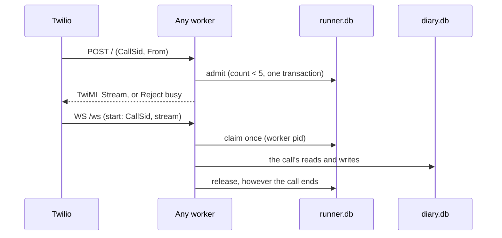
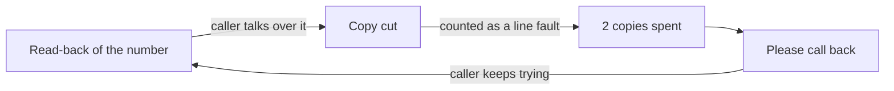
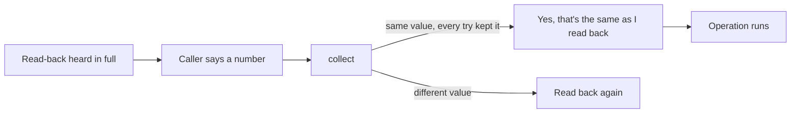

# Session 4b, stage C: shared state, one MacBook, five calls

Stage C closes the six guarantee gaps the Stage B review found, gives the salon one durable diary that every worker shares, runs it behind a small bounded runner, and qualifies one to two to five calls at once, with worker failure, on this MacBook. It also gives the Twilio number one owner per campaign.

## Status

The 20-call Coval benchmark booked correctly on every call: 20 of 20, judged from each batch's own diary file. It had 10 normal and 10 interruptive callers, five at a time, on a real Twilio line. Delivery passed on all 20 from Twilio marks. An independent review of every transcript, read literally, recorded **18 of 20 authorization passes and 2 fails**. In both "fails" the caller answered the phone-number read-back "no, it's …" and restated the same digits in groups of three, and the lookup went ahead. The user's rule (26 September) is that this is correct: the same number said back is a yes to it. Under that rule all 20 are right. The review files keep the literal reading. Since then code also confirms such a reply itself and says so aloud, and a targeted batch of five showed it live (finding 12). The only other open verdict is one completion left unknown: the caller hung up during the closing.

| Gate | Result |
|---|---|
| C0: six guarantee gaps | **Pass.** 6 of 6 fixed, each with a reproducer and a regression; 17 of 17 mutations caught |
| C1: shared durable diary | **Pass.** B1-B9, judged from the SQLite file |
| C2: bounded runner, one campaign per number | **Pass** offline (A1-A5, campaign and correlation tests) and live (5 campaigns, the number given back each time) |
| C3: optimise what profiling shows | Done: history is copied shallowly. **N12 failed** on its frozen trace rule; the per-turn limit (50 ms) passes |
| C4: offline ramp 1 → 2 → 5 | **Pass.** 62 s at five calls; loop lag p99 32.4 ms |
| C4: memory | **Failed** "no sustained growth": worker memory grows under steady load; still below 80 % of RAM |
| C4: worker failure F0-F5 | **Pass.** Dead sessions closed in ≤ 4.6 s, replacements ready in ≤ 1.8 s |
| C4: real-model text checks | **Pass.** T1-T4 at `f823d4e` |
| C4: live ramp | Call 1 (interruptive) **failed its task, safely**. It found two accuracy faults, both fixed and regression-tested (B4.4-B4.6). The pair and five-call steps were replaced by the benchmark, on the user's instruction |
| Benchmark: 20 calls | **20 of 20 correct bookings.** Outcome 20, delivery 20, operational 20 pass; completion 19 pass, 1 unknown; authorization 18 pass and 2 "fail" read literally; both are the same number said back after "no", correct under the user's rule |
| Finding 12 follow-up: 5 targeted calls | **5 of 5 correct bookings.** Same number said back: the lookup went ahead in all 3 cases, 2 with code's "Yes, that's the same as I read back"; a misspoken digit was read back again and fixed |

The runner is qualified on one laptop, for at most five calls at once. That is not a production or server capacity claim.

## Checkpoint

| Item | Value |
|---|---|
| Parent | PR #21, branch `feat/session-4b-runtime`, reviewed head `1bc9fec0d850333e94b1737465e2de373d866a2d` (open; base `feat/session-4b-evaluator`, PR #20, open) |
| This branch | `feat/session-4c-mac`, [PR #22](https://github.com/slng-ai/slng-voice-harness/pull/22), created from `1bc9fec` (the name was free locally and on the remote). The PR #21 branch was not renamed |
| Offline evidence SHA | `f823d4e5f218429c444096c2309ddcfefaa3a43f` (ramp, sizing, long run, faults, mutations; no tracked change at the start of the batch) |
| Text checks SHA | `f823d4e` (text-3 and text-4) |
| C3 SHA | `6024758` (history copied shallowly; N12 rerun) |
| Live call 1 SHA | `6024758` |
| Accuracy fixes | `2e5a654` (cut read-backs, joined-turn budget), `0e9414a` (drain lasts the ceiling), `a48b98a` (F0) |
| Benchmark SHA | `a48b98a` (all 20 calls; no tracked change during the runs) |
| Final matrix and wheel proof | `a48b98a` |
| Same number said back (finding 12) | `6feb64b`; text-5 and batch R ran on it |

## Effective configuration

The lockfile did not change. Checked in `uv.lock`: pydantic 2.13.5, pydantic-ai-slim 2.46.0, pydantic-graph 2.46.0, pipecat-ai 1.11.0, langfuse 4.15.4. Python 3.14.5. SQLite (bundled with Python) 3.50.4. uvicorn 0.53.0.

| Item | Value |
|---|---|
| Host | Apple M5 Pro, 15 cores (`hw.perflevel0.physicalcpu` 5, `hw.perflevel1.physicalcpu` 10), 24 GiB, macOS 27.0 (26A428) |
| Runner | `uvicorn server:app --workers 2`, one port; `MAX_CALLS=5`; `MAX_CALL_SECONDS=180` on live call 1 and 300 on the benchmark (the user's choice: one interruptive call took 225 s), 150 offline; `DRAIN_SECONDS` = ceiling + 20 s |
| Model | `google-cloud:gemini-3.5-flash-lite` (`salon/agent.yaml`), unchanged |
| Speech profile | `docs/research/reusable-core/session-3/speech-profile.v1.env`, unchanged: `SLNG_BASE_URL=eu-west.api.slng.ai`, `SLNG_STT_MODEL=deepgram/nova:3`, `SLNG_STT_LANGUAGE=en`, `SLNG_TTS_MODEL=slng/fish/tts:s2.1-pro`, `SLNG_TTS_VOICE=16cabdb7f8d240569aff36c9e480d783`, `SLNG_TTS_LANGUAGE=en` |
| VAD and turn taking | as Stage B: Silero with 0.3 s stop, smart-turn v3 with a 1.6 s ceiling |
| Delivery | `DELIVERY=marks` on the phone line: only a returned Twilio mark is a heard read-back |

## What changed


1. Twilio's webhook is admitted only while fewer than five calls are admitted or active over every worker. Past that, the caller hears busy. Nothing waits in a queue.
2. Each call's state, history, approvals and speech ledger are private to it. Only the diary file is shared.
3. A read-back is heard only when its own Twilio mark returns. An estimate never approves a voice write unless a launcher names the simulation.
4. The operation claims its intent before its first await, records it in the diary, and only then sends it.
5. The diary holds capacity with a database trigger, keys every write by its intent, and answers with a receipt.
6. A receipt settles the intent only if the application declared it a success (`succeeds`) or a final no (`rejects`). Anything else stays unknown.
7. An unknown intent is reconciled by its id. If the diary has no result, reconciliation writes a void, so a late write can never land.
8. What stands is each resource's highest version, keyed by its kind and id, never by arrival order.

## C0: the six gaps

Each gap was first reproduced at the parent, through a public entry point with model requests off (`core/tests/defects.py`, record `session-4c/defects-parent.txt`: 6 known defects). After the fixes every one is `fixed` (`session-4c/defects-after.txt`). Each fix was then turned off in a scratch copy of the evidence SHA, and its regression failed every time (`session-4c/mutations.md`, harness `mutations.py`).

| # | Reproducer | Root cause | Fix | Regression |
|---|---|---|---|---|
| 1 | A receipt with `status: pending` from a change | `Operation._settled` turned every non-success into `rejected`, which ended the intent and let a new intent be sent | `rejects:` in the manifest names the terminal no. `outcome()` sorts a validated, bound receipt: `succeeds` → succeeded, `rejects` → rejected, anything else → unknown, nothing filed. After dispatch every exception, a plain `ModelRetry` included, is unknown; `core.Refused` is the application's explicit no (Faro uses it for its pre-effect checks). A read (`changes: false`) is final either way | `test_outcomes` O1-O3; `test_speech` S3 |
| 2 | Two concurrent runs of one intent on one call, with a durable intent record that yields | `run` checked eligibility, awaited `note_intent`, and only then marked the intent dispatched | The intent is claimed (`CallContext._claimed`) in the same synchronous step as the check, and released in a `finally`. A cancellation during the record leaves it `prepared`. Across processes the backend arbitrates by intent id | `test_outcomes` O4, O5 |
| 3 | Desk: resolve, reopen, then a fresh session restores the old resolve | Reconciliation arrival order decided what stood, and a reconciled receipt was always said | `version:` names the receipt field that orders changes. `effective()` keeps the highest version. A reconciled success is checked against the service's `current_version`; below it, it is history: filed and audited, never said, assigned or recapped. `restore` never reopens a finished intent | `test_outcomes` O6 (normal, reversed, repeated and stale restore) |
| 4 | `update_ticket` and `update_address` on id `1` | Effective receipts were keyed by the id alone | `resource:` names the kind (default: the subject field). The key is kind and id | `test_outcomes` O7 |
| 5 | A read-back settled as `local` (audio written, or time for it to play) | `Spoken.delivered` counted `local`, and `playout` gives every non-Twilio transport `LocalPlayout` | `local` delivers only in a call opened with `simulate_playout`, which only `playout(simulate=True)` sets, from `DELIVERY=simulated`. `coval_sim` sets it only for Coval's mark-less simulator. The write audit says which | core `test_delivery`; salon `test_marks` M7, M8 |
| 6 | Desk, after a lookup only: "El ticket T-101 ha quedado solucionado definitivamente." | The claim patterns miss a paraphrase; any prose path can claim | `speech: rendered`: the step's agent has no text output and still chooses (record, read back, carry out, hand over, goodbye, `wait`). Every word is the application's or core's. An authoritative no on a rendered step is said in core's words. A rendered step cannot offer choices. The desk's write step is rendered | `test_speech` S1-S7 |

**What 6 does not claim.** `speech: prose` is still the default, and the salon's steps are prose. There, the claim patterns are a best-effort guard, and a paraphrase can still claim a change nothing made. `tests.defects` keeps that visible as a known limit. Truthful completion is structural only on rendered steps and on the code routes (read-backs, receipts, recaps, goodbyes, fixed lines). Moving the salon's booking step to rendered is a prompt change that needs its own live checks; it is left to Stage D's decision.

## C1: the salon's diary, shared and durable

`salon/diary.py` keeps every appointment rule and moves the state into one SQLite file every worker opens (`DIARY_PATH`).

- **Capacity by the database.** Bookings store their resource (the chair), start, end and revision. Triggers on insert and update refuse any active booking whose interval overlaps another on the same resource. So a different slot id cannot bypass the chair, and a row written past the Python check is still refused.
- **A move is one `UPDATE`.** It takes the new time and frees the old one in one step; refused, the booking is unchanged.
- **Ownership.** A move or cancel acts only on the caller's own booking, and only on the revision the call was shown (`show_holdings`, `expected_revision`).
- **Idempotency.** Each write's result is filed under its intent id in the same transaction. The same intent twice is one effect with one answer; a new intent with the same arguments is a new effect.
- **Durable intents and fencing.** `Salon.note_intent` records an intent before dispatch. A reconciliation that finds no result writes a `void` in the same kind of transaction, so a worker still holding that write can never land it later.
- **Bounded waits, off the audio loop.** `BEGIN IMMEDIATE`, a 2 s busy timeout, and core runs plain domain and choice functions in worker threads.
- **The rollback journal, not WAL.** This Python's SQLite (3.50.4) predates the fix for the WAL-reset bug, which can corrupt a WAL database when two processes write or checkpoint at the same instant (https://www.sqlite.org/wal.html#walresetbug). Faro's store avoids it with one thread; the shared diary and the runner's call file cannot. Measured here, the rollback journal was also faster: 0.06 ms p50 per read or write, against 0.24-0.35 ms on WAL. Upgrade path: WAL again once the runtime's SQLite is 3.51.3, or the 3.50.7 backport.

`tests.test_store` (B1-B9) starts real worker processes on one file and judges only the file:

| Check | Result |
|---|---|
| B1 five callers, five different times | all five kept |
| B2 five callers racing for one time | exactly one booked; four refused, each offered other times |
| B3 an overlap under another slot id; a raw overlapping row | refused; the trigger refuses the raw row |
| B4 another caller's move or cancel | refused |
| B5 a move, and a move onto a taken time | old time freed at once; the refused move changed nothing |
| B6 one intent sent twice at once | one effect, one answer; a new intent with the same arguments is new |
| B7 a commit whose process was killed before it answered | found after restart; no longer unresolved |
| B8 a hung worker's write after a void; a stale revision | the write does nothing; the cancel is refused |
| B9 booking ids and owners | unique; each owned by its caller |

## C2: a small runner, and one owner for the Twilio number

### The runner (`use-cases/salon-graph/server.py`)



1. Twilio's webhook reaches whichever worker the kernel picks. That worker admits the call in the shared runner file, in one `BEGIN IMMEDIATE` transaction, while fewer than five calls are admitted or active. Otherwise it answers `<Reject reason="busy"/>`. Nothing waits.
2. The media stream may reach another worker. It runs only for an admitted call it can claim, once; any other stream is closed with code 1013.
3. The call runs `bot.run_bot` with its own `FlowCall`, history, approvals and speech ledger. A failure is logged and ends only that call.
4. However the call ends, its place is released. A reaper on every worker (every 2 s) closes the calls of a worker that died, and gives back the place of a stream that never came (15 s).

What each worker owns for its whole life: the compiled flow (at import), the model clients, opened and warmed once (`model_clients` now yields one record per warm-up request, so each is counted), and a loop-lag sampler. uvicorn's supervisor holds the one port and replaces a dead worker. On SIGTERM a worker drains: it lets its calls end, at most `DRAIN_SECONDS`, and only then hands the signal to uvicorn. uvicorn on its own closes every open websocket at once (code 1012); the first drain test found that. `/ready`, `/stats`, `/calls` answer local readers only, because the tunnel is public.

A new call settles what calls that are over still owe its caller, before anything new (`FlowCall.take_owed`, `Salon.owed`). The first version did it only at open, which needs the caller known at open. On a phone line the caller says who they are later, so core now asks once the identity is known (regression O9).

`bot.py` still runs one call for development, and warms per call. The browser transport returns no marks, so it books only with `DELIVERY=simulated`.

### Campaign ownership (`use-cases/concierge-tools/coval_sim`)

- `serve --phone-number N --campaign L` points the number once, at `https://<host>/?campaign=L`, and writes a record beside the run log: owner, the URL it replaced, the URL it set, the owner's pid.
- `run --host H` on a phone line reads that record and touches nothing. It refuses a number no live campaign owns, or one owned at another host. A lone `run` is a one-job campaign.
- The number is given back once: only when the runner file has no admitted or active call and Twilio lists none queued, ringing or in progress to the number, and only if the number still holds the campaign's URL. A deadline passing leaves the number pointed and says so. A dead owner's record is taken over, keeping the URL from before it.
- Correlation is by evidence: a job's calls are the runner's own record of the campaign's calls since the launch; each Coval simulation binds to Coval's CallSid, or to the one call whose diary intents acted for the phone its test case gives the caller (`--fixtures`). Ambiguous is unknown. The CallSid is also the Langfuse session and the diary's session key.

Offline tests: `test_campaign` (two jobs on one campaign, a second campaign refused, a call in progress at teardown, the runner holding a call, a takeover, a change made by someone else) and `test_correlation`.

## C3: measure, then optimise

The profile of ten N12 booking traces (`cProfile`, delay 0) put the wall time in the event loop's waits (`kqueue`), not in harness code. Two CPU hot spots stood out:

| Where | CPU over 10 traces | Action |
|---|---|---|
| `core.history.project` and `paired`: a deep copy of every message on every request | 0.121 s | Fixed in `6024758`: each projected message is a new object with a new parts list, and no part is ever changed in place |
| Pydantic AI's `_replace_capability_context` | 0.180 s | Library code; not changed |

The change saved about 2 ms per trace. N12 ran again with its frozen protocol (3 warm-ups, 20 repetitions, delays 0 and 0.05 s). Both runs are kept in `session-4c/timing/`.

| Run | Native trace | Harness trace | Harness turns (ms) | Largest harness turn |
|---|---|---|---|---|
| Before (`a37e9e4`), delay 0 | 58.3 ms | 111.3 ms | 11.7, 18.2, 15.8, 17.6, 19.7 | 48.5 ms |
| After (`6024758`), delay 0 | 56.7 ms | 109.0 ms | 12.0, 18.2, 15.1, 16.3, 19.6 | 48.4 ms |
| After, delay 0.05 s | 419.5 ms | 483.2 ms | | |

**N12 failed.** The trace rule allows 5 ms or 25 % over native per turn, and turns 2 to 5 exceed it by 5 to 13 ms. The per-turn limit, 50 ms of harness time, passes. The user said that 50 ms per turn is fine and that accuracy matters more (26 September), so no further latency work was done. The smallest next step, if it is ever needed: fewer event-loop hops per turn (the clause gate and the thread hop for plain functions), measured the same way.

Classifier requests stayed at zero (`matrix time` records `classifier: 0` for every trace). The installed-wheel proof passes at `a48b98a` (`session-4c/package-proof.log`): the clinic and the support desk, run from `/` with only the core wheel installed, with `rejects`, `version`, `resource` and `speech: rendered`.

## C4: verification

The limits were written down before anything was measured (`load/*/ramp.json`, `limits`): at most 5 active calls; zero unauthorised, duplicate, capacity or cross-call faults; loop-lag p99 ≤ 100 ms; worker memory < 80 % of RAM with no sustained growth; dead sessions closed ≤ 10 s; replacements ready ≤ 30 s; resources back to idle ≤ 30 s.

### Offline ramp through the real runner

`evals.load` drives the real `server.py` under uvicorn: real core, real Pipecat adapter, real Silero VAD and smart-turn. The providers are doubles: a scripted policy model, an energy-based STT, a paced TTS. Fake Twilio phones send 20 ms µ-law frames of speech made with macOS `say`, and echo marks and clears as Twilio does. Scripts mix normal turns, fragments, endpointing edges, barge-in, lost TTS audio and two callers wanting one time.

| Run | Workers | Calls | Booked | Overlap at 5 | Loop lag p99 | Worker memory | Turn latency p50 / p90 / max |
|---|---|---|---|---|---|---|---|
| `ramp-w1`, 5 at once | 1 | 10 | 10 | 61.8 s | 21 ms | 658 MB | 0.91 / 2.03 / 5.32 s |
| `ramp-w2`, 1 → 2 → 5 | 2 | 1, 2, 10 | 1, 2, 10 | 62 s | 13.8, 29.7, 32.4 ms | 1,087 MB | 0.92 / 2.05 / 2.58 s |
| `ramp-w3`, 5 at once | 3 | 10 | 10 | 61.8 s | 38 ms | 1,309 MB | 0.91 / 2.05 / 2.45 s |
| `long-w2`, 5 at once for 180 s | 2 | 27 | 25 | 125 s longest run | 37.9 ms | 800 → 1,870 MB | |

Every verdict passed: no unauthorised, duplicate, capacity or cross-call fault, and no booking for a phone nobody gave. Two workers were chosen: one worker had the worst tail latency (5.3 s), and a third worker added memory without helping.

**Memory: failed "no sustained growth".** Under steady load, worker memory grew from 800 to 1,870 MB over 180 s and 27 calls. It stays well below the 80 % limit (19.2 GiB). Python's own memory (`tracemalloc`) stayed flat at about 17 MB. No per-call object stayed alive (`/debug/live`). The ONNX models are bounded (turn model 274 MB, VAD 120 MB for five calls). `vmmap` showed the MALLOC zone of one worker growing from 63 MB to 938 MB over four rounds. So the growth is in native code: onnxruntime, soxr, other C extensions, or allocator fragmentation. Next step: malloc stack logging on one worker. Mitigation if needed: recycle a worker after N calls, through the drain that already exists. In the live benchmark each batch started fresh and stayed at 383 to 914 MB for both workers together.

### Worker failure, overload and drain (offline, two workers)

| Case | What happens | Result |
|---|---|---|
| F0 | Worker killed after the caller's yes, before the intent is recorded | Pass. Dead call closed in 4.6 s, replacement ready in 1.8 s, a bystander on the other worker booked, no old intent, the ring-back booked once |
| F1 | Killed after the intent is recorded, before it is sent | Pass. Closed in 0.8 s, replaced in 0.6 s; the ring-back voided the old intent first and booked once |
| F2 | Killed after the diary committed, before anyone was told | Pass. Closed in 0.8 s, replaced in 0.8 s; the ring-back found BK0004 by its intent and booked nothing more |
| F3 | A stale worker: the write hangs, the caller rings back | Pass. The new call voided the old intent; when the hung thread woke, its write found the void and did nothing; one booking |
| F4 | Six calls against a ceiling of five | Pass. Five admitted, one refused as busy, none waited, a later call was admitted |
| F5 | SIGTERM to the worker carrying a call | Pass. That call finished and booked; a call placed during the drain was served in full; the worker exited after 0.8 s and was replaced after 1.6 s |

Tasks and file descriptors returned to their idle baseline (3 tasks, 20 descriptors) after every kill. Results: `faults/faults.json` (F1-F5) and `faults/f0.json`.

### Real-model text checks

T1-T4 passed at `f823d4e` (text-3: T1, T4; text-4: T2, T3), on the Stage C runtime with no salon prompt changed. The later accuracy fixes change only cut-off read-backs and joined turns, which a text run cannot produce, so no text run was spent on them. The 20 live calls ran on the fixed code.

### Live call 1, and the two faults it found

Live call 1 (`s4c-live-1`, run `hzSdfMNn`, CallSid `CAcd4b19…`) was the complex interruptive case (set `K3Xwqi7g`, case `GRdmreeb`, persona `VSruLZYY`), on a real Twilio line at `6024758`. It **failed its task, safely**: nothing was written and nothing untrue was said. The 180 s ceiling ended it. 18 of 19 marks came back; the one ignored mark belonged to a cleared segment.



1. The code read the phone number back.
2. The interruptive caller talked over it. Their yes began before the copy finished, so it was correctly not counted.
3. The copy counted against `READBACKS = 2`, the limit meant for a line that proves no delivery at all (Coval's simulator, call `C26pPHK6`).
4. After two cut copies the caller heard "please call back", twice, while every other mark came back and they were still trying.
5. Separately, two joined turns of up to eight pieces ran out of their 8 model requests just hearing the number, and said "going round in circles".

Both are fixed in `2e5a654`:

- **Cut copies.** On a line that has proven delivery (any segment of the call delivered), an unheard copy is one the caller talked over. It counts against its own limit, `CUT_READBACKS = 5`. A line that never proves delivery keeps `READBACKS = 2`, so the `C26pPHK6` case is unchanged (B4.1, B4.2). Regressions: B4.4 (two cut copies, then a heard one and a yes, books once) and B4.5 (a caller who cuts every copy never books, and hears the fallback after five).
- **Joined-turn budget.** Each further piece of a joined turn adds 2 requests and 2 tool calls, up to twice the turn's own (16). Regression: B4.6 (nine one-request pieces are not cut off; the tally stops at 16).

Each regression fails with its fix turned off. The same call also showed the model saying a digit read-back in its own words on the `verify` step. That is open (see Findings).

### The 20-call benchmark

On the user's instruction, the pair and five-call steps of the live ramp were replaced by a 20-call benchmark: 10 normal and 10 interruptive callers, drawn from the reserved pools. The two versioned test sets copy the reviewed cases and change only the caller's number and the day (`session-4c/coval-benchmark.v1.json`):

- normal (`2P6J33TP`, persona `MUFJdYAH`): the wording of `M5Z8LjVy`, a haircut on Monday to Friday morning, one day each;
- interruptive (`CHPwoXJf`, persona `VSruLZYY`): the wording of `GRdmreeb`, the number in two pieces, then a change of day at the booking read-back (Monday to Tuesday, and so on to Friday to Saturday).

The one chair fits three haircuts a morning, so no two callers of a batch want the same morning. Four batches of five ran at once, each with its own campaign and a fresh diary, at `a48b98a`, with `MAX_CALL_SECONDS=300`. Each simulation was bound to its CallSid by evidence: the intents its call wrote for its caller's number.

| Batch | Callers | Run | Correct (diary) | Delivery | Call length | Turn latency p50 / p90 | Model request p50 / p90 | Loop lag p99 | Worker memory |
|---|---|---|---|---|---|---|---|---|---|
| A | normal | `c77fpUwG` | 5/5 | 5/5 pass | 94-106 s | 2.46 / 4.15 s | 0.82 / 1.01 s | 2.8 ms | 704-859 MB |
| B | interruptive | `C4jjBivq` | 5/5 | 5/5 pass | 143-209 s | 2.34 / 3.33 s | 0.78 / 0.92 s | 2.9 ms | 383-848 MB |
| C | normal | `8Z7Qce4U` | 5/5 | 5/5 pass | 91-113 s | 2.31 / 4.23 s | 0.79 / 0.97 s | 2.9 ms | 383-886 MB |
| D | interruptive | `UMuV6YLm` | 5/5 | 5/5 pass | 139-225 s | 2.08 / 3.32 s | 0.84 / 1.05 s | 2.8 ms | 383-914 MB |

- Every caller holds exactly one haircut, on the day they finally wanted, at 09:00. No booking went to any other number.
- On the interruptive calls there is exactly one booking intent per caller, for the changed-to day. No intent was ever made for the day they first asked for.
- All 20 calls ended normally (`pipeline_end`). No fallback line, no exhausted turn and no blocked claim appeared in any bot log. 225 marks counted; 3 were ignored, each for a cleared segment.
- The only ERROR lines are expected: 35 TTS contexts stopped by a barge-in, 16 of Pipecat's usual hang-up lines, and one websocket close that raced the caller's goodbye.
- Two interruptive calls took longer than 180 s (209 s and 225 s). The old ceiling would have cut them.

**The review.** A separate reviewer agent read every call from local files only (the Langfuse export, the bot log and the diary judge) and wrote one review file per batch (`live/*/evidence.json`). The real `load_report` then judged each batch offline with it (`live/*/reviewed/`).

| Dimension | Pass | Fail | Unknown |
|---|---|---|---|
| outcome | 20 | 0 | 0 |
| authorization | 18 | **2** | 0 |
| delivery | 20 | 0 | 0 |
| completion | 19 | 0 | 1 |
| operational | 20 | 0 | 0 |

- **The two authorization failures** are `amAP5b4A` (batch A) and `Tiv9sDHH` (batch C), both normal callers. The code read back the right number, "Is your number +34 671 51 01 05?". The caller answered "no, it's plus three four six seven one five one zero one zero five": the same digits, in threes. The `verify` step's model then called `lookup_customer` with no new `collect`, so the lookup ran on a reply that began with "no". Finding 12 has the cause.
- **Three other calls** heard a wrong or garbled number read back (`9ut6yboS`, `SqB3qpaH` in B, `8EiDGNHq` in D). Each time the caller said no, and a fresh read-back and a yes came before the lookup. That is the designed path.
- **The completion left unknown** is `oJFVME6p` (batch D). The caller hung up while the closing was playing, so no whole claim sentence exists to judge. Its booking is correct in the diary.
- **Endings.** Batches A and C ended on the agent's goodbye. In batch B, three callers hung up just after the full closing. In batch D, one did so during the closing.
- **Cosmetic.** One stutter after a barge-in ("for a haircut haircut"), one "Your booked" in a closing, and one call with no recap after the caller's goodbye (`HTt7eSPj`). None changed a receipt.

Evidence: `session-4c/live/{A,B,C,D}/` (the judge from the diary, the runner's stats every 5 s, the `load_report` output, the reviews, the bot log) and `live/perf.json`.

### Finding 12 follow-up: the same number said back

The user's rule: when the caller answers a read-back by saying the same value again, even after "no", the value is confirmed and the operation goes on. `6feb64b` makes that code's decision and says it aloud.



1. The read-back played in full: its Twilio mark came back before the caller spoke.
2. The caller says a number. The `verify` prompt asks the agent to record it with `collect` and call nothing else.
3. Code compares the recorded value with the read-back. It counts as the same only if every try at the operation's fields this turn kept the value (`_tries`, `_kept`). A refused "half nine" or a change and back is a change.
4. The same value: code binds the approval to that exact question, says `Locale.restated`, and runs the operation through the same path as the agent's own call (`core.graph.Restated`).
5. A different value: it is read back again, as before. A read-back nobody heard is never confirmed this way.

Offline: core F5 (four cases) and salon `the_same_number_said_back_is_a_yes`. Turning off the restatement, or the guard, makes F5 fail. The pinned `verify` request was re-blessed, and only step 3 of its prompt changed. The native builds keep copies of the salon prompts; they were not changed, because the native baseline is frozen.

Live text: text-5 at `6feb64b` passed T1-T4 (97,112 tokens).

Live voice: batch R, run `gVH4ML72`, five normal callers at once on a fresh diary, set `DmJJChjD` (`coval-restate.v1.json`), 5 calls from the repair pool.

| Case | What the caller did | What happened |
|---|---|---|
| restate-3, restate-4 | "No, it's …" with the same digits | Code: "Yes, that's the same as I read back. Thanks, I have you." |
| restate-1 | the same | The agent called the lookup itself, with no `collect`. The same number, so correct under the user's rule, but nothing extra was said |
| restate-2 | the same, but STT added a digit | The digits did not fit; the bot asked which part was wrong, read the right number back, and got a yes |
| correct-5 | misspoke a digit, then corrected it | The corrected number was read back and got a yes. Nothing for the misspoken number |

All 5 booked correctly from the diary, and delivery passed on all 5. There was no fallback, no exhausted turn and no blocked claim. Evidence: `live/R/`.

## Findings

1. **Cut read-backs spent the line-fault limit.** Found live, fixed and regression-tested (above).
2. **A joined turn's budget did not grow with its pieces.** Found live, fixed and regression-tested (above).
3. **The `verify` step can say a read-back in model words.** At 17:07:49 in call 1 the model said "Is your number +34 671 73 45 4?" beside a `collect` the validator refused (8 digits). A yes to it can never book, because only code-worded read-backs are recorded questions. It still costs a round and can confuse. Open. The structural fix is `speech: rendered` on `verify`, with the validator's reason said by code. That is a prompt and behaviour change that needs its own live checks.
4. **Worker memory grows in native code.** Failed gate, open (C4 above).
5. **N12's trace rule fails; the per-turn limit passes.** Accepted by the user for now.
6. **SQLite WAL and the reset bug.** This Python's SQLite (3.50.4) predates the WAL-reset fix, so both shared files use the rollback journal (C1 above).
7. **uvicorn closes every websocket on SIGTERM** (code 1012). Each worker now drains itself first, and the drain lasts the call ceiling plus 20 s (`0e9414a`).
8. **The carrier's number is not the caller.** On Coval's line every call comes from one Coval number, so offering it as the caller's number is wrong. It is offered only with `CARRIER_NUMBER=1`.
9. **What an earlier call owes is known only once the caller is.** `take_owed` now runs when the identity becomes known, not only at open (O9).
10. **A call that writes no intent cannot be bound by evidence.** Call 1 wrote none, so `coval_sim` said "unknown" and it was bound by hand from the runner's record. That is the designed answer.
11. **The goodbye closes 0.4 s after its last audio is sent** (batch C, 20:41:29.646 to 20:41:30.022). Pipecat sends audio at real-time pace, so at most a short tail can be lost. Not checked against a recording; worth one listen in Stage D.
12. **A phone read-back grouped differently from the caller's words invites a "no", and the model can take "no, it's <same digits>" as a yes.** Seen in 2 of 10 normal benchmark calls. The read-back uses the Spanish grouping (`671 51 01 05`), while callers say the number in threes (`671 510 105`). The caller hears a mismatch and answers "no, it's …" with the same digits. The `verify` prompt says only "a clear yes to those digits" approves, but its model read the matching digits as agreement, and code accepts the model's reading. The effect was correct both times. **The user's rule:** if the number said back is the same, it is correct, and the lookup starts. Now implemented in `6feb64b` (below): code confirms a same-value reply and says so. Not changed: the read-back grouping.

## N1-N13 at the final code

`matrix run` at `a48b98a` (`session-4c/matrix/`): the harness passes N1-N11 and N13. Native fails N9 and does not exercise N13, as before; native was not changed. N12 is failed as above.

## What is proven, and how

| Claim | Implemented | Offline | Live |
|---|---|---|---|
| Six Stage B gaps closed | yes | defects, regressions, mutations | every live write went through the new outcome, dispatch, version and delivery rules; none of their failure paths happened live |
| Shared diary: capacity, ownership, idempotency, fencing | yes | B1-B9, F1-F3 | 20 calls in 4 batches of 5, one booking each |
| Five calls at once on two workers | yes | ramp and long run | 4 batches of 5 |
| Worker loss and replacement | yes | F0-F2, F5 | not run live (the five-call kill step was replaced by the benchmark) |
| One campaign per number, given back | yes | `test_campaign` | 5 campaigns, the number given back each time |
| Correct bookings for normal callers | yes | T1-T4, ramp | 10 of 10 |
| A read-back approved only by a yes, or by the same value said back | yes | B4.1-B4.5, F5, the_same_number_said_back_is_a_yes | 20 of 20 under the user's rule (18 of 20 read literally); 5 of 5 in the targeted batch |
| Correct bookings for interruptive callers | yes | B4.1-B4.6, ramp | 10 of 10 after the fixes (call 1 before them: 0 of 1, safe) |
| No sustained memory growth | no | failed | not measured long enough live |
| N12 trace rule | no | failed | |

Unproven: a worker kill during live calls; memory beyond one batch of live calls; more than five calls at once; any server host.

## Budgets

| Pool | Allowed | Used before Stage C | Used in Stage C | Left |
|---|---|---|---|---|
| Coval repair (targeted) | 20 | 3 | 6 (call 1, batch R) | 11 |
| Stage C live ramp cap, inside the repair pool | 8 | | 6 | 2 |
| Candidate final normal | 20 | 0 | 10 (benchmark A, C) | 10 |
| Candidate final interruptive | 20 | 0 | 10 (benchmark B, D) | 10 |
| Native normal top-up | 10 | 0 | 0 | 10 |
| Native interruptive top-up | 12 | 0 | 0 | 12 |
| **All new Coval calls** | **82** | 3 | 26 | **53** |
| Text tokens | 500,000 (raised from 250,000 by the user) | 186,792 | 187,558 | 125,650 |
| Text requests | no separate cap | 82 | 82 | |

The ledger is `session-4c/budget.json`. No paid rescoring and no extra metric ran: every Coval run used the agent's one metric, Turn Count.

## Stage D handoff

**Where to start.** Branch `feat/session-4c-mac`, stacked on PR #21 (`feat/session-4b-runtime`). The benchmark ran at `a48b98a`; the same-value confirmation (`6feb64b`) is the latest runtime change, checked by text-5 and batch R. Read this report, `session-4c/budget.json` and the stability plan.

**Decide first (the user's call):**

1. Whether the 20 benchmark calls count toward Stage D's cohorts. They ran on one revision (`a48b98a`) with a frozen speech profile, and they used 10 of each reserved cohort. If Stage D freezes `a48b98a`, or a later SHA with no runtime change, they can count, and 10 + 10 fresh calls complete the 20 + 20. If Stage D changes the runtime (for example rendered `verify`), only 10 + 10 remain in the reserved pools for a fresh 20 + 20, so the allowance needs a decision.
2. Whether to fix finding 3 (the `verify` step can say a digit read-back in model words). Finding 12 is closed under the user's rule.

**Frozen configuration for the cohort:** the latest runtime SHA (`6feb64b` at this handoff; the benchmark ran at `a48b98a`, before the same-value confirmation); `uv.lock` unchanged (pydantic 2.13.5, pydantic-ai-slim and pydantic-graph 2.46.0, pipecat-ai 1.11.0, langfuse 4.15.4); `salon/agent.yaml` and `salon/prompts/` as at that SHA; `session-3/speech-profile.v1.env`; VAD stop 0.3 s, smart-turn v3; two workers, `MAX_CALLS=5`, `MAX_CALL_SECONDS=300`; test sets `2P6J33TP` and `CHPwoXJf`, personas `MUFJdYAH` and `VSruLZYY`; agent `PEivYdEt` dialling +447427919928; batches of five on a fresh diary.

**Resume commands** (from `use-cases/concierge-tools`):

```bash
uv run --env-file ../../.env python -m coval_sim serve --agency salon --phone-number +447427919928 \
  --campaign <label> --workers 2 --call-seconds 300 --state <fresh folder> \
  --profile ../../docs/research/reusable-core/session-3/speech-profile.v1.env --log <run log>
uv run --env-file ../../.env python -m coval_sim plan --agency salon --agent PEivYdEtwEa65QSraG5fMQ \
  --test-set 2P6J33TP --persona MUFJdYAHdBHU6UbRRu4ykM --max-simulations 5 --concurrency 5 --label <label> \
  --call-seconds 300 --log <run log> --profile ../../docs/research/reusable-core/session-3/speech-profile.v1.env
uv run --env-file ../../.env python -m coval_sim run <same flags> --host <serve's host> --state <same folder> \
  --fixtures ../../docs/research/reusable-core/session-4c/coval-benchmark-cases.v1.json
uv run --env-file ../../.env python load_report.py <RUN_ID> --out <dir> --call <SIM>=<CALL_SID> ... --evidence <reviews>
```

Pass the same `--log` to `serve` and `run`: the campaign record lives beside it, and a `run` that cannot find it refuses to touch the number. Stop `serve` with SIGTERM to the Python process, not its `uv` wrapper. Run Coval CLI help only with `COVAL_API_KEY` unset.

**Open failures:** N12 trace rule; native memory growth; `verify` prose read-back (finding 3); a live worker kill not yet run.

**Native top-ups:** 10 normal and 12 interruptive remain. Before any, check each of the historical 10 + 8 native calls for eligibility: the exact case and persona content, speech, model, voice and VAD settings, source digest, deadlines, metric definitions and evidence. The historical calls ran on Coval's simulated websocket, not a real Twilio line, so they are not comparable with this benchmark. A fair comparison needs native calls on the same real line. Do not change native to make a row pass.
