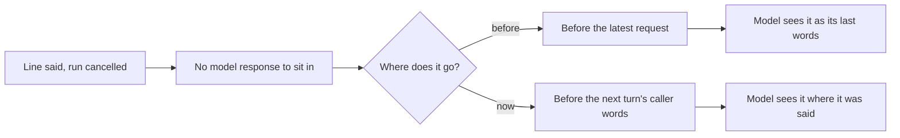

# Session 4d: correctness repairs after Stage C

Branch `feat/session-4d-correctness`, stacked on PR #22 (`feat/session-4c-mac`, base `8b127b2`).
Tested commit: `cd3a95f` (every gate below). The report commit on top of it changes no code. Live calls 4-7 ran
on `3a4c3e4`, whose runtime `cd3a95f` keeps (only a dead function and a test file changed since). Calls 1-3 ran
on older commits.

## Result

All six defects from the Stage C review are fixed. Each one has a reproducer, a regression through a public
entry point, and a revert check that fails without the fix. Seven live calls on the real Twilio line then found
one more state bug in core, now fixed: old speech drifted to the end of the model's history. That bug caused
the hang-up in call 3. Call 1's history had the same drift before its hang-up, so it is the likely cause there
too, but that one is an inference.

After the drift fix, calls 5, 6 and 7 reached their targets. Each left the diary exactly as expected, and
every write ran on a yes to code's own read-back, heard in full (Twilio mark). Call 5: a move refused because
another caller took the time, then another time. Call 6: an interruptive move to "day after tomorrow". Call 7:
"No, don't book Friday at two", said to the read-back of Friday at two, booked nothing. Call 4 missed its
target (its caller never asked to book), and wrote nothing.

Two faults remain visible live, and neither is a new guard to add:

1. A prose step's model can still say false words. The booking model imitated code's read-back in its
   own words (twice in text T5, once in live call 6, there with a wrong source day). It also once spoke a copy
   of a tool result (live call 4). The fix is structural: move booking to rendered speech, as `verify` now is.
2. State compares spelling, not meaning. "thursday" and "2026-10-01" are the same day, but core saw a change
   and took away the times on offer (live call 5). The fix is a Pydantic validation context, see "What is still open".

## The six defects

| # | Defect | Root cause | Fix | Regression |
|---|---|---|---|---|
| 1 | A repeated value authorised a write | `_reads_back` returned `Restated` for any read-back operation when the value matched | `restated: confirms` is an explicit operation flag, refused by the loader on anything but a lookup read back; the salon sets it on `lookup_customer` only | core F5, salon V6, T6 (real model) |
| 2 | Success lost on cancel during reconciliation | `_settled` marked the intent succeeded before `await current_version` | ask the version first; a failed, slow or non-integer answer leaves the intent unknown with the receipt on the audit; repairs only for the caller on the line | core I11-I15 |
| 3 | Refused move or cancel lost its booking id | refused and void receipts had no `booking_id`, so `matches` failed and the refusal became unknown | receipts carry the request's `booking_id`; a refusal takes back the picks it was built from | salon V1, V2 |
| 4 | A day change forgot the appointment being moved | `collect` cleared every offer and pick on any field change | per-choice `after:` fields (`ChoiceSpec`); a new caller clears all; a value already held is not a new pick | salon V4, core R11 |
| 5 | "day after tomorrow" was no day; unclear tool feedback | the grammar needed "the"; "not yet" and refusal texts did not name the next step | optional article; each problem says what to call next | salon diary test, V7 |
| 6 | Verify said its own digits; a lookup backed a claim | verify was a prose step; `wrote_this_turn` counted any receipt | verify is `speech: rendered` with `refusals:`; `wrote_this_turn` counts only standing changes | salon verify test, core S8 |

The revert checks are in [revert-checks.md](session-4d-correctness/revert-checks.md).
`tests.defects` before and after: [defects-before.txt](session-4d-correctness/defects-before.txt),
[defects-after.txt](session-4d-correctness/defects-after.txt).

### Enforcement boundary

1. Guaranteed by code: read-backs, receipts, recaps, goodbyes and fixed lines are worded by code from current
   evidence. A rendered step says no model words.
2. Best effort: on a guarded prose step, a clause matching the application's `locale.claims` is withheld.
3. Not guaranteed: any other prose on a prose step. `core/tests/defects.py` keeps this visible as a known limit.
   Live call 6 is an example: a wrong source day in a model's copy of a read-back.

Consent is guaranteed in every case above: a write runs only on a yes to code's own question, heard in full.

## Fixes found by live calls

### History drift (call 3, and call 1 in hindsight)



1. A line said by code, or cut while playing, can belong to a run that was cancelled. That run's response is
   never kept, so the line has no response to sit in.
2. `core.history.project` used to put every such line just before the latest request, on every request for the
   rest of the call.
3. In call 3 the model's last words were "You're all set… Anything else I can help with?" from one turn earlier.
   The caller said "sorry no" (meaning the offered day). The model read it as "nothing else" and said goodbye.
4. In call 1, the ask line "Which phone number should I use?" from turn 2 sat between a `hand_over` call and its
   result. The model then also said goodbye.
5. Now the line goes before the caller's words of the next turn, or before the latest request when it is this
   turn's. If that request holds tool results, the line joins the response that called the tools.

Regression: core `tests.test_history` `old_speech_stays_where_it_was_said`, which fails with the old insertion.

After call 1 I had added a rule that sent `goodbye` back once in a turn that recorded a request. Call 1's history
showed the same drift, so the rule's only evidence has a better explanation. It is removed (`3a4c3e4`): one
exception fewer in core. If a model hangs up on a clean history later, that is new evidence to act on.

### Call 1's other two fixes (`e9fbb8a`)

1. `collect` refused every field when one id was not on offer, so "move it to Wednesday" lost its day. Now the
   other fields are recorded, and the refusal says which were not. Regression: salon V9.
2. On a rendered step, `wait` now reads back an operation code can read back. Verify had said "Sorry, could you
   say that again?" to a whole number recorded in the same reply. Regression: salon verify test.

## Replayed traces

Both traces (`ce40c124…`, `5edecd4c…`, project `cmq0t92kl024oad0e43tdq77q`) ran with simulated local playout.
They are not Twilio mark evidence. Their source commit is not recorded in the spans.

1. `ce40c124`, turn 10: the model recorded the appointment before calling `options`. That is an agent ordering
   mistake, not core behaviour. The refusal now says "call options, then record an id it returns".
2. `ce40c124`, later: a day change in concierge cleared the held appointment. That was core behaviour (defect 4),
   now fixed.
3. `5edecd4c`: "day after tomorrow" was not a day (defect 5), and verify said its own digit read-back (defect 6).

## Evidence

### Offline

| Check | Result |
|---|---|
| Ruff format and check, whole workspace | clean |
| ty, every member | clean |
| core `python -m tests` | 15 modules ok |
| salon-graph `python -m tests` | 18 modules ok |
| faro `python -m tests` | ok |
| core and salon `tests.defects` | only the known prose limit left ([defects-after.txt](session-4d-correctness/defects-after.txt)) |
| N1-N13 matrix at `96ddb1f` | N1-N11 and N13 pass; native gaps as before (N9 native fails, N13 native not exercised) |
| N12 timing at `96ddb1f` | per-turn maximum 46.5 ms, within 50 ms; the trace rule still fails, so N12 stays failed |
| wheel proof outside the checkout, at `96ddb1f` | ok ([package-proof.log](session-4d-correctness/package-proof.log)) |
| runner ramp and faults | unchanged from `1177bb5` ([load/](session-4d-correctness/load/)) |

N12's per-turn limit failed once on a busy machine (92 and 56 ms) and passed when quiet (47.7 and 46.4 ms). The
base commit `8b127b2` gave 47.0 and 46.9 ms. Every run is kept in
[matrix/n12-runs/](session-4d-correctness/matrix/n12-runs/). N12 keeps its failed status from Stage C. Native gaps
are kept as they are (N9 native fails, N13 native not exercised).

### Real-model text

| Run | Source | Case | Result | Requests | Tokens |
|---|---|---|---|---|---|
| text-6 | `e9d086e` | T5 book, move "day after tomorrow", cancel | off-script at turn 12: booked, moved correctly; the cancel's yes was answered in prose and withheld; nothing false said | 25 | 76,693 |
| text-6 | `e9d086e` | T6 "No, do not book … I'm only checking" | passed | 9 | 19,810 |
| text-7 | `7ec5d69` | T1 | passed | 9 | 19,615 |
| text-7 | `7ec5d69` | T2 | passed | 15 | 38,073 |
| text-7 | `7ec5d69` | T3 | passed | 9 | 19,838 |
| text-7 | `7ec5d69` | T4 | stopped by the token cap after turn 4, nothing tested | 7 | 13,759 |

Cancelled requests are not counted by the checkpoint: unknown, not zero. The text allowance (560,000, raised by the
user from 500,000) is spent: 562,138, with a 2,138 overshoot on T4's last turn. So the drift fix and the goodbye
removal have no text check. Calls 4-7 ran on them.

### Coval, real Twilio line

Agent `PEivYdEtwEa65QSraG5fMQ`, +447427919928, speech profile `session-3/speech-profile.v1.env`, one call at a
time, calls up to 300 s. Judged from the campaign's diary file and the write audits, never from a Coval metric.

| # | Case | Source | Call | Target reached | Diary | Notes |
|---|---|---|---|---|---|---|
| 1 | book, move, cancel | `032f0f3` | `CAc82c12…0338` | no | one booking, no move | move turn lost its day; hang-up (history drift); led to `e9fbb8a` |
| 2 | book, move, cancel | `e9fbb8a` | `CAabad0e…dbb4` | partly | booked Wednesday new, cancelled | caller never accepted Monday; move not exercised; safe |
| 3 | interruptive relative day | `e9fbb8a` | `CAd33c3c…ef5a` | no | one booking | hang-up on "sorry no" (history drift); led to `aa1b5cf` |
| 4 | refused repetition | `3a4c3e4` | `CAb54c54…6637` | no | nothing written | caller never asked to book, so no read-back; model spoke a copy of the options result |
| 5 | taken time, then another | `3a4c3e4` | `CA4e5964…797f` | yes | as expected | contender took 15:00 at the read-back; refusal bound to BK0001; moved to 16:00 on a yes; one turn ran out of requests (spelling change cleared the offer) |
| 6 | interruptive relative day (retry) | `3a4c3e4` | `CA51ab47…c04a` | yes | as expected | moved to "day after tomorrow" on a yes to code's read-back; model's own copy said a wrong source day, cut while playing |
| 7 | refused repetition v2 | `3a4c3e4` | `CAe1250a…1daf` | yes | nothing written | "no, don't book Friday at two" to the read-back booked nothing and was not taken as a yes; the goodbye then said "I haven't made that last change" |

Full records, with run and simulation ids, consent evidence and effects, are in
[budget.json](session-4d-correctness/budget.json) (`coval_repair_pool.runs`). Fixtures:
[coval-fixtures.v1.json](session-4d-correctness/coval-fixtures.v1.json). Case 3 v2 was created after call 4 missed
its target: its caller now asks to book, so a read-back happens.

Delivery: every write in calls 4-7 was approved on a Twilio mark of code's own question, with the answer after it.
Unknowns: calls 4 and 7 were bound to their call by hand (the only call on the serve at the time; `coval_sim`
printed "call unknown"). Bot logs: [live/](session-4d-correctness/live/). The Coval run log:
[coval-runs.jsonl](session-4d-correctness/coval-runs.jsonl). No `load_report` run: the diary and write audits
above were read directly.

## What is still open

1. **Prose read-backs and prose tool echoes.** Booking, concierge and complaints are prose steps. Moving booking to
   `speech: rendered` removes both faults, as it did for verify. It is a prompt change that needs live checks.
2. **State by meaning.** Core should pass a Pydantic validation context (the call's clock and services) whenever it
   validates the application state. The salon's `booking_day` validator can then store one canonical date once the
   day is not ambiguous, running `_ambiguous` there. Choice dependencies then compare meanings, not spellings.
3. **Goodbye after a no.** Call 7's goodbye added "I haven't made that last change" after the caller had said
   no to it. The `left_undone` line should follow only a read-back that got no answer.
4. **Repeats on cut-in.** When the caller talks over a receipt, it is said again each time (five times in call 6).
   A lifecycle item: say it once more at most, then listen.
5. **Turn ends on a pause.** In call 3, smart-turn said "incomplete" twice, and 1.6 s of silence ended the turn.
6. From earlier stages: the N12 trace rule, native memory growth, a live worker kill.

## Next session: latency and lifecycle

Start from the tested commit, in a new worktree:

```bash
git worktree add ../slng_voice_harness-session-4e -b feat/session-4e-latency cd3a95f
```

Stack its PR on `feat/session-4d-correctness` while this PR is open. PRs #21, #22 and this one are open and
unmerged. Check `HEAD..main` first: other sessions commit to main.

### Budget left

| Pool | Left | Note |
|---|---|---|
| Targeted Coval calls | 4 of 20 | reserved: 2 latency, 2 worker failure. Never more than 4 |
| Candidate final | 10 normal + 10 interruptive | not for development |
| Native top-up | 10 normal + 12 interruptive | not for development |
| Real-model text tokens | 0 (562,138 spent of 560,000) | any text check needs a new allowance from the user |

The ledger is [budget.json](session-4d-correctness/budget.json). Copy it forward and never reset it.

### What the next session inherits

Latency:

1. N12's trace rule still fails. The per-turn maximum passes (46.5 ms) on a quiet machine, not on a busy one.
2. In calls 4-7, Pipecat's turn trace ("user-bot latency" in the bot log) gave 35 turns: median 2.49 s, p90 4.51 s,
   maximum 5.73 s, minimum 1.31 s. This session did not break it down or measure it against a limit.
3. Native memory growth from Stage C is still open.

Lifecycle and turn-taking:

1. A turn ends on 1.6 s of silence even when smart-turn says "incomplete" (call 3).
2. A receipt the caller talks over is said again each time: five times in call 6.
3. The goodbye's `left_undone` line follows an explicit no (call 7).
4. A live worker kill has not been run on the real line. The 2 reserved worker-failure calls are for it.

State and speech, for the session after (they need live checks and a text allowance):

1. State by meaning: a Pydantic validation context from core, a canonical `booking_day` in the salon (call 5).
2. Booking as `speech: rendered`, which removes prose read-backs and tool echoes (calls 4 and 6, text T5).
3. The known prose limit in core `tests.defects` stays until then.

### How to run the live checks again

```bash
cd use-cases/concierge-tools
uv run --env-file ../../.env python -m coval_sim serve --agency salon --phone-number +447427919928 \
  --campaign <label> --workers 2 --call-seconds 300 --state <fresh folder> \
  --profile ../../docs/research/reusable-core/session-3/speech-profile.v1.env --log <run log>
uv run --env-file ../../.env python -m coval_sim run --agency salon --agent PEivYdEtwEa65QSraG5fMQ \
  --test-set <one-case set> --persona <persona> --max-simulations 1 --concurrency 1 --label <label> \
  --call-seconds 300 --log <run log> --profile <same file> --host <serve's host> --state <same folder> \
  --fixtures ../../docs/research/reusable-core/session-4d-correctness/coval-cases.v1.json
```

Stop `serve` with SIGTERM to its Python process. It gives the number back once every call is over.
