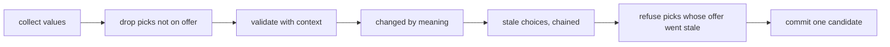

# Session 4e: state consistency, reliable speech, latency and lifecycle

[PR #26](https://github.com/slng-ai/slng-voice-harness/pull/26), branch `feat/session-4e-lifecycle`, stacked on PR #25 (`feat/session-4d-correctness`, head `31e998d`, still open).
Tested revision: `00e8aae` (every gate below). Later commits change only documents and evidence.

## Result

Seven general rules replace the exceptions the last live calls exposed. Each one has a regression through a
public entry point, and a revert check that fails without it ([revert-checks.md](session-4e/revert-checks.md)).

1. **A pick counts only against an offer made for the state an update ends in.** `after:` may name another
   choice, resets follow a chain, and a pick that arrives with the change that voided its offer is refused.
2. **State compares meaning, not spelling.** Core passes a Pydantic validation context whenever it validates
   the application's state. The salon keeps the day asked for as the date it means.
3. **A rendered step may offer choices, in the application's words.** Salon booking is now rendered: nothing
   its model writes reaches the caller.
4. **An unheard receipt is said again once, then the caller is heard.**
5. **A read-back the caller heard and turned down is not "left undone" at goodbye.**
6. **No holding line because a request is the turn's second.** Only work that lasts gets one.
7. **Warm-up requests end before their clients close.** The memory diagnostic now sees live calls.

Four targeted live calls ran on the real Twilio line:

- The two latency calls reached their targets. Every word on booking was the salon's.
- The worker-failure pair did not get its placement (both calls landed on one worker), so no worker was killed.
  Worker-failure verification is **incomplete**. The offline kills still pass.

N12 is still **failed**. The 50 ms ceiling passes (slowest turn 32 ms). The relative rule fails on turns 2, 4
and 5 and on the trace total.

## Faults, by layer

| Symptom | Initiating layer | Core behaviour after it (before the fix) | Evidence, confidence | Fix owner | Regression or limit |
|---|---|---|---|---|---|
| A resolution offered for billing stayed usable after the category changed | core state | `collect` removed every choice from the dependency set | public-path reproducer on the desk; high | core | R12 (A) |
| A pick arriving with the change that voided its offer was kept | core state | picks supplied in the same update were exempt; the tool checked the old offers | reproducer; high | core | R12 (B), plain and chained |
| "thursday" then "2026-10-01" took the times away (4d call 5) | core state + application | the change was computed from raw inputs | V10 replays call 5; high | core (validated values), salon (canonical day) | V10; limit below |
| Booking spoke its own copy of a read-back with a wrong day (4d call 6, text T5) | model, on a prose step | prose went to TTS | live and text traces; high | salon (rendered booking), core (rendered choices) | `model_speech_never_claims_a_completed_action`, R13 |
| Booking spoke a copy of the options JSON (4d call 4) | model, on a prose step | prose went to TTS | live trace; high | same | same |
| A receipt said six times as the caller talked over it (4d call 6) | caller barge-in (upstream), exposing core recovery | a hop-1 replay on every interruption, no limit; the replay also dropped the receipt's intent | trace; high | core | `an_unheard_receipt_is_said_again_once_then_the_caller_is_heard`; live call 2 said it twice in all |
| "I haven't made that last change" after an explicit no (4d call 7) | core goodbye | `left_undone` meant "intent never dispatched", whatever the caller said | trace; high | core | R14 |
| "One moment" before a fast answer | core filler | a holding line on every second model request | code and tests; high | core | `a_second_request_is_no_reason_to_hold` |
| A warm-up request could outlive its client | core lifecycle | tasks cancelled, never awaited | code; high | core | `a_warm_up_ends_before_its_client_closes` |
| The memory diagnostic always counted 0 live calls | salon tooling | `type(o).__name__ == 'FlowCall'`, but the class is `FlowCall[SalonState]` | printed class name; high | salon | A6 |
| "Sorry, could you say that again?" right after "Thanks, I have you." (live call 1) | model choice on a rendered step | `wait` with nothing to say fell back to pardon | bot log; high | core | `a_wait_with_nothing_to_say_offers_what_there_is` |
| "9:00 AM is taken" about the caller's own booking; the caller moved again (worker-pair bystander) | application wording, after a simulated caller repeated itself | the offer treated the caller's own slot as someone else's | bot log and diary; high | salon | V11 (offline only: no calls left) |
| Turn ended after 1.6 s of silence while smart-turn said incomplete (4d call 3) | endpointing (upstream) | a new turn, as designed | 4d bot log | Pipecat configuration; out of scope | not counted as a core regression |
| Both worker-pair calls on one worker | uvicorn's shared accept socket, on macOS | no fault injected: the watcher never armed it | runner record; high | runner design | worker-failure verification incomplete |

## How the rules work

### 1 and 2: one validated candidate per update

1. A pick is dropped first if it is not on the current offer, so an invalid id never blocks the other fields
   (the 4d call-1 fix still holds, V9).
2. The rest is validated with `{today, now, before}`: the call's clock, read once per call, and the committed
   state. No services, no I/O.
3. A field changed only if its validated value changed. "Thursday" recorded again as the date it already is,
   is no change.
4. A choice goes stale when a field in its `after:` changed. A choice may name another choice. A stale choice
   counts as changed, so a chain follows (ticket, then category, then resolution). A new known caller clears all.
5. A pick for a choice that went stale in this same update came from an offer that no longer stands. It is
   refused and reported, and the other fields are recorded.
6. One candidate is committed. A candidate that fails validation changes nothing: not state, not offers.

The salon's `booking_day` validator turns a phrase into `YYYY-MM-DD` when it names one date on the call's
clock. A date is never read again. A bare weekday stays words when it could mean two weeks beside the day
under discussion, so `find_times` still asks which one. **Limit:** a bare weekday said about a held
appointment, with no day asked for yet, stays words (the appointment's date is the diary's, and a validator
reads no diary). A later ISO spelling of that same day still rebuilds the offer.

### 3: rendered choices

A choice function on a rendered step returns `say` beside `options`: the application's words for the offer,
including "nothing is free" and "which of these two dates". `wait` says, in order: a read-back the reply calls
for; a refusal and then this turn's offer; `withheld` after an authoritative no; the first missing `asks:` field;
the offer as it stands, looked up by code; the pardon line. On a rendered step an authoritative no now goes back
to the agent, so it can look again. The loader now refuses `rendered` with `guarded` (nothing to guard) and no
longer refuses `rendered` with `choices`.

Salon booking is rendered. `find_times` and `held_bookings` word their offers in `functions.py`. Price
questions go to concierge. Proven outside the salon on the desk (R13): offers in the desk's words, a refusal
followed by a fresh offer, a read-back and a receipt. Hostile model text never reaches the caller.

### 4 and 5: bounded recovery

- The receipt record keeps its intent and counts its repeats. After one automatic repeat, the caller's words
  go to the node's agent. The receipt stays unheard: nothing marks it delivered. A superseded receipt is never
  said again (core R9).
- The call records which questions a reply began after, once heard in full. `left_undone` follows only a
  read-back with no such reply. A heard read-back the agent did not carry out was the caller's choice. No word
  of the reply is read.

**Limit:** on a rendered step, an explicit "say that again?" about a receipt is not honored; the goodbye
recap still says what was done. A `wait` fallback that repeated the receipt was tried and removed, because it
repeated it unasked.

### 6 and 7: latency and lifecycle

- The holding line covers a tool or action still running after `hold_after` (1.5 s). A provider stall keeps
  its own retry and says nothing.
- `model_clients` awaits cancelled warm-ups before its clients close. `server.py` stops its sampler in a
  `finally`. `live_counts` matches class names along the MRO.

## Evidence

### Offline, on `00e8aae`

| Check | Result |
|---|---|
| `ruff format --check` and `ruff check`, whole workspace | 275 files formatted; all checks passed |
| ty: core, salon-graph, faro, concierge-tools | all passed |
| core `python -m tests` | all 15 modules ok (R12-R14 new) |
| salon-graph `python -m tests` | all 18 modules ok (V10, V11, A6, A7 and the booking checks new) |
| faro, concierge-tools | 1 and 5 modules ok |
| core `tests.defects` | one entry left: the known prose-step limit (now concierge and complaints in the salon) |
| salon `tests.defects` | none left |
| N1-N13 functional matrix | harness passes every row; native gaps as before (N9 native fails, N13 native not exercised) |
| wheel outside the checkout | ok ([package-proof.log](session-4e/package-proof.log)) |
| offline faults F0-F5 | all verdicts pass ([load/faults.log](session-4e/load/faults.log)) |

### N12, frozen protocol, unchanged

| Run | Harness scripts | Load before / after | Per-turn medians, harness (native) ms | Slowest harness turn | Relative rule | Ceiling (50 ms) |
|---|---|---|---|---|---|---|
| run 1 | as in 4d | 1.46 / 4.09 | 11.8 (7.1), 18.4 (8.7), 54.3 (30.7), 17.2 (6.7), 19.1 (6.8) | 56.5 | fails turns 2-5 and trace | **fails** |
| run 2 | booking text replies as `wait` | 1.94 / 1.55 | 11.8 (7.1), 18.3 (8.3), 30.2 (30.5), 17.5 (6.5), 18.3 (6.7) | 31.9 | fails turns 2, 4, 5 and trace | passes |
| run 3 | same, on `00e8aae` | 1.65 / 1.21 | 11.7 (7.0), 17.9 (8.0), 30.1 (30.6), 17.4 (6.4), 18.5 (6.8) | 32.0 | fails turns 2, 4, 5 and trace | passes |

Run 1 used the old scripted replies. The booking model's text was refused on the rendered step, which added a
request and ended turn 3 on the stumble line. The harness arm's scripts now use `wait` there (three replies in
`evals/matrix.py`). The native reference and the protocol are unchanged. Every run is kept in
[matrix/n12-runs/](session-4e/matrix/n12-runs/).

Profile ([profile-core.txt](session-4e/matrix/profile-core.txt)): core's own work is about 10 ms per
five-turn trace, with no hot spot (operations 5.3 ms, offers 1.4 ms, projection 1.3 ms, validation 0.8 ms). The
diary costs under 4 ms per trace. Nearly all remaining time is the event loop waiting. So the gap to native
(about 11 ms on turns 2, 4 and 5) is the SDK agent loop and frame scheduling, not repeated core work. The
request count is 7 in both arms. Nothing was optimized, because nothing measured called for it.

### Memory and cleanup, offline, this MacBook (M5 Pro, 24 GB), 2 workers, doubles, one shared diary

| Run | Calls | Booked | Loop lag p99 | Live calls after | Tasks after | Worker memory |
|---|---|---|---|---|---|---|
| 1 → 2 → 5 ramp, 60 s at 5, 60 s idle | 1, 2, 10 | 1, 2, 10 | 20, 35, 31 ms | 0 | 3 | 5 calls: 575 MB peak, 438 MB idle (start 187) |
| sustained, 5 at once for 600 s, 300 s idle | 84 | 34 | 26 ms | 0 | 3, 20 fds | 540 MB at 1 min, about 700 MB from 7 min on (plateau), 486 MB idle |
| tracemalloc diagnostic, 120 s | 10 | 10 | | 0 | 3 | RSS 628 MB peak, 470 idle; Python heap 17-22 MB throughout |

- Every verdict passed: no unauthorised or duplicate effect, no capacity violation, no cross-call leak.
- The 50 unbooked sustained calls all asked for a time another call had already booked (one chair; checked by
  [unbooked.py](session-4e/load/unbooked.py)).
- Growth plateaus under steady load. It is not held by Python objects: live calls return to 0, tasks to 3,
  and the Python heap stays flat. What stays after the calls is in native libraries (ONNX runtime for VAD and
  smart-turn, resampling) or in freed pages the allocator keeps. Confidence: medium, since the native side was
  not attributed further. The kernel put almost every call on one worker in these runs too.
- Worker recycling is not used, and is not the fix.

### Live, real Twilio line

Agent `PEivYdEtwEa65QSraG5fMQ`, +447427919928, speech profile `session-3/speech-profile.v1.env`, 300 s calls.
Judged from each campaign's diary and the write records, never from a Coval metric. Trace review is agent
review, not a human listening test.

| Call | Case | Source | Outcome | Authorization | Delivery | Completion speech | Ending |
|---|---|---|---|---|---|---|---|
| s4e-latency-1 `CA38f4af…1858` | taken time, then another (`PpRSPVAi…`) | `57eac11` | pass: booked Tue 11:00; the move to Thu 15:00 refused (the contender took it); moved to Thu 16:00 | pass: each write after its read-back played | pass (13 Twilio marks counted; core approves only on a returned mark) | pass: receipts and recap from receipts | bot (EndFrame after goodbye) |
| s4e-latency-2 `CA3ecd42…9266` | interruptive "day after tomorrow" (`A3eP8AKJ…`) | `829271b` | pass: booked Mon 9:00, moved Tue 29th 9:00 | pass: the second read-back's mark returned 18:36:56.6, the answer began 18:36:59.9 | pass | pass; the talked-over receipt said again once, then not again | caller (CancelFrame after goodbye) |
| s4e-worker-affected `CAf07651…98a4` | book, move, cancel (`9GH9opPT…`) | `26a5b73` | pass as a normal call: booked Mon 10:00, moved Wed 10:00, cancelled | pass | pass | pass | pipeline_end; no fault injected |
| s4e-worker-bystander `CA3cd7a2…fb5e` | interruptive "day after tomorrow" | `26a5b73` | **fail**: moved to Tue 9:00 correctly, then again to Tue 10:00 | pass: the second move followed a heard read-back and a yes | pass | pass | pipeline_end; no fault injected |

The affected run's status poll hit a Coval 502. `coval runs get` later showed it COMPLETED, and it was bound to
its call by elimination (the campaign had two calls). Records, run and simulation ids are in
[budget.json](session-4e/budget.json). Bot logs, observations and diaries are in [live/](session-4e/live/).

#### Latency, from each call's spans (one process clock) and Pipecat's own breakdown

| Call | Core per turn, median | Model before first useful words | TTS first audio | Endpointing | Pipecat user-bot |
|---|---|---|---|---|---|
| s4e-latency-1 | 0.02 s (max 0.03) | 1.43 s (1-3 requests of about 0.75 s) | 1.24 s | 0.30 s | 2.3-5.4 s |
| s4e-latency-2 | 0.02 s (max 0.04) | 0.97 s | 1.26 s | 0.30 s | 1.1-5.4 s |
| s4e-worker-affected | 0.02 s | 0.90 s | 0.87 s | 0.30 s | |
| s4e-worker-bystander | 0.02 s | 1.02 s | 1.24 s | 0.30 s | |

[latency.py](session-4e/latency.py) reads the saved observations. The spans say it plainly: time to useful
audio is model round trips plus TTS first audio. Core adds about 20 ms. A replayed receipt spoke after 0.003 s
with no model. The lever left is the number of model round trips per turn (collect, options, wait: up to three
on a rendered booking turn), which is a prompt and model question. Text generation, TTS submission and fillers
were not counted as audio heard; delivery comes only from Twilio marks.

#### Model usage in the four calls

| Call | Requests | Input tokens | Cached | Output tokens |
|---|---|---|---|---|
| s4e-latency-1 | 35 | 94,699 | 0 | 664 |
| s4e-latency-2 | 38 | 98,890 | 0 | 553 |
| s4e-worker-affected | 27 | 74,942 | 0 | 539 |
| s4e-worker-bystander | 53 | 141,140 | 5,137 | 823 |

Each worker warmed its model clients once at start (`server.py`); those requests are not traced. Almost nothing
was served from the provider's cache.

### Worker failure: incomplete

The pair ran as planned: one campaign, two workers, `LIVE_FAULT=committed:+34671540101` and an arming file the
watcher creates only once both calls are active on different workers
([arm_after_placement.py](session-4e/live/arm_after_placement.py)). Both calls landed on worker 42639
([s4e-worker.placement.json](session-4e/live/s4e-worker.placement.json)). The fault was never armed and no worker
died. So nothing live was shown about a surviving worker's call, stale results, admission recovery or
reconciliation after a kill. The offline F0-F2 kills with a bystander on the other worker, F3 (stale worker
fenced) and F5 (drain) still pass. The calls were not replaced.

## Budget

| Pool | Before | Spent | Left |
|---|---|---|---|
| Targeted Coval calls | 4 (2 latency, 2 worker failure) | 4 | **0** |
| Candidate final | 10 normal + 10 interruptive | 0 | 10 + 10 |
| Native top-up | 10 normal + 12 interruptive | 0 | 10 + 12 |
| Real-model text tokens | 0 (562,138 of 560,000) | 0 | 0 |

## Blockers to frozen qualification

1. **Worker failure is not verified live.** Placing two calls on different workers needs control the runner does
   not have: uvicorn workers share one accept socket, and on macOS one worker took almost every call. A
   precise request: 2 more targeted calls, after the runner gets a way to place calls (for example one port per
   worker behind the tunnel, or admission that hands a call to a named worker). Not built this session.
2. **N12 relative rule fails** on turns 2, 4 and 5 and the trace total. The measured cause is outside core's own
   work.
3. **V11 and the offer fallback have offline proof only.** The fallback was fixed after live call 1 and ran live
   in calls 2-4. V11 was fixed after the last call.
4. **The prose-step limit remains** on concierge and complaints (core `tests.defects`).
5. The known debt from earlier stages is unchanged: native memory is retained after calls (it plateaus), and
   the interruptive persona makes verify repeat its number question over joined pieces.

## Next session

Start from this branch's head, in a new worktree, stacked on it while #25 and this PR are open. Check
`HEAD..main` first. No qualification, Faro migration, LiveKit or deployment was started.
