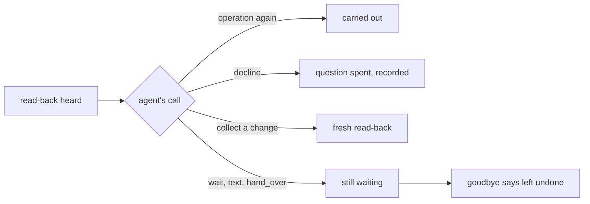
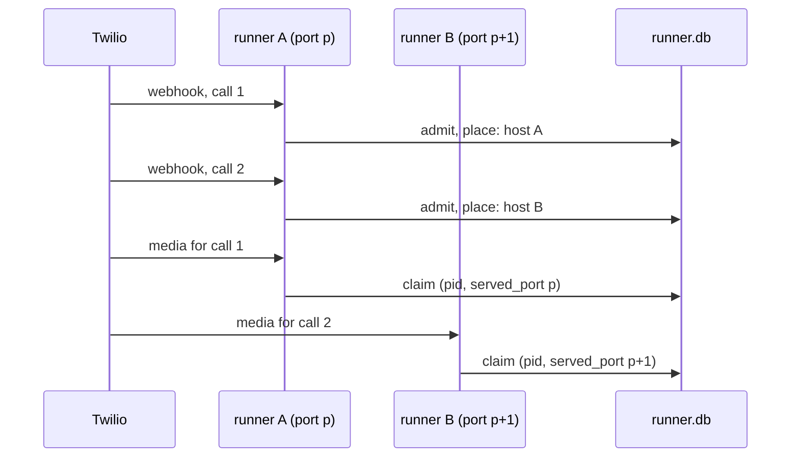

# Session 4f: readiness gaps closed before Faro

Branch `feat/session-4f-readiness`, stacked on PR #26 (`feat/session-4e-lifecycle`, head `420de86`, still open),
which is stacked on PR #25. Tested revision: see "Tested revision" below.

## Result

Seven repairs, each with a public-path regression and a revert check that fails without it
([revert-checks.md](session-4f/revert-checks.md)). Every core repair is proven on the support desk or the
clinic as well as the salon.

1. **An offer's words go with its ids.** `wait` can no longer say billing resolutions after the category
   became access.
2. **Only the node agent's `decline` turns a read-back down.** A question during a read-back leaves the change
   waiting, and the goodbye says so.
3. **A caller can ask to hear a receipt again** (`say_again`), past the one automatic repeat, with nothing sent.
4. **Complaint words are proven code**, and the prose that stays has a named negative test.
5. **Booking waits instead of spending a request on `options`.** Scripted booking requests drop from 3 to 1 on
   an ordinary offer.
6. **A changed resource stays on offer.** The booking just made can be moved and cancelled with no second
   lookup.
7. **Calls can be placed on two runner processes**, and the worker fault is armed only after placement is
   proven at the media connection.

Two more core defects were found while testing and fixed:

- A field set by a receipt rested on every operation that could set it. A new resolution wiped a looked-up
  revision, and the look-up would not run again, so the caller was stuck.
- The fields a reply recorded were kept across turns. After a no, `wait` read the same booking back again.

N12 is still **failed** on its relative rule. Its 50 ms ceiling passes (slowest turn 27.3 ms). The decision
proposal is below.

(Live results, faults and budget: see the sections below.)

## Findings, by kind

| Finding | Kind | Evidence | Fix | Regression |
|---|---|---|---|---|
| Spoken offer outlived its ids | core defect | public reproducer on the desk: "un reembolso o un abono" said after `category=access` | one record per offer (`Offers`) | R15, V12 |
| A question during a read-back counted as a no | core defect | reproducer on the desk (FAQ detour) | typed `decline` | R16, R14, P19 |
| No way to ask for a receipt again | core gap | 4e limit | `say_again` | R17, salon repeat test |
| A looked-up revision wiped by an unrelated field | core defect (found here) | R16 revision case stumbled | a field rests on the receipt that set it | R16 |
| Recorded fields kept across turns | core defect (found here) | `test_requests` K7 read the booking back after a no | cleared per turn piece | K7 |
| Booking re-found the booking it had just made | core defect, seen live | call A below | re-offer the named resource after a change | V13, R18 |
| `booked` and `appointment` name one booking | application friction | salon manifest | none needed: the refresh covers it | V13 |
| Own slot called "taken" | application defect (4e, fixed in `985522f`) | call B below | salon wording | V11, K4 |
| `options` then `wait`, deciding nothing | prompt and tool-contract friction | 13 of 15 live follow-ups | prompt and docstring | K1-K8 |
| Both 4e pair calls on one worker | runner design | 4e placement record | placement by process | A8, F6 |

### Calls A and B, kept apart

- **Call A**, Langfuse trace `e67c903456c6d8a7c96c43f8b257f9ce`, observation `abbc0e2af8d4d4d5`, session
  `CAf07651f2c66de160eafe0aa91f5298a4` (4e worker-affected). BK0002 was booked. On the move,
  `collect(appointment="BK0002")` was refused as not on offer, and `options` then returned the same BK0002.
  The call still booked, moved and cancelled correctly. The saved observations show the refusal text. Cause: a
  successful change took the offers of every field it bound, and never offered back the resource it named.
- **Call B**, Coval run `cCSJk34cuKVo3Ra7SDJM4p`, session `CA3cd7a2566a2756c450e265090d97fb5e` (4e bystander).
  The salon called the caller's own 9:00 slot "taken", and the caller moved again. This is V11, fixed offline
  in `985522f`. Live check: live call 1 below.

## How the repairs work

### 1. One record per offer

Before, `FlowCall` kept the ids on offer in one place and one string of words for the whole turn in another.
`record` took stale ids and left the words. Now `Offers` holds one `StandingOffer` per choice: its ids, its
words, the turn and the step that made it.

- Whatever takes the ids takes the words.
- `wait` says only offers its own step made on this turn, once.
- An update that fails validation takes nothing.
- A step reached by a hand-over never says another step's offer.

### 2. A decline is a typed call

1. The caller hears a read-back in full.
2. The step's agent reads the reply and makes one choice.
3. Calling the operation again carries it out, as before.
4. `decline` (new) records the no against that exact question and spends it, so no later yes can approve it.
5. A change gets a fresh read-back, which then has its own fate.
6. Anything else, such as a question or a hand-over to the FAQ, leaves the change waiting.
7. At goodbye, only a waiting change gets `left_undone`. An unknown outcome still gets `unsettled`.

`decline` is a function tool, not an output. Pydantic AI 2.46 uses `end_strategy='graceful'` by default, so a
function tool emitted before an output in the same response runs first. "No, bye" is `decline` + `goodbye` in
one request (R14 asserts one request). A joined turn that rewinds drops a no read from its first piece. On a
rendered step, `wait` after a no starts with `Locale.declined` and never says `pardon`.

### 3. `say_again`

A conversation step whose operations say receipts gets a `say_again` output. Code says the newest receipt that
still stands for the caller on the line (`CallContext.effective`), in its operation's own `say` words
(`StepFlow.receipt_words`). It sends nothing, makes no intent and marks nothing delivered. The automatic repeat
of an unheard receipt keeps its limit of one: a requested copy the caller cuts off brings no automatic repeat.
After a reopen superseded a resolve, `say_again` says the reopen.

### 4. Complaints and concierge

Every consequential complaint line is code: the read-back (`complaint_words`), the receipt with its reference
and next step (`say: '{said}'`), the reference said again (`say_again`), and the goodbye recap.
`complaint_words_are_the_salons` checks each against the salon's own rendering. Concierge has no operations.

Both steps stay `prose` for ordinary talk: empathy, questions, prices and lengths from the salon's documents.
That is the weaker guarantee. The claim guard (`locale.claims`) catches the salon's claim verbs, not an invented
number: `a_prose_reference_is_the_known_limit` shows "Your reference number is ZZ999." reaching the caller, and
core's `a_prose_step_can_still_claim` stays in `tests.defects`. Concierge accuracy is judged in the live
behavior call.

### 5. Fewer booking requests

The saved 4e traces ([booking_requests.py](session-4f/booking_requests.py), no network): in four live calls,
13 of the 15 requests made right after an `options` result only called `wait`, which already looks the offer
up itself. One used the result to move, one to record a pick.

The booking prompt and the rendered `options` docstring now say: record and wait in one reply; call `options`
only for an id the application state does not show yet. Nothing is picked or approved by code.

Scripted comparison, `use-cases/salon-graph/tests/test_requests.py`. The same caller turns with the 4e replies
and the 4f replies, on the real flow. Same words and diary where they should match.

| Case | 4e requests | 4f requests |
|---|---|---|
| K1 ordinary offer | 3 | 1 |
| K2 ambiguous "yes" to two times | 5 | 2 |
| K3 time taken before the yes | 6 | 4 |
| K4 own slot (V11) | 3 | 1 |
| K5 book, move, cancel | 15 | 10 |
| K6 question instead of a yes | 6 | 3 |
| K7 a no (words change: "All right, I haven't changed anything.") | 6 | 3 |
| K8 cut receipt, then asked again (4e gave an offer, 4f the receipt) | 6 | 4 |

The 4f counts assume the model sends `collect` and `wait` in one response. If it sends them one after the
other, an offer turn costs 2 requests, still one fewer. Scripted models prove what the runtime allows, not what
a real model chooses.

### 6. A changed resource stays on offer

`StepFlow` reads, from declarations the manifest already has, which choice fields name a resource: an
operation binds the field to its `subject` argument and names the resource kind. In the salon, move and cancel
take `booking_id` from `appointment` and say their receipts are about a `booking`. After any successful change
of that kind, the application's own choice function is asked again, quietly: no words for `wait`, no model
request. The domain decides what stands, so a cancelled booking is not offered back. Everything else holds: a
pick must be on offer, a foreign id is refused, and with two bookings held nothing is picked.

### 7. Placement by process

1. Two runners, each `uvicorn --workers 2` on its own port and tunnel, share one diary and one runner file.
2. The number points at runner A. Its webhook admits each call, globally bounded at five.
3. `Admission.place` sends consecutive calls to the hosts in `MEDIA_HOSTS` in turn, and records the choice.
4. Each media stream is claimed by the process it reached. The claim records the worker pid and the listening
   port (`served_port`): where the media really arrived.
5. `evals/placement.py` arms `LIVE_FAULT_ARM` only when two active calls have different pids and different
   ports.
6. The fault fires once: the dying worker removes the arm file.

The fake phones now follow the TwiML `<Stream url>`, as Twilio does.

(sections below are filled in as the evidence finishes)
