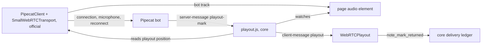
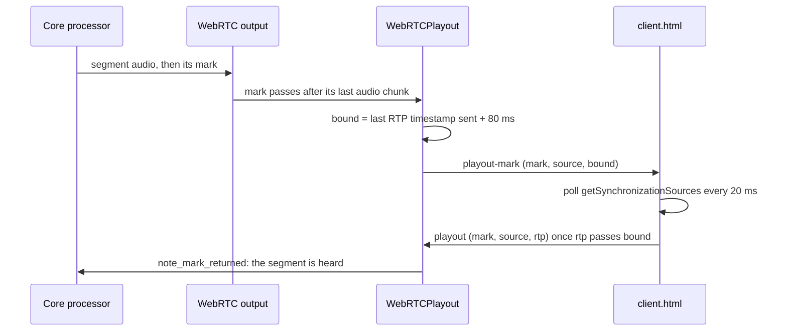
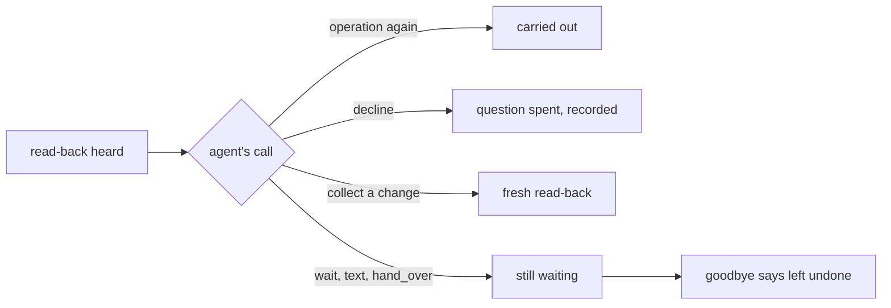
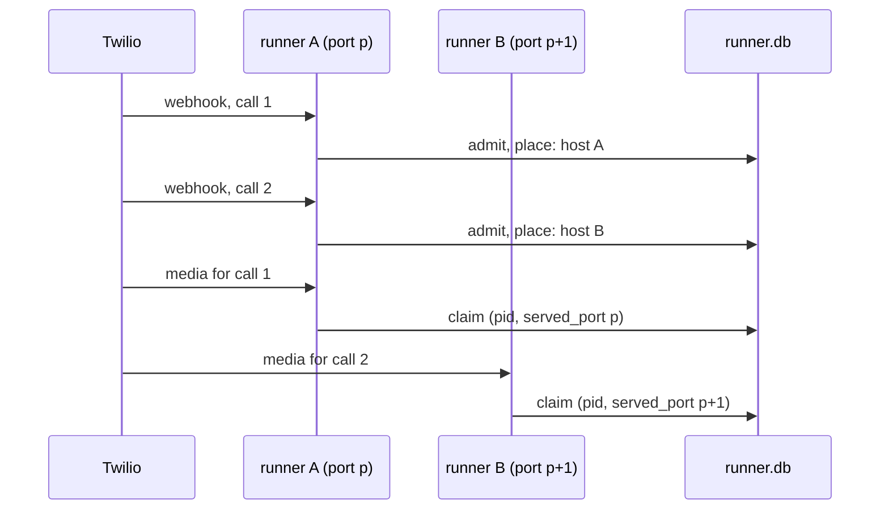

# Session 4f: readiness gaps closed before Faro

[PR #27](https://github.com/slng-ai/slng-voice-harness/pull/27), branch `feat/session-4f-readiness`, stacked on PR #26 (`feat/session-4e-lifecycle`, head `420de86`, still open),
which is stacked on PR #25. Tested runtime: `b36ab10`.

## Follow-up 2: Pipecat's own web client, and playback the page really played

The browser page is now Pipecat's own web client with one small addition from core. Before, it was a page core
wrote itself. A report now also requires that the page's audio output played the whole segment without a break.
A paused, blocked, detached or resumed output can no longer confirm a read-back. Live validation in a real
browser is **pending**: the manual checkpoint is at the end of this section.

The manual call before this change (Langfuse trace `cec2cb4a8cc81de19249e4e58fdab2aa`, on core's earlier
page, simulation off) confirmed a phone number, then booked, moved and cancelled one appointment. That
behavior is kept: the salon's BR4 now runs the same confirmation path over the new protocol, offline.

### What the native components allow

Checked in the installed packages, and against the official source at the same versions (the npm source maps
are byte-identical to the GitHub tags):

| Component | Version | Supported extension points | Can it carry playback evidence? |
|---|---|---|---|
| `pipecat-ai-prebuilt`, the stock UI at `/client/` | 1.2.1, built with `client-js` 1.13.1, `client-react` 1.8.2, `small-webrtc-transport` 1.10.8 | none at run time: no query parameter, window setting or fetched config; the `/start` endpoint and every callback are compiled in; its `<audio>` element is internal | no. Changing it means rebuilding its source, which would no longer be the stock bundle |
| `@pipecat-ai/client-js` (`PipecatClient`) | 1.13.1 | callbacks and `.on()` events (`ServerMessage`, `TrackStarted`, `Connected` …), `sendClientMessage`, `setAboutClient` (adds fields to its own `client-ready`) | carries the messages and declares the capability; has no playback acknowledgement and no plugin system |
| `@pipecat-ai/small-webrtc-transport` | 1.10.8 | constructor options (ICE, codecs, `mediaManager`); `onTrackStarted` hands the bot's track to the app | no public receiver: its `RTCPeerConnection` is TypeScript-`private pc`, and it exposes no `getSynchronizationSources`, `getStats` or track event. **This is the missing SDK capability.** It plays nothing itself |
| The app's `<audio>` element | browser | Pipecat's documented vanilla pattern: the app sets `srcObject` to the bot track in `TrackStarted` | its standard state (`paused`, `muted`, `volume`, `readyState`, `srcObject`, attached to the page) says whether the output is playing |
| Pipecat server | 1.11.0 | RTVI `client-message` in, `server-message` out; the runner's `app` takes routes registered before `main()` | no client playback message of its own |

So the answer to the three questions:

1. **The packaged UI cannot be extended** without rebuilding it, and a rebuilt bundle would not be the stock one.
2. **A small source-level integration is needed**, and is what ships: core's page uses the official
   `PipecatClient` and `SmallWebRTCTransport` for the connection, the microphone, devices and reconnection,
   and adds one module.
3. **One upstream capability is missing**: the transport gives the app no way to read the receiver's playout
   position. The added module reads it from the transport's `pc` member, which exists at run time but is not
   declared. If a version drops it, the page declares no capability, the bot refuses the call before its
   greeting, and nothing false is ever reported. The upstream fix is a public receiver, or a playout event.

### What is kept native, and the one addition



1. `core/src/core/client/sdk.js` is the official `@pipecat-ai/client-js` 1.13.1 and
   `@pipecat-ai/small-webrtc-transport` 1.10.8, bundled unmodified into one browser module by `core/client/`
   (`package.json` and `package-lock.json` pin them; esbuild 0.28.2; `npm ci && npm run build`). It is marked
   generated. It is not the stock prebuilt UI, and nothing in it is edited.
2. `index.html` is a few lines of page: Start, Hang up, and the bot's `<audio>` element, set from
   `TrackStarted` exactly as Pipecat's documentation shows. It connects with `client.connect()` to the runner's
   `/api/offer`.
3. `playout.js` is core's only addition (about 100 lines). It calls `setAboutClient` so the client's own
   `client-ready` names the capability (`playout: 'rtp-timestamp/2'`), receives each `playout-mark` through
   `ServerMessage`, and sends `playout` reports with `sendClientMessage`.
4. `serve_client(app)` mounts the folder at `/voice/` and sends `/` there. A launcher that never confirms
   anything, or brings its own client, need not call it: the harness does not require this page.

Nothing in core's domain code changed for this: the page, the adapter (`WebRTCPlayout` in `processor.py`) and
the launcher are the framework integration. No LiveKit code was written.

### The paused-output defect

The earlier page reported as soon as the receiver's `rtpTimestamp` passed a segment's bound. An independent
real-Chrome run paused the page's audio element before a read-back and still got `delivered`, and the desk
sent its write once. The W3C spec allows that: the receiver's timestamp can advance with no output attached.

The rule now has two halves, and both must hold:

1. **The output ran without a break** from a playout position at or before the segment's `start`. `start` is
   read when the segment's first audio frame leaves the server, less the same 80 ms margin, so it is early,
   never late. The page's "run" begins at the first 20 ms sample where its audio element is attached to the
   page, playing, not muted, above zero volume and holding the live bot track. Any `pause`, `emptied`,
   `loadstart`, `waiting`, `ended` or `volumechange` event, a track that goes muted or ends, or a sample
   where those conditions fail, ends the run. Playing again starts a new run at the position then.
2. **The playout position passed the segment's bound**, as before.

The report carries `since`, where the unbroken run began, and the server checks it too: a report whose `since`
is after the segment's `start` counts for nothing. So resuming can never approve a segment that did not play
whole: its `start` lies before the new run.

| Case | What happens | Checked by |
|---|---|---|
| Normal playback | reported about 100 ms after the segment's last audio left the server; a yes resolves once | C2, C3; W1, W6; BR4 |
| Autoplay blocked | the element stays paused: no run, no report | C7 (Chrome's strict autoplay policy) |
| Paused before the read-back | no run, no report; the yes resolves nothing | C4; W2 |
| Output detached (stream removed, or element removed from the page) | no run, no report | C6, both ways |
| Paused 1 s into a 3 s read-back, playing again 0.4 s later | the read-back is never reported; the yes resolves nothing; the next read-back is reported | C5; W2; BR5 (salon) |
| Interrupted in the middle | never heard, reads `cut` | C8; W4 |

A consequence: a segment that begins less than 80 ms after the output first starts playing is not reported.
The first greeting of a call can fall in that gap. It is safe, since a greeting needs no approval.

### Interruption on WebRTC

Before, an interruption voided every pending browser mark and labelled it `cut`. On WebRTC a pending mark
means the segment's audio was all sent, and a browser has no clear: it plays what it received. So the label
was wrong, and BR5 showed it: a read-back that simply had no report was audited as `cut` once the caller
spoke.

Now `note_cleared(sent=False)` voids only the marks still queued behind the dropped audio. Those segments were
cut, and read `cut`. A segment already sent stays pending. If its report arrives after the caller began to
speak, it is `early` and answers nothing (`answered_in_time`). If it never arrives, it is `unconfirmed`. Twilio
is unchanged: its `clear` empties audio the carrier still holds, so every pending Twilio mark is still voided.

### Three smaller repairs

1. **`reports_playback(wiring, call)` is truthful.** It was True for every transport but a non-reporting
   browser. Now:

   | Line | Can confirm |
   |---|---|
   | Twilio with marks | yes |
   | Twilio with no marks (Coval's simulator), outside simulation | no |
   | Any line opened with `DELIVERY=simulated` | yes, recorded as simulated |
   | A transport with estimates only, outside simulation | no |
   | Browser that declared `rtp-timestamp/2` | yes |
   | Browser that declared nothing, or version 1 | no |

   The salon asks it before its greeting on every line, not only the browser: a phone line that could never
   confirm now hears `Locale.unconfirmable` before anyone gives details. `coval_sim` always pairs
   `TWILIO_MARKS=absent` with `DELIVERY=simulated`, so Coval runs are unaffected (W10).
2. **The withdrawal's reason comes from evidence.** `CallContext.withdraw` chose `talked_over` whenever the
   stricter counter was not the one that ran out. After one heard greeting, missing reports fill that counter
   with no interruption at all. The reason is now the hearing of the read-back's last copy: `unconfirmed`,
   `cut`, `early` or `failed` (R20, on the desk).
3. **A malformed `client-ready` is handled.** `about` is read through a Pydantic model (`_About`); null, a
   list, a string, a number or bad `platform_details` are a client that reports nothing, never an exception
   (W9).

### Evidence each transport supplies (current)

| Transport | Evidence of playback | Where | Approves |
|---|---|---|---|
| Twilio Media Streams | returned `mark`, voided by any pending `clear` | `TwilioMarks` | yes |
| Twilio-shaped simulator with no marks (Coval) | audio settled at real time, `local` | `TwilioMarks(echoes_marks=False)` | only with `DELIVERY=simulated`; otherwise refused before the greeting |
| Browser, core's page (Pipecat's client with `playout.js`) | the output played without a break from before the segment's start until the playout passed its bound | `WebRTCPlayout` | yes |
| Browser, Pipecat's prebuilt UI | none | refused on `client-ready` | no: the call ends before the greeting |
| Browser with `DELIVERY=simulated` | audio written, `local` | `LocalPlayout` | yes, recorded as simulated |
| Text runner | `acknowledge` | `CallContext.acknowledge` | yes, recorded as simulated |

What a browser report does not prove: that a speaker played it, or that a person heard it. The page sees its
own audio element. It cannot see the tab's mute button, system volume or the output device. Twilio's marks
have the same kind of limit.

### Offline results

Provider and model requests were disabled for every check (`ALLOW_MODEL_REQUESTS` off, scripted models, speech
doubles). No Coval call, rescoring or live model run was made.

| Check asked for | Where | Result |
|---|---|---|
| The native UI and SDK integration itself, not a mocked acknowledgement | `tests.client_check`: core's page, the official `PipecatClient` and `SmallWebRTCTransport`, `playout.js`, in headless Chrome, against the real adapter and Pipecat's `SmallWebRTCRequestHandler` (POST and PATCH `/api/offer`) | C1-C8 pass |
| Normal read-back then yes: one operation | C3 (desk, Chrome); W6 (desk, aiortc peer); salon BR4 (the whole call: number, booking, one booking) | pass |
| Paused output, blocked autoplay, detached output: no false delivery | C4, C7, C6 (both ways); W2 | pass |
| Paused mid read-back, then resumed: no retroactive authorization | C5 (desk, Chrome, the flow's own read-back); W2; salon BR5 (the number read back while the output was stopped) | pass |
| Interrupted, stale, duplicate and wrong-call evidence: no authorization | C8, W4 (interrupted); W3 (another source, short of the bound, a late-started output, another call's mark, a malformed report, a duplicate); W5 (a reply begun before the report) | pass |
| Unsupported capability detected before confirmation-dependent details | salon BR3 (the prebuilt UI's `client-ready`: refused before the greeting); W7; W10 (`reports_playback` per transport) | pass |
| Malformed capability metadata handled without an exception | W9 (null, list, string, number, bad `platform_details`) | pass |
| Missing acknowledgement recorded as unknown, not caller interruption | core R20 (desk: withdrawn as `unconfirmed`, not `talked_over`); W4 (a sent segment reads `unconfirmed`, then `early`); salon BR5 (the blocked confirmation audited `unconfirmed`, not `cut`) | pass |
| Confirmation and recovery on the support desk and on the salon | desk: R2, R16, R19, R20, W1-W10, C1-C8; salon: B4.1-B4.6, BR1-BR5, M1-M6, E1 | pass |
| Existing recovery and Twilio regressions | every suite below | pass |

Suites on the final code (`uv run python -m tests` in each member):

- core: all 16 modules ok (R20, W9, W10 new; W2-W5 rewritten for the new rule).
- salon-graph: all 20 modules ok (BR4, BR5 new; BR1 checks the page at `/voice/`).
- faro-language-learning, concierge-tools (5 modules), salon-pipecat-flows: all ok.
- `tests.defects`: core exits 1, its one known limit (a prose step can still say an unbacked claim), as
  before; salon exits 0.
- `tests.client_check` (headless Chrome): C1-C8 ok.
- `ruff format`, `ruff check`, and `ty check` in core, salon-graph, faro, concierge-tools and
  salon-pipecat-flows: clean.
- Package proof: ok; the wheel carries `core/client/index.html`, `playout.js` and `sdk.js`
  ([browser2/package-proof.log](session-4f/browser2/package-proof.log)). `uv.lock` is unchanged.
- `sdk.js` rebuilt from `core/client/` with `npm run build`: byte-identical (SHA-256 `c7bb762d…3008`).
- N1-N13 matrix: every row identical to the 4f record.
- Revert checks: seven, all caught ([revert-checks.md](session-4f/revert-checks.md),
  [browser2/reverts.txt](session-4f/browser2/reverts.txt)).

**Latency.** No model request, no round trip and no sleep were added on the server. The page samples its own
state every 20 ms in the browser. The playout report reached the server 97 to 127 ms after the read-back's last
audio left it, over four Chrome runs on loopback: the 80 ms margin, the browser's jitter buffer and up to one
20 ms sample. Follow-up 1's page took 79 to 88 ms. The extra is the sample interval, and the report waits for
the audio element as well as the receiver. That delay sits between the end of a read-back and the earliest
moment a reply to it can count. A caller's reply is timed from its own voice onset, and normally starts later.
The adapter's added work per segment is one more sender read, at the segment's first frame.

**N12, run 6**, on this code, with the frozen protocol and tolerances: the verdict is unchanged. The relative
rule still fails on turns 2, 4 and 5 and on the trace (89.7 ms against 56.2); the 50 ms ceiling passes (slowest
harness turn 29.1 ms). Medians per turn, harness (native): 10.7 (7.1), 18.3 (7.9), 15.3 (30.1), 17.4 (6.3),
18.7 (6.6) ms. Raw samples: [matrix/n12-runs/run6](session-4f/matrix/n12-runs/run6/timing.json). N12 is not
relabelled, and no latency parity is claimed. N12 has no browser transport.

### Limits

- Two private fields carry the browser evidence, and each fails closed. The server reads aiortc 1.15.0's
  last sent RTP timestamp (`_RTCRtpSender__rtp_timestamp`). The page reads `SmallWebRTCTransport`'s `pc`.
  If either disappears, nothing is ever heard, or the call is refused before its greeting. `test_webrtc`
  and `client_check` fail at once.
- Headless Chrome plays to a fake audio device. The Chrome check proves the page's logic against the real
  element and receiver, not a speaker.
- Only core's page reports. The stock prebuilt UI, the Daily transport and any other client are refused
  before the greeting when the flow needs confirmations (Daily was not checked).
- `core/src/core/client/sdk.js` is a generated 650 kB file in the wheel. Upgrading the SDK means changing
  `core/client/package.json` and rebuilding.
- Faro's `bot.py` serves the page, but has no early refusal yet: that is session 5's.

### Manual checkpoint (pending)

Start the salon exactly as documented, with no simulation flag:

```bash
cd /Users/nicoferdi/Documents/GitHub/slng_voice_harness/.claude/worktrees/session-4f-readiness/use-cases/salon-graph
uv run bot.py
```

Open **http://localhost:7860/voice/** in Chrome (`/` redirects there) and click **Start call**. Allow the
microphone, and keep the tab playing. Under the buttons, "Playback reported for N replies" goes up as the
evidence arrives.

1. **Phone confirmation.** Ask to book a haircut. Give your number in two fragments. When it is read back, let
   it finish, then say "That sounds about right." Expected: the call goes on to the booking.
2. **Booking.** Ask for a day and time, let the booking be read back, say "Yes." Expected: one booking and
   its confirmation.
3. **Interruption.** Ask to move it. Interrupt the read-back halfway. Expected: it is read back again. Let it
   finish, then say "Yes." Expected: the booking moves once.
4. **Cancellation.** Ask to cancel it, let the read-back finish, say "Yes." Expected: cancelled once.
5. Say "That's all, goodbye." Expected: the goodbye, and the call ends.
6. Optional, the paused output. On a new call, open the browser's developer console before a read-back and
   run `document.getElementById('bot').pause()`, then `.play()` a second later. Expected: that read-back is
   read back again, and your yes to the paused copy changes nothing.
7. Optional, the refusal: **http://localhost:7860/client/** (Pipecat's prebuilt UI). Expected: "Sorry, this
   connection can't confirm that you've heard me…", and the call ends.

Afterwards, the bot log shows `browser client sends playback reports` and one `playout report for … counted`
line per heard segment. The Langfuse trace shows a `confirmation` span for any blocked read-back, and
`transport: webrtc` in each write audit.

## Follow-up 1: browser calls and bounded recovery

The documented browser entry point (`cd use-cases/salon-graph && uv run bot.py`) could never confirm a read-back,
and a read-back that could not be confirmed looped. Both are repaired in core, for every use case, with no
salon code in the fix. Twilio evaluations were never evidence for this path, and none is used as evidence here.

Follow-up 2 above replaces this section's page (`client.html` is gone; the page is now Pipecat's own client
with `playout.js`), its capability name (`rtp-timestamp/1` is no longer accepted), its interruption rule (step 7
below), and its manual checkpoint. The incident, the root cause and the recovery transitions still stand.

### The incident

Langfuse trace `369560b8ed25d40a0266fe1a602d0c91` (session `f4927fb0…`), a browser call on this branch with the
default `DELIVERY=marks`. Read-only review, every turn:

| Turn | Caller | Model chose | Delivery evidence | Authorization | Backend ran | Said by code |
|---|---|---|---|---|---|---|
| 4 | their number, in two fragments (one joined turn) | `collect(customer_phone)` | the read-back was sent; no report of it playing | nothing pending yet | no | "Is your number +34 …?" (the number assembled correctly) |
| 5 | "That sounds about right." | `lookup_customer` | none | refused: the question was not heard in full | no | the same read-back again |
| 6 | "That sounds right." | `lookup_customer` | none | refused: second unconfirmed copy, `READBACKS` reached | no | `Locale.gave_up` |
| 7 | "What do you mean that you couldn't confirm? I am confirming it now." | `lookup_customer` | none | refused: nothing pending | no | `Locale.gave_up` again |

The model was told, on turns 5 and 6: *"They did not hear all of it, so their reply cannot agree to it: put it to
them again."* The evidence showed only that playback was never confirmed, not that the caller missed it. The
trace held no delivery, authorization or transport record at all: the ledger lived only in process.

### Root cause

1. **No playback evidence on the browser transport.** `core.processor.playout` gave every non-Twilio transport
   `LocalPlayout`, which records a segment as `local` when its audio is written. That is an estimate, and by
   design an estimate approves nothing unless a launcher names the simulation. So on the default browser path no
   read-back could ever be heard. Pipecat 1.11 has no browser playback signal to use instead: `bot-stopped-speaking`
   is a server event, the prebuilt client sends only pings, and RTVI has no playback acknowledgement.
2. **Recovery was a string, not a state.** `Prompted.put` returned `Locale.gave_up` past the limit but left the
   intent `prepared`. Every later yes reached the same branch and said the same line.
3. **Missing evidence was worded as a fact about the caller.** The model's context said "they did not hear".

The support-desk flow reproduces all three through `core.load` and `core.text_turn` with no salon import
(core R19). The same scripted operation dispatches exactly once when playback is acknowledged.

### What each signal proves

| Signal | Where it comes from | What it proves | Can it approve? |
|---|---|---|---|
| `BotStoppedSpeakingFrame`, RTVI `bot-stopped-speaking` | the server's output transport | the server stopped sending audio | no: turn-taking only |
| Audio written to the WebRTC track (`LocalPlayout`) | the server | the audio left the server's queue | no: an estimate, unless simulation is named |
| The mark message arriving in the browser | the data channel | nothing about audio: the channel is not ordered with the RTP stream, and the message leaves before the packet is encoded | no |
| Twilio `mark` returned, no `clear` pending | Twilio's Media Streams | Twilio's playout reached that point | yes |
| Browser playout report past the segment's bound | `getSynchronizationSources().rtpTimestamp` in the page | the segment's audio, on this call's stream, was taken from the jitter buffer for playout | yes |
| Text `acknowledge` | a text runner | simulated delivery | yes, recorded as simulated |

### How the browser repair works



1. The processor pushes a `SegmentMark` behind each segment's speech, as for Twilio.
2. The output transport passes the mark on only after the segment's last 10 ms chunk has left the audio track.
   `WebRTCPlayout` counts the audio frames before it: a mark with no audio before it is never bounded.
3. It reads the audio sender's last RTP timestamp and adds `PLAYOUT_MARGIN` (3840 ticks, 80 ms: two packets the
   final sample may still be behind, one more because the browser names a packet by its start, one for the
   Opus lookahead). Late, never early.
4. It sends the page the mark, the stream's SSRC and the bound, in an RTVI `server-message`.
5. The page reads its receiver's `getSynchronizationSources()`. The W3C spec defines `rtpTimestamp` as the RTP
   timestamp of the media played out at `timestamp`. When it passes the bound (a serial comparison, since RTP
   timestamps wrap at 2³²), the page reports once.
6. The adapter validates the report (`PlayoutReport`, strict) and checks the source and the bound. Only then does
   the core ledger count the mark, timed at the report's arrival. A report for another stream, short of its
   bound, for a mark never bounded, from another call, for a mark voided by an interruption, or sent twice counts
   for nothing: the ledger's existing rules do most of this already.
7. An `InterruptionFrame` voids every mark still pending (`CallContext.note_cleared`), exactly as a Twilio clear
   does. The browser has no clear to confirm what it still played, so pending audio is never counted.
8. The page names the capability in its `client-ready` (`about.platform_details.playout = 'rtp-timestamp/1'`).
   `bot.py` asks `reports_playback` before its greeting. A page that does not report (Pipecat's prebuilt
   `/client/`) hears `Locale.unconfirmable` and the call ends, before anyone gives details.
9. `serve_client` puts the page at `/` on the runner's app before `main()` runs, so `http://localhost:7860` opens
   it. The prebuilt client stays at `/client/`.

No model request and no sleep were added to delivery handling. The one wait is `capability`, which waits for the
page's `client-ready` event itself (bounded at 5 s).

### Recovery as a state transition

A read-back past its limit (`READBACKS`, 2 unconfirmed copies on a line that has proven nothing, or
`CUT_READBACKS`, 5 talked-over copies) is now **withdrawn** (`CallContext.withdraw`). The intent becomes
`withdrawn`: terminal, never dispatched, owed to nobody. The pending question is spent. The caller hears
`Locale.gave_up` once, and a `confirmation` span records the transport, each copy's evidence and the reason.

| The caller then | What happens | Checked by |
|---|---|---|
| confirms again | the same arguments find the same withdrawn intent: no read-back, no new intent, no allowance reset, no dispatch; they hear `Locale.withdrawn` ("I still can't confirm that on this line, so it stays as it was.") | R19, twice |
| corrects the value | different arguments are a new intent with its own allowance, read back; once heard, a yes carries it out once | R19 |
| asks something else | answered normally; nothing is pending | R19 (FAQ hand-over) |
| asks to stop | the goodbye, with `left_undone` (they may have talked over the fallback too) | R19, salon B4.1 |

An operation that was already dispatched is untouched: only a `prepared` intent can be withdrawn, and unknown
outcomes still reconcile by intent.

The model is now told what the evidence says, not a guess about the caller (`CallContext.hearing`):

| Hearing | Told to the model |
|---|---|
| `heard` | They heard it in full. |
| `early` | They began answering before it finished playing … |
| `cut` | It was cut off before they heard all of it … |
| `failed` | Its audio failed to play … |
| `unconfirmed` | This line has not confirmed that it finished playing. That is missing evidence, not a sign they missed it … |

Every blocked or withdrawn confirmation leaves a `confirmation` span (`confirmation.audit`: event, operation,
reason, transport, whether estimates count, and per copy `heard_by`, `lost` and `hearing`). Every write audit
now names its `transport`.

### Evidence each transport supplies

| Transport | Evidence of playback | Where | Approves |
|---|---|---|---|
| Twilio Media Streams | returned `mark`, voided by any pending `clear` | `TwilioMarks` | yes |
| Twilio-shaped simulator with no marks (Coval) | audio settled at real time, `local` | `TwilioMarks(echoes_marks=False)` | only with `DELIVERY=simulated` |
| Browser, core's `client.html` | playout report past the segment's RTP bound | `WebRTCPlayout` | yes |
| Browser, Pipecat's prebuilt client | none | refused on `client-ready` | no: the call ends before the greeting |
| Browser with `DELIVERY=simulated` | audio written, `local` | `LocalPlayout` | yes, recorded as simulated |
| Text runner | `acknowledge` | `CallContext.acknowledge` | yes, recorded as simulated |

### Offline results (follow-up 1, commit 75dfd69)

Provider requests were disabled for every check (`ALLOW_MODEL_REQUESTS` off, scripted models, speech doubles).
No Coval call, rescoring or live model run was made.

| Check asked for | Where | Result |
|---|---|---|
| A. The original failure, reproduced through public entry points on a non-salon flow, failing without the repair | core R19 (the support desk, `core.load` and `core.text_turn`) | passes; fails with the old `Prompted.put` (revert F1) |
| B. A heard read-back and a yes dispatch once, on WebRTC evidence | core W6 (desk, real SmallWebRTC transport, aiortc peer), C3 (the same in headless Chrome) | passes: `desk.sent() == 1`, a second yes sends nothing |
| B. The same on Twilio evidence | salon E1 (`test_audit_export`: real processor, `TwilioMarks`, fake Twilio phone) | passes: exactly one booking, audit `transport: twilio`, not simulated |
| C. Missing, duplicate, stale, wrong-call, cleared reports, and an answer begun before playback, do not authorise | core W2, W3, W4, W5, W8; salon M4, M5, M6 unchanged | pass |
| D. An interrupted read-back keeps the authorization rules; a repeated receipt repeats nothing | core W4; salon B4.1-B4.6, M5; core R9, R17 | pass |
| E. Exhausted recovery does not loop, dispatch or make a fresh authorization; correct, ask, stop follow their transitions | core R19; salon B4.1, B4.5 (now `withdrawn`) | pass |
| F. The WebRTC wiring itself, not a manually marked segment | core W1-W8 (real transport, real peer, real data channel), `tests.client_check` C1-C3 (`client.html` in Chrome), salon BR1-BR3 (`bot.py` as a script, `run_bot` over SmallWebRTC) | pass |
| G. Existing Twilio, consent, cancellation, recovery and cross-use-case regressions | every suite below | pass |

Suites on the final code (`uv run python -m tests` in each member):

- core: all 16 modules ok (R1-R19, W1-W8 new).
- salon-graph: all 20 modules ok (BR1-BR3 new; B4.1 and B4.5 now expect `withdrawn`; E1 now counts one booking).
- faro-language-learning, concierge-tools (5 modules), salon-pipecat-flows: all ok.
- `tests.defects`: core exits 1, its one known limit (a prose step can still say an unbacked claim), as before;
  salon exits 0.
- `tests.client_check` (headless Chrome, fake microphone): C1-C3 ok.
- `ruff format`, `ruff check`, and `ty check` in core, salon-graph, faro, concierge-tools and salon-pipecat-flows:
  clean.
- Package proof (`session-4d-correctness/package-proof.sh`): ok; the wheel carries `core/client.html`
  ([browser/package-proof.log](session-4f/browser/package-proof.log)).
- N1-N13 matrix: every row identical to the 4f record.
- Revert checks: seven, all caught ([revert-checks.md](session-4f/revert-checks.md),
  [browser/reverts.txt](session-4f/browser/reverts.txt)).

**Latency.** No model request and no sleep were added to delivery. The page's playout report reached the server
79 to 88 ms after the read-back's last audio left it, in headless Chrome over loopback: the 80 ms margin and the
browser's jitter buffer. That delay sits between the end of the read-back and the earliest moment a reply to it
can count; a caller's reply normally starts later than that, and is timed from its own voice onset. The adapter's
work per frame is a type check and a counter; per segment, one dictionary entry and one data-channel message.

**N12, run 5**, on this code, with the frozen protocol and tolerances: the verdict is unchanged. The relative
rule still fails on turns 2, 4 and 5 and on the trace; the 50 ms ceiling passes. Both arms ran slower than in
run 4, the native reference too (its turn 3 38.8 ms against 30.8), because the machine was busier (the run came
straight after the suites and the Chrome check; no load average was captured this time). Raw samples:
[matrix/n12-runs/run5](session-4f/matrix/n12-runs/run5/timing.json). N12 is not relabelled, and no latency parity
is claimed. The N12 path has no browser transport; what this change adds there is the hearing lookup in each
request's context and an audit on a blocked confirmation.

### What is not supported, and what the evidence does not prove

- The page's report proves the audio was decoded and taken from the jitter buffer for playout on this call's
  stream. It does not prove a speaker played it, or that anyone listened: a muted tab still reports. Twilio's
  marks have the same limit.
- Headless Chrome may update the playout position on receipt when there is no audio device. The Chrome check
  proves the page's protocol and the RTP correlation, not speaker playout.
- `WebRTCPlayout` reads the last RTP timestamp sent from aiortc's sender, a private field of the pinned 1.15.0.
  aiortc's random RTP origin is not readable any other way. If the field disappears, nothing is ever heard,
  and `test_webrtc` fails at once. The upgrade path is an encoded-transform timestamp on the page, or aiortc
  exposing the sent timestamp. `uv.lock` is unchanged.
- Only core's page reports playback. Pipecat's prebuilt client, the Daily transport and any other client are
  refused before the greeting when the flow needs confirmations (Daily was not checked).
- Faro's `bot.py` serves the page too, but has no early refusal yet: that is session 5's.

## Result

Seven repairs, each with a public-path regression and a revert check that fails without it
([revert-checks.md](session-4f/revert-checks.md)). Every core repair is proven on the support desk or the
clinic as well as the salon.

1. **An offer's words go with its ids.** `wait` can no longer say billing resolutions after the category
   became access.
2. **Only the node agent's `decline` turns a read-back down.** A question during a read-back leaves the change
   waiting, and the goodbye says so.
3. **A caller can ask to hear a receipt again** (`say_again`), past the one automatic repeat, with nothing sent.
4. **Complaint words are proven code**, and the prose that stays has a named negative test.
5. **Booking waits instead of spending a request on `options`.** Scripted booking requests drop from 3 to 1 on
   an ordinary offer.
6. **A changed resource stays on offer.** The booking just made can be moved and cancelled with no second
   lookup.
7. **Calls can be placed on two runner processes**, and the worker fault is armed only after placement is
   proven at the media connection.

Two more core defects were found while testing and fixed:

- A field set by a receipt rested on every operation that could set it. A new resolution wiped a looked-up
  revision, and the look-up would not run again, so the caller was stuck.
- The fields a reply recorded were kept across turns. After a no, `wait` read the same booking back again.

N12 is still **failed** on its relative rule. Its 50 ms ceiling passes (slowest turn 27.3 ms). The decision
proposal is below.

Four authorized live calls ran on the real Twilio line:

- **V11 is verified live.** The caller repeated a request about the slot it already held, and the salon said
  so instead of calling it taken.
- **Worker failure is verified live.** The pair was placed on two processes, proven at the media connection.
  The victim's worker died right after its booking committed, and the bystander on the other process went on
  and booked.
- `say_again`, a question during a read-back, and moving the booking just made with no second lookup all ran
  live. `decline` did not: the caller's no reached a step without operations.
- One live behavior failure: the bystander heard "goodbye" after "Yes, that's perfect. Can you…", so its move
  never happened. A model misreading, recorded as a limit.

## Findings, by kind

| Finding | Kind | Evidence | Fix | Regression |
|---|---|---|---|---|
| Spoken offer outlived its ids | core defect | public reproducer on the desk: "un reembolso o un abono" said after `category=access` | one record per offer (`Offers`) | R15, V12 |
| A question during a read-back counted as a no | core defect | reproducer on the desk (FAQ detour) | typed `decline` | R16, R14, P19 |
| No way to ask for a receipt again | core gap | 4e limit | `say_again` | R17, salon repeat test |
| A looked-up revision wiped by an unrelated field | core defect (found here) | R16 revision case stumbled | a field rests on the receipt that set it | R16 |
| Recorded fields kept across turns | core defect (found here) | `test_requests` K7 read the booking back after a no | cleared per turn piece | K7 |
| Booking re-found the booking it had just made | core defect, seen live | call A below | re-offer the named resource after a change | V13, R18 |
| `booked` and `appointment` name one booking | application friction | salon manifest | none needed: the refresh covers it | V13 |
| Own slot called "taken" | application defect (4e, fixed in `985522f`) | call B below | salon wording | V11, K4 |
| `options` then `wait`, deciding nothing | prompt and tool-contract friction | 13 of 15 live follow-ups | prompt and docstring | K1-K8 |
| Both 4e pair calls on one worker | runner design | 4e placement record | placement by process | A8, F6 |

### Cross-use-case reuse

Every core change states its rule with no domain in it, and is proven on the support desk or the clinic through
the public API (`core.load`, `flow.open`, `core.text_turn`), with no salon code.

| Core change | Rule, domain-free | Non-salon proof |
|---|---|---|
| `Offers` | what a step says about an offer is exactly what can still be picked from it | desk R15 |
| `decline` | "left undone" means never carried out and never turned down; only the node agent's typed call turns down | desk R16, R14; clinic P19 |
| `_assigned_by` | a field a receipt set rests on the request that receipt answered | desk R16 (revision case) |
| `say_again` | a caller may hear the newest standing receipt again, with nothing sent | desk R17 |
| resource refresh | after a change, a choice that names that kind of resource is offered again by its own function | desk R18 |
| `turn_started` clears `_recorded` | a reply's recorded fields are that reply's | salon K7 only; the rule is generic, and the desk's R16 passes with it |

The three supported patterns stay apart:

- **Free conversation** (the desk's FAQ, salon concierge) gains no transactional tools. `decline` and `say_again`
  appear only on steps with operations that need them.
- **Typed transactional workflows** (desk, clinic, salon booking) get the new decisions.
- **Stateful teaching** (Faro) is untouched this session; it stays on its legacy path until session 5.

Nothing in core names a salon, a desk, a booking or a ticket. Wording (`Locale.declined`) is core's fixed-line
set, in English and Spanish, like `pardon`; the application's own words stay in its manifest and functions.

### Calls A and B, kept apart

- **Call A**, Langfuse trace `e67c903456c6d8a7c96c43f8b257f9ce`, observation `abbc0e2af8d4d4d5`, session
  `CAf07651f2c66de160eafe0aa91f5298a4` (4e worker-affected). BK0002 was booked. On the move,
  `collect(appointment="BK0002")` was refused as not on offer, and `options` then returned the same BK0002.
  The call still booked, moved and cancelled correctly. The saved observations show the refusal text. Cause: a
  successful change took the offers of every field it bound, and never offered back the resource it named.
- **Call B**, Coval run `cCSJk34cuKVo3Ra7SDJM4p`, session `CA3cd7a2566a2756c450e265090d97fb5e` (4e bystander).
  The salon called the caller's own 9:00 slot "taken", and the caller moved again. This is V11, fixed offline
  in `985522f`. Live check: live call 1 below.

## How the repairs work

### 1. One record per offer

Before, `FlowCall` kept the ids on offer in one place and one string of words for the whole turn in another.
`record` took stale ids and left the words. Now `Offers` holds one `StandingOffer` per choice: its ids, its
words, the turn and the step that made it.

- Whatever takes the ids takes the words.
- `wait` says only offers its own step made on this turn, once.
- An update that fails validation takes nothing.
- A step reached by a hand-over never says another step's offer.

### 2. A decline is a typed call



1. The caller hears a read-back in full.
2. The step's agent reads the reply and makes one choice.
3. Calling the operation again carries it out, as before.
4. `decline` (new) records the no against that exact question and spends it, so no later yes can approve it.
5. A change gets a fresh read-back, which then has its own fate.
6. Anything else, such as a question or a hand-over to the FAQ, leaves the change waiting.
7. At goodbye, only a waiting change gets `left_undone`. An unknown outcome still gets `unsettled`.

`decline` is a function tool, not an output. Pydantic AI 2.46 uses `end_strategy='graceful'` by default, so a
function tool emitted before an output in the same response runs first. "No, bye" is `decline` + `goodbye` in
one request (R14 asserts one request). A joined turn that rewinds drops a no read from its first piece. On a
rendered step, `wait` after a no starts with `Locale.declined` and never says `pardon`.

### 3. `say_again`

A conversation step whose operations say receipts gets a `say_again` output. Code says the newest receipt that
still stands for the caller on the line (`CallContext.effective`), in its operation's own `say` words
(`StepFlow.receipt_words`). It sends nothing, makes no intent and marks nothing delivered. The automatic repeat
of an unheard receipt keeps its limit of one: a requested copy the caller cuts off brings no automatic repeat.
After a reopen superseded a resolve, `say_again` says the reopen.

### 4. Complaints and concierge

Every consequential complaint line is code: the read-back (`complaint_words`), the receipt with its reference
and next step (`say: '{said}'`), the reference said again (`say_again`), and the goodbye recap.
`complaint_words_are_the_salons` checks each against the salon's own rendering. Concierge has no operations.

Both steps stay `prose` for ordinary talk: empathy, questions, prices and lengths from the salon's documents.
That is the weaker guarantee. The claim guard (`locale.claims`) catches the salon's claim verbs, not an invented
number: `a_prose_reference_is_the_known_limit` shows "Your reference number is ZZ999." reaching the caller, and
core's `a_prose_step_can_still_claim` stays in `tests.defects`. Concierge accuracy is judged in the live
behavior call.

### 5. Fewer booking requests

The saved 4e traces ([booking_requests.py](session-4f/booking_requests.py), no network): in four live calls,
13 of the 15 requests made right after an `options` result only called `wait`, which already looks the offer
up itself. One used the result to move, one to record a pick.

The booking prompt and the rendered `options` docstring now say: record and wait in one reply; call `options`
only for an id the application state does not show yet. Nothing is picked or approved by code.

Scripted comparison, `use-cases/salon-graph/tests/test_requests.py`. The same caller turns with the 4e replies
and the 4f replies, on the real flow. Same words and diary where they should match.

| Case | 4e requests | 4f requests |
|---|---|---|
| K1 ordinary offer | 3 | 1 |
| K2 ambiguous "yes" to two times | 5 | 2 |
| K3 time taken before the yes | 6 | 4 |
| K4 own slot (V11) | 3 | 1 |
| K5 book, move, cancel | 15 | 10 |
| K6 question instead of a yes | 6 | 3 |
| K7 a no (words change: "All right, I haven't changed anything.") | 6 | 3 |
| K8 cut receipt, then asked again (4e gave an offer, 4f the receipt) | 6 | 4 |

The 4f counts assume the model sends `collect` and `wait` in one response. If it sends them one after the
other, an offer turn costs 2 requests, still one fewer. Scripted models prove what the runtime allows, not what
a real model chooses.

### 6. A changed resource stays on offer

`StepFlow` reads, from declarations the manifest already has, which choice fields name a resource: an
operation binds the field to its `subject` argument and names the resource kind. In the salon, move and cancel
take `booking_id` from `appointment` and say their receipts are about a `booking`. After any successful change
of that kind, the application's own choice function is asked again, quietly: no words for `wait`, no model
request. The domain decides what stands, so a cancelled booking is not offered back. Everything else holds: a
pick must be on offer, a foreign id is refused, and with two bookings held nothing is picked.

### 7. Placement by process



1. Two runners, each `uvicorn --workers 2` on its own port and tunnel, share one diary and one runner file.
2. The number points at runner A. Its webhook admits each call, globally bounded at five.
3. `Admission.place` sends consecutive calls to the hosts in `MEDIA_HOSTS` in turn, and records the choice.
4. Each media stream is claimed by the process it reached. The claim records the worker pid and the listening
   port (`served_port`): where the media really arrived.
5. `evals/placement.py` arms `LIVE_FAULT_ARM` only when two active calls have different pids and different
   ports.
6. The fault fires once: the dying worker removes the arm file.

The fake phones now follow the TwiML `<Stream url>`, as Twilio does.

## Tested revision and configuration

- Runtime tested: `b36ab10` (every offline gate and all four live calls). `a20cecc` and later change only documents
  and evidence.
- Speech, frozen for the whole session: `session-3/speech-profile.v1.env` (STT `deepgram/nova:3`, TTS
  `slng/fish/tts:s2.1-pro`, host `eu-west.api.slng.ai`), VAD stop 0.3 s, smart-turn as in 4e. Model
  `google-cloud:gemini-3.5-flash-lite`, priority tier, minimal thinking. Nothing about VAD, endpointing, STT, TTS,
  models or regions changed.
- Live line: Coval agent `PEivYdEtwEa65QSraG5fMQ` dialling +447427919928 (real Twilio, marks echoed), 300 s calls,
  metric `7VHk6dTjvBcuV6XYPmaeGq` only because Coval refuses a launch with none. Judged from each campaign's
  diary and write records, never from a Coval metric.
- Host: this MacBook, at most five calls at once (`MAX_CALLS`).

## Evidence

### A. Scripted turns through public core APIs (offline, on `b36ab10`)

| Check | Result |
|---|---|
| `ruff format` and `ruff check`, whole workspace | all checks passed |
| ty: core, salon-graph, concierge-tools | all passed |
| core `python -m tests` | all 15 modules ok (R15-R18, P19 new) |
| salon-graph `python -m tests` | all 19 modules ok (V12, V13, `test_requests` K1-K8, A8, complaint and repeat tests new) |
| faro, concierge-tools, salon-pipecat-flows | 1, 5 and 1 modules ok |
| core `tests.defects` | one entry left, as in 4e: the known prose-step limit ([defects-core.txt](session-4f/defects-core.txt)) |
| salon `tests.defects` | none left ([defects-salon.txt](session-4f/defects-salon.txt)) |
| N1-N13 functional matrix | identical rows to 4e: harness passes every row; native N9 fails and N13 is not exercised ([matrix.md](session-4f/matrix/matrix.md)) |
| wheel outside the checkout (4d's script) | ok ([package-proof.log](session-4f/package-proof.log)) |

### B. Real runner, media doubles and the adapter (offline)

| Check | Result |
|---|---|
| F0-F5 (kills before and after the intent, after commit; stale worker fenced; overload; drain) | all verdicts pass |
| F6, the placed pair with the live fault | all 13 verdicts pass: media followed the webhook (ports 8020 and 8021), placed on two processes, armed only after placement, the victim's worker died after its commit, fired once, the bystander booked on the other process, dead call closed in 0.6 s, replacement in 1.0 s, admission back to empty, the old intent on file as booked, the ring-back booked nothing more, a contender did not get the victim's time, idle restored |
| F6 revert (phones ignore the stream URL) | fails: both calls on one worker, as in 4e |

Files: [load/faults.json](session-4f/load/faults.json), [load/faults.log](session-4f/load/faults.log).

### N12, frozen protocol, unchanged

| Run | Harness scripts | Load before / after | Per-turn medians, harness (native) ms | Slowest harness turn | Requests harness / native | Relative rule | Ceiling (50 ms) |
|---|---|---|---|---|---|---|---|
| 4e run 3 | 4e | 1.65 / 1.21 | 11.7 (7.0), 17.9 (8.0), 30.1 (30.6), 17.4 (6.4), 18.5 (6.8) | 32.0 | 7 / 7 | fails turns 2, 4, 5 and trace | passes |
| 4f run 4 | offer turn is `wait` alone | 1.57 / 1.14 | 11.7 (7.1), 18.4 (8.2), 26.3 (30.8), 17.7 (6.5), 18.9 (6.6) | 27.3 | 6 / 7 | fails turns 2, 4, 5 and trace (91.9 vs 58.9) | passes |
| 4f run 5 (browser follow-up) | as run 4 | not captured (busier: after the suites) | 11.7 (7.0), 23.5 (10.5), 19.1 (38.8), 22.2 (8.9), 23.3 (9.0) | 35.4 | 6 / 7 | fails turns 2, 4, 5 and trace (114.2 vs 73.3) | passes |
| 4f run 6 (browser follow-up 2) | as run 4 | not captured before; 1.41 after | 10.7 (7.1), 18.3 (7.9), 15.3 (30.1), 17.4 (6.3), 18.7 (6.6) | 29.1 | 6 / 7 | fails turns 2, 4, 5 and trace (89.7 vs 56.2) | passes |

The protocol, tolerances and native reference are unchanged. Every raw sample is in
[matrix/n12-runs/run4](session-4f/matrix/n12-runs/run4/timing.json); runs 1-3 stay in the 4e folder. **N12 is
not relabelled as passing.**

#### Acceptance-decision proposal for N12's relative rule

- **Measured cost.** On turns 2, 4 and 5 the harness takes about 18 ms against native's 6.5 to 8 ms: about 10 to
  12 ms more per turn. That is 140-190 % relative, far past the frozen tolerance of max(5 ms, 25 %). Over the
  five-turn trace the harness takes 92 ms against 59 ms. Turn 3 (the offer) is now faster than native, since it
  needs one model request fewer.
- **Cause.** Session 4e's profile holds: core's own work is about 10 ms per five-turn trace, with no hot spot.
  The rest of the gap is the Pydantic AI agent loop (building each request, the output-tool round, capability
  hooks) and Pipecat frame scheduling in the adapter. Both count as package overhead under the rule. They are
  not time outside the package.
- **Operational significance.** In the live calls, time to useful words was a median 0.93-1.01 s, almost all
  one model round trip. Core added a median 0.02 s per turn. 12 ms is about 1 % of the time a caller waits,
  and below what a person hears.
- **Tradeoff.** Closing the gap means bypassing the SDK's agent loop or frame path for scripted turns, which the
  architecture forbids (a second loop) and which would stop N12 measuring the real path. Chasing it would also
  cost engineering time the remaining sessions need.
- **Proposal.** Keep the frozen rule and its failure on record. Accept the 50 ms absolute ceiling as the release
  criterion for local overhead on this MacBook scope (it passes with 27 ms), and re-measure N12 once on the
  final frozen implementation before qualification. This is the user's decision; this session does not waive
  the rule.

### C. Real Twilio calls

Four targeted calls, all placed, all counted.

| Call | Case / persona | Outcome (diary) | Authorization | Delivery | Completion speech | Ending | Triggers reached | Missed |
|---|---|---|---|---|---|---|---|---|
| s4f-1 `CAfb240f…d5ecf`, run `ACdLZnmT` | V11 bystander case `A3eP8AKJ` / interruptive | pass: booked Mon 9:00, moved once to Tue 29th 9:00 (revision 2) | pass: each write after its heard read-back and a yes | pass (marks) | pass: receipts, recap from receipts | bot, `pipeline_end` after goodbye | **V11 live**: the caller repeated its request after the move receipt, and the salon said "You already have a haircut Tuesday the 29th at 9:00 AM. Would you like a different time?"; nothing more written | - |
| s4f-2 `CA46c31c…ac9e08`, run `DFUKKk8C` | new case `JKNSZVVG` (set `358XiSye`) / standard | pass: booked Tue 29th 14:00, moved to Wed 30th 14:00 (same booking, revision 2), nothing at Tue 11:00 | pass | pass | pass: receipts, `say_again`, recap | bot, `pipeline_end` | a question during a read-back (handed to concierge, nothing written); `say_again` live; the move of the booking just made as `collect > move_appointment`, no `options`, no "not on offer" retry; no `options` anywhere in the call | **`decline`**: the "no" landed on concierge, which has no operations and so no `decline` |
| s4f-3 `CA8f4db7…121d1a`, run `o5T5ygcV` | victim `9GH9opPT` / standard | fault as designed: BK0001 Mon 10:00 committed once, then its worker died | pass for the one write | pass | - (the call was cut by the fault) | `lost` (worker died) | **worker failure live**: placed on pid 71031, port 7870; armed after placement; fired once; runner replaced the worker | continuation of the killed call: not attempted, not claimed |
| s4f-4 `CA5c2494…b778babe`, run `dqpPTERW` | bystander `A3eP8AKJ` / interruptive | **fail against the case**: booked Mon 9:00 on the other process after the kill, but no move | pass | pass | pass | bot goodbye, early | crash isolation live: booked 22 s after the other worker died; `say_again` with nothing standing said the offer again | the move: booking's agent read "Yes, that's perfect. Can you…" as goodbye |

Review labels: every judgement above is **agent trace review** (spans, bot logs, diaries). No recording was
listened to by an agent or a person, so audio quality and human understanding are unknown. `load_report`
marks every dimension unknown, as expected without reviewed labels ([report-1.log](session-4f/live/report-1.log),
[report-2.log](session-4f/live/report-2.log), [report-pair.log](session-4f/live/report-pair.log)).

Offline, after the pair, on a copy of the pair's diary ([ringback_offline.out](session-4f/live/ringback_offline.out)):
the killed worker's booking is on file once with its result, nothing is unresolved, nothing is sent again, and a
new session offers it as held. This is **offline evidence**, not a live reconnection.

Upstream incidents: none seen. Endpointing cut turns as usual for the interruptive persona (joined pieces in
calls 1 and 4); core joined them as designed.

#### Worker failure: verified live, with its limits

- Placement was proven at the media connection: the runner record shows each stream claimed by a different pid
  on a different port, and `evals.placement` armed the fault only then
  ([s4f-pair.placement.json](session-4f/live/s4f-pair.placement.json)).
- The fault fired once, after the victim's booking committed. The bystander, on the other process, kept going
  and booked. The runner closed the dead call as lost, and uvicorn replaced the dead worker.
- Not exercised live: a stale worker's late write (F3 covers it offline), a ring-back by the victim, and
  admission at the five-call ceiling during a kill.

#### Model usage and latency, from each call's spans

| Call | Requests completed (started) | Input tokens | Output | Core per turn, median | Useful words, median | TTS first audio, median |
|---|---|---|---|---|---|---|
| s4f-1 | 22 (38) | 72,097 | 384 | 0.02 s | 0.93 s | 0.17 s |
| s4f-2 | 22 (25) | 61,435 | 450 | 0.02 s | 1.01 s | 1.11 s |
| s4f-3 | 6 (8), partial | 11,474 | 140 | 0.02 s | 1.00 s | 0.15 s |
| s4f-4 | 12 (17) | 29,809 | 205 | 0.02 s | 0.97 s | 0.15 s |

For comparison, the same V11 case used 38 and 53 completed requests in 4e (98,890 and 141,140 input tokens).
Startup: every worker warms its model clients with 4 one-token requests; the pair's 4 workers spent 16. Tables:
`live/s4f-*.latency.txt`. First useful audio and first audio of any kind are not separated by these spans; TTS
first audio is reported as measured.

#### What a real model did with the prompt change

Call 1 still called `options` 3 times, and 2 of those were followed only by `wait`. Calls 2 and 4 called no
`options` at all. The 4e calls used it 4-6 times each. So the change is partly followed, as expected from a
prompt, and the scripted K1-K8 counts are what it saves when followed.

## Capability limits carried forward

1. **A no said to another step is not a decline.** `decline` lives on the step that owns the operation. If the
   caller says no after a hand-over (call 2), nothing is recorded; a goodbye then says the change was left
   undone, which is true. Not a correctness risk; recorded as a limit.
2. **A premature goodbye** (call 4). The goodbye tool's own rule is the model's reading; nothing checks that the
   caller's latest piece was a whole sentence. A fix belongs in the next behavior work, with a live check.
3. **Prose steps** (concierge, complaints) keep the weaker guarantee: their consequential lines are code, their
   ordinary talk is model text, and the named negative tests stay.
4. **N12's relative rule fails**; the decision is the user's (above).
5. Carried from 4e: native memory retained after calls (plateaus); verify repeats its question over joined
   pieces with the interruptive persona.

## Budget

| Pool | Before | Spent | Left |
|---|---|---|---|
| Targeted Coval calls, 4f addition (user-authorized) | 4 | 4 (all placed, all counted) | **0** |
| Targeted repair pool from 4b-4e | 0 | 0 | 0 |
| Candidate final | 10 normal + 10 interruptive | 0 | 10 + 10 |
| Native top-up | 10 normal + 12 interruptive | 0 | 10 + 12 |
| Real-model text tokens | 0 | 0 | 0 |

Coval set-up actions, free: one new test set `358XiSye` with case `JKNSZVVGDEDG4xXgfCdeof`, attached to the agent
(its ten earlier sets kept). The ledger is [budget.json](session-4f/budget.json); launches are in
[coval-runs.jsonl](session-4f/coval-runs.jsonl).

## Next session

Start from this branch's head in a new worktree, stacked on it while #25, #26 and this PR are open. Check
`HEAD..main` first. The remaining sequence:

1. **4f readiness: done here**, with the open items above (a decision on N12, the premature-goodbye limit).
2. **Session 5: Faro migration** onto the node-agent path, with its affected regression checks. Faro is the third
   supported pattern (stateful teaching with domain-owned assessment and storage): its grading stays its own,
   and it must not inherit transactional concepts it does not need.
3. **Session 6: package, launcher and tooling integration.**
4. **Frozen qualification** on the resulting final implementation: the reserved 10 + 10 candidate calls and the
   native top-ups, with N12 re-measured once. Old Stage C calls are not pooled into its accuracy score.

No qualification, Faro migration, launcher extraction or deployment was started.
