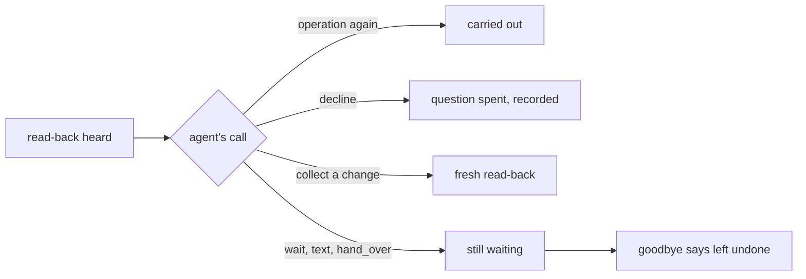
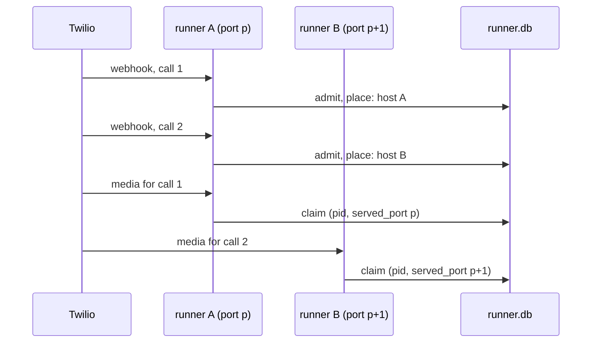

# Session 4f: readiness gaps closed before Faro

Branch `feat/session-4f-readiness`, stacked on PR #26 (`feat/session-4e-lifecycle`, head `420de86`, still open),
which is stacked on PR #25. Tested runtime: `b36ab10`.

## Result

Seven repairs, each with a public-path regression and a revert check that fails without it
([revert-checks.md](session-4f/revert-checks.md)). Every core repair is proven on the support desk or the
clinic as well as the salon.

1. **An offer's words go with its ids.** `wait` can no longer say billing resolutions after the category
   became access.
2. **Only the node agent's `decline` turns a read-back down.** A question during a read-back leaves the change
   waiting, and the goodbye says so.
3. **A caller can ask to hear a receipt again** (`say_again`), past the one automatic repeat, with nothing sent.
4. **Complaint words are proven code**, and the prose that stays has a named negative test.
5. **Booking waits instead of spending a request on `options`.** Scripted booking requests drop from 3 to 1 on
   an ordinary offer.
6. **A changed resource stays on offer.** The booking just made can be moved and cancelled with no second
   lookup.
7. **Calls can be placed on two runner processes**, and the worker fault is armed only after placement is
   proven at the media connection.

Two more core defects were found while testing and fixed:

- A field set by a receipt rested on every operation that could set it. A new resolution wiped a looked-up
  revision, and the look-up would not run again, so the caller was stuck.
- The fields a reply recorded were kept across turns. After a no, `wait` read the same booking back again.

N12 is still **failed** on its relative rule. Its 50 ms ceiling passes (slowest turn 27.3 ms). The decision
proposal is below.

Four authorized live calls ran on the real Twilio line:

- **V11 is verified live.** The caller repeated a request about the slot it already held, and the salon said
  so instead of calling it taken.
- **Worker failure is verified live.** The pair was placed on two processes, proven at the media connection.
  The victim's worker died right after its booking committed, and the bystander on the other process went on
  and booked.
- `say_again`, a question during a read-back, and moving the booking just made with no second lookup all ran
  live. `decline` did not: the caller's no reached a step without operations.
- One live behavior failure: the bystander heard "goodbye" after "Yes, that's perfect. Can you…", so its move
  never happened. A model misreading, recorded as a limit.

## Findings, by kind

| Finding | Kind | Evidence | Fix | Regression |
|---|---|---|---|---|
| Spoken offer outlived its ids | core defect | public reproducer on the desk: "un reembolso o un abono" said after `category=access` | one record per offer (`Offers`) | R15, V12 |
| A question during a read-back counted as a no | core defect | reproducer on the desk (FAQ detour) | typed `decline` | R16, R14, P19 |
| No way to ask for a receipt again | core gap | 4e limit | `say_again` | R17, salon repeat test |
| A looked-up revision wiped by an unrelated field | core defect (found here) | R16 revision case stumbled | a field rests on the receipt that set it | R16 |
| Recorded fields kept across turns | core defect (found here) | `test_requests` K7 read the booking back after a no | cleared per turn piece | K7 |
| Booking re-found the booking it had just made | core defect, seen live | call A below | re-offer the named resource after a change | V13, R18 |
| `booked` and `appointment` name one booking | application friction | salon manifest | none needed: the refresh covers it | V13 |
| Own slot called "taken" | application defect (4e, fixed in `985522f`) | call B below | salon wording | V11, K4 |
| `options` then `wait`, deciding nothing | prompt and tool-contract friction | 13 of 15 live follow-ups | prompt and docstring | K1-K8 |
| Both 4e pair calls on one worker | runner design | 4e placement record | placement by process | A8, F6 |

### Cross-use-case reuse

Every core change states its rule with no domain in it, and is proven on the support desk or the clinic through
the public API (`core.load`, `flow.open`, `core.text_turn`), with no salon code.

| Core change | Rule, domain-free | Non-salon proof |
|---|---|---|
| `Offers` | what a step says about an offer is exactly what can still be picked from it | desk R15 |
| `decline` | "left undone" means never carried out and never turned down; only the node agent's typed call turns down | desk R16, R14; clinic P19 |
| `_assigned_by` | a field a receipt set rests on the request that receipt answered | desk R16 (revision case) |
| `say_again` | a caller may hear the newest standing receipt again, with nothing sent | desk R17 |
| resource refresh | after a change, a choice that names that kind of resource is offered again by its own function | desk R18 |
| `turn_started` clears `_recorded` | a reply's recorded fields are that reply's | salon K7 only; the rule is generic, and the desk's R16 passes with it |

The three supported patterns stay apart:

- **Free conversation** (the desk's FAQ, salon concierge) gains no transactional tools. `decline` and `say_again`
  appear only on steps with operations that need them.
- **Typed transactional workflows** (desk, clinic, salon booking) get the new decisions.
- **Stateful teaching** (Faro) is untouched this session; it stays on its legacy path until session 5.

Nothing in core names a salon, a desk, a booking or a ticket. Wording (`Locale.declined`) is core's fixed-line
set, in English and Spanish, like `pardon`; the application's own words stay in its manifest and functions.

### Calls A and B, kept apart

- **Call A**, Langfuse trace `e67c903456c6d8a7c96c43f8b257f9ce`, observation `abbc0e2af8d4d4d5`, session
  `CAf07651f2c66de160eafe0aa91f5298a4` (4e worker-affected). BK0002 was booked. On the move,
  `collect(appointment="BK0002")` was refused as not on offer, and `options` then returned the same BK0002.
  The call still booked, moved and cancelled correctly. The saved observations show the refusal text. Cause: a
  successful change took the offers of every field it bound, and never offered back the resource it named.
- **Call B**, Coval run `cCSJk34cuKVo3Ra7SDJM4p`, session `CA3cd7a2566a2756c450e265090d97fb5e` (4e bystander).
  The salon called the caller's own 9:00 slot "taken", and the caller moved again. This is V11, fixed offline
  in `985522f`. Live check: live call 1 below.

## How the repairs work

### 1. One record per offer

Before, `FlowCall` kept the ids on offer in one place and one string of words for the whole turn in another.
`record` took stale ids and left the words. Now `Offers` holds one `StandingOffer` per choice: its ids, its
words, the turn and the step that made it.

- Whatever takes the ids takes the words.
- `wait` says only offers its own step made on this turn, once.
- An update that fails validation takes nothing.
- A step reached by a hand-over never says another step's offer.

### 2. A decline is a typed call

1. The caller hears a read-back in full.
2. The step's agent reads the reply and makes one choice.
3. Calling the operation again carries it out, as before.
4. `decline` (new) records the no against that exact question and spends it, so no later yes can approve it.
5. A change gets a fresh read-back, which then has its own fate.
6. Anything else, such as a question or a hand-over to the FAQ, leaves the change waiting.
7. At goodbye, only a waiting change gets `left_undone`. An unknown outcome still gets `unsettled`.

`decline` is a function tool, not an output. Pydantic AI 2.46 uses `end_strategy='graceful'` by default, so a
function tool emitted before an output in the same response runs first. "No, bye" is `decline` + `goodbye` in
one request (R14 asserts one request). A joined turn that rewinds drops a no read from its first piece. On a
rendered step, `wait` after a no starts with `Locale.declined` and never says `pardon`.

### 3. `say_again`

A conversation step whose operations say receipts gets a `say_again` output. Code says the newest receipt that
still stands for the caller on the line (`CallContext.effective`), in its operation's own `say` words
(`StepFlow.receipt_words`). It sends nothing, makes no intent and marks nothing delivered. The automatic repeat
of an unheard receipt keeps its limit of one: a requested copy the caller cuts off brings no automatic repeat.
After a reopen superseded a resolve, `say_again` says the reopen.

### 4. Complaints and concierge

Every consequential complaint line is code: the read-back (`complaint_words`), the receipt with its reference
and next step (`say: '{said}'`), the reference said again (`say_again`), and the goodbye recap.
`complaint_words_are_the_salons` checks each against the salon's own rendering. Concierge has no operations.

Both steps stay `prose` for ordinary talk: empathy, questions, prices and lengths from the salon's documents.
That is the weaker guarantee. The claim guard (`locale.claims`) catches the salon's claim verbs, not an invented
number: `a_prose_reference_is_the_known_limit` shows "Your reference number is ZZ999." reaching the caller, and
core's `a_prose_step_can_still_claim` stays in `tests.defects`. Concierge accuracy is judged in the live
behavior call.

### 5. Fewer booking requests

The saved 4e traces ([booking_requests.py](session-4f/booking_requests.py), no network): in four live calls,
13 of the 15 requests made right after an `options` result only called `wait`, which already looks the offer
up itself. One used the result to move, one to record a pick.

The booking prompt and the rendered `options` docstring now say: record and wait in one reply; call `options`
only for an id the application state does not show yet. Nothing is picked or approved by code.

Scripted comparison, `use-cases/salon-graph/tests/test_requests.py`. The same caller turns with the 4e replies
and the 4f replies, on the real flow. Same words and diary where they should match.

| Case | 4e requests | 4f requests |
|---|---|---|
| K1 ordinary offer | 3 | 1 |
| K2 ambiguous "yes" to two times | 5 | 2 |
| K3 time taken before the yes | 6 | 4 |
| K4 own slot (V11) | 3 | 1 |
| K5 book, move, cancel | 15 | 10 |
| K6 question instead of a yes | 6 | 3 |
| K7 a no (words change: "All right, I haven't changed anything.") | 6 | 3 |
| K8 cut receipt, then asked again (4e gave an offer, 4f the receipt) | 6 | 4 |

The 4f counts assume the model sends `collect` and `wait` in one response. If it sends them one after the
other, an offer turn costs 2 requests, still one fewer. Scripted models prove what the runtime allows, not what
a real model chooses.

### 6. A changed resource stays on offer

`StepFlow` reads, from declarations the manifest already has, which choice fields name a resource: an
operation binds the field to its `subject` argument and names the resource kind. In the salon, move and cancel
take `booking_id` from `appointment` and say their receipts are about a `booking`. After any successful change
of that kind, the application's own choice function is asked again, quietly: no words for `wait`, no model
request. The domain decides what stands, so a cancelled booking is not offered back. Everything else holds: a
pick must be on offer, a foreign id is refused, and with two bookings held nothing is picked.

### 7. Placement by process

1. Two runners, each `uvicorn --workers 2` on its own port and tunnel, share one diary and one runner file.
2. The number points at runner A. Its webhook admits each call, globally bounded at five.
3. `Admission.place` sends consecutive calls to the hosts in `MEDIA_HOSTS` in turn, and records the choice.
4. Each media stream is claimed by the process it reached. The claim records the worker pid and the listening
   port (`served_port`): where the media really arrived.
5. `evals/placement.py` arms `LIVE_FAULT_ARM` only when two active calls have different pids and different
   ports.
6. The fault fires once: the dying worker removes the arm file.

The fake phones now follow the TwiML `<Stream url>`, as Twilio does.

## Tested revision and configuration

- Runtime tested: `b36ab10` (every offline gate and all four live calls). `a20cecc` and later change only documents
  and evidence.
- Speech, frozen for the whole session: `session-3/speech-profile.v1.env` (STT `deepgram/nova:3`, TTS
  `slng/fish/tts:s2.1-pro`, host `eu-west.api.slng.ai`), VAD stop 0.3 s, smart-turn as in 4e. Model
  `google-cloud:gemini-3.5-flash-lite`, priority tier, minimal thinking. Nothing about VAD, endpointing, STT, TTS,
  models or regions changed.
- Live line: Coval agent `PEivYdEtwEa65QSraG5fMQ` dialling +447427919928 (real Twilio, marks echoed), 300 s calls,
  metric `7VHk6dTjvBcuV6XYPmaeGq` only because Coval refuses a launch with none. Judged from each campaign's
  diary and write records, never from a Coval metric.
- Host: this MacBook, at most five calls at once (`MAX_CALLS`).

## Evidence

### A. Scripted turns through public core APIs (offline, on `b36ab10`)

| Check | Result |
|---|---|
| `ruff format` and `ruff check`, whole workspace | all checks passed |
| ty: core, salon-graph, concierge-tools | all passed |
| core `python -m tests` | all 15 modules ok (R15-R18, P19 new) |
| salon-graph `python -m tests` | all 19 modules ok (V12, V13, `test_requests` K1-K8, A8, complaint and repeat tests new) |
| faro, concierge-tools, salon-pipecat-flows | 1, 5 and 1 modules ok |
| core `tests.defects` | one entry left, as in 4e: the known prose-step limit ([defects-core.txt](session-4f/defects-core.txt)) |
| salon `tests.defects` | none left ([defects-salon.txt](session-4f/defects-salon.txt)) |
| N1-N13 functional matrix | identical rows to 4e: harness passes every row; native N9 fails and N13 is not exercised ([matrix.md](session-4f/matrix/matrix.md)) |
| wheel outside the checkout (4d's script) | ok ([package-proof.log](session-4f/package-proof.log)) |

### B. Real runner, media doubles and the adapter (offline)

| Check | Result |
|---|---|
| F0-F5 (kills before and after the intent, after commit; stale worker fenced; overload; drain) | all verdicts pass |
| F6, the placed pair with the live fault | all 13 verdicts pass: media followed the webhook (ports 8020 and 8021), placed on two processes, armed only after placement, the victim's worker died after its commit, fired once, the bystander booked on the other process, dead call closed in 0.6 s, replacement in 1.0 s, admission back to empty, the old intent on file as booked, the ring-back booked nothing more, a contender did not get the victim's time, idle restored |
| F6 revert (phones ignore the stream URL) | fails: both calls on one worker, as in 4e |

Files: [load/faults.json](session-4f/load/faults.json), [load/faults.log](session-4f/load/faults.log).

### N12, frozen protocol, unchanged

| Run | Harness scripts | Load before / after | Per-turn medians, harness (native) ms | Slowest harness turn | Requests harness / native | Relative rule | Ceiling (50 ms) |
|---|---|---|---|---|---|---|---|
| 4e run 3 | 4e | 1.65 / 1.21 | 11.7 (7.0), 17.9 (8.0), 30.1 (30.6), 17.4 (6.4), 18.5 (6.8) | 32.0 | 7 / 7 | fails turns 2, 4, 5 and trace | passes |
| 4f run 4 | offer turn is `wait` alone | 1.57 / 1.14 | 11.7 (7.1), 18.4 (8.2), 26.3 (30.8), 17.7 (6.5), 18.9 (6.6) | 27.3 | 6 / 7 | fails turns 2, 4, 5 and trace (91.9 vs 58.9) | passes |

The protocol, tolerances and native reference are unchanged. Every raw sample is in
[matrix/n12-runs/run4](session-4f/matrix/n12-runs/run4/timing.json); runs 1-3 stay in the 4e folder. **N12 is
not relabelled as passing.**

#### Acceptance-decision proposal for N12's relative rule

- **Measured cost.** On turns 2, 4 and 5 the harness takes about 18 ms against native's 6.5 to 8 ms: about 10 to
  12 ms more per turn. That is 140-190 % relative, far past the frozen tolerance of max(5 ms, 25 %). Over the
  five-turn trace the harness takes 92 ms against 59 ms. Turn 3 (the offer) is now faster than native, since it
  needs one model request fewer.
- **Cause.** Session 4e's profile holds: core's own work is about 10 ms per five-turn trace, with no hot spot.
  The rest of the gap is the Pydantic AI agent loop (building each request, the output-tool round, capability
  hooks) and Pipecat frame scheduling in the adapter. Both count as package overhead under the rule. They are
  not time outside the package.
- **Operational significance.** In the live calls, time to useful words was a median 0.93-1.01 s, almost all
  one model round trip. Core added a median 0.02 s per turn. 12 ms is about 1 % of the time a caller waits,
  and below what a person hears.
- **Tradeoff.** Closing the gap means bypassing the SDK's agent loop or frame path for scripted turns, which the
  architecture forbids (a second loop) and which would stop N12 measuring the real path. Chasing it would also
  cost engineering time the remaining sessions need.
- **Proposal.** Keep the frozen rule and its failure on record. Accept the 50 ms absolute ceiling as the release
  criterion for local overhead on this MacBook scope (it passes with 27 ms), and re-measure N12 once on the
  final frozen implementation before qualification. This is the user's decision; this session does not waive
  the rule.

### C. Real Twilio calls

Four targeted calls, all placed, all counted.

| Call | Case / persona | Outcome (diary) | Authorization | Delivery | Completion speech | Ending | Triggers reached | Missed |
|---|---|---|---|---|---|---|---|---|
| s4f-1 `CAfb240f…d5ecf`, run `ACdLZnmT` | V11 bystander case `A3eP8AKJ` / interruptive | pass: booked Mon 9:00, moved once to Tue 29th 9:00 (revision 2) | pass: each write after its heard read-back and a yes | pass (marks) | pass: receipts, recap from receipts | bot, `pipeline_end` after goodbye | **V11 live**: the caller repeated its request after the move receipt, and the salon said "You already have a haircut Tuesday the 29th at 9:00 AM. Would you like a different time?"; nothing more written | - |
| s4f-2 `CA46c31c…ac9e08`, run `DFUKKk8C` | new case `JKNSZVVG` (set `358XiSye`) / standard | pass: booked Tue 29th 14:00, moved to Wed 30th 14:00 (same booking, revision 2), nothing at Tue 11:00 | pass | pass | pass: receipts, `say_again`, recap | bot, `pipeline_end` | a question during a read-back (handed to concierge, nothing written); `say_again` live; the move of the booking just made as `collect > move_appointment`, no `options`, no "not on offer" retry; no `options` anywhere in the call | **`decline`**: the "no" landed on concierge, which has no operations and so no `decline` |
| s4f-3 `CA8f4db7…121d1a`, run `o5T5ygcV` | victim `9GH9opPT` / standard | fault as designed: BK0001 Mon 10:00 committed once, then its worker died | pass for the one write | pass | - (the call was cut by the fault) | `lost` (worker died) | **worker failure live**: placed on pid 71031, port 7870; armed after placement; fired once; runner replaced the worker | continuation of the killed call: not attempted, not claimed |
| s4f-4 `CA5c2494…b778babe`, run `dqpPTERW` | bystander `A3eP8AKJ` / interruptive | **fail against the case**: booked Mon 9:00 on the other process after the kill, but no move | pass | pass | pass | bot goodbye, early | crash isolation live: booked 22 s after the other worker died; `say_again` with nothing standing said the offer again | the move: booking's agent read "Yes, that's perfect. Can you…" as goodbye |

Review labels: every judgement above is **agent trace review** (spans, bot logs, diaries). No recording was
listened to by an agent or a person, so audio quality and human understanding are unknown. `load_report`
marks every dimension unknown, as expected without reviewed labels ([report-1.log](session-4f/live/report-1.log),
[report-2.log](session-4f/live/report-2.log), [report-pair.log](session-4f/live/report-pair.log)).

Offline, after the pair, on a copy of the pair's diary ([ringback_offline.out](session-4f/live/ringback_offline.out)):
the killed worker's booking is on file once with its result, nothing is unresolved, nothing is sent again, and a
new session offers it as held. This is **offline evidence**, not a live reconnection.

Upstream incidents: none seen. Endpointing cut turns as usual for the interruptive persona (joined pieces in
calls 1 and 4); core joined them as designed.

#### Worker failure: verified live, with its limits

- Placement was proven at the media connection: the runner record shows each stream claimed by a different pid
  on a different port, and `evals.placement` armed the fault only then
  ([s4f-pair.placement.json](session-4f/live/s4f-pair.placement.json)).
- The fault fired once, after the victim's booking committed. The bystander, on the other process, kept going
  and booked. The runner closed the dead call as lost, and uvicorn replaced the dead worker.
- Not exercised live: a stale worker's late write (F3 covers it offline), a ring-back by the victim, and
  admission at the five-call ceiling during a kill.

#### Model usage and latency, from each call's spans

| Call | Requests completed (started) | Input tokens | Output | Core per turn, median | Useful words, median | TTS first audio, median |
|---|---|---|---|---|---|---|
| s4f-1 | 22 (38) | 72,097 | 384 | 0.02 s | 0.93 s | 0.17 s |
| s4f-2 | 22 (25) | 61,435 | 450 | 0.02 s | 1.01 s | 1.11 s |
| s4f-3 | 6 (8), partial | 11,474 | 140 | 0.02 s | 1.00 s | 0.15 s |
| s4f-4 | 12 (17) | 29,809 | 205 | 0.02 s | 0.97 s | 0.15 s |

For comparison, the same V11 case used 38 and 53 completed requests in 4e (98,890 and 141,140 input tokens).
Startup: every worker warms its model clients with 4 one-token requests; the pair's 4 workers spent 16. Tables:
`live/s4f-*.latency.txt`. First useful audio and first audio of any kind are not separated by these spans; TTS
first audio is reported as measured.

#### What a real model did with the prompt change

Call 1 still called `options` 3 times, and 2 of those were followed only by `wait`. Calls 2 and 4 called no
`options` at all. The 4e calls used it 4-6 times each. So the change is partly followed, as expected from a
prompt, and the scripted K1-K8 counts are what it saves when followed.

## Capability limits carried forward

1. **A no said to another step is not a decline.** `decline` lives on the step that owns the operation. If the
   caller says no after a hand-over (call 2), nothing is recorded; a goodbye then says the change was left
   undone, which is true. Not a correctness risk; recorded as a limit.
2. **A premature goodbye** (call 4). The goodbye tool's own rule is the model's reading; nothing checks that the
   caller's latest piece was a whole sentence. A fix belongs in the next behavior work, with a live check.
3. **Prose steps** (concierge, complaints) keep the weaker guarantee: their consequential lines are code, their
   ordinary talk is model text, and the named negative tests stay.
4. **N12's relative rule fails**; the decision is the user's (above).
5. Carried from 4e: native memory retained after calls (plateaus); verify repeats its question over joined
   pieces with the interruptive persona.

## Budget

| Pool | Before | Spent | Left |
|---|---|---|---|
| Targeted Coval calls, 4f addition (user-authorized) | 4 | 4 (all placed, all counted) | **0** |
| Targeted repair pool from 4b-4e | 0 | 0 | 0 |
| Candidate final | 10 normal + 10 interruptive | 0 | 10 + 10 |
| Native top-up | 10 normal + 12 interruptive | 0 | 10 + 12 |
| Real-model text tokens | 0 | 0 | 0 |

Coval set-up actions, free: one new test set `358XiSye` with case `JKNSZVVGDEDG4xXgfCdeof`, attached to the agent
(its ten earlier sets kept). The ledger is [budget.json](session-4f/budget.json); launches are in
[coval-runs.jsonl](session-4f/coval-runs.jsonl).

## Next session

Start from this branch's head in a new worktree, stacked on it while #25, #26 and this PR are open. Check
`HEAD..main` first. The remaining sequence:

1. **4f readiness: done here**, with the open items above (a decision on N12, the premature-goodbye limit).
2. **Session 5: Faro migration** onto the node-agent path, with its affected regression checks. Faro is the third
   supported pattern (stateful teaching with domain-owned assessment and storage): its grading stays its own,
   and it must not inherit transactional concepts it does not need.
3. **Session 6: package, launcher and tooling integration.**
4. **Frozen qualification** on the resulting final implementation: the reserved 10 + 10 candidate calls and the
   native top-ups, with N12 re-measured once. Old Stage C calls are not pooled into its accuracy score.

No qualification, Faro migration, launcher extraction or deployment was started.
