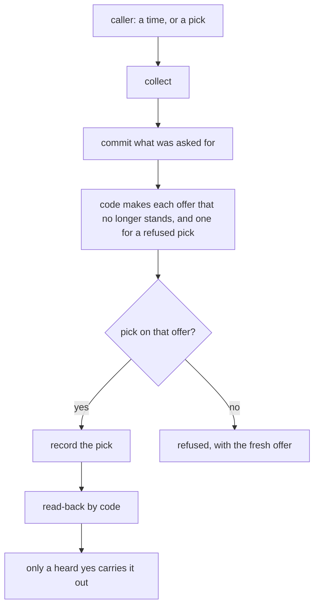
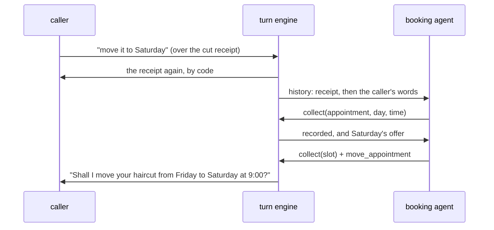

# Session 4g: a simpler tool contract, and new requests kept during receipt recovery

Branch `feat/session-4g-tool-contract`, stacked on [PR #27](https://github.com/slng-ai/slng-voice-harness/pull/27)
(`feat/session-4f-readiness`, head `0306f98`, still open). Tested runtime: `6686877`. Commits after it change
only documents and evidence scripts.

## Result

The caller no longer has to repeat themselves in the two situations the browser calls showed. The tool
contract is smaller: the rendered booking step has one tool fewer, and there is one rule for picks.

- **A pick counts on the offer for the state the update ends in.** Code makes that offer, with no model
  request. "Let's do 9:00", recorded as a time and a slot together, is now read back in one request. It
  used to take four requests and a repetition.
- **A request said over a cut receipt is read in the same turn.** The receipt is said again first, by code.
  Then the step's own agent reads what the caller said. "Move it to Saturday at the same time" now gets its
  read-back without the caller saying it again, and nothing moves before a heard yes.
- **`options` is gone from rendered steps.** `collect` now returns the offers it made. In both traces,
  `options` was only ever an extra request between `collect` and `wait`, or before an operation.
- One more core defect was found and fixed: the refusal line never reached live callers, because `_refused`
  read only the wrapped argument shape the test scripts send.

Trace B, replayed with the same caller words, the same starting state and the same diary result, needs
**13 model requests and 10 caller turns instead of 23 and 13, and no repetitions instead of 3.** These are
scripted models. They prove what the runtime allows and costs. They do not prove that a live model follows
the edited booking prompt: **live semantic validation is pending.**

## How to reproduce

From the workspace root, offline, with no key and no model request:

```bash
uv run ruff format --check . && uv run ruff check .
for d in core use-cases/*; do uv run --directory $d ty check .; done
uv run --directory core python -m tests
uv run --directory use-cases/salon-graph python -m tests
uv run --directory use-cases/salon-graph python -m tests.test_contract --table-only   # the trace replays
python3 docs/research/reusable-core/session-4g/reverts.py                              # the revert checks
./docs/research/reusable-core/session-4d-correctness/package-proof.sh                  # the wheel, outside
uv run --directory core python -m tests.client_check                                   # headless Chrome
cd use-cases/concierge-tools && uv run python -m matrix run --out ../../docs/research/reusable-core/session-4g/matrix
cd use-cases/concierge-tools && uv run python -m matrix time --out ../../docs/research/reusable-core/session-4g/matrix
```

The "before" replay table ([table-before.txt](session-4g/table-before.txt)) was made with the same
`test_contract.py` on the unchanged parent code, before any fix.

## Evidence read

Both traces were read with the Langfuse CLI (`langfuse api observations list --trace-id … --all`), with
every page:

| Trace | Observations | Pages | Model requests | Audited writes | Transport |
|---|---|---|---|---|---|
| A `3771f9b3353836889ad8dfe60edbb9eb` | 55 | 1 | 9 | 2 (lookup, book), both succeeded | WebRTC, `simulated_playout: false` |
| B `28723e6be948136b55783e693281906a` | 119 | 2 | 23 | 4 (lookup, book, move r2, cancel r3), all succeeded | WebRTC, `simulated_playout: false` |

The profile, read from the spans: model `gemini-3.5-flash-lite` (the manifest's
`google-cloud:gemini-3.5-flash-lite`), STT `soniox/speech-ai:rt-v5`, TTS `cartesia/sonic:3.5`, both through
`slng`. These are `bot.py`'s defaults (`SLNG_STT_MODEL`, `SLNG_TTS_MODEL`); the root `.env` sets neither.
This is **not** the frozen Coval profile of sessions 3 to 4f (`session-3/speech-profile.v1.env`, Deepgram
Nova and Fish). No latency here is combined with those runs.

This is trace evidence. Nobody listened to the recordings.

## Findings, by kind

| # | What the trace shows | Kind | Fixed by |
|---|---|---|---|
| 1 | 07:24:14 `collect(booking_time="09:00", slot=Fri 9:00)`: the time was recorded, the slot refused. Then `options`, then `book_appointment` refused ("no slot picked"), then `wait`, then the caller said 9:00 again | application contract (slot rests on the time) made worse by core (a pick judged on the offer before the update) | core `_record` |
| 2 | 07:24:38 "can you move the appointment to Saturday the same time?" over the booking's receipt: the receipt was said again with no model, and the request was dropped (0 requests, `receipt_unheard`) | core recovery | core `LocalAction.answers` |
| 3 | 07:24:51 the move recorded the day and time, then `options`, then `wait` offered Saturday's times, and the caller said "no, I asked for 9:00" | tool contract: the model had no slot id without `options` | `collect` returns the offer |
| 4 | 07:24:03 and 07:26:23 `options` then `wait` on arrival from verify; 07:25:24 `options` before a cancel, which fetched availability it did not need | tool contract, model behaviour | `options` removed from rendered steps |
| 5 | 07:24:16 `wait` after a refused pick said no refusal words | core defect: `_refused` read `args['values']`, and a live model sends the arguments flat | core `_refused` |
| - | Speech ran as designed (TTS first byte 0.13-0.21 s, STT first byte 0.29-0.44 s); the backend answered every write in 1-10 ms | transport, backend: no finding | - |

Also noted: Pipecat's `user_bot_latency` for the replay turn is 0.61 s, the fastest in the call. That is the
old receipt said again. It is **not** an answer to the new request, which got no answer at all.

## The contract, before and after



1. The caller's reply can hold what they asked for (a service, day, time or category) and a pick from an
   offer (a slot or a resolution). Before, both went into one candidate state. An offer resting on a changed
   field was taken away, and the pick taken from it was refused.
2. Now `ConversationStep._record` commits everything but the refused picks, as one validated candidate.
3. For each of the step's choices with no standing offer, or with a refused pick, code calls the
   application's own choice function for the state as it now stands. This is what `options` did. The
   application decides what is eligible. The model does not.
4. A refused pick that is on that fresh offer is recorded, as a second validated candidate. One that is not
   on it stays refused. The choices are taken in declared dependency order, so a chain (ticket, then category, then
   resolution) resolves in one pass, regardless of YAML order. Supplied children are rechecked after
   accepting a parent, even if those children were initially accepted and then invalidated.
5. `collect` returns what it offered, so the agent can record the caller's pick in its next reply with no
   `options` request. A rendered step has no `options` tool at all.
6. A pick is still not a yes. Every operation reads back and waits for a heard yes. Nothing old is accepted
   because its id looks familiar. A stale id, another call's id, an invented id and one that is wrong for the
   new request are all refused (salon G4, desk R12 and R21).

Search preferences, eligibility and the chosen resource are now kept apart. What the caller asked for is
state. What is eligible is the choice function's answer for that state. The chosen resource is a pick that
counts only on that answer. The manifest's `after:` stays as it was. A changed time still takes an older pick
away, so a new request cannot keep an incompatible slot.

**The receipt path:**



1. The caller speaks over a receipt that did not play. The engine says it again, as before
   (`RECEIPT_REPEATS`, still 1).
2. That action no longer ends the turn (`LocalAction.answers=False`). The step's agent runs next. Its history
   holds the receipt before the caller's words, because `history.project` puts a line said this turn before
   this turn's request.
3. The agent reads the rest. A new request gets a read-back, and nothing is carried out before a heard yes.
   The yes that booked is spent and cannot be spent again (`ProposalLedger.rewind`).
4. If the reply only agrees, `wait` says nothing more, and `say_again` would not repeat the words it just
   said (`CallContext.receipt_said_again`). The receipt is the answer.
5. If the caller cuts in again, their words are joined to the turn, as before. The repeat limit means the
   receipt is not said a third time, and the joined turn keeps one budget.

**Why the operations stay separate.** The Unmute reference
(`unmute_cli/examples/salon-concierge/build/pipecat/tools/`) has one read, `find_slots`, which returns the
caller's bookings and free slots together, and one write, `save_booking(action=…)`. We took its read side:
the offer comes back with the tool result the agent already calls. We did not take its write side. The traces
show no error in choosing between book, move and cancel. Each of those has its own read-back words,
reconciliation, revision check and receipt, and folding them into one tool would move those differences into
arguments without saving a request. Its in-process dictionary and lock were not used. The shared SQLite diary,
atomic moves, intent ids, reconciliation, ownership and revisions are untouched.

**What changed in core, generically:** `ConversationStep._record` (steps.py), `LocalAction.answers`
(graph.py), `CallContext.receipt_said_again` (state.py), `wait`, `say_again` and `_refused` (steps.py), and
the `_not_ready` and refused-write texts, which no longer name `options` on a rendered step. Nothing in core
names a booking, a slot, a day or a phone.

**What changed in the salon:** the booking prompt's lines about `options` and about a confirmation said
again, and the two `options` mentions in `_diary.md`. Salon-graph's `_diary.md` already differed from the
copies in salon-prompt and salon-pipecat-flows, so those copies are unchanged. The golden first request
(`tests/golden/agents.json`) differs by exactly these lines and the missing tool. The parent's copy is
[agents.parent.json](session-4g/agents.parent.json). **This is a prompt change. Live validation is pending.**

## Request counts and caller repetitions

The same caller words from the traces, on a fresh diary with a fixed clock. "Observed" is the live model's
moves on the parent code. "Repaired" is the moves the new contract allows. Both end with the same diary:
A books BK0001 on Friday at 9:00, and B leaves BK0001 moved to Saturday at 9:00 and then cancelled, at
revision 3. Files: [table-before.txt](session-4g/table-before.txt), [table-after.txt](session-4g/table-after.txt).

| Meaningful step | Observed: requests (caller turns) | Repaired: requests (caller turns) |
|---|---|---|
| A and B: back from verify, the offer | 3 (1) | 2 (1) |
| B: "let's do 9:00" to its read-back | 5 (2) | 1 (1) |
| B: the booking's yes | 1 (1) | 1 (1) |
| B: move over the cut receipt, to its read-back | 5 (3) | 2 (1) |
| B: the move's yes | 1 (1) | 1 (1) |
| B: cancel, to its read-back | 3 (1) | 1 (1) |
| **A whole call** | **9 (6), 0 repeats** | **8 (6), 0 repeats** |
| **B whole call** | **23 (13), 3 repeats** | **13 (10), 0 repeats** |

The observed replay reproduces the traces exactly: the same words said, and 9 and 23 requests, as Langfuse
shows. The repaired cancel is one request, because the booking was already recorded for the move. Right after
a booking, cancelling records the id and cancels in one reply, which is also one request (G5).

The repaired move takes 2 requests if the model sends `collect(slot)` beside `move_appointment`, and 3 if it
sends them one after the other. The table counts 2. Session 4f's K1-K8 comparison is unchanged, except K8:
both its variants cost one request more, because the words said over a cut receipt are now read instead of
dropped. That is the price of the new rule: one request whenever a cut receipt is said again, even when the
caller only agreed.

## Local timing

Each kind of time is kept apart. A replayed receipt is not counted as a fast answer.

| Part | Measured | Source |
|---|---|---|
| Framework and SDK per turn (N12 run 7, frozen protocol) | harness 11.7, 22.5, 17.3, 22.2, 22.3 ms; native 7.3, 9.3, 37.7, 7.0, 6.6 ms; trace 112.8 vs 69.2 ms; slowest harness turn 38.5 ms | [matrix/timing.json](session-4g/matrix/timing.json) |
| Code making the offers in `collect` (both salon choice functions, worker thread, SQLite) | median 0.51 ms, p90 0.57 ms, max 0.95 ms, n=300 | [offer-cost.txt](session-4g/offer-cost.txt) |
| Model round trips (trace B) | 0.64-1.32 s each | [trace-b-timing.md](session-4g/trace-b-timing.md) |
| Tools and backend (trace B) | 0.000-0.012 s each | same |
| STT first byte (trace B) | 0.29-0.44 s | same |
| TTS first byte (trace B) | 0.13-0.21 s | same |
| Pipecat user-to-bot latency (trace B) | 1.54-3.74 s, and 0.61 s for the replayed receipt, which answered nothing new | same |
| Browser playback confirmation (headless Chrome, C1-C8) | report 104 ms after the read-back's last audio left the server | [client-check.txt](session-4g/client-check.txt) |

**N12 is still failed on its relative rule**, on turns 2, 4 and 5 and on the trace. Its 50 ms ceiling passes.
The machine was busy with the browser and other apps (load 3.84 before, 3.07 after, recorded in
`matrix/load-*.txt`). Session 4f's run 5, under similar load, measured 11.7, 23.5, 19.1, 22.2 and 23.3 ms,
with a trace of 114.2 against 73.3 ms. The N12 trace does not use the changed paths: its offer is made by
`wait`, and its pick lands on a standing offer. So N12 shows no regression, and no improvement. Passing the
ceiling is not native parity.

In live time, each removed request is one model round trip: about 0.6-1.3 s in these traces. The new rule
adds one round trip when a cut receipt is said again. Before, that turn cost none, but it dropped the
request, which then cost the caller a whole extra turn.

## Regression evidence

Every defect has a public-path reproducer that failed on the parent code
([reproducers-salon.txt](session-4g/reproducers-salon.txt), [reproducers-core.txt](session-4g/reproducers-core.txt)),
a regression that passes now, and a revert check that fails without the fix
([reverts.txt](session-4g/reverts.txt): 6 reverts, 10 checks, all caught).

| Check | Salon (`tests.test_contract`) | Non-booking | Revert |
|---|---|---|---|
| A time and its slot in one `collect` | G1 | desk R21: category and resolution in one update (`choices.yaml`, `rendered_choices.yaml`) | A |
| Incompatible, stale, invented and foreign picks refused | G4 | desk R12 (case B kept), R21 (refund beside access; a made-up resolution) | - |
| A request over a cut receipt read in the same turn, in order | G2 (move) | desk R22 (reopen after a resolve); clinic P2/P7 | B |
| An agreement over a cut receipt adds and changes nothing | G3 (`wait` and `say_again`) | desk R22 ("vale, gracias") | E |
| The read-back after it, cut again, approves nothing | G7 | - | - |
| Refusal words in the live argument shape | G6 | - | C |
| No `options` on a rendered step; a cancel of a booking on offer in one request | G5 | desk R13 | D |
| A refused pick followed by its own fresh offer | - | desk R13 | F |

Existing regressions that pinned the old rules were changed, each for the reason given in its docstring:

- Clinic P2/P7 and salon J+P7 said "no model after a replayed receipt". Now the model reads the rest after
  the receipt. J+P7 keeps session 3's hostile reading: a model that misreads "Yes, tomorrow at nine AM.
  That's great." as a new request gets only a read-back of a second appointment. Nothing is booked or moved.
- Desk R12, R11 and R15 said "no resolution offer stands after the category changed". Now the offer that
  stands is the new category's, and they assert that billing's resolutions never survive.
- Salon V9 said "an unoffered booking id beside a new day is refused". Now it is judged on the offer made for
  the final state. The caller's own booking is on it, so it is recorded, and the day is still kept.
- Scripts no longer call `options` on rendered steps. Session 4f's `test_requests` still replays it in its
  "old" variant, where it meets the SDK's unknown-tool retry at the same request cost.

Suites (`uv run python -m tests`): **core all 16 modules ok; salon-graph all 21 modules ok** (test_contract
new); faro 1, concierge-tools 5 and salon-pipecat-flows 1 modules ok. `tests.defects`: core exits 1 with its
one known limit (a prose step can still say an unbacked claim), as in 4f. Salon exits 0 with 7 fixed. Ruff
format and check are clean in the workspace, and `ty` is clean in all seven members. N1-N13: every row is
identical to 4f ([matrix/matrix.md](session-4g/matrix/matrix.md)). The package proof is ok outside the
checkout ([package-proof.log](session-4g/package-proof.log)). The browser and transport suites rerun because
turn behaviour changed: core W1-W10 and Chrome C1-C8, salon BR1-BR5 and M1-M8, all ok. Real marks and
explicitly simulated evidence stay apart (W10, BR3, M-series). `uv.lock` is unchanged.

## Durability and isolation, kept

- Tests use a fresh temporary diary on a fixed clock (`tests.script.opened`), as before. Nothing was added
  to hide availability.
- The shared-diary checks stay separate and pass. Distinct callers cannot overwrite each other (V-series,
  B1-B9). Competing writes cannot exceed the chair's capacity (the SQLite trigger; B-series, V1). A failed
  move keeps the original (V1, V8). Retries and reconciliation cannot duplicate a committed write (I1-I15,
  O1-O9, R4, R7). Wrong-owner and stale-revision operations are refused (V2, V13, R3).
- Every write is still one intent, marked dispatched before the await and reconciled by its id. No new
  write path exists: `_record` calls the same choice functions `options` called, and the same
  `FlowCall.collect`.

## Status

| Claim | Status |
|---|---|
| The observed selection needs no retry and no second caller utterance | pass (scripted: G1) |
| A real day, service or identity change cannot keep an incompatible choice | pass (G4, R12, R21, V-series) |
| Choosing is not authorising | pass (G1, G7, R21; every write needs a heard yes) |
| A request over a cut receipt reaches its read-back without a repeat, with no duplicate write | pass (scripted: G2, R22) |
| A plain agreement over a cut receipt changes nothing | pass (G3, R22) |
| Further interruption keeps the input and the budget | pass (G7; B4.1-B4.6 and the continuation suite unchanged) |
| Fewer model requests on the trace sequences | pass for scripted models (B: 23 to 13) |
| A live model follows the edited booking prompt | **unknown: live validation pending** |
| N12 relative rule | **fail**, as in 4f; 50 ms ceiling passes |
| The browser path in a real browser with a person | **unknown**: manual checkpoint below, not run |

## Manual browser checkpoint (not run: needs a person and a live model)

This spends live model requests, and none are authorized. Run it only with a new allowance. Use the
documented entry point with no simulation flag:

```bash
cd use-cases/salon-graph
uv run bot.py
```

Open **http://localhost:7860/voice/** in Chrome, click **Start call** and keep the tab playing.

1. Trace A. Say "I'd like to book a haircut for Friday." Give your number in one go, then say "Yes." when it
   is read back. Expected: "Thanks, I have you." and then Friday's times, with no pause for a second request.
   Say "9:00 AM.", then "Yes, please." after the read-back. Expected: one booking. Then say "I'm good, thanks."
2. Trace B, on a new call, up to the times on offer. Say "Let's do 9:00 AM." Expected: "Shall I book a
   haircut, Friday … at 9:00 AM?" straight away. Before, the salon said the times again.
3. Say "Yes, please." As soon as the receipt starts, cut in with "Sorry, can you actually move the appointment
   to Saturday, same time?" Expected: the receipt again, then "Shall I move your haircut from Friday … to
   Saturday … at 9:00 AM?", with no need to ask again. Say "Yes, please." Expected: moved once.
4. Say "Can you actually cancel the appointment?" Expected: the cancel read-back at once. Say "Yes."
   Expected: cancelled once. Then say "I'm good, thanks."
5. Optional. Book again, cut in over the receipt with only "Okay, great." Expected: the receipt again and
   nothing else, and nothing changes.

Afterwards, the Langfuse trace should show no `options` tool. The replay turn should show
`receipt_unheard: true` with at least one model request after it, and each write audit should show
`transport: webrtc`. Only Chrome with core's page is supported. Pipecat's prebuilt UI is refused before the
greeting, and no other browser or LiveKit was tested.

## Budget

| Pool | Before | Spent | Left |
|---|---|---|---|
| Targeted Coval calls | 0 | 0 | 0 |
| Candidate final (reserved for qualification) | 10 normal + 10 interruptive | 0 | 10 + 10 |
| Native top-up (reserved) | 10 normal + 12 interruptive | 0 | 10 + 12 |
| Real-model text tokens | 0 | 0 | 0 |

No Coval call, model evaluation, warm-up, rescoring or live model request was made. The two traces were read,
not produced, by this session. [budget.json](session-4f/budget.json) is unchanged.

## Next

1. **Live validation of this prompt change**, when a new allowance is given: the manual checkpoint above, or a
   few targeted calls. Until then, the booking prompt is a candidate.
2. **Session 5: Faro migration**, with its affected checks. Faro's legacy `LocalAction('receipt')` in
   `core/conversation.py` keeps the old rule until then.
3. **Session 6: package, launcher and browser readiness.** Carried forward: only Chrome with core's page
   reports playback; the two private fields (aiortc's sent RTP timestamp and the transport's `pc`) fail closed;
   Faro's `bot.py` has no early refusal; Daily and other clients are unchecked.
4. **Frozen qualification** on the final implementation: the reserved 10 + 10 candidate calls and the
   10 + 12 native calls, with N12 measured once more. N12's relative rule is the user's decision (4f's
   proposal stands).


## Review follow-up: reuse across dependent choices

The review reproduced a generic defect on the support desk: when a newly available parent choice was
accepted, its supplied child choices were cleared but the tool reported them as recorded. Reversing the
YAML choice order also left valid dependent picks unrecorded.

The compiler now orders choices by their declared `after:` dependencies with stdlib `graphlib` and
rejects cycles. The runtime rechecks every supplied choice through the existing state validation after
its parents, and a failed refresh reports missing picks as refused. No domain rule, prompt or dependency
was added. R23 runs through the public loader and text entry point: fresh parents, reversed declarations,
incompatible children, unavailable lookup, no dispatch and cyclic manifests.

Validation: core's 16 modules and salon's 21 modules pass, as do Ruff and both members' type checks.
Reverting either the runtime recheck or dependency ordering makes R23 fail. These are offline checks;
no model request, Coval call or paid rescoring was run. The earlier live semantic checkpoint remains open.

The README now describes the reusable public architecture and application-owned nodes, rather than
using the salon's booking node as the package definition. LiveKit remains planned and qualification is
not represented as complete.
