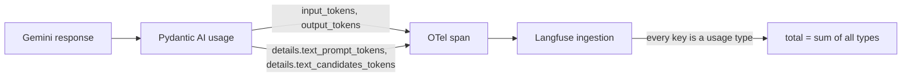

# Token accounting in Langfuse

Langfuse showed the harness using about twice the tokens it really used. The
tokens were real, but Langfuse added the same tokens up twice. New harness
traces now reach Langfuse with each token counted once. Old traces keep their
wrong totals in the Langfuse UI. The ledger (`concierge-tools/ledger.py`)
already counted them correctly and still does.

This fix changes what is reported. It does not change how many tokens the
harness uses, and it does not change any cost.

## Tested revision and versions

- Base: `0306f98330273bc658c7ab3eb974132f127b134b` (PR #27, `feat/session-4f-readiness`).
- Branch: `feat/token-accounting`.
- Pinned packages, not changed: `pydantic-ai-slim` 2.46.0, `langfuse` 4.15.4,
  `opentelemetry-sdk` 1.44.0, `pipecat-ai` 1.11.0, `google-genai` 2.24.0,
  `genai-prices` 0.1.7.
- Langfuse ingestion rules read from
  `packages/shared/src/server/otel/OtelIngestionProcessor.ts` on the
  `langfuse/langfuse` main branch, 28 September 2026, and from the docs pages
  "OpenTelemetry" and "Token and cost tracking".

## Root cause



1. Gemini reports a prompt count and a split of that count by modality.
2. Pydantic AI writes the counts as `gen_ai.usage.input_tokens` and
   `gen_ai.usage.output_tokens`. It also writes Gemini's split as
   `gen_ai.usage.details.text_prompt_tokens`,
   `gen_ai.usage.details.text_candidates_tokens`, and so on.
3. Langfuse's generic mapping keeps every `gen_ai.usage.details.X` as a usage
   type `X` of its own.
4. Langfuse sets the total to the sum of all usage types. So each text token
   is counted once as `input` and once as `text_prompt_tokens`.

Example, reproduced offline with Pydantic AI 2.46.0:

```
RequestUsage(input_tokens=1449, output_tokens=29,
             details={'text_prompt_tokens': 1449, 'text_candidates_tokens': 29})
real total:      1,478
Langfuse total:  2,956
```

Pydantic AI 2.46.0 already drops two detail keys, `input_tokens` and
`output_tokens`, for this reason (`_FIRST_CLASS_TOKEN_DETAIL_KEYS`). Gemini's
modality keys are not covered.

Every Gemini detail key is a part of the main counts, never an addition.
This was checked with `RequestUsage.extract` on the pinned version:

| Detail key | Part of |
|---|---|
| `text_prompt_tokens`, `cached_content_tokens`, `text_cache_tokens` | `input_tokens` |
| `tool_use_prompt_tokens` | `input_tokens` (100 prompt + 50 tool-use gives `input_tokens=150`) |
| `text_candidates_tokens`, `thoughts_tokens` | `output_tokens` (16 candidates + 40 thoughts gives `output_tokens=56`) |

## The fix

`core/src/core/observability.py` already rewrites each Pydantic AI span on
its way to Langfuse (`_Speech`). A new small class, `_Usage`, reads a `chat`
span's four count attributes. It then writes
`langfuse.observation.usage_details`. Langfuse uses that attribute in full when
it is present, and skips its generic `gen_ai.usage.*` mapping.

The counted usage types follow Langfuse's own generic mapping of the same four
attributes:

| Usage type | Value |
|---|---|
| `input` | `input_tokens − cache_read − cache_write` (raw input includes both) |
| `input_cached_tokens` | `gen_ai.usage.cache_read.input_tokens`, when not zero |
| `input_cache_creation` | `gen_ai.usage.cache_creation.input_tokens`, when not zero |
| `output` | `gen_ai.usage.output_tokens` |

Details of the rules:

- **Cached tokens are subtracted once.** Pydantic AI's raw input includes the
  cached tokens. The stored `input` does not. The ledger adds them back
  together. Example: raw input 4,215, cached 3,687, output 16 are stored as
  `input` 528, `input_cached_tokens` 3,687, `output` 16. The total is 4,231.
- **Thinking tokens stay in `output`.** Google bills them as output.
  Pydantic AI does not write a reasoning count that Langfuse would split off.
  Nothing is dropped.
- **The breakdown is kept.** It goes into the observation's metadata as
  `usage_breakdown`, where Langfuse does not add it up. The raw
  `gen_ai.usage.*` attributes stay on the span unchanged.
- **Missing usage stays missing.** A span with no `gen_ai.usage.*` attribute
  gets no `usage_details`. A count that Pydantic AI left out beside others is
  zero, because it writes only counts that are not zero.
- **Only request spans.** The agent run span carries the run's aggregate as
  `gen_ai.aggregated_usage.*`. Langfuse does not read it, and `_Usage` does
  not touch it. Pipecat's STT and TTS spans are not changed.
- **Cost is not changed.** No `cost_details` is written. Langfuse still prices
  the generation from its model definition, on the same `input`,
  `input_cached_tokens` and `output` values as before. The harness trace's
  recorded cost fits input and output alone: 21,005 × $0.30/M + 177 × $2.50/M
  = $0.006744. So the duplicate keys never had a price.

`use-cases/concierge-tools/ledger.py` already counted `input` plus
`input_cached_tokens`, and `output`. It now also adds two usage types that
Langfuse stores apart from `input` and `output`:

- `input_cache_creation`: cache writes, taken out of `input` by Langfuse.
- `output_reasoning_tokens`: reasoning, taken out of `output` by Langfuse when
  a span reports `gen_ai.usage.reasoning.output_tokens`. Pipecat's own LLM
  spans do.

Both are zero in the two traces below, so their totals do not change. Without
this, a native trace with reasoning would lose real output tokens in the
ledger.

## The two traces, recomputed offline

These are read-only reads of the stored Langfuse records through
`ledger.fetch`. Nothing in Langfuse was changed.

| Trace | Requests | Stored input | Cached input | Output | Correct total | Langfuse UI total |
|---|---|---|---|---|---|---|
| Harness `3771f9b3…` | 9, all with usage | 21,005 | 0 | 177 | **21,182** | 42,364 |
| Native Pipecat `7254d563…` | 11: 10 with usage, 1 unknown | 27,832 | 7,368 | 252 | **35,452** known, plus 1 request unknown | 35,452 |

- The harness UI total is doubled by `text_prompt_tokens` (21,005) and
  `text_candidates_tokens` (177).
- The native total was already right. Pipecat writes no modality details.
  Its TTS observations report 491 `characters`. Those are not LLM tokens, and
  the ledger does not count them.
- The interrupted native request reported only zeros. The ledger counts it
  as "cancelled or unreported", not as zero tokens. Its real use is unknown.

These are different builds on different models: the harness on Gemini 3.5
Flash Lite, native Pipecat on Gemini 3.1 Flash Lite. The difference between
them is not a controlled architecture benchmark. The recorded costs,
about $0.006744 and $0.0075202, are what Langfuse priced from the trace. They
are not provider invoices. They leave out untraced warm-up requests and the
speech services.

## Historical traces are not repaired

The fix changes what new spans tell Langfuse. Langfuse stores usage when it
ingests a span, so traces ingested before this change keep their doubled
totals in the Langfuse UI. Read old harness traces with the ledger, or add
only `input`, `input_cached_tokens`, `input_cache_creation`, `output` and
`output_reasoning_tokens`.

## Reported usage versus actual usage

This fix corrects how usage is reported. The harness sends the same prompts
and uses the same tokens as before. To reduce the tokens really used, change
prompts, history or caching. That is out of scope here.

## Tests

The regression tests use the repository's assert scripts. They need no
network and make no model requests.

- `use-cases/salon-graph/tests/test_traces.py`, `usage_is_counted_once`:
  real Pydantic AI agent runs on a `FunctionModel`, exported through `_Speech`
  into an `InMemorySpanExporter`. They check:
  - the 1,449 / 29 request totals 1,478 in Langfuse, while the raw attributes
    still sum to 2,956;
  - a request without details is unchanged;
  - cached input is stored once: 528 + 3,687 + 16 = 4,231;
  - thinking and tool-use breakdowns do not add to their totals, and output
    keeps its thinking tokens;
  - a request with no usage gets no usage;
  - the run span, STT and TTS get no usage;
  - no cost is written, and the output translation still works.
- `use-cases/concierge-tools/tests/test_ledger.py`, `usage_is_counted_once`:
  both traces' stored usage, as numbers only, recomputed to 21,182 and to
  35,452 plus one unknown. Cached input is counted once in both the old and
  the new stored form. Reasoning and cache writes stored apart are counted.
  Agent runs, STT and TTS are not.

Proof that the tests catch the defect:

- With the `_Usage` line removed from `_agent_words`,
  `test_traces` fails with `AssertionError: 2956`.
- With the ledger's old `tokens` rule, `test_ledger` fails on the reasoning
  and cache-write case.

Commands and results, run from the worktree on this branch:

```
uv run ruff format --check .                       290 files already formatted
uv run ruff check .                                All checks passed!
uv run --directory core ty check .                 All checks passed!
uv run --directory use-cases/salon-graph ty check .       All checks passed!
uv run --directory use-cases/concierge-tools ty check .   All checks passed!
cd core && uv run python -m tests                  all 16 modules ok
cd use-cases/salon-graph && uv run python -m tests all 20 modules ok
cd use-cases/concierge-tools && uv run python -m tests    all 5 modules ok
```
