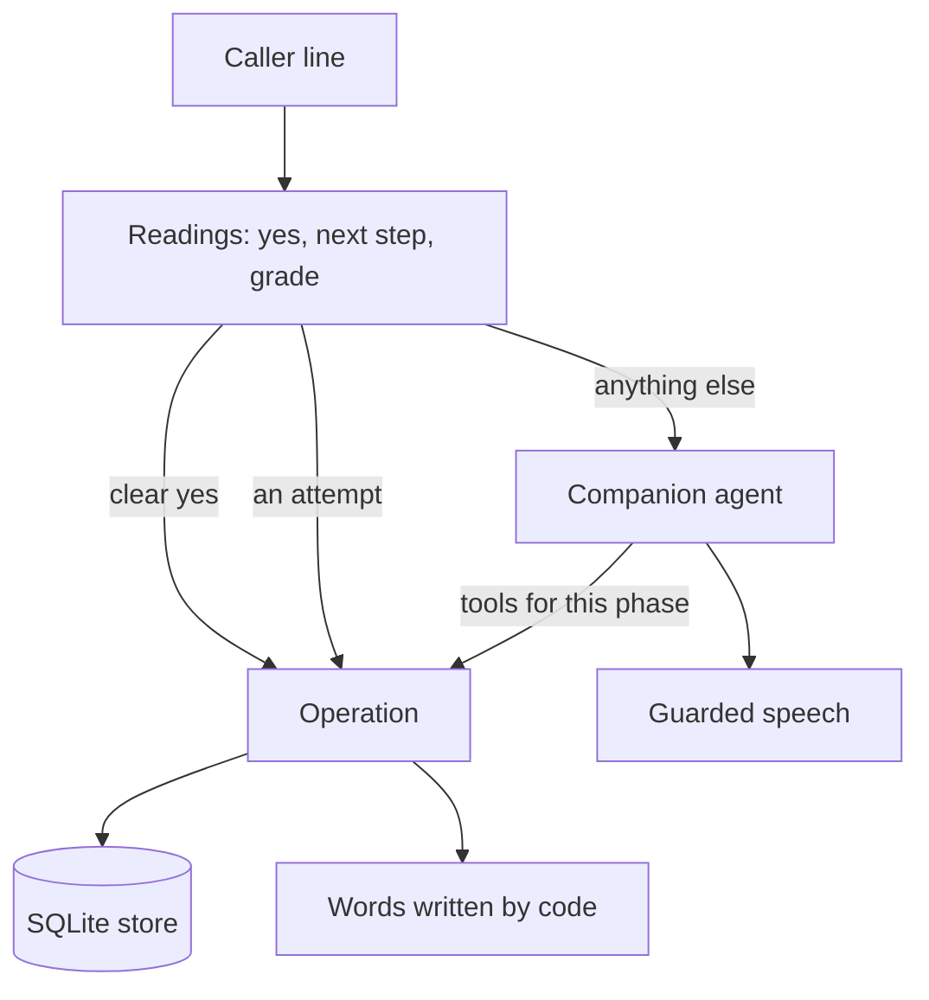

# Faro: a language-learning companion

Faro is a use case on core, built to show the harness is not only for short
bookings. One bilingual voice companion helps adults practise English or
Spanish. It knows learners by phone number, signs up new ones, runs a short
placement, agrees a plan, teaches lessons, and carries on where the learner
stopped, even after the application restarts.

```bash
CALLER_ID=+34600555666 uv run bot.py -t webrtc --host localhost --port 7861
```

Profiles, assessments, agreed plans, session summaries and exercise checkpoints
are persisted in a local SQLite database. Reconnect using the same phone number
and database path to continue, including after restarting the application.
Onboarding can also resume. Normal startup never resets existing progress.
A crash may replay the last prompt, but must not discard acknowledged answers.
This is a local benchmark demo with phone matching, not production authentication.
LLM and speech services still use their configured remote providers.

| | |
|---|---|
| `CALLER_ID` | the number the call arrives with. Faro reads it back and asks the caller to confirm it before it looks anything up |
| `LEARNING_DB_PATH` | the database file. Default `data/language_companion.sqlite3`, inside this folder, which Git ignores |
| `SLNG_STT_LANGUAGE`, `SLNG_TTS_LANGUAGE` | speech languages. Faro's defaults: recognition `es` (the answers), voice `en` (Faro speaks the learner's language) |

The database starts with three synthetic learners. Their numbers are
test-format Spanish numbers, not numbers to call.

| Learner | Phone | Learning | Where they are |
|---|---|---|---|
| Lucía | `+34600111222` | English A2 for travel, explained in Spanish | lesson 2 (ordering at a café), exercise 2 waiting |
| Diego | `+34600333444` | English B1 for work, explained in Spanish | lesson 3 (describing a project) ready; past tense on review |
| Emma | `+34600555666` | Spanish A1 for daily life, explained in English | lesson 2 (shopping), exercise 1 waiting |

`+34600777888` is unknown, for sign-up.

```bash
uv run python -m faro fixture data/bench.sqlite3        # a new disposable DB: exactly the three seeds
uv run python -m faro backup data/language_companion.sqlite3 data/backup.sqlite3
uv run python -m faro bench data/bench-perf.sqlite3     # p50/p95 lookup and checkpoint
```

`fixture` refuses a path that exists. Nothing resets a database on startup:
to start over, point `LEARNING_DB_PATH` at a new fixture. `backup` uses
SQLite's backup API, so it is safe while the bot runs.

## Try a call

Start from a fresh fixture, so every try begins at the same place:

```bash
uv run python -m faro fixture data/try.sqlite3
LEARNING_DB_PATH=data/try.sqlite3 CALLER_ID=+34600555666 \
  uv run bot.py -t webrtc --host localhost --port 7861
```

Open http://localhost:7861 and click connect. Faro speaks first, in English.
The call is one Langfuse trace named `faro call`. `fixture` refuses a file
that exists, so delete `data/try.sqlite3` or pick a new name before the next
try.

Faro gives every instruction in your own language and you answer in the
language you learn. It records every attempt itself, right or wrong, and
tells you what to fix before the next exercise.

### Script 1: a returning learner

Emma, `CALLER_ID=+34600555666`: speaks English, learns Spanish.

| Faro says | You say |
|---|---|
| "…Can you confirm your number is +34 600 555 666?" | "Yes." |
| "Hi, Emma. You were practising shopping… Shall we carry on, or would you like a recap first?" | "Let's carry on." |
| "Shopping, first exercise. Answer in Spanish: Ask for a kilo of apples at the market." | "Un kilo de manzanas, por favor." |
| "…Answer in Spanish: Ask how much it costs." | "¿Cuánto cuesta?" |
| "…Answer in Spanish: Buy bread and milk and ask how much it is in total." | "Quiero pan y leche. ¿Cuánto es en total?" |
| "Lesson complete: shopping… Shall we go on, or stop here for today?" | "That's all for today, bye." |

Try a question in the middle ("How do I say apples?") or a wrong answer ("Un
kilo de manzana"): Faro corrects you with the right sentence, records the
try, and asks the same exercise again, briefly. It moves on only when you say
it right.

Then call again with the same command. Faro should say shopping is finished
and "talking about your routine" is next. That shows the progress survived
the call.

### Script 2: sign-up

The unknown number, `CALLER_ID=+34600777888`.

1. Say "Yes" to confirm the number.
2. Say "Yes" to create a profile.
3. Give a name: "Call me Nico".
4. Answer the onboarding questions: "Spanish", then "For travel", then "Ten minutes".
5. Answer the three placement tasks in Spanish. Faro describes each one in English.
6. Say "Yes" to the plan. Faro says it is active and offers the first lesson.

To test a refusal, say "French" when Faro asks which language you want to
learn. Or say "yes, but only five minutes" when it presents the plan: nothing
is activated, and Faro presents the revised plan. To be a Spanish speaker
learning English instead, say "¿Podemos hablar en español?" at any point.

### What to watch

- Speech recognition is hinted to Spanish (`es`), for your answers; in a live
  call it also transcribed English well. Faro's voice is English (`en`), so
  Spanish feedback is read with an English voice. Change either with
  `SLNG_STT_LANGUAGE` and `SLNG_TTS_LANGUAGE`.
- One voice call has been made so far (trace `34e4fe68`, before these
  fixes). The text runs in `../faro-tools/bench.py` are what has been measured.

## How Faro is built



1. Every turn starts with the readings, side by side. Three questions wait on a yes: the phone read-back, the sign-up offer and the plan proposal. "Carry on, or recap?" is a fixed choice. While an exercise or placement task waits, the grading reading judges the reply.
2. A clear yes runs its `Operation` with no agent request. "Maybe", "yes, but only five minutes", or a yes to a proposal the caller talked over, activates nothing.
3. An attempt at an exercise is recorded by code, right or wrong. Only a correct sentence moves on. A wrong or partly right one is corrected (what was wrong, then the right sentence) and the same exercise is asked again, briefly and without its name, until it is said right. A goodbye while an exercise waits ends the call instead of being corrected. The companion never grades, so an answer can no longer be praised and left unsaved.
4. Anything else goes to one companion agent: questions, "slower, please", hesitation, onboarding answers. The phases are application state, not steps. Each tool is offered only in its phases, and each operation checks the phase again.
5. Every write goes through the store and commits before the tool returns. A replayed answer finds its first record and counts once.
6. The step is guarded: a sentence that says "saved" or "guardado" on a turn with no save is held back before it reaches speech.

It is one flow folder, `faro/`, on `core` alone:

| File | What it holds |
|---|---|
| `flow.yaml` | one `agent` step on its own call type (`state.py:FaroCall`) |
| `curriculum.py` | the versioned placement bank, the lessons, the level rule, and every line code says |
| `store.py` | SQLite in WAL mode with `synchronous=FULL`, three tables, one worker thread |
| `state.py` | `FaroState` (refuses learner data before a confirmed phone) and `FaroCall` |
| `operations.py` | one `Operation` per write |
| `conversation.py` | the three read-backs, the spoken phone number, the goodbye |
| `steps/companion.py` | the model-facing tools and their phase gates |

What the harness needed, all generic:

- `core.locale` gained `SPANISH`. A call can now pick its fixed lines per call, not only per class (`CallContext.locale`).
- A greeting can be a question (`core.turn.greet`), so a caller ID read back in the greeting is answered like any other read-back.
- `bot.py` greets with a line written for the call, runs `close_call` when the line drops, and sets Faro's own speech languages.
- `../concierge-tools/ledger.py` counts Faro's writes and checks its two consent writes against their questions.

## How Faro is checked

- `tests/test_faro.py`: the acceptance cases L01 to L16 offline, on a real SQLite file, with scripted models. One case kills a process right after an acknowledged save and checks the next process.
- `../faro-tools/bench.py`: the same cases as live scripted text calls on the real model. Each call runs in its own process and is one Langfuse session. Billable.

```bash
uv run python -m tests                                            # offline, from this folder
cd ../faro-tools && uv run bench.py                              # live, billable
cd ../concierge-tools && uv run ledger.py faro session:faro-L03-ES-... session:...
```

Results of 24 September 2026, gemini-3.5-flash-lite, one pass per case:

| What | Result |
|---|---|
| Offline acceptance cases (`tests/test_faro.py`) | 21 checks, all pass |
| Live cases (`faro-tools/bench.py`) | 23 of 23 pass, 29 calls, 160 caller turns. No line said three times in a row |
| Consent writes (ledger write audit) | 36 of 36 answered a matching question put on an earlier turn |
| Model requests | 1.76 per caller turn. 132 of 160 turns needed only one classifier request and no agent |
| Engine time, text in to first speech out | p50 0.92 s, p90 1.59 s, max 2.61 s. No STT or TTS: this is not voice latency |
| Store, 10,000 learners, 1,000 operations (Apple M5 Pro) | lookup p95 0.45 ms, checkpoint p95 0.72 ms |

L13 (replay, failed write, stale checkpoint) and L16 (fixture versus restart)
are checked offline only: a live model cannot trigger them. L11 (barge-in) is
simulated by marking the proposal as cut off, because text calls have no
audio. One pass per case finds failures; it is not a pass rate.

### What the first voice call and the runs found

A voice call (trace `34e4fe68`) and the live runs found these, now fixed:

1. The model chose when to record an answer. It praised a right answer and saved nothing, so the same exercise came back. Now the grading reading records every attempt and the model only coaches.
2. Instructions were in the language being learnt. Now every instruction is in the learner's own language, and they answer in the target language.
3. A retry repeated the whole exercise introduction. Now a retry is short: feedback, then "Try again, in Spanish: …".
4. Onboarding questions were asked twice: once by code, once by the model. Now the onboarding reading saves answers and code alone asks.
5. After a talked-over plan, the model re-read it in its own words, so the next "yes" counted for nothing. Now code repeats it word for word.
6. The model added +34 to a number the caller said without it. Now a number is read back only if the caller said the country code.
7. Asking to switch language used up the turn and the waiting question expired. Now the question is asked again in the new language.

## Faro's known limits

- The SQLite bundled with the project's Python is 3.50.4. SQLite documents a WAL-reset bug before 3.51.3 with concurrent connections. Faro keeps all database work on one thread, so it never opens two connections at once.
- Voice is wired but not tested live: one STT and one TTS language per call, Spanish by default. Mixed English and Spanish audio is not verified.
- Classifier instructions are English. Spanish replies are checked only by the live runs.
- The level rule is a mean over the placement results. It proposes a starting difficulty and is no CEFR claim. Answers are graded by the model, with no separate accuracy check and no pronunciation scoring.
- One active call per learner, in one process.

