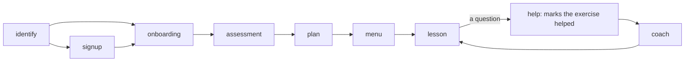

# Faro: a language-learning companion

Faro is a use case on core, built to show the harness is not only for short
bookings. One bilingual voice companion helps adults practise English or
Spanish. It knows learners by phone number, signs up new ones, runs a short
placement, agrees a plan, teaches lessons, and carries on where the learner
stopped, even after the application restarts.

```bash
CALLER_ID=+34600555666 uv run bot.py -t webrtc --host localhost --port 7861
```

Profiles, assessments, agreed plans, session summaries and exercise checkpoints
are persisted in a local SQLite database. Reconnect using the same phone number
and database path to continue, including after restarting the application.
Onboarding can also resume. Normal startup never resets existing progress.
A crash may replay the last prompt, but must not discard acknowledged answers.
This is a local benchmark demo with phone matching, not production authentication.
LLM and speech services still use their configured remote providers.

| | |
|---|---|
| `CALLER_ID` | the number the call arrives with. Faro reads it back and asks the caller to confirm it before it looks anything up |
| `LEARNING_DB_PATH` | the database file. Default `data/language_companion.sqlite3`, inside this folder, which Git ignores |
| `SLNG_STT_LANGUAGE`, `SLNG_TTS_LANGUAGE` | speech languages. Faro's defaults: recognition `es` (the answers), voice `en` (Faro speaks the learner's language) |

The database starts with three synthetic learners. Their numbers are
test-format Spanish numbers, not numbers to call.

| Learner | Phone | Learning | Where they are |
|---|---|---|---|
| Lucía | `+34600111222` | English A2 for travel, explained in Spanish | lesson 2 (ordering at a café), exercise 2 waiting |
| Diego | `+34600333444` | English B1 for work, explained in Spanish | lesson 3 (describing a project) ready; past tense on review |
| Emma | `+34600555666` | Spanish A1 for daily life, explained in English | lesson 2 (shopping), exercise 1 waiting |

`+34600777888` is unknown, for sign-up.

```bash
uv run python -m faro fixture data/bench.sqlite3        # a new disposable DB: exactly the three seeds
uv run python -m faro backup data/language_companion.sqlite3 data/backup.sqlite3
uv run python -m faro bench data/bench-perf.sqlite3     # p50/p95 lookup and checkpoint
```

`fixture` refuses a path that exists. Nothing resets a database on startup:
to start over, point `LEARNING_DB_PATH` at a new fixture. `backup` uses
SQLite's backup API, so it is safe while the bot runs.

## Try a call

Start from a fresh fixture, so every try begins at the same place:

```bash
uv run python -m faro fixture data/try.sqlite3
LEARNING_DB_PATH=data/try.sqlite3 CALLER_ID=+34600555666 \
  uv run bot.py -t webrtc --host localhost --port 7861
```

Open http://localhost:7861 and click connect. Faro speaks first, in English.
The call is one Langfuse trace named `faro call`. `fixture` refuses a file
that exists, so delete `data/try.sqlite3` or pick a new name before the next
try.

Faro gives every instruction in your own language and you answer in the
language you learn. It records every attempt, right or wrong, and tells you
what to fix before the next exercise.

### Script 1: a returning learner

Emma, `CALLER_ID=+34600555666`: speaks English, learns Spanish.

| Faro says | You say |
|---|---|
| "…Let me check: is your number +34 600 555 666?" | "Yes." |
| "Hi, Emma. You were practising shopping… Shall we carry on, or would you like a recap first?" | "Let's carry on." |
| "Shopping, first exercise. Answer in Spanish: Ask for a kilo of apples at the market." | "Un kilo de manzanas, por favor." |
| "…Answer in Spanish: Ask how much it costs." | "¿Cuánto cuesta?" |
| "…Answer in Spanish: Buy bread and milk and ask how much it is in total." | "Quiero pan y leche. ¿Cuánto es en total?" |
| "Lesson complete: shopping… Shall we go on, or stop here for today?" | "That's all for today, bye." |

Try a wrong answer ("Un kilo de manzana"): Faro corrects you with the right
sentence, records the try, and asks the same exercise again, briefly. It
moves on only when you say it right. Try a question in the middle ("How do I
say apples?"): the coach answers, and your next right answer to that
exercise is recorded as done with help.

Then call again with the same command. Faro should say shopping is finished
and "talking about your routine" is next. That shows the progress survived
the call.

### Script 2: sign-up

The unknown number, `CALLER_ID=+34600777888`.

1. Say "Yes" to confirm the number.
2. Say "Yes" to create a profile.
3. Give a name: "Call me Nico".
4. Answer the onboarding questions: "Spanish", then "For travel", then "Ten minutes".
5. Answer the three placement tasks in Spanish. Faro describes each one in English.
6. Say "Yes" to the plan. Faro says it is active and offers the first lesson.

To test a refusal, say "French" when Faro asks which language you want to
learn. Or say "yes, but only five minutes" when it presents the plan: nothing
is activated, and Faro presents the revised plan. To be a Spanish speaker
learning English instead, say "¿Podemos hablar en español?" at any point.

### What to watch

- Speech recognition is hinted to Spanish (`es`), for your answers; in a live
  call it also transcribed English well. Faro's voice is English (`en`), so
  Spanish feedback is read with an English voice. Change either with
  `SLNG_STT_LANGUAGE` and `SLNG_TTS_LANGUAGE`.
- One voice call has been made so far (trace `34e4fe68`), on the legacy
  build, before these fixes. The public-path build has had no live call yet.
- Open the page core serves (`/voice/`): a client that reports no playback is
  told so before the greeting, and the call ends.

## How Faro is built

Faro is a flow folder on core's public contract: a manifest, a Pydantic state
model, typed functions and one prompt per step. No classifier or reading runs
before a step's agent; each step's own agent reads the learner's reply.



1. `identify` reads the caller ID back in the greeting. A yes runs `confirm_phone`, which looks up the number and opens the session. Its receipt names the step the learner goes to (`route: next`): the store's checkpoint decides, not a model.
2. `signup` reads the sign-up offer back. A yes records consent for this call only; the name the caller gives is saved by code (`carries_out`) into a new profile.
3. `onboarding` records the language, goal and length. Code saves each answer and asks the next question. A language other than English or Spanish is refused by the state's type.
4. `assessment` and `lesson` are examiners: `speech: rendered`, so they say nothing themselves. The agent grades an attempt in fields (`answer`, `grade`, `feedback`), and code records it straight away with `record_attempt`. The answer must be the learner's own words (`quoted`).
5. A question, a hint request or a hesitation goes to `help`, a code step that marks the exercise helped in the store, then to `coach`, the only step that may explain. Any later correct answer to a helped exercise, in the coach or back in the lesson, is recorded as assisted, never independent. A right answer after a miss in the same session is assisted too.
6. `plan` reads the exact proposal back. "Yes, but only five minutes" is recorded, and code reads the changed proposal back; only a yes to that activates it. Keeping an old plan after a reassessment is recorded and carried out by code.
7. `menu` carries on, recaps (code's words from the plan) or starts a reassessment, and keeps what the learner says about themselves.

What a step says is code's where it matters: read-backs, receipts, exercises,
feedback the examiner wrote, and the goodbye. Prose steps are `guarded`: a
sentence that says "saved" or "guardado" with no standing change is held back.
The call's fixed lines follow the learner's language (`language:` and
`locales:` in the manifest).

| File | What it holds |
|---|---|
| `agent.yaml` | the manifest: state, operations, the nine steps and their moves |
| `state.py` | `FaroState`, plain data. It refuses learner facts before a confirmed phone, and a new number whose +34 the caller did not say |
| `functions.py` | the typed functions each operation runs, their receipts, and the services object (`Faro`) |
| `prompts/` | the shared voice (`_voice.md`) and one prompt per step |
| `curriculum.py` | the versioned placement bank, the lessons, the level rule, and every line code says |
| `models.py` | the store's records, and the phone and language types |
| `store.py` | SQLite in WAL mode with `synchronous=FULL`, three tables, one worker thread |

What Faro needed from core, all generic and proven on the support desk
(`core/tests/test_flow_rules.py`): a locale per call from a state field,
receipts that move the caller (`route:`), operations carried out by code after
`collect` (`carries_out:`), a greeting that carries the entry step's read-back,
validators that read what the caller said this turn, and a waiting read-back
put again in a new language.

## How Faro is checked

- `tests/test_faro.py`: the acceptance cases L01 to L16 and the public-path checks F1 to F9, offline, on a real SQLite file, with scripted step agents. One case kills a process right after an acknowledged save and checks the next process. One checks, in a fresh process, that no retired reader module is imported.
- `tests/test_bot.py`: `bot.py` offline over Pipecat's SmallWebRTC transport: core's page is served, a page that reports playback is greeted with the caller ID read back, and one that reports nothing hears the refusal first and the call ends.
- `../faro-tools/bench.py`: the same cases as live scripted text calls on the real model. Each call runs in its own process and is one Langfuse session. Billable.

```bash
uv run python -m tests                                            # offline, from this folder
cd ../faro-tools && uv run bench.py                              # live, billable
cd ../concierge-tools && uv run ledger.py faro session:faro-L03-ES-... session:...
```

The live results below are the legacy build's (24 September 2026, gemini-3.5-flash-lite, one pass per case).
The public-path build of session 5 has not been run live yet: its grading, onboarding and phase choices
are the step agents' own, and only a live run can say how well they read learners.

| What | Result (legacy build) |
|---|---|
| Offline acceptance cases | 21 checks, all pass |
| Live cases (`faro-tools/bench.py`) | 23 of 23 pass, 29 calls, 160 caller turns. No line said three times in a row |
| Consent writes (ledger write audit) | 36 of 36 answered a matching question put on an earlier turn |
| Model requests | 1.76 per caller turn. 132 of 160 turns needed only one classifier request and no agent |
| Engine time, text in to first speech out | p50 0.92 s, p90 1.59 s, max 2.61 s. No STT or TTS: this is not voice latency |
| Store, 10,000 learners, 1,000 operations (Apple M5 Pro) | lookup p95 0.45 ms, checkpoint p95 0.72 ms |

L13 (replay, failed write, stale checkpoint) and L16 (fixture versus restart)
are checked offline only: a live model cannot trigger them. L11 (barge-in) is
simulated by marking the proposal as cut off, because text calls have no
audio. One pass per case finds failures; it is not a pass rate.

### What the first voice call and the runs found

A voice call (trace `34e4fe68`) and the live runs found these. Each fix is kept in the public build:

1. The model chose when to record an answer. It praised a right answer and saved nothing. Now an attempt the examiner grades is recorded by code in the same reply, and the examiner cannot speak.
2. Instructions were in the language being learnt. Now every instruction is in the learner's own language, and they answer in the target language.
3. A retry repeated the whole exercise introduction. Now a retry is short: feedback, then "Try again, in Spanish: …".
4. Onboarding questions were asked twice. Now code asks each one, after the answer is saved.
5. After a talked-over plan, the model re-read it in its own words, so the next "yes" counted for nothing. Now a yes to a copy the learner did not hear in full gets the proposal put again, word for word, by code.
6. The model added +34 to a number the caller said without it. Now a new number is refused unless the caller said the country code this turn.
7. Asking to switch language used up the turn and the waiting question expired. Now the question is put again in the new language, and stays answerable.

## Faro's known limits

- The SQLite bundled with the project's Python is 3.50.4. SQLite documents a WAL-reset bug before 3.51.3 with concurrent connections. Faro keeps all database work on one thread, so it never opens two connections at once.
- Voice is wired but not tested live: one STT and one TTS language per call, Spanish by default. Mixed English and Spanish audio is not verified. A browser client or phone line that reports no playback is refused before the greeting.
- Grades, feedback and onboarding answers are the step agents' readings, checked for shape and for being the learner's own words, not for accuracy. The feedback is model text, said by code on a rendered step. Pronunciation is never scored.
- The level rule is a mean over the placement results. It proposes a starting difficulty and is no CEFR claim.
- One active call per learner, in one process. A lost reply to a write is reconciled on the next turn; only `record_attempt` can be sent again safely, so another write whose reply was lost stays unsettled for the rest of the call.
- The goodbye is a fixed line per language. The session summary is written to the plan when the call closes, not said.
